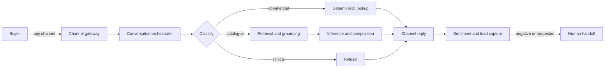
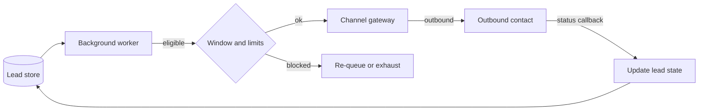
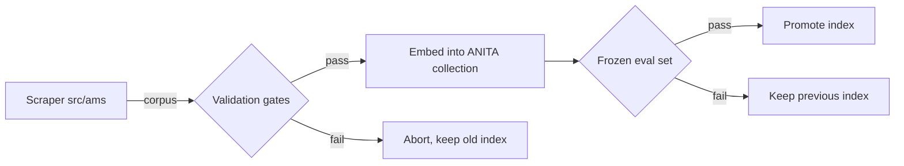
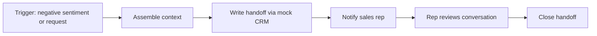

> **Lens:** BA · **Decided by:** BA · **Inputs:** `00-product-intent.md`, `01-brd.md` · **Engagement:** Brownfield · **Defines:** UC-01 … UC-14, WF-01 … WF-04

# Use Cases & Workflows — ANITA MEDICAL SYSTEMS Product Marketing & Support Assistant

## 1. Actors

| Actor | Role | Goals |
|---|---|---|
| **Buyer** | External human; any channel | Get an accurate answer about a catalogue product and, if interested, reach a human |
| **Outbound contact** | External human; a captured lead being called or messaged | Understand why they are being contacted; opt out if unwanted |
| **Sales rep** | Internal human | Receive a qualified, contextualised lead and follow it up |
| **Ops admin** | Internal human | Keep channels, models and instances healthy; audit what buyers asked |
| **Twilio gateway** | System actor | Deliver inbound calls/messages and outbound TwiML; fetch webhooks |
| **Messaging provider** | System actor | Deliver additional-channel messages (per `DG-07`) |
| **Background worker** | System actor | Drain outbound queue, push sentiment, refresh corpus |

**Persona resolution:** Priya (procurement), Dr. Rao (radiographer) and Meera (service engineer) each resolve to the **Buyer** actor — they differ in intent and vocabulary, not in system role, which is what the actor table records. Arun → **Sales rep**. Ops/admin → **Ops admin**. Every persona in `00-product-intent.md` §3 therefore resolves to an actor.

**Completeness note (actor interrogation, method A):** interrogation ran per actor. *Sales rep* produced UC-07 and UC-09 (receives handoff, receives outbound results) but no direct system use case beyond receiving — reps do not operate the assistant, so no further UC was generated, and that is deliberate. *Twilio gateway* and *Messaging provider* produced no use cases of their own: they are pure transports and appear only as participants in WF-01/WF-02. *Background worker* produced WF-02 and WF-03.

## 2. Use Cases

### UC-01 — Ask a catalogue question via web chat
- **Actor(s):** Buyer
- **Trigger:** Buyer opens the chat surface and submits a question.
- **Preconditions:** The instance is running; the corpus is indexed; a chat session exists.
- **Postconditions — success:** Buyer receives a grounded answer, and the turn is recorded against a conversation with its sentiment.
- **Postconditions — failure:** Buyer receives an honest "I can't answer that" plus a human handoff offer; no partial record is left.
- **Main flow:**
  1. Buyer submits a free-text question.
  2. System identifies the session and loads prior context (`BRD-02`).
  3. System classifies the question as catalogue-factual, commercial, clinical, or off-topic.
  4. For catalogue-factual, system retrieves grounded context and composes an answer.
  5. Answer is returned with its grounding; the turn is persisted with a sentiment score.
- **Alternate flows:**
  - **A1.** Question is commercial (price/MOQ/delivery) → answered deterministically from structured storage (`BRD-05`) with the caveat (`BRD-06`).
  - **A2.** Question names a product that matches two catalogue entries → system asks which one (`BRD-09`).
- **Exception flows:**
  - **E1.** Retrieval returns nothing above threshold → system declines and offers handoff (`BRD-04`, R-2).
  - **E2.** Answer engine unavailable → system returns a channel-appropriate apology and a callback offer; the turn is logged as failed.
- **Business rules:** `BRD-01`, `BRD-04`, `BRD-05`, `BRD-06`, `BRD-09`, R-1, R-2, R-3.
- **Related workflows:** `WF-01`.

- **Scenario Coverage** — all 14 rows marked; `—` only with a one-line reason.

| Scenario | Covered |
|---|---|
| Happy path | ✓ main flow |
| Alternate path | ✓ A1, A2 |
| Invalid input | ✓ empty/oversized message rejected with a re-prompt |
| Unauthorized user | ✓ no auth by design; rate-limited per session (`DG-06`) |
| Missing data | ✓ question names a product absent from the catalogue → decline + handoff |
| Partial data | ✓ product exists but has no specification block on the source site → say so (`BRD-07`) |
| Duplicate request | ✓ identical question twice → answered twice; no duplicate lead row |
| Timeout | ✓ retrieval/LLM exceeds budget → decline path E1 |
| Dependency failure | ✓ vector store down → E2 |
| Retry | ✓ transient LLM failure retried once, then E2 |
| Concurrent operation | ✓ same session in two tabs → turns serialised per conversation |
| Cancellation | ✓ Buyer closes the tab mid-answer → turn recorded incomplete, no lead created |
| Recovery | ✓ after E2 the Buyer can re-ask; context preserved |
| Partial completion | ✓ answer streamed then connection lost → full answer persisted for resume |

### UC-02 — Ask a catalogue question via WhatsApp
- **Actor(s):** Buyer, Twilio gateway
- **Trigger:** Inbound WhatsApp message to the ANITA sender number.
- **Preconditions:** The WhatsApp sender is registered on the ANITA Twilio number (`BRD-03`); the sender's number is known.
- **Postconditions — success:** Buyer receives a WhatsApp reply; the conversation is grouped under the sender's identity and scored.
- **Postconditions — failure:** Buyer receives a fallback message; the inbound is logged for ops; no silent drop.
- **Main flow:**
  1. Twilio posts the inbound message.
  2. System resolves the sender to a conversation using the idle window (`BRD-02`).
  3. Message type is classified: text, media, or voice note.
  4. Text is answered via the shared engine (UC-01 steps 3–5) and replied as a message.
- **Alternate flows:**
  - **A1.** Media (image/PDF) → accepted, stored against the lead, acknowledged.
  - **A2.** Voice note → politely declined with a text prompt (source platform does not transcribe WhatsApp audio).
- **Exception flows:**
  - **E1.** Sender unknown and idle window expired → new conversation, prior lead matched by phone number.
  - **E2.** Twilio delivery fails → outbound attempt recorded in the outbox for retry (`BRD-14`).
- **Business rules:** `BRD-01`, `BRD-02`, `BRD-04`, `BRD-11`, R-2.
- **Related workflows:** `WF-01`.

- **Scenario Coverage** — all 14 rows marked; `—` only with a one-line reason.

| Scenario | Covered |
|---|---|
| Happy path | ✓ |
| Alternate path | ✓ A1, A2 |
| Invalid input | ✓ unsupported media type → explained, not ignored |
| Unauthorized user | ✓ anyone who knows the number may message; abuse rate-limited (`DG-06`) |
| Missing data | ✓ sender number absent → conversation keyed on channel handle |
| Partial data | ✓ media arrives without caption → asked for context |
| Duplicate request | ✓ WhatsApp redelivery of the same MessageSid → deduplicated by provider id |
| Timeout | ✓ engine slow → holding reply then answer |
| Dependency failure | ✓ Twilio API down → outbox retry, no crash |
| Retry | ✓ outbound send retried with backoff |
| Concurrent operation | ✓ two messages in flight → processed in arrival order per conversation |
| Cancellation | ✓ Buyer blocks the number → future sends fail and are marked undeliverable |
| Recovery | ✓ after failure the next inbound message resumes normally |
| Partial completion | ✓ media stored but reply failed → reply queued |

### UC-03 — Inbound voice call
- **Actor(s):** Buyer, Twilio gateway
- **Trigger:** PSTN call to the ANITA number (`BRD-03`).
- **Preconditions:** Number provisioned and webhook pointed at this instance; GPU has capacity for one more call.
- **Postconditions — success:** Call answered by voice, question answered, transcript recorded, lead created or updated.
- **Postconditions — failure:** Caller hears a clear apology and, where possible, is offered a callback; the call is recorded as failed with a reason.
- **Main flow:**
  1. Twilio fetches TwiML; system checks admission capacity.
  2. Media stream opens; system greets the caller.
  3. Caller speaks; audio is transcribed as end-of-speech is detected.
  4. Transcript is answered via the shared engine.
  5. Synthesised speech is streamed back; the turn repeats until the caller ends the call.
  6. On disconnect, the conversation is summarised, scored and attached to a lead.
- **Alternate flows:**
  - **A1.** Caller interrupts the agent mid-answer → agent yields (barge-in).
  - **A2.** Caller asks for a human → escalation (UC-07).
- **Exception flows:**
  - **E1.** Capacity full → caller hears a busy message and is offered a callback (`BRD-13`).
  - **E2.** Speech not recognised after N attempts → agent offers a transfer/callback.
  - **E3.** Media stream drops abnormally → call torn down cleanly, no "lost connection" artefact.
- **Business rules:** `BRD-01`, `BRD-04`, `BRD-13`, R-2.
- **Related workflows:** `WF-01`.

- **Scenario Coverage** — all 14 rows marked; `—` only with a one-line reason.

| Scenario | Covered |
|---|---|
| Happy path | ✓ |
| Alternate path | ✓ A1, A2 |
| Invalid input | ✓ silence/gibberish → re-prompt then E2 |
| Unauthorized user | ✓ public number; abuse limited by admission control |
| Missing data | ✓ caller's number withheld → conversation keyed on stream id, lead created without phone |
| Partial data | ✓ name captured but no email → lead saved partially, follow-up flagged |
| Duplicate request | ✓ same question twice → answered twice; one lead |
| Timeout | ✓ end-of-speech never detected → call capped and closed gracefully |
| Dependency failure | ✓ LLM down → spoken apology + callback offer |
| Retry | ✓ failed TTS segment retried once |
| Concurrent operation | ✓ second call arrives → admission decides admit or busy (E1) |
| Cancellation | ✓ caller hangs up mid-answer → teardown, partial transcript kept |
| Recovery | ✓ caller calls back → matched to prior lead by number |
| Partial completion | ✓ call dropped after answer, before summary → summary job re-runs from transcript |

### UC-04 — Browser-mic voice question
- **Actor(s):** Buyer
- **Trigger:** Buyer presses the mic control on the website.
- **Preconditions:** Browser has mic permission; WebSocket endpoint reachable.
- **Postconditions — success:** Buyer hears the answer in the browser; turn recorded.
- **Postconditions — failure:** Buyer is told voice is unavailable and offered text chat.
- **Main flow:** 1. Mic opens. 2. Audio streams over WebSocket. 3. Transcribed as in UC-03. 4. Answered. 5. Speech returned to the browser. 6. Session closes on stop.
- **Alternate flows:**
  - **A1.** Buyer switches to typing mid-session → continues in text on the same conversation.
- **Exception flows:**
  - **E1.** Mic permission denied → text fallback offered.
  - **E2.** WebSocket drops → session ends; transcript retained.
- **Business rules:** `BRD-01`, `BRD-04`, `BRD-19`.
- **Related workflows:** `WF-01`.

- **Scenario Coverage** — all 14 rows marked; `—` only with a one-line reason.

| Scenario | Covered |
|---|---|
| Happy path | ✓ |
| Alternate path | ✓ A1 |
| Invalid input | ✓ no mic device → E1 |
| Unauthorized user | ✓ public endpoint; per-session rate limit |
| Missing data | ✓ no user identity → anonymous conversation, no lead |
| Partial data | ✓ partial enrolment captured |
| Duplicate request | ✓ duplicate start frames ignored |
| Timeout | ✓ idle socket closed after inactivity |
| Dependency failure | ✓ STT unavailable → text fallback |
| Retry | ✓ reconnect resumes a new session |
| Concurrent operation | ✓ two tabs → independent sessions |
| Cancellation | ✓ buyer stops mic → session closed, no partial lead |
| Recovery | ✓ reload page → new session, prior conversation retrievable by cookie/session |
| Partial completion | ✓ audio sent, answer not played → answer persisted in transcript |

### UC-05 — Get a price, MOQ or delivery answer
- **Actor(s):** Buyer
- **Trigger:** A commercial question in any channel.
- **Preconditions:** Corpus loaded; product resolved to a single catalogue id.
- **Postconditions — success:** Buyer receives the exact catalogue figure with the mandatory caveat.
- **Postconditions — failure:** Buyer is told the figure is unavailable and offered a human quotation.
- **Main flow:**
  1. Question is classified commercial.
  2. Product is resolved (disambiguating if needed — `BRD-09`).
  3. Figure is read from structured storage (`BRD-05`).
  4. Answer is composed with the caveat (`BRD-06`, R-1).
- **Alternate flows:**
  - **A1.** Buyer asks for a quantity-based price → system explains that pricing is quotation-based and captures the requirement for a human.
- **Exception flows:**
  - **E1.** Product unresolved → asked to choose.
  - **E2.** Figure missing for that product → decline + handoff.
- **Business rules:** `BRD-05`, `BRD-06`, `BRD-09`, R-1, R-3.
- **Related workflows:** `WF-01`.

- **Scenario Coverage** — all 14 rows marked; `—` only with a one-line reason.

| Scenario | Covered |
|---|---|
| Happy path | ✓ |
| Alternate path | ✓ A1 |
| Invalid input | ✓ "what's the price of the thing?" → product clarification |
| Unauthorized user | ✓ public; no price is user-specific |
| Missing data | ✓ product has no price in corpus → E2 |
| Partial data | ✓ price present, unit missing → unit omitted, not guessed |
| Duplicate request | ✓ idempotent read |
| Timeout | ✓ single indexed query; no timeout path in practice, but bounded |
| Dependency failure | ✓ DB unavailable → E2 |
| Retry | ✓ read retried once |
| Concurrent operation | ✓ read-only, safe |
| Cancellation | ✓ n/a mid-read; answer discarded if buyer leaves |
| Recovery | ✓ re-ask returns the same figure |
| Partial completion | ✓ caveat can never be partially emitted — answer is atomic |

### UC-06 — Compare two products
- **Actor(s):** Buyer
- **Trigger:** A question naming two catalogue products.
- **Preconditions:** Both products resolve to single catalogue ids.
- **Postconditions — success:** Buyer receives a side-by-side of the specifications that both products actually publish.
- **Postconditions — failure:** Buyer is told comparison is not possible for the requested pair and offered a human.
- **Main flow:** 1. Both products resolved. 2. Specification sets fetched from structured storage. 3. Intersection of spec names computed. 4. Differences presented, missing specs marked as not published.
- **Alternate flows:**
  - **A1.** Products are in different categories → comparison still offered on shared attributes only.
- **Exception flows:**
  - **E1.** One product ambiguous → disambiguation first (UC-01 A2).
  - **E2.** No shared specification names → explain and offer handoff.
- **Business rules:** `BRD-05`, `BRD-07`, `BRD-09`.
- **Related workflows:** `WF-01`.

- **Scenario Coverage** — all 14 rows marked; `—` only with a one-line reason.

| Scenario | Covered |
|---|---|
| Happy path | ✓ |
| Alternate path | ✓ A1 |
| Invalid input | ✓ three products named → ask which two |
| Unauthorized user | ✓ public |
| Missing data | ✓ spec absent for one product → marked "not published", never inferred |
| Partial data | ✓ ✓ (three of five specs shared) |
| Duplicate request | ✓ idempotent |
| Timeout | ✓ bounded queries |
| Dependency failure | ✓ DB down → E2 |
| Retry | ✓ retried once |
| Concurrent operation | ✓ read-only |
| Cancellation | ✓ answer discarded |
| Recovery | ✓ re-ask |
| Partial completion | ✓ never emits a half-comparison; either both sides or a decline |

### UC-07 — Request a human
- **Actor(s):** Buyer, Sales rep
- **Trigger:** Buyer asks for a person, or the system escalates (UC-10).
- **Preconditions:** A conversation exists with at least a channel identity.
- **Postconditions — success:** A handoff record exists carrying context, products discussed, sentiment and reason; the Buyer is told when to expect contact.
- **Postconditions — failure:** Buyer is given the direct phone number as a fallback; the failed handoff is logged.
- **Main flow:** 1. Intent detected. 2. Context assembled (transcript, products, sentiment, contact details). 3. Handoff record written. 4. Buyer informed of next step.
- **Alternate flows:**
  - **A1.** Buyer supplies contact details during handoff → lead created/updated first (UC-08).
- **Exception flows:**
  - **E1.** No way to reach the buyer (no phone/email) → system asks for one before completing.
  - **E2.** Mock CRM write fails → handoff still acknowledged and queued for retry (`BRD-14`).
- **Business rules:** `BRD-13`, `BRD-11`, R-5.
- **Related workflows:** `WF-04`.

- **Scenario Coverage** — all 14 rows marked; `—` only with a one-line reason.

| Scenario | Covered |
|---|---|
| Happy path | ✓ |
| Alternate path | ✓ A1 |
| Invalid input | ✓ unattached "operator" request on a silent channel → clarified |
| Unauthorized user | ✓ public |
| Missing data | ✓ E1 |
| Partial data | ✓ name known, phone missing → handoff marked incomplete |
| Duplicate request | ✓ Buyer asks twice → one open handoff, not two |
| Timeout | ✓ handoff write times out → E2 |
| Dependency failure | ✓ CRM unavailable → outbox |
| Retry | ✓ outbox retries with backoff |
| Concurrent operation | ✓ two channels escalate same buyer → deduplicated by lead |
| Cancellation | ✓ Buyer withdraws request → handoff closed as withdrawn |
| Recovery | ✓ failed handoff replayed from outbox |
| Partial completion | ✓ record written, notification failed → notification retried |

### UC-08 — Provide contact details
- **Actor(s):** Buyer
- **Trigger:** Buyer volunteers a name, phone, email or requirement.
- **Preconditions:** A conversation exists.
- **Postconditions — success:** Lead created or updated with validated contact data; conversation linked.
- **Postconditions — failure:** Data is held on the conversation only; nothing is lost, the lead is marked incomplete.
- **Main flow:** 1. Details detected in the turn. 2. Validated (phone/email format). 3. Lead upserted on phone/email. 4. Conversation linked to the lead.
- **Alternate flows:**
  - **A1.** Buyer is an existing lead → record updated, not duplicated.
- **Exception flows:**
  - **E1.** Validation fails → system asks once more, then accepts unvalidated with a flag.
  - **E2.** Two leads share the phone → merged or flagged for the sales rep.
- **Business rules:** `BRD-11`, `BRD-12`.
- **Related workflows:** `WF-01`, `WF-02`.

- **Scenario Coverage** — all 14 rows marked; `—` only with a one-line reason.

| Scenario | Covered |
|---|---|
| Happy path | ✓ |
| Alternate path | ✓ A1 |
| Invalid input | ✓ malformed email → re-ask, then flag |
| Unauthorized user | ✓ public |
| Missing data | ✓ only a first name → stored, lead incomplete |
| Partial data | ✓ phone but no email → stored, follow-up flags the gap |
| Duplicate request | ✓ same details twice → single lead |
| Timeout | ✓ DB write timeout → retried, then held on conversation |
| Dependency failure | ✓ DB down → conversation-only, replayed later |
| Retry | ✓ outbox/retry on write |
| Concurrent operation | ✓ two channels submit details simultaneously → unique constraint on phone resolves |
| Cancellation | ✓ Buyer asks to be forgotten → PII erased, lead anonymised (`DG-11`) |
| Recovery | ✓ pending details replayed on next boot |
| Partial completion | ✓ lead created, conversation link failed → link repaired by job |

### UC-09 — Outbound follow-up
- **Actor(s):** Background worker, Outbound contact, Twilio gateway
- **Trigger:** A lead becomes eligible (requested callback, unanswered enquiry, campaign).
- **Preconditions:** Lead has a reachable number; attempts below maximum; inside the approved calling window.
- **Postconditions — success:** Call or message placed, outcome recorded against the lead, lead status advanced.
- **Postconditions — failure:** Attempt counted, lead re-queued or marked exhausted; never silently dropped.
- **Main flow:** 1. Worker picks eligible leads. 2. Attempt limit and window checked. 3. Outbound placed. 4. Outcome callback recorded. 5. Lead status updated.
- **Alternate flows:**
  - **A1.** Contact answers and converses → same engine as UC-03.
  - **A2.** Contact asks not to be called again → suppression recorded immediately.
- **Exception flows:**
  - **E1.** No answer → attempt counted, retried per schedule until exhausted (R-6).
  - **E2.** Carrier rejects the call → recorded with reason; lead flagged.
- **Business rules:** `BRD-23`, R-6.
- **Related workflows:** `WF-02`.

- **Scenario Coverage** — all 14 rows marked; `—` only with a one-line reason.

| Scenario | Covered |
|---|---|
| Happy path | ✓ |
| Alternate path | ✓ A1, A2 |
| Invalid input | ✓ lead with malformed number → excluded, flagged |
| Unauthorized user | ✓ suppression list honoured |
| Missing data | ✓ no number → not callable, surfaced to rep |
| Partial data | ✓ number present, name unknown → addressed generically |
| Duplicate request | ✓ same lead queued twice → deduplicated in queue |
| Timeout | ✓ call not answered within ring limit → E1 |
| Dependency failure | ✓ Twilio API down → queue retains rows |
| Retry | ✓ bounded retries (R-6) |
| Concurrent operation | ✓ two workers → row locking prevents double dial |
| Cancellation | ✓ campaign stopped → in-flight call allowed to finish, queue drained |
| Recovery | ✓ worker restart resumes queue |
| Partial completion | ✓ call placed, status callback lost → reconciled by polling |

### UC-10 — Negative sentiment detected
- **Actor(s):** Buyer, Sales rep, Background worker
- **Trigger:** A turn's sentiment score crosses the negative threshold.
- **Preconditions:** Sentiment scoring active; conversation has a lead or contactable identity.
- **Postconditions — success:** Conversation escalated to a human within the turn; Buyer told a person will follow up.
- **Postconditions — failure:** Escalation queued and retried; Buyer still told a human will follow up.
- **Main flow:** 1. Turn scored. 2. Threshold evaluated against the composite. 3. Escalation triggered. 4. Buyer informed. 5. Handoff record created with the sentiment evidence.
- **Alternate flows:**
  - **A1.** Score negative but buyer explicitly declines a human → recorded, no escalation.
- **Exception flows:**
  - **E1.** Scorer unavailable → rule-based fallback (keyword/lexicon) so escalation still works.
  - **E2.** Escalation delivery fails → retried; repeated failure raises an ops alert.
- **Business rules:** `BRD-15`, `BRD-16`, `BRD-17`, R-5.
- **Related workflows:** `WF-04`.

- **Scenario Coverage** — all 14 rows marked; `—` only with a one-line reason.

| Scenario | Covered |
|---|---|
| Happy path | ✓ |
| Alternate path | ✓ A1 |
| Invalid input | ✓ very short turn ("ok") → not scored, no false trigger |
| Unauthorized user | ✓ public |
| Missing data | ✓ no contactable identity → escalation still recorded for the rep |
| Partial data | ✓ score present, objections absent → escalate on score alone |
| Duplicate request | ✓ repeated negative turns → one open escalation, not one per turn |
| Timeout | ✓ scorer slow → fallback path E1 |
| Dependency failure | ✓ LLM down → rule-based fallback |
| Retry | ✓ escalation retried |
| Concurrent operation | ✓ two negative turns in flight → single escalation (idempotent) |
| Cancellation | ✓ Buyer resolves the issue → escalation closed |
| Recovery | ✓ scorer back online → next turns scored normally |
| Partial completion | ✓ escalation recorded, rep notification failed → retried |

### UC-11 — Ask a clinical or diagnostic question
- **Actor(s):** Buyer
- **Trigger:** A question seeking medical advice, diagnosis, or a clinical recommendation.
- **Preconditions:** None beyond a live conversation.
- **Postconditions — success:** Question declined with a clear boundary statement, logged, and the Buyer offered a product-oriented or human path.
- **Postconditions — failure:** Decline cannot fail; worst case the standard fallback message is used.
- **Main flow:** 1. Question classified clinical. 2. Refusal composed from the approved wording. 3. Logged for ops. 4. Product/human alternative offered.
- **Alternate flows:**
  - **A1.** Question is a mix (clinical phrasing, product intent) → answer the product part, decline the clinical part.
- **Exception flows:**
  - **E1.** Classification uncertain → treat as clinical (fail safe).
- **Business rules:** `BRD-10`, R-4.
- **Related workflows:** `WF-01`.

- **Scenario Coverage** — all 14 rows marked; `—` only with a one-line reason.

| Scenario | Covered |
|---|---|
| Happy path | ✓ |
| Alternate path | ✓ A1 |
| Invalid input | ✓ ambiguous question → E1 fail-safe refusal |
| Unauthorized user | ✓ public |
| Missing data | ✓ refusal wording not configured → built-in default used |
| Partial data | ✓ n/a — refusal is atomic |
| Duplicate request | ✓ repeated clinical questions → same refusal, logged once per turn |
| Timeout | ✓ classification timeout → refuse (fail safe) |
| Dependency failure | ✓ classifier down → refuse |
| Retry | ✓ n/a — refusal cannot partially apply |
| Concurrent operation | ✓ stateless |
| Cancellation | ✓ n/a |
| Recovery | ✓ n/a |
| Partial completion | ✓ impossible by construction |

### UC-12 — Operator monitors instance health
- **Actor(s):** Ops admin
- **Trigger:** Routine check or an alert.
- **Preconditions:** Admin surface reachable; instance running.
- **Postconditions — success:** Operator sees channel health, live conversations, error rates and model status for **this instance only**.
- **Postconditions — failure:** Operator is shown stale-but-labelled data, never silently wrong data.
- **Main flow:** 1. Operator opens the console. 2. Channels, queue depth, model residency and error counts are shown. 3. Operator drills into a failing channel.
- **Alternate flows:**
  - **A1.** Operator restarts a channel adapter from the console.
- **Exception flows:**
  - **E1.** Metrics backend down → console shows "unavailable", not zeros.
- **Business rules:** `BRD-18`, `BRD-21`.
- **Related workflows:** `WF-03`.

- **Scenario Coverage** — all 14 rows marked; `—` only with a one-line reason.

| Scenario | Covered |
|---|---|
| Happy path | ✓ |
| Alternate path | ✓ A1 |
| Invalid input | ✓ unknown channel id → clear error |
| Unauthorized user | ✓ admin console must be access-controlled (`DG-06`) |
| Missing data | ✓ no traces yet → empty state, not an error |
| Partial data | ✓ some channels reporting → per-channel status |
| Duplicate request | ✓ idempotent |
| Timeout | ✓ slow backend → E1 |
| Dependency failure | ✓ metrics store down → E1 |
| Retry | ✓ auto-refresh |
| Concurrent operation | ✓ two operators → read-only, safe |
| Cancellation | ✓ operator leaves → no state change |
| Recovery | ✓ backend back → live data resumes |
| Partial completion | ✓ drill-down interrupted → no mutation |

### UC-13 — Operator reviews a conversation
- **Actor(s):** Ops admin, Sales rep
- **Trigger:** A handoff, complaint, or quality concern.
- **Preconditions:** A conversation exists with a transcript.
- **Postconditions — success:** Reviewer sees the full transcript, the grounding used, the sentiment trail and the lead record — for this instance only.
- **Postconditions — failure:** Reviewer is told the transcript is unavailable; the gap is logged.
- **Main flow:** 1. Reviewer opens a conversation. 2. Transcript, products, sentiment history and handoffs are shown. 3. Reviewer may export or annotate.
- **Alternate flows:** **A1.** Reviewer drills from a sentiment alert straight into the triggering turn.
- **Exception flows:** **E1.** Transcript retention expired → shown as expired, not empty.
- **Business rules:** `BRD-21`, `BRD-13`, `BRD-18`.
- **Related workflows:** `WF-04`.

- **Scenario Coverage** — all 14 rows marked; `—` only with a one-line reason.

| Scenario | Covered |
|---|---|
| Happy path | ✓ |
| Alternate path | ✓ A1 |
| Invalid input | ✓ unknown conversation id → clear error |
| Unauthorized user | ✓ access-controlled (`DG-06`) |
| Missing data | ✓ transcript empty (voice call failed early) → shown as such |
| Partial data | ✓ sentiment missing for early turns → partial trail |
| Duplicate request | ✓ idempotent read |
| Timeout | ✓ large transcript → paged |
| Dependency failure | ✓ DB down → E1 |
| Retry | ✓ manual refresh |
| Concurrent operation | ✓ two reviewers → read-only |
| Cancellation | ✓ n/a |
| Recovery | ✓ n/a |
| Partial completion | ✓ export interrupted → partial file discarded |

### UC-14 — Add a new messaging channel
- **Actor(s):** Ops admin, Messaging provider
- **Trigger:** Business decides to add a channel (per `DG-07`).
- **Preconditions:** Provider account exists; credentials available.
- **Postconditions — success:** New channel adapter live; inbound messages answered by the shared engine; outbound sends routed.
- **Postconditions — failure:** Adapter is not enabled; no other channel is affected.
- **Main flow:** 1. Adapter configured. 2. Inbound webhook registered. 3. Capability matrix declared (text/media/voice). 4. Channel enabled and smoke-tested.
- **Alternate flows:** **A1.** Channel is send-only (notifications) → no inbound webhook needed.
- **Exception flows:** **E1.** Provider credential invalid → adapter refuses to enable; others keep running.
- **Business rules:** `BRD-01`, `BRD-19`.
- **Related workflows:** `WF-03`.

- **Scenario Coverage** — all 14 rows marked; `—` only with a one-line reason.

| Scenario | Covered |
|---|---|
| Happy path | ✓ |
| Alternate path | ✓ A1 |
| Invalid input | ✓ malformed config → rejected with a specific error |
| Unauthorized user | ✓ only ops may add channels |
| Missing data | ✓ missing capabilities declaration → defaults to text-only |
| Partial data | ✓ credential present, webhook secret missing → enable inbound only, warn |
| Duplicate request | ✓ re-adding an existing channel → idempotent |
| Timeout | ✓ provider handshake timeout → E1 |
| Dependency failure | ✓ provider unreachable → adapter disabled, other channels unaffected |
| Retry | ✓ enable retried |
| Concurrent operation | ✓ two admins → second is a no-op |
| Cancellation | ✓ channel disabled → inbound rejected politely, config retained |
| Recovery | ✓ re-enable restores |
| Partial completion | ✓ inbound live, outbound failing → channel marked degraded, not healthy |

### UC-15 — Validate a release against the frozen evaluation set
- **Actor(s):** Ops admin
- **Trigger:** A corpus refresh, prompt change, model change, or release candidate.
- **Preconditions:** The frozen evaluation set exists with known-correct answers; the candidate index or configuration is loaded.
- **Postconditions — success:** Every evaluation question is answered, scored against ground truth, and the release is promoted or blocked on the result.
- **Postconditions — failure:** The release is blocked; the previous configuration stays live; the failing questions are listed.
- **Main flow:**
  1. Candidate configuration is loaded.
  2. Each frozen question is run through the answer engine.
  3. Answers are compared to ground truth; regressions and grounding failures are counted.
  4. Result is recorded; the release is promoted only on a pass (`BRD-22`).
- **Alternate flows:**
  - **A1.** Run in report-only mode during development → results recorded, promotion skipped.
- **Exception flows:**
  - **E1.** A question errors → counted as a failure, not skipped.
  - **E2.** The engine is unavailable → the whole run is void and the release blocked.
- **Business rules:** `BRD-22`, `BRD-04`.
- **Related workflows:** `WF-03`.

- **Scenario Coverage** — all 14 rows marked; `—` only with a one-line reason.

| Scenario | Covered |
|---|---|
| Happy path | ✓ |
| Alternate path | ✓ A1 |
| Invalid input | ✓ evaluation set malformed → run refused with a specific error |
| Unauthorized user | ✓ ops-only action (`DG-06`) |
| Missing data | ✓ evaluation set absent → release blocked, cannot be silently skipped |
| Partial data | ✓ some questions errored → run reported as incomplete, not passed |
| Duplicate request | ✓ re-running is idempotent for the same candidate |
| Timeout | ✓ run exceeds budget → void, release blocked |
| Dependency failure | ✓ engine down → E2 |
| Retry | ✓ re-run permitted |
| Concurrent operation | ✓ two runs → second refuses while one is in flight |
| Cancellation | ✓ run aborted → no promotion |
| Recovery | ✓ previous configuration remains live throughout |
| Partial completion | ✓ promotion is atomic — a partially-promoted state is impossible by construction |

## 3. Workflows

### WF-01 — Inbound enquiry to grounded answer to qualified lead
- **Participants:** Buyer, Twilio gateway / messaging provider, Channel gateway, Conversation orchestrator, Retrieval, Inference, Sentiment, Lead & mock CRM
- **Trigger → Outcome:** A buyer makes contact on any channel → either a grounded answer and a scored conversation, or an explicit decline plus a handoff.
- **Steps:**
  1. Channel gateway normalises the inbound into a channel-agnostic envelope (UC-01…UC-04).
  2. Conversation orchestrator resolves identity and loads context (`BRD-02`).
  3. Question is classified (catalogue / commercial / clinical / off-topic).
  4. Commercial → deterministic lookup (UC-05). Clinical → refusal (UC-11). Catalogue → retrieval then answer.
  5. Answer returned on the originating channel.
  6. Turn scored for sentiment (UC-10 logic).
  7. Details captured become a lead (UC-08).
  8. Threshold crossed or buyer asks → human handoff (UC-07).
- **Failure drill (method B):** forced the E-paths of UC-01…UC-08 and UC-10 — retrieval miss, engine down, DB down, provider down, media unparsable, handoff write failure. Drills that produced **nothing**: *duplicate delivery* produced no new flow because provider message ids make it idempotent (captured as a UC-02 scenario row, not a flow); *buyer switches channel mid-conversation* produced no exception because identity is by phone number and the orchestrator treats it as one conversation.
- **Partial completion matrix:**

| Failure point | State after (→ `SM-xx`) | Resumable? | Compensation | Retry |
|---|---|---|---|---|
| Answer composed, channel send fails | Conversation `ACTIVE`, turn unrendered (`SM-02`) | yes | none | outbox retry |
| Retrieval hit, LLM fails | Conversation `ACTIVE`, turn `FAILED` (`SM-02`) | yes (re-ask) | none | 1 retry then decline |
| Lead write fails after handoff | Lead `INCOMPLETE` (`SM-01`) | yes | replayed from conversation | outbox |
| Sentiment score fails | Conversation `ACTIVE`, sentiment missing (`SM-03`) | yes | rule-based fallback | next turn |
| Escalation write fails | Lead `ESCALATED` pending (`SM-01`) | yes | none | outbox retry |

### WF-02 — Outbound follow-up campaign
- **Participants:** Background worker, Lead & mock CRM, Twilio gateway, Outbound contact
- **Trigger → Outcome:** Eligible leads exist in the queue → each receives at most the permitted number of attempts inside the approved window, and every outcome is recorded.
- **Steps:**
  1. Worker selects eligible leads (UC-09).
  2. Suppression and attempt limits checked.
  3. Call or message placed via the channel gateway.
  4. Outcome callback recorded against the lead.
  5. Ops admin reviews campaign results (UC-12).
- **Failure drill (method B):** forced provider rejection, no-answer, status-callback loss, worker crash mid-batch and duplicate queue rows. Drills producing nothing: *contact answers and immediately hangs up* needs no new flow — it is a no-answer outcome with a recorded reason.
- **Partial completion matrix:**

| Failure point | State after (→ `SM-xx`) | Resumable? | Compensation | Retry |
|---|---|---|---|---|
| Call placed, status callback lost | Lead `CONTACTED` unconfirmed (`SM-04`) | yes | reconcile by polling | poll |
| Worker crashes mid-batch | Queue rows `IN_PROGRESS` stale (`SM-04`) | yes | lock expiry | on restart |
| Provider rejects call | Lead `CONTACT_ATTEMPTED` (`SM-04`) | yes | none | until limit |
| Suppression recorded mid-campaign | Lead `SUPPRESSED` (`SM-04`) | no (terminal) | none | none |

### WF-03 — Catalogue refresh and re-index
- **Participants:** Ops admin, Scraper (existing), Retrieval, Inference
- **Trigger → Outcome:** The TradeIndia catalogue changes → a new corpus is validated, indexed into the ANITA-only collection, and the quality gate re-run before the index is promoted.
- **Steps:**
  1. Ops runs the existing scraper (`src/ams/`) and re-runs its validation gates.
  2. New corpus is embedded into the **ANITA collection only** (`BRD-18`).
  3. Frozen evaluation set is executed against the new index (UC-12 surfaces the result).
  4. Index promoted only if the quality gate passes (`BRD-22`); otherwise the previous index remains live.
- **Failure drill (method B):** forced scraper failure, embedding dim mismatch, partial index build, and quality regression. Drills producing nothing: *collection name collision* — prevented by an explicit ANITA-only collection guard, so no flow.
- **Partial completion matrix:**

| Failure point | State after (→ `SM-xx`) | Resumable? | Compensation | Retry |
|---|---|---|---|---|
| Scraper exits non-zero | Old corpus still live (`SM-05`) | yes | none | re-run scraper |
| Embedding fails midway | Index `BUILDING` partial (`SM-05`) | yes | discard partial collection | rebuild |
| Quality gate fails | Index not promoted (`SM-05`) | yes | old index retained | fix corpus |
| Dim/space mismatch | Index `REJECTED` (`SM-05`) | no until config fixed | none | none |

### WF-04 — Escalation to human
- **Participants:** Buyer, Sentiment, Lead & mock CRM, Sales rep
- **Trigger → Outcome:** A negative-sentiment turn or an explicit human request → a reviewable handoff record with full context reaches a sales rep.
- **Steps:**
  1. Trigger detected (UC-07 or UC-10).
  2. Context assembled: transcript, products, sentiment trail, objections.
  3. Handoff record written through the mock-CRM interface.
  4. Sales rep is notified (channel per `DG-12`).
  5. Rep opens the conversation review (UC-13) and responds.
- **Failure drill (method B):** forced notification failure, CRM write failure, duplicate escalation and missing contact details. Drills producing nothing: *rep replies out-of-band* — no flow, because the assistant does not need to ingest the rep's reply to close the loop.
- **Partial completion matrix:**

| Failure point | State after (→ `SM-xx`) | Resumable? | Compensation | Retry |
|---|---|---|---|---|
| Handoff written, notify fails | Handoff `OPEN` un-notified (`SM-06`) | yes | none | outbox retry |
| CRM write fails | Escalation queued (`SM-06`) | yes | none | outbox |
| Buyer withdraws | Handoff `WITHDRAWN` (`SM-06`) | no (terminal) | none | none |
| Duplicate escalation | Single `OPEN` handoff (`SM-06`) | n/a | dedupe by lead | none |

