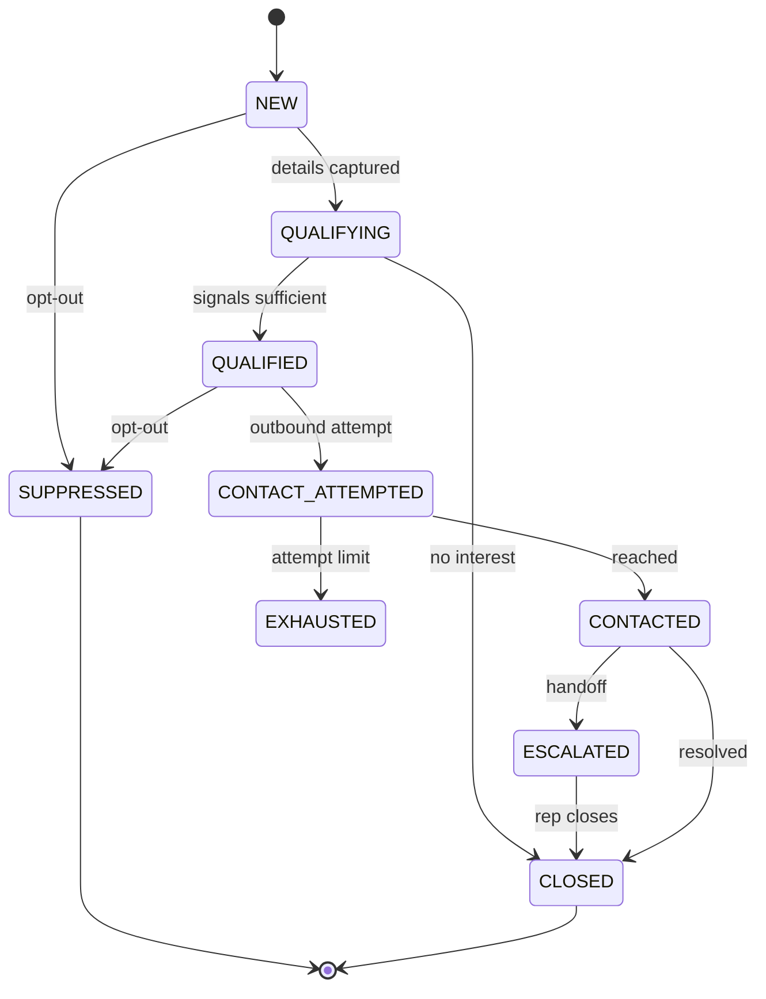
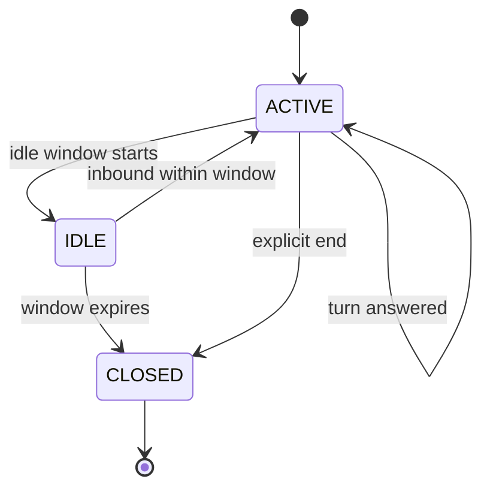
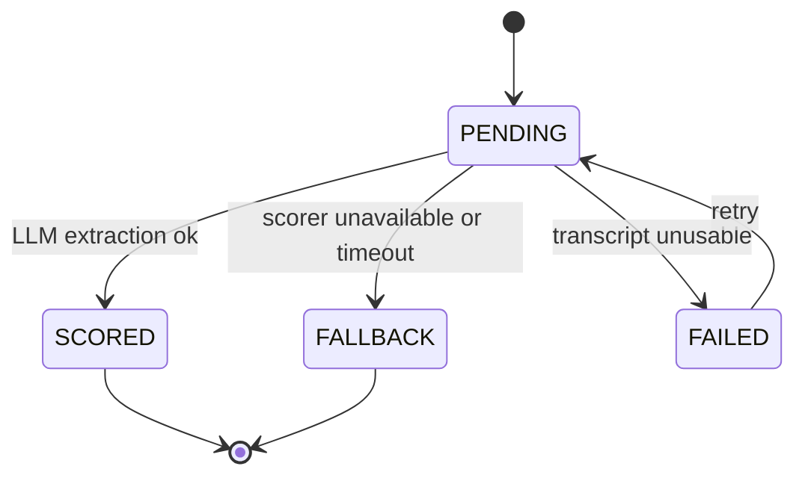
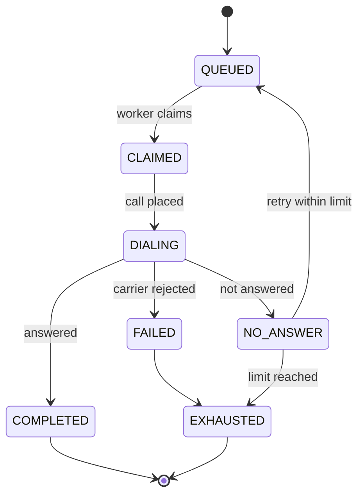
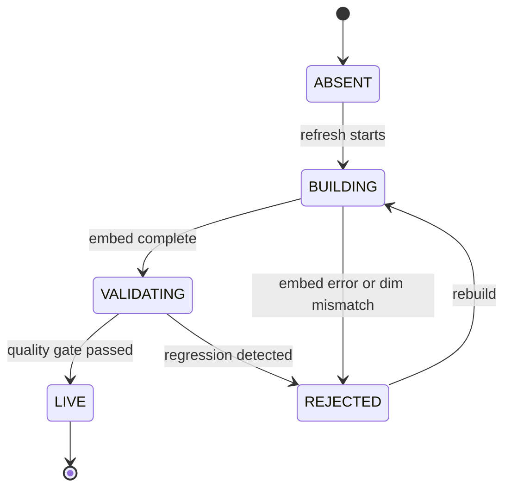
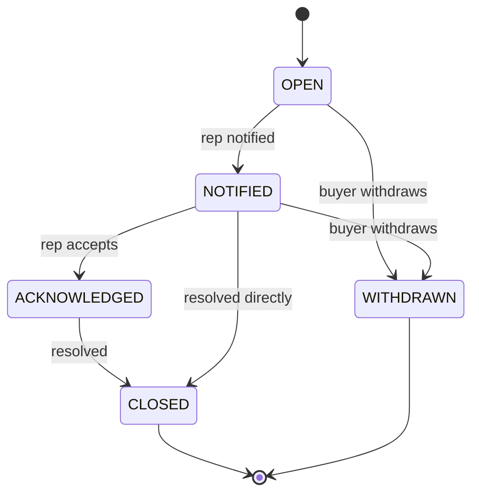

> **Lens:** BA (Part A) / BA + TPO (Part B) · **Decided by:** BA, gated by TPO on workaround feasibility · **Inputs:** `00-product-intent.md`, `01-brd.md`, `02-use-cases-workflows.md` · **Engagement:** Brownfield · **Defines:** DAT-01 … DAT-16, DG-01 … DG-13, SM-01 … SM-06

# Data & State Analysis — ANITA MEDICAL SYSTEMS Product Marketing & Support Assistant

## Part A — Data Reality [Lens: BA]

### A.1 Data Inventory

| ID | Data | Source | Owner | Required? | Availability | Quality | Freshness | Trust |
|---|---|---|---|---|---|---|---|---|
| DAT-01 | Catalogue chunks (RAG units) | `data/out/chunks.jsonl` | Scraper (this repo) | Yes | 100% — 169 chunks | High | at crawl | trusted |
| DAT-02 | Product records (price, MOQ, delivery) | `data/out/ams.sqlite` `products` | Scraper | Yes | 100% — 24 rows, 0 null prices | High | at crawl | trusted |
| DAT-03 | Product specifications | `product_specs` table (333 rows) | Scraper | Yes | **87.5%** — 21 of 24 products have specs | High | at crawl | trusted |
| DAT-04 | Product FAQs | `faqs` table (36 rows) | Scraper | No | **25%** — 6 of 24 products | High | at crawl | trusted |
| DAT-05 | Company / statutory facts | `company_ids`, `people`, `branches`, `certifications` | Scraper | Yes | 100% | High | at crawl | trusted |
| DAT-06 | Media manifest | `data/out/media_manifest.json` | Scraper | No | 100% (manifest only, no binaries) | High | at crawl | trusted |
| DAT-07 | Conversation transcripts | Runtime (new) | This product | Yes | created per conversation | High | real-time | trusted |
| DAT-08 | Lead records | Runtime (new, mock CRM) | This product | Yes | created per captured lead | Medium (user-entered) | real-time | user-entered |
| DAT-09 | Sentiment scores | Runtime (new) | This product | Yes | per scored turn | Medium | real-time | derived |
| DAT-10 | Handoff records | Runtime (new) | This product | Yes | per escalation | High | real-time | trusted |
| DAT-11 | Mock CRM store | Runtime (new) | This product | Yes | 100% | High | real-time | trusted |
| DAT-12 | Vector index (ANITA collection) | Derived from DAT-01 | This product | Yes | rebuilt on refresh | High | at index build | derived |
| DAT-13 | Configuration | `.env` + `config/` (new) | Ops | Yes | 100% | Medium — see DG-09 | at deploy | trusted |
| DAT-14 | Perf traces | Runtime (new) | This product | Yes | per turn | High | real-time | trusted |
| DAT-15 | Twilio number + account | External | ANITA / ops | Yes | 100% | High | static | trusted |
| DAT-16 | Outbound queue | Runtime (new) | This product | Yes | per queued attempt | High | real-time | trusted |

### A.2 Load & Capacity Model

**Every number below is `Assumed:`** — ANITA publishes no traffic figures, and the source system's measurements are for a different domain (admissions, seasonal). These are **Stage 5 validation targets**, not evidence.

| Core flow (WF-xx) | Peak QPS | Peak : average | 12-month growth | Evidence |
|---|---|---|---|---|
| WF-01 Web chat turns | 0.06 (≈4 turns/min) | 5:1 (business hours) | 4× | `Assumed:` 200 sessions/day × 6 turns ÷ 8 h |
| WF-01 WhatsApp messages | 0.03 (≈2/min) | 4:1 | 3× | `Assumed:` 100 messages/day |
| WF-01 Inbound voice | 0.008 (≈2 concurrent) | 8:1 | 3× | `Assumed:` bounded by GPU, not demand |
| WF-02 Outbound attempts | 0.02 (≈1/min) | 1:1 (paced by worker) | 2× | `Assumed:` 30 leads/day, 10 s poll |
| WF-03 Corpus refresh | batch, monthly | n/a | n/a | `Assumed:` monthly catalogue change |

**Peak load is small by web standards.** The binding constraint is **GPU residency**, not request rate: TTS, STT and the LLM compete for one 16,311 MiB card shared with the live university assistant (`AS-09`). Two concurrent voice calls is the working ceiling inherited from the source platform.

Per-asset scale profile:

| Asset | Volume | Velocity | Access pattern | Consistency needed |
|---|---|---|---|---|
| DAT-01 chunks | 169 units, ~20.5 K tokens | static until re-crawl | read-heavy, embedded once | strong (rebuild on change) |
| DAT-02 products | 24 rows | monthly | read-heavy, indexed by name/price | strong |
| DAT-03 specs | 333 rows | monthly | read by product id | strong |
| DAT-07 transcripts | ~50–200 rows/day | append-heavy | write once, read in review | strong |
| DAT-08 leads | ~40/day | upsert by phone/email | read-write | **strong** (dedupe correctness) |
| DAT-09 sentiment | 1 row/turn | append-heavy | write once, read as trail | eventual (analytics) |
| DAT-12 vector index | 169 vectors × 768-d | rebuilt monthly | bulk load, query | strong (promoted atomically) |
| DAT-16 outbound queue | ~30/day | low | claim/update with locking | **strong** (no double dial) |

**Deliberate conclusion:** for this corpus, retrieval is *not* the bottleneck and never will be. 169 chunks fit in memory trivially; a single indexed SQL query answers every commercial question. Capacity planning belongs on the GPU and the channel adapters, and the plan is designed accordingly.

### A.3 Completeness Classification

| Asset | Classification | Consequence |
|---|---|---|
| DAT-01, DAT-02, DAT-05, DAT-06, DAT-11, DAT-12, DAT-14, DAT-16 | **Complete** | — |
| DAT-03 product specifications | **Partially available** (21/24) | 3 products cannot answer spec questions — must say so (`BRD-07`), not invent |
| DAT-04 FAQs | **Partially available** (6/24) | Derived Q&A carries the load for the other 18 products |
| DAT-07, DAT-08, DAT-09, DAT-10 | **Derived / created at runtime** | Must handle absence gracefully at first boot |
| DAT-13 configuration | **Partially available** | Source system has keys written but never read — `DG-09` |
| DAT-15 Twilio | **External** | New number required (`BRD-03`); provisioning is a dependency |
| Vehicle/territory data | **Missing** | `DG-05` — outbound prioritisation cannot use it |

### A.4 Data Gap Decisions

| ID | Gap | Impact | Workaround | Decision |
|---|---|---|---|---|
| DG-01 | Traffic volume and concurrency target unknown (A.2) | Cannot size admission limits or the VRAM budget | Start at the inherited 2-call ceiling; instrument and revisit | `continue-without` — validate with real traffic; **PO sign-off required** |
| DG-02 | Source CRM is Salesforce-specific (`app/crm/` 3,653 LOC) | Cannot be reused by requirement | Define a CRM interface backed by a local mock store | `derive` — mock CRM behind a swappable interface (`BRD-14`) |
| DG-03 | No LLM fallback path exists in the source | An LLM outage silences every channel | Deterministic answers (SQL) keep working without the LLM; catalogue prose declines with handoff | `continue-without` — **partial** coverage only; document explicitly |
| DG-04 | Outbound cadence and calling window unspecified | Risk of over-calling or calling at unlawful hours | Default to 3 attempts, 10:00–19:00 IST, suppression honoured | `derive` — conservative defaults, ops-tunable |
| DG-05 | Vehicle/territory data absent | Outbound prioritisation cannot use territory | Prioritise on sentiment, buying intent and recency only | `continue-without` |
| DG-06 | Source system has **no auth, no rate limiting, no webhook signature validation** | Public commercial traffic would expose lead PII and allow abuse | Add admin auth, per-session rate limits and Twilio signature validation | `block` for public launch — **must be built in MOD-01/MOD-09** |
| DG-07 | Which additional messaging channels (D1 says "more") | Scope and adapter count | Ship the four core channels; treat extra channels as a single configurable adapter pattern with one reference implementation | `derive` — one adapter built, others by configuration |
| DG-08 | Clinical-refusal wording not legally reviewed | Regulatory exposure | Use a conservative default; flag for legal review before go-live | `block` for go-live — **PO/legal sign-off required** |
| DG-09 | Config keys can be written but never read (source defect) | Silent misconfiguration | Adopt the source's `config_truth` audit idea and make the audit a boot check | `derive` — enforce at boot (`BRD-20`) |
| DG-10 | Buyer acceptance of an AI assistant unvalidated (`AS-04`) | Product may not be adopted | Human handoff always one turn away; measure sentiment trend as the adoption proxy | `use-as-is` — **PO sign-off required** |
| DG-11 | No PII erasure path in the source | Cannot honour a deletion request | Lead anonymisation + sentiment/transcript cascade defined in MOD-06 | `derive` |
| DG-12 | Sales-rep notification channel unspecified | Handoffs may not reach a human | Default to email (SMTP already in the source), configurable | `derive` |
| DG-13 | 3 products with no specifications and 4 with no About text on the source site | Spec questions for those products cannot be grounded | Answer "not published" and offer a human (`BRD-07`); never infer | `use-as-is` — honest absence |

### A.5 Data Lineage

| Asset | Lineage |
|---|---|
| DAT-01 chunks | `TradeIndia catalogue → scraper (src/ams) → chunks.jsonl → ANITA-only vector collection (DAT-12)` |
| DAT-02 products | `catalogue → scraper → ams.sqlite products → deterministic answer path` |
| DAT-03 specs | `catalogue DOM → scraper → product_specs (long format) → comparison + spec answers` |
| DAT-05 company facts | `company-profile + homepage → scraper → company_ids/people/branches → company answers (DG-13)` |
| DAT-08 leads | `conversation turn → extraction → mock CRM store; phone/email is the dedupe key` |
| DAT-09 sentiment | `turn transcript → sentiment scorer → composite score → lead category → escalation (SM-03)` |
| DAT-12 index | `DAT-01 → embed (nomic-embed-text, 768-d) → ANITA collection → retrieval; rebuilt atomically (SM-05)` |
| DAT-14 traces | `every turn → trace writer → per-instance log; never shared with the university product (BRD-18)` |

## Part B — Entity Lifecycle & State Analysis [Lens: BA + TPO]

### B.1 Key Entities

| Entity | Owned by (MOD) | States | SM |
|---|---|---|---|
| Lead | MOD-06 | NEW, QUALIFYING, QUALIFIED, CONTACT_ATTEMPTED, CONTACTED, ESCALATED, SUPPRESSED, CLOSED | SM-01 |
| Conversation / turn | MOD-02 | ACTIVE, IDLE, CLOSED; turn: RECEIVED, CLASSIFIED, ANSWERED, FAILED | SM-02 |
| Sentiment score | MOD-07 | PENDING, SCORED, FALLBACK, FAILED | SM-03 |
| Outbound attempt | MOD-06 | QUEUED, CLAIMED, DIALING, COMPLETED, NO_ANSWER, FAILED, EXHAUSTED | SM-04 |
| Vector index | MOD-03 | ABSENT, BUILDING, VALIDATING, LIVE, REJECTED | SM-05 |
| Handoff | MOD-06 | OPEN, NOTIFIED, ACKNOWLEDGED, CLOSED, WITHDRAWN | SM-06 |

### B.2 State Machines

### SM-01 — Lead lifecycle

1. **Created by:** UC-08 (provide contact details), or UC-09 when an outbound lead is imported.
2. **States:** NEW → QUALIFYING → QUALIFIED → CONTACT_ATTEMPTED → CONTACTED → ESCALATED → CLOSED; any → SUPPRESSED; QUALIFYING → CLOSED (no interest).
3. **Who transitions:** Buyer (supplies details, withdraws), Lead module (qualifies on signals), Background worker (contact attempts), Sales rep (closes).
4. **Legal:** as drawn. **Illegal:** NEW → CONTACTED without an attempt; SUPPRESSED → any other state; CLOSED → CONTACTED.
5. **Repeatable:** details-supplied is idempotent on phone/email; suppression is repeatable and sticky.
6. **Concurrent:** two channels submit details for the same buyer → unique key on normalised phone/email decides; the loser is merged, never duplicated.
7. **Halfway stop:** crash between lead write and conversation link → lead exists unlinked; a repair job re-links from the conversation's phone number.
8. **Resume:** QUALIFYING resumes on the next turn; CONTACT_ATTEMPTED resumes on the next scheduled attempt.
9. **Cancel:** Buyer withdraws → CLOSED (or SUPPRESSED if they ask not to be contacted).
10. **Timeout:** QUALIFYING with no activity for 30 days → CLOSED (dormant).

### SM-02 — Conversation and turn lifecycle

1. **Created by:** UC-01…UC-04 on first inbound of a channel session.
2. **States:** conversation ACTIVE → IDLE → CLOSED; turn RECEIVED → CLASSIFIED → ANSWERED, or → FAILED.
3. **Who transitions:** Channel gateway (RECEIVED), Orchestrator (CLASSIFIED, ANSWERED, FAILED), idle timer (IDLE), teardown (CLOSED).
4. **Legal:** as drawn. **Illegal:** turn ANSWERED without CLASSIFIED; CLOSED conversation receiving a new turn (a new conversation is created instead).
5. **Repeatable:** CLOSED is terminal; a duplicate inbound for a closed conversation opens a new one containing the prior id as `parent`.
6. **Concurrent:** two turns for the same conversation → serialised in arrival order (`UC-01` scenario row) to keep the transcript coherent.
7. **Halfway stop:** crash after ANSWERED before persistence → the answer is re-rendered from the stored turn on recovery; the Buyer may see a duplicate reply, which is preferable to a silent loss.
8. **Resume:** IDLE → ACTIVE on the next inbound within the idle window; after the window, a new conversation (linked to the same lead).
9. **Cancel:** Buyer leaves → conversation IDLE; teardown after the window.
10. **Timeout:** IDLE beyond the idle window (default 6 h, inherited) → CLOSED.

### SM-03 — Sentiment score lifecycle

1. **Created by:** UC-10 path — every completed turn.
2. **States:** PENDING → SCORED, or → FALLBACK (rule-based), or → FAILED.
3. **Who transitions:** Sentiment module.
4. **Legal:** as drawn. **Illegal:** SCORED without a transcript; FALLBACK → SCORED in place (a RE-SCORE creates a new row).
5. **Repeatable:** re-scoring creates a new row; the lead's composite is recomputed, never mutated in place.
6. **Concurrent:** two turns scored at once → both rows written; the lead composite is computed under a row lock so the EWMA stays ordered.
7. **Halfway stop:** crash after SCORED before lead-composite update → the composite job re-derives from the score history.
8. **Resume:** PENDING rows are retried by the worker; age > 1 h → FALLBACK.
9. **Cancel:** conversation closed before scoring → score still written (it is the adoption signal).
10. **Timeout:** scorer exceeds its budget → FALLBACK.

### SM-04 — Outbound attempt lifecycle

1. **Created by:** UC-09 when a lead becomes eligible.
2. **States:** QUEUED → CLAIMED → DIALING → COMPLETED | NO_ANSWER | FAILED; any → EXHAUSTED at the attempt limit.
3. **Who transitions:** Background worker (CLAIMED, DIALING), carrier callback (COMPLETED, NO_ANSWER, FAILED).
4. **Legal:** as drawn. **Illegal:** QUEUED → COMPLETED; a second worker CLAIMING a DIALING row; EXHAUSTED → DIALING.
5. **Repeatable:** DIALING is not repeatable for the same row; a retry is a new row.
6. **Concurrent:** two workers → `SELECT … FOR UPDATE SKIP LOCKED` guarantees one dial per lead.
7. **Halfway stop:** worker dies in DIALING → row lock expires and returns it to QUEUED with the attempt already counted.
8. **Resume:** on worker restart, stale CLAIMED/DIALING rows are reconciled against carrier status.
9. **Cancel:** campaign stopped → QUEUED rows are dropped; in-flight calls finish.
10. **Timeout:** DIALING with no callback within the ring limit → NO_ANSWER.

### SM-05 — Vector index lifecycle

1. **Created by:** WF-03 refresh.
2. **States:** ABSENT → BUILDING → VALIDATING → LIVE; BUILDING|VALIDATING → REJECTED.
3. **Who transitions:** Refresh job and the quality gate.
4. **Legal:** as drawn. **Illegal:** ABSENT → LIVE (no bypass of validation); REJECTED → LIVE (must rebuild).
5. **Repeatable:** rebuild is repeatable; promotion is atomic (swap collection pointer).
6. **Concurrent:** a refresh during live traffic → queries keep hitting the LIVE collection until promotion.
7. **Halfway stop:** crash during BUILDING → the partial collection is discarded on next start, never promoted.
8. **Resume:** rebuild from the validated corpus.
9. **Cancel:** ops aborts → REJECTED, previous index untouched.
10. **Timeout:** validation exceeds its budget → REJECTED.

### SM-06 — Handoff lifecycle

1. **Created by:** UC-07 (buyer request) or UC-10 (negative sentiment).
2. **States:** OPEN → NOTIFIED → ACKNOWLEDGED → CLOSED; OPEN|NOTIFIED → WITHDRAWN.
3. **Who transitions:** Escalation module (OPEN, NOTIFIED), Sales rep (ACKNOWLEDGED, CLOSED), Buyer (WITHDRAWN).
4. **Legal:** as drawn. **Illegal:** OPEN → CLOSED without notification attempt; WITHDRAWN → ACKNOWLEDGED.
5. **Repeatable:** CLOSED and WITHDRAWN are terminal; a new escalation opens a new record.
6. **Concurrent:** two negative turns escalate simultaneously → deduplicated to one OPEN handoff per lead.
7. **Halfway stop:** crash after OPEN before NOTIFIED → the outbox retries notification.
8. **Resume:** NOTIFIED without acknowledgement ages into an ops alert after the SLA (default `Assumed:` 4 h).
9. **Cancel:** Buyer withdraws → WITHDRAWN; the rep is informed.
10. **Timeout:** OPEN beyond the SLA → escalated to the ops alert, remains OPEN.

### B.3 Partial Completion Matrix

Consolidated from `02-use-cases-workflows.md` §3 — the per-workflow matrices there are authoritative; this table maps each failure point to its owner.

| Failure point | State after | Owner (MOD) | Resumable? | Retry |
|---|---|---|---|---|
| Channel send fails after answer composed | Conversation ACTIVE, turn unrendered (`SM-02`) | MOD-01 | yes | outbox |
| Retrieval miss | Turn FAILED (`SM-02`) | MOD-03 | yes (re-ask) | none — decline + handoff |
| LLM unavailable | Turn FAILED (`SM-02`) | MOD-04 | yes | deterministic path survives (`DG-03`) |
| Lead write fails | Lead NEW unlinked (`SM-01`) | MOD-06 | yes | outbox |
| Sentiment scorer unavailable | Score FALLBACK (`SM-03`) | MOD-07 | yes | rule-based |
| Index rebuild fails | Index REJECTED (`SM-05`) | MOD-03 | yes | previous index stays live |
| Outbound callback lost | Attempt DIALING stale (`SM-04`) | MOD-06 | yes | lock expiry + reconcile |
| Handoff notify fails | Handoff OPEN (`SM-06`) | MOD-07 | yes | outbox |
