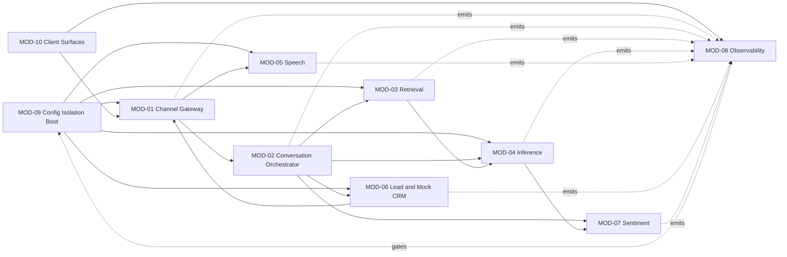

> **Lens:** TPO + Architect (joint) · **Decided by:** TPO + Architect, consulted BA · **Inputs:** `00-product-intent.md`, `01-brd.md`, `02-use-cases-workflows.md`, `03-data-state-analysis.md`, `04-coverage-gap-analysis.md` · **Engagement:** Brownfield · **Defines:** MOD-01 … MOD-10

# Modularization — ANITA MEDICAL SYSTEMS Product Marketing & Support Assistant

## 1. Approach & Justification

- **Decomposition style:** **Channel-in / engine-in-the-middle / domain-out**, layered over the proven seams of the source system. The source already has clean seams at `app/voice_handler.py` (speech turn loop), `app/rag*.py` (retrieval dispatcher), `app/llm_backend.py` (inference), `app/sentiment/` (scoring), `app/outbound/` (dialing) and `app/crm/` (integration seam). Those seams are kept; what changes is that the **channel edge becomes its own module** (the source fuses five channels into a 4,133-line `app/main.py`) and the **answer engine becomes channel-agnostic**.
- **Why it fits this product:** one deployable, one box, one GPU, shared with a live second product. Deployment independence buys nothing — the source plan reached the same conclusion for the same reason. What *is* needed is (a) **a channel edge that can grow** (D1 adds browser voice, mobile web and a configurable extra channel), (b) **an answer engine that cannot drift between channels** (BRD-01), and (c) **hard instance isolation** (BRD-18) so this product can never touch the university deployment's data.
- **Alternatives considered:**
  - *Microservices with independent deploys* — rejected: it would add network hops to a latency budget already dominated by GPU inference, and would make BRD-18's isolation harder to prove, not easier (two repos → two deployment graphs → drift).
  - *Copy `app/main.py` wholesale and edit* — rejected: the source file fuses Twilio webhooks, media-stream loops, the WhatsApp state machine, admission control, CRM session minting and the entire REST API. Editing it in place is how the two products silently diverge.
  - *Pure DDD bounded contexts* — partially adopted: MOD-03 (retrieval), MOD-06 (lead & CRM) and MOD-07 (sentiment) are genuine bounded contexts with their own lifecycles and stores. MOD-01/02/04/05 are pipeline stages, and are named as such.
- **Brownfield rule applied:** existing boundaries were the starting point, and every deviation carries a `REC-xx` in `07-brownfield-reconciliation.md`. Only **MOD-01** (split out of `app/main.py`), **MOD-08** and **MOD-10** are substantially new; the rest are the source's seams, renamed and re-scoped for a different domain.

## 2. Module Map

### MOD-01 — Channel Gateway
- **Responsibility:** own the edge. Terminate every inbound channel — Twilio voice webhooks and media streams, WhatsApp webhooks, web-chat REST/WS, browser-mic WebSocket, and any additional messaging channel — normalise it into one channel-agnostic message envelope, and render the reply back in that channel's native form (TwiML, WhatsApp message, JSON, audio frames). Own webhook signature validation and per-session rate limiting.
- **Why this boundary:** this is the module D1 grows. The source fuses every channel into one file, so adding a channel means editing the hot path of all the others; here a new channel is a new adapter and nothing else changes. It is also the only place `DG-06` (auth/abuse controls) can live without leaking into the engine.
- **Inputs / Outputs:** in — carrier webhooks, WebSocket frames, HTTP requests, agent responses. Out — normalised `InboundEnvelope`, outbound send calls, audio frames to the carrier.
- **Depends on:** MOD-02, MOD-09.
- **Key aggregates / entities:** channel session, Twilio number/sender binding, outbound send attempts (`DAT-16`).
- **Contains:** `DG-06` (public-surface hardening).
- **Satisfies:** `BRD-01`, `BRD-02`, `BRD-03`, `BRD-19` · `UC-01`, `UC-02`, `UC-03`, `UC-04`, `UC-14`
- **Size estimate:** ~6 stories.

### MOD-02 — Conversation Orchestrator
- **Responsibility:** own the conversation. Resolve identity across channels (BRD-02, per CV-02), mint and group conversations, serialise turns, classify the incoming question, assemble context from prior turns, and route to the answer path (deterministic / retrieval / refusal).
- **Why this boundary:** it is the only module that knows a conversation exists. Putting routing here keeps MOD-01 ignorant of business classification and MOD-04 ignorant of channels — the property BRD-01 depends on. It also inherits the source's `crm/session.py` identity registry, which is mis-namespaced there and belongs here (`REC-02`).
- **Inputs / Outputs:** in — `InboundEnvelope`. Out — classified turns to MOD-04, conversation state, transcripts to MOD-06/MOD-07.
- **Depends on:** MOD-04, MOD-06, MOD-07, MOD-09.
- **Key aggregates / entities:** Conversation (`SM-02`), Turn, identity map (`DAT-07`).
- **Satisfies:** `BRD-01`, `BRD-02`, `BRD-11` · `UC-01`, `UC-02`, `UC-03`, `UC-04`
- **Size estimate:** ~5 stories.

### MOD-03 — Retrieval & Grounding
- **Responsibility:** turn a question into grounded context, and decide when the context is not good enough to answer from. Own corpus ingestion, the **ANITA-only** vector collection, hybrid retrieval, and the grounding gate that makes BRD-04 enforceable.
- **Why this boundary:** it owns `SM-05` (index lifecycle) and the single hardest correctness property in the product — never answering from model memory. The source's version is split across two divergent stores (`REC-03`); this module deliberately starts clean with one collection and one writer.
- **Inputs / Outputs:** in — query text. Out — ranked chunks with source citations, or an explicit `not_relevant` signal.
- **Depends on:** MOD-04 (embeddings), MOD-09.
- **Key aggregates / entities:** `DAT-01` corpus, `DAT-12` ANITA vector index, `SM-05`.
- **Contains:** `DG-13` (products with absent specs/About must return "not published").
- **Satisfies:** `BRD-04`, `BRD-07`, `BRD-08` · `UC-01`, `UC-02`, `UC-03`, `UC-04`
- **Size estimate:** ~5 stories.

### MOD-04 — Inference & Answer Composition
- **Responsibility:** compose the answer. Own the LLM backend (Ollama on Windows/Linux, MLX on Apple Silicon — BRD-19), prompt assembly, streaming, the **deterministic SQL answer path** for commercial facts, and enforcement of the mandatory price caveat.
- **Why this boundary:** two different answer paths live here — generation and exact lookup — and BRD-05/BRD-06 make the distinction a correctness requirement, not an optimisation. Keeping both behind one interface is what lets MOD-02 route without knowing which is which.
- **Inputs / Outputs:** in — classified turn + retrieved context. Out — answer text (or stream), grounding citation, latency counters.
- **Depends on:** MOD-03, MOD-09.
- **Key aggregates / entities:** prompt templates, model config (`DAT-13`), answer objects.
- **Contains:** `DG-03` (no LLM fallback — the deterministic path must survive an outage).
- **Satisfies:** `BRD-05`, `BRD-06`, `BRD-09`, `BRD-19` · `UC-05`, `UC-06`, `UC-11`
- **Size estimate:** ~5 stories.

### MOD-05 — Speech Services
- **Responsibility:** transcribe caller audio and synthesise agent speech — STT, TTS, voice-activity detection, end-of-speech, barge-in and the µ-law/16 kHz audio contract for both Twilio and browser voice.
- **Why this boundary:** it owns the GPU-resident models that compete for the same VRAM as the LLM, and it is where the 600 ms end-of-speech floor lives — the dominant term in the voice latency budget. Isolating it keeps the VRAM budget ownable, which matters doubly when a second product shares the card (AS-09).
- **Inputs / Outputs:** in — audio frames, text. Out — transcripts, synthesised audio frames.
- **Depends on:** MOD-09.
- **Key aggregates / entities:** STT model, TTS model, TTS cache, VAD state.
- **Satisfies:** `BRD-19` · `UC-03`, `UC-04`
- **Size estimate:** ~4 stories.

### MOD-06 — Lead & Mock CRM
- **Responsibility:** own the lead. Capture, deduplicate, qualify, persist through a **CRM interface backed by a local mock store**, queue outbound attempts, run the outbound worker, and own handoff records.
- **Why this boundary:** it is a genuine bounded context with its own lifecycle (`SM-01`, `SM-04`) and it is the module most affected by the no-Salesforce constraint (BRD-14, `DG-02`). Isolating it means the CRM seam can be swapped for a real CRM later without touching the engine — the entire point of the constraint.
- **Inputs / Outputs:** in — captured details, outbound schedules, handoff requests. Out — leads, outbound calls, handoff records.
- **Depends on:** MOD-01 (to place calls), MOD-09.
- **Key aggregates / entities:** Lead (`SM-01`), Outbound attempt (`SM-04`), Handoff (`SM-06`), `DAT-08`, `DAT-11`, `DAT-16`.
- **Contains:** `DG-02` (mock CRM), `DG-04` (cadence/window defaults), `DG-05` (no territory data), `DG-11` (PII erasure), `DG-12` (rep notification).
- **Satisfies:** `BRD-11`, `BRD-12`, `BRD-13`, `BRD-14`, `BRD-23` · `UC-07`, `UC-08`, `UC-09`
- **Size estimate:** ~6 stories.

### MOD-07 — Sentiment & Escalation
- **Responsibility:** score every turn for sentiment, buying intent and friction; maintain the per-lead composite and category; capture objections; and trigger escalation when the negative threshold is crossed.
- **Why this boundary:** it owns `SM-03` and BRD-15/16/17, and it is the module with the clearest reuse case — the source implementation is 1,239 LOC of LLM-extraction plus a weighted composite, and the domain change (admissions → product enquiries) is a taxonomy and prompt change, not a rebuild (`AS-07`, `REC-05`).
- **Inputs / Outputs:** in — turn transcripts. Out — score rows, lead category, escalation triggers.
- **Depends on:** MOD-04 (LLM for extraction), MOD-06 (handoff), MOD-09.
- **Key aggregates / entities:** Sentiment score (`SM-03`), `DAT-09`.
- **Satisfies:** `BRD-15`, `BRD-16`, `BRD-17` · `UC-10`
- **Size estimate:** ~4 stories.

### MOD-08 — Observability & Evaluation
- **Responsibility:** make quality and latency measurable — per-turn traces, per-instance metrics, the admin console's data layer, the frozen evaluation set, and the quality gate that blocks a regressive release.
- **Why this boundary:** BRD-21 and BRD-22 have no home in the source beyond a partial `perf_trace.py`, and BRD-18 requires that this product's telemetry is **never** shared with the university deployment. It must also be dependency-free at runtime so that tracing can never fail a conversation — the source plan reached the same conclusion (`TRD-20` there).
- **Inputs / Outputs:** in — stage marks, engine counters, evaluation runs. Out — traces (`DAT-14`), metrics for the console, gate verdicts.
- **Depends on:** nothing at runtime (deliberately — emission is best-effort).
- **Key aggregates / entities:** `DAT-14` traces, frozen evaluation set.
- **Contains:** `DG-01` (instrument to resolve the unknown load model), `DG-09` (config audit surfaces here), `DG-10` (adoption proxy).
- **Satisfies:** `BRD-20`, `BRD-21`, `BRD-22` · `UC-12`, `UC-15`
- **Size estimate:** ~5 stories.

### MOD-09 — Configuration, Isolation & Boot
- **Responsibility:** one honest source of runtime configuration; the **isolation guards** that make BRD-18 enforceable (distinct database/schema, collection name, ports, log paths, model config); platform detection (Windows / macOS / Linux, CUDA vs MLX); secret loading policy; and a boot preflight that refuses to start misconfigured or colliding with the other product.
- **Why this boundary:** BRD-18 is the requirement most likely to be violated silently — two products pointing at the same collection name would "work" and quietly serve the wrong answers. A dedicated module with an explicit collision check is the only reliable guard. It also absorbs the source's hard-won lesson that a written-but-unread key is a real defect (`DG-09`).
- **Inputs / Outputs:** in — environment + config files. Out — a validated settings object and a started, isolated stack.
- **Depends on:** nothing (it starts everything else).
- **Key aggregates / entities:** `DAT-13` configuration, isolation assertions.
- **Contains:** `DG-06` (half — shared with MOD-01), `DG-09`.
- **Satisfies:** `BRD-18`, `BRD-19`, `BRD-20` · `UC-12`, `UC-14`
- **Size estimate:** ~4 stories.

### MOD-10 — Client Surfaces
- **Responsibility:** render the buyer-facing and admin surfaces — responsive/mobile-web chat, the embedded voice client, and the admin console UI (channel health, live conversations, conversation review).
- **Why this boundary:** D1 explicitly adds a mobile-web surface and an admin console, and UCs 12/13 are rendered here while their data comes from MOD-08. Keeping rendering separate from measurement means the console can change without touching tracing.
- **Inputs / Outputs:** in — REST/WS from MOD-01 and MOD-08. Out — rendered pages, mic audio, operator actions.
- **Depends on:** MOD-01, MOD-02, MOD-08.
- **Key aggregates / entities:** conversation views, channel status views.
- **Satisfies:** `BRD-01`, `BRD-21` · `UC-01`, `UC-04`, `UC-12`, `UC-13`
- **Size estimate:** ~4 stories.

## 3. Module Dependency Diagram

> **Note the shape, and a correction.** The dotted arrows read *"emits to"*, not *"depends on"* — a flowchart has no better primitive for this. **MOD-08 is a best-effort event sink, not a runtime dependency.** If MOD-08 is deleted entirely, every conversation on every channel still works. That is deliberate and matches the source plan's `TRD-20` reasoning: a telemetry module that can fail a call is worse than no telemetry. Only one solid arrow into MOD-08 exists — MOD-10 consumes it — and that is a *read* path for the admin console, not the conversation path.
>
> **MOD-08 gates MOD-09** (dotted) in the release sense only: the quality gate (`SM-05` VALIDATING → LIVE) must pass before a new index or configuration is promoted.

## 4. Decision Record

| Decision | Rationale | Alternatives considered | Lens |
|---|---|---|---|
| One deployable, split by responsibility not deployability | One box, one GPU, co-residency required for latency; the real need is channel extensibility and provable isolation | Microservices, independent deploys | TPO + Architect |
| The channel edge (MOD-01) is its own module | D1 adds channels; the source fuses five channels into one 4,133-line file, so a new channel edits every other channel's hot path | Extend the source's `app/main.py` | Architect |
| The answer engine is channel-agnostic (MOD-02/03/04) | BRD-01 requires one brain; drift between channels is the failure mode a catalogue assistant cannot afford | Per-channel answer logic | TPO + Architect |
| Two answer paths behind one interface (MOD-04) | BRD-05/06 make deterministic lookup a correctness requirement; an LLM must never be in the path of a price | LLM-only answers | PO + Architect |
| MOD-06 isolates the CRM seam behind an interface | BRD-14 forbids Salesforce reuse but the integration *pattern* is good; an interface is what makes it swappable later | Delete CRM entirely; or port the Salesforce client | TPO |
| MOD-07 re-targets rather than rewrites sentiment | `AS-07` — 1,239 LOC of LLM-extraction + weighted composite; the domain delta is taxonomy and prompt, not architecture | Write a new classifier (would lose the composite/EWMA model) | TPO |
| MOD-08 is dependency-free and built early | Nothing else's change is adoptable until it can be measured; and it must never fail a conversation | Fold tracing into MOD-02 | Architect |
| MOD-09 owns isolation as an enforced guard | BRD-18 fails *silently* — a shared collection name would appear to work and serve wrong answers | Rely on convention / documentation | TPO + Architect |
| Boundaries preserve the source's existing seams | Brownfield: new boundaries must justify deviating from what exists | Full re-decomposition | TPO + Architect |
