> **Lens:** Architect + TPO · **Decided by:** Architect, TPO on feasibility · **Inputs:** `05-modularization.md`, `03-data-state-analysis.md`, `04-coverage-gap-analysis.md` · **Engagement:** Brownfield · **References:** MOD-01 … MOD-10

# Architecture & Orchestration — ANITA MEDICAL SYSTEMS Product Marketing & Support Engine

## 1. System Architecture

One deployable process group on one Windows workstation (macOS/Linux parity), sharing a 16,311 MiB GPU with a **separate, live** university assistant. The shape is **channel edge → orchestrator → answer paths → domain modules**, with an isolated data plane per product.

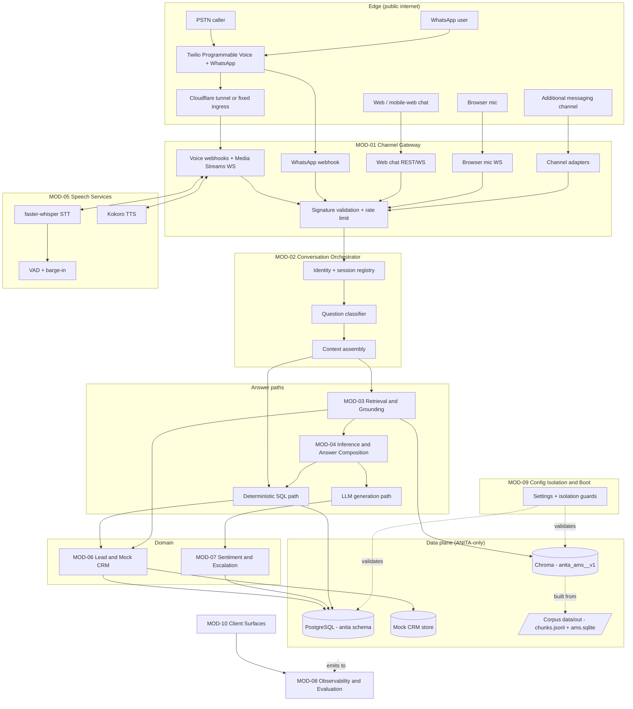

## 2. Orchestration Strategy

**Chosen pattern: synchronous in-process pipeline with an asynchronous best-effort side-channel.**

| Candidate pattern | Verdict | Rationale |
|---|---|---|
| Synchronous in-process call chain | **Chosen for the answer path** | The voice latency budget is ~1.2 s p95 with a 600 ms end-of-speech floor already spent; a network hop for retrieval or inference would consume a third of what remains. Co-residency is the whole point of the single-box design. |
| Event bus / message broker for the answer path | Rejected | Adds a broker to operate for zero benefit at 0.1 QPS; the source system reached the same conclusion. |
| Queue-based worker | **Chosen for outbound and post-conversation work** | Outbound dialing, sentiment persistence, CRM sync and notifications are latency-tolerant and must survive restarts. The source's outbox + polling worker is exactly this, and is reused as a *pattern* (not as code) per BRD-14. |
| Streaming (token/clause) | **Chosen for LLM and TTS output** | First-audio latency dominates perceived responsiveness in voice; the source already implements clause-level TTS cutting. |
| Agentic loop / tool-calling | Rejected for v1 | The answer space is closed (a 24-product catalogue + statutory facts) and deterministic lookups already cover the commercial questions. An agent loop would add latency and a new hallucination surface for no coverage gain. |
| MCP-based retrieval sidecar | Rejected for v1 | The source's MCP split is a documented pain point (two divergent stores, `REC-03`). With 169 chunks there is nothing to decouple — MOD-03 owns the index in-process. |

**Why not default:** the source platform uses a *different* mix (MCP-first retrieval with local fallback, plus a Pipecat pipeline that is installed but bypassed). Copying that mix would import its known divergence bug into a corpus that does not need the decoupling it was built for.

## 3. Component Flows

### Component Flow — MOD-01 Channel Gateway

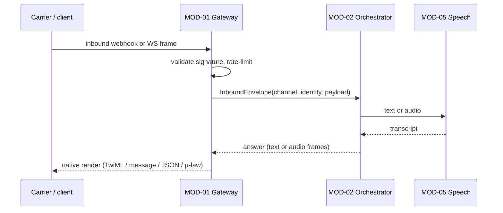
**Happy path:** inbound normalised → orchestrator → answer → native render. **Failure path:** signature invalid → rejected before any work (`DG-06`); carrier send fails → attempt persisted to the outbox and retried (`SM-04`); media stream drops → clean teardown, transcript retained (`SM-02`).

### Component Flow — MOD-02 Conversation Orchestrator

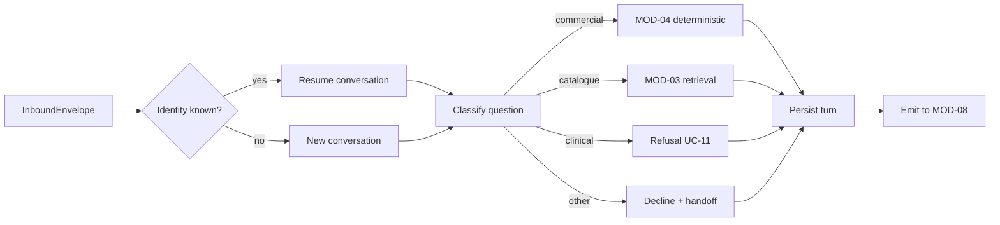
**Happy path:** identity resolution (per CV-02 — identified when a phone/handle/token exists, otherwise conversation-scoped) → classification → route → persist. **Failure path:** classifier unavailable → default to retrieval then decline, never to generation (`E1` of UC-11 — fail safe to refusal); persistence fails → the answer is still returned and the turn is replayed from MOD-08's trace.

### Component Flow — MOD-03 Retrieval & Grounding

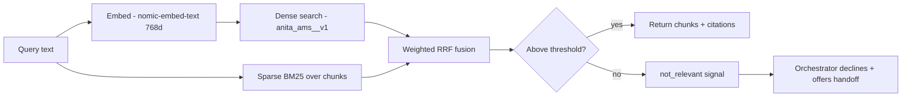
**Happy path:** embed → hybrid retrieve → fuse → return cited chunks. **Failure path:** embedding backend down → sparse-only retrieval still answers, flagged as degraded; index `REJECTED` → previous index stays live (`SM-05`); no chunk above threshold → `not_relevant`, never a generated guess (`BRD-04`, R-2).

### Component Flow — MOD-04 Inference & Answer Composition

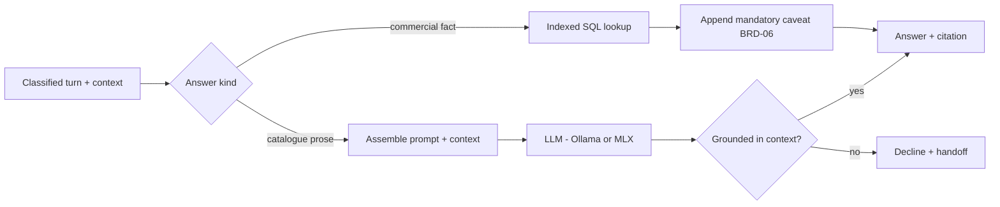
**Happy path:** commercial → indexed lookup (sub-millisecond, exact); prose → prompt with retrieved context → grounded check → answer. **Failure path:** LLM unavailable → commercial answers **still work** (this is the deliberate `DG-03` position); prose requests decline with a handoff; grounding check fails → decline rather than emit (`BRD-04`).

### Component Flow — MOD-05 Speech Services

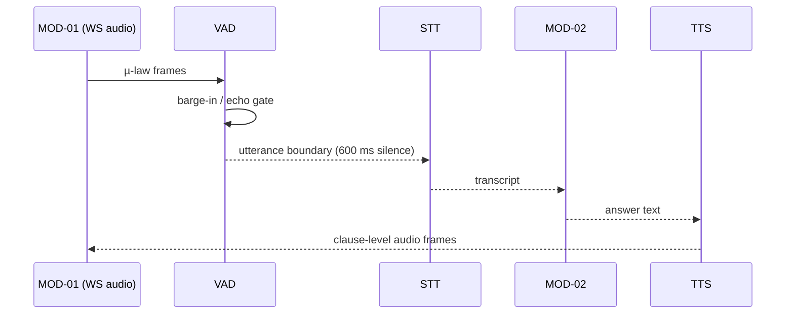
**Happy path:** frames → VAD → end-of-speech → STT → orchestrator → clause-level TTS streamed back. **Failure path:** STT confidence below floor → re-prompt then offer callback (`UC-03` E2); TTS engine falls back to CPU → response still produced, but RTF degrades badly (a named scale risk below); GPU unavailable → call refused at admission with a busy message (`UC-03` E1).

### Component Flow — MOD-06 Lead & Mock CRM

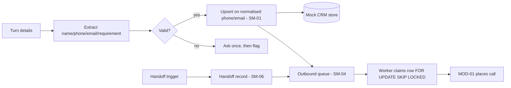
**Happy path:** extract → validate → dedupe-upsert → link conversation → enqueue follow-up. **Failure path:** store down → details kept on the conversation and replayed (never lost) (`SM-01` #7); worker dies mid-batch → lock expiry returns the row to `QUEUED` with the attempt counted (`SM-04` #7).

### Component Flow — MOD-07 Sentiment & Escalation

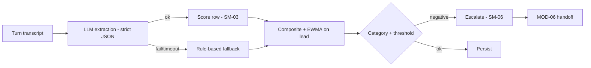
**Happy path:** extraction → score → composite → category → persist. **Failure path:** LLM unavailable → rule-based fallback so escalation still works (`UC-10` E1); two turns score concurrently → composite computed under row lock so the EWMA stays ordered (`SM-03` #6).

### Component Flow — MOD-08 Observability & Evaluation

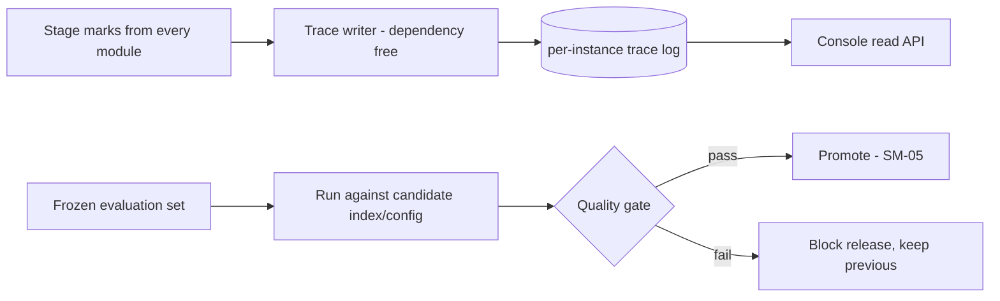
**Happy path:** best-effort trace write; evaluation run gates promotion. **Failure path:** trace writer throws → the exception is swallowed and the conversation is unaffected (MOD-08 is never on the critical path); metrics store down → the console shows "unavailable", never fabricated zeros (`UC-12` E1, inheriting the source plan's "absent, never zero" rule).

### Component Flow — MOD-09 Configuration, Isolation & Boot

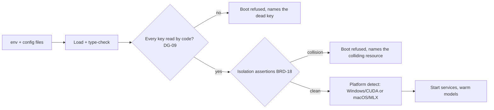
**Happy path:** load → audit → isolation assertions → platform detect → warm start. **Failure path:** any key written but unread → boot refused with the key named (`DG-09`); database/schema, Chroma collection, port or log path colliding with the university product → boot refused (`BRD-18`) — **this is the guard that makes isolation provable rather than aspirational**.

### Component Flow — MOD-10 Client Surfaces

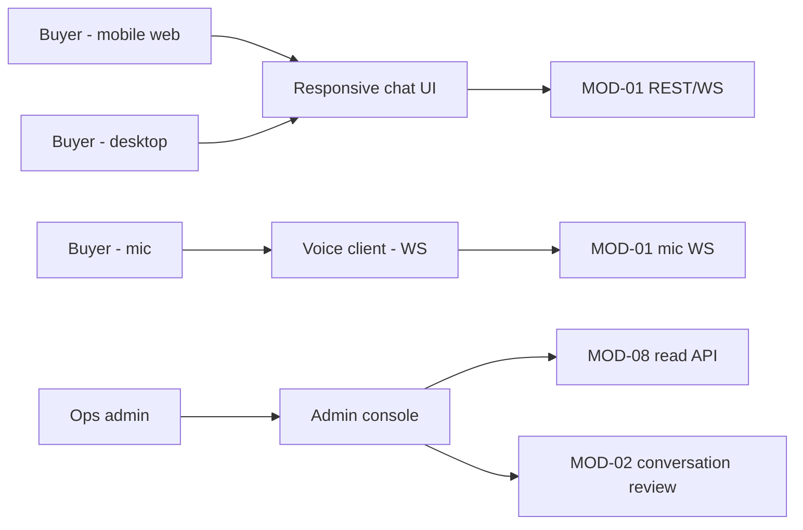
**Happy path:** buyer surfaces talk to MOD-01; console reads MOD-08/MOD-02. **Failure path:** backend unreachable → surfaces show an explicit unavailable state and the direct phone number, never a spinner that never resolves; admin console is access-controlled (`DG-06`, per CV-03).

## 4. Build vs Buy

| Capability | Decision | Rationale |
|---|---|---|
| Telephony + WhatsApp transport | **Buy** — Twilio | Already in use, credentials retained (D3); building carrier integration is not a differentiator. |
| Speech-to-text | **Buy/open-source, self-hosted** — faster-whisper | Already proven on the source path; hosted STT would ship buyer conversations off-box, which the source product explicitly prohibited for PII and which we extend to buyer data. |
| Text-to-speech | **Open-source, self-hosted** — Kokoro ONNX | Same reasoning; already GPU-viable. |
| LLM | **Open-source, self-hosted** — Ollama (Windows/Linux) / MLX (Apple) | Keeps buyer data on-prem; the source's dual-backend abstraction is reused. |
| Embeddings | **Open-source, self-hosted** — nomic-embed-text | Corpus is 169 chunks; an embedding API would add a network dependency and cost for no gain. |
| Vector store | **Open-source** — ChromaDB | Fits in memory at this scale; no operational burden. |
| Relational store | **Open-source** — PostgreSQL | Already required by the source; reused with a distinct schema. |
| CRM | **Build (mock)** — local store behind an interface | Required by the brief; the interface is what preserves the option to buy later (BRD-14). |
| Sentiment | **Build on LLM extraction** — reuse the source's pattern | `AS-07`; a hosted sentiment API would be another PII egress for a solved problem. |
| Orchestration/messaging broker | **Do not buy** | At 0.1 QPS a broker is pure operational cost. |
| Evaluation harness | **Build** | The frozen set is product-specific and small; off-the-shelf eval tooling does not know the catalogue. |

## 5. Scale & Bottleneck Analysis

Load figures trace to `03-data-state-analysis.md` A.2 — **all of them `Assumed:`**, and that is stated rather than hidden. The binding resource is the **GPU**, not request rate.

| Module | Scale profile | Scale unit | Scaling trigger | Saturation limit | Bottleneck at 10× | Degradation mode |
|---|---|---|---|---|---|---|
| MOD-01 Channel Gateway | stateless edge | concurrent connection | concurrent WS/HTTP conns > 150 | ~200 WS conns per process | Not reached — 10× is ~0.6 QPS; would exhaust WS file descriptors first | Shed the lowest-priority channel (extra messaging) before core channels; reject new WS with a retry hint |
| MOD-02 Conversation Orchestrator | stateless CPU | concurrent conversation | concurrent conversations > 60 | ~100 conv/sec classification | Not reached (10× ≈ 0.6 QPS) | Classification falls back to keyword routing; the conversation still completes |
| MOD-03 Retrieval and Grounding | in-memory index | concurrent query | embedding queue depth > 8 | 169 chunks resident; thousands of queries/sec | The embedding backend queue, not the index | Serve the last-good cache for repeated questions; sparse-only retrieval flagged degraded; a failed rebuild never takes the live index down |
| MOD-04 Inference and Answer Composition | GPU-resident model | concurrent generation | GPU queue depth > 1 | Shared 16,311 MiB card; 8,192-token context is the working set | **Saturates first.** The LLM queue grows unboundedly at 10× | **Deterministic SQL path keeps answering commercial questions with no LLM**; prose declines with a handoff — the one designed, tested degradation |
| MOD-05 Speech Services | GPU-resident models | concurrent call | concurrent calls > 2 | STT + TTS + LLM must co-reside; 2 calls is the inherited ceiling | **Second-hardest limit.** CPU-fallback TTS runs ~10× slower (RTF 0.63 vs 0.06) and breaches the latency SLO | Admission control refuses the third call with a busy message and a callback offer; voice degrades before text, deliberately |
| MOD-06 Lead and Mock CRM | stateful queue | queued outbound row | due rows > 50 | `FOR UPDATE SKIP LOCKED` scales with the database | None at this volume | The queue simply grows; outbound is latency-tolerant by design |
| MOD-07 Sentiment and Escalation | batch, off critical path | scored turn | pending scores > 100 | Shares MOD-04's GPU | Competed away by live conversations | Rule-based fallback keeps escalation working; pending rows drain later |
| MOD-08 Observability and Evaluation | append-only sink | trace row | trace write latency > 50 ms | Append-only writes | None — and it can never fail a conversation by construction | Drops traces rather than delaying a turn |
| MOD-09 Configuration Isolation and Boot | one-shot boot | boot attempt | n/a | n/a | n/a | Fails fast and refuses to start rather than running misconfigured |
| MOD-10 Client Surfaces | static + read API | browser session | concurrent sessions > 500 | Static assets and REST reads | None | Serves a degraded "chat unavailable — call us" page with the direct phone number |

**The named first bottleneck: MOD-04/05 sharing one GPU with a live second product.** Everything else in this architecture could handle 100× without change. The design response is not to make the GPU bigger but to (a) keep a GPU-free path (`SQL`) for the highest-value questions, and (b) degrade voice before text. `DG-01` (unknown real traffic) is the input that would change this analysis, and MOD-08 is what will resolve it.
