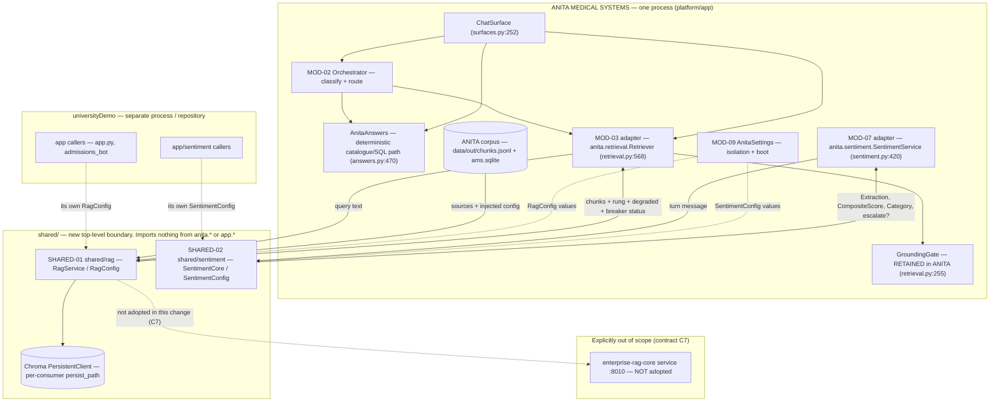
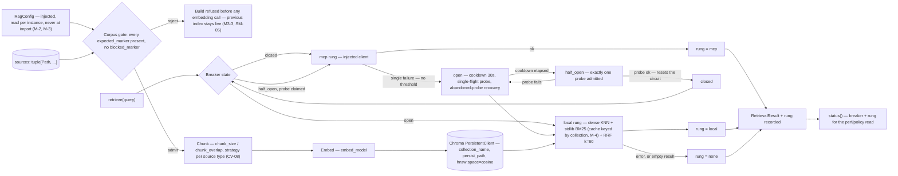
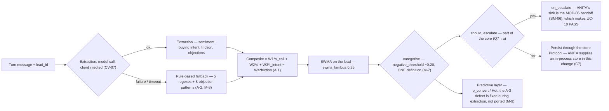
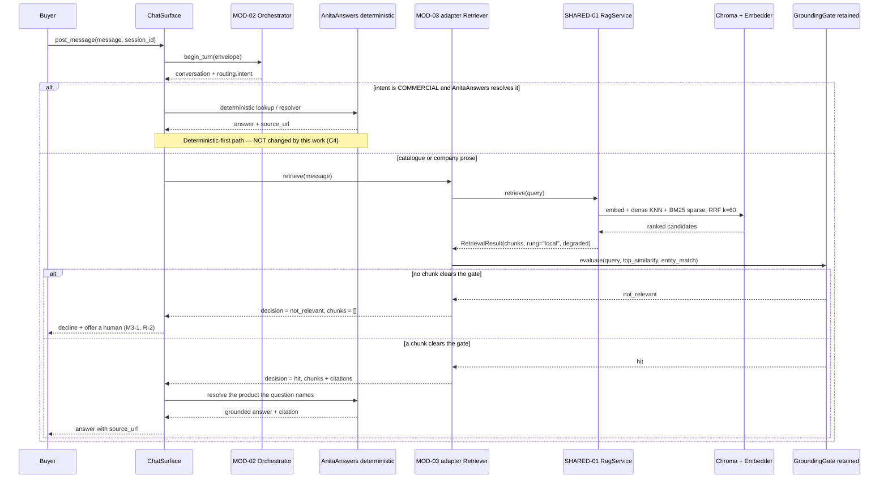

> **Lens:** Architect · **Decided by:** Architect · **Inputs:** CR-01-contract.md, CR-01 evidence, 06-architecture.md
> **Conformance:** every interface in this document conforms to `CR-01-contract.md` (FROZEN). Where the contract is silent or in tension with the source evidence, a `CV-xx` is raised in §9 — nothing is deviated silently.
> **Extends:** `06-architecture.md` (same Mermaid and section conventions). **Alters:** MOD-03, MOD-07 — see `CR-01-modularization-delta.md`.

**Citation convention.** `(CR-01 §n / A.n / B.n)` cites the evidence base as recorded. `(path:line — directly verified)` marks a fact re-checked in the repository while authoring this document; it is stronger evidence than a summary, not weaker. Anything neither cited nor verifiable is written `Unknown — needs verification`.

---

## 1. Scope

**What this change does.** Replaces ANITA's retrieval leg and sentiment core with two standalone modules under a new top-level `shared/` package, importable unchanged by ANITA and by universityDemo (contract C3). ANITA's `anita/retrieval.py` and `anita/sentiment.py` become adapters over `shared/rag` and `shared/sentiment`.

**What this change does not do.**

| Not in scope | Authority |
|---|---|
| ANITA's deterministic-first answer path | contract C4 — "This change does not alter that." The path is `ChatSurface._answer` intent routing (`platform/app/anita/surfaces.py:485-634` — directly verified) into `AnitaAnswers` (`platform/app/anita/answers.py:470` — directly verified). |
| `GroundingGate` behaviour | contract C4 — retained in `anita.retrieval`; ADR-03. |
| The external `enterprise-rag-core` service / MCP-first-over-HTTP | contract C2, C7. |
| PostgreSQL persistence for sentiment | contract C7 — the core exposes a store Protocol; ANITA keeps its in-process store. |
| Voice, WhatsApp, outbound | contract C7. |

**Consequence for the scale story.** The load-bearing module in ANITA remains MOD-04/MOD-05 on the shared GPU (`06-architecture.md` §5). This change adds no new GPU consumer — it moves where the embedding call is owned, not how much of the card it takes.

---

## 2. HLD — System Context

Both products consume the same two modules. The boundary is the package: what crosses it is data and injected configuration; what does not cross it is each product's policy, storage and vocabulary.

**Read the dotted arrows as "configured by", not "depends on at runtime".** The only runtime dependency from a product into `shared/` is the constructor call; every difference between the two products is a value in a config object, not a code path.

### 2.1 What crosses the boundary, and what does not

| Crosses into `shared/` | Crosses out of `shared/` | Does **not** cross |
|---|---|---|
| Query text (`RagService.retrieve`, C3.1) | `RetrievalResult` + recorded rung (`mcp\|local\|none`, B.3) | ANITA's `GroundingGate`, its threshold and entity-match rule (ADR-03) |
| Turn message (`SentimentCore.score_turn`, C3.2) | `Extraction`, `CompositeScore`, `Category`, `(should_escalate, reason)` | ANITA's `AnitaAnswers` and the deterministic path (C4) |
| `RagConfig` values: collection name, persist path, embed model, sources, `expected_markers` / `blocked_markers`, `system_prompt`, `refusal_text`, `top_k` / `fetch_k` / `chunk_size` / `chunk_overlap` | `build() -> int` (vectors written), `status() -> dict` (breaker + rung) | universityDemo's `app.config` / `app.llm_backend` imports (A.1, A.4 blockers) |
| `SentimentConfig` values: `w1..w4`, `ewma_lambda`, `negative_threshold`, `extraction_prompt`, `objection_labels`, `escalation_enabled` | Escalation decision and reason | Product storage: ANITA's SQLite/Chroma paths and universityDemo's PostgreSQL (A.1, C7) |
| ANITA's chunk records (identity + `product_id` / `chunk_type` / `source_url` metadata, B.2) | Chunks with their identity intact, so citations still resolve | The `enterprise-rag-core` transport (C2, C7) |

Prompt and refusal *strings* cross as injected data (C3.1 `system_prompt`, `refusal_text`; M-5). Prompt *assembly* and answer composition do not — they stay in MOD-04.

---

## 3. Component Flows per Shared Module

### 3.1 SHARED-01 — `shared/rag`

**Happy path:** config → corpus gate admits → chunk → embed → Chroma persists → `retrieve` fuses dense + sparse → rung recorded → result returned with the rung attached.

**Failure path:** corpus fails the gate → build refused, nothing embedded, the live index is untouched (the rejection happens before the expensive step — `rag_legacy.py:226-229`, B-1). A single retrieval failure opens the circuit (no failure threshold, `rag_mcp.py:369-376`, B-8) and the local rung serves instead; the probe is single-flighted so exactly one request per cooldown pays the timeout, and an abandoned probe cannot stop recovery forever (`rag_mcp.py:424-463`). If the local rung also fails or returns nothing, the rung is `none` and the result is empty — the caller's gate then declines, never composes (`anita/retrieval.py:641-643` — directly verified).

**This change's configuration of the ladder.** Contract C2/C7 exclude the MCP transport, so `mcp=None` is the construction in this change: the ladder degenerates to `local|none` and the breaker has no failure source. That degeneracy is a raised contradiction (CV-06) and must be an explicit, tested state — not a silently dead branch. The same reasoning comes from the source itself: `rag.py:180-192` documents a mechanism that was tested directly and had no reachable caller, and records it as a defect.

**Breaker constants (adopted, B.3):** opens on a single failure; cooldown `RAG_MCP_COOLDOWN` default 30 s; modes `off | on | auto` (default `auto`); probe read budget `max(read * 0.25, 0.5)` → 1.5 s at the 6.0 s serving timeout; fallback budget `8.0 − 1.5`; resets only on a successful `initialize` or `tools/call`.

### 3.2 SHARED-02 — `shared/sentiment`

**Happy path:** extraction → composite → EWMA on the lead → categorise → escalate or persist.

**Failure path:** the model call fails or times out → the rule-based fallback scores the turn, so escalation still fires (`UC-10` E1; A-2). This capability exists only on ANITA's side of the source (A.2) and the contract requires it to survive extraction (C3.2). A second consumer that wants no escalation sets `escalation_enabled=False`; ANITA sets it true because UC-10 is the capability being restored.

**Defect handling.** The `limit=10` fetch vs `>=100` gate makes `p_convert` always `None` and Hot unreachable through `compute_lead_score` in Side A (A.1/A-3). The contract classifies this as a defect to fix during extraction, not to port (C3.2, M-9). The shared core must therefore expose one history-depth definition, not two.

---

## 4. Orchestration Decision

**Chosen: an adapter inside `anita.retrieval`. `ChatSurface` keeps holding a `Retriever`; that `Retriever` delegates the retrieval legs to `shared.rag.RagService` and applies the retained `GroundingGate` before returning. The deterministic path is not touched.**

| Candidate | Verdict | Rationale |
|---|---|---|
| **Adapter at `anita.retrieval.Retriever`** | **Chosen** | `ChatSurface` already depends on exactly one retrieval object (`platform/app/anita/surfaces.py:602` — directly verified) and the `Retriever` constructor already takes `store` as a parameter (`platform/app/anita/retrieval.py:571-580` — directly verified). Replacing the legs behind that seam changes no caller, no gate call site, and no test double. |
| `ChatSurface` calls `RagService` directly | Rejected | It would move the `GroundingGate` call into the surface. The gate is invoked inside `Retriever.retrieve` today (``retrieval.py:676`, "Gate — before anything is composed from the context" — directly verified). Moving it changes gate ordering — forbidden by C4. |
| Move the gate into `shared/rag` and have the surface call the module | Rejected | ADR-03. |
| Event bus / deferred retrieval | Rejected | No decoupling need: 141 chunks in-process (CR-01 §4, B.2); the existing architecture already settled this (`06-architecture.md` §2 "MCP-based retrieval sidecar — rejected for v1"; `MOD-03` TRD-13 "without its MCP hop"). |
| Rewrite `ChatSurface` to a new answer interface | Rejected | The release gate judges the buyer's own path through `chat.post_message` (`platform/app/anita/assembly.py:264-282` — directly verified); changing the surface would invalidate the gate's meaning, not just its results. |

**Why not default.** The default reading of "adopt the module" is to call it from where retrieval is called. Here retrieval is called from *inside* a class that owns ANITA's correctness policy, so the honest seam is one level down: the adapter is the only shape that satisfies the contract (`shared/rag` replaces the retrieval leg; `GroundingGate` stays in `anita.retrieval` — C4) without re-testing the gate.

**Deterministic path — stated plainly.** `ChatSurface._answer` routes by intent before any retrieval is considered: `COMMERCIAL` goes to `AnitaAnswers`' deterministic engine (`surfaces.py:590-593` — directly verified), `CLINICAL` is refused, `INTRODUCTION` / `CONSENT` / `HELP` / `OFF_TOPIC` are canned, `LISTING` / `COMPANY` are answered from the corpus, and only the remainder reaches `self.retriever.retrieve` (`surfaces.py:602` — directly verified). **This change does not alter that ordering, those branches, or the answers they produce** (contract C4, "8 of 10 questions are answered from SQL and never touch retrieval"). Retrieval, shared or not, is downstream of the deterministic attempt.

**Gate behaviour — stated plainly.** The shared module returns candidates and a rung; it does not decide relevance. `GroundingGate` keeps its threshold, its entity-match rule and its `not_relevant` contract (MOD-03 TRD-14), and it still runs after fusion and before any composition (`retrieval.py:676` — directly verified).

---

## 5. Sequence — One ANITA Catalogue Question, End to End

**Happy path:** classify → deterministic if the intent is commercial → otherwise retrieval → shared legs → retained gate → grounded answer with a citation.

**Failure path:** the shared module returns the `none` rung → empty result → the gate returns `not_relevant` → decline and handoff. The embedding backend down → the dense leg is empty and the sparse leg carries the query (M3-5, degraded flag set); if nothing clears the gate, M3-1 applies. In every failure the answer is a refusal or a deterministic answer — never a generated guess, and never a change to the `COMMERCIAL` branch.

---

## 6. Scale & Bottleneck Analysis

One row per shared module. Real counts: **ANITA 141 chunks**, **universityDemo 35 vectors** (CR-01 §4 and B.2, both code-observed). The plan documents say 169 for ANITA — that conflict is CV-04 and it must be resolved before the corpus gate is written.

| Shared module | Scale profile | Scale unit | Saturation limit | Named bottleneck at 10× | Designed degradation mode |
|---|---|---|---|---|---|
| **SHARED-01 `shared/rag`** | In-process, read-heavy; one Chroma directory per consumer; corpus static between rebuilds | Concurrent retrieval query = 1 embed + 1 KNN + 1 BM25 + 1 fusion | **ANITA 141 chunks; universityDemo 35 vectors** (CR-01 §4, B.2) — thousands of queries/s at this size. The plan's stated single-process ceiling is ≥ 20 hybrid queries/s with embedding calls dominating (`MOD-03` TRD-13). Vectors are ~423 KiB by arithmetic (141 × 768 × 4 B); the plan states ~519 KB at its 169 count (`MOD-03` TRD-13) — CV-04 | **The embedding backend, not the index** — one Ollama embed endpoint on the box, competing with the LLM for the shared GPU (`06-architecture.md` §5 MOD-03; `03-data-state-analysis.md:55` "retrieval is not the bottleneck and never will be"). At 10× both products' embed queues join the same GPU queue as generation | Dense leg unavailable → sparse-only BM25, flagged degraded (M3-5); nothing clears the gate → `not_relevant` → decline + handoff (M3-1, R-2); breaker open → local rung (and with `mcp=None` the ladder is `local\|none`, CV-06); a failed rebuild never takes the live index down (SM-05). Per-process re-embed is removed by persistence, so a restart no longer costs the ~25 s build (B.3) |
| **SHARED-02 `shared/sentiment`** | Batch, off the critical path; state per lead | Scored turn = 1 extraction + composite + EWMA update | Shares MOD-04's GPU (`06-architecture.md` §5 MOD-07). ANITA's store is an in-process dict (`sentiment.py:435`, A.2), so its own limit is process memory; the contract leaves the durable store to the consumer (C7) | **GPU contention with live conversations** — sentiment is the workload that gets competed away first (`06-architecture.md` §5 MOD-07 "Competed away by live conversations") | Rule-based fallback keeps scoring and escalation working through an LLM outage (`UC-10` E1, A-2); scoring is off the answer path, so pending turns drain later; escalation is never blocked by a model call |

**The binding constraint is unchanged by this work: one 16,311 MiB GPU shared with a live second product** (`06-architecture.md` §1, §5). This change moves the embedding call's ownership into `shared/rag`; it does not add a model, a service or a network hop. The one new resource it introduces is an on-disk Chroma directory per consumer, which must be a distinct path per product — an extension of the MOD-09 isolation guard, not a new class of risk.

---

## 7. Migration Architecture

**Starting point (verified).** ANITA runs `InMemoryStore` (`platform/app/anita/assembly.py:104` — directly verified; CR-01 §4 "store in use = `InMemoryStore`"). A `ChromaStore` implementation already exists and is unused (`platform/app/anita/stores.py:41` — directly verified, imports `chromadb` lazily at `:60`). `chromadb>=1.0,<2.0` is declared (`platform/requirements.txt:24` — directly verified) but is not installed in the platform venv (checked directly; CR-01 §4 "chromadb NOT installed"). The corpus gate ANITA actually runs is marker-based — `REQUIRED_CORPUS_MARKER = "anitamedicalsystems"`, `FORBIDDEN_CORPUS_MARKERS = ("meridian", "university of maryland", "admissions")` (`platform/app/anita/index.py:75-76` — directly verified) — which maps one-to-one onto the contract's `expected_markers` / `blocked_markers` (M-1).

| Phase | Action | Downtime | Answer-regression guard |
|---|---|---|---|
| **M0 — preconditions** | Install `chromadb` (already declared); resolve CV-04's count; freeze ANITA's `RagConfig` values (collection, persist path, markers, prompts, refusal text) | None | Existing suite green before any change |
| **M1 — build offline** | `RagService.build()` writes into a staging persist path; the legacy `InMemoryStore` path remains the *served* path | None — an ops command | `build()` returns the corpus vector count; a non-ANITA corpus is refused (M3-3); index persists across restart (C6 DoD) |
| **M2 — shadow** | The adapter computes both results per query, logs disagreements (`decision`, top-1 `chunk_id`), and serves the legacy result | None | Produces the regression evidence: this is where a ranking change from CV-09 becomes visible before a buyer can see it |
| **M3 — flip** | `retrieval.backend = shared`; the adapter delegates to `RagService`; the legacy path stays wired as the rollback target | One process restart, applied through normal deployment | Frozen evaluation set + release gate + full suite re-run against the flipped build |
| **M4 — retire** | Remove the legacy wiring from `assemble`; keep `InMemoryStore` as the test double it already is (`retrieval.py:454` — directly verified) | None | Suite green with the legacy path unused |

**No answer regression — defined.** All of: (a) ANITA's 614 platform tests pass; (b) the release gate at 70 cases / 25 scenarios passes (both, contract C6); (c) the frozen set's grounded-answer rate is ≥ 98 % (`MOD-03` AC-7); (d) on the M2 shadow diff, every case agrees on `decision` and the top-1 chunk is unchanged — a proposed 100 % / 98 % threshold that the story set must confirm, not a settled number; (e) every citation still resolves to a `chunk_id` in `data/out/chunks.jsonl` (`MOD-03` AC-1).

**Rollback trigger (explicit).** Flip `retrieval.backend` back to `legacy` and restart if **any** of:

1. a frozen-set case changes `decision` (`hit` ↔ `not_relevant`);
2. a case that previously cited a chunk now declines;
3. the grounded-answer rate falls below 98 % (`MOD-03` AC-7);
4. the shared build fails validation, or the persisted index is missing/corrupt at boot;
5. a CONFLICT between ANITA's weighted fusion and the adopted fusion is unresolved (CV-09).

Rollback is a configuration flip with no data migration: the legacy path shares no state with Chroma, and the corpus is unchanged by any phase. That is the whole reason the legacy wiring is retained for one release rather than deleted at the flip.

**Honest statement on downtime.** This is a single-process product on one box. "No downtime" is achieved by keeping the legacy path the default until the shared path is proven, and by promoting the index atomically (`SM-05`, `MOD-03` TRD-15) — not by a hot swap. The flip costs one restart, which is a normal deployment event, and correctness never depends on a live cutover.

---

## 8. Architecture Decision Records

### ADR-01 — A shared package, not a copy per product

**Context.** CR-01.3 requires both products to use the modules without either product's vocabulary, paths, config keys or corpus assumptions baked in (CR-01 §1). The evidence shows the cost of the copy alternative already paid once: ANITA's sentiment file is "adapted-from Side A — the file says so", with no line copied verbatim and identifiers renamed (A.2, `sentiment.py:3-4`), and the adaptation left its config entirely inert (A.2, M-6). Side A additionally carries an internal duplicate that has already drifted — `non_fit_keywords` at 6 entries vs 3 (`categorizer.py:90-91` vs `:159`, A.1).

**Decision.** One `shared/` package, imported by both products, with all product-specific values injected (contract C3).

**Consequences.** One place to fix the A-3 defect (M-9) and collapse the threshold (M-7); both products must construct configs, so an un-parameterised value becomes a construction failure rather than a silent default; a shared change becomes a two-product change, which is why the boundary needs the packaging and tests in `CR-01-modularization-delta.md` §3; the two products now share a release-impact surface, mitigated by the frozen contract and the second-consumer test (C6 DoD #4).

**Alternatives rejected.** *Per-product copy* — fails CR-01.3 and repeats a drift that is already evidenced. *Vendor a copy at build time* — still two sources of truth, with the drift now invisible to both suites. *Make ANITA's MOD-03 the shared module in place* — impossible under the boundary rule: universityDemo would have to import `anita.*` (contract C3), and it would drag ANITA's isolation assumptions into a second product.

### ADR-02 — Chroma persistence over in-memory

**Context.** ANITA re-embeds per process into `InMemoryStore` (`assembly.py:104` — directly verified). The source's persistence path is proven and is the stated reason to adopt the code: it "kills the ~25 s per-process re-embed; the index survives restart" (B.3, `rag_legacy.py:172-181`, `:263-289`) with `hnsw:space=cosine` (`rag_legacy.py:259`). The dependency is already declared but not installed; a `ChromaStore` already exists in ANITA unused (`stores.py:41`). Corpus scale is small — 141 chunks / 35 vectors (CR-01 §4).

**Decision.** Adopt Chroma persistence inside `shared/rag`, with `persist_path` and `collection_name` injected per consumer (contract C3.1).

**Consequences.** Restart no longer re-embeds and the index survives — a contract DoD (C6). A new on-disk artifact exists per consumer, so `persist_path` and `collection_name` join the MOD-09 isolation assertions (BRD-18) — two products must never point at one directory. The embedding model is now bound to the index: a changed `embed_model` must be detected by dimension/space validation, not silently served (the `ChromaStore`'s existing "explicit dimension guard", `stores.py:42`). Chroma's native hybrid search is not used — the source notes it raises `NotImplementedError` on the local backend (`rag_legacy.py:414-417` — directly verified), so fusion stays in Python.

**Alternatives rejected.** *Keep `InMemoryStore`* — fails the C6 DoD, keeps the 25 s restart cost, and delivers none of the adopted architecture. *Adopt the external `enterprise-rag-core` service* — contract C7 excludes it; it adds a third repository and a network hop for 141 chunks (CR-01 B.2). *A store Protocol with no default implementation* — does not deliver persistence to either product and leaves two divergent stores, which is the source's documented defect (`REC-03`).

### ADR-03 — The `GroundingGate` stays in ANITA

**Context.** The gate turns "answer only from the corpus" from a prompt instruction into an enforced decision (MOD-03 A.1; `BRD-04`, R-2, R-7) and feeds the `not_relevant` contract that keeps MOD-04 unreachable for ungrounded turns (`MOD-03` TRD-14). It is invoked inside `anita.retrieval.Retriever.retrieve`, after fusion and before composition (`retrieval.py:676` — directly verified). universityDemo has no equivalent (B.3); its retrieval returns context text.

**Decision.** Keep the gate in `anita.retrieval`; `shared/rag` returns ranked candidates, rung and degradation state only; the ANITA adapter applies the gate (contract C4, "it stays in `anita.retrieval` and wraps the shared retriever").

**Consequences.** The shared module stays policy-free, which is precisely what makes it usable by universityDemo — a module that carried ANITA's threshold and entity-match rule would encode ANITA's catalogue assumptions in a second product. ANITA's gate behaviour is provably unchanged by this work (the gate code is not touched), so the frozen evaluation set's `not_relevant` cases remain valid evidence. The cost: a second consumer that wants grounding must add its own gate; the shared module cannot enforce it. That is accepted — C6's DoD requires both modules importable and configurable by a second consumer, not that grounding be shared.

**Alternatives rejected.** *Move the gate into `shared/rag`* — changes ANITA's gate behaviour, which C4 forbids, and imposes ANITA's relevance policy on a product with a different corpus and no equivalent concept. *Duplicate the gate in both products* — two policies drift, which is ADR-01's problem restated. *Gate inside `ChatSurface`* — moves correctness out of MOD-03 and invalidates the release-gate answerer, which deliberately runs the buyer's own path (`assembly.py:264-282` — directly verified).

---

## 9. Contradictions Raised (CV-04 … CV-09)

Raised under contract C1. None is resolved here by choosing silently: each records the evidence, the impact and a proposed resolution, and each is material to the story sets authored in parallel.

| ID | Contradiction | Severity | Evidence | Proposed resolution |
|---|---|---|---|---|
| **CV-04** | Corpus size: **141** vs **169** chunks for ANITA | **Blocking** | 141: CR-01 §4, B.2, B.5 (runtime, code-observed). 169: `03-data-state-analysis.md:11,46,52,55`, `01-brd.md:147`, `06-architecture.md:115,294,310`, `MOD-03` TRD-12/13/15, US-010/US-011 | Re-count the corpus at the pinned commit and state which figure is authoritative. The corpus gate, the build acceptance test and the `chunk_count_regression` rejection (`MOD-03` TRD-15) must use the same number, or ANITA's own corpus is refused at build — the exact failure mode B-1 describes |
| **CV-05** | `RagService.retrieve -> RetrievalResult` has no counterpart in the adopted source; reject semantics unspecified | Blocking for SHARED-01 | Contract C3.1. Source returns `str`: `rag.py:112 def retrieve_context(query: str) -> str`, `rag.py:104 def retrieve_context_hybrid(...) -> str`, `rag.py:216` returns `""` for the `none` rung; no result class exists in `rag.py` / `rag_legacy.py`. Source rejects a corpus by returning `None` (B-1); ANITA raises `CorpusError` (`index.py:79-104` — directly verified) | Define the shared result type and its fields (chunk identity + rung + degraded + scores) in the LLD; keep a string-rendering path for universityDemo's existing call sites so its behaviour is unchanged; specify whether `build()` returns 0 or raises on rejection, and map it to both consumers' current semantics |
| **CV-06** | Breaker and the `mcp` rung are carried over while the MCP transport is out of scope | Resolve in LLD | Contract C3.1 carries `closed\|half_open\|open` and rungs `mcp\|local\|none`; C2/C7 exclude the external service; `RagService.__init__(..., mcp: McpClient \| None = None)`. The source itself records an unreachable mechanism as a defect (`rag.py:180-192`), and B-12 lists `release_probe` / `mcp_available` / `mcp_retrieve_context` as having no callers | Declare the `mcp=None` degeneracy explicitly: ladder is `local\|none`, breaker pinned `closed`, `status()` reports that state, and a test asserts the `mcp` rung is unreachable rather than accidentally exercised. Alternative: do not carry the breaker in this change. Do not ship a breaker that can never open |
| **CV-07** | Sentiment extraction has no model dependency in the frozen config, and the frozen signature is sync over an async source | Blocking for SHARED-02 | Contract C3.2 — `SentimentConfig` carries prompts and weights but no model/client/endpoint, and `score_turn` is a plain sync method. Side A is model-based and async throughout (`scorer.py:126, :230, :398`, A.1) and is coupled to `app.llm_backend` (A.1); ANITA's is sync (A.2) | Let the core take an injected extraction client (the same injection shape the contract already uses for `McpClient`), so ANITA injects its sync LLM client and universityDemo its async one. The frozen sync signature is honoured; blocking an event loop is not acceptable for the async consumer, so the client boundary is where the sync/async choice is made |
| **CV-08** | Chunking ownership: the contract's pipeline chunks raw sources, but ANITA's corpus arrives pre-chunked and its chunk identity is load-bearing | **Blocking** | Contract C3.1 — `sources: tuple[Path, ...]`, `chunk_size`, `chunk_overlap`; the required flow is gate → chunk → embed. ANITA's corpus is per-section semantic chunks with `product_id` / `chunk_type` / `source_url` / `category` metadata (B.2) materialised at `data/out/chunks.jsonl` (DAT-01; `MOD-03` TRD-12). Citations must resolve to those `chunk_id`s (`MOD-03` AC-1), and the corpus gate reads `source_url` (`index.py:90` — directly verified). universityDemo chunks one markdown file with `RecursiveCharacterTextSplitter` (B.2) | Make the chunk step a strategy: ANITA injects a pass-through over the pre-chunked JSONL that preserves `chunk_id` and metadata; universityDemo injects the recursive splitter. `chunk_size` / `chunk_overlap` are scoped to the splitting strategy only — one source must not silently re-chunk and break the citations the frozen evaluation set is built on |
| **CV-09** | Fusion parity: the contract treats RRF k=60 as carried over unchanged, but the two implementations differ in three ways | Blocking for the no-regression claim | Contract C3.1 ("RRF k=60 fusion, `rag_legacy.py:410-459`"). Source fusion is **unweighted** and keys on document text (`rag_legacy.py:438-453` — directly verified: `_rrf(rank)=1/(60+rank)`, accumulated over `doc.strip()`). ANITA's is **weighted** `0.65 / 0.35` and keys on chunk index (`anita/retrieval.py:206-235` — directly verified), with a documented rationale that part-number queries must not lose to topic-similar chunks; ANITA also has a lexical-override rule (`retrieval.py:648-674` — directly verified: leader ≥ 1.5× runner-up and ≥ 5.0 wins outright) | Decide explicitly: either parameterise fusion (weights + the override rule as injected strategy, which the frozen `RagConfig` does not currently carry and would need adding), or adopt the source fusion for ANITA and re-baseline the frozen evaluation set. Adopting the source fusion silently changes ANITA's rankings — the M2 shadow phase is where that must be measured, not discovered |

**Cross-reference.** CV-04 also revises the scale row in §6. CV-05, CV-06, CV-08 and CV-09 land on the SHARED-01 build; CV-07 lands on the SHARED-02 build. All six are carried into `CR-01-modularization-delta.md` §6; none is resolved by this document alone.
