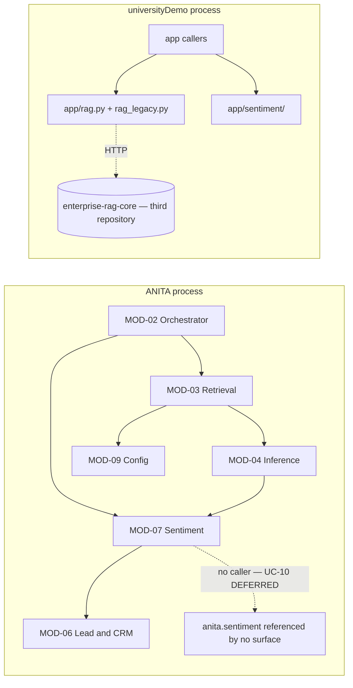
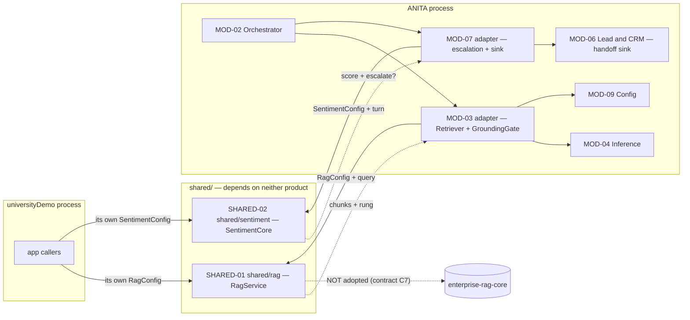

> **Lens:** Architect + TPO · **Decided by:** Architect · **Inputs:** CR-01-contract.md, 05-modularization.md, CR-01-architecture.md · **Engagement:** Brownfield · **Alters:** MOD-03, MOD-07 · **Introduces:** SHARED-01, SHARED-02

# CR-01 — Modularization delta: the `shared/` boundary and revised MOD-03 / MOD-07

**Status:** the `MOD-01 … MOD-10` map in `05-modularization.md` is **extended, not replaced**. Everything not named in §5 is untouched, and the dependency-direction note at the end of that map still holds for MOD-08 (best-effort sink, not a runtime dependency).

---

## 1. Why a new top-level boundary, not an extended MOD-03 / MOD-07

`MOD-xx` are modules **of one deployable** — one process, one box, one GPU, per-product data plane (`05-modularization.md` §1). A module that a *different* product in a *different* repository imports is not a module of that deployable, and modelling it as one would give it ANITA's package root, ANITA's config, and ANITA's isolation assumptions. CR-01.3's constraint is precisely that none of those may be baked in.

Four reasons, each evidenced:

1. **The reuse criterion is a boundary property, not a code property.** "Reusable by either product" means neither product's vocabulary, paths, collection names, config keys or corpus assumptions appear in the code (CR-01 §1). Both products currently violate this: universityDemo mutates process-global env at import (`rag_legacy.py:34-41`, B-4), reads the collection name from `os.environ` at import (`rag_legacy.py:53`, B-5), and hardcodes university vocabulary in prompts (`scorer.py:93-121`, `rag_legacy.py:116-136`, B-3/A.1); ANITA's corpus gate markers are module constants (`platform/app/anita/index.py:75-76` — directly verified), which one product may default but the other must not inherit. A dedicated boundary is what makes those violations *detectable by a test* instead of by review.

2. **MOD-03 and MOD-07 each keep genuinely ANITA-shaped responsibilities.** MOD-03 owns `GroundingGate` and the `not_relevant` contract that makes `BRD-04` enforceable (`MOD-03` TRD-14); MOD-07 owns the escalation sink that reaches MOD-06's handoff (`SM-06`, `UC-10`). Neither belongs in a module a second product imports — universityDemo has no equivalent of either (B.3; A.1 "escalation: none"). If the boundary moved wholesale into `shared/`, these would move with it or be duplicated on both sides.

3. **The evidence shows a copy already diverges.** ANITA's `sentiment.py` is adapted-from the universityDemo implementation — "the file says so" (`sentiment.py:3-4`, A.2) — and the adaptation left its config entirely inert (A.2, M-6) while the source carries an internal duplicate that has already drifted (6 entries vs 3, `categorizer.py:90-91` vs `:159`, A.1). Extending MOD-07 in place preserves exactly the structure that produced that drift.

4. **The brownfield rule favouring existing seams does not apply.** `05-modularization.md` §1 keeps existing seams because they are proven. Here the *proven* seam is in the other product (the facade/breaker/rungs split, B.3), and the instructions are to adopt it. Keeping MOD-03/MOD-07 as the owning boundary for that code would import the source's architecture into the wrong module map.

**Why two modules inside the boundary rather than one.** `shared/rag` and `shared/sentiment` share no code, no config and no consumer pair (a product may adopt one and not the other); their scale profiles differ (read-heavy synchronous vs batch GPU-bound, `CR-01-architecture.md` §6). One façade would couple the two release trains for no benefit.

**Boundary naming.** `SHARED-01` and `SHARED-02` are boundary identifiers introduced by this change. They are **not** `MOD-xx` renumbering — `MOD-01 … MOD-10` keep their identities and their ANITA scope.

---

## 2. Revised Definitions

### SHARED-01 — `shared/rag`

- **Responsibility:** own corpus validation, chunking, embedding, the vector store, and hybrid retrieval with fault-isolated rungs for any consumer that injects a `RagConfig`. It returns ranked candidates and the rung that served them. It **does not** decide relevance and **does not** compose answers.
- **Why this boundary:** it is the reusable core of the adopted architecture (facade + breaker + rungs + Chroma persistence, B.3) with every product-specific value lifted into config (M-1 … M-5). It is also the only place the source's fault isolation exists at all — ANITA has none (B.3).
- **Inputs / Outputs:** in — `RagConfig` (collection, persist path, embed model, sources, expected/blocked markers, prompt, refusal, `top_k` / `fetch_k` / `chunk_size` / `chunk_overlap`), optionally an `McpClient`. Out — `RetrievalResult` (chunks + rung + degraded), `build() -> int`, `status() -> dict`.
- **Depends on:** nothing in either product. Config is injected; no import-time env or file reads (contract C3.1; M-2/M-3).
- **Serves:** ANITA MOD-03 (adapter); universityDemo's retrieval callers.
- **Open items:** CV-05 (result type), CV-06 (`mcp` rung degeneracy), CV-08 (chunking strategy), CV-09 (fusion parity), CV-04 (count).

### SHARED-02 — `shared/sentiment`

- **Responsibility:** score a turn (model extraction with a rule-based fallback), maintain the composite and EWMA, categorise, and decide escalation — parameterised by `SentimentConfig`. Escalation is part of the core, not an extension (contract C2, Q7→a).
- **Why this boundary:** the scoring model (weights, EWMA λ, negative threshold) is shared; the vocabulary, prompt, objection labels and escalation sink are not (A.1, A.2). Extraction preserves both ANITA additions the source lacks: the fallback (A-2) and escalation (A-1, `UC-10`).
- **Inputs / Outputs:** in — turn message, `lead_id`, `SentimentConfig`. Out — `Extraction`, `CompositeScore`, `Category`, `(should_escalate, reason)`.
- **Depends on:** nothing in either product. The extraction client is injected (CV-07); the store is a Protocol the consumer implements (contract C7).
- **Serves:** ANITA MOD-07 (adapter); universityDemo's sentiment callers.
- **Open items:** CV-07 (client injection, sync/async), plus the A-3 defect (M-9) and the dead `DISQUALIFIED` category (A.2 — see §2.2).

### 2.1 MOD-03 — Retrieval & Grounding (revised): responsibility | before | after

| Responsibility | Before | After |
|---|---|---|
| Corpus identity gate | ANITA's, enforced by module constants (`index.py:75-76` — directly verified); plan text describes a structural check (`MOD-03` TRD-12) | Moves to SHARED-01 as injected `expected_markers` / `blocked_markers` (M-1). ANITA keeps the duty to supply the ANITA markers and to fail the boot if they are unset. **The gate text in `MOD-03` TRD-12 must be rewritten to match the config-shaped gate — the implemented check is marker-based, not the row-count predicates the TRD describes.** |
| Ingestion & chunking | ANITA's scraper produces `data/out/chunks.jsonl`; chunk identity, `product_id` / `chunk_type` / `source_url` are ANITA's (`MOD-03` TRD-12; B.2) | Step moves to SHARED-01 behind an injected chunking strategy. ANITA injects a pass-through that **preserves `chunk_id` and metadata** — CV-08; citations (`MOD-03` AC-1) and the frozen evaluation set depend on it |
| Embedding | ANITA owns it (`anita/embeddings.py`); MOD-03 depends on MOD-04 for embeddings (`05-modularization.md` MOD-03) | SHARED-01 constructs the embedder from `RagConfig.embed_model`. MOD-03 no longer needs MOD-04 for embeddings; **MOD-04's responsibility text is unchanged** — it never owned embeddings in its own definition |
| Vector store | `InMemoryStore` in use (`assembly.py:104` — directly verified); `ChromaStore` exists but unused (`stores.py:41` — directly verified) | SHARED-01's persistent Chroma store, `persist_path` + `collection_name` injected (ADR-02) |
| Retrieval legs & fusion | `anita/retrieval.py`: dense KNN + `MiniBM25` + weighted RRF `0.65 / 0.35` (`retrieval.py:206-235` — directly verified) + the lexical-override rule (`retrieval.py:648-674` — directly verified) | SHARED-01 performs dense + sparse + fusion. Whether ANITA's weights and override rule are carried as injected strategy or re-baselined is **CV-09** — not decided silently |
| Fault isolation | None (B.3) | Breaker + rungs inside SHARED-01; the consumed rung is observable via `status()` |
| **`GroundingGate` and the `not_relevant` contract** | `anita/retrieval.py:255`; threshold + entity-match rule (`MOD-03` TRD-14) | **Unchanged — stays in ANITA.** The adapter applies it after SHARED-01 returns candidates (ADR-03, contract C4) |
| **Deterministic catalogue path & product resolution** | `ChatSurface._answer` → `AnitaAnswers.resolver` (`surfaces.py:602-634` — directly verified) | **Unchanged** (contract C4) |
| Citation contract & index lifecycle (`SM-05`, atomic promotion, quality gate) | ANITA (`MOD-03` TRD-15/16) | **Unchanged** — ANITA still owns promotion and still requires SHARED-01 to return the same chunk identity |

### 2.2 MOD-07 — Sentiment & Escalation (revised): responsibility | before | after

| Responsibility | Before | After |
|---|---|---|
| Extraction | ANITA's synchronous service with LLM extraction + rule-based fallback (`sentiment.py:140-213`, A.2) | SHARED-02 owns the pipeline; the rule fallback is **preserved as a core capability** (A-2, M-8); the model client is injected (CV-07) |
| Composite & EWMA | ANITA's implementation, same weights/λ as the source (A.2) | SHARED-02 with `w1..w4` and `ewma_lambda` from `SentimentConfig` (A.1 values) |
| Negative threshold | Four copies (A.2, M-7); ANITA's config key `negative_escalation_threshold` (`config.py:216` — directly verified) | **One** definition in SHARED-02 (`negative_threshold`, C3.2); ANITA maps its config key onto it |
| Categorise | ANITA's categoriser; `Category.DISQUALIFIED` never returned (A.2) | SHARED-02 categorises and the A-3 defect is **fixed during extraction, not ported** (M-9). The dead `DISQUALIFIED` label must be resolved by evidence — whether to give it a path or remove it is **Unknown — needs verification** of any consumer reliance |
| Escalation | `should_escalate` + `on_escalate` exist (`sentiment.py:369`) but nothing calls the module — `system_check.py` records `UC-10` as DEFERRED, "referenced by no surface" (directly verified) | `should_escalate` moves into the core (Q7→a); ANITA supplies the sink — MOD-06's handoff (`SM-06`) — so `UC-10` moves DEFERRED → PASS (contract C6). Invocation sits on MOD-02's existing turn-completion edge (`05-modularization.md` MOD-02 "transcripts to MOD-06/MOD-07"); it is off the answer path (`06-architecture.md` §5 MOD-07) |
| Config | `SentimentSettings` is entirely inert (A.2, M-6) | `SentimentConfig` is injected and read; MOD-09's audit covers the keys, so an inert shared key is a boot failure, not a silent default |
| Persistence | `self._leads: dict` (`sentiment.py:435`), lost on restart (A.2) | Store Protocol exposed by the core (contract C7). **ANITA keeps the in-process store in this change** — it has no PostgreSQL; durable persistence remains deferred |
| **Escalation UI/notification beyond the handoff** | Out of scope | **Unchanged** — no new MOD-10 surface in this change |

---

## 3. Boundary Rules

| # | Rule | Why | Evidence |
|---|---|---|---|
| R1 | `shared/*` may not import `anita.*`, universityDemo's `app.*`, or any module rooted in either product | The package must be installable where neither product's code exists | Contract C3, C6 DoD #1 |
| R2 | `shared/*` may not read env vars, `.env` files or paths at import time; all configuration arrives through the injected config objects | Import-time globals made re-tenanting a global mutation in the source | Contract C3.1 ("ALL of these are injected, none read at import"), M-2, M-3; `rag_legacy.py:34-41`, `:53` (B-4, B-5); `config.py:19`, `:659` (A.1) |
| R3 | `shared/*` may not carry a product's vocabulary, path, collection name or corpus assumption as a default | A satisfying default is how CR-01.3 fails quietly | B-1, B-3, B-5, B-6; A.1's hardcoded university prompt and objections |
| R4 | Dependency direction is one-way: product modules may depend on `shared/`; `shared/` may never depend on a product module | Keeps the boundary acyclic and testable | Contract C3 |
| R5 | No process-global singleton keyed by a constant inside `shared/` — caches are keyed by collection or instance | The source's BM25 cache keyed by the literal `"bm25"` serves a stale corpus after a collection switch | B-6, M-4 (`rag_legacy.py:140`, `:359`, `:433`) |

### 3.1 How it is enforced and tested

Nothing here relies on review. The repository's own standard is that a rule which is written but not executed is a defect — MOD-09 refuses to boot on a written-but-unread config key (`DG-09`), and the source records the cost of a mechanism that is tested but unreachable (`rag.py:180-192`, B-12).

1. **Packaging — the primary enforcement (structural).** `shared/` ships as its own distribution with no dependency on either product, and neither product's package root is on its import path. An illegal `import anita` inside `shared/` then fails at import time in any environment, including a consumer's. Both products must add the shared package to their build config — for ANITA this is `platform/pyproject.toml:11-21` (`package-dir {"" = "app"}`, `pythonpath = ["app"]` — directly verified), which today makes `anita` importable but knows nothing of `shared`.

2. **Static boundary test (executable rule).** A test that parses every `shared/**/*.py` with `ast` and fails on any `Import` / `ImportFrom` whose root module is `anita`, `app`, or a product-local name. The mechanism already exists in this codebase as a source-scanning audit — `config_truth.scan_reads` walks source files and classifies reads (`platform/app/anita/config_truth.py:148` — directly verified) — so this is an existing pattern, not a new tool. It runs in **both** products' suites, since either could be the first to break the boundary.

3. **Second-consumer contract test (proves R3, contract C6 DoD #4).** One test that instantiates `RagService` and `SentimentCore` twice with different synthetic configs — one ANITA-like, one universityDemo-like — and asserts both construct and serve with no code edits. This is the test that fails when someone bakes a default, a path or a prompt back in.

4. **Boot audit extension (proves R2 for ANITA).** MOD-09's config audit and isolation assertions extend to shared config keys and to the shared store's `persist_path` / `collection_name` — a shared key that is written but unread fails ANITA's boot (`DG-09`), and two products pointing at one persist path fails the isolation assertion (BRD-18, `CV-01`).

5. **What is deliberately not used:** an import-time `sys.modules` assertion inside `shared/`. Both products legitimately have `anita` / `app` imported in their own processes, so such a check fires on correct code; the boundary is enforced where it is decidable — packaging and static analysis.

---

## 4. Dependency Direction

**Before** — two products, two independent retrieval/sentiment stacks; ANITA's sentiment referenced by nothing.

**After** — one shared boundary; both products depend on it; nothing depends back.

The dashed arrows out of `shared/` are returns and one explicit exclusion — there is **no solid arrow from `shared/` to either product**, which is R4 drawn as a picture.

---

## 5. Impact on MOD-01 … MOD-10

| Module | Impact | What changes |
|---|---|---|
| **MOD-01** Channel Gateway | **Untouched** | Channels, envelope and edge hardening are unchanged by CR-01 |
| **MOD-02** Conversation Orchestrator | **Untouched** | Classification and routing are unchanged (contract C4). Its existing turn-completion edge to MOD-07 becomes *reachable* (that is the `UC-10` fix), which is a wiring change in MOD-07, not a contract change here |
| **MOD-03** Retrieval & Grounding | **Altered** | Becomes an adapter over SHARED-01; corpus gate, chunking, embedder, store, legs and fusion move out; `GroundingGate`, citations, `not_relevant`, index lifecycle and the deterministic path stay. TRD-12/13 must be rewritten against the injected config; TRD-14/15/16 keep their contracts |
| **MOD-04** Inference & Answer Composition | **Untouched (interface)** | Its own responsibilities (LLM backend, prompt assembly, streaming, deterministic SQL, caveat) do not change, and the deterministic path is explicitly not touched (C4). The only delta is that MOD-03 no longer takes embeddings through it — MOD-04's definition never claimed embeddings |
| **MOD-05** Speech Services | **Untouched** | — |
| **MOD-06** Lead & Mock CRM | **No definition change** | It already owns handoff records (`SM-06`). Its handoff trigger gets a real producer (MOD-07 escalation), which is what makes `UC-10` PASS (contract C6) |
| **MOD-07** Sentiment & Escalation | **Altered** | Becomes an adapter over SHARED-02; extraction, composite, EWMA, categorise and `should_escalate` move out; escalation sink, store choice and invocation stay. `MOD-07`'s TRD halves are rewritten; `SentimentSettings` is replaced by an injected `SentimentConfig` (M-6, M-7) |
| **MOD-08** Observability & Evaluation | **Minor** | Adds one read: the shared module's `status()` (breaker + rung) for the perf/policy surface (contract C3.1). MOD-08 stays a best-effort sink — it can never fail a conversation (`05-modularization.md` §2 MOD-08, unchanged) |
| **MOD-09** Configuration, Isolation & Boot | **Touched** | The isolation assertions and the typed-config audit extend to shared config keys and to the shared Chroma `persist_path` / `collection_name` (BRD-18, `CV-01`, `DG-09`). It also assembles and injects both configs at boot — the shared modules read nothing themselves (M-2, M-3) |
| **MOD-10** Client Surfaces | **Untouched** | No new surface; escalation's visible artefact is the existing handoff/review path |

**MOD-03 / MOD-07 story impact.** Any story describing the *internals* of retrieval (index build validation, fusion, sparse cache) or sentiment scoring must be re-pointed at SHARED-01 / SHARED-02; stories asserting *behaviour visible to ANITA* (citations, `not_relevant`, escalation, handoff) keep their IDs and their acceptance criteria, and their modules' TRD halves are rewritten per CR-01 §6.

---

## 6. Contradictions Carried by This Delta

Raised in full in `CR-01-architecture.md` §9. Indexed here because each lands on a module boundary:

| ID | Lands on | Effect on this delta |
|---|---|---|
| **CV-04** | MOD-03 / SHARED-01 | The corpus gate threshold, the `chunk_count_regression` rejection (`MOD-03` TRD-15) and the §6 scale row all depend on whether ANITA is 141 or 169 chunks. Blocking before the gate is written |
| **CV-05** | SHARED-01 | The contract's `RetrievalResult` / `build()` / `status()` shapes have no counterpart in the adopted source — the shared façade must be designed, and universityDemo's existing string call sites preserved |
| **CV-06** | SHARED-01 | The `mcp` rung cannot be reached while the MCP transport is out of scope (C7). The degeneracy must be an explicit, tested state rather than a dead branch |
| **CV-07** | SHARED-02 | The core needs an injected extraction client (absent from the frozen `SentimentConfig`) and must serve a sync ANITA caller and an async universityDemo caller without blocking either |
| **CV-08** | MOD-03 / SHARED-01 | Chunk identity produced by ANITA must survive the shared pipeline, or citations (`MOD-03` AC-1) and the frozen evaluation set break |
| **CV-09** | MOD-03 / SHARED-01 | ANITA's weighted, identity-keyed fusion and lexical-override rule differ from the source's unweighted, text-keyed fusion. Carrying the source's fusion unchanged would change ANITA's rankings |

**Conformance.** This delta conforms to `CR-01-contract.md` C3 (package shape and boundary rule), C4 (nothing in the answer path or the gate changes), C5 (obligations M-1 … M-9 land as: M-1/M-2/M-3/M-4/M-5 in SHARED-01, M-6/M-7/M-8/M-9 in SHARED-02 and the MOD-07 adapter) and C7 (nothing adopted that C7 excludes).
