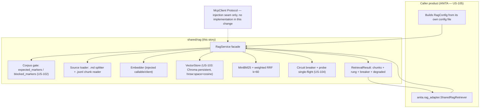

> **Lens:** Architect · **Decided by:** PO · **Inputs:** CR-01-contract.md, CR-01 Appendix B · **Engagement:** Brownfield

# US-101 — Extract `shared/rag` as an injected, product-neutral retrieval package [Lens: Architect]

- **Story:** As a **platform engineer**, I want the universityDemo retrieval code lifted into a standalone `shared/rag` package whose every product-specific value is injected through a `RagConfig`, so that ANITA (and any second product) can run the same retrieval architecture with its own corpus, collection, vocabulary and prompts — and no product's names are baked into the code.
- **Business value:** This is CR-01.3 made mechanical. A straight copy satisfies "same code" and fails "usable by either product" (`CR-01-rag-sentiment-rearchitecture.md:22-23`); a package with an injected config is what lets the architecture survive the second tenant without a fork. It is also what unblocks US-102…US-105 — nothing else in this change can be built without the interface.
- **Priority:** **Must** — the foundation story. TPO ordering note: no other story in this set can start until `RagConfig`/`RagService` exist and import cleanly.

## Acceptance Criteria [Lens: PO]

```gherkin
Scenario: Happy path — two products share one package with different configs
  Given shared/rag is importable from the repository root
  And two RagConfig instances exist with different collection_name, persist_path,
      sources, expected_markers and system_prompt values
  When both RagService instances are constructed and built
  Then each service reports its own collection in status()
  And each service retrieves only from its own corpus
  And no product name ("anita", "meridian", "university") appears in the package source

Scenario: Failure path — importing the package must not mutate the process environment
  Given os.environ contains no LANGCHAIN_TRACING_V2 and no HF_HUB_ENABLE_HF_XET key
  When shared.rag is imported and a RagService is constructed
  Then os.environ is byte-identical to the snapshot taken before the import
  And no LANGCHAIN_API_KEY, LANGCHAIN_ENDPOINT, LANGCHAIN_PROJECT or HF_HUB_ENABLE_HF_XET
      key has appeared

Scenario: Failure path — a config that disables the corpus gate is refused
  Given a RagConfig whose expected_markers is the empty tuple
  When RagService is constructed
  Then a RagConfigError is raised naming expected_markers
  And no service object exists and no store is opened

Scenario: Failure path — two collections never share a sparse index
  Given service A is built over collection "anita_ams__v1" with corpus A
  And service B is built over collection "other_product__v1" with corpus B
  When service B retrieves a term that exists only in corpus A
  Then corpus A's chunk is never returned by service B
  And each service's sparse index is keyed by its own (persist_path, collection_name)
```

Technical acceptance criteria [Lens: TPO]:

- TAC-1: `python -c "from shared.rag import RagConfig, RagService"` succeeds from the repository root with **no** `anita.*` or universityDemo `app.*` import reachable from `shared/rag` (asserted by a test that greps `sys.modules` after import and by an AST scan of the package source).
- TAC-2: Importing `shared/rag` performs **zero** `os.environ` writes (M-3; source defect B-4, `rag_legacy.py:34-41`).
- TAC-3: Every value in `RagConfig` is read from the instance, never from `os.environ` at import time (M-2; source defect B-5, `rag_legacy.py:53`).
- TAC-4: No module-level mutable cache is shared between service instances; the BM25 cache key is `(str(persist_path), collection_name)` (M-4; source defect B-6, `rag_legacy.py:359`, `:433-436`).
- TAC-5: `system_prompt` and `refusal_text` appear in `shared/rag` **only** as `RagConfig` field reads; the source's Meridian strings (`rag_legacy.py:116-136`; `rag.py:293`, `:327`, `:376`) do not appear anywhere in the package (M-5; source defect B-3).
- TAC-6: `RagService.retrieve()` returns a result whose `rung` is one of `mcp | local | none` on **every** return path, including the error paths (carried from `rag.py:194-216`).
- TAC-7: `RagService.__init__` accepts `mcp: McpClient | None`; when `mcp is None` the service makes no network call and reports breaker `"off"`. No HTTP client, MCP SDK or `enterprise-rag-core` dependency is added by this story (contract C7).
- TAC-8: The package imports with only the standard library plus `chromadb>=1.0,<2.0` (already declared in `platform/requirements.txt`) and `pydantic`-free dataclasses; installing it must not require `langchain`, `langchain-community` or `httpx`.

## HLD — Architecture Slice [Lens: Architect]



- **Components touched:**
  - `shared/rag/config.py` — `RagConfig`, the single injected surface (contract C3.1; M-1…M-5).
  - `shared/rag/service.py` — `RagService`, the facade over everything else.
  - `shared/rag/store.py`, `chunking.py`, `fusion.py`, `breaker.py`, `errors.py`, `__init__.py`.
  - `platform/app/anita/*` — untouched by this story; US-105 is the only story that wires it.
- **Interaction summary (happy path):** 1. Caller builds a `RagConfig` with its own collection, path, sources, markers, prompt and refusal text. 2. `RagService(config)` validates the config and opens nothing. 3. `build()` runs the corpus gate, loads/splits sources, embeds and upserts (US-102/US-103 detail). 4. `retrieve(query)` asks the breaker whether the primary may be tried; with `mcp=None` the local rung always serves. 5. The result carries chunks, the rung and the breaker state.
- **Failure paths:** (a) invalid config → `RagConfigError` at construction, before I/O; (b) corpus fails the gate → `CorpusGateError` from `build()`, no vectors written (US-102); (c) store unavailable → `VectorStoreUnavailable`; `retrieve()` degrades to sparse-only and sets `degraded=true` rather than returning a confident wrong answer; (d) unknown mode string → `RagConfigError` (this is the B-10 fix, detailed in US-104).

### Why a façade over internals

The source already has the pattern: `rag.py` is a façade re-exporting `rag_legacy` internals (`rag.py:34-63`) so callers import one name, and `rag_legacy.py` owns the mechanics. This story keeps that split, minus the MCP-first dispatcher's HTTP client, which is explicitly out of scope (contract C7).

## LLD — Implementation Detail [Lens: Architect]

### Module path

```
D:\project\anitamedicalsystems\shared\
  __init__.py                 # empty namespace marker
  rag\
    __init__.py               # exports: RagConfig, RagService, RetrievalResult,
                              #          RetrievedChunk, McpClient, and the error types
    config.py                 # RagConfig
    service.py                # RagService (facade)
    chunking.py               # load_sources(): markdown splitting + jsonl reading
    store.py                  # VectorStore Protocol, InMemoryVectorStore, ChromaVectorStore
    fusion.py                 # MiniBM25, weighted_rrf
    breaker.py                # CircuitBreaker, admit(), claim_probe(), release_probe()
    errors.py                 # RagConfigError, CorpusGateError, EmbeddingUnavailable,
                              #   VectorStoreUnavailable, DimensionMismatch, SpaceMismatch
```

Import name is `shared.rag`; the repository **root** (`D:\project\anitamedicalsystems`) must be on `sys.path`. Concrete plumbing (all three are required):

1. `platform/pyproject.toml`: `pythonpath = ["app", ".."]` (replaces `["app"]`), so pytest resolves `shared.rag` while running under `platform/`.
2. `platform/app/anita/__init__.py`: append the repository root resolved as
   `Path(__file__).resolve().parents[3]` to `sys.path` if not already present, guarded by an `if` (never a duplicate insert on re-import).
3. `platform/scripts/*.py` that insert `PLATFORM / "app"` (e.g. `scripts/release_gate.py:37`) also insert `PLATFORM.parent`, so the scripts' process can import `shared.rag`.

No `anita.*` or `app.*` module may be imported by anything under `shared/rag` (TAC-1, contract C6).

### Classes and functions — exact signatures

```python
# shared/rag/config.py
from dataclasses import dataclass, field
from pathlib import Path

@dataclass(frozen=True)
class RagConfig:
    # --- contract-fixed fields (CR-01-contract.md C3.1) — names and types are binding ---
    collection_name: str                      # M-2: was import-time os.environ (B-5)
    persist_path: Path                        # was CHROMA_DB_PATH
    embed_model: str
    sources: tuple[Path, ...]                 # was a single hardcoded Meridian path (B-1)
    expected_markers: tuple[str, ...]         # M-1: corpus acceptance markers
    blocked_markers: tuple[str, ...]          # M-1: corpus rejection markers
    system_prompt: str                        # M-5: was Meridian-specific (B-3)
    refusal_text: str                         # M-5: was "…in the university profile." (B-3)
    top_k: int = 5
    fetch_k: int = 20
    chunk_size: int = 600                     # universityDemo default, config.py:362
    chunk_overlap: int = 90                   # universityDemo default, config.py:363

    # --- additive fields: cited breaker constants (CR-01 Appendix B.3) + store/fusion ---
    mode: str = "off"                         # off | on | auto; validated in __post_init__
    cooldown_s: float = 30.0                  # RAG_MCP_COOLDOWN, config.py:406-407
    read_timeout_s: float = 6.0               # RAG_MCP_TIMEOUT, config.py:396-397
    probe_fraction: float = 0.25              # RAG_MCP_PROBE_FRACTION, config.py:402-403
    probe_floor_s: float = 0.5                # rag_mcp.py:56-58
    failure_threshold: int = 3                # NEW — fixes B-8 (US-104)
    retrieval_budget_s: float = 8.0           # rag_mcp.py:68-70
    fallback_reserve_s: float = 1.5           # rag_mcp.py:68-70
    rrf_k: int = 60                           # rag_legacy.py:439
    dense_weight: float = 0.65                # TRD-13
    sparse_weight: float = 0.35               # TRD-13
    search_mode: str = "hybrid"               # hybrid | dense
    embed_batch_size: int = 32                # matches platform/app/anita/retrieval.py:594
    max_context_chars: int = 6000             # matches platform/app/anita/retrieval.py:542
    distance_space: str = "cosine"            # hnsw:space, rag_legacy.py:259

    def __post_init__(self) -> None:
        """Validate, never coerce. Raises RagConfigError on the first problem."""
```

`__post_init__` validation rules (each one is an edge case in the test list):

| Rule | Refusal |
|---|---|
| `collection_name` non-empty and contains no whitespace | `RagConfigError("collection_name")` |
| `persist_path` non-empty | `RagConfigError("persist_path")` |
| `embed_model` non-empty | `RagConfigError("embed_model")` |
| `sources` non-empty | `RagConfigError("sources")` |
| `expected_markers` non-empty | `RagConfigError("expected_markers")` — an empty acceptance list would accept anything |
| `blocked_markers` non-empty | `RagConfigError("blocked_markers")` |
| `system_prompt` contains `"{context}"` | `RagConfigError("system_prompt")` — silent `KeyError` at answer time otherwise |
| `refusal_text` non-empty | `RagConfigError("refusal_text")` |
| `mode in {"off","on","auto"}`, matched after `.strip().lower()` | `RagConfigError("mode")` — **the B-10 fix**, see US-104 |
| `search_mode in {"hybrid","dense"}` | `RagConfigError("search_mode")` |
| `0 < dense_weight`, `0 < sparse_weight` | `RagConfigError` |
| `1 <= failure_threshold` | `RagConfigError` |
| `0 < probe_fraction <= 1.0` | `RagConfigError` |
| `distance_space in {"cosine","l2","ip"}` | `RagConfigError` |

```python
# shared/rag/__init__.py
from .config import RagConfig
from .errors import (CorpusGateError, DimensionMismatch, EmbeddingUnavailable,
                     RagConfigError, SpaceMismatch, VectorStoreUnavailable)
from .service import RagService, RetrievalResult, RetrievedChunk
from .store import ChromaVectorStore, InMemoryVectorStore, VectorStore

class McpClient(Protocol):
    """The optional primary-retrieval seam. NO implementation ships in this change.

    The contract lists it in the RagService signature (CR-01-contract.md C3.1)
    and this package keeps the seam so a future change can inject a client
    without touching the service. Nothing in this story may implement it over
    HTTP: the external enterprise-rag-core service and MCP-over-HTTP are out of
    scope (contract C7).
    """
    def retrieve(self, query: str, top_k: int) -> list[RetrievedChunk]: ...
```

```python
# shared/rag/service.py

@dataclass(frozen=True)
class RetrievedChunk:
    chunk_id: str
    text: str
    score: float = 0.0            # fused RRF score
    dense_score: float = 0.0      # cosine similarity, 0.0 when sparse-only
    sparse_score: float = 0.0
    section: str = ""             # '[§ {section}]' provenance, rag_mcp.py:240-249
    metadata: Mapping[str, object] = field(default_factory=dict)

@dataclass(frozen=True)
class RetrievalResult:
    query: str
    chunks: tuple[RetrievedChunk, ...]
    rung: str                     # "mcp" | "local" | "none"  (rag.py:194-216)
    breaker: str                  # "off" | "closed" | "half_open" | "open"
    degraded: bool = False
    top_dense_sim: float = 0.0    # cosine similarity, NOT distance
    collection: str = ""

    @property
    def ok(self) -> bool:
        return bool(self.chunks)

    def context(self, max_chars: int | None = None) -> str:
        """'[§ {section}]\\n{text}' joined by '\\n\\n---\\n\\n' (rag_legacy.py:488-489)."""

class RagService:
    def __init__(self, config: RagConfig, *, mcp: McpClient | None = None) -> None:
        """Store config; open nothing; perform no I/O; mutate no globals."""
    def retrieve(self, query: str) -> RetrievalResult: ...
    def build(self) -> int:
        """Embed and write; returns the number of vectors written (contract C3.1).
        Raises CorpusGateError / EmbeddingUnavailable / VectorStoreUnavailable."""
    def status(self) -> dict: ...
```

`status()` returns exactly:

```python
{
  "collection": config.collection_name,
  "persist_path": str(config.persist_path),
  "embed_model": config.embed_model,
  "vectors": int,                  # store.count(), 0 when the store could not be opened
  "rung": str | None,              # last rung recorded, None before the first retrieve
  "breaker": "off|closed|half_open|open",
  "breaker_opens": int,
  "breaker_probes": int,
  "failure_count": int,
  "failure_threshold": int,
  "last_error": str | None,
  "mode_configured": str,          # the RagConfig value
  "mode_effective": str,           # "off" when mcp is None
  "degraded": bool,
}
```

`mode_effective` is the explicit downgrade: `mode` is validated as one of `off|on|auto`, but with `mcp is None` no primary exists, so the effective mode is `off` and the breaker reports `"off"`. This is visible in `status()`, not silent.

### Behaviour carried over unchanged (contract C3.1 "proven in source")

| Behaviour | Source citation | Carried as |
|---|---|---|
| Circuit breaker `closed \| half_open \| open` | `rag_mcp.py:348-383` | `breaker.py` (US-104) |
| Probe single-flight + abandoned-probe recovery | `rag_mcp.py:424-463` | `breaker.py` (US-104) |
| Rung recording `mcp \| local \| none` | `rag.py:194-216` | `RetrievalResult.rung` on every return path |
| Chroma `hnsw:space=cosine` | `rag_legacy.py:259` | `distance_space` default (US-103) |
| RRF k=60 fusion | `rag_legacy.py:410-459` | `fusion.weighted_rrf` (US-103/US-105) |
| Façade over internal modules | `rag.py:34-63` | `RagService` façade |

### Migration obligations owned or shared by this story

| # | Obligation | Where this story discharges it |
|---|---|---|
| M-1 | Corpus gate becomes config | `RagConfig.expected_markers` / `blocked_markers`; enforcement detailed in US-102 |
| M-2 | Collection name from config, per instance | `RagConfig.collection_name`; no `os.environ` read at import (TAC-3) |
| M-3 | No process-global env mutation on import | TAC-2: the `rag_legacy.py:34-41` block is **deleted, not copied** |
| M-4 | BM25 cache keyed by collection | per-instance `(str(persist_path), collection_name)` key; module-level dict banned (TAC-4) |
| M-5 | Prompts/refusal parameterised | `RagConfig.system_prompt` / `refusal_text`; TAC-5 |

### Edge cases

1. Two `RagService` instances, same process, different configs → no shared state; both `status()` calls report their own collection.
2. `RagConfig` frozen → a caller cannot mutate a service's config after construction; a second tenant builds a second config.
3. `mcp=None` → `retrieve()` never touches the network; `status()["breaker"] == "off"`.
4. `mcp` injected but `mode="off"` → the client is never called; rung is `local`.
5. Unrecognised `mode` value → `RagConfigError` at construction (no silent auto-without-fallback; B-10).
6. `sources` contains a path that does not exist → `build()` raises `CorpusGateError` naming the missing path, before any embed call.
7. `sources` mixes `.md` and `.jsonl` → both load; ordering is the order of `sources`, then file order within a file (deterministic).
8. `system_prompt` without `{context}` → refused at construction.
9. Import of `shared.rag` when `chromadb` is absent → the package still imports; `ChromaVectorStore` fails at open time, not import time (so config/unit tests need no chromadb).
10. Re-import of the package (two `sys.path` entries) → module identity stable because the path insert is guarded.
11. Path objects in `sources` and `persist_path` may be relative; they are resolved against the caller's process CWD at `build()`/store-open time and the resolved form is reported in `status()`. Unknown — needs verification whether the consumers always run with the platform directory as CWD; US-105 pins the ANITA paths absolutely.
12. A config value that is a `str` where a `Path` is required (e.g. `persist_path="x"`) → `RagConfigError` at construction (no implicit coercion).

### Error handling

- `RagConfigError` — programmer/config error, raised at construction, never caught inside the package.
- `CorpusGateError` — corpus identity failure, raised from `build()`, no vectors written (US-102).
- `EmbeddingUnavailable` — the injected embedder raised; `build()` propagates it; `retrieve()` catches it and degrades to sparse-only with `degraded=True`.
- `VectorStoreUnavailable` — collection cannot be opened or written; `build()` propagates, `retrieve()` degrades to sparse-only.
- All errors are typed and carry the failing value; no `None`-on-failure returns anywhere in `shared/rag` — the source's `build_vector_store` returning `None` (`rag_legacy.py:226-229`) is the failure mode B-1 records, and it must not be reproduced.

### Regression contract — keeping ANITA green

- `shared/rag` is **additive**: no file under `platform/app/anita/` changes in this story, so the 614 platform tests and the release gate (70 cases / 25 scenarios, CR-01-contract.md C6) are untouched by definition.
- The package's own tests live in `shared/tests/` (new; run with `pytest shared/tests` from the repository root) and do not enter `platform/tests`.

### Test scenarios

- **Unit — happy:** construct two services with different configs; assert `status()["collection"]` differs and neither imports `anita` or `app` (inspect `sys.modules`).
- **Unit — import purity:** snapshot `dict(os.environ)`, import `shared.rag` in a fresh interpreter, assert equality and that no key matches `LANGCHAIN_*`/`HF_*` (TAC-2).
- **Unit — config validation:** one test per refusal row in the table above, asserting the exception names the field.
- **Unit — negative, empty gate:** `expected_markers=()` raises, and the message says the gate may not be disabled.
- **Unit — no baked vocabulary:** AST-scan every `shared/rag/**/*.py` for the literals `meridian`, `university`, `student`, `admissions`, `anita`; assert zero hits in code (docstrings/comments excluded from the scan) (TAC-5).
- **Unit — cache isolation (M-4):** build service A over corpus A and service B over corpus B; query service B for a term unique to corpus A; assert the corpus-A chunk is absent (contract M-4; source defect B-6).
- **Unit — unknown mode:** `mode="bogus"` and `mode=" AUTO "` (padded) both resolve through the one normaliser: the first raises, the second is accepted as `auto` (B-9/B-10; full detail in US-104).
- **Unit — prompt parameterisation:** two configs with different `system_prompt`/`refusal_text` produce results rendered with their own strings; the package source contains no refusal sentence.
- **Integration — build/query round trip:** in-memory store, a three-chunk fixture corpus, `build()` returns 3, `retrieve()` returns a chunk with `rung="local"`.
- **Integration — degraded:** embedder stub raises on `retrieve` → result `degraded=True`, sparse-only, no exception escapes.
- **Contract — signature conformance:** a test asserts `inspect.signature(RagService.__init__)` matches `(self, config, *, mcp=None)` and that `retrieve`/`build`/`status` exist with the contract's names (guards against drift before US-105 codes against it).
- **Contract — no out-of-scope dependency:** AST-scan `shared/rag` for `httpx`, `mcp`, `langchain` imports; assert zero (TAC-8, contract C7).

## Traceability

| Behaviour claimed | CR-01 requirement | MOD | Evidence (file:line) |
|---|---|---|---|
| Source code to extract: façade `rag.py`, internals `rag_legacy.py` | CR-01.1 | MOD-03 | `rag.py:1-63`; `rag_legacy.py:1-24` |
| Façade-over-internals split is the pattern to keep | CR-01.1 | MOD-03 | `rag.py:34-63` |
| Import-time process-global env mutation (M-3) | C5 M-3 | MOD-03 | `rag_legacy.py:34-41` |
| Collection name read from `os.environ` at import (M-2, B-5) | C5 M-2 | MOD-03 | `rag_legacy.py:53` |
| Corpus gate constants (M-1, B-1) | C5 M-1 | MOD-03 | `rag_legacy.py:89-95`; `:226-229` |
| Meridian prompt/refusal strings (M-5, B-3) | C5 M-5 | MOD-03 | `rag_legacy.py:116-136`; `rag.py:293`, `:327`, `:376` |
| Module-level store/BM25 caches (M-4, B-6) | C5 M-4 | MOD-03 | `rag_legacy.py:140`, `:359`, `:433-436` |
| Breaker states and single-flight probe | C3.1 | MOD-03 | `rag_mcp.py:348-383`; `:424-463` |
| Rung recording `mcp\|local\|none` | C3.1 | MOD-03 | `rag.py:194-216` |
| `hnsw:space=cosine` | C3.1 | MOD-03 | `rag_legacy.py:259` |
| RRF k=60 fusion | C3.1 | MOD-03 | `rag_legacy.py:410-459` |
| `RagConfig`/`RagService` required interface | C3.1 | MOD-03 | CR-01-contract.md:33-50 |
| 614 tests + 70 cases / 25 scenarios must stay green | C6 | MOD-03 | CR-01-contract.md:104-110 |
| ERC service and MCP-over-HTTP out of scope | C7 | MOD-03 | CR-01-contract.md:112-115 |
| Source is "not usable as is"; gate is a constant, not a design decision | Q8→(b) | MOD-03 | CR-01-rag-sentiment-rearchitecture.md:243-262 (Appendix B.5) |

- Parent module: `MOD-03`
- CR-01 requirements: `CR-01.1` (architecture parity), `CR-01.3` (reusable module — the decisive one)
- Contract: C3 (package location), C3.1 (interface), C5 M-1…M-5, C6 (definition of done), C7 (out of scope)
- Evidence appendix: `CR-01-rag-sentiment-rearchitecture.md` Appendix B, blockers B-1…B-7
- Reconciliation: `REC-04` (`app/rag*.py` refactor)
- Assets: `DAT-01` (chunks), `DAT-12` (vector index), `DAT-13` (retrieval config)

## Definition of Done

- [ ] `shared/rag` exists, imports with no `anita.*`/`app.*` and no HTTP/MCP dependency
- [ ] All ACs pass (AC-1 … AC-4, TAC-1 … TAC-8)
- [ ] M-1…M-5 each have a passing test named after the obligation
- [ ] `platform/pyproject.toml` pythonpath, `platform/app/anita/__init__.py` path insert and script path inserts are in place and tested by importing `shared.rag` from a `platform/`-rooted pytest run
- [ ] ANITA's 614 platform tests and the 70-case / 25-scenario release gate are unchanged and green (this story touches no ANITA file)
- [ ] No `CV-xx` open against this story; contract deviations raised, not absorbed
