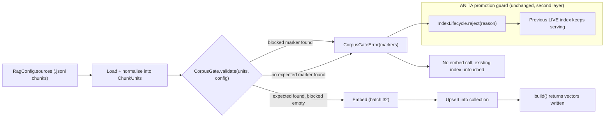

> **Lens:** Architect · **Decided by:** PO · **Inputs:** CR-01-contract.md, CR-01 Appendix B · **Engagement:** Brownfield

# US-102 — Make the corpus gate injected config so ANITA's corpus validates [Lens: Architect]

- **Story:** As an **ops admin**, I want the retrieval corpus acceptance/rejection markers to come from configuration instead of hardcoded Meridian constants, so that ANITA's 32-page, 141-chunk catalogue builds an index — while a foreign corpus (Meridian, UMD, FDU) is still refused before a single embedding call.
- **Business value:** **This is the load-bearing blocker of the whole RAG adoption (B-1).** The source's `build_vector_store` validates against `EXPECTED_MARKERS = ["meridian university"]` and returns `None` for anything else (`rag_legacy.py:89-95`, `:226-229`). ANITA's corpus contains zero "meridian university" markers, so a straight port produces **no index at all** — retrieval is dead and every catalogue question declines. Lifting the gate into config is what turns the copy into a working ANITA index without weakening the contamination defence (`BRD-18`).
- **Priority:** **Must** — blocks US-103, US-104 and US-105 in practice: with no build there is nothing to persist, no rung to record and nothing to wire.

## Acceptance Criteria [Lens: PO]

```gherkin
Scenario: Happy path — the ANITA catalogue passes its own configured gate
  Given the ANITA corpus at data/out/chunks.jsonl with 141 chunks from 32 scraped pages
  And the configured expected marker "anitamedicalsystems" (present in all 141 source URLs)
  And the configured blocked markers (meridian, umd, fdu, admissions, terrapin, fafsa, …)
  When the corpus gate runs inside RagService.build()
  Then zero blocked markers are found
  And the expected marker is found
  And the gate passes and embedding proceeds
  And build() returns 141 vectors written, never None

Scenario: Failure path — a corpus with no ANITA identity marker is refused
  Given a corpus whose chunk text and source URLs contain none of the configured
      expected markers
  When the corpus gate runs
  Then a CorpusGateError is raised naming every expected marker that was checked
  And no embedding call is made
  And no vector is written to the collection
  And the previously built index (if any) is untouched

Scenario: Failure path — a foreign corpus is refused by a blocked marker
  Given a corpus containing "university of maryland" in one chunk
  And containing "meridian" in another
  When the corpus gate runs
  Then a CorpusGateError is raised naming BOTH markers
  And the error lists every blocked marker found, not only the first
  And the build is refused before embedding

Scenario: Negative configuration — the gate cannot be switched off by config
  Given a RagConfig with expected_markers = ()
  Or a RagConfig with blocked_markers = ()
  When the config is constructed
  Then a RagConfigError is raised naming the empty field
  And no RagService is created
```

Technical acceptance criteria [Lens: TPO]:

- TAC-1: The ANITA corpus as shipped (141 chunks, 24 distinct `product_id` values, 32 source pages) passes the configured gate with zero blocked-marker hits. Verified counts: "anitamedicalsystems" in 141/141 chunks, "anita medical systems" in 53/141, zero occurrences of `meridian`, `university of maryland`, `terrapin`, `fafsa`, `mddcs`, `mhec`, `fairleigh dickinson`, `umd`, `fdu`, `admissions`.
- TAC-2: Gate failure raises `CorpusGateError`; `build()` never returns `None` on any path (the source's silent-`None` behaviour at `rag_legacy.py:226-229` is the B-1 failure mode and must not survive the port).
- TAC-3: Gate failure happens **before** the first embed call; an embedder stub that counts calls asserts `calls == 0` on rejection.
- TAC-4: Matching is case-insensitive and covers, per source: for a markdown source, the whole file text (source semantics, `rag_legacy.py:98-111`); for a JSONL source, the concatenation of every chunk's `text`, `context_prefix` and `source_url` (ANITA's identity marker lives in `source_url`, matching `platform/app/anita/index.py:89-94`).
- TAC-5: **Every** blocked marker found is reported in the error, not just the first (carried from the loop at `rag_legacy.py:108-110`).
- TAC-6: The ANITA gate values are config-file values, not code: changing the marker list in `platform/config/anita.yaml` changes the gate with no code edit and no rebuild.

## HLD — Architecture Slice [Lens: Architect]



- **Components touched:**
  - `shared/rag/corpus_gate.py` — new; `validate_corpus()` plus the marker-matching helpers.
  - `RagConfig.expected_markers` / `RagConfig.blocked_markers` — injected values (US-101 field definitions; this story owns their semantics).
  - `RagService.build()` — calls the gate first, before loading embeddings or opening the collection for write.
  - `platform/config/anita.yaml` `rag:` section — the ANITA marker values (new keys; read in `load_settings`).
  - ANITA's existing `assert_corpus_is_anita` (`platform/app/anita/index.py:79-102`) is **not removed and not weakened** — it remains the promotion-time guard in the index lifecycle. This story adds the build-time gate inside the shared package; the two layers have different inputs (loaded corpus vs. shared units) and must agree.
- **Interaction summary (happy path):** 1. `build()` loads `sources` into normalised units. 2. The gate builds the haystack per source and casefold-searches. 3. No blocked marker and at least one expected marker → proceed. 4. Embedding and upsert proceed (US-103). 5. `build()` returns the vector count.
- **Failure paths:** (a) expected marker absent → `CorpusGateError`, no embed, no write; (b) any blocked marker present → `CorpusGateError` naming all hits; (c) empty corpus (zero units) → `CorpusGateError("corpus is empty")`; (d) source file missing → `CorpusGateError` naming the path (source behaviour returned `None` here, `rag_legacy.py:222-224`); (e) ANITA's `IndexLifecycle` catches the error and moves the build to `REJECTED` while the LIVE index keeps serving (`platform/app/anita/index.py:311-321`).

## LLD — Implementation Detail [Lens: Architect]

### Module path and signatures

```python
# shared/rag/corpus_gate.py
from dataclasses import dataclass

@dataclass(frozen=True)
class ChunkUnit:
    """One normalised retrieval unit produced by the source loader."""
    chunk_id: str
    text: str                  # the answer text
    embed_text: str            # context_prefix + "\n\n" + text when a prefix exists
    section: str = ""
    source_file: str = ""
    source_url: str = ""
    metadata: Mapping[str, object] = field(default_factory=dict)

def haystack_for_source(units: Sequence[ChunkUnit], source_file: str) -> str:
    """Casefolded search surface for one source.

    .jsonl  -> " ".join(text + " " + context_prefix + " " + source_url for every unit)
    .md     -> the whole file text, exactly as rag_legacy.validate_source saw it
    """

def validate_corpus(units: Sequence[ChunkUnit], config: RagConfig) -> None:
    """Raise CorpusGateError unless the corpus passes the configured gate.

    Order of checks:
      1. units empty                          -> CorpusGateError("corpus is empty — nothing to index")
      2. any blocked marker in any haystack   -> CorpusGateError(issues=[...every hit...])
      3. no expected marker in any haystack   -> CorpusGateError(issues=["expected marker not found: ..."])
    A corpus that fails 2 never reaches 3: the foreign-content message is the
    more specific one and must be the one an operator sees.
    """
```

```python
# shared/rag/errors.py (additions)
class CorpusGateError(Exception):
    """Corpus identity/contamination failure. Carries `issues: tuple[str, ...]`."""
    def __init__(self, issues: Sequence[str]) -> None:
        self.issues = tuple(issues)
        super().__init__("; ".join(self.issues))
```

### Matching rules (exact)

- Both the haystack and every marker are `.casefold()`-ed before the substring test (source: `low = text.lower()`, `rag_legacy.py:105`).
- **Expected markers are any-of**: the gate passes if **at least one** expected marker appears anywhere in the corpus (source: `if not any(m in low for m in EXPECTED_MARKERS)`, `rag_legacy.py:106`).
- **Blocked markers are any-of, all reported**: every blocked marker that appears produces one issue line (source loop, `rag_legacy.py:108-110`); the port raises with all of them, because "fix one, rebuild, discover the next" is a wasted build cycle.
- Markers are plain substrings, not word-boundary regexes. This is deliberate: the source's contaminated PDF produced OCR variants ("maradian", "marradian") that a word-boundary rule would still catch only if spelled exactly (`rag_legacy.py:90-95`). The short markers `umd` and `fdu` are accepted as substring risks because they were proven necessary against the real contaminated corpus; ANITA's corpus has zero occurrences of either.
- No normalisation beyond casefolding (no accent stripping, no whitespace collapsing): a marker that differs from the corpus only by punctuation is not matched, and the operator sees the refusal.

### Config keys and defaults

Added to `platform/config/anita.yaml` under a new `rag:` section:

```yaml
rag:
  # Build-time corpus gate (US-102). Read into RagConfig.expected_markers /
  # blocked_markers. Case-insensitive substring match.
  expected_markers:
    - anitamedicalsystems       # present in 141/141 source URLs of the shipped corpus
  blocked_markers:
    - meridian                  # sibling product vocabulary (also ANITA index.py:76)
    - university of maryland
    - terrapin
    - fafsa
    - mddcs
    - mhec
    - fairleigh dickinson
    - umd
    - fdu
    - admissions
```

- Defaults when the keys are absent from the file: `RagSettings.expected_markers = ()` and `blocked_markers = ()` — which `RagConfig.__post_init__` **refuses**. The failure direction is strict: a missing gate config stops the build rather than silently accepting any corpus. This mirrors ANITA's existing strict-position rationale for empty deferral lists (`platform/app/anita/config.py:138-150`).
- Environment override: none for the marker lists in this story. Operators edit the config file; markers are corpus policy, not per-process tuning, and an env override would let a stray process environment weaken the gate. (Contrast: `mode`, cooldown and timeouts are legitimately env-overridable in US-104 because tests vary them in-process.)
- The values are read by `load_settings` via `rail_raw.get("expected_markers", ...)` with `_env_*` helpers for the scalar keys, so MOD-09's read-coverage audit (`platform/app/anita/config_truth.py`) sees them as reads (DG-09).

### Data structures

- `ChunkUnit` is the one normalised unit between the loaders and the gate/store:
  - `.jsonl` mapping from ANITA's chunk record: `chunk_id`, `text`, `context_prefix`, `chunk_type`, `product_id`, `product_name`, `category`, `source_url`, `token_estimate`, `content_hash` (`platform/app/anita/retrieval.py:62-75`).
  - `embed_text` is `context_prefix + "\n\n" + text` when a prefix exists, else `text` — byte-identical to the current ANITA embed input (`platform/app/anita/retrieval.py:56-60`). Changing this would change every vector and invalidate the gate calibration; it must not change.
  - `.md` mapping from the source splitter: `section` from the `## ` heading, `source_file` from the filename (`rag_legacy.py:184-202`).
- `CorpusGateError.issues` is a tuple of human-readable strings, each naming the marker and (for markdown) the source file.

### Edge cases

1. Corpus with 141 chunks but zero expected markers (e.g. a truncated scrape missing source URLs) → refused; the message names the expected markers checked.
2. Corpus containing the Meridian blocklist term in a *single* chunk out of 141 → refused; the contamination surface is the whole corpus, not a sample.
3. Corpus containing only one expected marker out of several configured → passes (any-of), and the accepted marker is logged at INFO.
4. Zero-unit corpus → refused before marker logic, with "corpus is empty — nothing to index" (source parity: `platform/app/anita/index.py:86-87`).
5. A `sources` path that does not exist → `CorpusGateError` naming the missing path before any marker test (source parity: `rag_legacy.py:220-224` returned `None`; the shared package raises).
6. A source file with a BOM or CRLF line endings → text is compared after `casefold()` only; CRLF does not affect substring matching within a line.
7. A marker containing uppercase (e.g. `"ANITA"`) → casefolded on both sides; matches.
8. A corpus that passes the gate but is not ANITA's (e.g. an empty-ish dummy with a URL containing the marker) → the shared gate is a *marker* gate, by design; ANITA's second-layer identity guard (`platform/app/anita/index.py:79-102`, ≥20 product ids / required marker / forbidden markers) remains the promotion-time defence. This story does not remove it.
9. Two sources in `sources`, one clean and one contaminated → refused; the error names the contaminated source file.
10. Gate config edited to add a new product-line marker → next `build()` uses it with no code change (TAC-6).

### Error handling

- `CorpusGateError` propagates out of `build()` to the caller. In ANITA, `anita.index.build_index` catches any exception around the build and calls `lifecycle.reject(...)`, so the previous LIVE index keeps serving (`platform/app/anita/index.py:311-321` — the existing pattern; the adapter wiring is US-105).
- The error never deletes or overwrites vectors: rejection happens before the store is opened for write.
- No `None` return, no `logger.error` + continue: the source's "log and return None" (`rag_legacy.py:228-229`) is replaced by a raise, because a `None` build is indistinguishable from "nothing to do" at the call site (B-1's evidence).

### Regression contract — keeping ANITA green

- This story changes only `shared/rag` plus additive `rag:` keys in `platform/config/anita.yaml` and their read in `load_settings`. ANITA's existing identity guard, answer path and retrieval wiring are untouched until US-105.
- `platform/tests/test_mod03_index.py` (which exercises `assert_corpus_is_anita` and the lifecycle) must remain green unchanged; a new test proves the two guards agree on the ANITA corpus.
- The 614 platform tests and the release gate (70 cases / 25 scenarios, CR-01-contract.md C6) are unaffected because no behaviour on the live path changes in this story; the ANITA-specific gate values are asserted in `shared/tests/` and in a config test that loads the shipped `anita.yaml`.

### Test scenarios

- **Unit — happy:** fixture of three `ChunkUnit`s carrying `anitamedicalsystems` in `source_url` passes with the shipped ANITA markers; zero issues.
- **Unit — negative, missing identity:** fixture with markers stripped → `CorpusGateError`, message names `anitamedicalsystems`.
- **Unit — negative, contamination:** fixture containing `"University of Maryland"` and `"Meridian"` (mixed case) → `CorpusGateError` whose `issues` has **two** entries, one per marker (TAC-5).
- **Unit — boundary, casefold:** `"ANITA MEDICAL SYSTEMS"` in text and `anitamedicalsystems` configured → expected marker found.
- **Unit — empty corpus:** zero units → refused with the empty-corpus message before marker tests.
- **Unit — missing source file:** `sources=(Path("does-not-exist.jsonl"),)` → refused naming the path, embedder stub count 0.
- **Unit — no embed on rejection:** embedder stub records calls; assert 0 after a rejected build (TAC-3).
- **Integration — real corpus:** run the gate over the shipped `data/out/chunks.jsonl` (141 units) with the shipped `anita.yaml` values → passes; assert the recorded counts (141 chunks, 24 product ids) so a regenerated corpus that shrinks or loses its identity fails loudly.
- **Integration — foreign corpus:** copy the Meridian markdown fixture in as a source → refused; assert no collection was created at `persist_path`.
- **Integration — second layer agreement:** for the same 141 chunks, `shared.rag.corpus_gate.validate_corpus` passes **and** `anita.index.assert_corpus_is_anita` does not raise; for a Meridian fixture both refuse (proves the two guards cannot disagree on the shipped corpus).
- **Config — shipped values:** load `platform/config/anita.yaml` through `load_settings`; assert `expected_markers == ("anitamedicalsystems",)` and `blocked_markers` contains all ten shipped markers; assert removing the section makes the config refusal fire (not a silent empty gate).

## Traceability

| Behaviour claimed | CR-01 requirement | MOD | Evidence (file:line) |
|---|---|---|---|
| Gate constants are hardcoded Meridian markers | C5 M-1; B-1 | MOD-03 | `rag_legacy.py:89-95` |
| Gate enforcement inside the builder; failure returns `None` | C5 M-1; B-1 | MOD-03 | `rag_legacy.py:226-229` |
| Source validation semantics (casefold, any-of expected, loop blocked) | C5 M-1 | MOD-03 | `rag_legacy.py:98-111` |
| Missing source file returns `None` | C5 M-1 | MOD-03 | `rag_legacy.py:220-224` |
| ANITA corpus is 32 scraped HTML pages → 141 chunks | CR-01.1 | MOD-03 | CR-01-rag-sentiment-rearchitecture.md:200-210 (Appendix B.2); §4:51 |
| ANITA's existing promotion-time identity guard must not be weakened | BRD-18 | MOD-03, MOD-09 | `platform/app/anita/index.py:75-102` |
| Build rejection leaves the previous LIVE index serving | TRD-15 | MOD-03 | `platform/app/anita/index.py:311-321` |
| Marker values verified against the shipped corpus (141/141 identity; 0 blocked hits) | CR-01.2 | MOD-03 | repo-verified: `data/out/chunks.jsonl` (141 lines, 24 product_ids, marker counts) |
| Config read-coverage audit requires configured keys to be read (DG-09) | C6 | MOD-09 | `platform/app/anita/config_truth.py:1-45` |
| 614 tests + 70 cases / 25 scenarios must stay green | C6 | MOD-03 | CR-01-contract.md:104-110 |

- Parent module: `MOD-03`
- CR-01 requirements: `CR-01.1`, `CR-01.3`
- Contract: C3.1 (`RagConfig.expected_markers`/`blocked_markers`), C5 M-1, C6, C7 (no ERC service)
- Evidence appendix: Appendix B.1 blocker **B-1**; Appendix B.5 verdict ("The build returns `None` and there is no index at all")
- Reconciliation: `REC-04`, `REC-23` (corpus identity gate pattern)
- Business requirements: `BRD-04` (grounded answers), `BRD-18` (instance isolation)
- Assets: `DAT-01` (chunks), `DAT-12` (index), `DAT-13` (config)

## Definition of Done

- [ ] `shared/rag/corpus_gate.py` exists with `validate_corpus` and `CorpusGateError`
- [ ] `build()` raises on gate failure and never returns `None`; no embed call on rejection (TAC-2, TAC-3)
- [ ] The shipped ANITA corpus passes the shipped config; a Meridian fixture is refused (TAC-1)
- [ ] `rag:` section added to `platform/config/anita.yaml` and read by `load_settings` (config_truth audit clean)
- [ ] ANITA's `assert_corpus_is_anita` still present and exercised by `platform/tests/test_mod03_index.py` unchanged
- [ ] ANITA's 614 platform tests and the 70-case / 25-scenario release gate are green
- [ ] All ACs pass (AC-1 … AC-4, TAC-1 … TAC-6)
