> **Lens:** Architect · **Decided by:** PO · **Inputs:** CR-01-contract.md, CR-01 Appendix B · **Engagement:** Brownfield

# US-103 — Persist the ANITA index in Chroma so a restart does not re-embed [Lens: Architect]

- **Story:** As an **ops admin**, I want ANITA's 141-chunk index written to a persistent Chroma collection at the configured path with cosine space, so that a process restart loads the existing index instead of re-embedding the corpus, a rebuild is idempotent, and the ~25 s per-process re-embed disappears.
- **Business value:** Two things change. **Startup:** today every new process builds the index in memory (`InMemoryStore`, `platform/app/anita/retrieval.py:449`) and pays the full 141-chunk embed before the first answer. **Durability:** an in-memory index dies with the process, so a crash costs the build again and there is no artefact an operator can inspect. Chroma persistence is the component CR-01 Appendix B.3 names as "genuinely worth adopting" — it kills the per-process re-embed and lets the index survive restart (`rag_legacy.py:172-181`, `:263-289`).
- **Priority:** **Must** — depends on US-101 (store interface) and US-102 (the build gate); blocks nothing, but every later story is measured against the restart behaviour it delivers. TPO ordering note: build once, then prove the second process does not embed.

## Acceptance Criteria [Lens: PO]

```gherkin
Scenario: Happy path — first run builds and persists the index
  Given no Chroma collection exists at the configured persist_path
  And the corpus gate passes for the 141-chunk ANITA corpus
  When RagService.build() runs
  Then the collection is created with metadata {"hnsw:space": "cosine"}
  And 141 vectors are written in batches of 32
  And build() returns 141
  And status() reports vectors = 141, collection = "anita_ams__v1"

Scenario: Happy path — a restart loads the index and embeds nothing
  Given a built collection at the configured persist_path
  When a new process constructs RagService and calls retrieve("FCR Prima T2 weight")
  Then the collection is opened, not rebuilt
  And the embedder is called exactly once (the query), not 141 times
  And the result carries chunks from the persisted collection
  And status() reports vectors = 141

Scenario: Happy path — rebuilding is idempotent by chunk_id
  Given a collection already holding 141 vectors for chunk ids C1…C141
  When build() runs again over the same corpus
  Then the same 141 ids are upserted
  And the collection still holds exactly 141 vectors
  And no duplicate chunk_id exists

Scenario: Failure path — a collection in the wrong distance space is refused
  Given an existing collection created with {"hnsw:space": "l2"}
  When RagService opens it with distance_space "cosine"
  Then a SpaceMismatch is raised naming both spaces
  And no vectors are written and no query is served from it

Scenario: Failure path — an unwritable persist_path fails the build loudly
  Given persist_path points at a location the process cannot write
  When RagService.build() runs
  Then a VectorStoreUnavailable is raised naming the path
  And the caller can reject the build; no partial collection is promoted

Scenario: Failure path — a dimension mismatch is rejected before any write
  Given an existing collection whose vectors are 512-dimensional
  And the configured embedder produces 768-dimensional vectors (nomic-embed-text)
  When build() runs
  Then a DimensionMismatch is raised naming 512 and 768
  And the existing collection is left byte-for-byte unchanged
```

Technical acceptance criteria [Lens: TPO]:

- TAC-1: A warm `retrieve()` on a persisted collection performs **1** embedder call (the query) and **0** corpus embeds. Measured with a counting embedder stub across two `RagService` instances in one process and across two processes.
- TAC-2: `build()` is idempotent: `build(); build()` leaves `store.count() == 141` and the second call returns 141 (vectors written, contract C3.1).
- TAC-3: Collection metadata is exactly `{"hnsw:space": "cosine"}` on create (carried, `rag_legacy.py:259`); an existing collection whose metadata disagrees raises `SpaceMismatch` rather than being silently used.
- TAC-4: A dimension mismatch raises `DimensionMismatch` **before** any upsert in that build; the existing collection is not modified.
- TAC-5: `ChromaVectorStore` is imported lazily: constructing `RagService` with a config never requires `chromadb` to be importable; only `build()`/`retrieve()` against the Chroma backend do. The unit-test suite runs with an `InMemoryVectorStore` and no `chromadb`.
- TAC-6: The persisted collection is the same name the isolation guard checks (`platform/config/anita.yaml`: `chroma_collection: anita_ams__v1`); `langchain` and `meridian_kb__v1` are refused by the existing boot guard and are never created by this code (`platform/app/anita/config.py:124-135`).

## HLD — Architecture Slice [Lens: Architect]

```mermaid
flowchart TB
  subgraph COLD["Cold start (no collection)"]
    B1["build()"] --> CK{"collection exists?"}
    CK -->|no| CREATE["create collection metadata hnsw:space=cosine"]
    CREATE --> EMB1["embed corpus (batch 32)"]
    EMB1 --> UP1["upsert ids=chunk_id"]
    UP1 --> N1["return vectors written"]
  end
  subgraph WARM["Warm start (collection exists)"]
    R1["retrieve(query)"] --> OPEN["open collection"]
    OPEN --> VER{"space == cosine? dim ok?"}
    VER -->|mismatch| ERR["SpaceMismatch / DimensionMismatch"]
    VER -->|ok| QE["embed query only (1 call)"]
    QE --> KNN["Chroma KNN fetch_k (cosine)"]
    KNN --> BM["MiniBM25 over persisted corpus"]
    BM --> RRF["weighted RRF k=60"]
    RRF --> RES["RetrievalResult"]
  end
  subgraph REBUILD["Rebuild (same corpus, stable ids)"]
    B2["build()"] --> UP2["upsert same 141 ids in place"]
    UP2 --> N2["count unchanged; no window with missing ids"]
  end
```



- **Components touched:**
  - `shared/rag/store.py` — new `ChromaVectorStore` plus the existing `VectorStore` Protocol (US-101) and `InMemoryVectorStore` (the test/rollback backend).
  - `RagService.build()` / `retrieve()` — orchestrate open → gate → embed → upsert, and open → embed query → dense + sparse → fuse.
  - `platform/config/anita.yaml` `rag.persist_path` / `rag.collection` — defaults resolved from the isolation section so there is one definition of each path and name.
  - ANITA's `IndexLifecycle` (`platform/app/anita/index.py`) — unchanged; it remains the owner of promotion state and the build lock. This story does not move that responsibility into `shared/rag`.
- **Interaction summary (happy path):** 1. `build()` runs the corpus gate (US-102). 2. The store opens or creates the collection with cosine space. 3. Chunks embed in batches of 32 and upsert by `chunk_id`. 4. `build()` returns the number written. 5. `retrieve()` opens the collection, embeds the query once, runs dense KNN with `fetch_k=20`, BM25 over the persisted corpus, fuses with RRF k=60.
- **Failure paths:** (a) unwritable path → `VectorStoreUnavailable`, caller rejects the build (ANITA: previous LIVE index keeps serving, `platform/app/anita/index.py:311-321`); (b) wrong distance space → `SpaceMismatch` at open, no query served; (c) dimension mismatch → `DimensionMismatch` before writes; (d) collection exists but is empty (`count() == 0`) → `retrieve()` returns rung `local` with zero chunks and `degraded=true`, and ANITA's gate then declines; it is not reported as a working index.

## LLD — Implementation Detail [Lens: Architect]

### Module path and signatures

```python
# shared/rag/store.py
from typing import Protocol, Sequence

class VectorStore(Protocol):
    def name(self) -> str: ...
    def count(self) -> int: ...
    def upsert(self, ids: Sequence[str], vectors: Sequence[Sequence[float]],
               metadatas: Sequence[dict]) -> None: ...
    def query(self, vector: Sequence[float], top_k: int) -> list[tuple[str, float]]: ...
        # returns (chunk_id, COSINE SIMILARITY) — not distance

class ChromaVectorStore:
    """Persistent Chroma backend. hnsw:space is fixed at creation (rag_legacy.py:259)."""

    def __init__(self, persist_path: Path, collection_name: str,
                 *, space: str = "cosine") -> None: ...

    @classmethod
    def open(cls, persist_path: Path, collection_name: str,
             *, space: str = "cosine") -> "ChromaVectorStore":
        """Open or create. Raises VectorStoreUnavailable / SpaceMismatch."""

    def name(self) -> str: ...
    def count(self) -> int: ...
    def upsert(self, ids, vectors, metadatas) -> None:
        """Chroma upsert by id — idempotent for a stable chunk_id."""
    def query(self, vector, top_k: int) -> list[tuple[str, float]]:
        """Dense KNN. Maps Chroma's cosine DISTANCE to similarity: sim = 1.0 - distance."""
    def metadata(self) -> dict: ...
    def dimensions(self) -> int | None:
        """Length of a stored vector, or None when the collection is empty."""

class InMemoryVectorStore:
    """Brute-force backend for tests and for the ANITA memory rollback (US-105)."""
```

```python
# shared/rag/service.py — build/retrieve details owned by this story

def build(self) -> int:
    """Gate -> load -> embed -> upsert. Returns vectors written.

    Order is load-bearing:
      1. corpus gate (US-102)           - no I/O to the store yet
      2. store = ChromaVectorStore.open(persist_path, collection_name, space)
      3. dim = store.dimensions(); if dim is not None and dim != len(first_vector)
             -> DimensionMismatch before any upsert
      4. for each batch of embed_batch_size chunks:
             vectors = self._embedder.embed([u.embed_text for u in batch])
             store.upsert(ids, vectors, metadatas)
      5. return number of vectors written (len(units) on success)
    """

def retrieve(self, query: str) -> RetrievalResult:
    """Open the store; embed the query ONCE; dense + BM25 + RRF; rung recorded."""
```

### Store creation and verification

```python
metadata = {"hnsw:space": "cosine"}          # rag_legacy.py:259
client = chromadb.PersistentClient(path=str(persist_path))   # rag_legacy.py:277
collection = client.get_or_create_collection(name=collection_name,
                                              metadata=metadata)
```

- On **open**, read `collection.metadata`; if it declares an `hnsw:space` other than the configured `space`, raise `SpaceMismatch`. If the metadata is absent (a legacy/anonymous collection) the store refuses too — an unverified distance space is exactly the silent-wrong-ranking hazard the explicit metadata exists to prevent (`rag_legacy.py:252-260`).
- `persist_path` is created with `mkdir(parents=True, exist_ok=True)` on build. A path that cannot be created or written raises `VectorStoreUnavailable` naming the path and the underlying error type.
- Distance→similarity conversion happens in `query()` and nowhere else: for cosine space Chroma returns `distance = 1 - cosine_similarity`, so `similarity = 1.0 - distance`. This is what makes `top_dense_sim` comparable with ANITA's gate threshold `0.62` (`platform/app/anita/config.py:193`). Getting this backwards would make every query look maximally relevant — hence a dedicated unit test with a hand-computed vector pair.
- Lazy import: `import chromadb` sits inside `ChromaVectorStore.open`, so `import shared.rag` and `InMemoryVectorStore` tests need no `chromadb` (TAC-5). The dependency is already declared: `chromadb>=1.0,<2.0` in `platform/requirements.txt`.

### Idempotent rebuild

- Chunk ids are the corpus `chunk_id` values, stable across rebuilds of the same scrape (`platform/app/anita/retrieval.py:594-611` uses the same contract). Chroma `upsert` replaces by id, so a rebuild over an unchanged corpus changes no vector and adds no row; `count()` before and after are equal (TAC-2).
- A corpus that lost a chunk between builds leaves the orphaned id in the collection. That is deliberate in this story: **deletion is not in scope**, because removing a vector is how an answer silently disappears. The fingerprint/regression check belongs to ANITA's lifecycle (`platform/app/anita/index.py:105-111` `corpus_fingerprint`, and the chunk-count regression REJECT reason in TRD-15). `build()` records `chunks_written` and `store.count()` in `status()` so the caller can detect the mismatch.
- Rebuild during live traffic is safe for readers because a stable id is only ever replaced, never absent: a concurrent query sees the old or the new vector for that id, never a hole. This is the same guarantee the current in-process build relies on; persistence does not weaken it.
- **Writer contract:** exactly one writer at a time per `persist_path`. `shared/rag` does not implement a lock; ANITA's `IndexLifecycle` owns the exclusive build lock and refuses concurrent builds (`TRD-15`; `platform/app/anita/index.py`), and MOD-09 refuses boot for an unbuilt collection. `RagService.build()` from two processes simultaneously is documented as unsupported.

### Config keys and defaults

Under `platform/config/anita.yaml` `rag:` (the section introduced in US-102):

```yaml
rag:
  persist_path: ./data/chroma_anita   # default: isolation.chroma_path (single definition)
  collection: anita_ams__v1           # default: isolation.chroma_collection
  embed_batch_size: 32                # matches platform/app/anita/retrieval.py:594
  distance_space: cosine              # rag_legacy.py:259
```

- `persist_path` / `collection` default to the existing isolation values (`platform/config/anita.yaml`: `chroma_path: ./data/chroma_anita`, `chroma_collection: anita_ams__v1`) rather than being duplicated. The shared package never reads `os.environ`; ANITA's `load_settings` resolves the values and builds `RagConfig` (US-105).
- Env overrides: `ANITA_CHROMA_PATH` and `ANITA_CHROMA_COLLECTION` already override the isolation values (`platform/app/anita/config.py:332-340`); the `rag:` keys are read through the same `_env*` helpers with a file fallback, so the existing override semantics are preserved.

### Edge cases

1. Cold start, empty parent directory → created; collection created; 141 written.
2. Cold start, `persist_path` exists but holds a different collection → `get_or_create` opens only the named collection; other collections are untouched.
3. Warm start → 1 embed call (query only) (TAC-1).
4. Second process, same path → opens the collection the first process built; both can query; only one may build at a time (writer contract).
5. Rebuild unchanged corpus → count stays 141, ids identical.
6. Rebuild shrunk corpus → orphans remain; `build()` returns the new (smaller) number written; ANITA's lifecycle rejects on the chunk-count regression before promotion.
7. Dimension mismatch: existing 512-d vectors vs 768-d embedder → `DimensionMismatch` before any write (TAC-4; mirrors the TRD-15 dim-mismatch reject reason).
8. Distance-space mismatch (`l2` collection opened as `cosine`) → `SpaceMismatch` at open.
9. Collection exists, count 0 (an interrupted previous build) → retrieval returns no dense hits; sparse leg can still serve from the loaded corpus; result is `degraded=true` when dense was expected; ANITA's boot note "index not built" fires.
10. `persist_path` is a file, not a directory → `VectorStoreUnavailable` naming the path.
11. Concurrent readers during a rebuild → each id is old or new, never missing.
12. Killing the process mid-build → Chroma's durable store holds whatever batches were committed; the next build re-upserts from the start, converging on 141 (idempotent).
13. Disk full mid-upsert → Chroma raises; `build()` propagates `VectorStoreUnavailable`; the partially written ids remain but the build is reported failed, and the ANITA lifecycle rejects, leaving the previous LIVE index serving.
14. `chromadb` not installed → `VectorStoreUnavailable` at open with an actionable message; import of the package still succeeds (TAC-5).

### Error handling

- `VectorStoreUnavailable` — open/create/upsert/query failure; message includes `persist_path`, `collection_name` and the underlying exception type. `build()` propagates it; `retrieve()` catches it, degrades to sparse-only with `degraded=True` and rung `local` if the BM25 corpus is available, else rung `none`.
- `SpaceMismatch` / `DimensionMismatch` — raised at open / before first write, never caught and coerced; a wrong-space store must not serve a single result.
- No silent `None`: the source's `_build_raw_chromadb` returned `None` when the collection was missing (`rag_legacy.py:280-287`); the shared store raises, and the caller decides (ANITA declines, it does not improvise).

### Regression contract — keeping ANITA green

- The live ANITA path still uses `InMemoryStore` until US-105 wires the adapter, so this story changes no ANITA behaviour and the 614 tests plus the 70-case / 25-scenario release gate are untouched (CR-01-contract.md C6).
- `platform/tests/test_mod03_retrieval.py` keeps exercising `Retriever` with `InMemoryStore` and must pass unchanged; `InMemoryVectorStore` is a port of that class's semantics (`platform/app/anita/retrieval.py:449-487`) so a shared-backend equivalence test can assert identical rankings on the same fixture.
- ANITA's `_index_available` check (`platform/app/anita/assembly.py:108-118`) already treats a populated `chroma_path` as "index built"; after US-105 the same predicate becomes truthful for the first time. It is not changed here.

### Test scenarios

- **Unit — create:** with a temp dir, `ChromaVectorStore.open` creates the collection; `metadata()["hnsw:space"] == "cosine"` (TAC-3).
- **Unit — similarity mapping:** upsert two known orthogonal-ish vectors; query with one; assert the returned score is `1 - distance` and that a self-query scores ≈ 1.0 (guards the inverted-similarity failure).
- **Unit — idempotent rebuild:** fixture of 3 units; `build()` twice; `count() == 3` after both (TAC-2).
- **Unit — dimension mismatch:** seed a collection with 4-d vectors, configure an 8-d embedder stub → `DimensionMismatch`, and assert `count()` is unchanged (TAC-4).
- **Unit — space mismatch:** create with `{"hnsw:space": "l2"}`, open as cosine → `SpaceMismatch`.
- **Unit — missing chromadb:** patch `sys.modules["chromadb"] = None` → `VectorStoreUnavailable` with an actionable message; `import shared.rag` itself still succeeds (TAC-5).
- **Unit — unwritable path:** point `persist_path` at a file → `VectorStoreUnavailable` naming it.
- **Integration — cold/warm:** process 1 builds (counting embedder: 141 calls); process 2 (new interpreter) retrieves (counting embedder: 1 call) and returns the same top chunk id as process 1 for the same query (TAC-1).
- **Integration — rebuild during queries:** start a query loop, run a rebuild, assert 0 query exceptions and every result id either old or new, never missing.
- **Integration — kill mid-build:** injected exception after the first batch; next `build()` converges to the full count, no duplicates.
- **Integration — InMemory equivalence:** identical fixture and query against `InMemoryVectorStore` and `ChromaVectorStore`; assert identical chunk id order (deterministic tie-break on `chunk_id`, TRD-13).
- **E2E — release gate:** `scripts/release_gate.py`'s `chat.retriever.build_index()` path (after US-105 wiring) leaves a populated collection; a second run of the script embeds only queries.
- **Load:** 20 concurrent warm queries against the persisted collection → 0 errors, no embedder call other than the 20 queries, p95 within the existing retrieval budget.

## Traceability

| Behaviour claimed | CR-01 requirement | MOD | Evidence (file:line) |
|---|---|---|---|
| Chroma persistence is the component worth adopting; kills the ~25 s per-process re-embed | CR-01.1 | MOD-03 | CR-01-rag-sentiment-rearchitecture.md:218-219 (Appendix B.3); `rag_legacy.py:172-181`, `:263-289` |
| Cosine space metadata at collection creation | C3.1 (carried) | MOD-03 | `rag_legacy.py:259` |
| Persisted load path, no rebuild in place | CR-01.1 | MOD-03 | `rag_legacy.py:143-169` |
| Raw-Chroma fallback opened by explicit collection name, `None` on missing | C5 M-2 | MOD-03 | `rag_legacy.py:263-289` |
| ANITA today: in-memory store, per-process build | CR-01.1 | MOD-03 | CR-01-rag-sentiment-rearchitecture.md:51 (§4); `platform/app/anita/retrieval.py:449-495`, `:594-611` |
| ANITA isolation values (`./data/chroma_anita`, `anita_ams__v1`) | CR-01.1 | MOD-09 | `platform/config/anita.yaml:10-13` |
| `chromadb>=1.0,<2.0` is an available dependency | CR-01.1 | MOD-03 | `platform/requirements.txt` (Retrieval section) |
| Dim-mismatch rejection is a lifecycle rule | TRD-15 | MOD-03 | `docs/sdlc/modules/MOD-03-retrieval-grounding.md:100-115` |
| ANITA's build rejection keeps the previous LIVE index | TRD-15 | MOD-03 | `platform/app/anita/index.py:311-321` |
| `build() -> int` returns vectors written; `persist_path` in config | C3.1 | MOD-03 | CR-01-contract.md:40, :46, :48 |
| 614 tests + 70 cases / 25 scenarios must stay green | C6 | MOD-03 | CR-01-contract.md:104-110 |

- Parent module: `MOD-03`
- CR-01 requirements: `CR-01.1`, `CR-01.3`
- Contract: C3.1 (`persist_path`, `build() -> int`, `status()`), C5 M-2, C6
- Evidence appendix: Appendix B.2 (corpus reality), Appendix B.3 (Chroma persistence), Appendix B.5
- Technical requirements: `TRD-12` (one ANITA-only collection, one writer), `TRD-15` (lifecycle; build promotion stays ANITA's)
- Reconciliation: `REC-03` (single collection), `REC-04`
- Assets: `DAT-01` (chunks), `DAT-12` (vector index), `DAT-13` (config)

## Definition of Done

- [ ] `ChromaVectorStore` exists with lazy `chromadb` import; `InMemoryVectorStore` retained for tests and rollback
- [ ] Collection created with `{"hnsw:space": "cosine"}`; `SpaceMismatch` and `DimensionMismatch` both tested
- [ ] Cold-build / warm-restart test passes with the embedder call counts asserted (141 vs 1)
- [ ] Idempotent rebuild test passes (count stable, ids stable)
- [ ] `build()` returns vectors written and never `None`; `status()["vectors"]` is accurate
- [ ] ANITA's 614 platform tests and the 70-case / 25-scenario release gate are green (live path unchanged in this story)
- [ ] All ACs pass (AC-1 … AC-6, TAC-1 … TAC-6)
