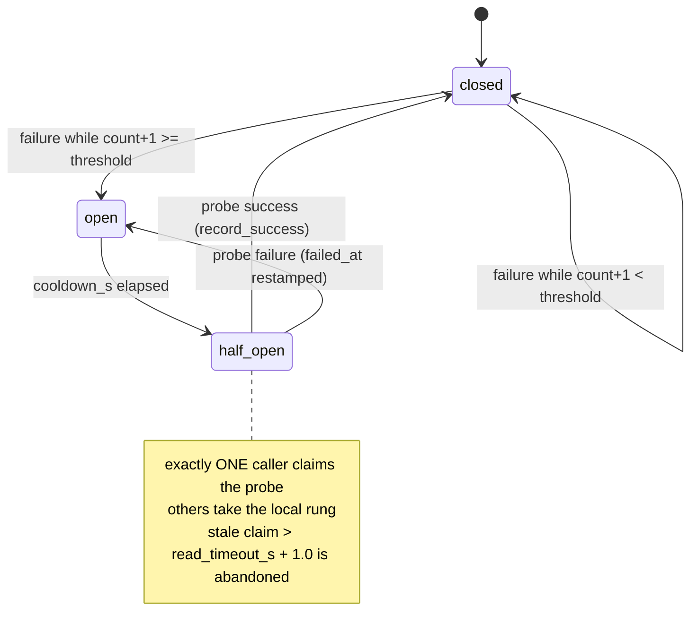

> **Lens:** Architect · **Decided by:** PO · **Inputs:** CR-01-contract.md, CR-01 Appendix B · **Engagement:** Brownfield

# US-104 — Port the circuit breaker and fallback rungs, with a failure threshold and one mode reader [Lens: Architect]

- **Story:** As a **platform engineer**, I want the source's three-state circuit breaker with single-flight probing and per-turn rung recording carried into `shared/rag` — with the source's single-failure trip, inconsistent mode normalisation and fallback-skipping unknown mode fixed — so that ANITA gains fault isolation it has none of today (`CR-01-rag-sentiment-rearchitecture.md:220-221`) without inheriting three verified defects.
- **Business value:** ANITA currently has **no** breaker and **no** rungs: a failed retrieval leg either raises or returns empty, and nothing distinguishes "the primary is down" from "the corpus does not contain the answer" in the turn record. The breaker bounds the wall time a dead dependency can charge a turn, and the rung (`mcp | local | none`) makes every answer attributable. The three fixes matter because the ported code is only an asset if its defects are not carried with it: B-8 makes one transient timeout disable the primary for 30 s; B-9 makes a padded config value mean two different things in two readers; B-10 silently returns an empty answer with no fallback for any mode it does not recognise.
- **Priority:** **Must** — depends on US-101 (`RagConfig`, `RagService`); US-105 consumes `status()` and the rung on every result. TPO ordering note: the fixes are part of the port, not a follow-up; shipping the port without them re-introduces verified defects on a new surface.

## Acceptance Criteria [Lens: PO]

```gherkin
Scenario: Happy path — the breaker survives a transient outage and recovers
  Given failure_threshold = 3 and cooldown_s = 30
  And the primary is admitted and fails once
  When the next turn retrieves
  Then the breaker is still "closed" and the primary is admitted again
  And when the third consecutive failure occurs the breaker is "open"
  And when the cooldown elapses the breaker is "half_open"
  And exactly one caller is admitted as a probe
  And when the probe succeeds the breaker returns to "closed"

Scenario: Negative — a single failure must NOT open the circuit (B-8 regression)
  Given failure_threshold = 3
  When one retrieval attempt fails with a timeout
  Then the breaker state is "closed"
  And the very next turn attempts the primary again
  And the turn's result does not report breaker "open"

Scenario: Failure path — the probe slot is single-flight
  Given the breaker is "half_open"
  When 20 callers retrieve concurrently
  Then exactly one caller claims the probe
  And the other 19 take the local rung without touching the primary
  And status()["breaker_probes"] increased by exactly one

Scenario: Failure path — an abandoned probe does not block recovery forever
  Given a caller claimed the probe and returned without recording a verdict
  And more than read_timeout_s + 1.0 seconds have elapsed
  When the next caller retrieves
  Then the stale claim is released
  And that caller may claim a fresh probe
  And the breaker does not stay "half_open" with a permanently held slot

Scenario: Negative — mode strings are normalised by one reader (B-9 regression)
  Given the configured mode string is " AUTO " (padded, mixed case)
  When the config is constructed and status() is read and a retrieval is admitted
  Then the effective mode is "auto" in every one of those places
  And no reader sees a different mode from any other

Scenario: Negative — an unrecognised mode is refused, not silently degraded (B-10 regression)
  Given the configured mode string is "bogus"
  When RagConfig is constructed
  Then a RagConfigError is raised naming mode and the allowed values
  And no service is created that could return an empty answer with rung "none"
      while skipping the local fallback

Scenario: Attribution — every return path records a rung
  Given a retrieval that succeeds from the primary
  Then rung is "mcp"
  When a retrieval falls back to the local store
  Then rung is "local"
  When neither backend can serve
  Then rung is "none" and degraded is true
  And no return path exists with an unset rung
```

Technical acceptance criteria [Lens: TPO]:

- TAC-1: Breaker states are exactly `closed | half_open | open`; `off` is reported when no primary client is injected (`mode_effective == "off"`) — never a fake `closed` (`rag_mcp.py:348-383`; `rag.py:175`).
- TAC-2: Failure threshold default **3** consecutive failures; a success resets the count and closes the breaker (source resets only on a successful initialize/tools-call: `rag_mcp.py:185`, `:222`). One failure never opens (B-8 fix; source had no threshold, `rag_mcp.py:369-376`).
- TAC-3: Cooldown 30.0 s default (`RAG_MCP_COOLDOWN`, `config.py:406-407`); probe read budget `max(read_timeout_s * probe_fraction, probe_floor_s)` = `max(6.0 * 0.25, 0.5)` = 1.5 s (`rag_mcp.py:56-58`); serving budget `max(min(read_timeout_s, retrieval_budget_s - fallback_reserve_s), probe_floor_s)` = `max(min(6.0, 8.0 - 1.5), 0.5)` = 6.0 s (`rag_mcp.py:68-70`); probe abandonment after `read_timeout_s + 1.0` (`rag_mcp.py:440`).
- TAC-4: Probe claim is atomic under concurrency: 20 concurrent claims on a `half_open` breaker produce exactly 1 `True` (port-time hardening of the source's check-then-set `claim_probe`, `rag_mcp.py:448-463`, which has no lock; see "Port-time defects" below).
- TAC-5: Mode normalisation exists in exactly **one** function, used by config validation, admission and status (B-9 fix; source split it between `rag.py:67` `.lower()` and `rag_mcp.py:500` `.strip().lower()`).
- TAC-6: An unrecognised mode raises `RagConfigError` at construction and can never reach the dispatch (B-10 fix; source admitted unknown modes like auto and returned `""` with rung `"none"`, skipping the fallback — `rag.py:208`, `:215-216`).
- TAC-7: Every `RetrievalResult` and every `status()` snapshot carries `rung ∈ {mcp, local, none}` (`rag.py:194-216`); the value is set on all return paths including error paths.
- TAC-8: All breaker state transitions are guarded by one `threading.Lock`; `status()` is callable from a worker thread during a probe without tearing (source state was an unguarded dict, `rag_mcp.py:359-366`).

## HLD — Architecture Slice [Lens: Architect]



Per-turn rung decision (the totality B-10 broke):

| mode (normalised) | primary client | breaker state | behaviour | rung |
|---|---|---|---|---|---|
| `off` | any | not consulted; reported `off` | local only | `local` / `none` |
| `on` | present | overridden (admission always true) | primary attempted; on failure **no** fallback (documented override) | `mcp` on success; `none` on failure |
| `auto` | present | `closed` | primary attempted; on failure fall back to local | `mcp` / `local` |
| `auto` | present | `half_open` | exactly one probe; others local | probe `mcp`/`local`; others `local` |
| `auto` | present | `open` | refuse primary | `local` (or `none` if local unavailable) |
| any | `None` | `off` | local only, `mode_effective == "off"` | `local` / `none` |
| unknown | any | — | **refused at config construction** | — |

- **Components touched:**
  - `shared/rag/breaker.py` — new: `CircuitBreaker` with the three states, threshold, cooldown, single-flight probe, abandoned-probe recovery, all under one lock.
  - `shared/rag/config.py` — `normalise_mode()` (the one reader) and the new breaker fields.
  - `shared/rag/service.py` — `RagService.retrieve()` dispatch, rung recording, `status()`.
  - `platform/config/anita.yaml` `rag:` — the breaker keys (read in `load_settings`; US-105 builds the `RagConfig`).
- **Interaction summary (happy path):** 1. `retrieve()` asks the breaker `admit(mode)`. 2. On admit, it calls the primary; success → `record_success()`, rung `mcp`. 3. On failure, `record_failure()`; `auto` falls back to local, rung `local`. 4. Refusal → local directly, rung `local`. 5. The rung and breaker state ride on the result and on `status()`.
- **Failure paths:** primary timeout → counted failure, no exception escapes; breaker open → local rung with `dead_ms` attributed (concept carried from the source's per-turn attribution); local unavailable too → rung `none`, `degraded=true`, empty chunks, and the caller declines.

## LLD — Implementation Detail [Lens: Architect]

### Module path and signatures

```python
# shared/rag/breaker.py
import threading, time

class CircuitBreaker:
    """closed | half_open | open, with a consecutive-failure threshold.

    All mutation happens under self._lock. The lock is the port-time fix for the
    source's check-then-set probe claim (rag_mcp.py:448-463) and its unguarded
    state dict (rag_mcp.py:359-366).
    """

    def __init__(self, *, failure_threshold: int, cooldown_s: float,
                 read_timeout_s: float, probe_fraction: float,
                 probe_floor_s: float) -> None: ...

    # -- constants derived once, per instance (cited values below) -------
    @property
    def probe_read_timeout_s(self) -> float:
        return max(self.read_timeout_s * self.probe_fraction, self.probe_floor_s)

    @property
    def serving_read_timeout_s(self) -> float:
        return max(min(self.read_timeout_s, self.retrieval_budget_s - self.fallback_reserve_s),
                   self.probe_floor_s)

    @property
    def probe_abandon_after_s(self) -> float:
        return self.read_timeout_s + 1.0            # rag_mcp.py:440

    # -- state -----------------------------------------------------------
    def state(self, *, mode: str) -> str:
        """closed | half_open | open | off. 'off' only when mode == 'off'."""
    def admit(self, *, mode: str) -> bool:
        """The single admission decision (rag_mcp.py:477-510).
        off -> False; on -> True; auto -> closed admits, half_open claims one probe,
        open refuses. Never called with an unvalidated mode."""
    def claim_probe(self) -> bool:
        """Atomically: if half_open and no live claim -> claim, probes += 1, True."""
    def release_probe(self) -> None: ...
    def record_success(self) -> None:
        """failure_count = 0; state -> closed; probe slot released."""
    def record_failure(self, error: str) -> None:
        """failure_count += 1; failed_at = now (cooldown restamped); last_error = error;
        if failure_count >= failure_threshold -> state open, opens += 1 (only on transition)."""
    def snapshot(self) -> dict: ...
```

```python
# shared/rag/config.py
MODES = ("off", "on", "auto")

def normalise_mode(raw: str) -> str:
    """The ONE mode reader (B-9 fix).

    Strips, lowercases and validates. Raises RagConfigError naming the value and
    the allowed set. RagConfig.__post_init__ calls this and stores the result,
    so every downstream reader -- admission, status, logging -- sees the same
    normalised value by construction and cannot disagree.
    """
    value = (raw or "").strip().lower()
    if value not in MODES:
        raise RagConfigError(
            "mode", raw, f"permitted values are {', '.join(MODES)}"
        )
    return value
```

```python
# shared/rag/service.py — dispatch (total, mode-keyed)

def retrieve(self, query: str) -> RetrievalResult:
    mode = self._mode                 # already normalised by RagConfig
    if self._mcp is None:
        return self._local(query, breaker="off")          # mode_effective == "off"

    admitted = self._breaker.admit(mode=mode)
    if not admitted:
        return self._local(query, breaker=self._breaker.state(mode=mode),
                           dead_ms=0.0)

    t0 = time.monotonic()
    try:
        chunks = self._mcp.retrieve(query, top_k=self.config.top_k)
    except Exception as exc:                              # adapter boundary
        self._breaker.record_failure(str(exc))
        chunks = None
    attempt_ms = (time.monotonic() - t0) * 1000.0

    if chunks is not None:
        self._breaker.record_success()
        return self._result(chunks, rung="mcp", breaker=self._breaker.state(mode=mode))

    if mode == "auto":                                    # ONLY auto falls back
        return self._local(query, breaker=self._breaker.state(mode=mode),
                           dead_ms=attempt_ms)
    return self._empty(query, rung="none", breaker=self._breaker.state(mode=mode),
                       dead_ms=attempt_ms)                # mode == "on" only
```

The dispatch is keyed on the validated normalised mode, so there is no branch that can be reached with an unrecognised value (B-10). `mode == "on"` failing with no fallback is the **documented override** (`rag_mcp.py:492`: "on — always — the documented breaker override"), not the B-10 defect; the defect was that *unknown* values fell into that branch by accident.

### Constants carried, with their citations

| Constant | Value (default) | Source |
|---|---|---|
| Breaker states | `closed \| half_open \| open` | `rag_mcp.py:348-366`, `:407-421` |
| Failure threshold | **3** (new — source had none) | fix for `rag_mcp.py:369-376` (B-8) |
| Cooldown | `cooldown_s = 30.0` | `RAG_MCP_COOLDOWN`, universityDemo `config.py:406-407` |
| Modes | `off \| on \| auto` (default `auto` in source; ANITA ships `off`) | `rag_mcp.py:500-510` |
| Probe read budget | `max(read_timeout_s * probe_fraction, probe_floor_s)` = 1.5 s | `rag_mcp.py:56-58` |
| Serving read budget | `max(min(read_timeout_s, budget - reserve), probe_floor_s)`; budget 8.0, reserve 1.5 | `rag_mcp.py:68-70` |
| Probe abandonment | `read_timeout_s + 1.0` = 7.0 s | `rag_mcp.py:440`, `:424-445` |
| Reset condition | success only (`record_success`) | `rag_mcp.py:185`, `:222` |
| Probe counters | `opens` on transition to open; `probes` on each claim | `rag_mcp.py:369-376`, `:448-463` |

### Port-time defects (beyond the three named fixes)

- **Non-atomic probe claim.** The source's `claim_probe` reads `_probe_in_flight()` and then sets `_breaker["probing"] = True` with no lock (`rag_mcp.py:448-463`); two threads meeting a `half_open` breaker can both pass the check. Carried as TAC-4: the claim is performed under one `threading.Lock`, and the 20-thread test proves exactly one winner. This is a correctness fix required by the port, not a scope addition.
- **README-level note on abandonment:** the source's abandonment window is `RAG_MCP_TIMEOUT + 1.0` where `RAG_MCP_TIMEOUT` is the *serving* timeout (`rag_mcp.py:440`); the port keeps that derivation and makes it a property, so a configured change to the read timeout moves both budgets together.

### Config keys and defaults

`platform/config/anita.yaml` `rag:` section (adds to US-102's keys):

```yaml
rag:
  mode: off                 # off | on | auto — normalised by normalise_mode()
  failure_threshold: 3      # B-8: consecutive failures before the breaker opens
  cooldown_s: 30.0          # universityDemo config.py:406-407
  read_timeout_s: 6.0       # universityDemo config.py:396-397
  probe_fraction: 0.25      # universityDemo config.py:402-403
  probe_floor_s: 0.5        # rag_mcp.py:56-58
  retrieval_budget_s: 8.0   # rag_mcp.py:68-70
  fallback_reserve_s: 1.5   # rag_mcp.py:68-70
```

Env overrides (read in `load_settings` with `_env`/`_env_float`/`_env_int`, so the MOD-09 read-coverage audit sees them): `ANITA_RAG_MODE`, `ANITA_RAG_FAILURE_THRESHOLD`, `ANITA_RAG_COOLDOWN_S`, `ANITA_RAG_READ_TIMEOUT_S`, `ANITA_RAG_PROBE_FRACTION`, `ANITA_RAG_RETRIEVAL_BUDGET_S`, `ANITA_RAG_FALLBACK_RESERVE_S`. These are legitimately per-process because tests vary them in-process and require the next call to observe the change — the same rationale the source records for its dynamic keys (`rag_mcp.py:23-27`).

**In this change ANITA ships `mode: off`** because no `McpClient` implementation exists (contract C7 puts MCP-over-HTTP and the external ERC service out of scope). The seam and the breaker are fully implemented and tested; ANITA's effective mode is `off`, reported as `mode_effective: "off"` in `status()`. Nothing calls `httpx`.

### Data structures

- Breaker state (private): `failed_at: float | None`, `failure_count: int`, `last_error: str | None`, `probing: bool`, `probe_claimed_at: float | None`, `opens: int`, `probes: int`, all under `self._lock`.
- `status()` addition (US-101's dict, values filled by this story):

```python
{
  "rung": "mcp|local|none" | None,
  "breaker": "off|closed|half_open|open",
  "breaker_opens": int,
  "breaker_probes": int,
  "failure_count": int,
  "failure_threshold": int,
  "last_error": str | None,
  "mode_configured": "off|on|auto",
  "mode_effective": "off|on|auto",
  "probe_read_timeout_s": float,       # derived, for /api/perf/policy
  "serving_read_timeout_s": float,
}
```

### Edge cases

1. Exactly `threshold - 1` failures → still `closed`, primary admitted (boundary test).
2. The `threshold`-th consecutive failure → `open`, `opens` incremented once.
3. Failure, then success, then failure ×3 → the success reset the count; it takes three fresh failures to open.
4. `half_open` + 20 concurrent `admit(auto)` → exactly 1 `True`; the other 19 return `False` without calling the primary (TAC-4).
5. Claimed probe, verdict recorded (`record_success`/`record_failure`) → slot released; the state follows the verdict.
6. Claimed probe, **no** verdict, `read_timeout_s + 1.0` elapsed → the stale claim is cleared by the next `claim_probe`; recovery is possible again (`rag_mcp.py:424-445`, carried).
7. Claimed probe, no verdict, within the window → a second caller is refused the probe; it takes the local rung. It does **not** deadlock the turn.
8. `mode="off"` → `state()` returns `"off"`, `admit()` returns `False`, the primary client is never referenced.
9. `mode="on"`, primary fails → rung `"none"`, empty chunks, `degraded=true`; the local store is **not** consulted (documented override).
10. `mode="auto"`, parser padded string `" AUTO "` and mixed case `"Auto"` → both normalise to `auto`; `status()["mode_configured"] == "auto"` in both (B-9).
11. `mode="bogus"` (also `""`, `"none"`, `"offf"`) → `RagConfigError` at construction (B-10).
12. `mcp=None` with `mode="auto"` → effective `off`; `mode_configured` still reports `auto` so the operator can see the downgrade.
13. A local-store failure while the primary is open → rung `none`, `degraded=true`; the turn declines rather than raising.
14. Zero-vector index → local rung with zero chunks; `degraded=true`; ANITA's gate then declines.
15. Clock going backwards (`time.monotonic` is monotonic, so this cannot happen; asserted as a non-case rather than coded around).

### Error handling

- The breaker never raises: `admit`, `claim_probe`, `record_*` are total.
- A primary exception is caught at the adapter boundary, converted to `record_failure(str(exc))`, and never propagates into the turn.
- `RagConfigError` for mode is a construction-time error and is not caught by the service.
- `status()` never raises; an unavailable store reports `vectors: 0` and its `last_error`.

### Regression contract — keeping ANITA green

- This story changes only `shared/rag` plus additive `rag:` keys. ANITA's live path still uses `Retriever`/`InMemoryStore` until US-105, so the 614 tests and the 70-case / 25-scenario release gate are unaffected (CR-01-contract.md C6).
- The rung and breaker fields are **new** result fields on the shared result type only; ANITA's own `RetrievalResult` (`platform/app/anita/retrieval.py:526-566`) is unchanged, and US-105 maps between them.
- `status()` is designed for the admin read API (`/api/perf/policy` per contract C3.1): no endpoint is added by this story; the dict is asserted directly in tests so the future endpoint has a stable contract.

### Test scenarios

- **Unit — threshold boundary:** two failures → `closed`; third → `open`; `opens == 1` (TAC-2).
- **Unit — B-8 regression (named test):** one failure with `failure_threshold=3` leaves the breaker `closed` and the next `admit(auto)` `True`.
- **Unit — success reset:** fail, fail, succeed, fail, fail → still `closed`.
- **Unit — cooldown:** freeze the clock, `open` → advance 29.9 s → `open`; advance to 30.0 s → `half_open` (boundary).
- **Unit — single-flight:** 20 threads call `admit(auto)` on a `half_open` breaker; collect results; assert exactly one `True`, `probes` incremented once (TAC-4).
- **Unit — abandoned probe:** claim, then advance the clock past `read_timeout_s + 1.0`; a new claim succeeds (`rag_mcp.py:424-445`).
- **Unit — verdict releases the slot:** claim + `record_success` → state `closed`, slot free; claim + `record_failure` → state `open`, `failed_at` restamped.
- **Unit — mode normalisation (B-9):** `" AUTO "`, `"auto"`, `"Auto"` all normalise to `auto`; assert the same value is returned by config, admission and `status()`.
- **Unit — unknown mode (B-10):** `"bogus"`, `""`, `"none"`, `"offf"` each raise `RagConfigError`; assert no `RetrievalResult` with rung `none` can be produced by a config that was never constructible.
- **Unit — rung totality:** fake primary/injected client; exercise success, failure+fallback, refusal, primary-failure-in-`on`, both-unavailable; assert rung is `mcp`, `local`, `local`, `none`, `none` respectively and never unset (TAC-7).
- **Unit — off never touches the client:** a client stub that raises `AssertionError` if called; `mode="off"` retrieval succeeds with rung `local`.
- **Unit — on-failure skips fallback:** `mode="on"`, failing client, healthy local store → rung `none`, empty chunks; assert the local store was not queried.
- **Integration — outage/recovery:** failing client, threshold 3, cooldown 1 s: requests 1–3 fall back to local with breaker `closed`→`open`; after cooldown one probe is admitted; probe succeeds → `closed`, rung `mcp`.
- **Integration — concurrency:** 20 concurrent retrievals during a `half_open` window with a healthy probe → exactly one `mcp` rung, 19 `local`, `breaker_probes` +1.
- **Integration — status under load:** `status()` polled from another thread while probes claim/record → no exception, values monotone where expected.
- **Load:** 1,000 retrievals through the dispatch with a failing primary and a healthy local store → 0 exceptions, bounded attempt time (≤ serving budget per admitted attempt), rung counts consistent with the admission log.

## Traceability

| Behaviour claimed | CR-01 requirement | MOD | TRD-14 / UC-01 | Evidence (file:line) |
|---|---|---|---|---|
| Breaker is three-state `closed\|half_open\|open` | C3.1 carried | MOD-03 | `rag_mcp.py:348-366`, `:407-421` |
| **B-8** single failure opens the breaker; no threshold | C3.1; Appendix B.4 | MOD-03 | `rag_mcp.py:369-376`  TRD-14, UC-01 |
| Cooldown 30 s default | C3.1 carried | MOD-03 | universityDemo `config.py:406-408`  TRD-14, UC-01 |
| Modes `off\|on\|auto`, default auto; `on` overrides the breaker | C3.1 carried | MOD-03 | `rag_mcp.py:477-510` |
| **B-9** `.lower()` vs `.strip().lower()` mode readers | Appendix B.4 | MOD-03 | `rag.py:67` vs `rag_mcp.py:500`  TRD-14, UC-01 |
| **B-10** unrecognised mode admitted like auto, skips fallback, returns `""` rung `none` | Appendix B.4 | MOD-03 | `rag.py:208`, `:215-216`  TRD-14, UC-01 |
| Probe budget `max(read * fraction, 0.5)`; default 1.5 s | C3.1 carried | MOD-03 | `rag_mcp.py:56-58`; `config.py:402-403`  TRD-14, UC-01 |
| Serving budget `budget - reserve`, 8.0 − 1.5 | C3.1 carried | MOD-03 | `rag_mcp.py:68-70`  TRD-14, UC-01 |
| Single-flight probe + abandoned-probe recovery (`read + 1.0`) | C3.1 carried | MOD-03 | `rag_mcp.py:424-463`; `:440`  TRD-14, UC-01 |
| Breaker resets only on success | C3.1 carried | MOD-03 | `rag_mcp.py:185`, `:222`  TRD-14, UC-01 |
| Rung recording `mcp\|local\|none` on every return path | C3.1 carried | MOD-03 | `rag.py:194-216` |
| `status()` reports breaker + rung for `/api/perf/policy` | C3.1 | MOD-03 | CR-01-contract.md:49  TRD-14, UC-01 |
| ANITA has no breaker/rung today | CR-01.1 | MOD-03 | CR-01-rag-sentiment-rearchitecture.md:220-221 (Appendix B.3)  TRD-14, UC-01 |
| ERC/MCP-HTTP out of scope; seam injected only | C7 | MOD-03 | CR-01-contract.md:112-115  TRD-14, UC-01 |
| 614 tests + 70 cases / 25 scenarios must stay green | C6 | MOD-03 | CR-01-contract.md:104-110  TRD-14, UC-01 |

- Parent module: `MOD-03`
- CR-01 requirements: `CR-01.1`, `CR-01.3`
- Contract: C3.1 (`RagService.__init__(config, *, mcp=None)`, `status()`), C5 (constants carried), C7
- Evidence appendix: Appendix B.3 (breaker constants table), Appendix B.4 (B-8, B-9, B-10)
- Reconciliation: `REC-04` (`app/rag*.py` breaker refactor, MCP hop dropped)
- Data gap / state machine: `DG-03` (dependency outage degrades, never fails the turn)
- Assets: `DAT-13` (retrieval config)

## Definition of Done

- [ ] `CircuitBreaker` exists with threshold, cooldown, single-flight claim and abandoned-probe recovery, all under one lock
- [ ] B-8, B-9 and B-10 each have a named regression test that fails against the source behaviour and passes against the port
- [ ] The mode table is total: no input can produce a retrieval that skips the fallback without the operator having chosen `on`
- [ ] Rung recorded on every return path; `status()` exposes breaker + rung + thresholds
- [ ] `rag:` breaker keys added to `platform/config/anita.yaml` and read by `load_settings` (env overrides honoured, config audit clean)
- [ ] ANITA's 614 platform tests and the 70-case / 25-scenario release gate are green (no ANITA file touched in this story)
- [ ] All ACs pass (AC-1 … AC-7, TAC-1 … TAC-8)
