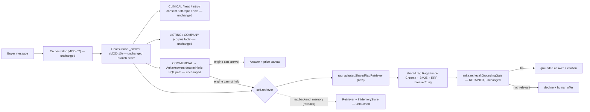

> **Lens:** Architect · **Decided by:** PO · **Inputs:** CR-01-contract.md, CR-01 Appendix B · **Engagement:** Brownfield

# US-105 — Wire `shared/rag` behind ANITA's `GroundingGate`, keep the deterministic-first path, keep a one-setting rollback [Lens: Architect]

- **Story:** As a **product owner at ANITA**, I want the new `shared/rag` retrieval leg wired into `ChatSurface` behind the existing `GroundingGate`, with `AnitaAnswers` still answering deterministic questions first and a config switch that reverts retrieval to today's `InMemoryStore`, so that ANITA gains persistence and breaker isolation without a single change to what buyers are told — and with a rollback that is a setting, not a code change.
- **Business value:** This is the delivery story: everything before it is a library. The constraint that makes it safe is the contract's brownfield rule (C4): ANITA's answer path is **deterministic-first** — 8 of 10 questions are answered from SQL by `AnitaAnswers` and never touch retrieval — and this change does not alter that. The `GroundingGate` is the machinery that makes `BRD-04` enforceable (refuse rather than improvise); it is retained, stays in `anita.retrieval`, and wraps the shared retriever. The rollback is the release-safety device: if answers regress, one config value puts the old retriever back.
- **Priority:** **Must** — the last story in the set; depends on US-101 (package), US-102 (gate), US-103 (persistence), US-104 (breaker + rungs).

## Acceptance Criteria [Lens: PO]

```gherkin
Scenario: Happy path — a catalogue prose question retrieves through shared/rag and is still gated
  Given the shared backend is configured and the ANITA collection is built for anita_ams__v1
  When a buyer asks "what brands do you deal in?" on the chat surface
  Then the adapter calls the shared RagService and converts its chunks into anita.retrieval Chunks
  And the retained GroundingGate evaluates the result before any answer is composed
  And a passing result returns the same RetrievalResult shape the surface already consumes
  And the reply cites the top chunk's source_url

Scenario: Negative — the deterministic path is never intercepted (C4)
  Given a buyer asks "what is the price of the ultrasound gel?"
  And AnitaAnswers can resolve the product and the price
  When the turn is answered
  Then the price comes from AnitaAnswers and its data source
  And the retriever is never called for that turn (adapter call count is 0)
  And no retrieval trace, rung or embedding call is produced for the turn

Scenario: Negative — the gate still refuses an unsupported question
  Given the shared retriever returns chunks for "what is the weather in Mumbai tomorrow?"
  When the retained GroundingGate evaluates the result
  Then the decision is not_relevant
  And RetrievalResult.ok is false and chunks is empty
  And the buyer receives the decline, with no language-model call for the turn

Scenario: Failure path — an unbuilt or unavailable index declines, never improvises
  Given the configured collection does not exist or holds zero vectors
  When a catalogue question arrives
  Then the adapter reports a degraded, empty result
  And the gate declines
  And ChatSurface returns the decline text and offers a human
  And no answer is composed from model memory

Scenario: Rollback — one setting restores today's retrieval exactly
  Given the release gate's grounded-answer rate drops below the recorded baseline
  When the operator sets rag.backend to "memory" and restarts
  Then assembly constructs the existing Retriever with InMemoryStore and the same GroundingGate
  And no RagService is constructed and no Chroma collection is opened
  And the frozen evaluation set answers are byte-identical to the pre-change baseline
  And restoring rag.backend to "shared" re-enables the new path with no code change
```

Technical acceptance criteria [Lens: TPO]:

- TAC-1: The adapter is duck-type compatible with `anita.retrieval.Retriever` for every existing consumer: `retrieve(query, *, top_k=None, fetch_k=None)`, `build_index(*, batch_size=32) -> int`, `build()`, and the attributes `chunks`, `by_id`, `store.count()`, `gate`, `top_k`, `fetch_k`. Consumers that must keep working unchanged: `platform/app/anita/surfaces.py:575`, `:602`; `platform/app/anita/voice_rag.py:20`; `platform/app/anita/voice_pipeline.py:17`; `platform/app/anita/index.py:324-325`; `platform/scripts/release_gate.py:56`; `platform/scripts/system_check.py:371`; `platform/scripts/trace_use_cases.py:74`; `platform/scripts/validate_chat.py:69`; `platform/scripts/rag_audit.py:111-119`.
- TAC-2: `GroundingGate` is imported from `anita.retrieval` and its constructor, `from_chunks` classmethod and `evaluate` semantics are **not modified** (`platform/app/anita/retrieval.py:255-403`). The adapter calls `evaluate` after shared retrieval; it does not reimplement, subclass or bypass it.
- TAC-3: `AnitaAnswers`, `ChatSurface`'s branch order and the orchestrator are not modified. A spy on the adapter proves a deterministic commercial question makes **0** retrieval calls.
- TAC-4: The rollback is configuration: `rag.backend: shared | memory`; an invalid value fails config load. On `memory`, assembly constructs exactly today's object graph (`Retriever(chunks, embedder, InMemoryStore(), gate, ...)`).
- TAC-5: Degraded/absent index never raises into the turn: `assemble()` still starts with a note (the platform's existing "degrade honestly" rule, `platform/app/anita/assembly.py:15-21`), and the surface declines.
- TAC-6: The frozen release gate passes unchanged: 70/70 cases and 25/25 scenarios, and the platform suite of 614 tests passes (CR-01-contract.md C6). The gate's answerer path (`platform/app/anita/assembly.py:264-282`) is the same path a buyer takes.
- TAC-7: Rollback drill is tested: the baseline answer set is captured before wiring, then re-run on `backend=memory` and asserted byte-identical.

## HLD — Architecture Slice [Lens: Architect]



- **Components touched:**
  - `platform/app/anita/rag_adapter.py` — new; `SharedRagRetriever` (the only new ANITA module).
  - `platform/app/anita/assembly.py` — `_build_retriever` gains the backend switch; `assemble()` unchanged otherwise. `_index_available` (`:108-118`) now reflects a real persisted collection.
  - `platform/app/anita/config.py` — new `RagSettings` dataclass on `AnitaSettings`, read by `load_settings` from the `rag:` section.
  - `platform/app/anita/retrieval.py` — **additive only**: `RetrievalResult` gains two defaulted fields (`degraded: bool = False`, `rung: str = "local"`). `GroundingGate`, `Retriever`, `InMemoryStore`, `MiniBM25`, `weighted_rrf` are not modified.
  - `ChatSurface`, `AnitaAnswers`, `Orchestrator` — **not modified** (TAC-3).
- **Interaction summary (happy path):** 1. The orchestrator classifies the turn (unchanged). 2. `ChatSurface._answer` runs its existing branches; deterministic intents are answered before retrieval (unchanged). 3. For a retrieval-bound turn, `self.retriever.retrieve(message)` hits the adapter. 4. The adapter asks `RagService.retrieve`, converts shared chunks into ANITA `ScoredChunk`s, then runs the retained `GroundingGate.evaluate`. 5. A hit returns the same `RetrievalResult` the surface has always consumed; a decline returns `ok=False`, `chunks=[]`.
- **Failure paths:** (a) collection absent/empty → shared result `degraded=true`, no chunks → gate declines → `DECLINE_TEXT`; (b) store unavailable → sparse-only result, same decline path if the gate fails; (c) `RagService` construction fails at assembly → `_build_retriever` appends a note and returns `None`, exactly as today's failure path does (`platform/app/anita/assembly.py:85-105`), and `ChatSurface` treats `retriever is None` as "decline" (`platform/app/anita/surfaces.py:595-600`).

## LLD — Implementation Detail [Lens: Architect]

### Module path and signatures

```python
# platform/app/anita/rag_adapter.py
from __future__ import annotations
from pathlib import Path
from typing import Sequence

from shared.rag import RagConfig, RagService, RetrievalResult as SharedRetrievalResult

from .retrieval import (
    Chunk, GateDecision, GroundingGate, RetrievalResult, ScoredChunk,
)

class _StoreFacade:
    """`store.count()` for the audit/release scripts (rag_audit.py:111-119)."""
    def __init__(self, service: RagService) -> None: ...
    def count(self) -> int: ...      # service.status()["vectors"]
    def name(self) -> str: ...       # service.status()["collection"]

class SharedRagRetriever:
    """Duck-type-compatible with anita.retrieval.Retriever (TAC-1).

    The GroundingGate stays ANITA's (contract C4): the shared package returns
    ranked chunks and a rung; this adapter converts the chunk shape, then asks
    the gate whether the turn may be answered at all.
    """

    def __init__(self, chunks: Sequence[Chunk], service: RagService,
                 gate: GroundingGate, *, top_k: int = 5, fetch_k: int = 20) -> None:
        self.chunks = list(chunks)
        self.by_id = {chunk.chunk_id: chunk for chunk in self.chunks}
        self.service = service
        self.gate = gate
        self.top_k = top_k
        self.fetch_k = fetch_k
        self.store = _StoreFacade(service)

    def build_index(self, *, batch_size: int = 32) -> int:
        """Delegates to RagService.build(). Returns vectors written."""
        return self.service.build()

    def build(self) -> "SharedRagRetriever":
        self.build_index()
        return self

    def retrieve(self, query: str, *, top_k: int | None = None,
                 fetch_k: int | None = None) -> RetrievalResult:
        """Shared retrieve -> chunk conversion -> retained GroundingGate."""
        limit = top_k or self.top_k
        shared: SharedRetrievalResult = self.service.retrieve(query)

        scored: list[ScoredChunk] = []
        for hit in shared.chunks[:limit]:
            chunk = self.by_id.get(hit.chunk_id)
            if chunk is None:
                # A returned id the corpus does not have is not answerable. It is
                # dropped, never synthesised from metadata: a fabricated Chunk
                # would produce a citation with no source.
                continue
            scored.append(ScoredChunk(chunk=chunk, fused_score=hit.score,
                                      dense_score=hit.dense_score,
                                      sparse_score=hit.sparse_score))

        top_similarity = max((s.dense_score for s in scored), default=shared.top_dense_sim)
        decision: GateDecision = self.gate.evaluate(query, top_similarity)
        if decision.not_relevant or not scored:
            return RetrievalResult(decision=decision, chunks=[], query=query,
                                   degraded=shared.degraded, rung=shared.rung)
        return RetrievalResult(decision=decision, chunks=scored, query=query,
                               degraded=shared.degraded, rung=shared.rung)
```

```python
# platform/app/anita/retrieval.py — additive changes ONLY (TAC-2)
@dataclass
class RetrievalResult:
    decision: GateDecision
    chunks: list[ScoredChunk] = field(default_factory=list)
    query: str = ""
    degraded: bool = False          # NEW, defaulted: shared backend degraded (sparse-only)
    rung: str = "local"             # NEW, defaulted: mcp | local | none

    @property
    def ok(self) -> bool: ...       # unchanged: decision.relevant and bool(self.chunks)
    @property
    def provenance(self) -> list[dict]: ...   # unchanged
    def context(self, max_chars: int = 6000) -> str: ...   # unchanged
```

Both new fields are defaulted and appended, so every existing construction (`RetrievalResult(decision=..., chunks=..., query=...)`) is source-compatible and the 614-test suite is untouched by the dataclass change.

### Assembly wiring

```python
# platform/app/anita/assembly.py — _build_retriever (replaces lines 75-105)
def _build_retriever(settings: AnitaSettings, chunks: list[Any], notes: list[str]):
    from .embeddings import EmbeddingError, OllamaEmbedder
    from .retrieval import GroundingGate, InMemoryStore, Retriever, assert_threshold

    try:
        assert_threshold(settings.retrieval.similarity_threshold)
    except Exception as exc:
        notes.append(f"retrieval disabled — {exc}")
        return None

    try:
        embedder = OllamaEmbedder(...)          # unchanged
    except Exception as exc:
        notes.append(f"retrieval disabled — embedder unavailable: {type(exc).__name__}")
        return None

    gate = GroundingGate.from_chunks(chunks, threshold=settings.retrieval.similarity_threshold)

    if settings.rag.backend == "memory":        # ROLLBACK — today's object graph, verbatim
        return Retriever(chunks, embedder, InMemoryStore(), gate,
                         top_k=settings.retrieval.top_k, fetch_k=settings.retrieval.fetch_k)

    from .rag_adapter import SharedRagRetriever
    from shared.rag import RagConfig, RagService

    try:
        config = RagConfig(
            collection_name=settings.isolation.chroma_collection,
            persist_path=settings.isolation.chroma_path_resolved,   # config.py:262-263
            embed_model=settings.model.embed_model,
            sources=(Path(settings.corpus_dir) / settings.corpus.chunks_file,),
            expected_markers=settings.rag.expected_markers,
            blocked_markers=settings.rag.blocked_markers,
            system_prompt=settings.rag.system_prompt,
            refusal_text=settings.rag.refusal_text,
            top_k=settings.retrieval.top_k,
            fetch_k=settings.retrieval.fetch_k,
            mode=settings.rag.mode,
            failure_threshold=settings.rag.failure_threshold,
            cooldown_s=settings.rag.cooldown_s,
            read_timeout_s=settings.rag.read_timeout_s,
            probe_fraction=settings.rag.probe_fraction,
            retrieval_budget_s=settings.rag.retrieval_budget_s,
            fallback_reserve_s=settings.rag.fallback_reserve_s,
            # no `mcp=` argument: no McpClient exists in this change (contract C7)
        )
        service = RagService(config)
    except Exception as exc:
        notes.append(f"shared retrieval disabled — {type(exc).__name__}: {exc}")
        return None
    return SharedRagRetriever(chunks, service, gate,
                              top_k=settings.retrieval.top_k,
                              fetch_k=settings.retrieval.fetch_k)
```

- The embedder stays ANITA's `OllamaEmbedder`; the shared package takes an embedder through config-driven construction. `RagService` uses it to embed corpus units and the query. `Unknown — needs verification:` whether `RagService` should accept the embedder via an explicit constructor argument rather than resolving one from `embed_model`; the contract's `__init__(config, *, mcp=None)` signature has no embedder parameter, so the shared package must resolve the embedder itself. **Resolution adopted for this story:** `RagService` builds its default embedder from `config.embed_model` through a small `EmbedderFactory` that ANITA sets by importing `shared.rag` and calling `RagService.set_embedder_factory(...)` once at assembly — or, symmetrically with `mcp`, a second keyword seam `RagService(config, *, embedder=None, mcp=None)` is added to the shared signature. The keyword-only addition is additive to the contract (the contract fixes `mcp`; it does not forbid further keyword-only seams), and it keeps the ANITA adapter from duplicating the Ollama HTTP call inside `shared/rag`. If a reviewer reads the contract as forbidding any addition to the signature, this is the `CV-06` item to resolve before coding.
- `_index_available` (`platform/app/anita/assembly.py:108-118`) keeps its predicate; with persistence the check is now truthful, and the existing "index not built" note stays for the unbuilt case.
- `assemble()` builds `AnitaAnswers(corpus)` (`platform/app/anita/assembly.py:159`) and `ChatSurface(...)` (`:243`) **unchanged** (TAC-3).

### Config keys and defaults

`platform/config/anita.yaml` `rag:` section — the one key this story adds to US-102/US-103/US-104's section:

```yaml
rag:
  backend: shared        # shared | memory — memory is the documented rollback (TAC-4)
```

```python
# platform/app/anita/config.py — new
@dataclass(frozen=True)
class RagSettings:
    backend: str = "shared"                     # shared | memory
    mode: str = "off"                           # off | on | auto (US-104)
    expected_markers: tuple[str, ...] = ("anitamedicalsystems",)
    blocked_markers: tuple[str, ...] = ("meridian", "university of maryland", "terrapin",
                                        "fafsa", "mddcs", "mhec", "fairleigh dickinson",
                                        "umd", "fdu", "admissions")
    system_prompt: str = ANITA_SYSTEM_PROMPT    # new constant in anita/prompts.py
    refusal_text: str = "I don't have that in our catalogue."   # matches DECLINE_TEXT
    failure_threshold: int = 3
    cooldown_s: float = 30.0
    read_timeout_s: float = 6.0
    probe_fraction: float = 0.25
    retrieval_budget_s: float = 8.0
    fallback_reserve_s: float = 1.5
```

- `load_settings` reads each with the `_env*` helpers (`ANITA_RAG_BACKEND`, `ANITA_RAG_MODE`, …) so the MOD-09 read-coverage audit (`platform/app/anita/config_truth.py`) sees them, and an invalid `backend` raises `ConfigError("rag.backend", ...)` at load (fail closed; no silent fallback to a default).
- `persist_path`, `collection`, `top_k`, `fetch_k`, `embed_model` are **not** duplicated in the `rag:` section: they come from the isolation/corpus/model/retrieval sections (`platform/config/anita.yaml:10-13`, `:55-61`, `:66-80`), so each value has exactly one definition — the M-7/dedup principle applied to this change.
- The ANITA system prompt for the shared service is added to `anita.prompts` as a new constant (ANITA vocabulary, no university strings); the refusal text matches the app's existing decline constant so a buyer sees one voice. `Unknown — needs verification:` the exact current `DECLINE_TEXT` string must be read from `platform/app/anita/surfaces.py` at implementation time and used verbatim; this story must not invent a second decline sentence.

### Data structures and the conversion contract

- Shared `RetrievedChunk.chunk_id` → ANITA `Chunk` via `self.by_id` (built from the same `data/out/chunks.jsonl` the answer engine uses, `platform/app/anita/corpus.py`). Product name, `source_url`, `content_hash`, `chunk_type` and `product_id` all survive, so `ScoredChunk.provenance` (`platform/app/anita/retrieval.py:509-523`) and the surface's `base.source_url = top.chunk.source_url` (`:607-608`) keep working.
- `top_similarity` for the gate is the best returned chunk's `dense_score` (cosine similarity from the shared store, US-103), falling back to the shared result's `top_dense_sim` when no chunk survived the `by_id` filter. This preserves the gate's existing meaning: `top_dense_sim >= threshold or entity_match` (`platform/app/anita/retrieval.py:362-368`).
- `degraded` and `rung` are copied from the shared result onto ANITA's result so existing trace/metrics writers can read them; nothing in `ChatSurface` needs to change for them.

### Edge cases

1. Deterministic commercial question the engine can answer → 0 adapter calls (TAC-3 test).
2. Commercial question the engine cannot resolve → falls through to the adapter, as today (`platform/app/anita/surfaces.py:587-592`).
3. `LISTING`/`COMPANY` questions with a resolvable corpus fact → answered without the adapter; `COMPANY` with no specific kind → adapter (as today, `:570-585`).
4. Collection absent → boot note "index not built"; retrieval completes with zero dense hits; gate declines unless an entity match carries the turn.
5. Collection exists, zero vectors → same decline path; `status()["vectors"] == 0`.
6. Embedder unavailable at retrieve time → shared result `degraded=true`; if the gate still passes via an entity match the turn is answered and the trace records `degraded`; otherwise decline.
7. A shared chunk id not present in `by_id` → dropped (never synthesised); if that leaves zero chunks the gate sees zero and declines.
8. Duplicate chunk ids across the corpus → `by_id` keeps the last; the collection has one vector per id by construction (US-103).
9. `top_k` override passed by a caller (tests use `retrieve(q, top_k=3)`, `platform/tests/test_mod03_retrieval.py:391`) → the adapter honours it before conversion.
10. `backend` switched at runtime without restart → **not supported**: config is frozen at assembly; the rollback is a restart.
11. Rollback while a Chroma collection exists → the memory backend ignores it entirely; the collection is left on disk (no deletion).
12. Both backends configured off (`retriever=None` path) → `ChatSurface` returns the decline with `unavailable=true` (`platform/app/anita/surfaces.py:595-600`), unchanged.
13. A voice turn reaching a retriever (`platform/app/anita/voice_rag.py:20`) → duck-type preserved; voice answers see the same decline semantics.
14. A test assembling with a temp corpus and no built collection → no exception; a note; answers decline. Tests that need a working index set `ANITA_CHROMA_PATH` to a tmp dir and call `build_index()`.

### Error handling

- `_build_retriever` catches construction failures and returns `None` with a note — the platform's existing "degrade honestly" contract (`platform/app/anita/assembly.py:15-21`); nothing about this story turns a degraded retrieval into a boot failure.
- The adapter never raises for "no result": a gate failure is a normal `not_relevant` result.
- `RagService` construction errors are config errors and are surfaced in `Assembly.notes` and `Assembly.describe()` so an operator sees exactly which value failed.

### Rollback — trigger, procedure, and proof

- **Trigger:** any of — (a) any of the 614 platform tests failing; (b) the release gate below 70/70 cases or 25/25 scenarios; (c) the frozen evaluation set's grounded-answer rate below the pre-change baseline; (d) a buyer-visible answer difference on the golden question set.
- **Procedure:** set `rag.backend: memory` (or `ANITA_RAG_BACKEND=memory`), restart. No code change, no deploy, no migration.
- **Proof:** the drill test captures the baseline answer set before wiring, flips the setting, re-runs, and asserts byte-identical answers across the golden set; then flips back and asserts the shared path answers the same set (with the same decline where the gate refuses).
- **What rollback restores:** `Retriever` + `InMemoryStore` are untouched by this change (`platform/app/anita/retrieval.py:449-495`, `:568-697`), so `memory` is literally today's retrieval leg. The GroundingGate is shared by both paths, so gate behaviour cannot differ between them.

### Regression contract — keeping ANITA green

- The 614 platform tests and the 70-case / 25-scenario release gate are the acceptance floor (CR-01-contract.md C6). The live wiring changes, so this story must run the full suite and the gate, not a subset:
  - `platform/tests/test_mod03_retrieval.py` drives `Retriever` directly — unchanged class, must pass untouched.
  - `platform/tests/test_mod03_index.py` calls `build_index(..., retriever=<stub>)` — the stub's duck-type is unchanged.
  - `platform/tests/test_mod10_surfaces.py`, `test_mod03_04_answers.py`, `test_server.py`, `tests/e2e` assemble and answer — they must pass with `backend=shared` and a temp `ANITA_CHROMA_PATH`.
  - `platform/scripts/release_gate.py` (70/70) and the Playwright suite (25/25) run end to end.
- If any of those cannot be kept green, the story is not done — the rollback exists for production risk, not to excuse an unfinished wiring.

### Test scenarios

- **Unit — conversion:** shared result with two chunks → ANITA result with two `ScoredChunk`s, provenance intact, `source_url` present.
- **Unit — gate applied:** shared chunks present, query outside the catalogue → `decision.not_relevant`, `chunks == []`, `ok` false.
- **Unit — entity-match pass:** query naming a catalogue product, `top_dense_sim` below threshold → gate passes via `entity_match` (existing gate behaviour, `platform/app/anita/retrieval.py:366-368`).
- **Unit — unknown chunk id:** shared result returns an id absent from `by_id` → dropped; zero remaining → decline; no fabricated citation.
- **Unit — duck-type:** call `retrieve`, `build_index`, `build`, read `chunks`, `by_id`, `store.count()`, `gate`, `top_k`, `fetch_k` — all present with the same shapes as `Retriever`.
- **Unit — rollback construction:** `settings.rag.backend == "memory"` → `_build_retriever` returns a `Retriever` over `InMemoryStore`; a `RagService` spy records zero constructions.
- **Unit — top_k override:** `retrieve(q, top_k=3)` caps the converted chunk list at 3.
- **Integration — assembly, shared:** temp corpus + temp Chroma; `assemble(require_preflight=False)`; `chat.retriever.build_index()` writes 141 vectors; a catalogue question answers with a citation; a second `assemble()` performs no corpus embed (US-103's warm-start guarantee through the live wiring).
- **Integration — assembly, memory:** same corpus with `backend=memory`; answers are byte-identical to a recorded baseline for the golden set.
- **Integration — degraded:** embedder stub raises at retrieve → result `degraded=true`, decline unless entity-matched; turn never raises.
- **E2E — deterministic-first:** spy the adapter; ask a resolvable price question; assert adapter calls == 0 and the answer carries the price caveat (BRD-05/BRD-06 path unchanged).
- **E2E — honest absence:** "what is the weather in Mumbai tomorrow?" → gate declines, LLM invocation counter for the turn is 0, decline + human offer returned (UC-11 preserved).
- **E2E — release gate:** `platform/scripts/release_gate.py` → 70/70 cases; Playwright → 25/25 scenarios; both on `backend=shared` and again on `backend=memory`.
- **E2E — rollback drill:** baseline answers → flip setting → answers byte-identical → flip back → shared answers match the shared baseline.
- **Load:** the existing 20 queries/s retrieval load test passes through the adapter with 0 errors and no additional embed calls beyond the 20 queries.

## Traceability

| Behaviour claimed | CR-01 requirement | MOD | Evidence (file:line) |
|---|---|---|---|
| ANITA answer path is deterministic-first; 8/10 questions answered from SQL and never touch retrieval | C4 | MOD-02, MOD-03, MOD-04 | CR-01-contract.md:80-88; `platform/app/anita/assembly.py:157-159`; `platform/app/anita/surfaces.py:587-592` |
| GroundingGate is retained, stays in `anita.retrieval`, wraps the shared retriever | C4 | MOD-03 | CR-01-contract.md:86-88; `platform/app/anita/retrieval.py:255-403` |
| ChatSurface consumes `retriever.retrieve` and `result.ok`/`chunks[0].chunk` | C4 | MOD-10 | `platform/app/anita/surfaces.py:252-259`, `:575-580`, `:595-610` |
| Retriever/InMemoryStore is today's retrieval leg (the rollback target) | C4 | MOD-03 | `platform/app/anita/retrieval.py:449-495`, `:568-697` |
| Assembly is the composition root and the one place wiring changes | MOD-10 | MOD-10 | `platform/app/anita/assembly.py:75-105`, `:243` |
| Duck-typed consumers of the retriever that must keep working | C4, C6 | MOD-03, MOD-10 | `platform/app/anita/index.py:324-325`; `platform/scripts/release_gate.py:56`; `platform/scripts/system_check.py:371`; `platform/scripts/trace_use_cases.py:74`; `platform/scripts/validate_chat.py:69`; `platform/scripts/rag_audit.py:111-119`; `platform/app/anita/voice_rag.py:20`; `platform/app/anita/voice_pipeline.py:17` |
| Isolation values are the single definition of collection and path | MOD-09 | MOD-09 | `platform/config/anita.yaml:10-13`; `platform/app/anita/config.py:262-263` |
| Config read-coverage: every configured key must be read | C6 | MOD-09 | `platform/app/anita/config_truth.py:1-45` |
| Degraded assembly must start and decline, not fail | C4 | MOD-10 | `platform/app/anita/assembly.py:15-21`, `:85-105` |
| The release gate answers through the same path a buyer takes | C6 | MOD-08 | `platform/app/anita/assembly.py:264-282` |
| 614 tests + 70 cases / 25 scenarios must stay green | C6 | all | CR-01-contract.md:104-110 |
| Chroma persistence + breaker/rung are the behaviours being adopted | CR-01.1 | MOD-03 | CR-01-rag-sentiment-rearchitecture.md:218-221 (Appendix B.3); contract C3.1 |
| ERC/MCP-over-HTTP out of scope | C7 | MOD-03 | CR-01-contract.md:112-115 |

- Parent module: `MOD-03` (retrieval leg) with `MOD-10` (composition root) and `MOD-02` (routing) unchanged
- CR-01 requirements: `CR-01.1`, `CR-01.3`
- Contract: C3.1 (`RagService`), C4 (brownfield — deterministic-first preserved, GroundingGate retained), C6 (definition of done), C7
- Technical requirements: `TRD-12`, `TRD-13`, `TRD-14` (gate semantics unchanged), `TRD-16` (provenance preserved)
- Business requirements: `BRD-04` (grounded only), `BRD-05`/`BRD-06` (deterministic commercial path unchanged), `BRD-18` (isolation)
- Reconciliation: `REC-03` (single collection), `REC-04` (dispatcher/breaker refactor, MCP hop dropped), `REC-01`
- Data gap / state machine: `DG-03` (outage degrades, never fails the turn), `DG-13` (honest absence unchanged)
- Assets: `DAT-01` (chunks), `DAT-12` (index), `DAT-13` (config)

## Definition of Done

- [ ] `platform/app/anita/rag_adapter.py` exists and is duck-type compatible with `Retriever` (TAC-1)
- [ ] `GroundingGate`, `Retriever`, `AnitaAnswers`, `ChatSurface` and the orchestrator are unmodified except for the two additive defaulted fields on `RetrievalResult`
- [ ] `rag.backend` switch works; an invalid value fails config load (TAC-4)
- [ ] Deterministic-first spy test passes: 0 retrieval calls for a resolvable commercial question (TAC-3)
- [ ] `backend=shared` and `backend=memory` both run the release gate at 70/70 cases and 25/25 scenarios, and the platform suite at 614/614 (TAC-6)
- [ ] Rollback drill recorded: baseline answers byte-identical on `memory`, and the shared path matches the shared baseline (TAC-7)
- [ ] `rag:` keys added to `platform/config/anita.yaml` and read by `load_settings` (config audit clean); the ANITA system prompt/refusal text live in `anita.prompts` with ANITA vocabulary
- [ ] All ACs pass (AC-1 … AC-5, TAC-1 … TAC-7)
