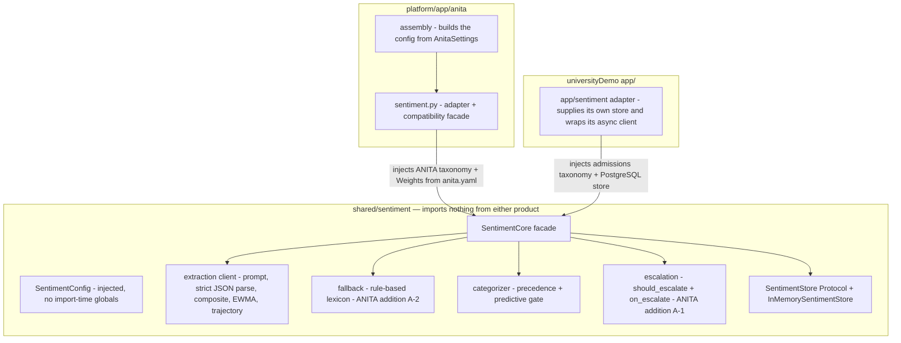

> **Lens:** Architect · **Decided by:** PO · **Inputs:** CR-01-contract.md, CR-01 Appendix A

# US-111 — Extract `shared/sentiment`: one parameterised core both products import [Lens: Architect]

- **Story:** As an **architect on the ANITA platform**, I want **the sentiment subsystem extracted into a product-neutral `shared/sentiment` package that merges universityDemo's `app/sentiment/` (1,239 LOC) with ANITA's `anita/sentiment.py` (516 LOC) behind the frozen `SentimentConfig` / `SentimentCore` interface**, so that **ANITA and universityDemo run the same sentiment architecture, a third product can adopt it with its own vocabulary and no code edits, and ANITA keeps the two capabilities it added — the rule-based fallback and escalation (CR-01.3, M-8)**.
- **Business value:** CR-01.2 and CR-01.3. The merged core is the mechanism that lets both products share one subsystem without either one's vocabulary, config keys or storage being baked in. M-8 is the value-protecting half: A-1 and A-2 are ANITA additions that a verbatim copy of Side A would delete, and A-1 would make UC-10 unimplementable.
- **Priority:** **Must** — the first story of this set. US-112, US-113, US-114 and US-115 all edit files this story creates.
- **Prerequisites:** none. **Blocks:** US-112, US-113, US-114, US-115.

## Contract conformance notes (CR-01-contract.md §C3.2)

1. The contract's `SentimentConfig` field order places `extraction_prompt: str` and
   `objection_labels: tuple[str, ...]` **after** defaulted fields. A bare `@dataclass` raises
   `TypeError: non-default argument follows default argument`. The class is therefore declared
   `@dataclass(frozen=True, kw_only=True)` (Python ≥ 3.11, `platform/pyproject.toml`
   `requires-python = ">=3.11"`). Field names, order and defaults are exactly the contract's.
2. The contract enumerates three `SentimentCore` methods and does not specify `__init__`. `__init__`
   is declared here; `on_escalate` is a constructor keyword because C3.2 lists
   "`should_escalate` + `on_escalate` (A-1, UC-10)" as a capability that **MUST survive** and a
   callback is not config data.
3. Contract §C5 M-8 makes the fallback and escalation blocking. Both are carried by this story with
   a dedicated preservation test each (T-07, T-08); deleting either is a blocking regression.
4. Contract §C7 keeps PostgreSQL out of the shared core. The core's only persistence dependency is
   the `SentimentStore` Protocol (built in US-115); this story ships the in-memory default.
5. **CV-07 (C8 takes precedence) is honoured exactly:** `SentimentConfig` gains
   `client: ExtractionClient | None = None`, where `ExtractionClient` is a Protocol with the single
   method `extract(prompt: str) -> str`; with `client is None` extraction uses the rule-based path
   (which is ANITA's fallback, A-2). The core is sync; an async product wraps its own client at its
   edge (or uses the additive `ascore_turn`). No second injection seam is added — the client is
   config data, so injecting one is never a `SentimentCore` signature change.

## Acceptance Criteria [Lens: PO]

```gherkin
Scenario: AC-1 A third product uses the core with its own vocabulary
  Given a product that has never imported anita or universityDemo code
  When it constructs SentimentConfig with its own extraction_prompt and its own objection_labels
    And constructs SentimentCore(config)
    And calls score_turn("we are evaluating your product, please send terms", lead_id="L-1")
  Then it receives an Extraction and a CompositeScore
    And no module named anita.* or app.* was imported to do it

Scenario: AC-2 The two source implementations become one
  Given shared/sentiment is importable
  When the package's public surface is inspected
  Then SentimentConfig and SentimentCore match CR-01-contract.md §C3.2 name for name
    And no module under shared/sentiment imports anita.* or app.*

Scenario: AC-3 ANITA's rule-based fallback survives the extraction (M-8, A-2)
  Given a config whose client raises RuntimeError("LLM unavailable")
  When score_turn("this is ridiculous, the third time I am asking") is called
  Then the returned Extraction has state FALLBACK and source "rules"
    And its sentiment score is negative and its objections include at least one label

Scenario: AC-4 ANITA's escalation survives the extraction (M-8, A-1)
  Given a core constructed with an on_escalate handler
  When a turn that crosses the negative threshold is scored
    And should_escalate(composite, extraction) is called
  Then it returns (True, reason) with a non-empty reason
    And the handler is invoked once, with (composite, extraction)
    And a handler that raises does not propagate and does not lose the score

Scenario: AC-5 (negative) A hostile config does not break the core
  Given a SentimentConfig whose extraction_prompt is an empty string
  When SentimentCore(config).score_turn("hello") is called
  Then the call does not raise
    And the Extraction is produced by the rule-based fallback

Scenario: AC-6 (negative) An unrelated product's import graph is untouched
  Given a Python process whose sys.path contains only the repository root and the standard library
  When shared.sentiment is imported and used
  Then importing it does not raise
    And sys.modules contains no key beginning "anita" or "app"
```

Technical acceptance criteria [Lens: TPO]:

- **TAC-1:** `SentimentConfig` and `SentimentCore` are importable from `shared.sentiment` by the exact
  names and signatures in CR-01-contract.md §C3.2. No product-specific identifier appears in the
  package (no "anita", "medical", "hospital", "university", "student", "meridian").
- **TAC-2:** An AST scan of `shared/sentiment/**/*.py` finds zero imports of `anita.*`, `app.*` or any
  relative import reaching outside the package. The scan is a test, not a review step.
- **TAC-3:** The package is imported by ANITA without any import-time environment mutation and without
  reading any environment variable at import time; every value arrives through `SentimentConfig`.
- **TAC-4:** `score_turn` never raises for any input string, including the empty string, and returns
  an `Extraction` with a valid `state`.
- **TAC-5:** The merge preserves ANITA's numeric behaviour exactly when the caller supplies no BANT
  data: `composite_score(latest, previous_latest=…, intent=…, friction=…)` returns byte-identical
  values to `anita/sentiment.py:304-341` for the same inputs (regression-parity test T-09).

## HLD — Architecture Slice [Lens: Architect]



- **Components touched:**
  - **new `shared/sentiment/`** — the merged core (this story).
  - **`platform/app/anita/sentiment.py`** — becomes a thin adapter + compatibility facade so every
    existing caller and test keeps its name; no behaviour change.
  - **`platform/app/anita/assembly.py`** — constructs the config from `AnitaSettings` and passes it
    when the surface is wired (US-114 performs the wiring; US-112 supplies the mapping).
  - **`platform/pyproject.toml` / `platform/requirements.txt`** — make `shared` importable from the
    platform venv.
- **Interaction summary (the merge, in one pass):**
  1. **From Side A (`universityDemo/app/sentiment/`, A.1)** the core takes: the strict-JSON
     extraction contract, the weighted composite `W1·s_call + W2·d + W3·i_intent − W4·friction`
     (`scorer.py:258`), the EWMA baseline, the trajectory classifier (`scorer.py:322-353`), the
     predictive layer and `p_convert` (`scorer.py:272-283`), the heuristic
     `p = sigmoid(2.5·s_lead + trajectory bonus)` (`scorer.py:372-392`), the categoriser precedence,
     and the decision trace. Side A's async `extract_sentiment` (`scorer.py:126`) becomes an
     `ExtractionClient` implemented at the product edge (its async call wrapped there, CV-07); the
     core itself is synchronous per the contract.
  2. **From Side B (`platform/app/anita/sentiment.py`, A.2)** the core takes: the rule-based lexicon
     fallback (`sentiment.py:140-213`, **A-2 — blocking if lost**), `should_escalate` +
     `on_escalate` (`sentiment.py:369-382`, `:495-500`, **A-1 — blocking if lost**), the
     product-enquiry taxonomy, the `ScoreState` machine, and the per-lead `LeadSentiment` shape.
  3. **Neither product's vocabulary survives in the core.** The prompt and objection labels move to
     the caller: ANITA keeps its string in `anita/sentiment.py` and passes it through
     `SentimentConfig`; Side A keeps the admissions prompt in its own adapter.
  4. **The defect A-3 is not ported.** The `limit=10` fetch and the `>= MIN_LABELED_OUTCOMES` gate
     are separated in the merged scorer so the two constants cannot silently disagree; the full fix
     and its regression test are US-113.
  5. **Failure path:** the extraction client raising or returning unparseable JSON degrades to the
     rule-based fallback and still produces an escalation decision (M7-1). A store failure degrades
     to in-memory state for the turn rather than losing the score.
  6. **Persistence is a Protocol, not a product** — the core holds per-lead state through
     `SentimentStore`; ANITA gets the in-memory implementation, universityDemo supplies its
     PostgreSQL-backed one (US-115).

## LLD — Implementation Detail [Lens: Architect]

- **Module path:** `D:\project\anitamedicalsystems\shared\sentiment\` (new top-level package next to
  `platform/` and `docs/`, per CR-01-contract.md §C3).

```
shared/
  __init__.py                    # empty; marks the namespace
  pyproject.toml                 # distribution "shared-core", packages=["sentiment"]
  sentiment/
    __init__.py                  # public surface only (re-exports, no logic)
    config.py                    # SentimentConfig
    client.py                    # ExtractionClient Protocol — the CV-07 injection seam
    models.py                    # Emotion, Category, ScoreState, Extraction, CompositeScore, LeadSentiment
    scorer.py                    # prompt build, parse, compute_lead_score, EWMA, trajectory, p_convert
    categorizer.py               # categorise(), predictive gate, decision trace
    fallback.py                  # rule_based_extraction()  — A-2, MUST survive
    escalation.py                # should_escalate(), dispatch_escalation() — A-1, MUST survive
    store.py                     # SentimentStore Protocol + InMemorySentimentStore (US-115)
    core.py                      # SentimentCore facade
  tests/
    conftest.py                  # inserts the repo root on sys.path
    test_config_contract.py
    test_core_contract.py
    test_merge_parity.py
    test_no_product_imports.py
    test_third_product_consumer.py
```

- **Classes / functions / APIs** — signatures the contract fixes, verbatim:

```python
# shared/sentiment/config.py
@dataclass(frozen=True, kw_only=True)
class SentimentConfig:                      # CR-01-contract.md §C3.2
    w1: float = 0.30
    w2: float = 0.30
    w3: float = 0.25
    w4: float = 0.15
    ewma_lambda: float = 0.35
    negative_threshold: float = -0.20       # ONE definition; see CV-12 in US-112
    extraction_prompt: str                  # caller supplies domain vocabulary (required)
    objection_labels: tuple[str, ...]       # caller supplies (required)
    escalation_enabled: bool = True
    client: ExtractionClient | None = None  # CV-07: None -> rule-based path (A-2)

    def render_prompt(self, message: str) -> str:
        """Substitute {message}, truncated to 2000 chars (anita/sentiment.py:134)."""

# shared/sentiment/client.py   — CV-07 injection seam
class ExtractionClient(Protocol):
    """A raw-text extraction backend. Sync by contract (CV-07); an async product
    wraps its own client at the product edge, never inside the shared core."""
    def extract(self, prompt: str) -> str: ...   # model text; the core parses it

# shared/sentiment/core.py
class SentimentCore:
    def __init__(
        self,
        config: SentimentConfig,
        *,
        store: SentimentStore | None = None,
        on_escalate: Callable[[CompositeScore, str, Extraction], None] | None = None,
    ) -> None:
        """Extraction runs through `config.client` (CV-07) when present; with no
        client, or when the client fails, it falls through to `rule_based_extraction`
        (A-2). The client is config data deliberately: injecting one is never a
        change to this signature."""

    def score_turn(self, message: str, *, lead_id: str = "") -> tuple[Extraction, CompositeScore]: ...
    def categorise(self, composite: CompositeScore, extraction: Extraction) -> Category: ...
    def should_escalate(self, composite: CompositeScore, extraction: Extraction) -> tuple[bool, str]: ...

    # the module-level functions the methods delegate to carry the config explicitly:
    #   categorizer.py: categorise(composite, extraction, *, config)          (US-113)
    #   escalation.py:  should_escalate(composite, extraction, *, config)     (US-114)
    # so the contract's two-argument method signatures are preserved exactly (T-02).

    # additive, contract-silent: an async product (universityDemo) awaits the sync core
    # without blocking its loop (thread offload), keeping CV-07's sync-core rule
    async def ascore_turn(self, message: str, *, lead_id: str = "") -> tuple[Extraction, CompositeScore]: ...

    # additive reads, preserved from anita/sentiment.py:505-515
    def for_lead(self, lead_id: str) -> LeadSentiment | None: ...
    def at_risk(self) -> list[LeadSentiment]: ...
    def summary(self) -> dict: ...

# shared/sentiment/scorer.py
def parse_extraction(raw: str, *, config: SentimentConfig) -> Extraction:   # raises ValueError
def composite_score(
    latest: float, *, previous_latest: float | None = None, intent: float = 0.0,
    friction: float = 0.0, baseline: float | None = None, turn_count: int = 1,
    weights: Weights | None = None,
) -> CompositeScore: ...
def compute_lead_score(
    extraction: Extraction, *, history: Sequence[float], baseline: float | None,
    previous_latest: float | None, turn_count: int,
    labelled_outcome_count: int, config: SentimentConfig,
) -> CompositeScore: ...
def classify_trajectory(s_calls: Sequence[float]) -> tuple[str, str | None]: ...

# shared/sentiment/fallback.py   — A-2, preserved from anita/sentiment.py:140-213
def rule_based_extraction(message: str, *, config: SentimentConfig) -> Extraction: ...

# shared/sentiment/escalation.py — A-1, preserved from anita/sentiment.py:369-382
def should_escalate(
    composite: CompositeScore, extraction: Extraction, *, config: SentimentConfig
) -> tuple[bool, str]: ...
```

- **Data structures** (all added fields carry defaults, so every existing ANITA test that constructs
  these types by keyword keeps compiling and passing):

```python
class Emotion(str, Enum):
    INTERESTED="interested"; READY="ready"; NEUTRAL="neutral"; UNCERTAIN="uncertain"
    FRUSTRATED="frustrated"; ANGRY="angry"; CONFUSED="confused"

class Category(str, Enum):
    HOT="Hot"; WARM="Warm"; NURTURE="Nurture"; AT_RISK="At-Risk"; DISQUALIFIED="Disqualified"

class ScoreState(str, Enum):                 # anita/sentiment.py:58-64
    PENDING="pending"; SCORED="scored"; FALLBACK="fallback"; FAILED="failed"

@dataclass
class Extraction:
    primary_emotion: Emotion = Emotion.NEUTRAL
    sentiment_score: float = 0.0             # [-1, 1]
    buying_intent_score: float = 0.0         # [0, 1]
    friction_score: float = 0.0              # [0, 1]
    objections: list[str] = field(default_factory=list)
    state: ScoreState = ScoreState.PENDING
    source: str = "llm"                      # llm | rules
    bant: dict = field(default_factory=dict) # NEW (Side A gain, A-5); empty for ANITA
    model_version: str = ""
    extraction_raw: dict = field(default_factory=dict)   # PII-scrubbed by the caller

@dataclass
class CompositeScore:
    score: float; latest: float; delta: float; intent: float; friction: float
    baseline: float; turn_count: int = 1
    delta_vs_baseline: float | None = None   # Side A's delta_s: latest - EWMA baseline
    trajectory: str = "Stable"               # Upward | Stable | Degrading | Volatile
    p_convert: float | None = None           # None = predictive layer inactive (see US-113)
    predictive_layer_active: bool = False
    bant_completeness: float = 0.0
```

- **Merge rules (each is a decision this story makes; the contract is silent on internals):**
  1. **Composite:** ANITA's formula is kept verbatim — `S = W1·latest + W2·delta + W3·intent − W4·friction`,
     clamped to [-1, 1], `delta = latest − previous_latest` (`anita/sentiment.py:325`). Side A's
     `delta_s = s_call − EWMA_baseline` (`scorer.py:250`) is carried **separately** as
     `delta_vs_baseline`, because conflating the two would change every ANITA score.
  2. **Intent:** `intent = buying_intent_score` when `extraction.bant` is empty (ANITA's exact
     behaviour); `intent = 0.5·bant_completeness + 0.5·buying_intent_score` when BANT is present
     (Side A's `scorer.py:254`). This is how the core gains BANT (A-5) without moving ANITA's
     numbers (TAC-5).
  3. **Fallback (A-2):** `SentimentCore.score_turn` calls `config.client.extract` (CV-07) inside
     `try/except`; `client is None`, any exception, or unparseable output logs and falls through to
     `rule_based_extraction`, setting `state=FALLBACK`, `source="rules"`. Never raises
     (`anita/sentiment.py:444-451`).
  4. **Escalation (A-1):** `should_escalate` keeps all three ANITA triggers — emotion in
     {ANGRY, FRUSTRATED}; `score <= negative_threshold`; `delta <= -0.5` — returns
     `(bool, reason)`, and is gated by `config.escalation_enabled` (contract §C3.2). The
     `on_escalate` handler is called best-effort; its exception is logged, never propagated
     (`anita/sentiment.py:496-500`).
  5. **Categorisation precedence** (ANITA's, preserved; US-113 layers the predictive criterion):
     non-fit objection → Disqualified (this is the one Side A branch adopted — it makes
     `Category.DISQUALIFIED` reachable, closing A.2's "dead code" finding) → emotion in
     {ANGRY, FRUSTRATED} → At-Risk → `score <= negative_threshold` → At-Risk → READY and
     `score > 0.3` → Hot → `intent >= 0.5 and score > 0` → Warm → else Nurture.
  6. **Prompt/labels:** no prompt string lives in `shared/sentiment`. The core's `config.render_prompt`
     substitutes `{message}`; a missing `{message}` placeholder appends the message rather than
     silently dropping it.
  7. **Trajectory:** `classify_trajectory(s_calls)` — last 5 samples including the current one;
     `<2` samples → `("Stable", "insufficient_history")`; variance > 0.10 → `Volatile`; slope
     > 0.05 → `Upward`; < −0.05 → `Degrading`; else `Stable` (`scorer.py:322-353`).
- **Config keys:** the core reads **no** environment variable and no file. Every value arrives in
  `SentimentConfig`. This is the property that makes CR-01.3 true and that US-112 relies on when it
  maps `anita.yaml` onto it.
- **Packaging / importability (so ANITA can import `shared.sentiment` with no path hacks):**
  1. `shared/pyproject.toml` declares `name = "shared-core"`, `packages = ["sentiment"]`,
     no runtime dependencies (stdlib only) — a product with no Postgres, no Chroma and no framework
     can install it.
  2. `platform/requirements.txt` gains the line `-e ../shared` (installed into `platform/.venv` by
     the existing `pip install -r requirements.txt` step, `platform/README.md:43`).
  3. `platform/pyproject.toml` `[tool.pytest.ini_options] pythonpath` becomes `["app", ".."]`, so the
     suite runs even in a venv where the editable install was skipped.
  4. ANITA must never be imported by the core: the dependency arrow is one-way.
- **ANITA adapter (`platform/app/anita/sentiment.py`, rewritten, ~516 LOC → a facade):**
  - re-exports, unchanged in name: `Emotion`, `Category`, `ScoreState`, `CATEGORY_ACTIONS`,
    `Extraction`, `CompositeScore`, `Weights`, `LeadSentiment`, `rule_based_extraction`,
    `parse_extraction`, `build_extraction_prompt`, `composite_score`, `categorise`,
    `should_escalate`;
  - keeps `SentimentService` with its present constructor and return shapes —
    `SentimentService(scorer=None, *, weights=None, negative_threshold=-0.20, on_escalate=None,
    config=None, store=None)` and `observe(lead_id, message, *, extraction=None) ->
    (LeadSentiment, bool, str)` — so `platform/tests/test_mod07_sentiment.py` runs unmodified. A
    callable `scorer` passed to the facade is adapted into an `ExtractionClient` whose `extract()`
    returns that callable's `Extraction` re-serialised, so ANITA's existing injection point keeps
    working while the core's only seam stays CV-07's `config.client`;
  - when `config is None` the facade builds the ANITA default config (its own prompt and labels,
    `Weights()` defaults), which is exactly today's behaviour; when the assembly passes a config
    (US-112), the configured values are in force;
  - `categorise(composite, extraction, *, negative_threshold=-0.20)` and
    `should_escalate(composite, extraction, *, negative_threshold=-0.20)` keep their keyword so the
    existing tests' positional calls still bind.
- **Edge cases** (each with the decided behaviour):
  1. **Empty or whitespace message** → still scored; the rule-based path yields NEUTRAL, `score=0.0`,
     no objections (never raises — TAC-4).
  2. **Client returns `None` or unparseable text** → treated exactly like a client that raised:
     fallback.
  3. **`parse_extraction` yields an `Extraction` with out-of-range numbers** → clamped to [-1, 1] /
     [0, 1] on ingestion, and `state` is left as the parser set it.
  4. **`extraction_prompt` empty or missing `{message}`** → AC-5; the core degrades to the fallback
     rather than rendering a prompt with no message.
  5. **`objection_labels` empty** → the fallback's known-label filter keeps only `"other"`; unknown
     labels from an LLM are dropped rather than persisted as free text (`anita/sentiment.py:247`).
  6. **`lead_id=""`** (anonymous turn) → scored and returned, but no `LeadSentiment` is retained;
     nothing keys on the empty string.
  7. **Two cores in one process with different configs** (the re-tenanting case A.1 says Side A
     cannot do) → independent; no module-level mutable state; asserted by T-10.
  8. **Store unavailable** → the turn's state falls back to in-memory for that call and the score is
     still returned; the failure is logged once per call, not per field.
  9. **Handler raises** → logged, score retained, `should_escalate` still returns `(True, reason)`.
  10. **BANT present but partial** → `bant_completeness` counts only non-null fields; unknown keys
      are ignored (`Unknown — needs verification` for Side A's exact completeness rule; the merged
      rule is non-null-field ratio).
- **Error handling:**
  - `ClientUnavailable` (any exception from `config.client.extract`) → fallback, `state=FALLBACK`.
  - `ExtractionInvalid` (unparseable JSON / no JSON object) → `parse_extraction` raises
    `ValueError`; the caller converts it to a fallback, never a partial score
    (`anita/sentiment.py:216-231`).
  - `StoreError` → logged; the core continues with in-memory state for the turn.
  - `EscalationHandlerError` → logged with `logger.exception`, swallowed by design (`BRD-16` must
    not be lost to a notification outage).
  - No retries inside the core: retry policy belongs to the product (ANITA's worker, universityDemo's
    async task).

- **Test scenarios** — concrete and runnable (`python -m pytest shared/tests -q`):

| # | Level | Test |
|---|---|---|
| T-01 | unit | `SentimentConfig()` raises `TypeError` without `extraction_prompt`/`objection_labels`; with them, the six weights carry the contract defaults 0.30/0.30/0.25/0.15, 0.35, −0.20, and `escalation_enabled is True` (C3.2). |
| T-02 | contract | `inspect.signature(SentimentCore.score_turn)` == `(self, message: str, *, lead_id: str = "") -> tuple[Extraction, CompositeScore]`; `categorise` and `should_escalate` present with the contracted parameter names; **CV-07 shape**: `SentimentConfig` carries `client` (default `None`) and `SentimentCore.__init__` has no `client` parameter; `ExtractionClient` is a Protocol with the single method `extract(prompt: str) -> str`. |
| T-03 | unit | Happy path: a client returning JSON that parses to READY/0.9 → `state=SCORED`, `source="llm"`, composite returned, `turn_count == 1`. |
| T-04 | unit | Parse: fenced JSON, JSON in prose, unknown emotion → NEUTRAL, out-of-range numbers clamped, unknown objection labels dropped (`anita/sentiment.py:216-257` behaviour, asserted identically). |
| T-05 | unit | Rule-based fallback: "unacceptable, ridiculous" → negative and `state=FALLBACK`; "please send me a quotation" → READY; a price phrase → `"price"` in objections (A-2 survival). |
| T-06 | unit | Client raises, and separately `config.client=None` → fallback both times, score retained, no exception escapes (TAC-4). |
| T-07 | unit | **M-8 guard (fallback):** deleting or bypassing `rule_based_extraction` makes this test fail — a scraper-style assertion walks `shared/sentiment/core.py` and asserts `rule_based_extraction` is called on the client-exception path. |
| T-08 | unit | **M-8 guard (escalation):** `should_escalate` returns True for angry emotion, for `score <= -0.20`, and for `delta <= -0.5`; `on_escalate` is called exactly once; a raising handler does not lose the score. |
| T-09 | regression | **Parity:** for a table of 20 (latest, previous_latest, intent, friction, baseline) tuples, the merged `composite_score` equals the values produced by `anita/sentiment.py:304-341` (recorded as fixtures from the current implementation before the move). |
| T-10 | unit | Two `SentimentCore` instances with different `SentimentConfig` (different weights) produce different scores for the same message and do not influence each other. |
| T-11 | static | **No product imports (TAC-2):** AST-walk `shared/sentiment/**/*.py`; assert no `Import`/`ImportFrom` names start with `anita` or `app`; assert the string "university" and "student" appear in no prompt/label constant. |
| T-12 | e2e | **Third-product consumer (AC-1, C6):** a subprocess with `sys.path=[repo_root]` + stdlib imports `shared.sentiment`, asserts `not [m for m in sys.modules if m.split('.')[0] in {"anita", "app"}]`, builds a config with a fictional vocabulary ("widget", "licence"), and scores a turn. |
| T-13 | negative | Hostile config: empty prompt, empty labels, `negative_threshold=0.0` → no exception, a valid `Extraction` returned (AC-5). |
| T-14 | integration | ANITA adapter unchanged: `platform/tests/test_mod07_sentiment.py` passes **without edits** through the facade (this is the story's contribution to the 614-test gate; see below). |

- **How ANITA's 614 platform tests stay green (CR-01-contract.md §C6):**
  1. `platform/app/anita/sentiment.py` keeps every public name and signature its tests import
     (`platform/tests/test_mod07_sentiment.py:16-30`) — verified by T-14, which runs that file
     **unmodified**.
  2. `SentimentService()` with no arguments behaves exactly as today: ANITA's default prompt,
     ANITA's default labels, ANITA's `Weights()` defaults, `negative_threshold=-0.20`.
  3. `categorise`/`should_escalate` keep the `negative_threshold` keyword default so existing
     positional calls bind identically.
  4. The new fields on `Extraction`/`CompositeScore` all carry defaults, so existing keyword
     constructions still compile.
  5. No test file is edited, skipped or deleted in this story. Run:
     `platform\.venv\Scripts\python -m pytest tests -q` from `platform/` — the summary must report
     **0 failures, 0 errors, 0 skipped** against the pre-change count (the 614 figure is the CR-01
     contract's §C6 gate; record the actual local count in the PR and treat any decrease as a
     regression).
  6. The release gate is untouched by this story: the 25 browser scenarios
     (`platform/tests/e2e/scenarios.spec.js`) and the corpus gate at 70 cases are not on the import
     path being changed.

## Traceability

- Change request: **CR-01**, requirement **CR-01.2** (sentiment adopts Side A's architecture),
  **CR-01.3** (standalone, reusable by either product)
- Contract: **CR-01-contract.md §C3.2** (`SentimentConfig`, `SentimentCore`), **§C3** (no `anita.*` /
  `app.*` imports), **§C5 M-8** (escalation + fallback preserved), **§C6** (import proof, 614 tests),
  **§C7** (PostgreSQL out of scope — store Protocol only), **§C8/CV-07** (extraction client injected
  through `SentimentConfig`, core stays sync — T-02 asserts the shape)
- Migration obligations: **M-8** (this story owns it; US-112 → M-6/M-7, US-113 → M-9, US-115 → the
  Protocol half of C7)
- Module: **MOD-07** sentiment & escalation; TRD-32 (strict-JSON extraction), TRD-33 (fallback),
  TRD-34 (composite/EWMA/category), TRD-35 (escalation trigger)
- Use case: **UC-10** (negative sentiment detected)
- Evidence citations:
  - Side A inventory and LOC — CR-01 Appendix A.1: `scorer.py` 694, `models.py` 249,
    `categorizer.py` 220, `schema.py` 59, `__init__.py` 17 = 1,239 LOC
  - Side A composite — `scorer.py:258`; weights — `config.py:490-496`; async — `scorer.py:126`,
    `:230`, `:398`; failure → neutral — `scorer.py:197`
  - Side A has **no escalation** — A.1 escalation row, nearest artefact a display string at
    `categorizer.py:42`
  - Side B inventory — CR-01 Appendix A.2: `anita/sentiment.py` 516 LOC; adapted-from Side A
    (`sentiment.py:3-4`); sync; no persistence (`self._leads` dict); fallback added
    (`sentiment.py:140-213`); escalation added (`sentiment.py:369` + `on_escalate`); reads no config
  - A-1 (escalation loss is blocking), A-2 (fallback loss is high), A-4 (Side A not reusable as-is)
  - Repo-verified while drafting this story (not in Appendix A): `anita/sentiment.py:304-341`
    (composite), `:444-451` (fallback on scorer failure), `:495-500` (handler best-effort),
    `:505-515` (reads), `platform/pyproject.toml` (pythonpath), `platform/README.md:43` (install step)
- Evidence erratum raised: Appendix A.1 says `non_fit_keywords` is "6 entries vs 3"
  (`categorizer.py:90-91` vs `:159`); re-verified in `D:\project\universityDemo\app\sentiment\
  categorizer.py` on 2026-10-03 as **7 vs 3**. The finding (duplicated, drifted) stands; the count
  should be corrected in Appendix A.

## Definition of Done

- [ ] `shared/sentiment/` exists with the module layout above and imports cleanly with stdlib only
- [ ] `SentimentConfig` and `SentimentCore` match CR-01-contract.md §C3.2 exactly; conformance
      notes 1–4 above are recorded as comments in `config.py` / `core.py`
- [ ] Both ANITA additions demonstrated present by their guard tests: T-07 (fallback), T-08
      (escalation) — deleting either fails CI
- [ ] T-11 and T-12 pass: no product import, and a third product consumes the core
- [ ] T-09 parity fixtures recorded **before** the move and green after it
- [ ] `platform/tests/test_mod07_sentiment.py` passes unmodified; the full platform suite shows no
      decrease against the 614-test gate
- [ ] `shared/pyproject.toml`, `platform/requirements.txt` (`-e ../shared`) and the pytest
      `pythonpath` change are in place, with the install step documented in `platform/README.md`
