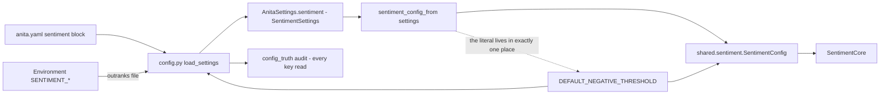

> **Lens:** Architect · **Decided by:** PO · **Inputs:** CR-01-contract.md, CR-01 Appendix A

# US-112 — Make the sentiment settings real, and give `negative_threshold` one definition [Lens: Architect]

- **Story:** As an **ops admin and a product owner**, I want **the six sentiment keys declared in `anita.yaml` to actually reach the scorer, and the negative threshold to have exactly one definition in code**, so that **tuning a weight changes behaviour instead of being a decorative value, and the threshold cannot drift between the four code sites that hard-code it today (M-6, M-7)**.
- **Business value:** `BRD-20`, `DG-09` and CR-01-contract.md §C5. The evidence is blunt: `SentimentSettings` is loaded (`config.py:401-412`) and `anita/sentiment.py` reads none of it — the service builds `Weights()` and `negative_threshold=-0.20` from its own literals. An operator can move every weight in the file and the scorer does not move. Worse for a threshold: four code copies means tuning one site leaves three behind, and a buyer's escalation depends on which one ran.
- **Priority:** **Must** — TPO ordering note: lands after US-111 (the core exists) and before US-114 (which passes the assembled config into the live chat path). It is independent of US-113 and US-115.
- **Prerequisites:** US-111 (the `shared/sentiment` package and `SentimentConfig`).

## Contract contradiction raised — M-7 "ONE definition" vs the operator-tunable key

> Canonical ID: **CV-12** (defined in `CR-01-contract.md` §C10).

**Raised against:** CR-01-contract.md §C3.2 (`negative_threshold: float = -0.20   # ONE definition;
today duplicated in 4 places`) and §C5 M-7.

**The conflict:** read literally, "ONE definition" means the literal `-0.20` appears once in the
repository. But `platform/config/anita.yaml:94` carries
`negative_escalation_threshold: -0.20` as an **operator-tunable value**, and
`platform/app/anita/config_truth.py:230-231` recognises the corresponding env key
`NEGATIVE_ESCALATION_THRESHOLD` as a platform key. Deleting the YAML key to satisfy "one definition"
would (a) remove the PO's ability to tune escalation without a code change, which MOD-07's TPO
sign-off calls "a business-tuning value, not a technical one" (`MOD-07-sentiment-escalation.md`,
TPO risk 3), and (b) turn a live config key into a missing one.

**Proposed resolution (implemented by this story, pending PO confirmation):** exactly one *code*
definition — a module-level constant in `shared/sentiment/config.py` — and the YAML/env value is its
single *input*, not a duplicate default:

```python
# shared/sentiment/config.py
DEFAULT_NEGATIVE_THRESHOLD: float = -0.20     # the only code copy in the repository
...
negative_threshold: float = DEFAULT_NEGATIVE_THRESHOLD
```

```python
# platform/app/anita/config.py
from shared.sentiment import DEFAULT_NEGATIVE_THRESHOLD
...
negative_escalation_threshold: float = DEFAULT_NEGATIVE_THRESHOLD
```

If the PO instead intends the YAML key to be deleted, that is a different story and this CV must be
answered before implementation; the rest of this story is unaffected either way.

## Acceptance Criteria [Lens: PO]

```gherkin
Scenario: AC-1 A tuned weight changes the score
  Given anita.yaml with sentiment.w1 changed from 0.30 to 0.90
  When the platform loads settings and the sentiment service scores a turn
  Then the composite is computed with w1 = 0.90
    And the value in force is observable on the service (service.config.w1 == 0.90)

Scenario: AC-2 An environment variable overrides the file
  Given anita.yaml with sentiment.ewma_lambda = 0.35
    And the environment sets SENTIMENT_EWMA_LAMBDA=0.80
  When settings are loaded
  Then the effective ewma_lambda is 0.80
    And the YAML value is not used

Scenario: AC-3 The threshold has one code definition
  Given the repository after this change
  When every source file under shared/ and platform/app is scanned for the literal -0.20
  Then exactly one code occurrence exists, in shared/sentiment/config.py
    And platform/app/anita/config.py's default is an import of that constant
    And platform/app/anita/sentiment.py contains no threshold literal
    And the operator value in anita.yaml remains the input to it (see CV-12)

Scenario: AC-4 (negative) A malformed value is refused at boot, naming the key
  Given anita.yaml with sentiment.w1 = "heavy"
  When the platform boots
  Then the boot is refused
    And the refusal names sentiment.w1 and the expected numeric type
    And no scorer is constructed with a partial configuration

Scenario: AC-5 (negative) An out-of-range value is refused, not clamped
  Given SENTIMENT_EWMA_LAMBDA=1.5 (outside (0, 1]) or NEGATIVE_ESCALATION_THRESHOLD=-4
  When settings are loaded
  Then loading raises a configuration error naming the key and the permitted range
    And the instance does not start with a silently clamped value

Scenario: AC-6 (negative) No key becomes inert
  Given the changed configuration path
  When the configuration read-audit (config_truth.audit_config) runs
  Then every sentiment key is reported read, not inert
    And NEGATIVE_ESCALATION_THRESHOLD still appears in the known platform keys
```

Technical acceptance criteria [Lens: TPO]:

- **TAC-1:** The external names are frozen: `anita.yaml` `sentiment.{w1,w2,w3,w4,ewma_lambda,
  negative_escalation_threshold}` and the env keys `SENTIMENT_W1..W4`, `SENTIMENT_EWMA_LAMBDA`,
  `NEGATIVE_ESCALATION_THRESHOLD` are unchanged. Internal rename to the contract's
  `SentimentConfig` field names happens in the mapping only (`negative_escalation_threshold` →
  `negative_threshold`).
- **TAC-2:** The typed-helper read shape is preserved (`_env_float(environment, "SENTIMENT_W1", …)`),
  because `config_truth.py:35-44` counts exactly that shape as a read; a read moved into a helper the
  scanner cannot see would flag the key as inert and, under US-028's boot refusal, stop the instance.
- **TAC-3:** Loading is atomic: a value that fails validation produces no partially-populated
  `AnitaSettings` and no constructed `SentimentService`.
- **TAC-4:** With `anita.yaml` at its checked-in values (0.30/0.30/0.25/0.15/0.35/−0.20), the
  effective configuration is numerically identical to today's hard-coded literals, so the change is
  behaviour-neutral until an operator changes a value.
- **TAC-5:** `anita.yaml`'s values are the *only* operator surface; no new required key is
  introduced by this story (`escalation_enabled` is optional and defaults to `True`).

## HLD — Architecture Slice [Lens: Architect]



- **Components touched:**
  - **`shared/sentiment/config.py`** — gains `DEFAULT_NEGATIVE_THRESHOLD` and `__post_init__`
    validation (US-111 created the class; this story owns its defaults' provenance).
  - **`platform/app/anita/config.py`** — `SentimentSettings` gains `escalation_enabled: bool = True`
    and imports its threshold default from the shared constant; the loader at `:401-412` continues to
    read each key in the typed-helper shape (TAC-2).
  - **`platform/app/anita/sentiment.py`** — gains `sentiment_config_from(settings) -> SentimentConfig`
    and passes the config into the core; the three local `-0.20` defaults are replaced by `None`
    resolving to the one constant.
  - **`platform/app/anita/assembly.py`** — unchanged in this story; US-114 calls
    `sentiment_config_from(built.settings)` where it constructs the surface.
- **Interaction summary:**
  1. `load_settings` reads the YAML block and then the environment, exactly as it does today
     (`config.py:401-412`); the env still outranks the file.
  2. `sentiment_config_from(settings)` maps the six ANITA keys plus `escalation_enabled` onto
     `SentimentConfig`, and injects ANITA's taxonomy (extraction prompt and objection labels) so the
     core stays vocabulary-free (US-111).
  3. The core receives one threshold; the facade's three former literal defaults now resolve to the
     same constant, so no call path can disagree.
  4. **Failure path:** a non-numeric or out-of-range value raises at settings load, before any
     surface is built — the same fail-fast position US-028 takes for every other key; a value that
     passed today's loose `float()` still passes, and nothing that is currently accepted silently
     becomes a hard failure except values outside the documented ranges (TAC-3, TAC-4).

## LLD — Implementation Detail [Lens: Architect]

- **Module paths:** `D:\project\anitamedicalsystems\shared\sentiment\config.py`,
  `D:\project\anitamedicalsystems\platform\app\anita\config.py`,
  `D:\project\anitamedicalsystems\platform\app\anita\sentiment.py`,
  `D:\project\anitamedicalsystems\platform\config\anita.yaml`.

- **Where the four unlinked copies are today** (verified in the working tree, 2026-10-03; the
  contract's "4 places" counts code sites, the YAML value is the fifth, input-only site):

| # | Site | Text |
|---|---|---|
| 1 | `platform/app/anita/config.py:211` | `negative_escalation_threshold: float = -0.20` |
| 2 | `platform/app/anita/sentiment.py:348` | `def categorise(..., *, negative_threshold: float = -0.20)` |
| 3 | `platform/app/anita/sentiment.py:373` | `def should_escalate(..., *, negative_threshold: float = -0.20)` |
| 4 | `platform/app/anita/sentiment.py:429` | `SentimentService(..., negative_threshold: float = -0.20, ...)` |
| (5) | `platform/config/anita.yaml:94` | `negative_escalation_threshold: -0.20` — operator input (CV-12) |

- **Classes / functions / APIs:**

```python
# shared/sentiment/config.py
DEFAULT_NEGATIVE_THRESHOLD: float = -0.20      # the single code definition (M-7)

@dataclass(frozen=True, kw_only=True)
class SentimentConfig:
    w1: float = 0.30; w2: float = 0.30; w3: float = 0.25; w4: float = 0.15
    ewma_lambda: float = 0.35
    negative_threshold: float = DEFAULT_NEGATIVE_THRESHOLD
    extraction_prompt: str
    objection_labels: tuple[str, ...]
    escalation_enabled: bool = True

    def __post_init__(self) -> None:
        """Fail fast. Refuse, never clamp (US-028's posture)."""
        # each of w1..w4: finite, >= 0
        # ewma_lambda: 0.0 < value <= 1.0
        # negative_threshold: -1.0 <= value <= 1.0

# platform/app/anita/config.py   (existing dataclass, two changes only)
@dataclass(frozen=True)
class SentimentSettings:
    w1: float = 0.30
    w2: float = 0.30
    w3: float = 0.25
    w4: float = 0.15
    ewma_lambda: float = 0.35
    negative_escalation_threshold: float = DEFAULT_NEGATIVE_THRESHOLD   # was the literal
    escalation_enabled: bool = True                                     # new, optional

# platform/app/anita/sentiment.py   (adapter)
def sentiment_config_from(settings: AnitaSettings) -> SentimentConfig:
    """Map the ANITA config object onto the contract's config, injecting ANITA's taxonomy."""

class SentimentService:
    def __init__(self, scorer=None, *, weights: Weights | None = None,
                 negative_threshold: float | None = None,
                 on_escalate=None, config: SentimentConfig | None = None,
                 store: SentimentStore | None = None) -> None:
        """negative_threshold=None resolves to config.negative_threshold.
        config=None builds the ANITA default config (today's behaviour, TAC-4)."""
```

- **Config keys, defaults and mapping (the whole surface, one table):**

| YAML key (`anita.yaml`) | Env key | `SentimentSettings` field | `SentimentConfig` field | Default |
|---|---|---|---|---|
| `sentiment.w1` | `SENTIMENT_W1` | `w1` | `w1` | 0.30 |
| `sentiment.w2` | `SENTIMENT_W2` | `w2` | `w2` | 0.30 |
| `sentiment.w3` | `SENTIMENT_W3` | `w3` | `w3` | 0.25 |
| `sentiment.w4` | `SENTIMENT_W4` | `w4` | `w4` | 0.15 |
| `sentiment.ewma_lambda` | `SENTIMENT_EWMA_LAMBDA` | `ewma_lambda` | `ewma_lambda` | 0.35 |
| `sentiment.negative_escalation_threshold` | `NEGATIVE_ESCALATION_THRESHOLD` | `negative_escalation_threshold` | `negative_threshold` | −0.20 (one constant) |
| `sentiment.escalation_enabled` (new, optional) | `SENTIMENT_ESCALATION_ENABLED` | `escalation_enabled` | `escalation_enabled` | `True` |
| — | — | — | — | *If the optional env key is exposed, add `SENTIMENT_ESCALATION_ENABLED` to `config_truth._KNOWN_PLATFORM_KEYS` beside the other sentiment names (`config_truth.py:230-231`), so the read audit keeps recognising it.* |
| — (code constant) | — | — | `extraction_prompt` | ANITA's prompt, `sentiment.py:103-130` |
| — (code constant) | — | — | `objection_labels` | ANITA's nine labels, `sentiment.py:117-119` |

  `extraction_prompt` and `objection_labels` are not operator keys: they are the product's taxonomy
  and change with the code, not with the deployment. They are injected by
  `sentiment_config_from`, which is what keeps the shared core vocabulary-free (US-111 TAC-1).

- **Read-shape requirement (TAC-2), exactly as it must appear:**
  `config.py:402-411` stays in the `_env_float(environment, "SENTIMENT_W1", float(sent_raw.get("w1",
  SentimentSettings.w1)))` shape. `config_truth.py:35-44`'s `typed_helper` pattern
  (`_(?:env|env_int|env_float|env_bool|env_list_int)\(\s*[^,()]+,\s*["']([A-Z][A-Z0-9_]*)["']`)
  is what makes the key count as read; a refactor that hides the literal behind an indirection would
  flag six live keys as inert and, under US-028, refuse the boot.
- **Edge cases** (each with the decided behaviour):
  1. **Key absent from both YAML and env** → the code default applies (single source), never an
     error.
  2. **Env value empty string** (`SENTIMENT_W1=`) → treated as absent, YAML applies, code default
     last; the empty string is not `float()`-parsed into a `ValueError` at boot (it is a common
     `.env` artefact) — the same guard the current loader applies (`or` semantics).
  3. **YAML value is a quoted string** (`w1: "0.30"`) → accepted via the numeric coercion and
     validated identically.
  4. **YAML value is non-numeric** → refused, naming the key (AC-4).
  5. **Weight is NaN or ±inf** → refused (not finite).
  6. **`ewma_lambda = 0.0`** → refused: the EWMA would never forget the first turn; range is
     `(0, 1]`.
  7. **`negative_threshold` outside [−1, 1]** → refused; a threshold of −4 would make At-Risk
     unreachable.
  8. **Only one weight configured** → the other three keep their defaults; no requirement that the
     four sum to 1 (they need not today, and clamping the sum would silently change scores).
  9. **A configured value equals the default** → no-op; TAC-4's behaviour-neutrality holds.
  10. **`config.py` imported without `shared` installed** → the import of
      `DEFAULT_NEGATIVE_THRESHOLD` fails loudly at import; the install step is US-111's DoD, and a
      silent fallback literal here would re-create the drift this story removes.
- **Error handling:**
  - `ConfigurationError` (or the settings loader's existing error type) raised with the YAML path and
    the key name — never a bare `ValueError` from `float()` (AC-4's naming requirement).
  - Validation runs in `SentimentConfig.__post_init__` and at settings load; both refuse, neither
    clamps.
  - No retry, no partial application: the instance does not start (US-028's posture).
- **Test scenarios** — concrete and runnable:

| # | Level | Test |
|---|---|---|
| T-01 | integration | Build `AnitaSettings` from a YAML with `w1: 0.90`; assert `sentiment_config_from(settings).w1 == 0.90` and that a fixed message scores differently from the default-config score (AC-1). |
| T-02 | integration | `SENTIMENT_EWMA_LAMBDA=0.80` in the env mapping outranks `ewma_lambda: 0.35` from the file (AC-2). |
| T-03 | unit | Unset key → YAML value; unset in both → code default; empty env value → YAML value. |
| T-04 | static | **AC-3 scanner:** regex `-0\.20` over `shared/**/*.py` and `platform/app/**/*.py`; assert exactly one hit, in `shared/sentiment/config.py`; assert no hit in `platform/app/anita/sentiment.py`. |
| T-05 | integration | `config_truth.audit_config(...)` reports the six sentiment env keys as read and `ok` (AC-6, TAC-2). |
| T-06 | negative | `w1: "heavy"` → load raises naming `sentiment.w1` and the expected type; no `SentimentService` is constructed (AC-4, TAC-3). |
| T-07 | negative | `SENTIMENT_EWMA_LAMBDA=1.5` and `NEGATIVE_ESCALATION_THRESHOLD=-4` each raise with key and range (AC-5). |
| T-08 | regression | **Behaviour neutrality (TAC-4):** with the checked-in `anita.yaml`, the effective `SentimentConfig` equals the historical literals exactly (0.30/0.30/0.25/0.15/0.35/−0.20), and `platform/tests/test_mod07_sentiment.py` passes unmodified. |
| T-09 | unit | `service.config.w1 == 0.90` after construction with the tuned config (AC-1's observable). |
| T-10 | negative | `SentimentConfig(w1=float("nan"), extraction_prompt="x", objection_labels=("a",))` raises; `w1=-1` raises. |

- **How ANITA's 614 platform tests stay green (CR-01-contract.md §C6):**
  1. `SentimentSettings` keeps its six field names and its frozen dataclass shape; only the *source*
     of one default changes (an import instead of a literal). `platform/tests/test_mod09_boot.py:68`
     constructs `cfg.SentimentSettings()` with no arguments and still succeeds.
  2. `SentimentService()` with no arguments keeps today's behaviour: `config=None` builds the ANITA
     default config, which is numerically identical to the current literals (T-08).
  3. The three facade keyword defaults become `None`-resolving; no test passes
     `negative_threshold=` explicitly, and an explicit value still works, so no assertion changes.
  4. No test file is edited. The full suite is run from `platform/` with
     `.venv\Scripts\python -m pytest tests -q`; any decrease against the recorded pre-change count
     (the 614 figure is the CR-01 §C6 gate) is a blocking regression.
  5. The added `escalation_enabled` key is optional with a default, so a boot test using a minimal
     YAML is unaffected by its absence.

## Traceability

- Change request: **CR-01**, requirement CR-01.2 / CR-01.3
- Contract: **§C3.2** (`SentimentConfig` — "injected, no import-time globals (A-4)"; "ONE
  definition; today duplicated in 4 places"), **§C5 M-6, M-7**, **§C1** (deviation → CV-xx:
  **CV-12 raised above**)
- Module: **MOD-07**; config posture from **US-028** (`TRD-41`, `DG-09` — the read audit and the
  boot refusal)
- Evidence citations:
  - A.2: "Config — **Reads none.** `SentimentSettings` (6 keys) is entirely inert — no
    `settings`/`os.environ` reference"
  - A.1 (Side A's equivalent coupling): import-time `settings = Settings()` + `load_dotenv`
    (`config.py:19`, `config.py:659`); weights as module-level `W1..W4` (`scorer.py:47-50`)
  - A-4: Side A is not reusable as-is (import-time globals, `app.config` coupling)
  - Repo-verified while drafting this story (not in Appendix A): `platform/app/anita/config.py:210-216`
    (`SentimentSettings`), `:401-412` (the loader), `platform/config/anita.yaml:88-94` (the block),
    `platform/app/anita/sentiment.py:348`, `:373`, `:429` (the three code literals),
    `platform/app/anita/config_truth.py:35-44` (read patterns), `:230-231` (known keys),
    `platform/tests/test_mod09_boot.py:68` (the no-argument construction)

## Definition of Done

- [ ] M-6: a tuned `anita.yaml` value changes the score; T-01/T-02/T-09 prove the value reaches the
      core, not just the settings object
- [ ] M-7: exactly one code definition of the threshold (T-04), with CV-12 answered or explicitly
      accepted in writing
- [ ] AC-4/AC-5: malformed and out-of-range values refuse the boot naming the key; no clamping
- [ ] T-05: the read audit still reports every sentiment key read; `NEGATIVE_ESCALATION_THRESHOLD`
      remains in the known platform keys
- [ ] T-08: full platform suite unchanged and green against the 614-test gate
- [ ] Any new key is documented in `anita.yaml` with its default; no key is written that no code reads
