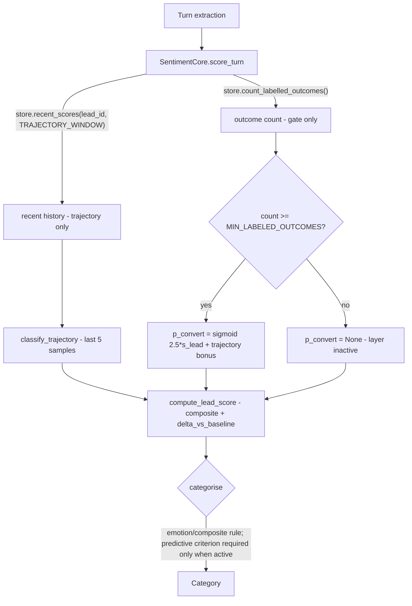

> **Lens:** Architect · **Decided by:** PO · **Inputs:** CR-01-contract.md, CR-01 Appendix A

# US-113 — Fix, do not port, the unreachable Hot category (A-3 / M-9) [Lens: Architect]

- **Story:** As a **sales rep and a product owner**, I want **the predictive layer's `p_convert` to actually be computed on the per-lead scoring path, and the Hot category to be reachable through `compute_lead_score`**, so that **adopting universityDemo's code does not import a verified defect in which the strongest buying signal the system has — a READY buyer at the top of the score range — can never be classified Hot (A-3, M-9)**.
- **Business value:** A-3 is one of the two "verified defect" findings in the change request: `scorer.py:272` fetches ten rows while `scorer.py:276` gates on a hundred, so `p_convert` is **always** `None`, `predictive_layer_active` is **always** `False`, and Hot requires `p >= 0.55` (`categorizer.py:112`). CR-01-contract.md §C3.2 makes the fix a condition of the extraction: "Defect to fix during extraction, not port". Carrying it forward would ship a category no code path can produce, while the console reports the lead as merely Warm.
- **Priority:** **Must** — it is a blocking item of the merge (contract §C3.2) and it changes the merged categoriser that US-114 and US-115 build on.
- **Prerequisites:** US-111 (the core exists; `compute_lead_score` and `CompositeScore` live there). Independent of US-112 and US-114.

## The defect, stated exactly (evidence)

| Element | Value | Citation |
|---|---|---|
| History fetch | `get_lead_sentiment_history(lead_id, limit=10)` | `scorer.py:272` |
| Gate | `if history and len(history) >= settings.MIN_LABELED_OUTCOMES:` | `scorer.py:276` |
| Gate default | `MIN_LABELED_OUTCOMES = 100` | `config.py:497-499` |
| Consequence | `p_convert` always `None`, `predictive_layer_active` always `False` | A-3 |
| Downstream | `p = p_convert if p_convert is not None else 0.0` | `categorizer.py:109` |
| Hot gate | `s_lead >= 0.70 and p >= 0.55 and d > 0 and trajectory in ("Upward","Stable") and friction < 0.40` | `categorizer.py:112` |
| Net effect | **Hot is unreachable through `compute_lead_score`**; it survives only on the session-aggregate path | A-3, `scorer.py:628` |

**Additional finding verified in the source while writing this story (not in Appendix A):**
`get_lead_sentiment_history` filters `WHERE lead_id = %s` (`D:\project\universityDemo\app\sentiment\
models.py:160`), so `len(history)` is **one lead's turn count**, compared against a constant whose
name and documented purpose are a **corpus-wide labelled-outcome count** ("carried from the source
but only populated when a labelled-outcome count ≥ `MIN_LABELED_OUTCOMES` (100) exists",
`MOD-07-sentiment-escalation.md` B.7). Two quantities of different units are being compared.

**Therefore the fix is not `limit = 100`.** Raising the fetch to 100 would make the gate arithmetically
satisfiable only for a lead with a hundred scored turns, and would leave a per-lead row count deciding
a corpus-level model-availability question. The fix separates the two quantities:

1. **Trajectory** needs a bounded recent window — the classifier already uses the last five samples
   (`scorer.py:337`, `scorer.py:348-353`). It reads `TRAJECTORY_WINDOW = 5`.
2. **The predictive gate** needs the number of labelled outcomes available to the model — a
   dedicated store call, not a history length.
3. **`p_convert is None` must stay distinguishable from `0.0`** — the `else 0.0` substitution at
   `categorizer.py:109` is deleted, so "the model is not active" can never masquerade as "the model
   predicts zero".

## Acceptance Criteria [Lens: PO]

```gherkin
Scenario: AC-1 Hot is reachable through the per-lead scoring path (the regression test)
  Given a store reporting 120 labelled outcomes
    And a lead whose turn is READY with sentiment 0.9, intent 0.9 and friction 0.1
    And a trajectory of Upward
  When compute_lead_score is called for that lead
  Then predictive_layer_active is True
    And p_convert is not None and >= 0.55
    And categorise(composite, extraction) is Category.HOT

Scenario: AC-2 The gate is about outcomes, not about turns
  Given the same store response of 120 labelled outcomes
    And a lead with only 11 scored turns
  When compute_lead_score is called
  Then the predictive layer is active
    And the result does not depend on a history fetch reaching 100 rows

Scenario: AC-3 With too few outcomes the layer is inactive and says so
  Given a store reporting 40 labelled outcomes (fewer than MIN_LABELED_OUTCOMES)
  When a strong READY lead is scored
  Then predictive_layer_active is False
    And p_convert is None (not 0.0)
    And the category is decided by the emotion-and-composite rule alone
    And the score row records that the predictive layer was inactive and why

Scenario: AC-4 (negative) A store failure does not break scoring or invent a probability
  Given a store whose labelled-outcome count raises an exception
  When a turn is scored
  Then the turn still returns an Extraction and a CompositeScore
    And predictive_layer_active is False and p_convert is None
    And no exception reaches the caller

Scenario: AC-5 (negative) The two quantities can never be re-coupled silently
  Given the merged scorer source
  When it is scanned
  Then no call site compares a history length against MIN_LABELED_OUTCOMES
    And the trajectory window and the outcome gate are separately named constants

Scenario: AC-6 (negative) An inactive layer never fabricates a zero probability
  Given p_convert is None
  When the decision trace is rendered
  Then it reports "predictive layer inactive" with the reason
    And it does not report "p_convert = 0.00"
```

Technical acceptance criteria [Lens: TPO]:

- **TAC-1:** The fix lives in the shared core, so both products inherit it; it is not an ANITA-side
  workaround. The session-aggregate path is fixed by the same call, not patched separately.
- **TAC-2:** `compute_lead_score` stays a pure function of its arguments (no store access inside): the
  labelled-outcome count is fetched by the caller (`SentimentCore.score_turn`) and passed in. This is
  what makes AC-1 a unit test with a fake store and no database.
- **TAC-3:** The trajectory window and the outcome gate are module-level constants with distinct
  names (`TRAJECTORY_WINDOW: int = 5`, `MIN_LABELED_OUTCOMES: int = 100`), and a test asserts they
  are independent (AC-5).
- **TAC-4:** `HOT_P_CONVERT: float = 0.55` is a named constant in the core, not a literal at the
  comparison site.
- **TAC-5:** These constants are **not** added to `SentimentConfig` — the contract's field list stays
  exactly as frozen (CR-01-contract.md §C3.2). Promoting them later is an additive change; doing it
  now would deviate from the frozen config surface. They are tunable in code only until a future
  story makes them config.

## HLD — Architecture Slice [Lens: Architect]



- **Components touched:**
  - **`shared/sentiment/scorer.py`** — `compute_lead_score` takes `labelled_outcome_count` and
    computes or declines the predictive layer; `classify_trajectory` takes a bounded sequence.
  - **`shared/sentiment/categorizer.py`** — deletes the `None → 0.0` substitution; requires the
    predictive criterion only when the layer is active; the decision trace states the reason.
  - **`shared/sentiment/core.py`** — fetches the two quantities separately from the store and passes
    them in.
  - **`shared/sentiment/store.py`** — requires `count_labelled_outcomes() -> int` and
    `recent_scores(lead_id, limit) -> Sequence[float]` (US-115 formalises the Protocol; if US-115 has
    not landed, this story adds exactly these two methods to the core's store interface, since it
    cannot be implemented without them).
- **Interaction summary:**
  1. The turn is scored (fallback included), never raising.
  2. The core asks the store for the recent score window — bounded, small, used only for trajectory —
     and for the number of labelled outcomes — an integer, used only for the gate.
  3. If the count is at least `MIN_LABELED_OUTCOMES`, `p_convert` is computed with the source's
     heuristic `p = clamp(sigmoid(2.5·s_lead + bonus(trajectory)), 0.01, 0.99)`
     (`scorer.py:372-392`) and `predictive_layer_active = True`; otherwise `p_convert = None`.
  4. `categorise` applies the predictive criterion **only when the layer is active**; when it is
     inactive the emotion-and-composite rule decides, which is today's ANITA behaviour and the
     MOD-07 B.7 accepted state at launch.
  5. **Failure path:** a store error on either read logs, sets the layer inactive and returns the
     score; it never blocks the turn and never substitutes a fabricated probability.
  6. **Arithmetic note that makes the regression test deterministic:** with `s_lead = 0.72` and
     trajectory `Upward`, `p = sigmoid(2.5·0.72 + 0.5) = sigmoid(2.30) ≈ 0.909 ≥ 0.55`. Once the
     layer is active the probability criterion is comfortably satisfied at the score levels Hot
     already requires, so the only thing that ever blocked Hot was the activation defect itself.

## LLD — Implementation Detail [Lens: Architect]

- **Module paths:** `D:\project\anitamedicalsystems\shared\sentiment\scorer.py`,
  `...\shared\sentiment\categorizer.py`, `...\shared\sentiment\core.py`,
  `...\shared\sentiment\store.py`, tests in `...\shared\tests\test_predictive_layer.py`.
- **Constants (module level, core):**

```python
TRAJECTORY_WINDOW: int = 5          # scorer.py:337 - "based on the last 5 calls"
MIN_LABELED_OUTCOMES: int = 100     # config.py:497-499 - the gate, now an outcome count
HOT_P_CONVERT: float = 0.55         # categorizer.py:112
HOT_S_LEAD: float = 0.70            # categorizer.py:112
HOT_FRICTION_MAX: float = 0.40      # categorizer.py:112
P_CONVERT_FLOOR: float = 0.01       # scorer.py:392
P_CONVERT_CEIL: float = 0.99        # scorer.py:392
```

- **Classes / functions / signatures:**

```python
# shared/sentiment/scorer.py
def compute_lead_score(
    extraction: Extraction,
    *,
    recent_scores: Sequence[float],       # newest-first; only TRAJECTORY_WINDOW is used
    baseline: float | None,
    previous_latest: float | None,
    turn_count: int,
    labelled_outcome_count: int,          # the gate input — an outcome count, never a row count
) -> CompositeScore:
    """Pure. No store access (TAC-2).

    Sets on the returned CompositeScore:
      trajectory, delta_vs_baseline, p_convert (None when inactive),
      predictive_layer_active, bant_completeness.
    """

def classify_trajectory(s_calls: Sequence[float]) -> tuple[str, str | None]:
    """Last TRAJECTORY_WINDOW samples, current included.
    < 2 samples -> ("Stable", "insufficient_history")
    variance > 0.10 -> ("Volatile", None)
    slope > 0.05 -> ("Upward", None); < -0.05 -> ("Degrading", None); else ("Stable", None)
    (scorer.py:334-353, :359-366)"""

def heuristic_conversion_probability(s_lead: float, trajectory: str) -> float:
    """sigmoid(2.5*s_lead + {Upward:+0.5, Degrading:-0.5, Volatile:-0.2, Stable:0.0}),
    rounded to 4 dp, clamped to [0.01, 0.99] (scorer.py:372-392)."""

# shared/sentiment/categorizer.py
def categorise(composite: CompositeScore, extraction: Extraction, *, config: SentimentConfig) -> Category:
    """Precedence (US-111 rule 5) with the predictive criterion applied only when active:

    predictive_active = composite.predictive_layer_active
    hot_ok = (
        composite.score > 0.3 and extraction.primary_emotion is Emotion.READY
    ) and (
        (not predictive_active)
        or (composite.p_convert is not None
            and composite.p_convert >= HOT_P_CONVERT
            and composite.score >= HOT_S_LEAD
            and (composite.delta_vs_baseline or 0.0) > 0
            and composite.trajectory in ("Upward", "Stable")
            and composite.friction < HOT_FRICTION_MAX)
    )
    """

# shared/sentiment/core.py
class SentimentCore:
    def score_turn(self, message: str, *, lead_id: str = "") -> tuple[Extraction, CompositeScore]:
        extraction = self._score(message)                    # fallback-safe (A-2)
        state = self._store.for_lead(lead_id) if lead_id else None
        recent = [row["s_call"] for row in self._store.recent_scores(lead_id, TRAJECTORY_WINDOW)] \
            if lead_id else []
        try:
            outcomes = self._store.count_labelled_outcomes()
        except Exception:
            logger.warning("labelled-outcome count unavailable; predictive layer inactive")
            outcomes = -1                                     # never >= MIN_LABELED_OUTCOMES
        composite = compute_lead_score(
            extraction, recent_scores=recent,
            baseline=state.baseline if state else None,
            previous_latest=state.previous_latest if state else None,
            turn_count=(state.turn_count + 1) if state else 1,
            labelled_outcome_count=outcomes,
        )
        ...
```

- **Data structure change:** `CompositeScore` (defined by US-111) carries `p_convert: float | None`,
  `predictive_layer_active: bool`, `trajectory: str`, `delta_vs_baseline: float | None`. The
  contract's `categorise(composite, extraction) -> Category` signature is unchanged; the predictive
  output travels **inside** the composite, which is why no contract deviation is needed.
- **Decision trace (AC-6):** `decision_trace(composite, extraction) -> list[str]` renders each check
  with its value and verdict, including `"predictive layer inactive (3 labelled outcomes < 100)"` or
  `"p_convert 0.91 ≥ 0.55 ✓"`. A `None` probability is never rendered as `0.00`.
- **Config keys:** none added to `SentimentConfig` (TAC-5). The four constants above are code-level.
  `MIN_LABELED_OUTCOMES` is **not** an ANITA `anita.yaml` key today and this story does not add one
  (`Unknown — needs verification` whether the PO wants it operator-tunable; if yes, it is an additive
  `SentimentConfig` field and a US-112-style mapping, not a change to this fix).
- **Edge cases** (each with the decided behaviour):
  1. **Store reports exactly `MIN_LABELED_OUTCOMES`** → active (the gate is `>=`).
  2. **Store reports `MIN_LABELED_OUTCOMES - 1`** → inactive, `p_convert is None`, reason recorded.
  3. **Recent-window read returns more rows than `TRAJECTORY_WINDOW`** → only the newest
     `TRAJECTORY_WINDOW` are used; the function is deterministic regardless of the caller's slice.
  4. **Fewer than 2 samples** → `("Stable", "insufficient_history")`; the layer can still be active
     (trajectory and the gate are independent — the whole point of the fix).
  5. **`labelled_outcome_count` negative** (a store bug) → treated as inactive; never raises.
  6. **`p_convert` computed as exactly 0.55** → Hot criterion satisfied (`>=`).
  7. **`s_lead` at 1.0 with trajectory Degrading** → `p = sigmoid(2.5 − 0.5) = sigmoid(2.0) ≈ 0.881`,
     but `trajectory not in ("Upward","Stable")` → not Hot; the trace says which clause failed.
  8. **Predictive layer active and `p < 0.55`** → the lead is Warm, not Hot, and the trace shows the
     probability that blocked it — the behaviour the defect made unreachable to observe.
  9. **Store row missing `s_call`** → that row is skipped for trajectory, never defaulted to 0.0
     (a fabricated neutral would distort the variance).
  10. **Two leads scored concurrently** → the outcome count is read per call and may differ between
      calls; the layer's state is recorded on each composite, so a score is always explainable.
- **Error handling:**
  - `StoreUnavailable` on the outcome count → inactive layer, logged once, score returned (AC-4).
  - `StoreUnavailable` on the recent window → empty window, `("Stable","insufficient_history")`,
    score returned.
  - No exception from the predictive block may escape: it is wrapped exactly as the source wrapped
    its LightGBM probe (`scorer.py:279-283`) — but with a *visible* inactive state rather than a
    silent one.
- **Test scenarios** — concrete and runnable (`python -m pytest shared/tests/test_predictive_layer.py -q`):

| # | Level | Test |
|---|---|---|
| T-01 | unit | **AC-1, the required regression test.** Fake store: `count_labelled_outcomes() == 120`; lead extraction READY, s_call 0.9, intent 0.9, friction 0.1; recent scores rising. Assert through `compute_lead_score` + `core.categorise`: `predictive_layer_active is True`, `p_convert is not None`, `p_convert >= 0.55`, `category is Category.HOT`. Assert the same call under the pre-fix code (fixture of the old behaviour) yields `p_convert is None` — the test fails if the defect is re-introduced. |
| T-02 | unit | **AC-2:** 11 turn-scores in history, 120 labelled outcomes → layer active. Fails if someone "fixes" the defect by setting the fetch limit to 100. |
| T-03 | unit | **AC-3:** 40 labelled outcomes → `predictive_layer_active is False`, `p_convert is None`, category from the emotion rule, trace contains "inactive" and the count. |
| T-04 | unit | 200 turn-scores in history, 3 labelled outcomes → layer inactive: the gate reads outcomes, not rows. |
| T-05 | unit | **AC-6:** with `p_convert is None` the trace never contains "0.00" as a probability and contains the reason. |
| T-06 | negative | **AC-4:** `count_labelled_outcomes` raises → no exception, layer inactive, score returned. |
| T-07 | static | **AC-5:** AST scan of `shared/sentiment/**` asserts no comparison between a `recent_scores`/history expression and `MIN_LABELED_OUTCOMES`, and that `TRAJECTORY_WINDOW` and `MIN_LABELED_OUTCOMES` are distinct names. |
| T-08 | unit | Trajectory: 2 samples variance > 0.10 → Volatile; rising slope → Upward; falling → Degrading; `<2` → Stable with the `insufficient_history` flag (`scorer.py:334-366` parity fixtures). |
| T-09 | unit | `heuristic_conversion_probability` parity against `scorer.py:372-392` for a table of (s_lead, trajectory) pairs, including the clamps at 0.01/0.99. |
| T-10 | unit | Boundary: exactly 100 outcomes → active; 99 → inactive; `p_convert == 0.55` → Hot criterion satisfied. |
| T-11 | integration | A full `score_turn` with a store whose outcome count moves from 99 to 100 between two turns: the first composite records inactive, the second active — the state is per composite, and both are explainable. |

- **How ANITA's 614 platform tests stay green (CR-01-contract.md §C6):**
  1. ANITA has no labelled-outcome store, so in the platform suite `count_labelled_outcomes()` returns
     0 (in-memory default) → the predictive layer is inactive → `categorise` uses the emotion and
     composite rule, which is **exactly today's `anita/sentiment.py:344-366` behaviour**. Every
     categorisation assertion in `platform/tests/test_mod07_sentiment.py` is therefore unchanged,
     including `test_ready_with_intent_is_hot`, which asserts Hot through the emotion rule.
  2. `compute_lead_score` is a new function; ANITA's existing `composite_score` path is untouched
     (US-111 T-09 parity holds).
  3. No test edits. Full suite from `platform/`: `.venv\Scripts\python -m pytest tests -q`; no
     decrease against the 614-test gate.
  4. **Behaviour change made visible:** for any product that *does* have ≥100 labelled outcomes, Hot
     becomes stricter (it now also requires `p >= 0.55`). That is the intended reading of A-5's
     "ANITA gains … `p_convert`" and is recorded in the module's accepted-debt note; ANITA itself
     cannot reach that state until it has an outcomes table, which is out of scope.

## Traceability

- Change request: **CR-01**, requirement CR-01.2 (adopt the architecture, including its predictive
  layer) / CR-01.3 (one fixed core, not a per-product patch)
- Contract: **§C3.2** ("Defect to fix during extraction, not port: the `limit=10` vs `>=100` gate
  (A-3)"), **§C5 M-9**
- Module: **MOD-07**; accepted debt recorded in **`MOD-07-sentiment-escalation.md` B.7**
  ("`P_convert` … only populated when a labelled-outcome count ≥ `MIN_LABELED_OUTCOMES` (100)
  exists") — this story makes that sentence true
- Use case: **UC-10** (Hot/At-Risk classification feeds the escalation decision)
- Evidence citations:
  - A.1: "`scorer.py:272` fetches history with `limit=10`; `scorer.py:276` gates the predictive block
    on `len(history) >= settings.MIN_LABELED_OUTCOMES` (default **100**). A 10-row fetch cannot
    satisfy a 100-row gate, so `p_convert` is **always `None`** and `predictive_layer_active`
    **always `False`**. `categorize` substitutes `p = 0.0` when `p_convert is None`
    (`categorizer.py:109`) and **Hot requires `p >= 0.55`** (`categorizer.py:112`) — so **Hot is
    unreachable through `compute_lead_score`**. It survives only via the session-aggregate path
    (`scorer.py:628`)."
  - A-3: "ANITA inherits a verified defect — Hot unreachable via `compute_lead_score`" (severity:
    High)
  - A-5: "ANITA gains persistence + async + trajectory + BANT + `p_convert`"
  - Repo-verified while drafting this story (not in Appendix A):
    `D:\project\universityDemo\app\sentiment\models.py:143-168` (`get_lead_sentiment_history` filters
    `WHERE lead_id = %s`, `LIMIT %s`), `scorer.py:322-353` (trajectory thresholds),
    `scorer.py:372-392` (`_heuristic_conversion_probability` arithmetic),
    `config.py:497-499` (`MIN_LABELED_OUTCOMES` default 100)

## Definition of Done

- [ ] **T-01 passes and fails against the old code** — the regression test proves Hot is reachable
      through `compute_lead_score`, not merely that the constants differ
- [ ] AC-2/T-02 passes: the gate is satisfied by outcome count, not by a 100-row history fetch
- [ ] AC-4/T-06 passes: a store failure cannot break scoring or fabricate a probability
- [ ] AC-5/T-07 passes: no history-length-vs-gate comparison exists anywhere in the core
- [ ] AC-6/T-05 passes: an inactive predictive layer is reported as inactive, never as p = 0.00
- [ ] `p_convert`/`predictive_layer_active`/`trajectory` recorded on the score row so a historical
      category can be explained after the fact (`weights_used`, `model_version` per TRD-32)
- [ ] Full platform suite green against the 614-test gate; no test file edited
