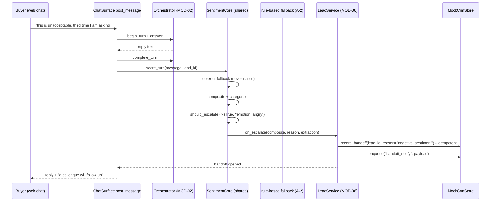

> **Lens:** Architect · **Decided by:** PO · **Inputs:** CR-01-contract.md, CR-01 Appendix A

# US-114 — Give `should_escalate` a real sink so UC-10 stops being DEFERRED [Lens: Architect]

- **Story:** As a **buyer who is unhappy, and the sales rep who is supposed to call them**, I want **a negative turn to open a real, deduplicated escalation to a human with the sentiment evidence attached, inside the same turn**, so that **UC-10 "Negative sentiment detected" is actually reachable in the running product and moves from DEFERRED to PASS (CR-01-contract.md §C6)**.
- **Business value:** `BRD-16`, `R-5` and the whole point of MOD-07. Today the capability is complete, tested and **referenced by no surface** (`anita.yaml:154-156`, `system_check.py:212-213`) — "escalating to nobody is worse than not detecting it". A-1 adds a second reason this story must exist in this shape: **universityDemo has no escalation path at all** — no function, no callback, no notification (A.1) — so the capability exists **only in ANITA** and must be preserved through the extraction (M-8), not replaced by Side A's architecture.
- **Priority:** **Must** — it is the story that satisfies CR-01-contract.md §C6's "UC-10 moves from DEFERRED to PASS" and the release gate's deferred list shrinks by one.
- **Prerequisites:** US-111 (core) and US-112 (config reaches the core). US-113 is independent but shares the categoriser.

## Contract conformance notes

1. C3.2 lists "`should_escalate` + `on_escalate` (A-1, UC-10)" as a capability that **MUST survive**
   the extraction. This story is the proof: `should_escalate` stays a core method, and ANITA supplies
   the `on_escalate` callback that writes the handoff.
2. The core stays product-neutral: it decides and dispatches; **ANITA** decides what a sink is.
   Nothing about handoffs, SQLite or reps appears in `shared/sentiment`.
3. `SentimentConfig.escalation_enabled` semantics are fixed here (the contract names the field but not
   its meaning): `False` stops the **dispatch**, never the **decision**. The decision is still
   returned and recorded, so a disabled switch is auditable rather than invisible.

## Acceptance Criteria [Lens: PO]

```gherkin
Scenario: AC-1 A frustrated buyer with a captured lead opens one handoff
  Given a web-chat conversation whose lead has been captured
  When the buyer sends "this is unacceptable, the third time I am asking and nobody responds"
  Then the buyer's reply tells them a person will follow up
    And exactly one handoff row exists for that lead with reason "negative_sentiment"
    And the handoff carries the composite score and the objection labels
    And the escalation happened inside the same turn (before the next message is answered)

Scenario: AC-2 Two negative turns still open one handoff
  Given a lead with an open handoff from a negative turn
  When a second consecutive negative turn is scored
  Then no second open handoff is created
    And the first handoff is unchanged

Scenario: AC-3 The LLM is down and the buyer is still escalated
  Given the sentiment scorer raises (inference unavailable)
  When a frustrated turn is scored
  Then the fallback produces the score
    And the handoff is still opened within the turn

Scenario: AC-4 (negative) Delivery of the notification fails
  Given the CRM records the handoff but the rep notification cannot be delivered
  When the escalation is dispatched
  Then the handoff remains open with the reason recorded
    And a retry row is queued on the outbox
    And the buyer is still told a person will follow up

Scenario: AC-5 (negative) The escalation switch is off
  Given sentiment.escalation_enabled = false
  When a frustrated turn is scored
  Then should_escalate still returns (True, reason) and the decision is recorded
    And on_escalate is not called and no handoff row is created
    And the turn's score is unaffected

Scenario: AC-6 (negative) An anonymous buyer with no lead
  Given a session where no contact details were ever captured
  When a frustrated turn is scored
  Then the escalation decision is recorded against the session
    And no handoff row is created, because a handoff names a lead (MOD-06 contract)
    And the buyer is not promised a callback the system has nowhere to record

Scenario: AC-7 UC-10 is driven by system_check and reported PASS
  Given the assembled platform
  When scripts/system_check.py runs
  Then it drives a lead capture followed by a frustrated turn
    And records [PASS] UC-10 Negative sentiment detected
    And the deferred count in the JSON report is one lower than before this story
```

Technical acceptance criteria [Lens: TPO]:

- **TAC-1:** The sink is the existing MOD-06 handoff (`CrmStore.record_handoff`, `crm.py:238`,
  `:463-483`), which is already idempotent per lead by construction ("two negative turns must not
  open two handoffs", `crm.py:464`). No new store is created for escalations.
- **TAC-2:** The escalation is evaluated **inside the turn**, after the reply is composed and the
  score committed — not in a worker, not on a poll (`BRD-16`, MOD-07 TRD-35).
- **TAC-3:** A sink failure (handler raises, CRM write fails, outbox write fails) never loses the
  score and never fails the buyer's turn (`anita/sentiment.py:496-500` behaviour, preserved).
- **TAC-4:** The trigger set is TRD-35's three conditions; the third (a hard objection — `price` or
  `trust` — with `friction_score >= 0.5`) is added by this story, because it is specified in
  `MOD-07-sentiment-escalation.md` TRD-35 and absent from the current `should_escalate`.
- **TAC-5:** No transcript text beyond what the handoff already carries (`sentiment_score`,
  `products`) is written; no buyer identifier beyond `lead_id` appears in a log line (`DG-11`).
- **TAC-6:** `scripts/system_check.py` detects its own failure: if the handoff is absent, UC-10 is
  FAIL and appears in `broken`, not silently skipped.

## HLD — Architecture Slice [Lens: Architect]



- **Components touched:**
  - **`platform/app/anita/sentiment.py`** — `on_escalate` implementation injected by the assembly;
    the adapter exposes `escalation_sink(leads)`.
  - **`platform/app/anita/surfaces.py`** — `ChatSurface` gains `sentiment` and a post-turn scoring
    step; on escalation the reply gains the notice.
  - **`platform/app/anita/leads.py`** — `LeadService.escalate(lead_id, reason, score, products)`
    (TRD-35's `HandoffService.open` in the ANITA codebase) and `list_handoffs(state=None)`.
  - **`platform/app/anita/assembly.py`** — constructs the config (US-112), the core, the sink, passes
    them to `ChatSurface`, and adds `leads` to `Assembly` so the check can read the handoffs.
  - **`platform/app/anita/orchestrator.py` / `surfaces.py`** — `Conversation.lead_id` is assigned on
    capture; it exists today (`orchestrator.py:203`) and is never set.
  - **`platform/scripts/system_check.py`** — UC-10 leaves the "not reachable" tuple and gains a
    driven check.
  - **`platform/config/anita.yaml`** — the `UC-10` entry is removed from `release.deferred_use_cases`.
- **Interaction summary:**
  1. The buyer's turn is answered and committed exactly as today (`surfaces.py:268-288`).
  2. Immediately after, `ChatSurface` calls `sentiment.score_turn(message, lead_id=conversation.
     lead_id or "")`; scoring is post-answer, escalation is within the turn (`BRD-16`).
  3. `should_escalate` returns the decision. If true and `escalation_enabled`, the core dispatches to
     `on_escalate`.
  4. ANITA's handler records the handoff through MOD-06 (idempotent per lead) and enqueues the rep
     notification on the existing outbox (`crm.py:242`, `:496`); the handoff carries the composite
     score and the objection labels for the rep's briefing.
  5. **Failure path:** a raising handler is logged and swallowed; the buyer's turn and the score are
     untouched. The handoff is not rebuilt from scratch on retry — the outbox row is retried
     (`UC-10` E2, `SM-06` #7).
  6. **Not-triggered path:** a neutral turn produces no dispatch and no handoff; the score row is
     still written.
- **Why the sink is the handoff and not a notification:** Side A's only escalation artefact is a
  **display string** (`categorizer.py:42`, A.1) — it has no sink at all. ANITA's MOD-06 already owns
  the durable escalation record (`Handoff`, `crm.py:191-213`; `SM-06`), so "a real destination" is a
  row a rep can act on, with the notification as a retryable side effect.

## LLD — Implementation Detail [Lens: Architect]

- **Module paths:** `D:\project\anitamedicalsystems\platform\app\anita\sentiment.py` (adapter +
  sink), `...\platform\app\anita\surfaces.py`, `...\platform\app\anita\leads.py`,
  `...\platform\app\anita\assembly.py`, `...\platform\scripts\system_check.py`,
  `...\platform\config\anita.yaml`, tests in `...\platform\tests\test_mod07_sentiment.py`
  (additions only) and `...\platform\tests\test_mod06_leads.py`.
- **Classes / functions / APIs:**

```python
# platform/app/anita/leads.py   (additions)
class LeadService:
    def escalate(
        self, lead_id: str, *, reason: str, score: float | None,
        products: Sequence[str] = (), conversation_id: str = "",
    ) -> Handoff:
        """TRD-35's HandoffService.open. Delegates to CrmStore.record_handoff,
        which is idempotent per lead (crm.py:463-483) -> one open handoff."""

    def list_handoffs(self, *, state: str | None = None) -> list[Handoff]:
        """Read side for the rep console and for scripts/system_check.py (UC-10)."""

# platform/app/anita/sentiment.py   (adapter additions)
def escalation_sink(leads: LeadService, *, conversation_id: str = ""):
    """Build the on_escalate callback ANITA uses. Signature:
       (composite: CompositeScore, reason: str, extraction: Extraction) -> None
    Writes a handoff with reason 'negative_sentiment', sentiment_score=composite.score,
    products from the caller, then enqueues 'handoff_notify' on the outbox."""

class SentimentService:
    def observe(self, lead_id: str, message: str, *, extraction: Extraction | None = None,
                context: dict | None = None) -> tuple[LeadSentiment, bool, str]:
        """Unchanged return shape; `context` (products, conversation_id) is new and
        optional so existing callers and tests are unaffected."""

# platform/app/anita/surfaces.py
class ChatSurface:
    def __init__(self, orchestrator, answers=None, retriever=None, leads=None, *,
                 rate_limit=None, sentiment: SentimentService | None = None) -> None: ...

    def _escalate_turn(self, conversation, message: str) -> bool:
        """Score the completed turn; return True when an escalation was raised.
        Never raises: a sentiment failure cannot fail a buyer's turn (TAC-3)."""

# platform/app/anita/assembly.py
@dataclass
class Assembly:
    settings: AnitaSettings
    router: Router
    chat: ChatSurface
    admin: AdminSurface
    leads: LeadService | None = None          # NEW - so UC-10 can be observed
    notes: list[str] = field(default_factory=list)

# platform/scripts/system_check.py   (UC-10 becomes driven)
# 1. remove the ("UC-10", ...) row from the not-reachable tuple (system_check.py:203-216)
# 2. add, after the driven-use-case loop:
#    chat.post_message(message="call me on 98200 11122", session_id="uc-10")
#    chat.post_message(message="this is unacceptable — third time I am asking, no one responds",
#                      session_id="uc-10")
#    handoffs = built.leads.list_handoffs(state="open") if built.leads else []
#    ok = any(h.reason == "negative_sentiment" for h in handoffs)
#    record(PASS if ok else FAIL, "UC-10 Negative sentiment detected", f"{len(handoffs)} open handoff(s)")
#    if not ok: broken.append("UC-10")
```

- **Data structures** — the escalation record already exists; this story writes it and adds two
  fields to make the reason legible without a join:

```python
# platform/app/anita/crm.py - Handoff (existing, crm.py:191-213), plus:
@dataclass
class Handoff:
    handoff_id: str
    lead_id: str
    reason: str                     # "negative_sentiment" for UC-10
    state: str = "open"             # open | notified | acknowledged | closed | withdrawn
    sentiment_score: float | None = None
    products: list[str] = field(default_factory=list)
    created_at: str = ...
    notified_at: str | None = None
    objections: list[str] = field(default_factory=list)   # NEW - the rep's briefing (BRD-17)
    trigger: str = ""                                     # NEW - should_escalate's reason string
```

  The two new columns are added with `ALTER TABLE ... ADD COLUMN IF NOT EXISTS`-equivalent guards in
  the mock store's DDL path (`crm.py:278-288` shows the existing `CREATE TABLE IF NOT EXISTS`
  pattern), so an existing `anita_crm.sqlite` upgrades in place.
- **Config keys:** `sentiment.escalation_enabled` (bool, default `True`) — mapped by US-112, consumed
  by the core as the dispatch gate. No other key is added; the trigger thresholds come from the
  existing `negative_threshold`.
- **Trigger set (TRD-35 alignment, TAC-4)** — `should_escalate` returns `(True, reason)` when any
  holds:
  1. `extraction.primary_emotion in {ANGRY, FRUSTRATED}` → `"emotion=angry"` (existing,
     `anita/sentiment.py:376-377`);
  2. `composite.score <= config.negative_threshold` → `"composite -0.31 <= -0.20"` (existing,
     `:378-379`);
  3. `composite.delta <= -0.5` → `"sharp decline (-0.60)"` (existing, `:380-381`);
  4. **new:** a hard objection (`"price"` or `"trust"` in `extraction.objections`) **and**
     `extraction.friction_score >= 0.5` → `"hard objection price with friction 0.60"`
     (`MOD-07-sentiment-escalation.md` TRD-35).
  The reason string is stored on the handoff as `trigger`, so the console can explain why a rep was
  called.
- **Edge cases** (each with the decided behaviour):
  1. **No lead on the conversation** → decision recorded against the session (`LeadSentiment.lead_id
     = session key`), no handoff; the reply does not promise a callback (AC-6).
  2. **Lead exists but is erased** (`Lead.is_erased`, `crm.py:165`) → no handoff; the decision is
     recorded; erasure wins over escalation (`DG-11`).
  3. **`escalation_enabled=False`** → decision `(True, reason)` recorded on the lead's state and in
     the trace, no dispatch (AC-5).
  4. **Two negative turns in the same millisecond** → `record_handoff` returns the existing open row;
     one handoff (TAC-1, AC-2).
  5. **Handoff write fails** → logged, turn and score unaffected; the next negative turn retries the
     write because the decision is re-evaluated every turn.
  6. **Outbox enqueue fails after the handoff is written** → the handoff exists and is open; the
     failure is logged; a later turn re-enqueues (the escalation is never re-derived, never
     duplicated — `SM-06` #7).
  7. **Buyer's message contains no negative signal but the composite is below threshold** → escalates
     on condition 2; the reason string says so.
  8. **A previous handoff is `closed`** (buyer resolved the issue) → a new negative turn opens a new
     open handoff, because idempotency is defined over open states (`crm.py:467`), which is the
     correct reading of "one **open** handoff per lead" (M7-5).
  9. **Sentiment disabled entirely** (no service wired) → `ChatSurface` behaves exactly as today;
     this is the degraded build and is asserted by an existing-surface regression test.
  10. **Long message** → the transcript snippet is truncated before any storage (MOD-07 NFR, 500
      chars) — the handoff stores no transcript at all, only the score and labels.
- **Error handling:**
  - `EscalationHandlerError` → `logger.exception`, swallowed (`anita/sentiment.py:496-500`).
  - `HandoffWriteError` → logged; no retry inside the turn; the next negative turn re-evaluates
    (idempotent write makes this safe).
  - `OutboxWriteError` → logged; handoff remains the record of truth.
  - No exception from the sentiment block may propagate to `post_message` (TAC-3).
- **The DoD trap this story must not fall into:** `system_check.py:203-226` treats every UC in its
  hard-coded tuple as unreachable and records FAIL for any of them that is *not* deferred.
  **Deleting the `UC-10` entry from `anita.yaml` alone therefore turns DEFERRED into FAIL.** Both
  edits are mandatory: remove the tuple row **and** add the driven check (AC-7, TAC-6).
- **Test scenarios** — concrete and runnable:

| # | Level | Test |
|---|---|---|
| T-01 | unit | `should_escalate` returns True/False for each of the four triggers and for a neutral turn; the reason strings are non-empty and name the trigger. |
| T-02 | integration | **AC-1:** capture a lead, send a frustrated message → one handoff, `reason="negative_sentiment"`, `sentiment_score` equals the composite, `objections` contains a label, reply contains the follow-up notice. |
| T-03 | integration | **AC-2:** two frustrated messages → `len([h for h in list_handoffs(state="open")]) == 1` (crm.py:463-483 idempotency). |
| T-04 | integration | **AC-3:** scorer raises → fallback score → the handoff is still opened. |
| T-05 | negative | **AC-4:** outbox enqueue raises → handoff exists and is open, the buyer's turn succeeds, the failure is logged. |
| T-06 | negative | **AC-5:** `escalation_enabled=false` → `should_escalate` still True, no handoff, no handler call (spy handler). |
| T-07 | negative | **AC-6:** anonymous session (no lead) → no handoff, no callback promise in the reply, decision present on the state. |
| T-08 | negative | Erased lead → no handoff, decision recorded. |
| T-09 | e2e | `python scripts/system_check.py` prints `[PASS] UC-10 Negative sentiment detected`; `--json` shows `deferred` one lower and `UC-10` absent from the failures. |
| T-10 | regression | `ChatSurface` built without a sentiment service behaves exactly as before (the surface's existing tests pass unmodified). |
| T-11 | unit | `Conversation.lead_id` is assigned on capture and is the id used for the handoff (guards the wiring gap found in `orchestrator.py:203` vs `surfaces.py:414-425`). |
| T-12 | negative | A handoff exists in `closed` state and a new negative turn arrives → a new open handoff is created (edge case 8). |

- **How ANITA's 614 platform tests stay green (CR-01-contract.md §C6):**
  1. `ChatSurface`'s new `sentiment` parameter is optional with default `None`; every existing test
     that constructs the surface without it takes the unchanged path (T-10).
  2. `SentimentService.observe` keeps its return shape and gains only an optional `context`
     keyword; `platform/tests/test_mod07_sentiment.py` is not edited for this story.
  3. `Handoff` gains two fields with defaults; existing constructions and `as_dict()` consumers keep
     working.
  4. `LeadService` gains two methods; nothing existing changes signature.
  5. The `anita.yaml` change removes a deferral entry only — no value read by the suite changes.
  6. Full suite from `platform/`: `.venv\Scripts\python -m pytest tests -q`, no decrease against the
     614-test gate, plus the two new tests. The e2e smoke `run.sh` still passes (25 scenarios).
- **Not in this story (recorded as gaps, not silently dropped):**
  - **UC-10 A1 — "buyer explicitly declines a human"** (`M7-6`): implementing it needs a decline
    intent in the classifier; `Unknown — needs verification` whether ANITA's orchestrator has one
    (only `Intent.CONSENT` is in evidence). The operator-level equivalent shipped here is
    `escalation_enabled=false`, plus the decision being recorded for every suppressed turn.
  - **MOD-06's rep notification transport** (email/SMTP): the handoff and the outbox row are written;
    the sender is the outbound worker's responsibility and stays out of scope.

## Traceability

- Change request: **CR-01**, requirement CR-01.1/CR-01.2 (keep ANITA's capability while adopting the
  shared architecture) / CR-01.3
- Contract: **§C3.2** ("escalation is part of the core"; "`should_escalate` + `on_escalate`
  (A-1, UC-10)" — MUST survive), **§C5 M-8**, **§C6** ("`system_check.py` UC-10 moves from DEFERRED
  to PASS"), **§C7** (escalation sink is product-side, not a shared dependency)
- Module: **MOD-07** TRD-35 (same-turn escalation trigger and handoff); MOD-06 handoff
- Use case: **UC-10** — the story's whole subject; workflows `WF-04` steps 1–3
- Business requirements: **BRD-16** (negative-sentiment escalation within the turn), **R-5**,
  **BRD-17** (objection labels on the handoff)
- Evidence citations:
  - A.1 escalation row: "**None. No function, no callback, no notification**"; "Nearest artefact — a
    **display string** only — `categorizer.py:42`"
  - A.2 escalation row: "**Added** — `should_escalate` (`sentiment.py:369`) + `on_escalate` callback";
    callers: "**None.** Only `tests/test_mod07_sentiment.py`"
  - A-1: "**ANITA loses escalation entirely.** … ANITA's **UC-10 is 'Negative sentiment detected'** —
    the capability would be deleted, not ported" (severity: **Blocking**)
  - M-8: "ANITA's escalation and fallback preserved through extraction"
  - Repo-verified while drafting this story (not in Appendix A): `platform/config/anita.yaml:154-156`
    (the UC-10 deferral text), `platform/scripts/system_check.py:200-226` (the deferral/tuple
    mechanics), `platform/app/anita/crm.py:191-213` and `:463-483` (`Handoff`,
    `record_handoff` idempotency), `crm.py:165-169` (`is_erased`, `contactable`),
    `platform/app/anita/orchestrator.py:203` (`Conversation.lead_id`, never assigned),
    `platform/app/anita/surfaces.py:268-288` (post-turn hook point), `:414-425` (the capture path),
    `platform/app/anita/assembly.py:235` (`ChatSurface(...)` construction),
    `platform/app/anita/sentiment.py:369-382` and `:495-500` (the preserved escalation code)

## Definition of Done

- [ ] AC-7/T-09: `scripts/system_check.py` reports `[PASS] UC-10`; the deferred count drops by one;
      `UC-10` is gone from `anita.yaml`'s `release.deferred_use_cases` **and** from the
      not-reachable tuple in `system_check.py` (both edits, or the check goes red)
- [ ] AC-1–AC-6 pass; both the decision and the handoff are observable, and the buyer's reply says a
      person will follow up when one will
- [ ] One open handoff per lead under repeated negative turns (T-03), and a closed handoff does not
      block a new one (T-12)
- [ ] Fallback path still escalates with the LLM down (T-04, M7-1/M-8) — removing either the
      fallback or the escalation fails CI
- [ ] `Handoff` migration applied in place to an existing `anita_crm.sqlite`; no data loss
- [ ] Full platform suite green against the 614-test gate; browser smoke (25 scenarios) still passes
- [ ] The two "not in this story" gaps are recorded in the module doc's accepted-debt list, not left
      as silent omissions
