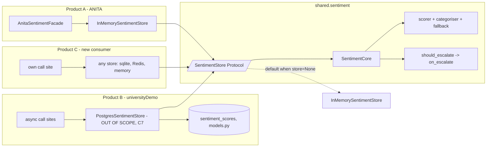

> **Lens:** Architect · **Decided by:** PO · **Inputs:** CR-01-contract.md, CR-01 Appendix A

# US-115 — Persistence behind a `SentimentStore` Protocol, with an in-memory default [Lens: Architect]

- **Story:** As a **developer building the shared sentiment core, and the next product that will consume it**, I want **all persistence to go through a small `SentimentStore` Protocol that the core ships with an in-memory implementation of**, so that **ANITA (no PostgreSQL) and universityDemo (PostgreSQL, `app/sentiment/models.py`) each supply their own store, and neither database becomes a requirement of the shared core (CR-01-contract.md §C7)**.
- **Business value:** the contract says the core is *standalone and reusable* (CR-01.3) and that "PostgreSQL persistence for sentiment" is **out of scope** because "ANITA has no Postgres; the core exposes a store Protocol" (§C7). The two source sides disagree on persistence by construction: Side A writes every score to PostgreSQL (`models.py:58-115`) and reads history per lead (`:143-168`); Side B has **no persistence at all** — a single `self._leads: dict[str, LeadSentiment] = {}` (`anita/sentiment.py:435`), in-process only (A.2). A core that hard-codes either answer breaks the other product; a Protocol satisfies both and lets a third product bring a `sqlite` file, Redis, or nothing.
- **Priority:** **Must** — it is the seam the contract names explicitly (§C7) and the mechanism behind §C6's last DoD bullet ("a second consumer can instantiate both modules with its own config and no code edits").
- **Prerequisites:** US-111 (core skeleton). US-113 consumes exactly three methods of this Protocol — `for_lead`, `recent_scores`, `count_labelled_outcomes` — and states it will add them if this story has not landed (`US-113 …:130-133`). This story is that formalisation, so **it is authoritative**.

## Contract conformance notes

1. **§C7 is the scope boundary, quoted:** "PostgreSQL persistence for sentiment (ANITA has no Postgres; the core exposes a store Protocol)". This story ships the Protocol and the default; **it does not ship a PostgreSQL adapter**, which stays out of scope with the second product's own code.
2. **No contract signature is touched.** `SentimentConfig` and `SentimentCore` are exactly as frozen in §C3.2; the store is a keyword-only constructor argument alongside `on_escalate` (`US-111` declares `SentimentCore.__init__`; this story fixes this parameter and its default). Nothing in `score_turn`/`categorise`/`should_escalate` changes shape. Extraction injection is `config.client` (CV-07) and stays untouched here.
3. **The core stays sync** (CV-07: "`score_turn` stays sync; an async implementation wraps it"). The Protocol is therefore declared with **sync** methods; a product whose backend is async (`models.py` is async throughout, `:58`, `:118`, `:143`) wraps it at the product boundary — its bridge lives in the product, never in the shared package.
4. **Ordering reconciliation with US-113, stated rather than silently patched:** US-113's code snippet reads `row["s_call"]` and its prose shrinks the return to `Sequence[float]` (`US-113 …:130-132`, `:222`). The Protocol defined here returns `Sequence[StoredScore]`; the core reads rows through a two-line helper that accepts a `StoredScore`, any object with a `s_call` attribute, **or** a mapping with a `"s_call"` key, so both spellings in US-113 remain literally valid. `StoredScore` is the recommended type; the conformance suite asserts ordering (newest-first) and shape.

## Acceptance Criteria [Lens: PO]

```gherkin
Scenario: AC-1 The core works with no store supplied and touches no database
  Given a SentimentCore built with a config and no store argument
  When two turns are scored for the same lead
  Then the second composite carries momentum from the first (delta is not zero)
    And no connection to PostgreSQL, SQLite or the network is opened
    And no file is created

Scenario: AC-2 An injected store is the only persistence path
  Given a spy store injected into the core
  When a turn is scored for lead "L-7"
  Then save_score receives one record carrying the composite, the category and the extraction's components
    And the score's read of history came from the store, not from a process global

Scenario: AC-3 A durable store carries state across a process restart
  Given a store whose data outlives the core instance (a fake durable store in the test)
  When the first core scores turn 1 and a second core instance scores turn 2 for the same lead
  Then turn 2's baseline, previous_latest and turn_count continue from turn 1
    And a sharp second-turn decline escalates, because the delta was not lost with the process

Scenario: AC-4 (negative) The store fails
  Given a store whose save_score raises
  When a turn is scored
  Then the score is returned and the buyer's turn is unaffected
    And the failure is logged with the store's exception type
    And the store is not asked again within that turn

Scenario: AC-5 (negative) The store cannot answer the outcome count
  Given a store whose count_labelled_outcomes raises
  When a turn is scored
  Then the predictive layer is inactive and p_convert is None
    And no probability is fabricated from a substituted value
    And the composite records why (US-113 AC-4)

Scenario: AC-6 (negative) A store is not required to be writable
  Given a read-only store (save_score raises NotImplementedError)
  When a turn is scored
  Then scoring, categorisation and the escalation decision all complete
    And the failure to persist is recorded, not swallowed silently

Scenario: AC-7 The shared package carries no database dependency
  Given the shared/sentiment package and its pyproject.toml
  When an import scan and an AST scan run
  Then no module imports psycopg2, sqlite3, asyncpg, chromadb or any product module
    And installing the package pulls zero runtime dependencies

Scenario: AC-8 A second product satisfies the Protocol without editing the shared code
  Given a store written against a different backend (a test double mirroring universityDemo's five model functions)
  When the shared conformance suite runs against it
  Then it passes with no change to shared/sentiment
    And the same core code that runs for ANITA runs for it
```

Technical acceptance criteria [Lens: TPO]:

- **TAC-1:** `SentimentStore` is a `typing.Protocol` (`@runtime_checkable`), not an ABC: no registration, no subclassing requirement, no factory-by-string, no entry-point plugin loading.
- **TAC-2:** the default is constructed **per core instance** — no module-level singleton. Two `SentimentCore`s created in one process with default stores must not share state (a module-level default is exactly how two products in one test process would leak into each other).
- **TAC-3:** store access is skipped entirely when `lead_id` is empty, so no synthetic/session key can ever be written (US-114 AC-6); product-level observability for anonymous sessions lives in the product, not in the store.
- **TAC-4:** at most one `save_score` call per scored turn, and only for a non-empty `lead_id`; any exception it raises is caught inside the core (AC-4/AC-6).
- **TAC-5:** ordering is part of the contract: `recent_scores` returns **newest-first** (`models.py:161` already does this: `ORDER BY created_at DESC`); the conformance suite asserts it, and the core never re-sorts.
- **TAC-6:** `shared/sentiment`'s only imports are the standard library. `shared/pyproject.toml` declares no runtime dependencies. This is the mechanical form of CR-01.3.

## HLD — Architecture Slice [Lens: Architect]



- **The seam is one-directional:** the core depends on the Protocol; products depend on the core; the Protocol never imports a product and never names a database. `save_score` is the only write; the three reads are `for_lead`, `recent_scores`, `count_labelled_outcomes`.
- **Why the default is in-memory, not "no store":** ANITA's current behaviour *is* an in-process dict (`anita/sentiment.py:435`, A.2). Shipping the default as that same behaviour means US-111's extraction changes nothing observable for the 614 tests, while a product that wants durability injects a store and gets it without a core edit.
- **Why the core does not own the write of labelled outcomes:** outcomes are the *product's* business (a call result, an admission decision — `universityDemo/app/leads/schema.py:42`, `conversations.outcome`). The core only *counts* them to gate the predictive layer (US-113, `MIN_LABELED_OUTCOMES`, `universityDemo/app/config.py:497-499`). Adding `record_outcome` to the Protocol would make the shared module a CRM.
- **Why `should_escalate` is unaffected:** the escalation decision is core logic (US-114); persistence of the *sink* (a handoff) is the product's own store (MOD-06), never this Protocol. Mixing them would make a handoff store a dependency of two products that do not have one.

## LLD — Implementation Detail [Lens: Architect]

- **Module paths:** `D:\project\anitamedicalsystems\shared\sentiment\store.py` (new),
  `...\shared\sentiment\core.py` (the three guarded reads and the guarded write),
  `...\shared\sentiment\testing.py` (the conformance helper),
  `...\shared\pyproject.toml` (dependency declaration), tests in
  `...\shared\tests\test_store_protocol.py` and `...\shared\tests\test_store_conformance.py`.
- **Classes / functions / signatures:**

```python
# shared/sentiment/store.py
from __future__ import annotations
from dataclasses import dataclass, field, asdict
from typing import Protocol, Sequence, runtime_checkable

@dataclass(frozen=True, slots=True)
class StoredScore:
    """One scored turn, as the core writes it and reads it back.

    Field order is deliberately additive-friendly: every field after `lead_id`
    carries a value the source stores (models.py:58-115 signature) and none is
    required to reconstruct a score, so a leaner store may persist a subset and
    return an object with the fields it kept.
    """
    lead_id: str
    s_call: float                 # models.py:63 `s_call` - this turn's sentiment
    s_lead: float = 0.0           # models.py:67 `s_lead` - the composite
    intent: float = 0.0           # models.py:64 `buying_intent_score`
    friction: float = 0.0         # models.py:65 `friction_score`
    category: str = "Nurture"     # models.py:72 `category`
    trajectory: str = "Stable"    # models.py:71 `trajectory`
    conversation_id: str = ""
    created_at: str = ""          # ISO-8601 UTC; "" means "the store assigns"
    model_version: str = "shared-v1"

    @classmethod
    def from_mapping(cls, row) -> "StoredScore":
        """One-line adapter for dict-returning stores (models.py:217-238 shape)."""
        ...

    def to_mapping(self) -> dict: ...

@dataclass(slots=True)
class LeadSentimentState:
    """The continuation state the core needs for the next turn."""
    lead_id: str
    baseline: float = 0.0
    previous_latest: float | None = None
    turn_count: int = 0

class StoreUnavailable(RuntimeError):
    """Raised by a store to signal a temporary backend failure.

    The core catches *every* exception from a store (AC-4/AC-5); this type
    exists so a product can distinguish "backend down" from a bug in its own
    adapter when it reads its logs.
    """

@runtime_checkable
class SentimentStore(Protocol):
    def for_lead(self, lead_id: str) -> LeadSentimentState | None:
        """Continuation state, or None for a lead never seen."""

    def recent_scores(self, lead_id: str, limit: int) -> Sequence[StoredScore]:
        """Newest-first, at most `limit` rows (models.py:143-168)."""

    def count_labelled_outcomes(self) -> int:
        """Corpus-wide labelled-outcome count for the predictive gate
        (US-113; config.py:497-499). Never raises in a healthy store."""

    def save_score(self, record: StoredScore) -> None:
        """Persist one scored turn. The only write in the Protocol."""

class InMemorySentimentStore:
    """Default. No I/O, no dependencies, per-instance state (TAC-2).

    - per-lead list of StoredScore, newest-first
    - a `threading.Lock` around append/snapshot, so two threads scoring the
      same lead cannot interleave a read and a write (the defect class CV-10
      found in the RAG pass, avoided here by construction)
    - MAX_HISTORY_PER_LEAD = 200: the trajectory uses TRAJECTORY_WINDOW = 5
      (US-113), so unbounded growth would be a leak with no reader
    - count_labelled_outcomes() returns 0: the core ships no outcome table,
      so the predictive layer is inactive in a default-configured consumer
      (which is exactly ANITA's accepted state, MOD-07 B.7)
    """

# shared/sentiment/testing.py
def assert_store_conforms(store: SentimentStore) -> None:
    """Runnable conformance assertions for any product's store (AC-8):
    ordering newest-first, limit honoured, save->read round-trip, unknown
    lead -> None, empty history -> [], count returns an int. Raises
    AssertionError with the failing property named."""
```

- **The core's guarded access (the only code in `SentimentCore` that knows a store exists):**

```python
# shared/sentiment/core.py
class SentimentCore:
    def __init__(self, config: SentimentConfig, *,
                 store: SentimentStore | None = None) -> None:
        self._config = config
        self._store = store or InMemorySentimentStore()   # per instance (TAC-2)
        # extraction injection is config.client (CV-07), not a constructor seam

    def score_turn(self, message, *, lead_id=""):
        extraction = self._score(message)                  # fallback-safe (A-2)
        state, recent, outcomes = None, [], 0              # no store access (TAC-3)
        if lead_id:                                        # one guarded block
            state = self._read(lambda: self._store.for_lead(lead_id))
            recent = self._read(lambda: self._store.recent_scores(lead_id, TRAJECTORY_WINDOW)) or []
            outcomes = self._read(lambda: self._store.count_labelled_outcomes()) or 0
            if isinstance(outcomes, int) and outcomes < 0:
                outcomes = 0                               # a buggy count never activates the layer
        composite = compute_lead_score(...)                # US-113
        if lead_id:
            self._write(lambda: self._store.save_score(self._record(composite, extraction)))
        return extraction, composite

    def _read(self, fn):
        try:
            return fn()
        except Exception as exc:                           # incl. StoreUnavailable
            logger.warning("sentiment store read failed (%s); degrading", type(exc).__name__)
            return None

    def _write(self, fn):
        try:
            fn()
        except Exception as exc:
            logger.warning("sentiment store write failed (%s)", type(exc).__name__)
```

  The `s_call` read is tolerant of both spellings used in the two sides' code:

```python
def _s_call(row) -> float | None:
    if isinstance(row, StoredScore):
        return row.s_call
    if isinstance(row, Mapping):
        value = row.get("s_call")                          # models.py dict shape
    else:
        value = getattr(row, "s_call", None)               # duck-typed object
    return float(value) if isinstance(value, (int, float)) else None
```

  A row whose `s_call` is missing or non-finite is **skipped**, never defaulted to `0.0`
  (US-113 edge 9 — a fabricated neutral would distort the variance).
- **Config keys:** **none**. The store is an injected object, never a YAML name — naming a
  store class in `anita.yaml` would reintroduce exactly the import-time/plugin coupling CR-01.3
  removes. `SentimentConfig` is unchanged by this story.
- **Mapping for the second product (design note; the real adapter is out of scope per §C7):**

| Protocol member | universityDemo counterpart (all async) |
|---|---|
| `save_score(StoredScore)` | `models.py:58-115` `save_sentiment_score(...)` — 16 columns, `transcript_snippet[:500]` |
| `recent_scores(lead_id, limit)` | `models.py:143-168` `get_lead_sentiment_history(lead_id, limit)`; already `ORDER BY created_at DESC LIMIT %s` (`:161`) |
| `for_lead(lead_id)` | `models.py:118-140` `get_lead_sentiment` (latest row) + the denormalised `leads` columns (`schema.py:44-50`: `overall_sentiment_score`, `sentiment_trajectory`, `conversion_probability`) |
| `count_labelled_outcomes()` | a `COUNT(*)` over `conversations` with a non-empty `outcome` (`app/leads/schema.py:42`) — the count `MIN_LABELED_OUTCOMES` was always meant to gate (`app/config.py:497-499`) |

  Field mapping: `s_call←s_call`, `s_lead←s_lead`, `intent←buying_intent_score`,
  `friction←friction_score`, `category←category`, `trajectory←trajectory`,
  `conversation_id←conversation_id`, `created_at←created_at` (`models.py:217-238`). Lead ids are
  `UUID` there and `str` in ANITA; the adapter casts (`models.py:222` already does `str(row[1])`).
  The async-to-sync bridge (`asyncio.run` on a worker thread, one loop per store instance) is the
  **product's** code — CV-07 keeps the shared core sync.
- **Edge cases** (each with the decided behaviour):
  1. **`lead_id=""`** → no read, no write, no synthetic key (TAC-3); the score is still returned and
     categorised; the escalation decision is still returned to the caller (US-114 AC-6).
  2. **Unknown lead** → `for_lead` returns `None`, `recent_scores` returns `[]`; first turn has
     `previous_latest=None`, `turn_count=1` (source parity: `scorer.py:245-251`).
  3. **Store returns oldest-first** → contract violation; the conformance suite fails the store, and
     the core does not silently re-sort (re-sorting would hide the broken adapter).
  4. **Two cores, one process, default stores** → independent histories (TAC-2); a test asserts
     core A's turn does not move core B's baseline.
  5. **Same store object injected into two cores** (the restart test, AC-3) → state continues; this is
     the in-process model of a durable backend.
  6. **`save_score` raises `NotImplementedError`** (read-only store, AC-6) → logged, scoring completes.
  7. **`count_labelled_outcomes` returns a negative int** → coerced to 0, layer inactive, never raises
     (US-113 edge 5).
  8. **Non-finite or missing `s_call`** → row skipped for the trajectory window; warning names the
     lead and the store.
  9. **History longer than `limit`** → only `limit` rows are read and only `TRAJECTORY_WINDOW` are
     used (US-113 edge 3); the core never asks for "all history" (an unbounded read is how the
     `limit=10`/`>=100` defect class starts).
  10. **Memory growth in the default store** → capped at `MAX_HISTORY_PER_LEAD = 200`; eviction is
      oldest-first; a durable product store may keep everything, because retention is a product
      policy, not a core one.
- **Error handling:**
  - Reads (`for_lead`, `recent_scores`, `count_labelled_outcomes`) → `None`/`[]`/`0`; the layer
    degrades; the score is always returned (AC-4, AC-5).
  - Write (`save_score`) → logged once per failing call; never retried inside the turn (a retry loop
    inside a request path is how a slow store becomes a slow page — retries belong to the product's
    store).
  - `assert_store_conforms` raises `AssertionError` naming the property; it is a test helper, not a
    runtime guard (the core never calls it).
- **Test scenarios** — concrete and runnable:

| # | Level | Test |
|---|---|---|
| T-01 | unit | **AC-1:** a fresh core, two turns, same lead → second composite's delta non-zero; assert no files created and `psycopg2`/`sqlite3` never imported (patch/scan). |
| T-02 | unit | **AC-2:** spy store → exactly one `save_score` per scored turn, with `s_call`, `s_lead`, `category` populated; `recent_scores` called with `TRAJECTORY_WINDOW`. |
| T-03 | integration | **AC-3:** `FakeDurableStore` (a JSON-file store defined in the test module, not shipped) → two cores in sequence continue baseline/turn_count; a `delta <= -0.5` on turn 2 escalates (US-114's trigger 3). |
| T-04 | negative | **AC-4:** `save_score` raises → returned score is byte-identical to the in-memory run, warning logged once, no second write attempt. |
| T-05 | conformance | **TAC-5:** `assert_store_conforms(InMemorySentimentStore())`; and a deliberately oldest-first store fails with the ordering property named. |
| T-06 | negative | **AC-5:** `count_labelled_outcomes` raises → `predictive_layer_active is False`, `p_convert is None` (US-113 AC-4 restated at the store seam). |
| T-07 | negative | **AC-6:** read-only store → scoring/categorisation/escalation complete; the write failure is in the log. |
| T-08 | static | **AC-7:** AST + import scan of `shared/sentiment/**`: no `psycopg2`, `asyncpg`, `sqlite3`, `chromadb`, no `anita.*`, no `app.*`; `shared/pyproject.toml`'s `dependencies == []`. |
| T-09 | unit | **TAC-2:** two default-store cores do not share state; also asserts no module-level store instance exists (`SentimentCore` builds one per instance). |
| T-10 | unit | **TAC-3:** `lead_id=""` → the spy store records zero calls of any kind, while the score and the escalation decision are still returned. |
| T-11 | unit | Edge 8: a row with `s_call=None`/`nan` is skipped; trajectory is computed from the remaining rows; never defaulted to `0.0`. |
| T-12 | conformance | **AC-8:** a store double written only against the mapping table above (mirroring `models.py`'s five functions, with a sync bridge) passes `assert_store_conforms`, proving the Protocol is satisfiable by the Postgres-shaped product with no shared-code edit. |
| T-13 | regression | ANITA: the platform suite's `test_mod07_sentiment.py` passes **unmodified** against the facade with the default in-memory store (TAC-6). |

- **How ANITA's 614 platform tests stay green (CR-01-contract.md §C6):**
  1. ANITA's adapter (US-111) injects nothing, so `InMemorySentimentStore` is the store and the
     observable behaviour is today's dict (`anita/sentiment.py:435`) — same single-process scope,
     same reads, same answers (T-13).
  2. No public signature in `platform/app/anita/**` changes: the store lives behind the facade;
     `SentimentService.observe`'s return shape is untouched (US-111/US-114).
  3. `count_labelled_outcomes()` returns 0 for ANITA, so the predictive layer stays inactive and
     categorisation follows the emotion-and-composite rule — the MOD-07 B.7 accepted state, so no
     category in any existing test changes (this is the same neutrality argument as US-113's).
  4. No test file is edited or added-to by this story; the new tests live under `shared/tests/`,
     which the platform suite does not collect.
  5. `platform/` still runs `.venv\Scripts\python -m pytest tests -q` with no decrease against 614,
     and the 70-case/25-scenario release gate is unaffected (no live behaviour change).

## Traceability

- Change request: **CR-01**, requirement **CR-01.3** (standalone modules a second product can adopt),
  supporting CR-01.2
- Contract: **§C3.2** (the interface this Protocol serves without altering it), **§C7** ("PostgreSQL
  persistence for sentiment is out of scope … the core exposes a store Protocol" — quoted and
  honoured), **§C6** last DoD bullet (second consumer, no code edits)
- Module: **MOD-07** (sentiment state, `SM-03`/`DAT-09`), serving **TRD-36** (the sentiment store
  Protocol) and **TRD-35** (escalation), and **UC-10** (negative sentiment detected) whose
  persistence this Protocol provides; MOD-06 stays the escalation sink's owner
  (US-114) and is deliberately **not** this Protocol
- Evidence citations:
  - A.1 persistence row — Side A is PostgreSQL: score CRUD in `models.py`, history in
    `models.py:143-168` (A.1; verified at `D:\project\universityDemo\app\sentiment\models.py:58-115`,
    `:143-168`, tables `sentiment_scores` in `schema.py:9-31`, `leads` columns `schema.py:44-50`)
  - A.2 persistence row — Side B is "**None** — `self._leads` dict only (in-process)"
    (`anita/sentiment.py:435`, cited by A.2 as the adaptation difference)
  - A.2 — Side B is sync; A.1 is async: the sync-Protocol-with-product-bridge decision applies
    CV-07's precedent
  - A-4 — no import-time globals; config (and now the store) injected, not discovered
  - US-113 (`…:130-133`, `:221-234`) — the three methods this story formalises; `MIN_LABELED_OUTCOMES`
    gate at `D:\project\universityDemo\app\config.py:497-499`
  - Repo-verified while drafting this story: `anita/sentiment.py:394-435` (`LeadSentiment` fields,
    the `_leads` dict), `universityDemo/app/leads/schema.py:42` (`conversations.outcome`, the labelled
    outcome source), `models.py:32-48` (`_get_db` returning `None` when PostgreSQL is unreachable —
    the same posture this Protocol reproduces as "reads degrade, never raise")

## Definition of Done

- [ ] `SentimentStore` Protocol + `StoredScore` + `LeadSentimentState` + `StoreUnavailable` +
      `InMemorySentimentStore` + `assert_store_conforms` shipped under `shared/sentiment/`
- [ ] T-08 passes: the package imports stdlib only; `pyproject.toml` has no runtime dependencies —
      a product with no PostgreSQL, no SQLite and no network can instantiate the core (CR-01.3)
- [ ] T-09/T-10 pass: no module-level default store; no store call at all when there is no lead
- [ ] T-04/T-06/T-07 pass: a failing or read-only store never blocks a turn and never fabricates a
      probability; the failure is always logged with the exception type
- [ ] T-05/T-12 pass: the conformance helper is green for the default store and for a
      Postgres-shaped double built only from the mapping table (the second-consumer proof)
- [ ] T-13: ANITA's 614-test suite green with no test edits, against the default in-memory store
- [ ] The real `PostgresSentimentStore` for universityDemo is **explicitly deferred** with §C7 as its
      authority — recorded as deferred, not silently omitted (no CI step in this change may require a
      live PostgreSQL)
