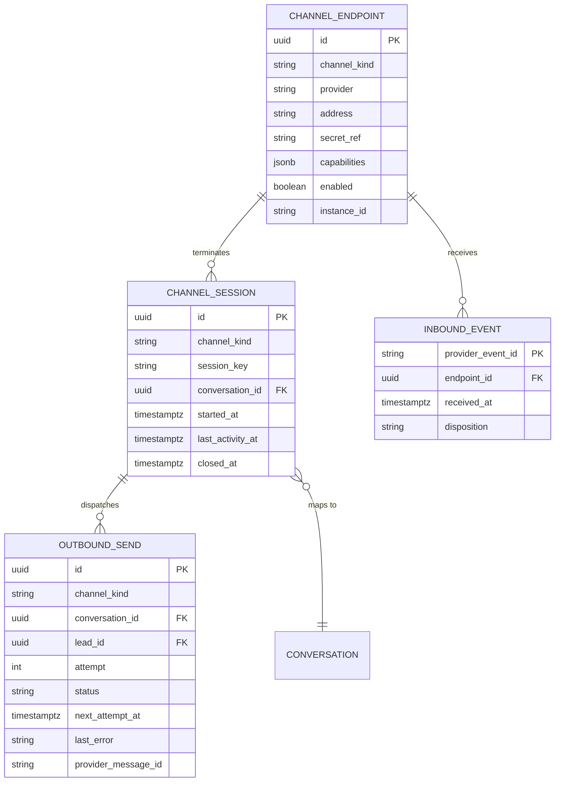

> **Lens:** BA (Part A) / TPO + Architect (Part B) · **Inputs:** `01-brd.md`, `02-use-cases-workflows.md`, `03-data-state-analysis.md`, `05-modularization.md`, `06-architecture.md`, `07-brownfield-reconciliation.md` · **Engagement:** Brownfield · **Defines:** TRD-01 … TRD-06

# Channel Gateway — MOD-01

## Part A — Module BRD [Lens: BA]

### A.1 Module Objectives

1. **Every buyer reaches the same assistant, whatever they are holding.** A hospital procurement officer on a mobile browser, a radiographer on a landline and a service engineer on WhatsApp are three transports for one conversation. MOD-01 exists so a catalogue answer is identical on all of them and a correction is never channel-specific (BRD-01).
2. **The business can add a channel without re-opening the product.** Decision D1 adds browser voice, mobile web and one configurable extra messaging channel. If adding those meant editing the code path of the existing four, the fourth channel would cost as much as the first three together. MOD-01 makes a new channel an adapter plus configuration (UC-14).
3. **ANITA traffic is unmistakably ANITA's.** Inbound calls and messages arrive at the ANITA number/sender only; a wrongly routed event is refused before it can create a turn about the wrong company (BRD-03, D3).
4. **The public edge cannot be used against the business.** The source platform shipped with no signature validation and no rate limiting (`DG-06`); on a public commercial endpoint that is a PII leak and an abuse vector, not a polish item.
5. **Nothing a buyer was told is lost in transit.** A reply that fails to leave the box is queued and retried, and ops can see it (BRD-13 delivery, DAT-16).

### A.2 Scoped Requirements

Satisfies `BRD-01`, `BRD-02` (transport-level identity extraction only — resolution is MOD-02), `BRD-03`, `BRD-19`, and the placement half of `BRD-23`. Enacts `UC-01`, `UC-02`, `UC-03`, `UC-04`, `UC-14`, and provides the outbound send path used by `UC-09`/`WF-02`. Contains the `DG-06` remediation for the public buyer edge (the admin half lives in MOD-09/MOD-10, per `CV-03`).

### A.3 Module Business Rules

| Rule | Condition → Action |
|---|---|
| CG-1 | An inbound event that cannot be attributed to a configured endpoint of **this** instance (wrong number, wrong sender, unknown adapter) → reject it, log the attribution failure, create no conversation, produce no turn. |
| CG-2 | Two inbound events carrying the same provider event id (Twilio `MessageSid`, `CallSid`, stream id, chat client id) → process exactly one; the duplicate is acknowledged and discarded. |
| CG-3 | The reply is always rendered in the channel the question arrived on. The gateway never chooses a different channel to reply on. |
| CG-4 | A send that fails is persisted with its error and retried on a backoff; after the configured attempt limit it is surfaced to ops as failed, never silently dropped. |
| CG-5 | A voice call is admitted or refused **before** the caller hears agent speech. Refused calls hear a busy message plus a callback offer (`UC-03` E1, `R-6` analogue). |
| CG-6 | Buyer surfaces stay open (no login) but are bounded per identity and per IP; admin surfaces are authenticated (`CV-03`, `DG-06`). |
| CG-7 | Silence is not an error: a media stream that delivers no frames for the idle period is closed cleanly and its transcript retained (`UC-03` E3, `SM-02`). |
| CG-8 | Media the channel cannot process (WhatsApp voice note, unsupported attachment) is declined with an explanatory reply, never silently ignored (`UC-02` A2). |

### A.4 Actors

| Actor | Interaction with this module |
|---|---|
| Buyer | Speaks on a PSTN call, types in web/mobile chat, presses the browser mic, or messages WhatsApp / the extra channel. |
| Twilio gateway | System actor: fetches TwiML, opens the Media Streams WebSocket, posts WhatsApp and status callbacks. |
| Messaging provider | System actor: posts inbound events for the configurable extra channel and accepts outbound sends. |
| Outbound contact | Receives calls/messages placed through the gateway on behalf of MOD-06 (`UC-09`). |
| Ops admin | Enables/disables a channel adapter and reads channel health (`UC-12`, `UC-14`). |
| MOD-02 / MOD-05 (internal) | Consume `InboundEnvelope`; supply answers and audio frames back for native rendering. |

### A.5 Module Acceptance Criteria

- **AC-1** A buyer messaging the ANITA WhatsApp sender receives a reply; the turn reaches conversation review within 2 s of the reply being dispatched.
- **AC-2** A PSTN caller hears the greeting within 1.2 s (p95) of the call being answered, and hears the first clause of the answer within 1.2 s (p95) of finishing the question.
- **AC-3** A Twilio webhook presented with an invalid `X-Twilio-Signature` is refused with 403 and produces **zero** conversations, zero turns and zero lead writes.
- **AC-4** Replaying the same WhatsApp `MessageSid` ten times produces exactly one reply and one turn.
- **AC-5** Enabling the reference extra-channel adapter in configuration makes it accept inbound and answer outbound without any change to MOD-02/03/04 and without restarting another channel.
- **AC-6** A send failure leaves a queued row visible in the ops console within 60 s and is retried automatically; after the attempt limit it is marked failed with the carrier error.
- **AC-7** Disabling a channel adapter leaves the other four channels serving (UC-14 postcondition).

## Part B — Module TRD [Lens: TPO + Architect]

### TRD-01 — Channel-agnostic inbound envelope contract

One normalised `InboundEnvelope` is produced for every channel, carrying `channel_kind`, `endpoint_id`, `provider_event_id`, `identity` (E.164 phone / channel handle / session token / empty), `payload` (text, media ref, audio stream handle), `received_at`, `capabilities`. Serves `BRD-01`/`BRD-02`; implements the `SM-02` RECEIVED transition; refuses to construct if `endpoint_id` does not resolve to this instance (`CG-1`, `BRD-03`). Envelope construction is the only thing MOD-02 sees — no channel vocabulary crosses the boundary.

### TRD-02 — Twilio voice ingress: TwiML webhook and Media Streams

`POST /twilio/voice` validates the signature, checks admission (`MAX_CONCURRENT_CALLS`, default 2 inherited from `DG-01`), and returns TwiML: `<Connect><Stream url="wss://…/twilio/media-stream"/>` when admitted, or `<Say>` busy-plus-callback when refused. The media-stream WebSocket handles Twilio's `connected`/`start`/`media`/`mark`/`stop` events, decodes base64 µ-law 8 kHz frames to MOD-05, and streams clause-level audio back with `mark`-based flow control. Serves `BRD-01`, `BRD-03`; implements `UC-03` including E1/E3.

### TRD-03 — Channel adapter registry and capability matrix

Adapters are registered by `channel_kind` and declare a capability matrix (`inbound`, `outbound`, `text`, `media`, `audio`, `streaming`). The web-chat, WhatsApp, browser-mic and voice adapters ship built-in; the extra messaging channel is a **reference implementation** of the same interface loaded by configuration (`DG-07`, `D1`). Adding an adapter must not modify any other adapter or the answer engine. Serves `BRD-01`, `BRD-19`; implements `UC-14` including A1/E1.

### TRD-04 — Native outbound rendering with a durable send outbox

Every reply is rendered by the originating adapter (TwiML, WhatsApp content API body, JSON frame, µ-law audio) and sent through a durable `outbound_send` row: `status`, `attempt`, `next_attempt_at`, `last_error`, `provider_message_id`. Backoff is exponential from 5 s to a 15 min ceiling, max 5 attempts, then `FAILED` surfaced to ops. Re-implements the source outbox pattern (`REC-07`) — never the Salesforce code (`BRD-14`, `REC-06`). Serves `BRD-13`/`BRD-23` delivery; implements `DAT-16`, `UC-02` E2, `UC-09` E2.

### TRD-05 — Browser-mic WebSocket transport

`WS /voice/browser` accepts a session token, performs the same admission check as PSTN, and relays 16 kHz mono PCM frames in both directions, converting to/from the µ-law contract at the MOD-05 boundary. Session lifecycle: idle timeout 30 s with no frames → clean close; reconnect within 60 s resumes under the same conversation id; mic permission denial is a client-side path, not a server error. Serves `BRD-01`, `BRD-19`; implements `UC-04` including E1/E2.

### TRD-06 — Public-edge hardening: signature validation, rate limits, connection caps

100 % of Twilio webhooks validate `X-Twilio-Signature` (HMAC-SHA1) against the configured public base URL before any body parse; 100 % of extra-adapter webhooks validate a per-adapter HMAC secret; buyer chat/browser-mic sessions carry a signed, HttpOnly session token. Limits: 20 inbound turns per identity per minute (burst 30), 120 requests per IP per minute on chat REST, 10 concurrent WSS per IP, 200 WSS per process; breaches return 429 with `Retry-After`. Unauthenticated admin routes return 401. Serves `BRD-03`/`BRD-18`; implements `DG-06` and the buyer half of `CV-03`.

### B.1 Technical Constraints

- **Stack inherited (brownfield default):** Python 3.11+, FastAPI + uvicorn, `twilio` SDK, `httpx` for provider REST calls, PostgreSQL via raw `psycopg2` (`REC-13`). Divergence would need its own `REC-xx`; none is taken.
- **Twilio Media Streams** is the voice transport — bidirectional WebSocket carrying base64 µ-law 8 kHz. The source has **no** `<Gather input="speech">` and no call recording; neither is introduced (`REC-11`).
- **Ingress is a Cloudflare tunnel** (or fixed ingress later). Signature validation must therefore be computed against the configured public base URL, not the tunnel's internal `Host` header.
- **One deployable, one process group.** MOD-01 is an in-process module, not a service; the "API" table below mixes HTTP surfaces (external) and function contracts (internal).
- **Windows-first, macOS/Linux parity** (`BRD-19`); no platform-specific socket options.
- **Reconciliation:** refactor `REC-11` (Twilio integration, 7 files, ~1,100 LOC), drop `REC-10` (`app/main.py`, 4,133 LOC), pattern-only `REC-07` (outbox structure), refactor `REC-16` (voice client static page — rendered by MOD-10). New: adapter abstraction and the reference extra channel (`DG-07`).

### B.2 Non-Functional Requirements

| NFR | Target |
|---|---|
| Performance | Webhook → 200 ack p95 ≤ 150 ms; envelope → MOD-02 handoff p95 ≤ 20 ms; media-frame forwarding added latency p95 ≤ 30 ms; WhatsApp reply dispatch p95 ≤ 400 ms after the answer is composed |
| Throughput | ≥ 25 inbound events/s sustained per process; ≥ 4 concurrent media streams (2 admitted calls + 2 browser-mic sessions) — `DG-01` ceiling |
| Security | 100% Twilio webhook signature validation before body parse; 403 on failure; per-adapter HMAC on the extra channel; signed HttpOnly session tokens on chat/browser-mic; no secrets in logs (masking per `REC-14`) |
| Scalability | 200 concurrent WebSocket connections per process; horizontal headroom is not claimed — one box, shared GPU (`AS-09`) |
| Scale unit & limits | Process. 200 WS conns; 10 WS conns/IP; 20 turns/identity/min burst 30; 120 req/IP/min on chat REST; max inbound body 1 MiB (chat), 16 MiB (WhatsApp media); oversize → 413 |
| Degradation | Shed the extra messaging channel first, then refuse voice admission with busy + callback (`UC-03` E1); chat and WhatsApp keep serving; if MOD-02 is unreachable, render the "chat unavailable — call us" fallback (`UC-12` E1 analogue) |
| Observability | Per-turn stage marks (`received`, `validated`, `routed`, `rendered`, `sent`); per-channel counters for accepted/rejected/deduped/send-failed; channel health readable within 2 s of change (`BRD-21`) |
| Availability | 99.5% monthly for the gateway edge; no durable state beyond the outbox, so RTO ≤ 30 min by process restart and outbox replay |

### B.3 APIs / Interfaces

| Name | Direction | Style | Contract | AuthN/Z |
|---|---|---|---|---|
| `POST /twilio/voice` | exposed | REST (TwiML) | inbound call → TwiML (`Connect/Stream` or busy `Say`); 200/403/503 | Twilio signature |
| `WS /twilio/media-stream` | exposed | WebSocket | Twilio Media Streams events in; µ-law audio frames out | Stream opened from a signed TwiML response |
| `POST /twilio/status` | exposed | REST | call status callback (`completed`, `no-answer`, `failed`, `busy`) → MOD-06 | Twilio signature |
| `POST /twilio/whatsapp` | exposed | REST | inbound WhatsApp (text/media/voice-note) → 200 empty TwiML; 403 invalid | Twilio signature |
| `POST /channels/{channel_id}/inbound` | exposed | REST | reference adapter webhook → 202 accepted / 401 / 409 duplicate | Per-adapter HMAC |
| `POST /chat/session` · `WS /chat/stream` | exposed | REST + WebSocket | session mint; text turn in, token/clause stream out | Signed session token + rate limit |
| `WS /voice/browser` | exposed | WebSocket | PCM16@16k up, µ-law down; `start`/`stop` control frames | Signed session token + rate limit |
| `send(channel_kind, identity, reply) → SendResult` | consumed from MOD-02 / MOD-06 | in-process | renders natively, writes `outbound_send`, returns `sent`/`queued`/`failed` | — |
| `place_outbound(lead_id, script_ref) → AttemptRef` | consumed from MOD-06 | in-process | dials via Twilio REST with status callback | — |
| `channel_health() → ChannelHealth[]` | exposed to MOD-10 | in-process read | per-channel state, last event, error counters, queue depth | Admin session (enforced in MOD-10) |

Events: `channel.inbound.accepted`, `channel.inbound.rejected`, `channel.send.failed` — emitted best-effort to MOD-08 (`BRD-21`). Consumers: MOD-08 only; no conversation path depends on them.

### B.4 Data Model

`CONVERSATION` and `LEAD` are owned by MOD-02 and MOD-06 respectively; the gateway holds only the FK. `INBOUND_EVENT` is the dedupe table (`CG-2`) and is pruned after 30 days. `OUTBOUND_SEND` is `DAT-16`; its partial index on `next_attempt_at WHERE status IN ('QUEUED','RETRY')` is the outbox drain path (`REC-07` pattern).

### B.5 Tech Stack Choices

| Choice | Rationale | Runner-up rejected |
|---|---|---|
| FastAPI + uvicorn | Inherited from the source and already proven for this exact WebSocket + webhook mix (`REC-10` behaviour re-expressed). | aiohttp — a rewrite for no functional gain. |
| `twilio` Python SDK for REST + `RequestValidator` | Signature validation is a security control; hand-rolling HMAC-SHA1 URL canonicalisation is a known source of silent bypasses. | Manual HMAC — rejected: `DG-06` is a blocking control, not a place to be clever. |
| `websockets` via uvicorn, one WS handler per channel | Uniform lifecycle (connect → frames → close) across Twilio, browser mic and chat streaming. | Separate ASGI app per channel — rejected: three deployment surfaces for one module. |
| Pydantic v2 models for `InboundEnvelope` | Guarantees no channel vocabulary leaks past the boundary; validation errors are typed (`UC-01` invalid input). | dict + convention — rejected: the boundary is the module's whole value. |
| httpx for provider REST (WhatsApp sends, extra adapter) | Async, already a source dependency, timeouts and connection pooling for free. | `requests` — blocks the event loop under a media stream. |
| PostgreSQL table for the send outbox | Durable across restart, which is the point of the outbox (`UC-02` E2). | In-memory queue — rejected: a restart loses a buyer's reply. |

### B.6 Edge Cases & Error Handling

| Failure class | Handling |
|---|---|
| Invalid/forged Twilio signature (`DG-06`) | 403 before body parse; `channel.inbound.rejected` counted; no turn, no conversation, no log of body content. |
| Replayed provider event (`CG-2`) | `INBOUND_EVENT` primary key conflict → 200/202 with no processing (`UC-02` duplicate row). |
| Wrong number / unattributed endpoint (`CG-1`, `BRD-03`) | Reject with 403 and an ops-visible counter; this is the guard that keeps ANITA and university traffic separate. |
| Caller ID withheld (`UC-03` missing data) | Envelope identity empty; session keyed on `stream_sid`; lead may be created without a phone. |
| Media stream drops abnormally (`UC-03` E3) | `stop` event or socket close → clean teardown, transcript retained, conversation left `ACTIVE`/`IDLE` per `SM-02`. |
| Silence / no media for 30 s (`CG-7`) | Idle close; no failure recorded; caller who returns is matched to the prior conversation. |
| Unsupported WhatsApp media (`UC-02` A2, `CG-8`) | Stored if media, acknowledged; voice notes declined with a text prompt — never silently ignored. |
| Oversized payload | 413 with the limit named in the response; counted per IP. |
| Carrier send failure (`UC-02` E2, `UC-09` E2) | `outbound_send` row `RETRY` with backoff; after 5 attempts `FAILED` and surfaced to ops (`CG-4`). |
| Status callback lost (`SM-04` halfway stop) | Row stays `DIALING`; lock expiry returns it to `QUEUED` with the attempt counted; MOD-06 reconciles by polling. |
| Extra adapter credential invalid (`UC-14` E1) | Adapter refuses to enable; boot/ops logs name the adapter; other channels unaffected. |
| MOD-02 unavailable | Gateway renders the channel-appropriate unavailable message + direct phone number; the turn is not acknowledged as answered. |
| Rate limit breached (`DG-06`) | 429 + `Retry-After`; counted; never a silent drop. |

Retries: outbound sends use exponential backoff (5 s → 15 min, 5 attempts). Inbound processing is not retried by the gateway — Twilio's own retry is deduped by `CG-2`. Dead letter: `outbound_send.status = 'FAILED'` is the dead letter and is visible in the ops console; no automatic deletion.

### B.7 Tech Debt Accepted

- **Accepted: in-process rate-limit counters (token bucket in memory), not Redis.** At `Assumed:` 0.06 QPS peak (`03-data-state-analysis.md` A.2) a shared store is operational cost for no benefit; counters reset on restart, which is acceptable until the gateway is split across processes. Revisit if MOD-01 is ever scaled beyond one process.
- **Accepted: WhatsApp media stored on local disk, not object storage.** Volumes are `Assumed:` a few MB/day; a single box has no object store. Revisit before any multi-box deployment (`BRD-18` currently forbids nothing here, but portability would suffer).
- **Accepted: the reference extra adapter is webhook-HMAC generic rather than a named provider.** `DG-07` deliberately defers provider choice; building against a generic contract is what makes the second adapter configuration-only. Revisit when the first real provider is chosen.
- **Accepted: no per-buyer conversation-level rate limit on voice beyond admission control.** A single caller may hold a line; PSTN cost and the 2-call ceiling bound abuse. Revisit if toll fraud is observed.

## TPO Buildability Sign-off [Lens: TPO]

**TPO sign-off: this TRD is buildable against the BRD above.**

Feasibility risks, each with its mitigation:

1. **Signature validation behind a Cloudflare tunnel.** Twilio signs the URL it called; the tunnel rewrites `Host`. If the validator uses the request's own host header, every webhook fails closed and the product appears dead. *Mitigation:* validate against a configured public base URL (`PUBLIC_BASE_URL`-style setting owned by MOD-09) and cover it with an integration test that signs a request for the public URL while delivering it with the tunnel host header.
2. **Admission control is the voice ceiling and its number is assumed (`DG-01`).** Setting `MAX_CONCURRENT_CALLS` too high starves the LLM and breaches the 1.2 s voice target; too low refuses revenue. *Mitigation:* ship the inherited value of 2, instrument per-call latency and GPU residency via MOD-08, and make the value configurable without redeploy; PO owns the revisit.
3. **Media Streams flow control.** Streaming clause-level TTS without `mark` acknowledgement overruns the carrier buffer on long answers. *Mitigation:* reuse the source's clause-cut + mark pattern from `REC-11`; the source already solved this on the same transport.
4. **Adapter abstraction could leak channel vocabulary.** If `InboundEnvelope` grows a WhatsApp- or Twilio-specific field, `BRD-01`'s one-engine property degrades quietly. *Mitigation:* the envelope model is frozen in TRD-01 with capability flags only, and MOD-02's classifier consumes it without channel branches — checked at code review against TRD-03.
5. **The extra channel provider is unchosen (`DG-07`).** *Mitigation:* TRD-03 defines the contract, not the provider; the reference adapter is testable against a local HMAC-signed fixture. No provider SDK is a build dependency.
