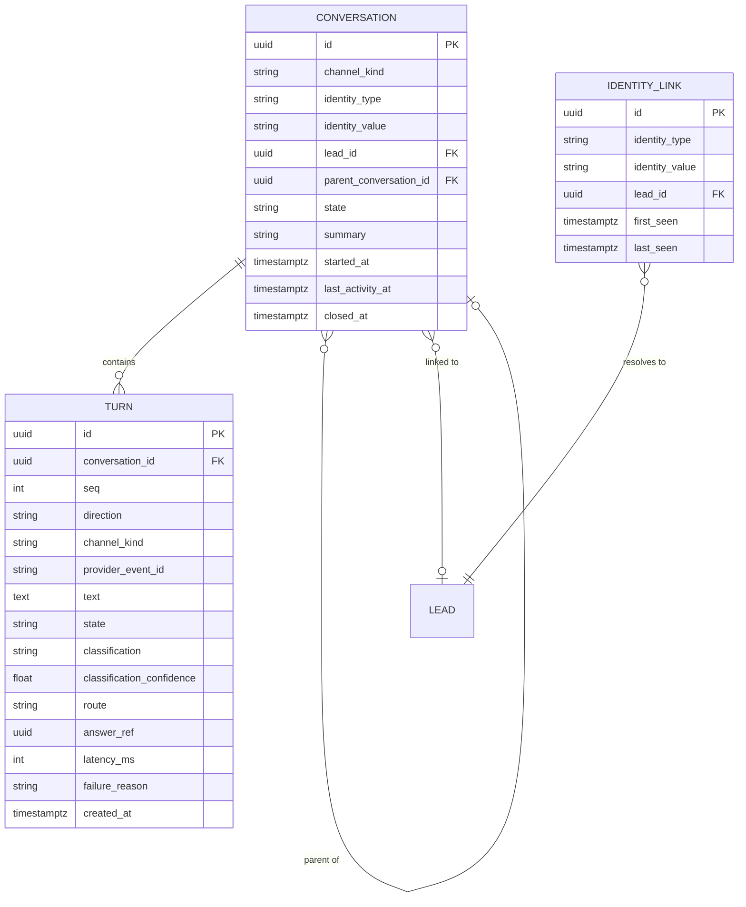

> **Lens:** BA (Part A) / TPO + Architect (Part B) · **Inputs:** `01-brd.md`, `02-use-cases-workflows.md`, `03-data-state-analysis.md`, `05-modularization.md`, `06-architecture.md`, `07-brownfield-reconciliation.md` · **Engagement:** Brownfield · **Defines:** TRD-07 … TRD-11

# Conversation Orchestrator — MOD-02

## Part A — Module BRD [Lens: BA]

### A.1 Module Objectives

1. **A buyer is one conversation, not one channel.** Priya asks about an FCR Prima T2 on web chat at 22:40 and calls from the same number at 08:15; the business cannot afford for her to be treated as a stranger. Where an identity exists — a phone number, a WhatsApp handle, a persisted session token — the prior context is available to the answer engine (BRD-02, scoped by `CV-02`).
2. **Every question is sent to the right answer path, once.** A price question must reach the deterministic lookup, a specification question the retrieval path, and a clinical question the refusal path. Getting this routing wrong is how a hallucinated price would reach a buyer.
3. **Turns are coherent.** Two messages arriving 200 ms apart must not interleave into a transcript no one can review (UC-01 concurrent operation).
4. **The context the answer engine sees is bounded and honest.** Enough prior turns to resolve "and what does the other one cost?", never so much that latency or cost drifts.
5. **The conversation identity registry survives the CRM cut.** The source's `app/crm/session.py` is mis-namespaced, not coupled — deleting it with the Salesforce package would break conversation grouping across every channel (`REC-02`, coupling trap #2).

### A.2 Scoped Requirements

Satisfies `BRD-01`, `BRD-02`, `BRD-11` (turn-level detail extraction is emitted here, the lead is owned by MOD-06), and contributes the turn half of `BRD-21` (traceable per-conversation turns). Enacts `UC-01`, `UC-02`, `UC-03`, `UC-04`, and owns the classification boundary exercised by `UC-11` (`R-4` fail-safe). Contains `CV-02` (continuity only where an identity exists).

### A.3 Module Business Rules

| Rule | Condition → Action |
|---|---|
| CO-1 | Identity resolution precedence: E.164 phone > channel handle (WhatsApp) > persisted session token > anonymous conversation key. An anonymous web session is conversation-scoped and is **not** merged with anything until the buyer supplies contact details (`CV-02`). |
| CO-2 | A conversation is the unit of context and of turn ordering. Turns within a conversation are processed in arrival order; a second turn is queued, never processed concurrently. |
| CO-3 | Classification is fail-safe, not fail-open: an unclassifiable question is routed to retrieval and, if retrieval returns nothing, declined with a handoff. A question that *might* be clinical is treated as clinical (`UC-11` E1, `R-4`). A classifier outage defaults to retrieval-then-decline — **never** to direct generation. |
| CO-4 | Commercial questions (price, MOQ, delivery, GST, address) are routed to the deterministic path and must not reach the LLM generation path (`BRD-05`, `R-7`). |
| CO-5 | A closed conversation never receives a new turn; a new conversation is created with `parent_conversation_id` set so review can follow the thread (`SM-02` #5). |
| CO-6 | Context assembly is bounded: the last 20 turns plus the conversation summary. "The whole transcript" is never sent to a model. |
| CO-7 | Every turn is persisted with its classification, route, answer reference and state, so a disputed answer can be reconstructed in review (`BRD-21`). |
| CO-8 | A missing or unreadable answer is recorded as a `FAILED` turn with a reason, and the buyer gets the channel-appropriate apology — a turn is never left in limbo (`SM-02`). |

### A.4 Actors

| Actor | Interaction with this module |
|---|---|
| Buyer | Every turn they send passes through resolution, classification and routing; they never see this module directly. |
| Twilio gateway / Messaging provider | Deliver the envelope; receive the answer back through MOD-01. |
| Sales rep / Ops admin | Read conversations and transcripts through the review surface (`UC-13`), rendered by MOD-10. |
| MOD-03 / MOD-04 / MOD-06 / MOD-07 (internal) | Receive routed turns; return context, answers, lead links and scores. |

### A.5 Module Acceptance Criteria

- **AC-1** A buyer who supplies their phone number on web chat and later calls from that number is recognised as the same lead, and the prior products discussed are present in the voice conversation's context.
- **AC-2** Two turns submitted 200 ms apart appear in review in arrival order with no interleaved text.
- **AC-3** A question phrased "my patient has chest pain, which X-ray should I buy?" is refused and logged, never answered with clinical guidance (`UC-11` A1/E1).
- **AC-4** A commercial question ("MOQ on the ultrasound gel?") produces an answer with no LLM generation call in the turn trace.
- **AC-5** A conversation idle for more than the 6 h window reopens as a **new** conversation linked to the prior one, and both are visible in review.
- **AC-6** With MOD-03 returning `not_relevant`, the buyer receives a decline plus a handoff offer, and the turn is recorded `ANSWERED` with route `decline` — never a generated answer.
- **AC-7** With PostgreSQL down, turns are still answered and are persisted on recovery (inheriting the source's graceful-degradation behaviour, `REC-13`).

## Part B — Module TRD [Lens: TPO + Architect]

### TRD-07 — Conversation identity registry (relocated `session.py`)

The source registry at `app/crm/session.py` (304 LOC, `REC-02`) is relocated into the orchestrator namespace and retained structurally: `ConversationSession(conversation_id, channel, key, phone_number, lead_id, awaiting)` with `touch()`, `idle_seconds()`, `is_expired(idle_window_seconds)`; module functions `start(channel, key, *, phone_number, lead_id, conversation_id)`, `get`, `end`, `touch`, `active`, `purge_expired`, and the async `resolve_whatsapp_session(phone_number, *, idle_window_hours)` with its three-level fallback (process registry → most recent `conversation` row inside the window → fresh session). Idempotent on `(channel, key)` so a duplicated Twilio `start` cannot fork a conversation. Serves `BRD-02`; implements `SM-02` and `CV-02`; the `crm_user_id` field becomes `lead_id` (no CRM vocabulary survives).

### TRD-08 — Turn serialisation and conversation grouping

Each conversation owns a single-slot async queue: at most 1 turn in flight, depth 20, overflow answered with a re-prompt rather than dropped. Turns are persisted with a monotonic `seq` per conversation; the persistence layer takes a row lock on `conversation` while appending, so two concurrent turns cannot produce the same `seq`. If the conversation is `CLOSED`, a new conversation is created with `parent_conversation_id` pointing at the closed one (`SM-02` #5). Serves `BRD-02`, `BRD-11`; implements `UC-01` concurrent-operation and cancellation rows.

### TRD-09 — Question classification contract

A four-class classifier — `CATALOGUE_FACTUAL`, `COMMERCIAL`, `CLINICAL`, `OFF_TOPIC` — runs a deterministic rule/lexicon pass first (product-name and price-term gazetteers built from `DAT-02`; clinical lexicon per `DG-08`), p95 ≤ 40 ms, and falls back to a bounded LLM classification (p95 ≤ 300 ms) only when rules are inconclusive. Confidence below 0.6 → fail-safe per `CO-3`. Any absolute clinical term (dose, diagnosis, treatment, symptom) forces `CLINICAL` regardless of confidence. Serves `BRD-01`, `BRD-10`; implements `R-4` and `UC-11` E1.

### TRD-10 — Context assembly and answer-path routing

Assembles a bounded context: last 20 turns (text + channel + timestamp), the conversation summary, and any lead facts (products discussed, qualification signals). Routes by classification: `COMMERCIAL` → MOD-04 deterministic lookup with product resolution/disambiguation (`BRD-09`); `CATALOGUE_FACTUAL` → MOD-03 retrieval and grounding; `CLINICAL` → refusal template (`DG-08`) + `UC-07` handoff offer; `OFF_TOPIC` → decline + handoff (`R-2`). Product-name resolution returns `RESOLVED`, `AMBIGUOUS` (multiple catalogue ids, e.g. two "Medical Dry Imager" rows 270683/3935251) or `UNKNOWN`; `AMBIGUOUS` produces the disambiguation question before any answer. Serves `BRD-01`, `BRD-04`, `BRD-09`; implements `UC-01` A1/A2, `UC-05` E1, `UC-06` E1.

### TRD-11 — Turn persistence and downstream emission

Every turn writes a `turn` row (`state`, `classification`, `route`, `answer_ref`, `latency_ms`, `failure_reason`) and emits best-effort to MOD-08 (trace), MOD-06 (details extraction), MOD-07 (sentiment input). Persistence failure degrades to in-memory-only with a replay queue, never to a failed answer (`REC-13` graceful degradation). Completed conversation summaries are written on `IDLE → CLOSED` and on `UC-03`/`UC-04` teardown. Serves `BRD-11`, `BRD-21`; implements `SM-02` including the halfway-stop recovery (answer re-rendered from the stored turn).

### B.1 Technical Constraints

- **In-process module** inside the single deployable; MOD-01 calls `Orchestrator.handle(envelope)` directly. No network hop is introduced — the voice budget cannot afford one (`06-architecture.md` §2).
- **Python asyncio** turn loop with one worker per conversation; `threading.Lock` from the relocated registry is retained where it already exists (`REC-02` is thread-safe by construction and the source ran it that way).
- **PostgreSQL via raw psycopg2**, idempotent `CREATE TABLE IF NOT EXISTS` at boot, every helper returning empty/None when the DB is down (`REC-13`).
- **No channel vocabulary** in this module: it consumes `InboundEnvelope` (TRD-01) and never imports a channel adapter.
- **Reconciliation:** `relocate` `REC-02` (`app/crm/session.py`, 304 LOC) — this is the module's only directly carried asset. `pattern-only` `REC-22` for the conversation-flow test structure. No Salesforce code (`REC-06`).

### B.2 Non-Functional Requirements

| NFR | Target |
|---|---|
| Performance | Identity resolution p95 ≤ 10 ms (registry hit) / ≤ 25 ms (DB fallback); classification p95 ≤ 40 ms rule pass, ≤ 300 ms with LLM assist; context assembly p95 ≤ 30 ms for a 20-turn window; total orchestrator overhead p95 ≤ 120 ms per turn |
| Throughput | ≥ 100 conversations/s of classification on CPU; ≥ 20 turns/s persisted (`06-architecture.md` §5 — 10× load is ~0.6 QPS, so this is 30× headroom) |
| Security | No PII in logs beyond masked phone/email (masking per `REC-14`); transcripts readable only through the authenticated review surface (`CV-03`) |
| Scalability | Single process; ≥ 500 live conversations in the registry with memory ≤ 50 MB (`Assumed:` ~10 KB per session) |
| Scale unit & limits | Process. Registry 5,000 live sessions; per-conversation queue depth 20; context window 20 turns; conversation summary ≤ 2,000 chars |
| Degradation | Classifier unavailable → rule-only then retrieval-then-decline (`CO-3`); DB unavailable → answer from memory, replay persistence on recovery; registry miss → new session (never an error, `REC-02`) |
| Observability | Per-turn marks `resolved`, `classified`, `routed`, `persisted` emitted to MOD-08; route distribution and classification-confidence counters per instance (`BRD-21`) |
| Availability | 99.9% monthly; a restart degrades WhatsApp to the DB fallback path and loses only anonymous in-memory sessions, matching the source's documented multi-worker behaviour |

### B.3 APIs / Interfaces

| Name | Direction | Style | Contract | AuthN/Z |
|---|---|---|---|---|
| `Orchestrator.handle(envelope: InboundEnvelope) → TurnResult` | consumed from MOD-01 | in-process | resolves identity, serialises, classifies, routes, persists; returns answer + route + conversation id | — |
| `Orchestrator.resolve_identity(envelope) → Identity` | consumed from MOD-01 | in-process | phone / handle / session token / anonymous key, precedence per `CO-1` | — |
| `Orchestrator.close_conversation(conversation_id, reason)` | consumed from MOD-01/MOD-05 teardown | in-process | writes summary, `IDLE → CLOSED` (`SM-02`) | — |
| `review.conversation(conversation_id) → ConversationView` | exposed to MOD-10 | in-process read | transcript + turns + routes + sentiment refs, paged 100 turns | Admin/rep session (enforced in MOD-10) |
| `review.search(filter) → ConversationSummary[]` | exposed to MOD-10 | in-process read | by channel, lead, state, time window | Admin/rep session |
| `turn.answered` | published | in-process event, best-effort | payload v1: conversation, turn, route, latency, classification | — |
| `conversation.closed` | published | in-process event, best-effort | payload v1: conversation, summary, turn count | — |

Consumers of the events: MOD-06 (lead link), MOD-07 (sentiment), MOD-08 (trace). No event is on the critical path — a dropped event costs a trace or a delayed sentiment score, never an answer.

### B.4 Data Model

Unique constraints: `TURN (conversation_id, seq)`; `TURN (provider_event_id)` where non-null (belt-and-braces with MOD-01's `INBOUND_EVENT` dedupe); `IDENTITY_LINK (identity_type, identity_value)` — the constraint that makes `UC-08`'s "two channels submit details simultaneously" resolve to a merge, not a duplicate (`SM-01` #6). `state` values are the `SM-02` set (`ACTIVE`, `IDLE`, `CLOSED`); `turn.state` is `RECEIVED`, `CLASSIFIED`, `ANSWERED`, `FAILED`. `DAT-07` transcripts are these rows.

### B.5 Tech Stack Choices

| Choice | Rationale | Runner-up rejected |
|---|---|---|
| Relocated in-process registry (`REC-02`) for live session identity, PostgreSQL for durability | The source registry is proven, has no network I/O, and its docstring already documents exactly this lifecycle; WhatsApp's durability need is already solved by its DB fallback. | Redis session store — a new operational dependency at 0.06 QPS for a solved problem. |
| Deterministic rule/lexicon classifier first, bounded LLM assist second | Routing a price question must not depend on the same model that might hallucinate the price; rules are free, auditable and instant. | LLM-only classification — rejected: adds GPU contention on the critical path and a new failure mode for zero accuracy gain on a 24-product vocabulary. |
| Bounded 20-turn context + stored summary | Keeps prompt size and latency predictable when a conversation runs long; matches `OLLAMA_NUM_CTX` 8192 headroom (`06-architecture.md` §5). | Full-transcript prompting — rejected: unbounded latency and no benefit at this corpus size. |
| asyncio single-slot queue per conversation | Directly implements the `SM-02` "serialised in arrival order" guarantee with the smallest possible mechanism. | Global lock — rejected: one slow turn would stall every conversation. |
| Raw psycopg2 + idempotent DDL (`REC-13`) | Inherited pattern; `CREATE TABLE IF NOT EXISTS` on boot keeps migration tooling out of a single-box deployment, and the graceful-degradation helpers are already a proven property. | SQLAlchemy/Alembic — divergence with no `REC-xx` justification. |

### B.6 Edge Cases & Error Handling

| Failure class | Handling |
|---|---|
| Anonymous web session, no identity (`CV-02`) | Conversation-scoped key (signed session token); no lead; if details are later supplied, `IDENTITY_LINK` links the conversation to the lead and the agent merges on the next turn. |
| Registry miss after restart | Mint a new session (never an error, `REC-02`); WhatsApp recovers via `resolve_whatsapp_session`'s DB fallback; anonymous chat sessions are lost by design (`SM-02` #8). |
| Duplicate provider event | `TURN (provider_event_id)` unique violation → the existing turn is returned; no double answer. |
| Two turns in flight (`UC-01` concurrent) | Queued in arrival order; `seq` assigned under a conversation row lock. |
| Buyer abandons mid-answer (`UC-01` cancellation) | Turn persisted as `ANSWERED` with the answer reference; no lead created; conversation goes `IDLE` per the window. |
| Turn answered, persistence crashed (`SM-02` #7) | On recovery the answer is re-rendered from the stored turn; a duplicate reply is possible and is the accepted trade against silent loss. |
| CLOSED conversation receives a turn (`CO-5`) | New conversation with `parent_conversation_id`; the buyer sees continuity, review sees the thread. |
| Idle beyond 6 h (`SM-02` #10) | `IDLE → CLOSED` by the idle sweeper (runs every 5 min); next inbound opens a child conversation. |
| Classification timeout / classifier down (`UC-11` timeout, `CO-3`) | Fail-safe: `CLINICAL`-uncertain refuses; otherwise retrieval then decline. Never direct generation. |
| Ambiguous product name (`BRD-09`, `UC-05` E1) | Return `AMBIGUOUS` with candidate ids and prices; the disambiguation question names the numeric id and price so the two "Medical Dry Imager" rows can never be conflated. |
| DB unavailable (`UC-08` dependency failure) | Answer proceeds; turns held in a bounded in-memory replay queue (capacity 1,000, then dropped oldest with a counter); replayed on reconnect (`REC-13`). |
| Context window overflow | Oldest turns dropped from the prompt, never from storage; summary refreshed every 10 turns. |

Retries: classification LLM assist retried once with a 300 ms budget, then rule-only. Persistence retried on the next turn and by the replay queue. Dead letter: unpersisted turns beyond the replay capacity are counted and surfaced as an ops alert — the answer was already delivered, so no buyer is affected.

### B.7 Tech Debt Accepted

- **Accepted: classification is gazetteer + rules + small LLM assist, with no trained model and no per-intent evaluation at launch.** The vocabulary is 24 products and a handful of intent families; a trained classifier is unjustifiable now. Revisit when MOD-08's misroute metric (route corrected by a handoff, or a decline on an answerable question) exceeds `Assumed:` 5% of turns.
- **Accepted: in-process registry means multi-worker deployment degrades to per-worker sessions** — a documented property of the source (`REC-02`) and the reason the WhatsApp path has a DB fallback. Revisit only if the product is ever run with more than one worker, which `BRD-18`'s single-box model does not currently require.
- **Accepted: conversation summaries are extractive (selected turns + entities), not LLM-written.** Cheaper, GPU-free, and deterministic in review; revisit if summary quality visibly harms multi-session continuity.
- **Accepted: no cross-conversation topic memory beyond `IDENTITY_LINK` and the lead record.** A buyer's earlier products are available through the lead, not through a semantic memory. Revisit if buyers routinely expect recall beyond the identity merge.

## TPO Buildability Sign-off [Lens: TPO]

**TPO sign-off: this TRD is buildable against the BRD above.**

Feasibility risks, each with its mitigation:

1. **The relocated registry is process-local (`REC-02`).** Running uvicorn with more than one worker silently splits conversations. *Mitigation:* the boot preflight (MOD-09) asserts a single conversation worker for this process group; `resolve_whatsapp_session`'s DB fallback covers restarts; the degraded behaviour is documented rather than discovered.
2. **Classification accuracy is unmeasured at launch.** A misroute sends a price question to the LLM path — the one failure the product cannot tolerate. *Mitigation:* `CO-4` routes on the rule pass with a price-term gazetteer that is a **deny-list for generation**, not a best-effort hint; the frozen evaluation set (`BRD-22`, UC-15) includes commercial questions and blocks a release that misroutes them.
3. **Context assembly latency versus the voice budget.** Every millisecond here is spent before retrieval. *Mitigation:* the 20-turn cap and ≤ 30 ms budget are enforced by a unit benchmark in the story's load test; the voice path uses streamed composition so assembly is not on the first-token path.
4. **Transcript volume growth (`DAT-07`).** `Assumed:` 50–200 rows/day is small, but review paging must not degrade. *Mitigation:* `turn` is indexed on `(conversation_id, seq)` and review is paged at 100 turns; retention/anonymisation is owned by MOD-06 per `DG-11`.
5. **Clinical refusal wording is not legally reviewed (`DG-08`).** Classification is buildable now; the *words* are blocked for go-live. *Mitigation:* the refusal template is configuration, with the conservative default shipped; the PO/legal sign-off is tracked in the coverage gap list, not silently absorbed here.
