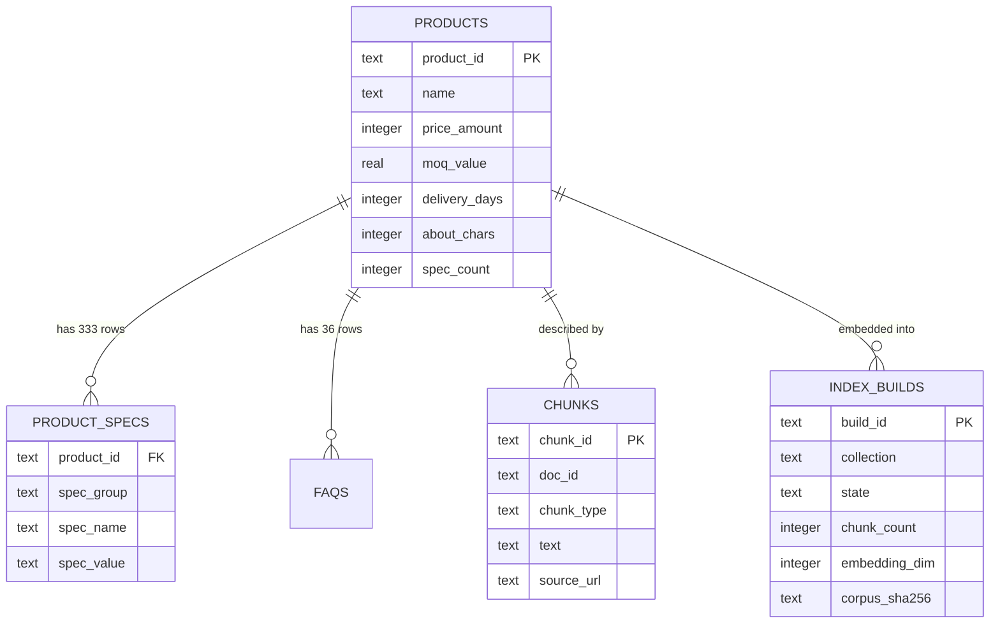

> **Lens:** BA (Part A) / TPO + Architect (Part B) · **Inputs:** `01-brd.md`, `02-use-cases-workflows.md`, `03-data-state-analysis.md`, `05-modularization.md`, `06-architecture.md`, `07-brownfield-reconciliation.md` · **Engagement:** Brownfield · **Defines:** TRD-12 … TRD-16

# Retrieval & Grounding — MOD-03

## Part A — Module BRD [Lens: BA]

### A.1 Module Objectives

MOD-03 is the module that decides **what the assistant is allowed to know**. It converts a buyer's question into ranked catalogue evidence, and — when that evidence is not good enough — it returns an explicit refusal signal instead of a plausible guess.

Three business outcomes depend on it:

1. **A wrong answer is worse than no answer.** The assistant sells regulated medical equipment; a spec or a claim that is not in ANITA's own published catalogue is a commercial and regulatory liability (`BRD-04`, `BRD-10`). MOD-03 is where "answer only from the corpus" stops being a prompt instruction and becomes an enforced gate (R-2, R-7).
2. **Every answer must be showable.** A buyer, an ops admin reviewing a conversation (`UC-13`) or an evaluator running the frozen set (`UC-15`) must be able to see which catalogue record produced the answer. MOD-03 returns citations with every hit.
3. **Honest absence is a product feature.** 3 of the 24 products publish no specifications and 4 publish no About text (`DG-13`). For those products the correct answer is *"that is not published"* plus a human, never an inferred value (`BRD-07`).

### A.2 Scoped Requirements

- `BRD-04` — Grounded answers only: every product fact traceable to a corpus record; refuse rather than improvise.
- `BRD-07` — Specification answering, including products whose specification block is empty on the source site.
- `BRD-08` — Company and statutory answering (GST, PAN, IEC, directors, branches, certifications) from collected company facts.
- `BRD-18` — Instance isolation, retrieval half: one ANITA-only collection, no shared index (`CV-01`).
- `BRD-22` — Quality gate: the index is promoted only after the frozen evaluation set passes (`SM-05` VALIDATING → LIVE).

Business rules enacted: **R-2** (no chunk above threshold → say so and offer handoff), **R-7** (unknown source → do not answer), `R-1` and `R-3` reach MOD-03 only as *disambiguation inputs* — pricing itself is MOD-04's.

### A.3 Module Business Rules

| Rule | Condition → Action |
|---|---|
| M3-1 | No retrieved chunk clears the grounding gate → return `not_relevant`; the turn is declined with a human offer. Never fall through to model generation. |
| M3-2 | A product's specification block is absent in the corpus → the answer is "not published on ANITA's catalogue", with an offer of a human. Never infer, never interpolate from a sibling product (`DG-13`). |
| M3-3 | The corpus presented for indexing does not identify itself as the ANITA catalogue → the build is refused outright (`REC-23` pattern). |
| M3-4 | Two catalogue rows share a name → retrieval returns both with their product ids and prices so MOD-04 can force disambiguation (`BRD-09`); MOD-03 never silently picks one. |
| M3-5 | The embedding backend is unavailable → retrieval continues sparse-only (BM25) and flags itself degraded; if that also yields nothing, M3-1 applies. |
| M3-6 | A rebuild fails validation → the previously LIVE index stays live; a partial build is never queryable (`SM-05`). |

### A.4 Actors

| Actor | Why they touch MOD-03 |
|---|---|
| **Buyer** | Indirect — every catalogue answer on every channel is produced from MOD-03's output; the citation is what makes the answer auditable. |
| **Ops admin** | Runs the corpus refresh (`WF-03`), reads index status (`UC-12`), triggers the quality-gate run (`UC-15`). |
| **Background worker** | Drives BUILDING → VALIDATING and the atomic promotion; discards partial builds after a crash. |
| **MOD-04 Inference** | The only runtime consumer: supplies the query, receives ranked chunks or `not_relevant`, and owns embedding calls on MOD-03's behalf. |
| **MOD-08 Observability** | Receives per-query traces (`retrieval_ms`, top score, decision) and provides the gate verdict that permits promotion. |

### A.5 Module Acceptance Criteria

- **AC-1** — For all 36 published FAQs in the corpus, the answer returned by the shared engine cites at least one chunk whose `chunk_id` exists in `data/out/chunks.jsonl`; 0 answers cite anything else. (`BRD-04`, `BRD-22`)
- **AC-2** — A question with no catalogue support (e.g. *"what is the price of an MRI scanner?"* — not in the 24) returns `not_relevant` and the buyer is offered a human; 0 such questions produce a generated answer. (R-2, R-7)
- **AC-3** — For each of the 3 specification-less products (`270685`, `270687`, `381893`), a specification question returns "not published" and 0 invented spec values. (`DG-13`, `BRD-07`)
- **AC-4** — The two products named "Medical Dry Imager" are returned together by retrieval for a name-only query, and the engine asks which one; 0 answers conflate their prices (₹5,50,000 / ₹2,00,000). (`BRD-09`)
- **AC-5** — A name-and-address question (*"where is ANITA's Delhi office?"*) resolves to the corpus branch record (`101-D.R.Chambers, Karol Bagh, New Delhi - 110 005`) and cites it. (`BRD-08`)
- **AC-6** — A deliberately corrupted corpus (embedding dimension changed to 512) is refused at VALIDATING; the previous index remains LIVE and queryable throughout.
- **AC-7** — The post-refresh frozen-evaluation run passes at ≥ 98 % grounded-answer rate before the new index accepts traffic; below that the old index stays live (`BRD-22`, `SM-05`).

## Part B — Module TRD [Lens: TPO + Architect]

### TRD-12 — ANITA-only collection with a guarded corpus ingestion pipeline

**Serves:** `BRD-04`, `BRD-18`, `BRD-22`. **Implements:** `DAT-01`, `DAT-12`, `SM-05` (ABSENT → BUILDING), `DG-13` ingestion guard, `REC-23` pattern.
**Reconciles:** `REC-03` (drop both source stores), `REC-04` (refactor `app/rag*.py`).

The module owns exactly **one** Chroma collection, `anita_ams__v1`, 768-dimensional (nomic-embed-text), one writer, one reader. Ingestion reads `data/out/chunks.jsonl` (169 chunks), `data/out/ams.sqlite` (`products` 24 rows, `product_specs` 333 rows, `faqs` 36 rows, `company_ids`, `people`, `branches`, `certifications`), and refuses any corpus whose identity does not match the ANITA catalogue. Identity check: the corpus must contain ≥ 20 distinct `product_id` values and ≥ 200 `product_specs` rows, and the `products.name` set must include `"Ultrasound Gel"` — a corpus that fails is rejected before a single embedding call is made. Chunk records carry `chunk_id`, `doc_id`, `chunk_type`, `section`, `context_prefix` and `text`; the vector payload preserves `chunk_id` plus `source_url` so citations resolve.

The collection name is never derived from an env default that could collide with the university product (`langchain`, `meridian_kb__v1` are both forbidden strings, asserted at boot by MOD-09). A single writer holds an exclusive build lock; concurrent builds are refused, not merged.

### TRD-13 — Hybrid dense + sparse retrieval with weighted RRF

**Serves:** `BRD-04`, `BRD-07`, `BRD-08`. **Implements:** `DAT-01`, `DAT-12`, `SM-05` (LIVE query path).

Retrieval is hybrid and in-process, reusing the dispatcher/breaker *idea* of `REC-04` without its MCP hop:

- **Dense:** Chroma KNN over `anita_ams__v1`, `fetch_k = 20`, cosine space, L2-normalised embeddings.
- **Sparse:** a stdlib BM25 scorer (`_MiniBM25` pattern, `REC-04`) over the 169 loaded chunk texts, cached in memory after first build; it exists to catch exact catalogue tokens (model numbers such as `DRYPIX 2000`, `RT-150`, `APO 200`) that a small embedding model blurs.
- **Fusion:** weighted Reciprocal Rank Fusion, `score = Σ w_i / (k + rank_i)`, `k = 60` (the source's tested constant), `w_dense = 0.65`, `w_sparse = 0.35`. Weights are config keys read by the fusion function — a key that is not read fails the MOD-09 boot audit (`DG-09`).

Combined result set is trimmed to `top_k = 5`. The hybrid path must return identical rankings for identical inputs (deterministic tie-break on `chunk_id` ascending) so the frozen evaluation set (`BRD-22`) can be re-run and compared.

### TRD-14 — Grounding gate and the explicit `not_relevant` contract

**Serves:** `BRD-04`, `BRD-07`, R-2, R-7. **Implements:** M3-1, M3-4, M3-5.

The gate runs **after** fusion and decides whether the turn may be answered at all. It is a hard contract, not a confidence hint:

```
RetrievalResult:
  decision:      "hit" | "not_relevant"
  chunks:        list[Chunk]      # empty iff not_relevant
  top_dense_sim: float            # 0.0 under sparse-only degradation
  entity_match:  bool             # exact product name/model/id token matched
  collection:    str              # "anita_ams__v1"
  build_id:      str
  degraded:      bool             # true when sparse-only
```

A `hit` requires **either** `top_dense_sim >= 0.62` **or** `entity_match = true`. `Assumed: 0.62` cosine — to be calibrated against the frozen evaluation set before launch; the value is a config key (`RETRIEVAL_MIN_DENSE_SIM`), and `0.0` is **forbidden by the boot audit** because that is exactly the dormant state the source shipped (`RAG_SIMILARITY_THRESHOLD=0.0`, `REC-04`) where the gate silently never fires. Below the gate, the module returns `decision = "not_relevant"` with no chunks — MOD-02 turns that into the decline-and-handoff path and MOD-04 must never be entered.

`entity_match` is computed by a normalised exact lookup against `products.name`, `products.model` and the numeric `product_id`; for a name that matches two rows it sets `entity_match = true` **and** returns both rows (M3-4).

### TRD-15 — Index lifecycle with atomic promotion (SM-05)

**Serves:** `BRD-22`, `BRD-18`. **Implements:** `SM-05` in full.

```
ABSENT ──refresh starts──▶ BUILDING ──embed complete──▶ VALIDATING ──gate pass──▶ LIVE
                            │                             │
                            └── embed error / dim mismatch ┴── regression detected ──▶ REJECTED
                                                                                       │
                                                                              rebuild ─┘
```

Rules enforced in code, not convention:

- `ABSENT → LIVE` is impossible; a build must pass through VALIDATING.
- `REJECTED → LIVE` is impossible; REJECTED requires a rebuild from a validated corpus.
- Promotion is a single atomic pointer swap from the staging collection to the served collection name; queries during a build keep hitting the LIVE build id.
- A crash during BUILDING leaves a partial collection that is discarded on next start and never promoted (`SM-05` #7).
- Validation budget: if VALIDATING exceeds **15 minutes**, the build is REJECTED (`SM-05` #10).
- The lifecycle state, build id, chunk count, embedding dim, corpus `content_sha256` aggregate and reject reason are persisted in `anita.index_builds` (B.4) so UC-12 and UC-15 can report them.

Dim/space mismatch and chunk-count regression (`< 169` chunks from a corpus that claims 169) are the two hard REJECT reasons; the quality-gate verdict from MOD-08 is the third.

### TRD-16 — Provenance payload and honest-absence handling

**Serves:** `BRD-04`, `BRD-07`, `BRD-08`. **Implements:** `DG-13`, M3-2, `UC-06` "not published" rule.

Every `hit` chunk carries a citation record — `chunk_id`, `doc_id`, `source_url`, `chunk_type` — and MOD-03 exposes a coverage probe used before a specification or About question is answered:

```
CoverageProbe.for_product(product_id) -> Availability
  specs:  "published" | "not_published"      # product_specs row count == 0 → not_published
  about:  "published" | "not_published"      # products.about_chars == 0 → not_published
```

The probe is a read against `product_specs` and `products.about_chars`; it is the mechanism that turns `DG-13` from a data-quality observation into a product behaviour. Three products return `specs = not_published` (`270685` Microbar Paste, `270687` Microbar Powder, `381893` Fuji Computed Radiography System) and four return `about = not_published` (`270683`, `3935251`, `3935247`, `3935249`). A "not published" answer is composed by MOD-04 from this signal and must not be routed through the LLM.

Company facts are answered from the same collection: `company_ids` (GST `07AAACA3337R1ZF` / `27AAACA3337R1ZD`, PAN `AAACA3337R`, IEC `0388056606`), `people` (7 named directors/officers), `branches` (Mumbai, Delhi, Navi Mumbai storage) and `certifications` (ISO 9001:2015, NSIC-CRISIL MSE 1A*) are chunked with their `source_url` and cited like any other chunk.

### B.1 Technical Constraints

| Constraint | Source |
|---|---|
| Python 3.11+; ChromaDB in-process (persistent client), no server process | `05-modularization.md` MOD-03; `06-architecture.md` §2 rejects the MCP sidecar |
| Embeddings are produced by MOD-04's provider (`nomic-embed-text`, 768-d) — MOD-03 depends on MOD-04 and must not instantiate its own model | MOD-03 dependency declaration |
| One collection, one writer; the string `langchain` and `meridian_kb` are forbidden as collection names | `REC-03`, `BRD-18`, `CV-01` |
| Corpus is read-only input at `data/out/`; MOD-03 never writes to it | `BRD` §8 constraint |
| Windows-primary with macOS/Linux parity; Chroma path is a config key, not a hardcoded relative path | `BRD-19`, `REC-18` (hardcoded ports/paths must go) |
| No network egress: retrieval and embedding are local-only | `06-architecture.md` §4 |

### B.2 Non-Functional Requirements

| NFR | Target |
|---|---|
| Performance — retrieval | p95 ≤ **150 ms** for a hybrid query over 169 chunks, warm (embed call included), measured server-side from `retrieval_start` to `retrieval_done` |
| Performance — grounding gate | `not_relevant` decision ≤ **5 ms** after fusion completes; gate adds no I/O |
| Performance — cold embed | First query after model unload p95 ≤ **900 ms** (`Assumed:` — nomic-embed-text load from the Ollama runner) |
| Throughput | ≥ **20 hybrid queries/s** sustained single-process on the target box (`Assumed:` — trivial at 169 chunks; embedding calls dominate) |
| Scale unit & limits | 1 collection; **169 chunks**, 768-d, ~519 KB of vectors resident; `top_k = 5`, `fetch_k = 20`; BM25 index warm ≤ 1 s |
| Index rebuild | Full rebuild + validation ≤ **10 min** wall clock for 169 chunks (`Assumed:` 1.5 chunks/s embedding, plus validation) |
| Degradation | Embedding backend down → sparse-only BM25 retrieval, `degraded = true`, still answers entity-matched questions; a REJECTED rebuild never takes the LIVE index down (`SM-05`, `06-architecture.md` §5 MOD-03 row) |
| Recovery | Index REJECTED → previous index continues serving; RTO for a fresh LIVE index ≤ **30 min** (scrape-free rebuild from validated corpus); RPO = last promoted build |
| Availability | 99.5 % within the single instance (no HA by design — one box); a collection load failure refuses boot rather than serving empty results |
| Grounding quality | Frozen evaluation set (`BRD-22`): grounded-answer rate ≥ **98 %**; retrieval recall@5 ≥ **95 %** on the 36 published FAQs; 0 answers with a citation that does not resolve to a chunk |
| Isolation | 0 shared rows, 0 shared collections, 0 shared index files with the university product; asserted at boot (`BRD-18`) |
| Observability | Per query: `retrieval_ms`, `top_dense_sim`, `decision`, `degraded`, `collection`, `build_id`, chunk ids — emitted best-effort to MOD-08 |

### B.3 APIs / Interfaces

| Name | Direction | Style | Contract | AuthN/Z |
|---|---|---|---|---|
| `Retriever.retrieve(query, top_k=5, tenant=None) -> RetrievalResult` | exposed | Python in-process | `decision ∈ {hit, not_relevant}`; chunks carry citations; never raises on "no result" | In-process caller only (MOD-02/MOD-04); no public route |
| `Retriever.coverage(product_id) -> Availability` | exposed | Python in-process | `specs`/`about` ∈ `{published, not_published}` (`DG-13`) | In-process |
| `IndexBuilder.build(corpus_dir, staging_dir) -> BuildReport` | exposed | CLI + function | Staging build only; refuses non-ANITA corpus; returns `build_id`, `chunk_count`, `dim` | Ops-only; CLI on the instance box |
| `IndexLifecycle.promote(build_id, gate_verdict) -> None` | exposed | Python | Atomic swap; refuses unless `state = VALIDATING` and `gate_verdict = pass` | Ops-only, called by WF-03 after `UC-15` |
| `IndexLifecycle.status() -> IndexStatus` | exposed | REST read via MOD-08 | `{state, build_id, chunk_count, dim, promoted_at, reject_reason}` | Admin auth (`CV-03`) |
| `EmbeddingProvider.embed(texts) -> list[list[float]]` | **consumed** | Python (MOD-04) | 768-d, L2-normalised; raises `EmbeddingUnavailable` | In-process |
| `chunks.jsonl` + `ams.sqlite` | **consumed** | file / SQLite read | `DAT-01`, `DAT-02`, `DAT-03`, `DAT-05` | Read-only, path from config |
| `index.build.started` / `index.build.rejected` / `index.promoted` | published | event (MOD-08 trace) | `{build_id, collection, chunk_count, dim, reason?}` | Internal |

**As built (US-010 + US-012, 2026-10-04).** Two additions, both read by a
running process rather than by a test:

* **The index has a lifecycle with a memory.** `SqliteBuildStore` persists
  `anita.index_builds` with the story's partial unique index
  (`UNIQUE (collection) WHERE state = 'LIVE'`); promotion runs in one
  transaction and writes the **pointer** the serving process reads
  (`assembly` asks the store which collection is live, falling back to the
  configured name). `scripts/rebuild_index.py` is the operational entry point:
  begin → embed → validate against the frozen set → promote or reject, and a
  rejection leaves the previous build serving. The boot preflight gained an
  `INDEX` phase that refuses when there is neither a built index nor a
  promoted build, naming the command that fixes it.
* **Coverage is a first-class answer.** `coverage.CoverageProbe` is the single
  definition of "published", keyed per product id, and the answer engine
  consults it before retrieval: a product with no published specifications or
  About is answered as exactly that (0 LLM calls, human offer attached), not
  declined. Every grounded reply carries `grounded_on` — the TRD-16 payload
  (chunk id, type, product, source URL, content hash) — surfaced through the
  API and stored on the turn so the console review renders the grounding.
  `citation_incomplete` is counted and the release gate fails on a non-zero
  count over the frozen set.

**Not claimed:** the probe is not exposed on the admin console; reads share the
corpus connection (single process, read-only). Both are recorded rather than
implied.

### B.4 Data Model

MOD-03 owns no corpus tables — the corpus is read-only (`DAT-01`…`DAT-05`). It owns the vector index (`DAT-12`) and one lifecycle table it adds to the ANITA schema (extends `REC-13`'s DDL pattern):



```sql
CREATE SCHEMA IF NOT EXISTS anita;

CREATE TABLE IF NOT EXISTS anita.index_builds (
    build_id       TEXT PRIMARY KEY,
    collection     TEXT NOT NULL,
    state          TEXT NOT NULL,
    chunk_count    INTEGER NOT NULL,
    embedding_dim  INTEGER NOT NULL,
    corpus_sha256  TEXT NOT NULL,
    reject_reason  TEXT,
    started_at     TIMESTAMPTZ NOT NULL DEFAULT now(),
    promoted_at    TIMESTAMPTZ,
    CONSTRAINT index_builds_state_chk CHECK (state IN ('BUILDING','VALIDATING','LIVE','REJECTED')),
    CONSTRAINT index_builds_dim_chk   CHECK (embedding_dim = 768),
    CONSTRAINT index_builds_count_chk CHECK (chunk_count > 0)
);

-- Exactly one LIVE build per collection: makes double-promotion impossible.
CREATE UNIQUE INDEX IF NOT EXISTS index_builds_one_live
    ON anita.index_builds (collection) WHERE state = 'LIVE';

-- Forbidden legacy names: the isolation guard (MOD-09) asserts zero rows here.
-- SELECT count(*) FROM anita.index_builds WHERE collection IN ('langchain','meridian_kb__v1');  -- must be 0
```

Required read indexes on the corpus projection (already present in the SQLite build per `03-data-state-analysis.md` A.2; recreated in the `anita` schema):

```sql
CREATE INDEX IF NOT EXISTS products_name_lower_idx   ON anita.products (lower(name));
CREATE INDEX IF NOT EXISTS products_price_idx        ON anita.products (price_amount);
CREATE INDEX IF NOT EXISTS product_specs_product_idx ON anita.product_specs (product_id);
```

### B.5 Tech Stack Choices

| Choice | Rationale | Runner-up rejected |
|---|---|---|
| **ChromaDB persistent, in-process** | 169 vectors; no server to operate; matches the corpus scale (`AS-03`) | ERC/MCP sidecar — the source's own documented divergence defect (`REC-03`, `06-architecture.md` §2) |
| **nomic-embed-text 768-d** | Already the source's embedding model and already resident on the box; strong on English technical nouns | A hosted embedding API — network dependency and PII egress for a 20.5 K-token corpus |
| **Weighted RRF (k=60)** | Rank-fusion needs no score calibration between cosine and BM25, which live on incompatible scales; k=60 is the source's tested value | Score-normalised linear blend — requires per-corpus calibration and drifts when the corpus changes |
| **Stdlib `_MiniBM25`** | ~30 lines, zero dependencies, catches exact model numbers (`DRYPIX 2000`, `RT-150`); proven in the source (`REC-04`) | Elasticsearch/Whoosh — an entire service for 169 documents |
| **Dense-first gate (sim ≥ 0.62) + entity match** | One number an operator can tune against the frozen set; entity match rescues exact-name queries where embeddings under-score | Pure RRF-score threshold — the fused score is rank-based and not comparable across query lengths |
| **Atomic collection pointer swap** | Makes `SM-05` promotion a single observable event; no reader can see a half-built index | In-place upsert — the failure mode that leaves the live index corrupt |

### B.6 Edge Cases & Error Handling

| Edge case | Class | Decided behaviour | Traces |
|---|---|---|---|
| Query is empty / whitespace / > 2,000 chars | Validation | Rejected before embedding with `EmptyQuery`; MOD-02 re-prompts | `UC-01` invalid-input row |
| No chunk clears the gate | Business refusal | `decision = not_relevant`, no chunks, no LLM call; decline + handoff | R-2, R-7, `UC-01` E1 |
| Embedding backend down | Transient | Sparse-only BM25, `degraded = true`; entity-matched questions still answer; if none, `not_relevant` | `DG-03` (retrieval half), `06-architecture.md` MOD-03 row |
| Collection ABSENT at boot | Startup | Boot refuses (MOD-09 preflight); running with an empty index would silently decline every query | `SM-05` ABSENT, `BRD-18` |
| Rebuild crashes mid-BUILDING | Recovery | Partial staging collection discarded on next start; LIVE untouched | `SM-05` #7 |
| Dim mismatch (512 vs 768) | Build rejection | REJECTED with `reject_reason = dim_mismatch`; old index stays LIVE | `SM-05`, `TRD-15` |
| Quality gate fails | Build rejection | REJECTED with `reject_reason = gate_regression`; previous index remains LIVE (`WF-03`) | `BRD-22`, `UC-15` |
| Corpus is not the ANITA catalogue | Ingestion refusal | Build refused before embedding; ≥ 20 product ids and ≥ 200 spec rows required | `REC-23`, M3-3 |
| Product name matches two rows | Ambiguity | Both rows returned, `entity_match = true`; MOD-04 forces disambiguation | `BRD-09`, M3-4, `UC-05` E1 |
| Product has 0 spec rows | Absence | `CoverageProbe` returns `not_published`; answer states it; never inferred | `DG-13`, `BRD-07`, `UC-06` missing-data row |
| Product has 0 About chars | Absence | Same as above for About questions | `DG-13` |
| Two concurrent rebuilds | Concurrency | Second refused on the exclusive build lock; first continues | `SM-05` #6 |
| Query during rebuild | Concurrency | Served entirely from the LIVE build id; a build in progress is invisible | `SM-05` #5 |
| Identical question asked twice | Idempotency | Same ranking, same citations (deterministic tie-break) | `UC-01` duplicate row, `BRD-22` |

### B.7 Tech Debt Accepted

- **Full re-embed on every refresh.** No incremental upsert path. At 169 chunks a full rebuild is < 10 min and removes an entire class of stale-vector bugs. Revisit above **5,000 chunks**, where a full rebuild starts to matter. (`TPO`)
- **BM25 index rebuilt in memory at boot**, not persisted. Builds in under a second at this size; persisting it would add an on-disk artefact to keep in sync with the collection. Revisit if boot time exceeds 5 s. (`TPO`)
- **No sharding, quantisation or ANN tuning** — `AS-03` states the corpus stays in one collection. Revisit only if the corpus exceeds 10,000 chunks. (`Architect`)
- **Grounding threshold `0.62` is `Assumed:`** and must be calibrated against the frozen evaluation set during Stage 11. Accepted because the alternative — shipping the source's dormant `0.0` — is the exact defect `REC-04` calls out. (`TPO`)
- **Single writer, single process.** No concurrent-build safety beyond a lock file. Acceptable on one box (`06-architecture.md` §2). (`Architect`)
- **Company facts are embedded as prose chunks rather than answered from a typed lookup.** Statutory values are few and stable; a typed path is deferred with MOD-04's SQL path owning the *numeric* commercial facts only. Revisit if GST/PAN change frequency rises. (`BA`)

## TPO Buildability Sign-off [Lens: TPO]

**TPO sign-off: this TRD is buildable against the BRD above.** Feasibility risks and their mitigations:

1. **The `0.62` threshold is uncalibrated.** A wrong value either declines answerable questions (too high) or admits weak ones (too low). *Mitigation:* it is a config key, the frozen evaluation set (`BRD-22`, `UC-15`) is the calibration instrument, and Stage 11 blocks promotion until recall@5 ≥ 95 % and grounded-answer rate ≥ 98 % are both measured. The gate is fail-closed, so the failure direction is a decline, never a fabrication.
2. **Hybrid fusion changes ranking versus the source's dense-only legacy path.** Existing source behaviours do not transfer. *Mitigation:* the frozen set is built from the corpus's 36 FAQs plus derived commercial questions, so ranking regressions surface at `BRD-22` before promotion — not in production.
3. **`DG-13` absence handling depends on `about_chars` and `product_specs` counts being trustworthy.** They are derived by the scraper, not declared. *Mitigation:* the coverage probe re-derives from row counts at query time rather than trusting a cached counter, and `UC-06`'s missing-data test asserts "not published" for the three named products.
4. **Embedding availability is MOD-04's, so MOD-03 inherits its outage surface.** *Mitigation:* sparse-only degradation is a tested path (`TRD-14`), not an aspiration, and it is exercised by a unit test with the embedder stubbed to raise.
5. **One collection and one writer is a deliberate constraint that will be tested by the first corpus refresh during live traffic.** *Mitigation:* `SM-05`'s atomic swap plus the `index_builds_one_live` partial unique index make double-promotion a database error rather than a silent divergence.
