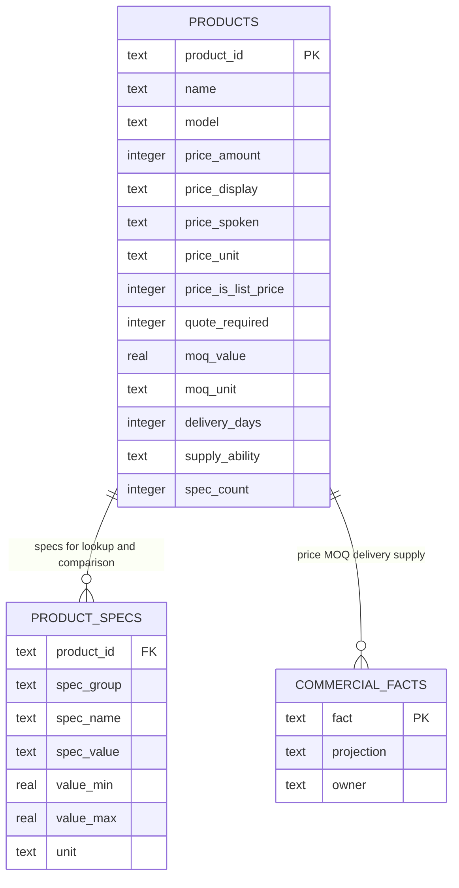

> **Lens:** BA (Part A) / TPO + Architect (Part B) · **Inputs:** `01-brd.md`, `02-use-cases-workflows.md`, `03-data-state-analysis.md`, `05-modularization.md`, `06-architecture.md`, `07-brownfield-reconciliation.md` · **Engagement:** Brownfield · **Defines:** TRD-17 … TRD-21

# Inference & Answer Composition — MOD-04

## Part A — Module BRD [Lens: BA]

### A.1 Module Objectives

MOD-04 turns a classified question plus retrieved context into **the sentence the buyer actually receives**. It owns the two answer paths the product's commercial credibility rests on:

1. **The deterministic path.** Price, MOQ, delivery time, supply ability, GST, PAN, IEC and address are read from structured storage and are **never** produced by a language model (`BRD-05`). A price that drifts by one digit is a commercial liability, and a quotation-required caveat that is forgotten is a compliance one (`BRD-06`, R-1).
2. **The grounded prose path.** Specifications, product descriptions and company narrative are composed from retrieved catalogue chunks under a prompt whose grounding rules are enforced, not requested (`BRD-04`).
3. **The honest degradation path.** There is **no LLM fallback** (`DG-03`). When the model is unavailable, the module must keep answering commercial questions from SQL and decline prose with a human handoff — while never, under any failure, inventing a catalogue fact.

### A.2 Scoped Requirements

- `BRD-04` — Grounded answers only (composition half; retrieval half is MOD-03).
- `BRD-05` — Deterministic commercial lookups: price, MOQ, delivery, supply ability, GST, PAN, address from SQL.
- `BRD-06` — The list-price / quotation-required caveat on every price, without exception.
- `BRD-07` — Specification answering, including products whose specification block is absent.
- `BRD-08` — Company and statutory answering (shared with MOD-03, composed here).
- `BRD-09` — Same-named product disambiguation before a commercial answer.
- `BRD-10` — Clinical question refusal (composed here from approved wording; classification is MOD-02).
- `BRD-19` — Cross-platform runtime: Ollama on Windows/Linux, MLX on Apple Silicon.
- `BRD-22` — No release may regress the frozen evaluation set (this module's outputs are what it scores).

Business rules enacted: **R-1** (price → caveat), **R-3** (duplicate name → disambiguate), **R-4** (clinical → refuse), `R-2`/`R-7` enforced by MOD-03's gate and honoured here as a hard precondition.

### A.3 Module Business Rules

| Rule | Condition → Action |
|---|---|
| M4-1 | Every price answer is emitted as a single atomic answer object carrying `caveat_applied = true`. An answer object with a price and `caveat_applied = false` is a defect and must fail composition. |
| M4-2 | A commercial fact is answered from SQL or not at all. If the row or the column is absent, the answer states the fact is unavailable and offers a human; it is never estimated, rounded from the model's memory, or borrowed from another product. |
| M4-3 | A price question that resolves to more than one catalogue row requires disambiguation first (`BRD-09`). Two rows named "Medical Dry Imager" exist at ₹5,50,000 and ₹2,00,000; they are never conflated. |
| M4-4 | A generated answer may not introduce a numeric or unit token that does not appear in its retrieved context. A failed post-generation check turns the answer into a decline. |
| M4-5 | When the LLM is unavailable, commercial answers continue unchanged and prose answers decline with a human offer. No user-visible message may claim the assistant is "thinking" or "looking it up" while it is not. |
| M4-6 | A clinical or diagnostic question is refused with the approved wording and routed to a human, whether or not retrieval found a product chunk (`DG-08`). |
| M4-7 | Absent specification/About data (`DG-13`) is answered by MOD-04 from MOD-03's coverage probe, not by the model. |

### A.4 Actors

| Actor | Why they touch MOD-04 |
|---|---|
| **Buyer** | Receives the answer; the price caveat and the refusal are the two statements they most often read. |
| **Sales rep** | Benefits when a commercial answer routes the buyer to a quotation rather than closing the conversation. |
| **Ops admin** | Reads model/provider state in the console (`UC-12`); runs the frozen evaluation set against a candidate configuration (`UC-15`). |
| **MOD-02 Orchestrator** | Routes classified turns here and consumes the `Answer` object without knowing which path produced it. |
| **MOD-05 Speech** | Consumes clause-level output: the streaming interface exists so TTS can begin before the answer is finished. |
| **MOD-07 Sentiment** | Reads the composed answer text as the turn's response side of the transcript. |

### A.5 Module Acceptance Criteria

- **AC-1** — For all 24 products, a price question returns the exact `price_display` and `price_spoken` from `products`, each accompanied by the list-price/quotation caveat. 0 answers omit the caveat; 0 prices differ from the SQL value. (`BRD-05`, `BRD-06`)
- **AC-2** — "What is the MOQ on the ultrasound gel?" returns `10 Pieces`; "MOQ on the Microbar Paste?" returns `10 Pieces`; "MOQ on the FCR Capsula X?" returns `1 Unit`. Values are read from `moq_value`/`moq_unit`, and where the unit is empty the answer omits the unit rather than guessing.
- **AC-3** — A price question naming only "Medical Dry Imager" returns a disambiguation prompt listing both product ids and both prices, and answers neither until the buyer chooses. (`BRD-09`)
- **AC-4** — With the LLM process stopped, price/MOQ/delivery/GST/address questions are still answered correctly, and a specification prose question returns the decline-with-handoff message. 0 fabricated answers. (`DG-03`)
- **AC-5** — A clinical question ("is this machine safe for a patient with a pacemaker?") is refused with the approved wording and produces a handoff reason of `clinical`. (`BRD-10`)
- **AC-6** — A specification question for `270685`, `270687` or `381893` returns "not published" with a human offer; 0 spec values are stated for those products. (`DG-13`, `BRD-07`)
- **AC-7** — The same binary and configuration starts and serves on Windows (Ollama) and macOS/Apple Silicon (MLX) with only `MODEL_PROVIDER` differing. (`BRD-19`)
- **AC-8** — An answer proposed by the model containing a numeric token absent from the retrieved context is intercepted and converted to a decline, with the failure recorded in the turn trace. (M4-4, `BRD-04`)

## Part B — Module TRD [Lens: TPO + Architect]

### TRD-17 — Portable LLM backend: Ollama (Windows/Linux) and MLX (Apple Silicon)

**Serves:** `BRD-19`, `BRD-04`. **Implements:** `REC-08` (reuse), `DG-09` (every model key read).
**Reconciles:** `REC-08` — `app/llm_backend.py` (734 LOC) is taken **as-is** for the provider switch and patched only for prompt templates.

One interface, two providers, selected by MOD-09's platform detection:

```python
provider_name() -> "ollama" | "mlx"
pick_model(preferred: str | None = None) -> str        # first installed model from a preference list
chat(messages, *, model=None, num_ctx=None, temperature=None) -> str          # _chat_ollama / _chat_mlx
stream_chat(messages, *, model=None, num_ctx=None, temperature=None) -> Iterator[str]
is_ready() -> bool
health() -> {"provider": str, "model": str, "ready": bool, "keep_alive": str}
```

- **Ollama:** `/api/chat` with `num_ctx` and `keep_alive`; `OLLAMA_KEEP_ALIVE=-1` keeps the model resident, because a cold load on the shared GPU would breach the voice latency budget.
- **MLX:** `mlx_lm` generation on Apple Silicon; the same caller code, no `num_ctx` (MLX manages its own context window — the key is read and honoured by the provider, not silently dropped, per `DG-09`).
- Model preference list is a config value: ANITA's default is a 14B-class instruct model (the source's `qwen2.5:14b` remains the reference); `SMALL_TASK_NUM_CTX` governs sentiment/eval calls so they do not evict the chat model's KV cache.
- Provider and model names are surfaced to MOD-08 on every generation, so `UC-12`'s model-residency panel reads a real value rather than a configured one.

### TRD-18 — Deterministic SQL answer path for commercial and structural facts

**Serves:** `BRD-05`, `BRD-07`, `BRD-09`. **Implements:** M4-2, M4-3, `DAT-02`, `DAT-03`, `DAT-05`, `UC-05`, `UC-06`.

Commercial questions never reach the LLM. A declarative **fact registry** maps each supported fact to its SQL projection; the registry is the single place a fact can be added, and at boot the module asserts every registry column exists in `data/out/tables_schema.json` (a registry column that is not present fails startup — the `DG-09` "set ≠ live" defect turned into an invariant).

| Fact | Source | Example corpus value |
|---|---|---|
| price | `products.price_amount`, `price_display`, `price_spoken`, `price_unit` | ₹5,50,000/Piece, "about 5.5 lakh rupees" |
| MOQ | `products.moq_value`, `moq_unit` | `10.0 Pieces` (Ultrasound Gel) |
| delivery | `products.delivery_time`, `delivery_days` | `7 Days` / `7` |
| supply ability | `products.supply_ability` | `1 Unit Per Day`, `100 Pieces Per Day` |
| availability / condition / brand | `products.availability`, `condition`, `brand` | `InStock`, `NewCondition` |
| GST, PAN, IEC, drug licence | `company_ids` | `07AAACA3337R1ZF`, `27AAACA3337R1ZD`, `AAACA3337R`, `MUMA26381F` |
| address | `branches` | Mumbai (Goregaon East), Delhi (Karol Bagh), Navi Mumbai storage |
| certifications | `certifications` | ISO 9001:2015, NSIC-CRISIL MSE 1A* |
| specifications / comparison | `product_specs` (333 long-format rows) | intersected by `spec_name` across two product ids |

**Resolution before lookup.** `ProductResolver.resolve(text)` matches on normalised `name`, `model` or `product_id` and returns exactly one of:

```
Resolution = Resolved(product_id) | Ambiguous(candidates: list[ProductRef]) | NotFound
```

`Ambiguous` is returned whenever a name matches more than one row. The corpus contains exactly one such name — "Medical Dry Imager" (`270683` ₹5,50,000 and `3935251` ₹2,00,000) — and the resolver is required to find it: a boot self-test asserts the ambiguity set is non-empty, so a future corpus that loses the duplicate cannot silently disable the disambiguation path.

**Comparison.** `UC-06` is a structured operation, not a generation: fetch both products' spec sets from `product_specs`, intersect on normalised `spec_name`, present shared values and mark names present on only one side as `not published`. Fewer than one shared spec name → decline with a human offer (`UC-06` E2). Absent specs are never inferred from a sibling product (`DG-13`).

### TRD-19 — Mandatory price caveat, enforced at the composition boundary

**Serves:** `BRD-06`, R-1. **Implements:** M4-1, `AS-06`, `UC-05`.

Every corpus price row carries `price_is_list_price = 1` and `quote_required = 1`. The invariant is asserted against the loaded projection at boot:

```sql
-- Must return 0. Any non-zero count disables the commercial price path and refuses boot.
SELECT count(*) FROM anita.products WHERE price_is_list_price <> 1 OR quote_required <> 1;
-- Verified against data/out/tables/products.csv: 24 of 24 rows carry 1 and 1.
```

Enforcement is structural, not textual:

- The price formatter is the **only** function that can emit `price_display`/`price_spoken`, and it returns a `PriceAnswer` whose constructor appends the approved caveat string. There is no code path that renders a price without the caveat.
- The `Answer` object carries `caveat_applied: bool` and `price_facts: list[str]`; the composer's final assertion is `price_facts == [] or caveat_applied is True` (M4-1).
- The caveat is part of the answer, not a UI decoration: it is spoken in voice, appended in chat/WhatsApp, and is present in the transcript and in the frozen evaluation set's expected output.
- The caveat wording is a config value (`PRICE_CAVEAT_TEXT`) read by the formatter; an unread caveat key is caught by MOD-09's audit (`DG-09`).

### TRD-20 — Grounded prompt assembly, streaming, and the clause contract for TTS

**Serves:** `BRD-04`, `BRD-19`. **Implements:** `REC-09` (refactor), `REC-08`'s `ClauseCutter`.

**Prompt assembly.** The source's prompt *structure* is reused (`REC-09`): numbered grounding rules, a `{context}` slot, a profile/history block and an interruption contract. The *content* is 100 % rewritten for the catalogue:

- rules 1–3: answer only from `{context}`; if the context does not contain the fact, say so; never state a price (that is the SQL path's job);
- rule 4: never give clinical or diagnostic advice (`BRD-10`);
- rule 5: when two catalogue entries share a name, ask which one (`BRD-09`);
- an `INTERRUPTION_CONTRACT_BY_FLAG` prefix, inherited from the source — flipping `BARGE_IN_ENABLED` changes the prompt prefix and therefore invalidates the engine's prefix cache (`REC-09` coupling trap 7); the module reads both keys so the behaviour is deliberate.

Budget: system prompt ≤ **1,200 tokens**, retrieved context ≤ **4,000 tokens**, history ≤ **800 tokens**, total ≤ **8,192** (`OLLAMA_NUM_CTX`). Over-budget context is trimmed from the lowest-ranked chunks first, never truncated mid-chunk. `temperature = 0.1`; `max_tokens = 512` chat, **256** voice.

**Streaming.** Tokens stream from the provider through the reused `ClauseCutter` (`REC-08`), which emits at sentence boundaries so MOD-05 can synthesise the first clause before the answer ends. The cutter must flush a clause within **120 ms** of its final token and must never buffer more than **400 characters** without emitting — a guard against a run-on answer delaying first audio.

**Post-generation grounding check (M4-4).** Before an answer is released, every numeric/unit token in the generated text is required to appear in the retrieved context (tokens are normalised for formatting: `₹5,50,000` ≡ `5,50,000` ≡ `5.5 lakh`). A miss converts the answer into a decline and records `grounding_check = failed` on the turn. The catalogue is full of numeric specs — 350 PSI, 200 ml, 1200 psi, 50–70 Kilograms — so this check is the mechanism that keeps `BRD-04` true even when the model interpolates.

### TRD-21 — LLM-outage degradation: commercial survives, prose declines, nothing is invented

**Serves:** `BRD-05`, `BRD-13`, R-2, R-7. **Implements:** `DG-03`, M4-5, `UC-01` E2, `UC-03` E2, `06-architecture.md` §5 MOD-04 degradation row.

There is **no LLM fallback** — that is the recorded decision, not an omission. The designed behaviour:

| Condition | Commercial question | Prose question |
|---|---|---|
| LLM ready | SQL answer + caveat | generated, grounded, checked |
| LLM unavailable | **unchanged SQL answer + caveat** | decline + handoff, ≤ 2 s |
| LLM times out (> 8 s first token, `Assumed:`) | unchanged | decline + handoff, retried once |
| Embedding backend unavailable (MOD-03 degraded) | unchanged | decline + handoff (no context to answer from) |
| Grounding check fails | n/a | decline + handoff, logged as a grounding failure |

Failure detection is a provider circuit: **3 consecutive** `GenerationFailed`/timeout outcomes mark the provider unavailable for **60 s**; while open, prose requests decline immediately rather than waiting on a dead socket, and a health probe re-enables it. The breaker state is published to MOD-08 so `UC-12` shows model health as a real state, never as fabricated green.

The refusal wording for `UC-11` and the decline wording for `UC-01` E2 / `UC-03` E2 are config values with built-in defaults, because a missing key must degrade to a conservative sentence, never to silence (`UC-11` missing-data row). Clinical refusal wording remains flagged for legal review (`DG-08`).

### B.1 Technical Constraints

| Constraint | Source |
|---|---|
| Python 3.11+; provider calls are blocking HTTP/subprocess and run off the event loop via `asyncio.to_thread` | `REC-08` pattern; MOD-02 serialises turns |
| Corpus is read-only; MOD-04 never writes `products`, `product_specs` or `company_ids` | `BRD` §8 |
| PostgreSQL/`anita` schema is the SQL target; every commercial query is parameterised and read-only | `REC-13` (raw `psycopg2`, idempotent DDL pattern) |
| One GPU, shared with a live second product; generation must not exceed its VRAM budget | `AS-09`, `CV-01` |
| `app/main.py` (4,133 LOC) and `app/pipeline.py` (Pipecat) are **not** carried | `REC-10`, `REC-20` |
| No agentic loop / tool calling in v1 | `06-architecture.md` §2 |
| Every model, provider, context-window and caveat key must be read by the code that acts on it | `BRD-20`, `DG-09` |

### B.2 Non-Functional Requirements

| NFR | Target |
|---|---|
| Performance — deterministic path | p95 ≤ **25 ms** end-to-end (SQL read + formatting + caveat) on the target box; p50 ≤ 10 ms |
| Performance — prose, first token | p95 ≤ **900 ms** warm with `OLLAMA_NUM_CTX = 8192` (`Assumed:` 14B-class model on the RTX 5060 Ti) |
| Performance — prose, whole answer | p95 ≤ **2.5 s** for a ≤ 200-token chat answer; voice first-audio p95 ≤ **1.2 s** inherited from `00-product-intent.md` §4 |
| Performance — clause flush | ≤ **120 ms** from a clause's last token to emission; ≤ 400 characters buffered without a flush |
| Throughput & scale unit | **2 concurrent generations** (GPU ceiling, `DG-01`, AS-09); ≥ 20 commercial lookups/s (DB-bound, not GPU-bound) |
| Degradation | LLM unavailable → commercial answers 100 % available; prose declines in ≤ **2 s**; breaker opens after 3 consecutive failures for 60 s; **0** fabricated answers under any failure (`DG-03`) |
| Grounding | 100 % of prose answers pass the numeric-token check; grounded-answer rate on the frozen set ≥ **98 %** (`BRD-22`) |
| Correctness | 100 % of price answers carry the caveat; 0 price values differ from SQL; 0 conflations of the two "Medical Dry Imager" rows |
| Cold start | Model load p95 ≤ **30 s** (`Assumed:`); `OLLAMA_KEEP_ALIVE=-1` prevents a cold load during traffic |
| Availability | Commercial path: available whenever the database is reachable (no LLM dependency); prose path: best-effort with a defined decline |
| Security | Prompts contain only the current turn's text and retrieved catalogue chunks; secrets never enter a prompt; config masking inherited from `REC-14` |
| Observability | Per generation: provider, model, prompt tokens, completion tokens, first-token ms, total ms, `grounding_check`, `caveat_applied`, breaker state → MOD-08 |

### B.3 APIs / Interfaces

| Name | Direction | Style | Contract | AuthN/Z |
|---|---|---|---|---|
| `AnswerComposer.answer(turn: ClassifiedTurn, context: RetrievalResult) -> Answer` | exposed | Python in-process | `Answer(kind, text, citations, caveat_applied, price_facts, model, latency_ms)`; never raises for a decline | In-process (MOD-02) |
| `AnswerComposer.stream(turn, context) -> Iterator[Clause]` | exposed | Python generator | Clause objects with `text`, `is_final`; used by voice | In-process (MOD-02/MOD-05) |
| `CommercialLookup.lookup(resolution: Resolved, facts: list[Fact]) -> CommercialAnswer` | exposed | Python | Exact values + units; missing column → `FactUnavailable` (decline), never a guess | In-process |
| `ProductResolver.resolve(text: str) -> Resolved \| Ambiguous \| NotFound` | exposed | Python | Boot self-test asserts the ambiguity set is non-empty (`BRD-09`) | In-process |
| `LLMBackend.chat / stream_chat / pick_model / is_ready / health` | exposed | Python + provider HTTP | `_chat_ollama` / `_chat_mlx`; `GenerationFailed`, `GenerationCancelled` | In-process |
| `Retriever.retrieve()` | **consumed** | Python (MOD-03) | `not_relevant` is a hard precondition: no prose generation without a hit | In-process |
| `anita.products`, `anita.product_specs`, `anita.company_ids`, `anita.branches`, `anita.certifications` | **consumed** | SQL (read-only) | Parameterised queries; DB role `anita_read` | DB role |
| Ollama `/api/chat`, `/api/tags`; MLX local runtime | **consumed** | HTTP / local | Provider abstraction normalises both | Localhost / local process |
| `answer.composed` / `llm.unavailable` / `caveat.applied` / `grounding.failed` | published | event (MOD-08 trace) | `{turn_id, kind, provider, model, latency_ms, flags}` | Internal |

### B.4 Data Model

MOD-04 owns no corpus tables. It reads `DAT-02`, `DAT-03`, `DAT-05` read-only and owns the prompt/model configuration (`DAT-13`) plus the presentation of `DAT-12`'s citations.



The `COMMERCIAL_FACTS` entity is the fact registry of `TRD-18`; it exists in code and is audited at boot against the corpus schema rather than being stored as rows. Guard and lookup SQL it drives:

```sql
-- Boot guard (M4-1): 0 required, otherwise the price path refuses to start.
SELECT count(*) FROM anita.products WHERE price_is_list_price <> 1 OR quote_required <> 1;

-- Disambiguation (M4-3 / BRD-09): returns both Medical Dry Imager rows.
SELECT product_id, name, price_display, price_amount
FROM anita.products
WHERE lower(name) = lower(:q) OR lower(model) = lower(:q) OR product_id = :q
ORDER BY price_amount DESC;

-- Commercial lookup (M4-2). NULL columns are omitted, never estimated.
SELECT product_id, price_amount, price_display, price_spoken, price_unit,
       moq_value, moq_unit, delivery_time, delivery_days, supply_ability
FROM anita.products WHERE product_id = :product_id;

-- Comparison (UC-06): shared spec names across two products.
SELECT spec_name, spec_value, product_id
FROM anita.product_specs
WHERE product_id IN (:a, :b) AND lower(spec_name) IN (
  SELECT lower(spec_name) FROM anita.product_specs WHERE product_id = :a
  INTERSECT
  SELECT lower(spec_name) FROM anita.product_specs WHERE product_id = :b
)
ORDER BY spec_name, product_id;
```

Required indexes (created with the `anita` schema projection; the SQLite corpus build already indexes price/name per `03-data-state-analysis.md` A.2):

```sql
CREATE INDEX IF NOT EXISTS products_name_lower_idx   ON anita.products (lower(name));
CREATE INDEX IF NOT EXISTS products_price_idx        ON anita.products (price_amount);
CREATE INDEX IF NOT EXISTS product_specs_product_idx ON anita.product_specs (product_id);
CREATE INDEX IF NOT EXISTS product_specs_name_idx    ON anita.product_specs (lower(spec_name));
```

### B.5 Tech Stack Choices

| Choice | Rationale | Runner-up rejected |
|---|---|---|
| **Ollama (Windows/Linux) + MLX (Apple Silicon)** | `BRD-19` requires both runtimes; `REC-08` already implements and has run the switch — zero new code in the provider layer | A single hosted API — PII egress, a per-token cost and a network dependency for a box that has a GPU sitting in it |
| **SQL for commercial facts, LLM for prose** | `BRD-05`/`BRD-06` make the split a correctness boundary; an LLM in the price path can drift a digit and cannot be proven not to | One RAG path for everything — the source's model; it cannot satisfy `BRD-05` |
| **Registry of commercial facts, boot-audited** | One place to add a fact, one place to break at startup if the corpus schema moves (`DG-09`) | Ad-hoc queries per fact — drift between corpus and code is exactly the `set ≠ live` defect |
| **Reused `ClauseCutter`** | Sentence-boundary streaming is already written and tuned for TTS (`REC-08`) | Token-level streaming to TTS — synthesis starts mid-word and the audio contract in MOD-05 breaks |
| **Structural caveat enforcement in the formatter** | "Every price carries the caveat" becomes unrepresentable rather than untested | A prompt instruction or a post-hoc string check — both can be bypassed by a new code path |
| **Circuit-broken provider with an immediate decline** | A dead socket must not consume the voice latency budget; declining fast is part of `UC-01` E2's honest behaviour | Retrying until timeout — the buyer hears silence, and `DG-03` already accepts the decline |

### B.6 Edge Cases & Error Handling

| Edge case | Class | Decided behaviour | Traces |
|---|---|---|---|
| Product not found in the catalogue | Missing data | Decline + handoff; 0 generated answers for unknown products | `UC-01` missing-data row, R-2 |
| Product name matches 2 rows | Ambiguity | `Ambiguous`; disambiguation prompt with both ids and prices | `BRD-09`, `UC-05` E1 |
| Column present but NULL (`moq_unit` for `270692`, `supply_ability` for `6797484`/`6835421`/`6835567`) | Partial data | Omit the value; state the fact is not published for that product; never infer | `UC-05` partial-data row, M4-2 |
| Spec absent for one product in a comparison | Partial data | Marked `not published`; comparison still emitted on shared names | `UC-06` missing-data row, `DG-13` |
| No shared spec names between two products | Business refusal | Explain and offer handoff; never emit a half-comparison | `UC-06` E2, partial-completion row |
| Model emits a number absent from context | Correctness | Answer intercepted → decline + handoff; `grounding_check = failed` logged | M4-4, `BRD-04` |
| LLM process down | Dependency failure | Commercial answers unchanged; prose declines with handoff in ≤ 2 s | `DG-03`, `UC-01` E2 |
| LLM slow (first token > 8 s) | Timeout | One retry, then decline; turn recorded `FAILED` | `UC-01` retry & timeout rows |
| Buyer interrupts mid-stream (voice) | Cancellation | Stream cancelled via `GenerationCancelled`; partial text kept in transcript marked truncated | `UC-03` A1, `REC-01` |
| Context over budget | Validation | Trim lowest-ranked chunks first; never truncate mid-chunk | `TRD-20` |
| Clinical question misclassified as catalogue | Fail-safe | Prompt rule 4 refuses; escalation reason `clinical` | `BRD-10`, `UC-11` E1 |
| Caveat key unset | Config | Boot audit fails (key written but unread / key absent) rather than emitting an uncaveated price | `BRD-20`, `DG-09`, M4-1 |
| Two channels ask the same commercial question concurrently | Concurrency | Independent read-only queries; no shared mutable state | `UC-05` concurrent-operation row |
| Identical question repeated | Idempotency | Same SQL value, same caveat, same citation | `UC-05` duplicate-request row |

### B.7 Tech Debt Accepted

- **Single in-process generation queue with no priority classes.** Voice and chat generations are FIFO. At the 2-concurrent ceiling (`DG-01`) the queue is short, and a priority scheme would need real traffic to tune. Revisit when MOD-08's instrumentation resolves the load model. (`Architect`)
- **Prompt templates are config values, not versioned artefacts.** A prompt change requires a restart and a frozen-set re-run (`BRD-22`); no prompt A/B harness exists. Accepted for v1 because the eval gate makes prompt changes safe to try, not free. (`TPO`)
- **`grounding_check` is numeric-token-based, not entailment-based.** It catches fabricated numbers and units — the failure mode that matters for a catalogue — but not a fabricated qualitative claim. Entailment scoring is deferred; the frozen set is the compensating control. (`TPO`)
- **No streaming structured output / JSON mode for the commercial path** — it is SQL, not generation. Accepted; JSON mode would only matter if the prose path needed to emit structured data, which it does not. (`Architect`)
- **Provider circuit is process-local.** Two processes would each learn of an outage independently; with one deployable (`06-architecture.md` §2) this is not reachable. Revisit if the process is ever split. (`Architect`)
- **`DG-08` clinical refusal wording is a default pending legal review.** Accepted with a named owner (PO/legal); flagged blocking for go-live in `04-coverage-gap-analysis.md` §6. (`BA`)

## TPO Buildability Sign-off [Lens: TPO]

**TPO sign-off: this TRD is buildable against the BRD above.** Feasibility risks and their mitigations:

1. **The numeric-token grounding check (M4-4) may over-decline.** A legitimate answer that formats a value differently from the chunk (e.g. `50-70 Kilograms` vs `50–70 kg`) could be intercepted. *Mitigation:* the normaliser is shared with MOD-05's spoken-form handling and is unit-tested against the corpus's real spec values; the frozen evaluation set measures the false-decline rate, and the failure direction is a decline, never a fabrication.
2. **The first-token target (900 ms p95) is `Assumed:` for ANITA.** It is inherited from a source measurement on a different model and prompt length. *Mitigation:* the number is marked `Assumed:` and instrumented by MOD-08 from the first day; if it holds the voice budget breaks, the fallback is a shorter voice-specific prompt (`max_tokens = 256`, tighter context) already provided for in `TRD-20`.
3. **Two answer paths behind one interface can drift.** A future contributor could route a price through the prose path. *Mitigation:* MOD-02's classifier routes commercial turns to `CommercialLookup`, the `Answer` object carries `price_facts`, and the composer asserts `price_facts == [] or caveat_applied` — a drifted path fails loudly rather than emitting.
4. **`DG-03` keeps the SQL path alive with no LLM, but sentiment (MOD-07) and evaluation (`BRD-22`) depend on the LLM.** During an outage sentiment falls to its own rule-based fallback and evaluation runs are void — both already specified, both outside this module.
5. **MLX parity is asserted, not yet re-measured for ANITA's model choice.** `REC-08` de-risks the code path, but Apple Silicon is a secondary runtime with no CI here. *Mitigation:* `AC-7` is a manual smoke test in the release checklist, and the MLX branch is exercised by a provider-stub unit test in CI.
