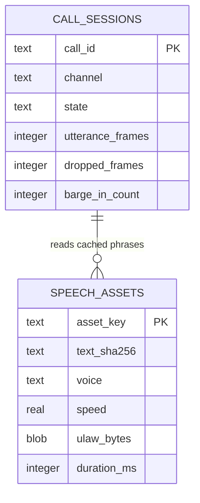

> **Lens:** BA (Part A) / TPO + Architect (Part B) · **Inputs:** `01-brd.md`, `02-use-cases-workflows.md`, `03-data-state-analysis.md`, `05-modularization.md`, `06-architecture.md`, `07-brownfield-reconciliation.md` · **Engagement:** Brownfield · **Defines:** TRD-22 … TRD-25

# Speech Services — MOD-05

## Part A — Module BRD [Lens: BA]

### A.1 Module Objectives

MOD-05 gives the product its voice. It owns the two GPU-resident models that turn caller audio into text and agent text into audio, plus the framing, voice-activity detection, turn-taking and interruption behaviour that make a phone call feel like a conversation rather than a recording.

Three business outcomes depend on it:

1. **The buyer hears an answer at all.** Voice is the channel a procurement officer uses when away from a desk; if speech is unintelligible or the agent talks over them, the channel is worse than no channel (`UC-03`, `UC-04`).
2. **The latency budget is spent here.** The measured **600 ms** end-of-speech floor is the dominant term in the ≤ 1.2 s p95 first-audio guardrail (`00-product-intent.md` §4). Every millisecond MOD-05 adds is a millisecond MOD-04 and MOD-03 cannot use.
3. **The product's hard scale ceiling is owned here.** STT, TTS and the LLM co-reside on one **16,311 MiB** GPU that is also serving a **live, separate product** (`AS-09`, `CV-01`). Voice must degrade before text (`06-architecture.md` §5), and that policy has to live where the audio is admitted.

### A.2 Scoped Requirements

- `BRD-01` — Single answer engine across channels: the transcript MOD-05 produces and the speech it renders must carry the same answer the other channels get, with no voice-specific answer path.
- `BRD-04` — Grounded answers only, honoured by refusing to synthesise anything but the composed answer.
- `BRD-19` — Cross-platform runtime: CUDA on Windows/Linux, Apple Silicon on macOS; speech models follow the same platform detection as the LLM.
- `BRD-13` — Human handoff must be speakable: a caller asking for a person must hear a clear next step, not a dead line (`UC-03` A2, E2).

Business rules enacted: **R-2** (retrieval declined → the caller is told honestly and offered a human, not read a guess), `R-5` (negative-sentiment escalation is spoken in the same turn), and `UC-03`'s admission rule at capacity (`E1`).

### A.3 Module Business Rules

| Rule | Condition → Action |
|---|---|
| M5-1 | End-of-speech is decided after **600 ms** of silence below the VAD floor, and never before a minimum utterance of 15 frames (300 ms). |
| M5-2 | Caller speech during agent playback interrupts the agent: playback stops and the turn yields within **150 ms**. |
| M5-3 | The agent's own audio returning through the line is echo, not speech, and must be discarded — never transcribed, never treated as a barge-in. |
| M5-4 | At GPU capacity, a new voice call is refused with the busy message and a callback offer. Text channels are never refused for a GPU reason. |
| M5-5 | Speech that is not recognised after the configured attempts takes the fixed ladder — re-prompt, line-quality prompt, alternative-channel prompt, human transfer — and never loops. |
| M5-6 | An outbound or inbound call is capped so a silent line cannot hold GPU resources indefinitely. |

### A.4 Actors

| Actor | Why they touch MOD-05 |
|---|---|
| **Buyer (caller)** | Speaks to it and is spoken to by it; barge-in and the noise ladder are the two behaviours they notice most. |
| **Outbound contact** | Receives agent speech on a placed call (`UC-09`); the same audio contract applies. |
| **Ops admin** | Reads speech health — model residency, RTF, queue depth, VRAM estimate — and restarts the channel (`UC-12`). |
| **MOD-01 Channel Gateway** | Supplies and consumes raw audio frames for both Twilio Media Streams and the browser-mic WebSocket. |
| **MOD-02 Orchestrator** | Consumes transcripts and supplies answer text for synthesis. |
| **MOD-09 Config & Boot** | Owns platform detection, model residency policy and the admission/VRAM machinery this module enforces. |

### A.5 Module Acceptance Criteria

- **AC-1** — A caller who stops speaking is answered within the measured floor plus pipeline: first audio p95 ≤ **1.2 s** end-to-end across a 20-call sample; 0 calls answer while the caller is still speaking.
- **AC-2** — A caller who speaks over the agent stops the agent's playback within 150 ms and is heard on the next turn; 0 cases where the caller's interruption is transcribed as agent audio.
- **AC-3** — Agent playback picked up by the caller's microphone (open speakerphone) is rejected as echo in ≥ 95 % of frames and never appended to the transcript. (`UC-03`, M5-3)
- **AC-4** — With 2 calls active, a third caller hears the busy message and is offered a callback; the two active calls show 0 dropped frames and no latency regression beyond 10 %. (`UC-03` E1)
- **AC-5** — A silent or unintelligible caller is escalated through the fixed ladder in order and ends at a human-transfer offer; 0 infinite re-prompts. (M5-5, `UC-03` E2)
- **AC-6** — The browser-mic path (`UC-04`) and the Twilio path (`UC-03`) produce transcripts through the same STT call, with the same transcript shape, on 16 kHz PCM and 8 kHz µ-law respectively; 0 channel-specific transcript fields. (`BRD-01`)
- **AC-7** — An abnormally dropped media stream tears the call down cleanly within 1 s, keeps the partial transcript, and leaves no "still active" call in the console. (`UC-03` E3)

## Part B — Module TRD [Lens: TPO + Architect]

### TRD-22 — STT: faster-whisper, the frame contract, VAD and the 600 ms end-of-speech floor

**Serves:** `BRD-01`, `BRD-19`, M5-1. **Implements:** `REC-01` (refactor), `REC-19` (reuse `hardware_profile`/`memory_budget`), `UC-03`, `UC-04`, `DAT-13`.

**Frame contract.** One contract, two carriers, normalised at the MOD-01 boundary:

| Carrier | Wire format | Frame | Sample rate | Decode |
|---|---|---|---|---|
| Twilio Media Streams | 8-bit µ-law | 20 ms (`FRAME_MS = 20`) | 8 kHz | `ulaw_to_pcm` → 16 kHz linear PCM |
| Browser mic WebSocket | 16-bit linear PCM, mono | 20 ms, 320 frames (`audio_format.py`) | 16 kHz | direct |

Both converge on `SAMPLE_RATE = 16000`, `CHANNELS = 1`, `SAMPLE_WIDTH = 2`, `CHUNK_MS = 20`. A frame that is not a multiple of 20 ms or arrives out of order is dropped with a counter increment, never partially decoded.

**VAD / end-of-speech.** Silence threshold is a frame RMS floor compared against a decaying reference of recent playback (`frame_rms`, `_reference_rms` in `REC-01`). End-of-speech fires after `VAD_SILENCE_MS = 600` (the measured platform floor) of consecutive sub-floor frames, and never before `MIN_UTTERANCE_FRAMES = 15` (300 ms) of voiced audio — a cough or a door slam does not end a turn.

**Speculative STT.** While silence is still accumulating, transcription starts at `VAD_SPECULATIVE_ADVANCE_MS = 220` ms before the floor would fire. If the caller resumes, the speculative result is discarded and the utterance continues; if end-of-speech lands, the transcript is already in flight. This is the source's optimisation and it is what keeps the 600 ms floor off the critical path.

**Confidence gates.** A transcript is rejected as unusable when `avg_logprob < STT_MIN_AVG_LOGPROB = -4.0`, `no_speech_prob` exceeds its maximum, or the text is shorter than `STT_MIN_CHARS` or is a pure noise token (`is`, `uh`, `um`, `oh`, `ah`, `hmm`, …). Rejections advance the **noise ladder** rather than being passed to the answer engine: `NOISE_REPLY` → `LINE_QUALITY_REPLY` → `ALT_CHANNEL_REPLY` → `HUMAN_TRANSFER_REPLY` (M5-5). No rejected transcript ever reaches MOD-02.

**Model.** faster-whisper, `WHISPER_MODEL = small.en` default, CUDA when available; `medium.en` is a config change requiring a re-measured VRAM budget (`TRD-25`). Model is loaded once and kept resident.

### TRD-23 — TTS: Kokoro ONNX, clause-level streaming synthesis and the speech cache

**Serves:** `BRD-19`, `BRD-01`. **Implements:** `REC-01` (refactor), `UC-03`, `UC-04`.

Kokoro ONNX synthesises `af_heart` at speed **1.0** by default (`KOKORO_VOICE`, `KOKORO_SPEED`), producing chunks re-encoded to µ-law for Twilio and to PCM for the browser. Two properties matter more than the engine choice:

- **Clause-level streaming.** MOD-04 emits clauses; TTS synthesises and plays each clause as it arrives, so first audio does not wait for the whole answer. The first clause must be audible within **300 ms** p95 of MOD-04's first clause (Kokoro RTF ≈ **0.06** on the shared GPU).
- **Truncation awareness.** When barge-in or cancellation stops playback mid-answer, the fixed truncation marker (`"[the caller began speaking before I finished — they may not have heard the end]"`) is appended to the turn so MOD-02's context and MOD-07's sentiment see what the caller actually heard, not what was generated.

**Speech cache.** Fixed phrases — greeting, busy message, callback offer, noise ladder, human-transfer, good-byes — are pre-synthesised and cached keyed on `sha256(voice|speed|text)`, so the most latency-critical utterances (the greeting and the busy message) cost a byte fetch, not a synthesis. Greetings for both carriers are loaded as µ-law assets at boot; a cache miss synthesises on demand and populates. Cache scope is **per instance** (`TTS_CACHE_SCOPE = instance`, replacing the source's `shared` value) — BRD-18 forbids sharing this artefact with the university product even though it contains no buyer data.

### TRD-24 — Turn-taking: barge-in, echo gate and frame arbitration

**Serves:** `UC-03` A1, `UC-03` E3, M5-2, M5-3. **Implements:** `REC-01` (refactor — this is the single most valuable asset in the source repo), `UC-03`, `UC-04`.

The session is a three-state machine — `LISTENING → PROCESSING → SPEAKING → LISTENING` — and every inbound frame is classified before it can affect state:

```
FrameVerdict ∈ { LISTENING, INTERRUPTION, ECHO, MUTED }
```

- `LISTENING` — ordinary caller audio while the agent is silent.
- `INTERRUPTION` — caller audio during `SPEAKING` that clears the barge-in gate: RMS above `BARGE_IN_ABS_FLOOR`, above the decaying playback reference by `BARGE_IN_MARGIN`, sustained for at least `BARGE_IN_MIN_FRAMES`. Playback stops, the TTS stream is cancelled, the truncation marker is recorded, and the turn yields (M5-2).
- `ECHO` — caller-line audio that falls within `BARGE_IN_ECHO_GAIN = 0.5` of the reference playback RMS. Discarded entirely: not transcribed, not a barge-in (M5-3).
- `MUTED` — the documented discard when `BARGE_IN_ENABLED` is off; the frame is counted but does not interrupt.

Cancellation is explicit: `request_interruption()` / `cancel_requested()` / `note_answer_truncated()` from the source session are retained. When the barge-in flag is flipped, MOD-04's prompt prefix changes with it (`INTERRUPTION_CONTRACT_BY_FLAG`, `REC-09` coupling trap 7) — MOD-05 signals the flag and MOD-04 reads it, so the pair cannot disagree.

**Call caps and teardown.** A hard call-duration cap and a no-input cap (default `Assumed:` 15 min and 45 s of continuous silence) close the call through the human-transfer or good-bye path rather than holding GPU state (M5-6). An abnormal media-stream drop tears down within 1 s, keeps the partial transcript, and marks the call `FAILED` with a reason — no ghost `ACTIVE` call survives (`UC-03` E3, `SM-02`).

### TRD-25 — VRAM budget, admission control, and the voice-degrades-first policy

**Serves:** `BRD-19`, `AS-09`, `DG-01`, `CV-01`. **Implements:** `REC-19` (reuse `admission.py`, `memory_budget.py`, `hardware_profile.py`, `platform.py`, `boot_readiness.py`), `06-architecture.md` §5 MOD-05 row.

**The budget.** One 16,311 MiB card, two live products. ANITA's envelope is capped so the university assistant always has headroom:

| Consumer | Budget (MiB) | Note |
|---|---|---|
| ANITA LLM (MOD-04) | 6,144 | 14B-class model, `OLLAMA_NUM_CTX 8192`; `Assumed:` |
| faster-whisper STT | 1,200 | `small.en`, CTranslate2 CUDA; `Assumed:` |
| Kokoro ONNX TTS | 512 | CUDA execution provider; `Assumed:` |
| VAD / audio buffers | 64 | per active call; `Assumed:` |
| Kernel + CUDA context overhead | 192 | `Assumed:` |
| **ANITA total** | **≤ 8,192** | **≤ 8,119 MiB left for the university product** |

The model-residency check runs at boot (`REC-19` `memory_budget`/`boot_readiness`): if the sum of measured model footprints exceeds the envelope, boot refuses rather than starting a stack that will starve its neighbour.

**Admission control.** Concurrent calls are capped at **2** — the working ceiling inherited from the source platform and recorded as `DG-01`'s launch value. A third inbound call is answered with the cached busy message and a callback offer (`UC-03` E1) and is recorded as a refused admission for the ops console. Admission is evaluated against **live** VRAM headroom, not just a call counter, so a larger model or a university-product spike can lower the effective cap.

**Degradation order (deliberate).** Voice degrades **before** text, because text answers have no GPU dependency and voice does:

1. Third concurrent call → busy + callback (`UC-03` E1).
2. VRAM pressure with a call in flight → TTS is capped to CPU only as a **last** resort; at RTF ≈ **0.63** a 10 s answer takes ≈ 6.3 s to synthesise and would breach the SLO, so the policy is to end the call gracefully with a callback offer rather than serve it badly.
3. STT unavailable → the caller hears the alternative-channel prompt (`ALT_CHANNEL_REPLY`) and is offered text/WhatsApp; the call ends cleanly rather than hanging.
4. Text channels: unaffected by all of the above.

**Outbound.** `UC-09`'s dialler consumes the same admission gate through MOD-01, so a campaign cannot open calls the box cannot afford; the worker checks capacity before dialling and re-queues rather than dialling into a busy signal (`SM-04`).

### B.1 Technical Constraints

| Constraint | Source |
|---|---|
| Python 3.11+; faster-whisper (CTranslate2) + Kokoro ONNX; no cloud speech API | `06-architecture.md` §4 — buyer audio never leaves the box |
| Audio in/out is 20 ms frames; µ-law 8 kHz for Twilio, PCM16 16 kHz for the browser | `REC-01`, `app/audio_format.py` |
| Speech models and the LLM share one GPU with a live second product | `AS-09`, `CV-01` |
| The turn loop has no Twilio imports and must keep none — transport stays in MOD-01 | `REC-01` |
| `app/pipeline.py` (Pipecat) is **not** carried: the framework is installed but bypassed in the source | `REC-20` |
| Model sizes, `VAD_SILENCE_MS`, `MIN_UTTERANCE_FRAMES`, `BARGE_IN_*` and TTS cache keys are config values that must be read by the code acting on them | `BRD-20`, `DG-09` |
| Speech failures are turn failures, never conversation failures: the transcript survives and the call is resumable | `SM-02`, `UC-03` recovery row |

### B.2 Non-Functional Requirements

| NFR | Target |
|---|---|
| Performance — first audio | p95 ≤ **1.2 s** from caller end-of-speech to first agent audio, including the 600 ms floor (`00-product-intent.md` §4 guardrail) |
| Performance — end-of-speech | **600 ms** silence floor; minimum utterance **300 ms** (15 frames); speculative STT advance **220 ms**; 0 turns ended on a sub-300 ms utterance |
| Performance — STT | transcript available ≤ **400 ms** p95 after end-of-speech for a ≤ 10 s utterance; RTF ≤ **0.35** on GPU (`Assumed:`) |
| Performance — TTS | first clause audible ≤ **300 ms** p95 after the first clause is available; Kokoro RTF ≈ **0.06** GPU / **0.63** CPU |
| Performance — barge-in | playback stopped ≤ **150 ms** from caller speech onset; truncation marker written on 100 % of interrupted answers |
| Frame budget | 20 ms frames; jitter buffer ≤ **300 ms**; over-buffer policy = drop oldest, count the drop |
| Scale unit & limits | **2 concurrent calls** (`DG-01` launch value); 100 frames/s per call (50 inbound + 50 outbound) sustained with 0 dropped frames; third call refused with busy + callback |
| VRAM budget | MOD-05 ≤ **2,048 MiB**; ANITA total ≤ **8,192 MiB** of 16,311 MiB; ≥ **8,119 MiB** reserved for the university product; boot refuses if the measured envelope is exceeded |
| Degradation | Voice degrades before text: 3rd call → busy + callback; TTS-on-CPU not served (RTF 0.63 breaches SLO) → graceful end + callback; STT down → alternative-channel prompt; text channels unaffected (`06-architecture.md` §5 MOD-05 row) |
| Recovery | Media-stream drop → clean teardown ≤ **1 s**, partial transcript retained, call marked `FAILED`; failed TTS segment retried **once** (`UC-03` retry row); worker restart re-dials only per `SM-04` |
| Call caps | Max call duration `Assumed: 15 min`; max continuous silence `Assumed: 45 s`; then human-transfer or good-bye, never an open line |
| Echo rejection | ≥ **95 %** of playback-coupled frames classified `ECHO` on an open-speakerphone call; 0 echo frames transcribed |
| Availability | Speech available whenever the GPU envelope permits; a refused admission is counted and surfaced to `UC-12`, never silently dropped |
| Observability | Per turn: VAD decision, utterance ms, STT ms + `avg_logprob`, `no_speech_prob`, TTS first-clause ms, RTF, frames in/out, drops, barge-in count, VRAM estimate → MOD-08 |

### B.3 APIs / Interfaces

| Name | Direction | Style | Contract | AuthN/Z |
|---|---|---|---|---|
| `SpeechSession.feed_audio(ulaw_chunk: bytes) -> FrameVerdict` | exposed | Python in-process | 20 ms µ-law frame → `LISTENING \| INTERRUPTION \| ECHO \| MUTED`; never raises on noise | In-process (MOD-01) |
| `SpeechSession.transcribe(*, speculative: bool = False) -> Transcript` | exposed | Python | `Transcript(text, avg_logprob, no_speech_prob, duration_ms, rejected_reason?)`; rejected transcripts carry a reason, never reach MOD-02 | In-process |
| `SpeechSession.speak(text: str) -> Iterator[bytes]` | exposed | Python generator | µ-law frames per clause, 20 ms aligned; `cancel_requested()` stops emission | In-process |
| `SpeechSession.mark_speaking() / mark_listening() / note_answer_truncated()` | exposed | Python | Turn-state transitions; truncation marker recorded for the transcript | In-process |
| `speech_health() -> dict` | exposed | REST read via MOD-08 | `{stt: {model, ready}, tts: {voice, ready}, vram_mib, active_calls, queue_depth, rtf_p50}` | Admin auth (`CV-03`) |
| `admit_call() -> Admission \| Refused(reason, callback_offered=True)` | exposed | Python | Reads live VRAM headroom, not just the call counter | In-process (MOD-01) |
| Audio frames from MOD-01 | **consumed** | WS bytes | µ-law 8 kHz (Twilio) / PCM16 16 kHz (browser); 20 ms alignment required | Channel-authenticated at MOD-01 |
| Answer clauses from MOD-04 | **consumed** | Python iterator | Clause text arrives incrementally; `is_final` marks the last | In-process |
| Cached µ-law assets + TTS cache | **consumed / owned** | file + `anita.speech_assets` | Keyed `sha256(voice \| speed \| text)`; per-instance scope | Local filesystem / DB |
| `speech.turn.completed` / `speech.admission.refused` / `speech.model.unavailable` | published | event (MOD-08 trace) | `{call_id, stage_ms, rtf, verdict, vram_mib}` | Internal |

### B.4 Data Model

MOD-05 owns the TTS cache; VAD, playback reference and turn state are in-memory per call and are deliberately **not** persisted (they are meaningless after teardown and must never be reloaded).



```sql
-- TTS/asset cache. Per-instance (BRD-18): never point this at the university schema.
CREATE TABLE IF NOT EXISTS anita.speech_assets (
    asset_key    TEXT PRIMARY KEY,          -- sha256(voice | ':' | speed | ':' | text)
    text_sha256  TEXT NOT NULL,             -- sha256 of the source text, for collision diagnosis
    voice        TEXT NOT NULL,             -- KOKORO_VOICE, e.g. af_heart
    speed        REAL NOT NULL,             -- KOKORO_SPEED, e.g. 1.0
    ulaw_bytes   BYTEA NOT NULL,            -- 8 kHz µ-law, 20 ms aligned
    duration_ms  INTEGER NOT NULL,
    created_at   TIMESTAMPTZ NOT NULL DEFAULT now(),
    CONSTRAINT speech_assets_duration_chk CHECK (duration_ms > 0)
);

CREATE INDEX IF NOT EXISTS speech_assets_text_idx ON anita.speech_assets (text_sha256);
-- Isolation guard (MOD-09): this table lives in the anita schema only; a cross-schema read fails.
```

The VRAM budget of `TRD-25` is a configuration contract (`DAT-13`), not a table: `SPEECH_STT_VRAM_MIB`, `SPEECH_TTS_VRAM_MIB`, `SPEECH_TOTAL_VRAM_MIB`, `ANITA_GPU_BUDGET_MIB`, `MAX_CONCURRENT_CALLS`. Each is read by the admission check, so MOD-09's audit passes them (`BRD-20`).

### B.5 Tech Stack Choices

| Choice | Rationale | Runner-up rejected |
|---|---|---|
| **faster-whisper, self-hosted** | `REC-01` already runs it and it is GPU-viable inside the envelope; buyer audio never leaves the box (`06-architecture.md` §4) | A hosted STT API — PII egress and a network hop inside a 1.2 s budget |
| **Kokoro ONNX, self-hosted** | Same reasoning; RTF 0.06 on GPU makes clause-level streaming viable | A hosted TTS API — same egress problem, plus per-character cost on every greeting |
| **RMS-based VAD + decaying playback reference** | Adequate for narrowband telephony, ~30 lines, and already tuned in `REC-01`; no model to load into the VRAM envelope | A neural VAD (Silero) — another GPU-resident model competing with the LLM for a budget that is already the product's ceiling |
| **Echo gate on RMS, not AEC** | The source's gate rejects our own playback without a DSP library; callers on headsets are unaffected in the common case | Full acoustic echo cancellation — a signal-processing dependency and CPU cost for the open-speakerphone minority |
| **Pre-synthesised cached fixed phrases** | The greeting and busy message are the two most latency-critical utterances in the product; a byte fetch beats a synthesis | Synthesising every fixed phrase on demand — adds 200–400 ms to the moments that are already tightest |
| **`MAX_CONCURRENT_CALLS = 2`, VRAM-checked admission** | Inherited, measured ceiling (`DG-01`); checked against live headroom so a co-tenant product's spike cannot be ignored | A fixed 3+ ceiling — would breach the first-audio SLO and risk the university product's GPU (AS-09) |

### B.6 Edge Cases & Error Handling

| Edge case | Class | Decided behaviour | Traces |
|---|---|---|---|
| Silence, no speech at all | Invalid input | VAD never fires end-of-speech on sub-300 ms input; ladder advances to human transfer after the cap | M5-1, M5-5, `UC-03` invalid-input row |
| Gibberish / noise tokens | Invalid input | `is_noise_fragment` rejects; `NOISE_REPLY` then the ladder; never reaches MOD-02 | `UC-03` invalid-input row |
| Caller interrupts mid-answer | Alternate path | Playback stops ≤ 150 ms, `INTERRUPTION` verdict, truncation marker recorded | `UC-03` A1, M5-2 |
| Agent audio returns through the caller's mic | Concurrency/echo | `ECHO` verdict, discarded; never transcribed or treated as barge-in | M5-3, `UC-03` |
| `BARGE_IN_ENABLED` off | Config | Frames classified `MUTED` (documented discard) and counted; prompt prefix changes with the flag so MOD-04 stays consistent | `REC-09` trap 7 |
| Third concurrent call | Capacity | Busy message (cached) + callback offer; admission refusal counted and surfaced | `UC-03` E1, M5-4 |
| GPU unavailable / VRAM envelope exceeded | Dependency failure | Voice refused at admission; text channels unaffected; boot refuses if the envelope is exceeded at start | `TRD-25`, `06-architecture.md` §5 |
| STT model fails to load | Startup | Boot readiness blocks voice; caller hears the alternative-channel prompt and is offered text/WhatsApp | `UC-03` E2 |
| TTS segment synthesis fails | Transient | Retried once; on second failure the clause is skipped and the turn ends with the human-transfer offer — never silence | `UC-03` retry row |
| Media stream drops abnormally | Dependency failure | Teardown ≤ 1 s, partial transcript retained, call `FAILED` with reason | `UC-03` E3, `SM-02` |
| Caller hangs up mid-answer | Cancellation | Teardown; partial transcript kept; no partial lead created | `UC-03` cancellation row |
| Caller never speaks (open line) | Timeout | Continuous-silence cap (`Assumed: 45 s`) closes via good-bye or transfer | M5-6 |
| Call exceeds duration cap | Timeout | Good-bye path; the turn and lead survive | M5-6 |
| Duplicate start frames on the browser WS | Idempotency | Ignored after the session exists | `UC-04` duplicate-request row |
| Two browser tabs, same buyer | Concurrency | Independent sessions; identity is not shared unless MOD-02 links them | `UC-04` concurrent-operation row |
| Outbound call with no answer | Timeout | `SM-04` `NO_ANSWER`; attempt counted, retried per `DG-04` window and limit | `UC-09` E1, `SM-04` |

### B.7 Tech Debt Accepted

- **Single English voice, no multi-language.** `00-product-intent.md` §5 puts multi-language out of MVP scope; the session carries a `voice` field so a second voice is additive, not a refactor. (`PO`)
- **RMS echo gate instead of acoustic echo cancellation.** Open-speakerphone callers may still see occasional echo frames; the gate is tuned to ≥ 95 % rejection. AEC is deferred until call recordings show it is the binding quality problem. (`TPO`)
- **Speech assets cached on local disk + a table, not in a content-addressed store.** At ~30 fixed phrases this is smaller than the code that would manage it. Revisit if voice count grows. (`Architect`)
- **Speculative STT can waste GPU work.** When a caller resumes speaking, the speculative transcription is discarded; at 2 concurrent calls the waste is negligible but real. Revisit if the admission ceiling rises. (`TPO`)
- **`MAX_CONCURRENT_CALLS = 2` is inherited, not measured for ANITA.** `DG-01` is the accepted gap; the value is a config key and MOD-08 instrumentation is the instrument that will resolve it. (`TPO`)
- **No acoustic diarisation / speaker separation.** Single-speaker calls are the assumed case; a second voice on the line is treated as caller audio. Accepted for a B2B sales line. (`BA`)
- **`app/pipeline.py` (Pipecat) stays dropped** — the source installed it and bypassed it on the live path. Re-implementing a framework wrapper around a working hand-rolled loop is negative value. (`Architect`, `REC-20`)

## TPO Buildability Sign-off [Lens: TPO]

**TPO sign-off: this TRD is buildable against the BRD above.** Feasibility risks and their mitigations:

1. **The VRAM envelope is the product's hard ceiling and it is shared with a live product.** A university-side spike could evict an ANITA model mid-call. *Mitigation:* the boot readiness gate (`REC-19`) refuses to start outside the envelope, admission checks live headroom rather than a counter, and the degradation policy ends a voice call gracefully instead of silently degrading — but this risk is reduced, not removed, and it is why `DG-01` is a PO-signed accepted gap.
2. **The `Assumed:` VRAM splits (STT 1,200 / TTS 512 MiB) must be measured on the actual card before launch.** They are the input to the admission ceiling. *Mitigation:* `REC-19`'s `memory_budget` machinery exists precisely to measure this; the numbers are config keys, and Stage 11 measures them before enabling outbound calling.
3. **Speculative STT plus barge-in is subtle stateful code**, and the source's turn loop (1,890 LOC) is being refactored rather than copied verbatim. A regression here is a call-quality regression that unit tests may miss. *Mitigation:* the refactor is bounded by `REC-01` — transport, RAG and CRM minting are stripped, the frame arbitration is kept — and the UC-03 scenario table gives the integration suite its floor, including barge-in and echo rows.
4. **TTS-on-CPU is a dead end by design (RTF 0.63).** There is no "slow but working" voice fallback. *Mitigation:* this is stated as policy (M5-4, `TRD-25`), not left implicit: the buyer gets an explicit callback offer rather than a call that is technically connected and unusable.
5. **faster-whisper `small.en` will mis-hear Indian-English product names** (`FCR Capsula X`, `Microbar`, `APTH`-style model strings). *Mitigation:* the transcript post-processor retains the source's clarification ladder, catalogue-specific corrections are a config list, and any resulting spec answer still passes MOD-03's entity match and MOD-04's grounding check before a fact is stated.
