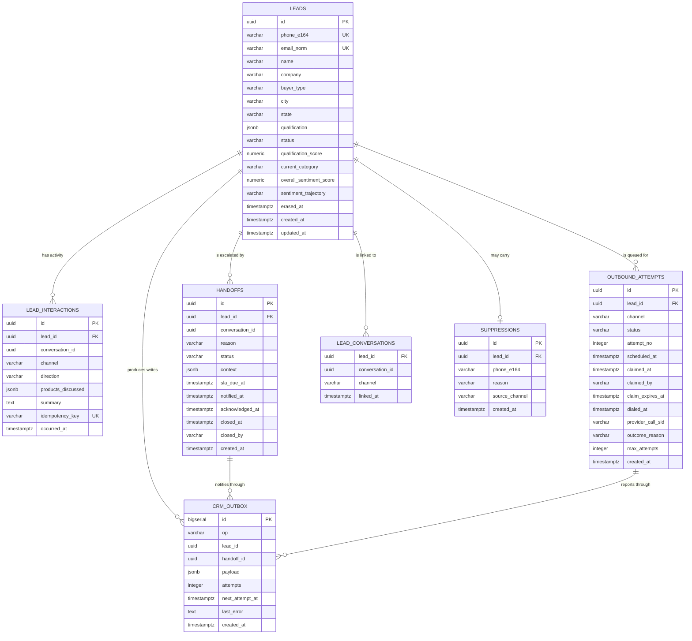

> **Lens:** BA (Part A) / TPO + Architect (Part B) · **Inputs:** `01-brd.md`, `02-use-cases-workflows.md`, `03-data-state-analysis.md`, `05-modularization.md`, `06-architecture.md`, `07-brownfield-reconciliation.md` · **Engagement:** Brownfield · **Defines:** TRD-26 … TRD-31

# Lead & Mock CRM — MOD-06

## Part A — Module BRD [Lens: BA]

### A.1 Module Objectives

MOD-06 exists to make sure **no interested buyer is lost**. It turns a conversation into a durable, deduplicated, qualified lead; it carries that lead through human handoff and outbound follow-up; and it does all of it through a CRM seam that is *ours* — a local mock store behind an interface — so the entire Salesforce dependency the source product carried is gone, and a real CRM can be dropped in later without a single caller changing.

In business terms the module owns four outcomes:

1. **Capture** — anything a buyer tells us (name, phone, email, requirement, quantity) becomes a structured lead record, never a paragraph of free text a rep has to read.
2. **Dedupe** — the same buyer arriving on web chat, then WhatsApp, then a phone call is **one** lead, not three.
3. **Handoff** — when a buyer asks for a person, or the sentiment module escalates, a handoff record exists that a sales rep can act on, and the rep is told about it.
4. **Follow-up** — an eligible lead is called back a bounded number of times, inside lawful hours, and every outcome is recorded so the rep knows what happened.

### A.2 Scoped Requirements

This module satisfies, and does not restate:

- `BRD-11` — Lead capture on every channel
- `BRD-12` — Lead qualification
- `BRD-13` — Human handoff
- `BRD-14` — Mock CRM seam (**no Salesforce code — `REC-06` is `forbidden`**)
- `BRD-23` — Outbound follow-up

Business rules enacted here: `R-6` (attempt limit → exhausted). Cross-module rules consumed: `R-5` (negative sentiment → escalate) arrives from MOD-07 as a handoff request.

Use cases: `UC-07`, `UC-08`, `UC-09`. Workflows: `WF-01` step 7, `WF-02`, `WF-04` steps 3–4.

### A.3 Module Business Rules

| Rule | Condition → Action | Traces to |
|---|---|---|
| M6-1 | A buyer supplies details on any channel → an `upsert` is attempted on **normalised phone**, then on **normalised email**; if neither key matches, a new lead is created | `BRD-11`, `BRD-12`, `SM-01` #5 |
| M6-2 | Two channels submit details for the same buyer concurrently → the unique key decides; the loser **merges into the winner**, never a duplicate row | `SM-01` #6 |
| M6-3 | A buyer asks not to be contacted → the lead goes `SUPPRESSED` and a suppression entry is written; **suppression is sticky and terminal** — no outbound row may be created for it, ever | `SM-01` #4, `BRD-23` |
| M6-4 | A buyer asks to be forgotten → PII is erased and the lead anonymised, with a cascade over conversations and sentiment rows; the fact of the request and the erasure timestamp are retained | `DG-11` |
| M6-5 | An outbound attempt may only be created when the lead has a reachable number, is not suppressed, and has fewer than the configured maximum attempts | `BRD-23`, `R-6`, `DG-04` |
| M6-6 | A call may only be placed inside the approved calling window (default 10:00–19:00 IST); outside it, the row is scheduled to the next window, not dropped | `DG-04` |
| M6-7 | A handoff is opened at most **once per lead** while one is already `OPEN` or `NOTIFIED`; a repeat trigger attaches to the existing record | `SM-06` #6 |
| M6-8 | Handoff notification failure never blocks the handoff: the record is written first, the notification is queued and retried | `SM-06` #7, `DG-12` |
| M6-9 | Lead prioritisation uses sentiment, buying intent and recency **only** — no territory or vehicle data exists and none may be invented | `DG-05` |

### A.4 Actors

| Actor | Interaction | Why |
|---|---|---|
| **Buyer** | Supplies details, requests a person, withdraws a request, asks to be forgotten (`UC-08`, `UC-07`) | The source of every lead and every handoff |
| **Outbound contact** | Receives a call or message; may ask to be suppressed (`UC-09` A2) | The target of `BRD-23`; owns the opt-out |
| **Sales rep** | Receives the notification, opens the handoff, acknowledges, closes (`UC-07`, `WF-04`) | The human the lead is handed to; the module exists to serve him |
| **Background worker** | Claims queue rows and places outbound attempts (`UC-09`, `WF-02`) | Makes follow-up durable across restarts |
| **MOD-02 Orchestrator** | System actor — calls capture with a completed turn | Supplies the conversation context a lead is built from |
| **MOD-07 Sentiment** | System actor — requests a handoff on threshold crossing | Consumes `BRD-16`'s escalation into this module's handoff record |
| **Ops admin** | Reads queue depth and handoff age; clears stuck rows (`UC-12`) | Operates the worker |

### A.5 Module Acceptance Criteria

Business-verifiable outcomes, each testable without reading code:

- **AC-M6-1** — A buyer who gives the same phone number on web chat and then on WhatsApp has **exactly one** lead row, with both conversations linked to it, within 5 s of the second turn.
- **AC-M6-2** — A conversation that yields a name and a phone produces a lead whose `status` is `QUALIFYING` or beyond, with `product_interest`, `buyer_type` and `urgency` populated as structured values (not prose).
- **AC-M6-3** — With the mock CRM store stopped, a buyer still completes a conversation, is still told a human will follow up, and the lead is written within 60 s of the store returning — **zero leads lost**.
- **AC-M6-4** — A lead that reaches 3 failed outbound attempts is never dialled a 4th time, and is visible to the rep as exhausted.
- **AC-M6-5** — An outbound row created at 21:30 IST is **not** dialled that night; it is dialled after 10:00 IST the next day.
- **AC-M6-6** — Two workers running simultaneously never place two calls for the same lead in the same attempt window.
- **AC-M6-7** — A buyer who says "don't call me again" is never included in a later outbound batch.
- **AC-M6-8** — A handoff opened at 11:00 reaches a rep notification (default SMTP email, `DG-12`) within 60 s; if SMTP is down the handoff is still `OPEN` and a retry is pending.
- **AC-M6-9** — A buyer's "forget me" request anonymises the lead and its conversation transcripts and sentiment rows within 60 s, and the lead can no longer be dialled.

## Part B — Module TRD [Lens: TPO + Architect]

### TRD-26 — Lead capture, normalisation and dedupe identity

Implements `BRD-11`, `BRD-12`, `SM-01` (settles #2, #5, #6, #10), consuming `DAT-08`. One normaliser (`app/anita/leads/normalise.py`) converts any channel-supplied identifier to canonical form: phone → E.164 (`+91…`), email → lowercase + trimmed. Dedupe is **database-enforced**, not application-enforced: two partial unique indexes on `leads(phone_e164)` and `leads(email_norm)`, both `WHERE erased_at IS NULL`. The write path is a single `INSERT … ON CONFLICT` upsert per key; on a phone collision against a different email the rows merge under the survivor (activity row, not a delete). Qualification is extracted into the `qualification` JSONB against a versioned schema (`qualification.schema.json`), with `urgency`, `buyer_type`, `city`, `state` promoted to columns because prioritisation reads them. `SM-01` transitions are enforced by a `CHECK` constraint plus a transition function; `SUPPRESSED` and `CLOSED` are terminal (`SM-01` #4).

### TRD-27 — Mock CRM store behind a swappable CRM interface, with a durable write outbox

Implements `BRD-14`, `DG-02`, `REC-06` (`forbidden`) and `REC-07` (`pattern-only`). `CrmClient` is a `typing.Protocol` — the only names callers may use — implemented by `MockCrmStore` against the `anita` schema. **No file from `app/crm/` other than `session.py` (which `REC-02` relocates to MOD-02) may be copied, imported or ported; the forbidden package's domain vocabulary — Salesforce ids, picklists, `CRM_BASE_URL`, `X-API-Key`, SOQL scrubbing — appears nowhere in the interface.** Failed writes are queued in `crm_outbox` with `attempts`, `next_attempt_at` and a partial index on due rows (the `REC-07` pattern, re-implemented). Replay backoff is 30 s, 2 m, 10 m, 30 m, 1 h, 2 h, capped at 8 attempts; after that the row is dead-lettered and surfaced to the console. The outbox **never raises into a conversation path** — a failed enqueue returns `False` and is logged.

### TRD-28 — PII erasure and anonymisation cascade

Implements `DG-11`, `BRD-11`, the `UC-08` cancellation scenario. `erase_subject(lead_id)` is a single transaction that: overwrites `leads.name/phone_e164/email_norm/company/notes` with `NULL` or a tombstone (`phone_e164 = NULL` releases the unique key), sets `erased_at`, writes an `erasure_log` row (`requested_at`, `completed_at`, `channel`, `scope`) that contains **no PII**, deletes conversation transcript bodies for the lead's conversations, and deletes or blanks `sentiment_scores.transcript_snippet` and `extraction_raw` for the lead. Erasure is idempotent (`erased_at IS NOT NULL` → no-op, `200`). A daily reconciliation job re-runs erasure for any request whose cascade did not complete (crash mid-cascade).

### TRD-29 — Outbound queue claim protocol with row locking

Implements `BRD-23`, `SM-04` (#4, #6, #7), the `REC-12` worker pattern. Eligibility and claiming are one SQL statement using `FOR UPDATE SKIP LOCKED` — the hardening `REC-12` requires over the source's `call_queue` claim, which the source plan flagged as a double-dial race. A claim sets `status='CLAIMED'`, `claimed_by`, `claim_expires_at = now() + 90 s`; a worker that dies in `DIALING` leaves a stale row that the reconciler returns to `QUEUED` **with the attempt already counted** (`SM-04` #7). `DIALING` is not re-enterable for the same row — a retry is a new row (`SM-04` #5). Callback outcomes arrive through MOD-01 as Twilio status callbacks and are matched on `provider_call_sid`; a `COMPLETED`/`NO_ANSWER`/`FAILED` transition without a matching callback is reconciled by polling provider status at 60 s and 5 min after dial.

### TRD-30 — Attempt limits, calling window and suppression

Implements `R-6`, `BRD-23`, `DG-04`, `DG-05`. `OUTBOUND_MAX_ATTEMPTS` defaults to **3**; `OUTBOUND_WINDOW_START`/`END` default to **10:00–19:00** in `OUTBOUND_TIMEZONE=Asia/Kolkata`; retry spacing defaults to **+4 h** then **+24 h** (Assumed, ops-tunable). The window is evaluated in the configured timezone against the **lead's** local time, and a row whose window has passed is scheduled to the next window opening, not dropped. `MAX_CALL_ATTEMPTS` in the source is `3` and the same default is carried. Suppression is checked **twice** — when the row is created and again inside the claim statement — so an opt-out recorded mid-campaign cannot be dialled by a row already in the queue (`WF-02` partial-completion row). Prioritisation orders by `(overall_sentiment_score DESC, buying_intent DESC, last_activity_at DESC)`; **no territory term exists** (`DG-05`).

### TRD-31 — Handoff records and rep notification

Implements `BRD-13`, `SM-06` (#4, #6, #7, #8), `DG-12`. A handoff carries the buyer's contact snapshot, the products discussed, the sentiment trail reference and a machine-readable `reason` (`buyer_request` | `negative_sentiment` | `unanswerable` | `clinical` | `capacity`). `open_handoff()` is idempotent per lead while an `OPEN`/`NOTIFIED` record exists (`SM-06` #6). The write commits **before** any notification is attempted; notification is an outbox row (`TRD-27`), so `SM-06` #7 holds. Notification channel defaults to SMTP email (`DG-12`), reusing the source's `emailer.py` **transport only** (`REC-20`) — the university's offer-letter copy is not carried. `NOTIFIED` without acknowledgement ages into an ops alert at the SLA (default `Assumed: 4 h`, per `SM-06` #8) and remains `OPEN`/`NOTIFIED`, never auto-closed.

### B.1 Technical Constraints

- **Python 3.11 + FastAPI + raw `psycopg2`**, no ORM — the source's stack is the default (`REC-13`); a divergence into SQLAlchemy would orphan the idempotent-`CREATE TABLE IF NOT EXISTS`-on-boot pattern the whole platform uses.
- **PostgreSQL, schema `anita`** — never the university's `admissions` database (`BRD-18`).
- **Mock CRM only.** `app/crm/` (3,349 LOC, all files except `session.py`) is `forbidden` by the brief (`REC-06`). No Salesforce credential, URL, payload shape or picklist may appear in any ANITA file, including tests and fixtures.
- **Worker runs in-process** with the FastAPI lifespan (asyncio task), matching the source's `OutboundCallWorker` / `CrmOutboxWorker` pattern — one box, one process group (`06-architecture.md` §2).
- Depends on MOD-01 for call placement and MOD-09 for configuration; MOD-07 calls into handoff creation.

### B.2 Non-Functional Requirements

| NFR | Target |
|---|---|
| Performance | Lead dedupe-upsert p95 < **120 ms** at the DB; queue claim p95 < **50 ms**; Twilio status callback → lead state committed p95 < **1 s**; handoff write p95 < **120 ms**; erasure cascade p95 < **60 s** end-to-end |
| Performance (LLM-free) | Every path in this module is LLM-free by construction — an LLM outage must not stop capture, dedupe, handoff or dialling (`DG-03`) |
| Security | Buyer PII never logged: phone/email are masked to last-4 in logs; transcript text never written to an outbox payload; erasure ≤ **60 s** from request (Assumed); suppression honoured within **1** claim cycle (≤ 10 s) |
| Scalability | Queue claim is DB-bound, not app-bound: 2 workers at 10× the assumed 30 leads/day (300/day) with **zero** duplicate dials; outbound queue absorbs a **10× burst** (300 rows) without app-side back-pressure |
| Scale unit & limits | Unit = **outbound attempt row**. Max attempts/lead **3**; candidate rows claimed per poll **1**; poll interval **10 s**; queue-depth alert at **> 500** due rows (Assumed); worker claim lease **90 s** |
| Degradation | Per `06-architecture.md` §5: **the queue simply grows** — outbound is latency-tolerant. Mock store/Postgres down → details stay on the conversation, capture is replayed from the turn (never lost, `SM-01` #7); outbound claims stop and resume automatically on restart. Recovery: replay `crm_outbox` + reconcile stale `CLAIMED`/`DIALING` rows against provider status (`SM-04` #8) |
| Observability | Handoff age, queue depth by status, attempts-per-lead histogram, dedupe merge count, outbox depth and dead-letter count emitted to MOD-08 (`BRD-21`); `NOTIFIED`-beyond-SLA alert at **4 h** |
| Availability | Capture is **synchronous and must not be lost**: accepted writes RPO = **0** (single commit before reply); outbox delivery is at-least-once with idempotent replay; no lead may be dropped by a module restart |

### B.3 APIs / Interfaces

| Name | Direction | Style | Contract | AuthN/Z |
|---|---|---|---|---|
| `CrmClient.upsert_lead(...)` | exposed (in-process) | Python `Protocol` | returns `LeadRef`; idempotent on phone/email | internal — MOD-02 caller, no network |
| `CrmClient.get_lead(lead_id)` / `find_by_identifier(kind, value)` | exposed | Python `Protocol` | `LeadRecord \| None` | internal |
| `CrmClient.append_interaction(...)` | exposed | Python `Protocol` | activity row; idempotent on `(conversation_id, turn_id)` | internal |
| `CrmClient.erase_subject(lead_id, request_meta)` | exposed | Python `Protocol` | idempotent; returns `ErasureReport` | internal + admin trigger |
| `LeadService.upsert_from_turn(turn: TurnRef) -> LeadRef` | exposed | in-process | called by MOD-02 on turn completion | internal |
| `LeadService.qualify(lead_id, signals)` | exposed | in-process | runs extraction into `qualification` JSONB | internal |
| `HandoffService.open(lead_id, reason, context) -> Handoff` | exposed | in-process | idempotent per lead (`M6-7`) | internal — called by MOD-02 and MOD-07 |
| `HandoffService.ack(handoff_id, rep_id)` / `close(...)` / `withdraw(...)` | exposed | in-process | `SM-06` transitions; illegal transitions raise `IllegalTransition` | internal / admin |
| `OutboundService.enqueue(lead_id, channel, reason)` | exposed | in-process | refuses suppressed/exhausted leads (`M6-5`) | internal |
| `OutboundService.claim_next(worker_id)` | exposed | in-process | `FOR UPDATE SKIP LOCKED`; `None` when empty | internal — worker only |
| `POST /webhooks/twilio/status` (voice + messaging status) | consumed | REST | provider callback; signature-validated by MOD-01 (`DG-06`) before reaching this module | Twilio signature (MOD-01) |
| `GET /api/admin/leads/{lead_id}` | exposed (via MOD-08 console read API) | REST | lead + interactions + handoffs | admin bearer token (CV-03) |
| `crm.write` | published | event (outbox row) | payload `{op, lead_id, fields, idempotency_key}` v1 | — |
| `handoff.opened` | published | event (outbox row) | payload `{handoff_id, lead_id, reason, sla_due_at}` v1 | — |

### B.4 Data Model

Entities map to `DAT-08` (leads), `DAT-10` (handoffs), `DAT-11` (mock CRM store), `DAT-16` (outbound queue), with conversation linkage to `DAT-07` owned by MOD-02. Lives in schema `anita`; the university product's tables are never referenced.



Key DDL fragments (idempotent, on-boot, per `REC-13`):

```sql
CREATE SCHEMA IF NOT EXISTS anita;

CREATE TABLE IF NOT EXISTS anita.leads (
    id                    UUID PRIMARY KEY,
    phone_e164            VARCHAR(20),
    email_norm            VARCHAR(254),
    name                  VARCHAR(255) DEFAULT '',
    company               VARCHAR(255) DEFAULT '',
    buyer_type            VARCHAR(32)  DEFAULT 'unknown',
    city                  VARCHAR(128) DEFAULT '',
    state                 VARCHAR(128) DEFAULT '',
    qualification         JSONB        NOT NULL DEFAULT '{}',
    qualification_score   NUMERIC(4,3) DEFAULT 0.0,
    status                VARCHAR(32)  NOT NULL DEFAULT 'NEW'
        CHECK (status IN ('NEW','QUALIFYING','QUALIFIED','CONTACT_ATTEMPTED',
                          'CONTACTED','ESCALATED','EXHAUSTED','SUPPRESSED','CLOSED')),
    current_category      VARCHAR(32)  DEFAULT '',
    overall_sentiment_score NUMERIC(4,3) DEFAULT 0.0,
    sentiment_trajectory  VARCHAR(32)  DEFAULT '',
    erased_at             TIMESTAMPTZ,
    created_at            TIMESTAMPTZ NOT NULL DEFAULT NOW(),
    updated_at            TIMESTAMPTZ NOT NULL DEFAULT NOW()
);
-- Dedupe is DB-enforced (TRD-26). NULLs are distinct in Postgres, so a lead
-- with only an email may coexist with a phone-only lead until they merge.
CREATE UNIQUE INDEX IF NOT EXISTS ux_leads_phone
    ON anita.leads(phone_e164) WHERE phone_e164 IS NOT NULL AND erased_at IS NULL;
CREATE UNIQUE INDEX IF NOT EXISTS ux_leads_email
    ON anita.leads(email_norm) WHERE email_norm IS NOT NULL AND erased_at IS NULL;

CREATE TABLE IF NOT EXISTS anita.outbound_attempts (
    id                UUID PRIMARY KEY,
    lead_id           UUID NOT NULL REFERENCES anita.leads(id) ON DELETE CASCADE,
    channel           VARCHAR(16) NOT NULL DEFAULT 'voice',
    status            VARCHAR(16) NOT NULL DEFAULT 'QUEUED'
        CHECK (status IN ('QUEUED','CLAIMED','DIALING','COMPLETED','NO_ANSWER','FAILED','EXHAUSTED')),
    attempt_no        INTEGER NOT NULL,
    max_attempts      INTEGER NOT NULL DEFAULT 3,
    scheduled_at      TIMESTAMPTZ NOT NULL DEFAULT NOW(),
    claimed_at        TIMESTAMPTZ,
    claimed_by        VARCHAR(64),
    claim_expires_at  TIMESTAMPTZ,
    dialed_at         TIMESTAMPTZ,
    provider_call_sid VARCHAR(64),
    outcome_reason    VARCHAR(128) DEFAULT '',
    created_at        TIMESTAMPTZ NOT NULL DEFAULT NOW(),
    UNIQUE (lead_id, attempt_no)
);
CREATE INDEX IF NOT EXISTS ix_outbound_due
    ON anita.outbound_attempts(scheduled_at) WHERE status = 'QUEUED';
CREATE INDEX IF NOT EXISTS ix_outbound_stale
    ON anita.outbound_attempts(claim_expires_at) WHERE status IN ('CLAIMED','DIALING');
```

### B.5 Tech Stack Choices

| Choice | Rationale | Runner-up rejected |
|---|---|---|
| **Raw `psycopg2` + on-boot idempotent DDL** (`REC-13`) | The source's graceful-degradation property — every helper returns `None`/`[]` when Postgres is down — is exactly what `AC-M6-3` needs, and it comes free with this pattern | SQLAlchemy/Alembic: a migration graph to operate for 6 tables, and it would silently break the "boot creates its own schema" contract the whole platform shares |
| **`typing.Protocol` for `CrmClient`** with a `MockCrmStore` implementation | Structural typing gives the swap-without-changing-callers property `BRD-14` demands, at zero runtime cost; a real CRM later is a second class, not a refactor | ABC + `isinstance` registration: heavier, and it invites callers to depend on the base class |
| **`FOR UPDATE SKIP LOCKED` claim** (`REC-12` hardening) | The only correct claim primitive at >1 worker; the source's `call_queue` used `UPDATE … RETURNING` with a lock hint whose behaviour under two workers the source plan flagged as unproven | Advisory locks or an app-level mutex: single-process only, fails the moment a second worker starts |
| **Outbox as an in-DB table, replayed by an asyncio task** (`REC-07` pattern) | The source proved it: Postgres is already the durable store, and the retry lives where the data does | External broker: another process to operate at 30 leads/day (`06-architecture.md` §2) |
| **SMTP email for rep notification** (`DG-12`) | `emailer.py` already exists in the source and SMTP is already configured; zero new dependency | SMS/push: new provider account and no stated requirement |
| **Idempotency key on interactions** = `(conversation_id, turn_id)` | `SM-01` #5 requires repeatable details-supplied without duplicate rows; a natural key beats a generated UUID | Timestamp-window dedupe: fails on a replay after a restart |

### B.6 Edge Cases & Error Handling

| Failure class | Handling | Cites |
|---|---|---|
| **Postgres unavailable at capture** | `upsert_from_turn` returns `None`, the turn is still answered, and the details stay on the conversation; a replay job re-runs capture from the stored turn on recovery. Nothing is lost | `SM-01` #7, `DAT-08`, `DG-03` |
| **Two channels submit the same buyer simultaneously** | Unique index decides; the loser's `INSERT` conflicts, the code catches `UniqueViolation` and merges into the winner, writing an activity row | `SM-01` #6, `UC-08` concurrent-operation row |
| **Buyer supplies a malformed phone/email** | One re-ask, then accept unvalidated with `qualification.needs_review = true`; never silently discarded | `UC-08` E1 |
| **Buyer asks to be forgotten mid-conversation** | `erase_subject` runs in one transaction; the conversation continues but is no longer linked to a PII-bearing lead | `DG-11`, `UC-08` cancellation row |
| **Store down during a handoff write** | `HandoffService.open` writes the record to the local store; if *that* fails the escalation is queued in `crm_outbox` and the buyer is still told a human will follow up | `SM-06` #7, `UC-07` E2 |
| **Worker dies mid-batch** | `claim_expires_at` lapses; the reconciler returns the row to `QUEUED` with the attempt counted | `SM-04` #7, `WF-02` partial-completion matrix |
| **Two workers claim simultaneously** | `SKIP LOCKED` gives each a different row; the `UNIQUE (lead_id, attempt_no)` constraint makes a double-dial a database error, not a race | `SM-04` #6, `UC-09` concurrent-operation row |
| **Carrier status callback lost** | Reconcile by polling provider status at 60 s and 5 min after dial; a `DIALING` row with no callback inside the ring limit → `NO_ANSWER` | `SM-04` #10, `WF-02` |
| **Suppression recorded mid-campaign** | Checked again inside the claim statement, so an already-queued row cannot dial a suppressed lead | `WF-02` matrix, `M6-3` |
| **Attempt limit reached** | Any → `EXHAUSTED`; terminal; the lead is surfaced to the rep as exhausted, never dialled again | `R-6`, `SM-04` #4 |
| **Handoff never acknowledged** | Ages into an ops alert at the 4 h SLA; stays `NOTIFIED`, never auto-closed | `SM-06` #8, `SM-06` #10 |
| **Outbox row dead-letters after 8 attempts** | Moved to a dead-letter state, surfaced on the console with its last error; ops replay is manual and audited | `TRD-27` |
| **Duplicate escalation from two channels** | `open_handoff` is idempotent per lead while one is open | `SM-06` #6, `UC-07` duplicate-request row |

### B.7 Tech Debt Accepted

- **Accepted: the mock CRM stores leads in the same PostgreSQL instance as the product's operational tables, in a separate schema — not a separate database.** Revisit when a real CRM is integrated (`BRD-14`): the interface already isolates the swap, and a second Postgres for 40 rows/day would be operational cost with no isolation benefit that `BRD-18` actually asks for (which is isolation *from the university product*, satisfied by the `anita` schema).
- **Accepted: erasure cascade is transactional within Postgres but the transcript bodies live in `conversations` owned by MOD-02.** The delete is issued through MOD-02's repository interface in-process, so there is no distributed transaction to worry about today; revisit if MOD-02 ever splits into a separate process, because a two-phase delete would then be required.
- **Accepted: no outbound WhatsApp/SMS campaign scheduling beyond a lead-level enqueue.** Only voice and single-message follow-ups are built for v1; revisit at >200 leads/day or when a campaign object is actually requested, because campaign-level pacing needs a scheduler this module does not have.
- **Accepted: suppression is stored as a row keyed on lead + phone, not a global hash list.** Revisit if the same phone recurs across erased leads, because erasure nulls `phone_e164` and a suppressed-but-erased lead would otherwise become re-contactable.

## TPO Buildability Sign-off [Lens: TPO]

**TPO sign-off: this TRD is buildable against the BRD above.** Feasibility risks:

1. **The `forbidden` boundary is the risk most likely to be violated by accident** — a developer reaching for `app/crm/identity.py`'s phone-normalisation because it already exists. Mitigation: `TRD-26` owns normalisation natively, a CI check greps the ANITA tree for `crm_`, `CRM_BASE_URL`, `X-API-Key` and salesforce-shaped payload keys, and the reconciliation table marks the whole package `forbidden` rather than "refactor".
2. **The double-dial race is the correctness risk.** `SKIP LOCKED` plus `UNIQUE (lead_id, attempt_no)` makes it a DB error rather than a silent duplicate, but the claim/reconcile path must be tested with two real workers, not mocked — the story carries an explicit concurrency test.
3. **`DG-11` erasure has an unresolved edge** (suppressed-then-erased, recorded in B.7) that could re-contact a buyer who opted out. Mitigation: the daily reconciliation job checks suppression rows for erased leads and re-applies suppression on the surviving tombstone phone hash; this must be built in US-019, not deferred.
4. **`DG-05` leaves no territory data**, so prioritisation is sentiment+intent+recency only. This is a deliberate scope acceptance, not a gap to be filled with a proxy — if the business later wants territory, it is a data-acquisition project, not a code change here.
