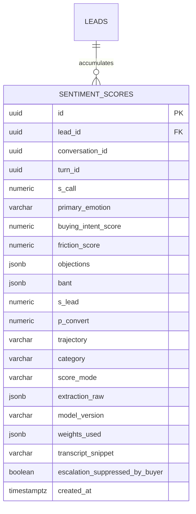

> **Lens:** BA (Part A) / TPO + Architect (Part B) · **Inputs:** `01-brd.md`, `02-use-cases-workflows.md`, `03-data-state-analysis.md`, `05-modularization.md`, `06-architecture.md`, `07-brownfield-reconciliation.md` · **Engagement:** Brownfield · **Defines:** TRD-32 … TRD-35

# Sentiment & Escalation — MOD-07

## Part A — Module BRD [Lens: BA]

### A.1 Module Objectives

MOD-07 is the module that decides **when a machine should stop talking and a human should start**. Every completed turn is read for how the buyer feels and how close they are to buying. Those readings accumulate into a per-lead composite that survives across channels and across days, and the composite decides one operational fact: whether this conversation is escalated to a sales rep *now*, inside the turn the buyer is in.

It is also the module with the clearest reuse story in the whole re-purpose. The source system already implements exactly this shape for university admissions — 1,239 LOC of LLM-extraction → strict JSON → weighted composite → EWMA → category (`REC-05`). The domain changes; the architecture does not (`AS-07`). What changes is the **taxonomy**: admissions emotions and objections ("course", "fees", "scholarship", "counsellor") become product-enquiry emotions and objections ("price", "delivery", "specification", "MOQ", "after-sales"). What tightens is the **availability requirement**: escalation must work even when the LLM does not.

Three business outcomes:

1. **Every conversation is scored** — no turn is silently unscored; a fallback row is still a row.
2. **Frustration is detected and acted on within the turn** (`BRD-16`, `R-5`) — the escalation is not a nightly batch.
3. **Objections become data** (`BRD-17`) — the rep sees "price, delivery time" on the lead, not a transcript to re-read.

### A.2 Scoped Requirements

- `BRD-15` — Sentiment scoring on every conversation
- `BRD-16` — Negative-sentiment escalation within the turn
- `BRD-17` — Objection capture

Business rules enacted here: `R-5`. Consumed from `01-brd.md`: `R-2` (an unanswerable question produces a decline, which is a separate escalation trigger owned by MOD-02, not this module).

Use cases: `UC-10`. Workflow: `WF-01` step 6, `WF-04` steps 1–3.

### A.3 Module Business Rules

| Rule | Condition → Action | Traces to |
|---|---|---|
| M7-1 | The LLM extraction is unavailable, times out, or returns unparseable JSON → the **rule-based fallback** scores the turn; the escalation path is never disabled by an LLM outage | `UC-10` E1, `DG-03` |
| M7-2 | A turn shorter than the minimum signal length (no content words after stopword removal) → **not scored**, and produces no escalation candidate. A bare "ok" must not trip the threshold | `UC-10` invalid-input row |
| M7-3 | Re-scoring a turn **creates a new row**; the composite is **recomputed from history**, never mutated in place | `SM-03` #5 |
| M7-4 | Two turns scored concurrently → the composite is computed under a row lock on the lead so the EWMA stays ordered | `SM-03` #6 |
| M7-5 | The composite crosses the negative threshold → escalate **within the same turn**, to at most **one** open handoff per lead | `BRD-16`, `R-5`, `SM-06` #6 |
| M7-6 | The buyer explicitly declines a human after a negative turn → the escalation is **recorded but not delivered**, and no handoff is opened | `UC-10` A1 |
| M7-7 | A conversation closed before scoring → the score is still written: it is the adoption signal (`DG-10`), not a conversation artefact | `SM-03` #9 |
| M7-8 | Objections are stored as a **closed vocabulary** (`price`, `delivery`, `specification`, `moq`, `aftersales`, `trust`, `timeline`, `competitor`), normalised from the extractor's free text; unknown labels are kept verbatim under `other` | `BRD-17` |

### A.4 Actors

| Actor | Interaction | Why |
|---|---|---|
| **Buyer** | Supplies the turn that is scored; may decline a human or resolve the issue (`UC-10` A1, cancellation row) | The subject of the score; the escalation exists for them |
| **Sales rep** | Receives the escalated handoff with the sentiment evidence and objection list (`UC-07`, `UC-13` A1) | Acts on the signal; the objection list is their briefing |
| **Background worker** | Retries `PENDING`/`FAILED` score rows and ages stale ones to `FALLBACK` (`SM-03` #8) | Makes scoring durable when the GPU is busy |
| **MOD-02 Orchestrator** | System actor — hands over each completed turn for scoring | Owns the turn boundary |
| **MOD-04 Inference** | System actor — serves the extraction LLM call, or is absent (`DG-03`) | The extraction dependency and its single point of failure |
| **MOD-06 Lead & Mock CRM** | System actor — receives the escalation as a handoff, holds the composite columns | Where the score lands and where escalation becomes a record |
| **Ops admin** | Reads score-mode distribution (`llm` vs `fallback`) and pending-row age (`UC-12`) | Detects a silent quality collapse the buyer would never report |

### A.5 Module Acceptance Criteria

- **AC-M7-1** — 100 % of completed turns ≥ the minimum signal length have a row in `sentiment_scores` with `score_mode` in (`llm`, `fallback`); zero turns are silently unscored.
- **AC-M7-2** — With MOD-04 stopped, a frustrated buyer turn still produces a `FALLBACK` score and still opens a handoff within the same turn.
- **AC-M7-3** — A buyer who says "this is the third time I'm asking, forget it" escalates within the turn, and the rep's handoff shows the sentiment trail and the objection labels.
- **AC-M7-4** — A buyer who says only "ok" produces no escalation.
- **AC-M7-5** — A lead whose score crosses negative on two successive turns has **one** open handoff, not two.
- **AC-M7-6** — The lead's `current_category` is recomputed on every scored turn and is one of Hot / Warm / Nurture / At-Risk / Disqualified.
- **AC-M7-7** — A price objection raised on web chat is visible as `price` on the lead when the same buyer later calls, without re-stating it.

## Part B — Module TRD [Lens: TPO + Architect]

### TRD-32 — Per-turn LLM sentiment extraction with a strict JSON contract

Implements `BRD-15`, `BRD-17`, `SM-03` (`PENDING` → `SCORED`), re-targeting `REC-05` (`app/sentiment/`, 1,239 LOC). The extraction prompt is the source's structure with the **taxonomy and prompt rewritten for product enquiry** — the admissions vocabulary (courses, fees, scholarships, counsellors) is deleted, not left as dead branches. The contract is strict JSON, validated before use:

```json
{"sentiment_score": 0.0, "primary_emotion": "interested", "buying_intent_score": 0.0,
 "friction_score": 0.0, "objections": ["price"], "bant": {"budget": null, "authority": null, "need": null, "timeline": null}}
```

Emotions are the closed set `excited | interested | neutral | skeptical | frustrated | angry | confused` (retained from the source — the emotion space is domain-neutral). `sentiment_score` is clamped to `[-1, 1]`; `buying_intent_score` and `friction_score` to `[0, 1]`; a JSON parse failure, a missing field, or an out-of-range value is a **scoring failure that falls through to `TRD-33`**, never a partly-applied score. Every extraction carries `model_version` (the backend model name) and `weights_used` so a score can be explained after the fact.

### TRD-33 — Rule-based fallback scorer when the LLM is unavailable

Implements `BRD-16`, `UC-10` E1, `DG-03`, `SM-03` (`PENDING` → `FALLBACK`, `PENDING` → `FAILED` → retry). A lexicon scorer — product-enquiry terms only: price/cost/"too expensive"/budget (negative, friction), "just asking"/"send details" (neutral), "urgent"/"need it by"/"can you ship" (intent), plus explicit frustration markers ("third time", "no one is responding", "forget it") — produces the same `ScoreResult` shape. It is deliberately **coarse**: it does not need to be as good as the LLM, it needs to be **always available** and to preserve the escalation path. The fallback also fires on a scoring **timeout** (budget: **4 s** p95) and on `PENDING` rows older than **1 h** (`SM-03` #8). `score_mode='fallback'` is stored on every such row so the console can show the LLM/fallback ratio; a fallback ratio above **20 %** over 24 h is an ops alert, because a silently-falling-back scorer would otherwise look healthy while quality degraded.

### TRD-34 — Weighted composite, EWMA baseline and category assignment

Implements `BRD-15`, `BRD-17`, `SM-03` (#5, #6). The composite formula is carried from the source unchanged (`REC-05`), because the arithmetic is domain-neutral:

```
S_lead   = W1·S_latest + W2·ΔS + W3·I_intent − W4·F_friction
ΔS       = S_latest − EWMA_baseline        (null on the first turn)
I_intent = 0.5·BANT_completeness + 0.5·buying_intent_score
EWMA     = λ·s + (1−λ)·EWMA_prev
```

Defaults carried from the source: `W1=0.30`, `W2=0.30`, `W3=0.25`, `W4=0.15`, `λ=0.35` (`SENTIMENT_W1..W4`, `SENTIMENT_EWMA_LAMBDA`). Every weight is configurable and the effective values are frozen onto the score row in `weights_used`, so re-weighting is reproducible and a historical score can be re-explained. Categories reuse the source's precedence, unchanged in structure: **Disqualified** (`S_lead < −0.20` or explicit non-fit) → **At-Risk** (`ΔS < −0.35` or rising friction) → **Hot** (`S_lead ≥ 0.70` **and** `P_convert ≥ 0.55` **and** positive ΔS) → **Warm** (`0.35 ≤ S_lead < 0.70`, or Hot without full criteria) → **Nurture** (fallthrough). The composite update runs under `SELECT … FOR UPDATE` on `anita.leads` so concurrent turns cannot interleave the EWMA (`SM-03` #6); the lead columns `current_category`, `overall_sentiment_score`, `sentiment_trajectory`, `last_sentiment_at` are written in the same transaction as the score row's `s_lead`.

### TRD-35 — Same-turn escalation trigger and handoff

Implements `BRD-16`, `R-5`, `SM-06` (`OPEN`), consuming `TRD-31`. The trigger is evaluated **inside the turn handler, after the composite write commits** — not in a worker, not on a poll — so the buyer is told a human will follow up before they send their next message. Trigger conditions (any): `current_category = 'At-Risk'`; `S_lead < NEGATIVE_ESCALATION_THRESHOLD` (`Assumed: −0.20`, the source's Disqualified boundary promoted to a live trigger); or an explicit hard objection (`price` or `trust`) combined with `friction_score ≥ 0.5`. Escalation calls `HandoffService.open(lead_id, reason='negative_sentiment', context=…)` which is idempotent per lead (`SM-06` #6), carrying the score trail, the objection labels and the products discussed. `UC-10` A1 (buyer declines a human) records the escalation decision on the score row as `escalation_suppressed_by_buyer = true` and does **not** open a handoff. Escalation delivery failure is retried through MOD-06's outbox — never re-derived, never duplicated.

### B.1 Technical Constraints

- **Re-target, not rewrite** — the four source files (`scorer.py`, `categorizer.py`, `models.py`, `schema.py`) are `refactor` (`REC-05`). The composite/EWMA/category machinery is carried; only the prompt and taxonomy are ANITA's. A from-scratch classifier is explicitly rejected (`05-modularization.md` Decision Record).
- **Scoring is post-turn and off the critical path** for latency, but **inside the turn** for escalation (`BRD-16`) — the two are not in tension: the score row commits before the next turn arrives, and the escalation decision is made on the committed row without waiting for any notification.
- **LLM dependency is soft.** MOD-04 is required for the *good* score and forbidden as a *hard* requirement (`DG-03`, `UC-10` E1).
- **Shared GPU.** Sentiment extraction competes with live conversations for the card and loses deliberately (`06-architecture.md` §5) — hence the fallback, not a queue-with-SLA.
- Depends on MOD-06 (handoff, lead composite columns) and MOD-09 (weights, thresholds, windows).

### B.2 Non-Functional Requirements

| NFR | Target |
|---|---|
| Performance | LLM extraction p95 ≤ **4 s**; rule-based fallback p95 ≤ **5 ms**; composite + category computation p95 ≤ **50 ms**; escalation decision committed ≤ **500 ms** after the score row; end-to-end buyer-visible escalation ≤ **1 turn** |
| Coverage | **100 %** of completed turns ≥ minimum signal length have a score row; fallback ratio alert at **> 20 %** over 24 h; caller-visible latency of scoring is **0 ms** (post-turn) |
| Security | Transcript snippets stored for scoring are truncated to **500 characters** and erased with the lead (`DG-11`, `TRD-28`); the extraction prompt is never logged with PII; no buyer-provided string is written to an outbox payload |
| Scalability | Scores **1 turn per completed turn** at the assumed peak of ~0.1 turns/s (≈ 8,600/day); the fallback path is CPU-only so a GPU-saturated box still scores 10× the assumed load |
| Scale unit & limits | Unit = **sentiment score row**. `PENDING` retry age before forced `FALLBACK` = **1 h**; retry attempts ≤ **3**; lead-composite lock hold ≤ **50 ms**; score history read for EWMA capped at the last **50** rows |
| Degradation | Per `06-architecture.md` §5: sentiment is **competed away by live conversations**. Pending rows drain later; the fallback keeps escalation working (`UC-10` E1, `SM-03`). Recovery: `PENDING`/`FAILED` rows are retried by the worker; re-scoring creates a new row rather than mutating one (`SM-03` #5) |
| Observability | `score_mode` distribution, pending-row age, fallback ratio, escalation count and trigger reason, EWMA trajectory distribution — all emitted to MOD-08 (`BRD-21`); alert when **no score row** has been written for **15 min** while conversations are active |
| Availability | Escalation must survive an LLM outage — that is the fallback's whole purpose. The module is **fail-safe**: an error anywhere in scoring escalates with a conservative rule score rather than skipping the turn; `FAILED` is terminal only for an unusable transcript (empty or non-linguistic audio) |

### B.3 APIs / Interfaces

| Name | Direction | Style | Contract | AuthN/Z |
|---|---|---|---|---|
| `SentimentScorer.score_turn(turn: TurnRef) -> ScoreResult` | exposed | in-process | idempotent on `turn_id` unless `rescore=True`; returns `llm`/`fallback` mode | internal — MOD-02 caller |
| `SentimentScorer.score_transcript(text, *, lead_id) -> ScoreResult` | exposed | in-process | pure function used by tests and the eval harness | internal |
| `RuleScorer.score(text) -> ScoreResult` | exposed | in-process | stdlib-only, no network, no GPU | internal |
| `CompositeService.recompute(lead_id) -> LeadComposite` | exposed | in-process | takes the lead row lock; recomputes from history | internal |
| `CompositeService.latest(lead_id) -> ScoreRow \| None` | exposed | in-process | read for the console and the rep briefing | internal / admin |
| `EscalationService.evaluate(lead_id, score_row) -> EscalationDecision` | exposed | in-process | pure decision; no side effects | internal |
| `EscalationService.escalate(decision)` | exposed | in-process | calls `HandoffService.open` (MOD-06); idempotent per lead | internal |
| `SentimentWorker` (asyncio task) | exposed | in-process | drains `PENDING`/`FAILED`, ages to `FALLBACK` | internal |
| LLM extraction call | consumed | HTTP (Ollama `/api/chat`) via MOD-04 | strict JSON response; timeout **4 s** | internal — MOD-04 owns the backend switch |

### B.4 Data Model

Entities map to `DAT-09` (sentiment scores) and `DAT-08` (the lead columns the composite writes). The `leads` table is owned by MOD-06; this module writes only its five sentiment columns. The table shape is the source's `sentiment_scores` (`REC-05`, `REC-13`) with two ANITA additions: `score_mode` and the escalation decision fields.



```sql
CREATE TABLE IF NOT EXISTS anita.sentiment_scores (
    id                UUID PRIMARY KEY,
    lead_id           UUID REFERENCES anita.leads(id) ON DELETE CASCADE,
    conversation_id   UUID,
    turn_id           UUID,
    s_call            DOUBLE PRECISION NOT NULL DEFAULT 0.0,
    primary_emotion   VARCHAR(64)  DEFAULT 'neutral',
    buying_intent_score DOUBLE PRECISION DEFAULT 0.0,
    friction_score    DOUBLE PRECISION DEFAULT 0.0,
    objections        JSONB NOT NULL DEFAULT '[]',
    bant              JSONB NOT NULL DEFAULT '{}',
    s_lead            DOUBLE PRECISION DEFAULT 0.0,
    p_convert         DOUBLE PRECISION,
    trajectory        VARCHAR(32) DEFAULT 'Stable',
    category          VARCHAR(32) DEFAULT 'Nurture',
    score_mode        VARCHAR(16) NOT NULL DEFAULT 'llm'
        CHECK (score_mode IN ('llm','fallback')),
    escalation_suppressed_by_buyer BOOLEAN NOT NULL DEFAULT FALSE,
    extraction_raw    JSONB DEFAULT '{}',
    model_version     VARCHAR(64) DEFAULT 'rules-v1',
    weights_used      JSONB DEFAULT '{}',
    transcript_snippet VARCHAR(500) DEFAULT '',
    created_at        TIMESTAMPTZ NOT NULL DEFAULT NOW()
);
CREATE INDEX IF NOT EXISTS ix_sentiment_lead_latest
    ON anita.sentiment_scores(lead_id, created_at DESC);
CREATE INDEX IF NOT EXISTS ix_sentiment_pending
    ON anita.sentiment_scores(created_at) WHERE score_mode = 'fallback';
```

The lead composite columns are the `REC-05` `ALTER_LEADS_SENTIMENT_SQL` shape, extended for ANITA:

```sql
ALTER TABLE anita.leads ADD COLUMN IF NOT EXISTS current_category        VARCHAR(32) DEFAULT '';
ALTER TABLE anita.leads ADD COLUMN IF NOT EXISTS overall_sentiment_score DOUBLE PRECISION DEFAULT 0.0;
ALTER TABLE anita.leads ADD COLUMN IF NOT EXISTS sentiment_trajectory    VARCHAR(32) DEFAULT '';
ALTER TABLE anita.leads ADD COLUMN IF NOT EXISTS conversion_probability  DOUBLE PRECISION;
ALTER TABLE anita.leads ADD COLUMN IF NOT EXISTS last_sentiment_at       TIMESTAMPTZ;
```

### B.5 Tech Stack Choices

| Choice | Rationale | Runner-up rejected |
|---|---|---|
| **Carry the source's LLM-extraction + weighted-composite architecture** (`REC-05`) | 1,239 LOC already does this and the arithmetic is domain-neutral; only the taxonomy changes (`AS-07` confirmed by reading the code) | A trained classifier: needs labelled data that does not exist, loses the explainable composite, and adds a model to the GPU budget |
| **Strict JSON with full validation, fail to fallback** | A partly-applied extraction is worse than a coarse fallback: it would poison the EWMA with a fabricated number | Best-effort field-by-field parsing: silently mixes a bad score into the lead's history |
| **Lexicon rule scorer as the fallback** | stdlib-only, no model, no GPU, ~5 ms — the escalation path's availability must not depend on the thing that just failed | A second, smaller LLM: same dependency, same failure mode, more VRAM |
| **Postgres row lock for the composite** (`SM-03` #6) | The EWMA is order-dependent; a lock is the only way to guarantee order across concurrent turns | `SELECT … FOR UPDATE` on the score row instead of the lead: does not serialise the *sequence*, which is what the EWMA needs |
| **Closed objection vocabulary with an `other` escape** | `BRD-17` needs structured data the rep can filter; a closed set makes it queryable, `other` stops it losing signal | Store raw extractor strings: unqueryable, and the extractor's wording drifts |

### B.6 Edge Cases & Error Handling

| Failure class | Handling | Cites |
|---|---|---|
| **LLM unavailable / times out (> 4 s)** | `RuleScorer` scores the turn; `score_mode='fallback'`; escalation still evaluated | `UC-10` E1, `DG-03`, `SM-03` |
| **Extractor returns malformed JSON or out-of-range values** | Treated as an LLM failure → fallback; the raw response is kept in `extraction_raw` for diagnosis | `TRD-32` |
| **Turn too short to score ("ok")** | No row, no escalation candidate; recorded as `skipped_short` on the conversation | `UC-10` invalid-input row, `M7-2` |
| **Transcript empty / non-linguistic (failed call)** | `FAILED`; retried up to 3 times; then a `FALLBACK` row with `s_call=0` so the turn is still counted | `SM-03` #3, `SM-03` #8 |
| **Two turns scored concurrently for one lead** | Composite computed under `FOR UPDATE` on the lead; both rows written; EWMA ordered | `SM-03` #6, `M7-4` |
| **Crash after `SCORED` before composite update** | A composite job re-derives the lead columns from the score history on next boot | `SM-03` #7 |
| **Conversation closed before scoring** | Score still written; it is the adoption signal (`DG-10`) | `SM-03` #9, `M7-7` |
| **Buyer declines a human after a negative turn** | Decision recorded (`escalation_suppressed_by_buyer`), no handoff opened, buyer's choice respected | `UC-10` A1, `M7-6` |
| **Two negative turns in flight** | `HandoffService.open` idempotent per lead → one open handoff | `SM-06` #6, `UC-10` concurrent-operation row |
| **Escalation delivery fails** | Outbox retry via MOD-06; buyer is still told a human will follow up; repeated failure raises an ops alert | `UC-10` E2, `SM-06` #7 |
| **Buyer resolves the issue** | Escalation closed; subsequent turns scored normally, so the trajectory recovers | `UC-10` cancellation row |
| **Scorer back online after an outage** | Next turns score via LLM normally; historical `FALLBACK` rows are **not** rewritten (`SM-03` #4) — a re-score is a new row | `UC-10` recovery row, `SM-03` #4 |

### B.7 Tech Debt Accepted

- **Accepted: the fallback lexicon is intentionally coarse and English-only.** Revisit when multi-language lands (currently out of MVP scope): the LLM path is the quality path, and a lexicon tuned for a language pair it does not serve is worse than an honest fallback flag.
- **Accepted: `P_convert` (conversion probability) is carried from the source but only populated when a labelled-outcome count ≥ `MIN_LABELED_OUTCOMES` (100) exists.** At launch it is `NULL`, so the **Hot** category degrades to `S_lead ≥ 0.70 AND positive ΔS`. Revisit after 100 closed-won/closed-lost outcomes are recorded; until then, `P_convert` must never be allowed to *block* a Hot classification silently without the console showing why.
- **Accepted: sentiment rows survive a lead's erasure as anonymised rows with `lead_id` nulled and snippets blanked, rather than being deleted.** This keeps the aggregate adoption metric (`DG-10`) intact while honouring `DG-11`; revisit if the erasure policy is ever interpreted as "no residual row at all", which would require a separate aggregate table first.
- **Accepted: no backfill re-scores history when weights change.** A weight change applies forward only, and `weights_used` on each row makes the discontinuity explicit; a full re-score is a manual, offline job if it is ever needed.

## TPO Buildability Sign-off [Lens: TPO]

**TPO sign-off: this TRD is buildable against the BRD above.** Feasibility risks:

1. **`AS-07` is assumed and the code read confirms it** — the architecture carries, the taxonomy changes. The risk is not architectural, it is **prompt-quality**: the admissions extraction prompt is tuned for a domain whose objections differ, and the first ANITA prompt will mis-classify until it is calibrated against real turns. Mitigation: the frozen evaluation set (MOD-08) carries sentiment-labelled cases from day one, and the console exposes the `fallback` ratio and category distribution so mis-calibration is visible rather than assumed away.
2. **`BRD-16`'s "within the same turn" is the hardest feasibility item in this module**, because it puts a score-dependent decision on the buyer-visible path while the score itself is post-turn. It is achievable because the composite is computed from *committed* rows, not from the LLM call: the turn commits, the score commits, and the escalation decision reads committed state. If the LLM is slow, the fallback fires and the same-turn guarantee still holds.
3. **The negative threshold is `Assumed: −0.20`** (promoted from the source's Disqualified boundary). It is a business-tuning value, not a technical one; the console surfaces category distribution so the PO can move it with evidence. Nothing in the build depends on the exact number.
4. **Erasing a lead while scoring is in flight** is a real interleaving: `DG-11`'s cascade and a `PENDING` score row can cross. Mitigation is in `TRD-28` — erasure nulls snippets and the composite columns and the scoring path tolerates a missing lead by discarding the row — but it must be an explicit integration test in US-024, not an assumption.
