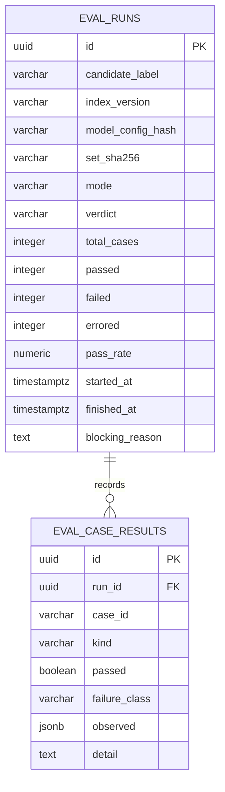

> **Lens:** BA (Part A) / TPO + Architect (Part B) · **Inputs:** `01-brd.md`, `02-use-cases-workflows.md`, `03-data-state-analysis.md`, `05-modularization.md`, `06-architecture.md`, `07-brownfield-reconciliation.md` · **Engagement:** Brownfield · **Defines:** TRD-36 … TRD-40

# Observability & Evaluation — MOD-08

## Part A — Module BRD [Lens: BA]

### A.1 Module Objectives

MOD-08 answers two questions the business otherwise cannot: **"what is actually happening out there?"** and **"did that change make the answers worse?"**

The first question has no answer in the source product — it has a partial per-turn latency trace and a Streamlit cockpit, and nothing else (`REC-15`). It matters commercially here for a reason specific to this re-purpose: nobody knows how much traffic ANITA will get (`DG-01`). The concurrency ceiling, the VRAM budget and the admission limits are all inherited guesses. MOD-08 is the instrument that turns those guesses into measurements, and it is the only way `DG-01` ever gets resolved.

The second question is a **commercial-liability control**. A catalogue assistant that quotes a wrong price is a legal and reputational problem, not a bug (`01-brd.md` §10). `BRD-22` requires a frozen set of questions with known-correct answers and a release that cannot ship when it regresses against them. That set is ANITA's own — the university's 137-case golden set is not transferable (`REC-17`).

Two further jobs fall out of the same read API: the ops console's data layer (`UC-12`, `UC-13`) and the surfacing of the config audit (`DG-09`) and the adoption proxy (`DG-10`).

**The defining constraint: this module must be deletable.** If MOD-08 is removed entirely, every conversation on every channel still works, end to end. That is not an aspiration — it is the design rule that decides every implementation choice below (`05-modularization.md` §3, `TRD-20` of the source plan).

### A.2 Scoped Requirements

- `BRD-20` — Configuration is a single source of truth (the audit's *result* is surfaced here; the *enforcement* is MOD-09)
- `BRD-21` — Per-conversation observability
- `BRD-22` — Quality gate on answer correctness

Contained data-gap decisions: `DG-01` (instrument to resolve the unknown load model), `DG-09` (config audit surfaces here), `DG-10` (sentiment trend as the adoption proxy).

Use cases: `UC-12`, `UC-13`, `UC-15`. Workflow: `WF-03` steps 3–4 (the quality gate decides index promotion, `SM-05`).

### A.3 Module Business Rules

| Rule | Condition → Action | Traces to |
|---|---|---|
| M8-1 | Any trace or metric emission failure is **swallowed**: the conversation continues, and the failure is counted, not raised | `BRD-21`, `05-modularization.md` §3 |
| M8-2 | A metric whose backend is down is reported as **`unavailable`**, never as `0`, `null` or an empty chart. Absent is not zero | `UC-12` E1, `REC-15` |
| M8-3 | A trace carries **no buyer PII**: no transcript text, no phone number, no email, no caller-supplied string | `DG-11`, `DG-06` |
| M8-4 | The frozen evaluation set is **immutable within a release**: changing it is a reviewed commit with its own justification, and a run records the set's content hash | `BRD-22` |
| M8-5 | A release is promoted **only** when the frozen run passes; a failed run blocks the promotion and keeps the previous configuration live | `BRD-22`, `SM-05` |
| M8-6 | An evaluation question that errors counts as a **failure**, never as a skip; a run that cannot complete is **void** and blocks | `UC-15` E1, E2 |
| M8-7 | Console surfaces are **access-controlled**; buyer surfaces never see MOD-08's data | `DG-06`, CV-03 |
| M8-8 | Traces are isolated per product instance: this module writes only under the ANITA log path and never reads the university product's logs | `BRD-18` |

### A.4 Actors

| Actor | Interaction | Why |
|---|---|---|
| **Ops admin** | Opens the console, drills into channel health and a conversation, runs the evaluation gate (`UC-12`, `UC-13`, `UC-15`) | The only human actor; every read path terminates here |
| **Buyer** | Indirect — their conversation is traced, but they never see it | The traced subject; the reason PII must not enter a trace |
| **PO / business owner** | Consumes the sentiment trend and category distribution as the adoption proxy (`DG-10`) | `AS-04`'s validation signal |
| **All modules (MOD-01…MOD-07, MOD-10)** | System actors — emit stage marks and counters | MOD-08 owns nothing they need at runtime; they call it best-effort |
| **MOD-09** | System actor — the gate's verdict gates index/config promotion (`SM-05`) | The release decision is joint: MOD-09 refuses to boot on a blocked promotion |

### A.5 Module Acceptance Criteria

- **AC-M8-1** — With MOD-08's trace writer deliberately crashed, a full conversation on every channel completes normally and the buyer notices nothing.
- **AC-M8-2** — Every conversation emits one trace containing channel, turn count, retrieval hit/miss per turn, answer latency, sentiment category and outcome.
- **AC-M8-3** — With the metrics store stopped, the admin console shows `unavailable` for affected panels — never zeros, never a blank chart that reads as "healthy at zero".
- **AC-M8-4** — The console shows only this instance's conversations; the university product's data is unreachable from it.
- **AC-M8-5** — Running the frozen set against a deliberately regressed answer engine (one prompt changed to omit the price caveat) blocks the release and lists the failing questions by name.
- **AC-M8-6** — A run in which one question errors is reported as **incomplete**, not passed, and does not promote.
- **AC-M8-7** — The console shows the config audit result: keys written but never read, named, with the boot-blocking ones flagged.
- **AC-M8-8** — An unauthenticated request to any console read API is rejected before any data is read.

## Part B — Module TRD [Lens: TPO + Architect]

### TRD-36 — Dependency-free per-turn trace emission

Implements `BRD-21`, `DAT-14`, `REC-15` (`reuse`). The source's `perf_trace.py` already has the right shape — one JSON line per turn, ordered stage marks, durations computed between consecutive *present* marks — and its best property is preserved verbatim: **it imports stdlib only, never `app.*`**. That is what makes "tracing cannot fail a call" structurally true rather than test-dependent. The ANITA stage set extends the source's voice stages to every channel:

```
turn_received → classified → retrieval_done | sql_lookup_done → llm_sent → llm_first_token
→ llm_done → answer_composed → channel_send_start → channel_send_done → sentiment_scored → outcome
```

Absent stages are **absent from the record, not zero** (`TRD-21` of the source plan, carried): `stages_seen` is always present so a reader can distinguish a short turn from a broken one. The record carries counts, flags and engine integers only — no transcript, no phone, no email, no session token (`M8-3`). Written append-only to the instance's own path (`ANITA_LOG_DIR`), never the university product's (`M8-8`). Every public method wraps its body in `try/except` and swallows; the writer holds no lock, allocates one dict per turn, and does no network I/O.

### TRD-37 — Per-instance metrics aggregation and console read API

Implements `BRD-21`, `UC-12`, `UC-13`, `DG-01`, `DG-10`, `DG-06` (admin half, with CV-03). Aggregation reads the JSONL trace log and the `anita` tables; it does **not** sit on the turn path. Endpoints (all behind admin auth, `M8-7`):

| Endpoint | Returns |
|---|---|
| `GET /api/anita/admin/channels` | per-channel status, last inbound, error count, queue depth |
| `GET /api/anita/admin/conversations?since=&channel=&limit=` | conversation list with turn count, category, outcome |
| `GET /api/anita/admin/conversations/{id}` | full turn trail: stages, retrieval hits, sentiment per turn, handoffs |
| `GET /api/anita/admin/metrics?window=1h|24h|7d` | latency percentiles (p50/p95/p99) per stage, grounded-answer rate, retrieval hit rate, fallback-scorer ratio, escalation count, outbound queue depth |
| `GET /api/anita/admin/adoption` | sentiment-trend and category distribution over time — the `DG-10` proxy |
| `GET /api/anita/admin/config-audit` | `DG-09` audit result: effective value source per key, and the written-but-unread list |
| `GET /api/anita/admin/eval/runs` · `POST /api/anita/admin/eval/run` | gate history and a new run (`TRD-40`) |

`DG-01` is resolved by this API rather than by a separate instrument: the p95/p99 latency percentiles per stage, admission-refusal count and concurrent-call watermark are exactly the inputs the 2-call ceiling assumption needs, and the console shows them against the `Assumed:` targets from `03-data-state-analysis.md` A.2 so the gap is visible rather than remembered.

### TRD-38 — "Unavailable, never zero" degradation contract

Implements `M8-2`, `UC-12` E1, `06-architecture.md` §5 (MOD-08 row: "drops traces rather than delaying a turn"). Every read in `TRD-37` returns a three-state envelope instead of a bare value:

```json
{"metric": "retrieval_hit_rate", "value": 0.982, "state": "ok", "as_of": "2026-10-03T11:20:00Z",
 "source": "trace_log", "window": "1h", "stale_seconds": 4}
```

`state` is one of `ok` | `unavailable` | `stale`. `unavailable` means the backend could not be read — the console renders "unavailable", and a value of `0` is only ever rendered when the backend *said* zero. `stale` carries `stale_seconds` and the console labels it. No endpoint fabricates, interpolates or zero-fills a missing window; a partial window is returned with the coverage it actually has. The aggregator never caches a failed read as a successful one.

### TRD-39 — Frozen evaluation set and scoring against ground truth

Implements `BRD-22`, `UC-15` mode "run", `REC-17` (`pattern-only` — the university's harness imports nothing from `app.*`, and neither does this). The set is a versioned file in the repo (`eval/anita_frozen_set.jsonl`), not a database table, because it must be **diffable, reviewable and immutable within a release** (`M8-4`). Each case carries: `id`, `question`, `channel_kinds`, `expected_answer_kind` (`exact` | `grounded` | `refusal`), `expected_value` (for `exact` commercial answers), `expected_source_ids` (corpus record ids the answer must cite), and `must_include` / `must_not_include` string lists (e.g. must-not-include: any price without the caveat).

Seed composition, drawn from the corpus that actually exists: the **36 verbatim FAQs**, **24 product-specification questions** (one per product, including the 3 with no specs — expecting the honest "not published" answer, `DG-13`), **12 commercial lookups** covering price/MOQ/delivery/GST/address, **4 disambiguation cases** using the two "Medical Dry Imager" entries, **6 refusals** (clinical and off-catalogue), and **8 sentiment-labelled turns** for `TRD-32` calibration — **90 cases** total (Assumed).

Scoring: an `exact` case passes on value equality after normalisation; a `grounded` case passes when every asserted fact appears in the cited chunks and the answer cites ≥ 1 corpus record; a `refusal` case passes on the refusal envelope. An **errored** question counts as a failure (`M8-6`). The run records `set_sha256`, the candidate's index version and model config hash, so two runs are comparable only when their inputs are.

### TRD-40 — Release quality gate and promotion verdict

Implements `BRD-22`, `M8-5`, `M8-6`, `SM-05` (`VALIDATING` → `LIVE` | `REJECTED`), `WF-03` steps 3–4. A gate run has one verdict: **PASS**, **BLOCK**, or **VOID**.

- `PASS` — every case passed, or the pass rate is ≥ **98 %** and **zero** cases of kind `exact` failed (`01-brd.md`'s hallucinated-price target is absolute; a missing FAQ answer is a quality miss, a wrong price is a liability).
- `BLOCK` — any `exact` failure, or pass rate < 98 %, or the run completed with errored cases. The failing case ids are returned, never a bare count.
- `VOID` — the engine was unavailable, the set was malformed or absent, the run exceeded its budget (**Assumed: 15 min**), or a run is already in flight (`UC-15` E2, duplicate-request row). A VOID run blocks promotion: it is never silently skipped.

Report-only mode (`UC-15` A1) records the result and skips promotion for development use. Promotion is atomic: the verdict is written with the candidate's `index_version` and the previous configuration stays live throughout (`SM-05` #5, #6). The gate never edits the frozen set and never waives an `exact` failure; a waiver, if the business ever wants one, is a new, visible configuration with the PO's name on it.

### B.1 Technical Constraints

- **Stdlib-only trace writer** (`REC-15` property, preserved); the aggregation API may use FastAPI and `psycopg2` because it is not on the turn path.
- **No runtime dependency in either direction.** Other modules call MOD-08 best-effort and never await it; MOD-08 is never a required import for MOD-01…MOD-07 and MOD-10 (only MOD-10's console *reads* it, and its failure degrades to an "unavailable" panel). Deleting the package must leave every conversation working — this is the module's acceptance test, not a comment.
- **`eval/` imports nothing from `app.*`** (`REC-17`), so the harness can run against a frozen candidate without booting the product.
- **Isolated paths** — `ANITA_LOG_DIR`, `anita` schema; a sibling product's log files are never opened (`BRD-18`).
- Depends on MOD-09 for paths, ports and the auth token; gates MOD-09's promotion decision in the release sense only (`05-modularization.md` §3).

### B.2 Non-Functional Requirements

| NFR | Target |
|---|---|
| Performance | Trace emission overhead ≤ **2 ms** p95 per turn and **zero** blocking I/O on the turn path; console read API p95 ≤ **300 ms**, p99 ≤ **1 s** at 24 h windows; evaluation run ≤ **15 min** for 90 cases (Assumed) |
| Performance (hard) | **A trace write must never add > 5 ms to a voice turn**, and must be skipped rather than delayed if the process is under admission pressure |
| Security | Admin endpoints require a bearer token; unauthenticated requests are rejected before any read (`M8-7`, CV-03); trace records contain **no** PII (`M8-3`); trace files are written with instance-only paths and are not world-readable |
| Scalability | Trace log append-only, rotates at **100 MB** with **7** retained files; aggregation handles **30 days** of traces (Assumed: ~26 K turns) within the p95 read target; the gate is single-flight (one run at a time, `UC-15` duplicate-request row) |
| Scale unit & limits | Unit = **trace row**. Retention: traces **30 days**, eval runs **12 months**, conversation transcripts per `DG-11` erasure. Max concurrent eval runs **1**; max window **90 days** |
| Degradation | Per `06-architecture.md` §5: **drops traces rather than delaying a turn**; metrics store down → console shows `unavailable` (`UC-12` E1); aggregation backend down → the API returns `state: "unavailable"` with the reason, never an empty success. Recovery: the API resumes live data as soon as the backend returns; dropped traces are gone by design and the loss is counted |
| Observability | Self-instrumented: trace drops, write errors, aggregation latency, and gate verdicts are themselves counted and exposed; alert when trace write errors > **1 %** of turns over 15 min |
| Availability | MOD-08 is **best-effort by construction**: it holds no lock any conversation needs, and a full outage must produce **0** failed conversations. The eval gate is available whenever the module is up; when it is not, promotion is **blocked, not bypassed** |

### B.3 APIs / Interfaces

| Name | Direction | Style | Contract | AuthN/Z |
|---|---|---|---|---|
| `TraceWriter.mark(stage: Stage)` | exposed | in-process, stdlib-only | no-op if tracing disabled; never raises | internal — dependency-free |
| `TraceWriter.emit(turn_id, outcome)` | exposed | in-process | append one JSON line; returns nothing | internal |
| `MetricsAggregator.window(kind, window)` | exposed | in-process | returns the three-state envelope (`TRD-38`) | internal |
| `GET /api/anita/admin/channels` | exposed | REST | per-channel health; `unavailable` when unknown | admin bearer |
| `GET /api/anita/admin/conversations` / `/{id}` | exposed | REST | conversation list and drill-down; paged | admin bearer |
| `GET /api/anita/admin/metrics` | exposed | REST | latency percentiles, grounding rate, fallback ratio, queue depth | admin bearer |
| `GET /api/anita/admin/adoption` | exposed | REST | sentiment trend + category distribution (`DG-10`) | admin bearer |
| `GET /api/anita/admin/config-audit` | exposed | REST | `DG-09` audit result (effective values masked) | admin bearer |
| `GET /api/anita/admin/eval/runs` · `POST /api/anita/admin/eval/run` | exposed | REST | gate history; start a run (body: `mode: gate\|report_only`) | admin bearer |
| `EvalRunner.run(set, candidate) -> Verdict` | exposed | in-process / CLI | `PASS` / `BLOCK` / `VOID` + failing case ids | ops-only |
| Stage marks from MOD-01…MOD-07 | consumed | in-process, best-effort | `mark(stage)` calls, no return contract | — |

### B.4 Data Model

Entities map to `DAT-14` (perf traces) and a new evaluation-run record. The frozen set itself is a repo file, deliberately not a table (`M8-4`).



```sql
CREATE TABLE IF NOT EXISTS anita.eval_runs (
    id                 UUID PRIMARY KEY,
    candidate_label    VARCHAR(128) NOT NULL,
    index_version      VARCHAR(64),
    model_config_hash  VARCHAR(64),
    set_sha256         VARCHAR(64) NOT NULL,
    mode               VARCHAR(16) NOT NULL DEFAULT 'gate'
        CHECK (mode IN ('gate','report_only')),
    verdict            VARCHAR(8) CHECK (verdict IN ('PASS','BLOCK','VOID')),
    total_cases        INTEGER NOT NULL DEFAULT 0,
    passed             INTEGER NOT NULL DEFAULT 0,
    failed             INTEGER NOT NULL DEFAULT 0,
    errored            INTEGER NOT NULL DEFAULT 0,
    pass_rate          NUMERIC(5,4),
    started_at         TIMESTAMPTZ NOT NULL DEFAULT NOW(),
    finished_at        TIMESTAMPTZ,
    blocking_reason    TEXT DEFAULT ''
);
CREATE UNIQUE INDEX IF NOT EXISTS ux_eval_single_flight
    ON anita.eval_runs((1)) WHERE finished_at IS NULL;   -- UC-15: one run at a time
```

Trace records are **not** in Postgres — one append-only JSON line per turn under `ANITA_LOG_DIR/perf_turns.jsonl` (the `REC-15` shape):

```json
{"turn_id":"…","conversation_id":"…","channel":"whatsapp","turn_no":3,
 "stages_seen":["turn_received","classified","retrieval_done","llm_sent","llm_done","channel_send_done","sentiment_scored"],
 "durations_ms":{"classify":14,"retrieval":38,"llm":1180,"send":22},
 "retrieval":{"hits":3,"top_score":0.81,"not_relevant":false},
 "sentiment":{"category":"Warm","mode":"llm","s_lead":0.41},
 "outcome":"answered","admission_refused":false,"version":"anita-1"}
```

### B.5 Tech Stack Choices

| Choice | Rationale | Runner-up rejected |
|---|---|---|
| **JSONL append-only trace log, stdlib writer** (`REC-15`) | Survives a crash mid-write without corrupting prior lines, greppable, zero dependencies — which is precisely what makes `TRD-36`'s "cannot fail a turn" structural | OpenTelemetry SDK: a dependency tree on the turn path, and a collector to operate, for a box with one product |
| **Aggregation on read, no metrics TSDB** | At ~26 K turns/30 days, an index over a JSONL file and a few SQL aggregates are fast enough; a Prometheus/InfluxDB install is operational cost with no query this product needs | Prometheus + Grafana: real value at 100× the volume, unjustifiable now |
| **Three-state envelope (`ok`/`unavailable`/`stale`)** | `M8-2` is a *presentation* contract as much as a data one; making absence a first-class state is the only way the console cannot show a false zero | `null` values: every consumer must remember to handle them, and one that forgets renders "0" |
| **Frozen set as a versioned repo file, results in DB** (`REC-17` pattern) | The set must be reviewable in a diff and immutable within a release; results must be queryable and durable | Set in the DB: invisible to code review, which is exactly how a quality gate gets quietly weakened |
| **Single-flight gate enforced by a partial unique index** | `UC-15`'s duplicate-run rule becomes a database guarantee rather than a lock in application code | Application-level `asyncio.Lock`: lost on restart, and wrong the moment a second process exists |
| **Vanilla-JS console polling MOD-08** (`REC-16`, served by MOD-10) | The source's cockpit polls at 2 s because a Cloudflare tunnel returns headers but never the body for SSE — hard-won, and unchanged here | Server-sent events: known-broken through the tunnel in this deployment |

### B.6 Edge Cases & Error Handling

| Failure class | Handling | Cites |
|---|---|---|
| **Trace writer raises** | Exception swallowed inside the writer; the turn is unaffected; the drop is counted and alerted above 1 % | `M8-1`, `AC-M8-1`, `06-architecture.md` §5 |
| **Metrics/trace store unreadable** | Endpoint returns `state: "unavailable"` with a reason; the console renders "unavailable" | `M8-2`, `UC-12` E1, `AC-M8-3` |
| **No traces yet (fresh instance)** | Empty state rendered as "no data yet", distinct from `unavailable` and from zero | `UC-12` missing-data row |
| **Unknown conversation id** | `404` with a specific error, not an empty object | `UC-13` invalid-input row |
| **Large transcript drill-down** | Paged at **200 turns** per page with a cursor; the response states the total | `UC-13` timeout row |
| **Transcript retention expired** | Shown as "expired", never as an empty transcript | `UC-13` E1 |
| **Two operators reading concurrently** | Read-only; no locking, no mutation | `UC-12`/`UC-13` concurrent rows |
| **Two eval runs requested** | Second refuses while one is in flight (partial unique index) | `UC-15` concurrent row |
| **Eval set absent or malformed** | Run refused with a specific error; release blocked; never silently skipped | `UC-15` invalid-input + missing-data rows, `M8-6` |
| **A question errors mid-run** | Counted as a failure; run reported **incomplete**, verdict `BLOCK` | `UC-15` E1 + partial-data row |
| **Engine unavailable during a run** | Run `VOID`; release blocked; previous configuration remains live | `UC-15` E2, `SM-05` #6 |
| **Run exceeds budget** | `VOID`, release blocked | `UC-15` timeout row |
| **Run aborted by the operator** | No promotion; run recorded as `VOID` | `UC-15` cancellation row |
| **Console tokens leaked/expired** | Admin auth rejects before any read; `401` carries no data | `M8-7`, `AC-M8-8`, CV-03 |
| **Config key written but never read** | Surfaced on the console as a blocking list item; the boot refusal itself is MOD-09's | `DG-09`, `AC-M8-7` |

### B.7 Tech Debt Accepted

- **Accepted: traces are sampled 1-in-1 today (no sampling) because volume is ~0.1 QPS.** Revisit at >50 turns/s: at that point the JSONL writer and the read-time aggregation both need to change, and the honest trigger is the p95 of `GET /metrics` crossing 300 ms — not a calendar date.
- **Accepted: no automated regression alerting between gate runs.** The gate runs on release and on demand (`UC-15`), not on a schedule; a slow quality drift between releases would be caught by the console's grounded-answer rate rather than by an alert. Revisit when a corpus refresh cadence exists (WF-03 is manual today).
- **Accepted: the eval set covers 90 cases and will not catch every wrong answer.** It is a regression gate, not a proof: it is sized to the corpus's 36 FAQs plus derived cases (`REC-17`), and `BRD-04`'s grounding gate is the runtime control that actually prevents invention. Revisit after the first month of real buyer questions, which will name the cases the seed set missed.
- **Accepted: `P_convert` and the sentiment trend are the standing adoption proxy (`DG-10`) and are a weak one** — they measure engagement, not acceptance. Revisit when `AS-04` validation interviews land; until then the console labels it as "adoption proxy (sentiment trend)", not "satisfaction".

## TPO Buildability Sign-off [Lens: TPO]

**TPO sign-off: this TRD is buildable against the BRD above.** Feasibility risks:

1. **The "deletable module" property is easy to state and easy to violate.** The first well-meaning refactor that makes a module `await` a metrics write would break it silently. Mitigation: the acceptance test for `AC-M8-1` runs the product with `anita.observability` import-blocked, and CI keeps that test — if it is ever removed, the property is gone.
2. **`DG-09`'s audit is only as good as the source's read-detection.** `config_truth.py`'s docstring records two false-positive classes it has already hit (helper-call shapes and assignment-vs-comparison). Reusing the auditor inherits those fixes — but ANITA adds new keys and new helper wrappers, so the auditor's regex set must be extended with each new `_env` variant, or a live key will be reported INERT and an operator will "fix" something that was working. This is a real, recurring hazard; US-027's config-audit surfacing must display the auditor's pattern inventory alongside its findings.
3. **The gate's numbers (98 % pass rate, zero exact failures, 15-min budget) are `Assumed:`.** They are the PO's risk appetite expressed as a threshold, and they are configurable rather than hard-coded so the PO can move them with evidence — the *structure* (exact failures are absolute; VOID blocks) is the part that must not be configurable.
4. **The 90-case seed set requires corpus work, not code work** — extracting 36 FAQs, 24 spec questions and the disambiguation pairs from `data/out/`. That is a real effort item, and it is a **dependency for the release gate existing at all**, so it is scheduled in US-027 rather than deferred with the other debt.
