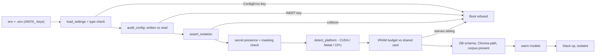

> **Lens:** BA (Part A) / TPO + Architect (Part B) · **Inputs:** `01-brd.md`, `02-use-cases-workflows.md`, `03-data-state-analysis.md`, `05-modularization.md`, `06-architecture.md`, `07-brownfield-reconciliation.md` · **Engagement:** Brownfield · **Defines:** TRD-41 … TRD-44

# Configuration, Isolation & Boot — MOD-09

## Part A — Module BRD [Lens: BA]

### A.1 Module Objectives

MOD-09 owns the two failure modes that would otherwise be **invisible**.

The first is **collision**. ANITA runs on the same box, against the same PostgreSQL server, the same Chroma install and the same Twilio account as a live university assistant that must not be disturbed (`AS-10`). If ANITA is pointed at the university's database, or its vector collection, or its port, or its log file, **everything appears to work** — the stack starts, answers questions, and quietly serves the wrong product's data to the wrong buyer, or corrupts the other product's leads. `BRD-18` exists because that failure has no error message. MOD-09's isolation guard is the error message.

The second is **dead configuration**. The source product has a real, recorded defect class: a key written into `.env` that no code path ever reads (`DG-09`, and `FASTAPI_WORKERS` is a live example — `REC-14`). A tuning decision that is written, silently discarded, and later blamed for a latency number it never influenced is worse than no setting at all, because it manufactures false confidence. ANITA makes the audit a **boot check**: a key written but never read refuses the start.

Around those two guards sits the ordinary but load-bearing work: one honest source of configuration, platform detection so the same config serves Windows/CUDA and macOS/MLX (`BRD-19`), a secret loading policy that never puts a credential in a log, and a boot preflight that starts an **isolated** stack or refuses.

### A.2 Scoped Requirements

- `BRD-18` — Instance isolation (the guard; `CV-01` defines isolation as logical)
- `BRD-19` — Cross-platform runtime
- `BRD-20` — Configuration is a single source of truth
- `DG-06` (shared half with MOD-01) — the secret and credential loading policy; authentication *enforcement* on admin surfaces lives in MOD-08 (`TRD-37`) and the buyer edge in MOD-01

Contained data-gap decisions: `DG-09` (config audit enforced at boot). Consumed: `DG-01` (the load model MOD-08 measures against is configured here and must be tunable without a code change).

Use cases: `UC-12` (operator needs the effective configuration and the audit), `UC-14` (a new channel is enabled by configuration and refused when the config is malformed). Workflow: `WF-03` (the refresh runs against an isolated collection).

### A.3 Module Business Rules

| Rule | Condition → Action | Traces to |
|---|---|---|
| M9-1 | Any configured resource value that collides with a known university-product value → **boot refused**, naming the colliding resource and both values | `BRD-18` |
| M9-2 | Any key present in the environment/config file that no code path reads → **boot refused**, naming the dead key | `BRD-20`, `DG-09` |
| M9-3 | A value that fails to parse as its declared type → **boot refused** naming the key; never a silent fallback to the default, because a silent fallback is indistinguishable from a deliberate choice | `BRD-20` |
| M9-4 | A secret value is never rendered, logged, echoed in an error, or written to an audit output — only its presence is reported | `DG-06` |
| M9-5 | The same configuration file starts the stack on Windows and macOS/Linux; the only platform-dependent decision is the model backend, and it is derived, not hand-set | `BRD-19` |
| M9-6 | The isolation guard runs **before** any service binds a port or opens a connection to a shared resource; a refused boot must leave the university product untouched | `BRD-18` |
| M9-7 | A configuration change that alters an isolation-relevant value (DB, collection, port, log path) requires a restart; the running process never hot-swaps an isolation value | `BRD-18` |

### A.4 Actors

| Actor | Interaction | Why |
|---|---|---|
| **Ops admin** | Writes configuration, starts the stack, reads the refusal message, acts on it (`UC-12`, `WF-03`) | The only human who changes configuration; the guard's message is written for them |
| **MOD-01…MOD-08, MOD-10** | System actors — consume the frozen settings object and are started by the preflight | They must not each re-read the environment |
| **Meridian platform owner** | Indirect — relies on ANITA never touching the university instance (`AS-10`) | The guard protects their product, not ours |
| **ANITA IT** | Owns the Twilio account, the GPU box and the sibling deployment's values | Supplies the deny-list values the guard compares against |

### A.5 Module Acceptance Criteria

- **AC-M9-1** — Starting the stack with `ANITA_DB_NAME=admissions` (the university's database) **refuses to boot**, names `ANITA_DB_NAME`, names the collision, and leaves every port unbound.
- **AC-M9-2** — Starting with `ANITA_CHROMA_COLLECTION=langchain` or `meridian_kb__v1` refuses, naming the collection.
- **AC-M9-3** — Starting with `ANITA_API_PORT=8000` (the university's API port) refuses, naming the port.
- **AC-M9-4** — Adding an unknown key `ANITA_FOO=bar` to the config file refuses the boot, naming `ANITA_FOO`.
- **AC-M9-5** — Removing a key that *is* read causes the boot to fail naming that key (no silent default), or falls back only where a documented default exists.
- **AC-M9-6** — The same config file boots on Windows (CUDA backend) and on macOS (MLX backend) with no edits other than the platform's own model paths.
- **AC-M9-7** — The startup log and the config-audit output contain no secret value; a grep of both for the Twilio auth token returns nothing.
- **AC-M9-8** — A successful boot prints/emits the effective, masked configuration with, for each key, the source it came from (env, file, detection artifact, default).

## Part B — Module TRD [Lens: TPO + Architect]

### TRD-41 — Single typed configuration source with a read-coverage audit

Implements `BRD-20`, `DG-09`, `REC-14` (`reuse`: `app/config.py` 739 LOC + `app/config_truth.py` 511 LOC). A frozen `@dataclass(frozen=True)` `AnitaSettings` with typed `_env`/`_env_int`/`_env_float`/`_env_bool` parsers that **name the offending key** on a parse failure (`M9-3`). The source's `config_truth` auditor is carried with its two documented false-positive fixes intact (typed `_env_*` helper forms; assignment `os.environ["K"] = x` must not count as a read). The **CRM block (~25 keys) is excised** — `CRM_BASE_URL`, `CRM_API_KEY`, `CRM_ENABLED`, `CRM_TIMEOUT_*` and the picklist keys have no ANITA meaning (`REC-06`), and leaving them would create dead keys the audit would immediately (and correctly) reject. ANITA keys are additive and grouped: isolation (`ANITA_DB_NAME`, `ANITA_DB_SCHEMA`, `ANITA_CHROMA_PATH`, `ANITA_CHROMA_COLLECTION`, `ANITA_API_PORT`, `ANITA_CHAT_PORT`, `ANITA_ADMIN_PORT`, `ANITA_LOG_DIR`), identity (`ANITA_COMPANY_NAME`, `ANITA_AGENT_NAME`), outbound (`OUTBOUND_MAX_ATTEMPTS=3`, `OUTBOUND_WINDOW_START=10:00`, `OUTBOUND_WINDOW_END=19:00`, `OUTBOUND_TIMEZONE=Asia/Kolkata`, `OUTBOUND_POLL_INTERVAL=10`, `OUTBOUND_RETRY_DELAYS_MIN=240,1440`), sentiment (`SENTIMENT_W1..W4`, `SENTIMENT_EWMA_LAMBDA=0.35`, `NEGATIVE_ESCALATION_THRESHOLD=-0.20`), model (`ANITA_LLM_PROVIDER`, `OLLAMA_MODEL`, `EMBED_MODEL`, `MLX_MODEL`, `MLX_BASE_URL`, `MLX_PORT`), and security (`ANITA_ADMIN_TOKEN`).

The audit's contract: for every key the auditor finds written anywhere (env file, exported environment, config file), either **a code path reads it** — in which case it is `LIVE` — or the boot is refused with `INERT_KEY: <name>` (`M9-2`). The auditor's read-detection patterns are themselves reported (`pattern inventory`), because a false INERT is a foot-gun: the console shows which helper shapes count as reads, so an operator can see why a key was flagged (`TRD-37`, `DG-09`).

### TRD-42 — Isolation assertions and collision refusal at boot

Implements `BRD-18`, `M9-1`, `M9-6`, `M9-7`, `CV-01` (isolation is **logical**: own DB/schema, own collection, own ports, own log path; the Twilio account and the GPU are explicitly shared), and the `REC-18` instruction that the source's hard-coded ports must go. `assert_isolation(settings, forbidden: ForbiddenValues)` runs **before** the app object is created, before any port is bound and before any DB connection is opened (`M9-6`). It compares four resource classes:

| Class | ANITA value | Known university value(s) it may not equal |
|---|---|---|
| Database | `ANITA_DB_NAME` / `ANITA_DB_SCHEMA` | `admissions` (the source `DB_NAME` default) |
| Vector collection | `ANITA_CHROMA_COLLECTION` | `langchain`, `meridian_kb__v1` (`REC-03`) |
| Ports | `ANITA_API_PORT` / `ANITA_CHAT_PORT` / `ANITA_ADMIN_PORT` | `8000`, `8501`, `8502`, `8098`, `1234` |
| Log path | `ANITA_LOG_DIR` | `logs/` (the source's shared path) |

The forbidden values are **configuration, not code** (`ISOLATION_FORBIDDEN_*` lists seeded with the values above), because the sibling deployment's values are the operator's knowledge, not a constant — but they are seeded so the guard is useful out of the box rather than empty until someone remembers. The guard also refuses a **non-absolute or non-instance-scoped** `ANITA_LOG_DIR`, and refuses if `ANITA_DB_NAME` equals `ANITA_DB_SCHEMA` on a shared cluster (a schema collision that would still be wrong). Failure message shape, deliberately machine-greppable and operator-readable:

```
BOOT REFUSED — isolation collision (BRD-18)
  resource : chroma_collection
  anita    : langchain
  sibling  : langchain
  action   : set ANITA_CHROMA_COLLECTION to a value unique to this product (e.g. anita_ams__v1)
```

No service is started, no port is bound, no connection is opened on the refusal path (`AC-M9-1`…`AC-M9-3`).

### TRD-43 — Platform detection and model-backend selection

Implements `BRD-19`, `REC-19` (`reuse`: `app/platform.py`, `app/hardware_profile.py`, `app/memory_budget.py`). `detect_platform()` returns a `DeviceConfig` (`device`, `compute_type`, `dtype`, `total_memory_gb`) by probing in order: NVIDIA CUDA → Apple Metal → CPU; `pick_model()` (`REC-08`, `app/llm_backend.py`) maps the detected platform to a backend without operator input:

| Runtime | Backend | STT | Vocabulary |
|---|---|---|---|
| Windows / Linux + NVIDIA | **Ollama** (`OLLAMA_URL`, `OLLAMA_MODEL`, `OLLAMA_KEEP_ALIVE`) | faster-whisper, `compute_type=int8` | CUDA |
| macOS / Apple Silicon | **MLX** (`MLX_BASE_URL` on `MLX_PORT`, `MLX_MODEL`) | faster-whisper, Metal/int8 with NEON | Metal |
| CPU only | Ollama with a smaller model; **voice is refused at admission** rather than served at unusable latency (`06-architecture.md` §5) | int8 | CPU |

The platform branch is **derived, never hand-set** (`M9-5`): no config file differs between operating systems except paths, and an operator never edits an OS-specific value to make the stack start. The VRAM budget from `memory_budget.py` is computed against the **shared** 16,311 MiB card and the ANITA share is asserted at boot — an ANITA budget that would leave the university assistant less than its own floor is a boot refusal, not a warning (`AS-09`).

### TRD-44 — Secret loading policy, log isolation and boot preflight

Implements `BRD-18`, `BRD-19`, `REC-14` (masking), `REC-18` (`refactor`: the multi-phase CHECK → INSTALL → START orchestration, **minus the hard-coded ports and minus the external-repo clone at Step 4b**), `REC-21` (`forbidden`: no secret value is ever copied from the source repo). Four rules:

1. **Secret loading.** Secrets are read from the environment or from an `ANITA_*`-prefixed file only. Any key whose name matches `TOKEN|SECRET|PASSWORD|PASSWD|KEY|CREDENTIAL|SID|AUTH` is masked by default in every render, log line, audit output and error message; only presence (`set` / `unset`) is reported (`M9-4`, `AC-M9-7`). A secret that is *required* and unset is a boot refusal naming the key and never the value. `.env`, `.env.bak-*` from the source repo are `forbidden` and are neither read nor copied; the migration carries **key names only** into a fresh `.env.example` (`REC-21`).
2. **Log isolation.** Every logger writes under `ANITA_LOG_DIR` (`logs/anita/`), which the isolation guard has already proven distinct (`TRD-42`). No handler may target the repository-root `logs/` directory or any sibling product's path.
3. **Boot preflight.** Ordered phases, each with a hard failure that stops the boot: `LOAD` (parse + type-check) → `AUDIT` (read-coverage, `TRD-41`) → `ISOLATION` (`TRD-42`) → `SECRETS` (required-secret presence) → `PLATFORM` (`TRD-43`) → `DATA` (schema present or creatable; Chroma path writable; corpus present) → `WARM` (models resident). The preflight is `python -m anita.boot --preflight` and runs to completion **without starting any service**, so an operator can validate a configuration change before restarting a live instance. Budget: **≤ 20 s** excluding model warm-up (Assumed).
4. **Start orchestration.** The source's `bootstrap_services.py` (1,153 LOC) + `start_services.ps1`/`.sh` advance verbatim in structure but with two removals `REC-18` requires: **all ports come from settings** (no literals), and **the Step 4b external-repo clone is deleted** — ANITA's corpus is local (`data/out/`), so a network clone on the boot path is both unnecessary and a supply-chain surface.

### B.1 Technical Constraints

- **Reuse, with exclusions.** `app/config.py`, `app/config_truth.py` (`REC-14`, `reuse`), `app/platform.py`, `app/hardware_profile.py`, `app/memory_budget.py`, `app/admission.py`, `app/work_priority.py`, `app/boot_readiness.py` (`REC-19`, `reuse`), `bootstrap_services.py` + launchers (`REC-18`, `refactor`). Excluded: the ~25-key CRM block (`REC-06`), any `.env*` file (`REC-21`, `forbidden`).
- **Python 3.11**, stdlib + the platform's existing dependencies. The config auditor stays stdlib-only (`REC-14`'s property) so it can run before anything else.
- **Frozen settings.** `AnitaSettings` is frozen after load; no module re-reads `os.environ` (`M9-7` is the runtime corollary — isolation values are immutable for the process lifetime).
- **Boot is all-or-nothing.** Partial start is forbidden: a refused boot must leave **no** port bound and **no** connection opened (`M9-6`).
- Depends on nothing; it starts everything else (`05-modularization.md`).

### B.2 Non-Functional Requirements

| NFR | Target |
|---|---|
| Performance | Preflight completes ≤ **20 s** excluding model warm-up (Assumed); config load + audit ≤ **500 ms**; isolation assertions ≤ **50 ms**; the READY gate is not satisfied until every service answers its health check within **30 s** (Assumed) |
| Security | 100 % of secret-named keys masked in every render (`DG-06`); **zero** secret values in logs, audit output or error messages; `.env`-family files never read from the source repo (`REC-21`); admin token required and loaded as a secret; file permissions on the config file checked and a world-readable secret file is a boot **warning at minimum** (Assumed: refusal on POSIX, warning on Windows where ACLs differ) |
| Scalability | Scales by **not scaling**: one boot per instance; the guard is O(number of configured resources) ≈ **20** comparisons |
| Scale unit & limits | Unit = **one boot**. Max boot attempts before an operator alert **3**; preflight is idempotent and side-effect-free; ports declared per instance; every port configurable — **zero** hard-coded ports (`REC-18`) |
| Degradation | Per `06-architecture.md` §5: **fails fast and refuses to start rather than running misconfigured.** A refused boot never leaves a half-started stack; a failed preflight after a config change leaves the currently-running instance untouched (the preflight runs as a separate process) |
| Observability | The effective masked configuration, the audit result (with the pattern inventory), the isolation assertions and their verdicts, the detected platform and the VRAM budget are all emitted to MOD-08's config-audit surface (`DG-09`) and printed at boot in a machine-greppable block |
| Availability | Availability is not a target for this module: a correct refusal is a **success**. The measured property is the inverse — **zero** misconfigured boots and **zero** collisions reaching a live service |

### B.3 APIs / Interfaces

| Name | Direction | Style | Contract | AuthN/Z |
|---|---|---|---|---|
| `AnitaSettings` (frozen dataclass) | exposed | in-process | typed, immutable; the single config source for all modules | internal |
| `load_settings(env: Mapping[str, str]) -> AnitaSettings` | exposed | in-process | raises `ConfigError(key, reason)`; never falls back on a parse failure | internal |
| `audit_config(settings, sources) -> AuditReport` | exposed | in-process, stdlib-only | `LIVE` / `INERT` / `MISSING` per key + pattern inventory | internal |
| `assert_isolation(settings, forbidden) -> IsolationVerdict` | exposed | in-process | raises `IsolationViolation(resource, anita_value, sibling_value)` | internal |
| `detect_platform() -> DeviceConfig` | exposed | in-process | CUDA → Metal → CPU probe | internal |
| `pick_model(device, settings) -> ModelConfig` | exposed | in-process | Ollama or MLX backend selection (`REC-08`) | internal |
| `preflight(settings) -> PreflightReport` | exposed | CLI + in-process | ordered phases; returns all failures, never just the first | ops-only |
| `python -m anita.boot --preflight` | exposed | CLI | exit 0 = bootable, exit 2 = refused (with reasons), exit 3 = config error | ops-only (local) |
| `python -m anita.boot --start` | exposed | CLI | runs preflight then starts the stack (or the launcher invokes it) | ops-only (local) |
| `GET /api/anita/admin/config-audit` | exposed via MOD-08 | REST | the masked effective config + audit result | admin bearer (`TRD-37`) |
| `ANITA_*` environment keys | consumed | env/config file | names per `TRD-41`/`TRD-44`; `DATABASE_URL`, `DB_HOST/PORT/USER/PASSWORD`, `TWILIO_*`, `SMTP_*`, `OLLAMA_URL` reused from the platform's documented set | secrets masked |

### B.4 Data Model

No new tables. MOD-09's data asset is `DAT-13` (configuration), which is files plus environment, not rows. The two persisted artefacts are the boot preflight report (a log line and an optional JSON file under `ANITA_LOG_DIR`) and the isolation assertion record, which is *derived* from settings and therefore never stored. The config-audit surface in MOD-08 reads the same computation live rather than a snapshot, so a stale audit can never be displayed.



The configuration contract for the isolation-relevant keys, which is also what the guard compares:

```yaml
# config/anita.yaml (non-secret; secrets stay in env only)
isolation:
  db_name: anita_ams
  db_schema: anita
  chroma_path: ./data/chroma_anita
  chroma_collection: anita_ams__v1
  api_port: 8100
  chat_port: 8601
  admin_port: 8602
  log_dir: logs/anita
  forbidden:                      # never equal to any of these (BRD-18)
    db_names: [admissions]
    collections: [langchain, meridian_kb__v1]
    ports: [8000, 8501, 8502, 8098, 1234]
    log_dirs: [logs]
```

### B.5 Tech Stack Choices

| Choice | Rationale | Runner-up rejected |
|---|---|---|
| **Reuse the frozen-dataclass + auditor pattern** (`REC-14`) | It already names the offending key and already masks secrets; the only change is excising the CRM block and adding ANITA keys | `pydantic-settings`: a better library, but it would leave the auditor's proven read-detection work behind and add a dependency on the boot path |
| **Collision refusal instead of a probe-and-warn** | `BRD-18`'s failure is silent — a warning in a 400-line startup log is not a control (`M9-1`) | A warning banner: an operator restarting at 02:00 will not read it, and the wrong-data failure survives |
| **Deny-list in configuration, seeded with known sibling values** | The operator owns the sibling's values; hard-coding them makes the guard wrong the moment the sibling changes port, and an empty list makes it useless | Auto-discovering the sibling instance (reading its `.env` or its processes): reads a forbidden file (`REC-21`) and makes isolation depend on the thing it is isolating from |
| **Preflight as a separate, side-effect-free process** | An operator can validate a configuration change **without restarting the live instance**, which is the only way a hard refusal is tolerable operationally | Validate-in-place at start: a bad config takes the live instance down to tell you it is bad |
| **Platform derived, never hand-set** (`M9-5`) | One config file across Windows and macOS is what `BRD-19` asks for; a hand-set `LLM_PROVIDER` is the thing that gets forgotten on a new machine | Per-OS config files: guaranteed drift, and it makes "same configuration" untrue |

### B.6 Edge Cases & Error Handling

| Failure class | Handling | Cites |
|---|---|---|
| **DB name / schema collides with the university product** | Boot refused; both values named; no port bound, no connection opened | `M9-1`, `M9-6`, `AC-M9-1` |
| **Chroma collection collides** | Boot refused, naming the collection | `AC-M9-2`, `REC-03` |
| **Port collides** | Boot refused, naming the port **and the ANITA key that set it**, so the fix is unambiguous | `AC-M9-3`, `REC-18` |
| **Key written but never read** | Boot refused naming the key; the console shows the auditor's pattern inventory so a false INERT is diagnosable | `DG-09`, `M9-2`, `AC-M9-4` |
| **Key has an unparseable value** | Boot refused naming the key; no silent default (`M9-3`) | `AC-M9-5` |
| **Required secret unset (Twilio token, admin token)** | Boot refused naming the key; the value is never echoed | `M9-4` |
| **Secret mistakenly logged** | A startup self-check greps the rendered config block for secret values; a hit is a hard failure, not a warning | `AC-M9-7`, `DG-06` |
| **No GPU / CPU-only machine** | Platform detection falls back to CPU and the boot succeeds in **text-only** mode; voice is refused at admission with a busy message | `BRD-19`, `06-architecture.md` §5 |
| **VRAM budget would starve the sibling product** | Boot refused (or, where the budget is advisory, a loud warning plus admission limits recomputed) | `AS-09`, `CV-01` |
| **Corpus absent or wrong institution** | Boot refused: the `REC-23` validation-gate pattern refuses a corpus that is not the ANITA catalogue | `REC-23`, `WF-03` |
| **Postgres unreachable at boot** | Config validation passes (it is syntactic); the module starts in the platform's degraded mode and MOD-06/MOD-07 degrade per their own contracts, rather than blocking boot on an external dependency | `REC-13` |
| **Config changed while running** | Not picked up; a restart is required for isolation-relevant values (`M9-7`), and the audit endpoint shows the running process's effective values | `M9-7` |
| **Two instances of ANITA started on one box** | Second refuses at the port check and names the port — the same guard, a different collision pair | `M9-1` |

### B.7 Tech Debt Accepted

- **Accepted: the deny-list is seeded with the university product's known values rather than discovered.** Revisit if the sibling deployment ever moves ports or renames its collection: discovered values would be preferable, but discovery means reading the sibling's configuration files, and `REC-21` forbids touching its `.env`. The mitigation is that the guard's message names the collision, so the operator learns immediately.
- **Accepted: the isolation guard compares values, not identity — it cannot detect two instances pointing at the *same database under different names* (e.g. a DNS alias).** Revisit if the deployment ever gains a second host: server-side identity (`SELECT current_database()` plus a marker row) would be required, and is over-engineering for one box.
- **Accepted: secret-mistake detection is a post-render grep, not a taint-tracking proof.** Revisit if a secret ever does leak into a log, because the grep is heuristic and a base64-encoded or split value would evade it; a proper scrub handler on the logging formatter is the follow-up.
- **Accepted: the platform branch for Linux/Docker is configured but not exercised in this deployment** (`BRD-19` asks for parity, the box is Windows). Revisit before claiming Linux support in a release note: an untested branch is a claim, not a capability.

## TPO Buildability Sign-off [Lens: TPO]

**TPO sign-off: this TRD is buildable against the BRD above.** Feasibility risks:

1. **The config audit will refuse real boots for real keys, and that is the point — but it needs a workable escape.** Some keys legitimately exist for the launcher or an external tool and are never read by Python (a `docker-compose` variable, for example). Mitigation: `TRD-41` carries an explicit, **reviewed** `EXTERNAL_KEYS` allow-list with a reason per entry, so the audit stays hard by default and the exceptions are visible rather than blanket-disabled. Without this allow-list the guard is unusable in practice and will be turned off; with it, the guard survives.
2. **`REC-14`'s read-detection has a documented history of false positives**, and ANITA adds new `_env`-family wrappers. The audit must be extended with each new helper shape or it will report a live key as dead and an operator will "fix" working configuration. US-028 owns extending the pattern inventory and testing both false-positive classes the source recorded.
3. **The isolation guard's deny-list is a configuration value, so the guard itself can be misconfigured** — an empty `forbidden.ports` list silently disables a quarter of the protection. Mitigation: boot warns when any forbidden class is empty, and the config-audit console surface shows the deny-list alongside the assertions so a disabled guard is visible.
4. **Refusal messages are the module's user interface.** A message that says only "isolation violation" would send an operator to the wrong layer and, in the worst case, to disabling the guard. Every refusal names resource, value, counterpart and the exact key to change (`TRD-42`); that wording is an acceptance criterion (`AC-M9-1`…`AC-M9-3`), not a nicety.
