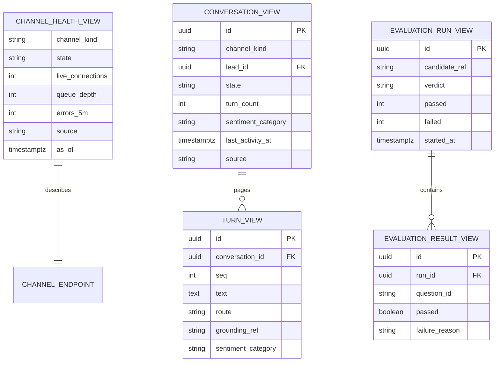

> **Lens:** BA (Part A) / TPO + Architect (Part B) · **Inputs:** `01-brd.md`, `02-use-cases-workflows.md`, `03-data-state-analysis.md`, `05-modularization.md`, `06-architecture.md`, `07-brownfield-reconciliation.md` · **Engagement:** Brownfield · **Defines:** TRD-45 … TRD-48

# Client Surfaces — MOD-10

## Part A — Module BRD [Lens: BA]

### A.1 Module Objectives

1. **The buyer gets the assistant on the device they are already holding.** A radiographer comparing specs on his phone between cases is the common case, not the desktop. The chat surface is mobile-web first and needs no app install (D1, BRD-01).
2. **Voice is one tap away from text, and text is one tap away from voice.** The browser-mic client makes the same answer engine reachable without a phone call, and falls back to typing the moment the mic is unavailable (UC-04).
3. **Ops can run the business from one screen.** Channel health, live conversations and a single conversation's transcript, grounding and sentiment trail — for **this instance only** (BRD-18, BRD-21, UC-12, UC-13).
4. **The console never lies.** At `DG-01` the traffic model is assumed, and MOD-08 may one day be down; a screen that shows "0 active calls" when the truth is "unknown" would send an operator to the wrong conclusion. Stale and unavailable are labelled as such (`UC-12` E1, `UC-13` E1).
5. **Release quality is visible.** The frozen evaluation run gates a release (BRD-22, UC-15), and the person who promotes an index is looking at this console.

### A.2 Scoped Requirements

Satisfies `BRD-01` (buyer surfaces), `BRD-21` (renders what MOD-08 measures), `BRD-22` (release-validation surface), and the instance-scoping half of `BRD-18`. Enacts `UC-01`, `UC-04`, `UC-12`, `UC-13`, `UC-15`. Enforces the admin half of `CV-03`/`DG-06` at the route layer.

### A.3 Module Business Rules

| Rule | Condition → Action |
|---|---|
| CS-1 | Buyer surfaces (chat, browser mic) are open — no login — and rate-limited; admin surfaces (console, review, evaluation) require an authenticated session. `CV-03` split, enforced here. |
| CS-2 | A screen never renders a value it cannot source. Unknown → "unavailable"; expired retention → "expired"; empty → "no data yet". Never a fabricated zero (`UC-12` E1, `UC-13` E1). |
| CS-3 | Mobile-web is the primary target; desktop is the same page at a wider breakpoint. No separate build, no native app (non-goal). |
| CS-4 | Any mic, permission, WebSocket or audio failure in the voice client degrades to text **and** shows the direct phone number — the buyer is never left at a dead control (`UC-04` E1/E2). |
| CS-5 | The console is read-mostly. Its only mutations are enabling/disabling a channel adapter (`UC-12` A1, `UC-14`) and starting an evaluation run (`UC-15`); every mutation requires the admin session and is recorded. |
| CS-6 | Every console view is scoped to this instance's data. There is no cross-instance or university view and no configuration that can create one (`BRD-18`). |
| CS-7 | A page that cannot reach its backend shows the unavailable state and the direct phone number within one interaction — never an unbounded spinner (`06-architecture.md` MOD-10 failure path). |

### A.4 Actors

| Actor | Interaction with this module |
|---|---|
| Buyer | Types in the responsive chat, taps the mic, reads or listens to answers on a phone or desktop. |
| Ops admin | Watches channel health, drills into a failing channel, reviews conversations, runs the evaluation gate. |
| Sales rep | Opens a handed-off conversation and reads the transcript, products and sentiment trail (UC-13). |
| MOD-01 / MOD-08 / MOD-02 (internal) | Supply the chat REST/WS, the mic WS, the console read API and conversation review. |

### A.5 Module Acceptance Criteria

- **AC-1** The chat surface is usable at 360 px width with no horizontal page scroll and a 16 px minimum gutter; first contentful paint p95 ≤ 1.5 s on a 4G profile.
- **AC-2** A buyer who denies mic permission is shown the text fallback and the direct phone number in the same interaction, with no console error visible to them.
- **AC-3** With MOD-08's read API unreachable, every console panel shows "unavailable" — no panel shows 0 or an empty success state.
- **AC-4** An unauthenticated request to any `/admin/*` route returns 401 and renders no conversation data in the response body.
- **AC-5** A 100-turn transcript renders in review in ≤ 500 ms per page and pages to the next batch in ≤ 500 ms.
- **AC-6** A channel disabled from the console stops accepting inbound within one console refresh cycle (≤ 2 s) and the other channels' health is unchanged.
- **AC-7** The evaluation surface blocks promotion when the frozen set has a failing question, and names the failing question ids (`UC-15` E1/partial-data).

## Part B — Module TRD [Lens: TPO + Architect]

### TRD-45 — Responsive web-chat client contract

A single no-build-step page (`chat.html` + `chat.css` + `chat.js`) served as a static asset, mobile-first with breakpoints at 480/768/1024 px, 16 px gutter, `viewport-fit=cover`, safe-area insets, and a sticky composer above the on-screen keyboard. It talks to `POST /chat/session` (mint a signed session token) and `WS /chat/stream` (send a text turn, receive clause-level tokens), renders streaming text with an aria-live answer region, and shows a persistent "Call us" affordance with the company number. A fallback static page renders "chat unavailable — call us" when the WS cannot connect within 3 s (`CS-7`, `UC-12` E1 analogue). Serves `BRD-01`; implements `UC-01` on the buyer surface. Refactors the source's vanilla-JS client pattern (`REC-16`).

### TRD-46 — Browser voice client state machine and media contract

`voice_client.html` + `voice.js`: `getUserMedia({audio:{channelCount:1, echoCancellation:true, noiseSuppression:true}})` → AudioWorklet capture at 16 kHz mono → PCM16 frames over `WS /voice/browser` → µ-law playback frames rendered through an ordered audio queue with a barge-in control that stops playback and sends a `stop_speaking` control frame. States: `IDLE → MIC_REQUESTED → CONNECTING → LISTENING ⇄ SPEAKING → CLOSED`, with `DEGRADED` reachable from every state on permission denial, WS failure, or 3 s without audio. `DEGRADED` shows the text fallback and the phone number (`CS-4`). Serves `BRD-01`, `BRD-19`; implements `UC-04` including E1/E2 and A1.

### TRD-47 — Admin console read-API contract and authentication

The console consumes a single read surface: `GET /admin/api/health` (per-channel state, live WS count, queue depth, model residency, error counts in the last 5/60 min), `GET /admin/api/conversations` (filter by channel/state/lead/time, paged 50), `GET /admin/api/conversations/{id}` (transcript paged 100 turns, grounding refs, sentiment trail, handoffs), `GET /admin/api/evaluations` (runs, per-question results, verdict), `POST /admin/api/channels/{id}/enable|disable`, `POST /admin/api/evaluations/run`. Every route requires a signed admin session cookie (HttpOnly, Secure, SameSite=Lax); unauthenticated → 401 with no body data. Every response carries `source: "live" | "stale" | "unavailable"` and a timestamp so the UI can label it (`CS-2`). All reads are instance-scoped by construction — the queries take no instance parameter and read only this instance's schema (`CS-6`, `BRD-18`). Serves `BRD-21`, `BRD-22`; implements `UC-12`, `UC-13`, `UC-15`; enforces `DG-06` on admin routes and `CV-03`.

### TRD-48 — Console rendering and refresh model

Vanilla JS, no framework, no build step; a 2 s polling loop on `/admin/api/health` and on-demand fetches for the other panels. **Polling, not SSE/WebSocket, deliberately:** the source's own note records that a Cloudflare tunnel returns headers but never the body for SSE (`REC-16`), so a push transport would appear to work and then hang. Panels render the four explicit states — `live`, `stale` (last successful fetch older than 3 refresh cycles), `unavailable`, `empty` — and distinguish "no conversations yet" from "could not load conversations" in both text and colour. A drill-down into a conversation is a URL-addressable route so an operator can share it. Serves `BRD-21`, `BRD-18`; implements `UC-12` A1, `UC-13` A1/E1.

### B.1 Technical Constraints

- **No build step.** The source's surfaces are plain HTML/CSS/JS served by the FastAPI app; introducing a bundler adds a toolchain to a single-box product for no capability gain. Any divergence would need an `REC-xx`.
- **Cloudflare-tunnel-compatible transports only.** Long-lived SSE/HTTP streaming is unreliable through the tunnel (`REC-16`); WebSockets are used only where the source already proved them (Twilio media, chat streaming, browser mic).
- **The browser is a deployment target, not a dependency:** the surfaces must degrade to usable text when a transport is blocked.
- **Desktop plus mobile-web at launch; native apps are a non-goal** (`00-product-intent.md` §6).
- **Reconciliation:** refactor `REC-16` — `app/dashboard/` (895 LOC) and `app/static/` (`dashboard.html/css/js`, `voice_client.html`, ~1,100 LOC total) are the carried assets; add the admin auth `DG-06` requires. `REC-15` (`perf_trace.py`) supplies the console's data through MOD-08, not directly.

### B.2 Non-Functional Requirements

| NFR | Target |
|---|---|
| Performance | Chat surface first contentful paint p95 ≤ 1.5 s on a 4G profile (1.6 Mbps, 150 ms RTT); console page load p95 ≤ 2 s; transcript page render p95 ≤ 500 ms; chat answer first token p95 ≤ 2.5 s end-to-end (inherits `00-product-intent.md` §4) |
| Voice latency | Mic capture → first outbound frame ≤ 300 ms; end-of-speech → first answer audio p95 ≤ 1.2 s end-to-end (inherits the platform floor, `00-product-intent.md` §4) |
| Payload | Initial JS bundle ≤ 150 KB uncompressed / ≤ 45 KB gzipped; no third-party analytics or CDN at runtime |
| Browser support | Last 2 versions of Chrome, Edge, Safari, Firefox; iOS Safari ≥ 16; Android Chrome ≥ 110; the chat surface is functional with JavaScript disabled up to the "call us" page |
| Accessibility | WCAG 2.1 AA on chat and console (contrast ≥ 4.5:1 body text, full keyboard operability, aria-live answer region, visible focus); voice client exposes a non-audio path at all times |
| Security | Admin session cookie HttpOnly + Secure + SameSite=Lax; 401 on every unauthenticated `/admin/*`; no PII in URLs or browser storage beyond the session token; CSP `default-src 'self'`; no transcript data in local storage |
| Scale unit & limits | Browser session. 2 s poll per console tab; ≤ 5 concurrent console tabs per operator before the console drops to a 10 s poll; conversation list paged at 50, transcript at 100 |
| Degradation | Explicit `unavailable` state + direct phone number; console shows `stale` rather than zero; chat serves the static fallback page when the WS cannot connect within 3 s |
| Observability | Client-side error and WS-drop counters posted best-effort to MOD-08; console renders its own source-state labels (`live`/`stale`/`unavailable`/`empty`) |
| Availability | 99.5% monthly for static assets (served from the same process); no data loss on refresh — chat history is server-side, not browser-side |

### B.3 APIs / Interfaces

| Name | Direction | Style | Contract | AuthN/Z |
|---|---|---|---|---|
| `GET /chat` + static assets | exposed | HTTP | chat page, CSS, JS; cache-busted build string | none (public) |
| `POST /chat/session` | consumed | REST | mint signed session token; 201 / 429 rate-limited | Rate limit per IP |
| `WS /chat/stream` | consumed | WebSocket | text turn in; token/clause stream out; close codes for rate limit and idle | Signed session token |
| `WS /voice/browser` | consumed | WebSocket | PCM16@16k frames up, µ-law down, `start`/`stop_speaking` control frames | Signed session token |
| `GET /admin/api/health` | consumed | REST | channel states, WS counts, queue depth, model residency, error counts, `source` label | Admin session |
| `GET /admin/api/conversations` · `/{id}` | consumed | REST | paged lists and transcripts with grounding and sentiment refs, `source` label | Admin session |
| `GET /admin/api/evaluations` · `POST /admin/api/evaluations/run` | consumed | REST | run history + verdict; start a run (409 if one is in flight) | Admin session |
| `POST /admin/api/channels/{id}/enable` · `/disable` | consumed | REST | idempotent toggle; 200 / 404 unknown channel / 401 | Admin session |
| `GET /` (marketing/landing embed) | exposed | HTTP | iframe/embed snippet for the chat surface | none |

No events are published by MOD-10. Every consumed endpoint is a read except the two explicit mutations in `CS-5`.

**As built — the browser-voice frame contract (US-003/US-008, frozen 2026-10-04).**
The transport went live this revision; the contract below is what the server
and the shipped client actually speak, and both are asserted against it
(`tests/test_mod01_browser_voice.py`, `tests/e2e/voice.spec.js`). The token is
sent in the **first frame**, never the query string — a credential in a URL
lands in tunnel logs and history (`TAC-8`); the socket is accepted, then closed
with a real code if the handshake fails (a close before `accept` reaches the
browser as an HTTP 403 with no code at all).

| Direction | Frame | Meaning |
|---|---|---|
| client → server | `{"type":"auth","token"}` | First frame; HMAC-signed TTL token. Unsigned/expired → close `4001` |
| client → server | `{"type":"start","conversation_id"}` | Idempotent; server answers `ready` |
| client → server | `{"type":"audio","pcm16":<b64>}` | Mono PCM16 @ 16 kHz; server decimates to 8 kHz µ-law for the engine |
| client → server | `{"type":"commit"}` | Push-to-talk: forces the turn when there is no trailing silence (MediaRecorder fallback) |
| client → server | `{"type":"stop_speaking"}` | Interrupt: engine stops, client flushes its playback queue |
| client → server | `{"type":"stop"}` | Clean end → close `1000` |
| server → client | `{"type":"ready","session_id"}` | Session opened; capture may start |
| server → client | `{"type":"transcript","role","text","final"}` | Both halves of the turn — the buyer's words and the answer, as text |
| server → client | `{"type":"audio","ulaw_b64"}` | 20 ms µ-law frame; client schedules it on one ordered queue |
| server → client | `{"type":"flush"}` | Server-side barge-in: drop buffered playback |
| server → client | `{"type":"turn_complete","turn_id"}` | Turn settled; client returns to `listening` when the queue drains |
| server → client | `{"type":"busy","callback_number","message"}` | Admission refused → close `4002` |
| server → client | `{"type":"error","code"}` | `rate_limited` (→ close `4008`) or `turn_failed` |

Close codes: `1000` normal · `4001` token · `4002` admission · `4008` rate
limit. Idle (30 s without a frame) closes `1000` with `close_reason='idle'`,
releasing the voice slot.

### B.4 Data Model

MOD-10 owns **no persistent store** — a deliberate property, so a console outage can never lose a conversation. It renders read models owned elsewhere:

`CHANNEL_HEALTH_VIEW` is assembled by MOD-08 from MOD-01's counters; `CONVERSATION_VIEW`/`TURN_VIEW` come from MOD-02's review read (TRD-11); `EVALUATION_*` are MOD-08's frozen-set runs. The single client-side stored value is the chat session token (or the admin session cookie) — no transcript, lead or sentiment data is persisted in the browser (`CS-6`, `B.2` security).

### B.5 Tech Stack Choices

| Choice | Rationale | Runner-up rejected |
|---|---|---|
| Vanilla JS + HTML/CSS, no framework, no build step | Carried from the source and proven against this exact tunnel (`REC-16`); it keeps the bundle inside the 150 KB budget and removes a Node toolchain from a Python-only box. | React/Vite SPA — rejected: build step, bundle size, and it would re-solve a problem the source already solved. |
| 2 s polling for console refresh | The tunnel returns headers but never the SSE body (`REC-16`); polling is the transport that actually works through it. | SSE — rejected on evidence, not preference. WebSocket — reserved for the chat/voice paths where it is already proven. |
| WebSocket for chat streaming and browser audio | Already the transport for both in the source (`REC-11`, `REC-16`); clause-level streaming is what makes the perceived latency target achievable. | Fetch streaming (`ReadableStream`) — rejected: inconsistent browser support at the supported floor (iOS Safari 16). |
| AudioWorklet for mic capture (MediaRecorder fallback) | Worklet gives frame-level control needed to hit the 300 ms first-frame target and to implement barge-in cleanly. | `MediaRecorder` only — kept as a fallback for browsers without a worklet, at the cost of chunkier framing. |
| Signed cookie session for admin, signed token for chat | Two small, auditable primitives; no auth provider, no user table, no SSO (a non-goal). | Full identity provider — rejected: enterprise SSO is explicitly out of scope (`00-product-intent.md` §5 Out). |

### B.6 Edge Cases & Error Handling

| Failure class | Handling |
|---|---|
| Mic permission denied (`UC-04` E1, `CS-4`) | Immediate `DEGRADED`: text fallback plus the direct phone number; no error surface beyond a one-line explanation. |
| No microphone device (`UC-04` invalid input) | `getUserMedia` rejects with `NotFoundError` → same `DEGRADED` path; counted. |
| WebSocket drops mid-session (`UC-04` E2) | Session ends; the transcript is retained server-side; a reconnect within 60 s resumes the same conversation id. |
| Duplicate start frames (`UC-04` duplicate) | Ignored by `session_id` + frame sequence; no double session. |
| Idle socket (`UC-04` timeout) | Client heartbeats every 15 s; the server closes after 30 s of silence with a normal close code; the UI shows the ended state and a re-open control. |
| Two tabs, one buyer (`UC-04` concurrent) | Independent sessions; both render the same lead if identity resolves; neither tab claims the other's transcript. |
| Backend unreachable (`CS-7`) | Static "chat unavailable — call us" page after a 3 s connect timeout; console `unavailable` panels; no infinite spinner. |
| Metrics store down (`UC-12` E1) | Panels render `unavailable`, never `0`; the console header states which panels are affected. |
| Transcript retention expired (`UC-13` E1) | Review shows "transcript expired on <date>"; the conversation row and lead remain visible. |
| Unknown conversation id (`UC-13` invalid input) | 404 rendered as a clear "not found in this instance" message; no stack trace, no partial data. |
| Large transcript (`UC-13` timeout) | Paged at 100 turns with server-side cursor; export is streamed and discarded on interruption (`UC-13` partial completion). |
| Evaluation run already in flight (`UC-15` concurrent) | 409 with the in-flight run id; the run button reflects the running state. |
| Console backend returns a partial payload | The panel containing the missing field renders `unavailable`; the rest of the page renders; the response `source` label covers the whole response. |
| Mobile keyboard/viewport change | Composer sticks above the visual viewport (`visualViewport` API with a `resize` fallback); transcript keeps scroll position. |

Error handling: all client errors are caught at the panel boundary so one failed fetch cannot blank the console. Retries: chat/voice reconnect with exponential backoff (1 s → 8 s, 4 attempts) then `DEGRADED`; console polling backs off 2 s → 10 s after 3 consecutive failures and resumes on the first success. No dead-letter path — MOD-10 is stateless by design.

### B.7 Tech Debt Accepted

- **Accepted: the console polls at 2 s rather than pushing.** The tunnel makes SSE unreliable (`REC-16`) and the console is read-mostly; the cost is a small, bounded request rate and up to 2 s of staleness, labelled in the UI. Revisit if fixed ingress replaces the tunnel.
- **Accepted: no i18n and English-only copy at launch.** The architecture permits it (all strings live in one JS bundle constant table) but the corpus is English. Revisit when the multi-language MVP exclusion is lifted (`00-product-intent.md` §5 Out).
- **Accepted: the admin auth is a single shared operator credential (signed cookie), not per-user accounts.** There is one ops role and one sales role at launch; per-user accounts and audit trails are unjustified. Revisit before more than three operators.
- **Accepted: the console reads through MOD-08's in-process read API rather than a database view.** Keeps the console decoupled from storage shape; costs a MOD-08 availability dependency for the console (surfaced honestly as `unavailable`).
- **Accepted: no offline/PWA capability.** Mobile-web is required; offline is not. Revisit only on real field demand.

## TPO Buildability Sign-off [Lens: TPO]

**TPO sign-off: this TRD is buildable against the BRD above.**

Feasibility risks, each with its mitigation:

1. **Browser audio capture on the supported floor.** iOS Safari's AudioWorklet and 16 kHz capture behaviour is the least predictable part of this module; a naive implementation can produce 44.1 kHz frames that break the µ-law contract. *Mitigation:* sample-rate conversion lives in one tested helper, `MediaRecorder` is the documented fallback, and the contract (TRD-46) is byte-level with an integration test on a synthetic frame sequence rather than on a real device only.
2. **Admin authentication is the first auth this codebase has ever had (`DG-06`).** A hand-rolled session scheme is a real security risk. *Mitigation:* one signed-cookie primitive with a server-side secret, no bespoke crypto, no password storage beyond a configured credential hash; unauthenticated access is a 401 with no body data, covered by a test on every `/admin/*` route.
3. **Polling load at 2 s per console tab.** Five tabs is 2.5 req/s — trivial at this scale, but the console read path must not touch the GPU or the conversation path. *Mitigation:* all console reads are served from MOD-08's in-process aggregates and MOD-02's indexed review queries; the read path shares no connection pool with the media-stream path.
4. **The `source` label contract depends on MOD-08's honesty about freshness.** If MOD-08 cannot distinguish "stale" from "empty", `CS-2` fails silently. *Mitigation:* the label is part of TRD-47's contract and is asserted in a test where the metrics backend is stopped mid-session.
5. **The browser voice path competes for admission with PSTN.** A browser-mic session consumes the same GPU speech budget as a call (`06-architecture.md` §5). *Mitigation:* TRD-05 applies the same admission check for both; the client's `DEGRADED` path is the designed outcome when capacity is refused, and the text chat remains GPU-free for commercial questions (`DG-03`).
