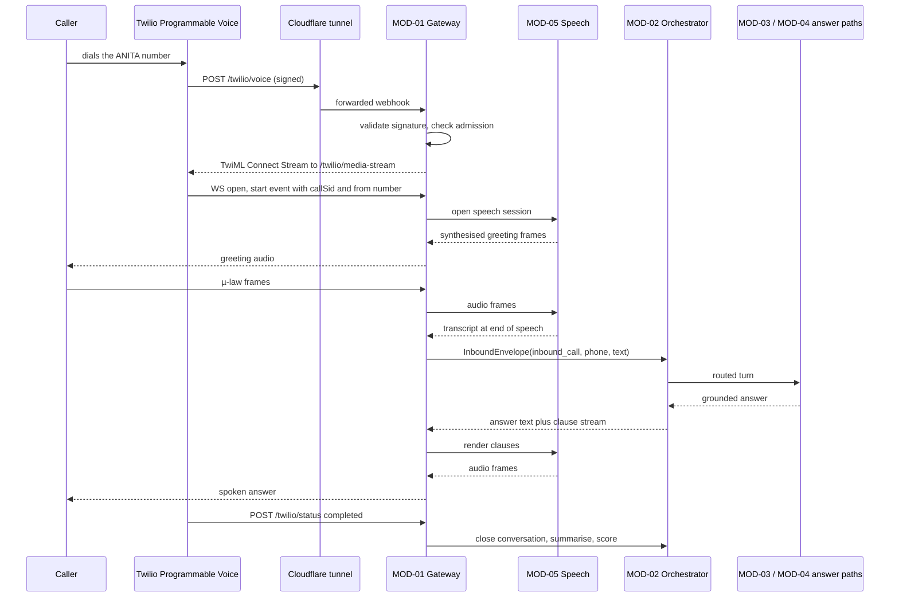

> **Lens:** PO / TPO (technical ACs) / Architect (HLD, LLD) · **Engagement:** Brownfield

# US-001 — Answer a PSTN call end to end over Twilio Media Streams [Lens: PO]

- **Story:** As a **hospital procurement officer calling the ANITA number**, I want **my spoken question about a catalogue product answered in the call, with a real person one request away**, so that **I get the specification, price or MOQ I need without submitting a form and waiting**.
- **Business value:** Inbound voice is the channel with the highest intent per contact — a buyer who dials has already shortlisted ANITA. Every call answered after hours is a lead that would otherwise reach a competitor (North Star metric, `00-product-intent.md` §4).
- **Priority:** **Must** — one of the four core MVP channels (`00-product-intent.md` §5).
- **Ordering note (TPO):** must land after US-004 (conversation identity, MOD-02) and the MOD-05 speech services it depends on, and before US-006 (turn persistence surfaces the call transcript). It is independent of US-002 (messaging) — the two can be built in parallel; both share the TRD-01 envelope contract, which US-002 also consumes.

## Acceptance Criteria [Lens: PO]

```gherkin
Scenario: AC-1 A caller asks about a catalogue product and hears a grounded answer
  Given the ANITA number is provisioned and its webhook points at this instance
    And the caller's phone number is presented by the carrier
  When the caller dials the ANITA number and asks "what does the FCR Prima T2 weigh?"
  Then the call is answered and the greeting is spoken within 1.2 s of answer
    And the answer states the specification from the corpus and cites the product by name
    And the conversation is recorded with channel "inbound_call" and linked to a lead

Scenario: AC-2 A price question is answered with the exact catalogue figure and the caveat
  Given the caller has an open voice conversation
  When the caller asks "how much is the ultrasound gel?"
  Then the reply states the catalogue price with the list-price / quotation-required caveat (BRD-06, R-1)
    And no generated text about price appears in the turn trace (BRD-05)

Scenario: AC-3 The caller interrupts and the agent yields
  Given the agent is speaking a long answer
  When the caller begins speaking
  Then the agent stops within the barge-in budget and the caller's new question is transcribed

Scenario: AC-4 (failure) Capacity is full and the caller is offered a callback
  Given both admitted call slots are occupied
  When a third caller dials the ANITA number
  Then the caller hears a busy message plus a callback offer, never silence
    And a callback lead is created and no media stream is opened

Scenario: AC-5 (failure) A webhook with an invalid Twilio signature is refused
  Given an inbound request to /twilio/voice with an invalid X-Twilio-Signature
  When the request is processed
  Then the response is 403
    And no conversation, turn or lead row is created

Scenario: AC-6 (failure) The caller's number is withheld
  Given the carrier withholds the caller's number
  When the caller asks a catalogue question
  Then the call is answered normally and the conversation is keyed on the media stream id
    And any lead created is marked incomplete and the follow-up gap is flagged

Scenario: AC-7 (failure) Speech is not recognised after repeated attempts
  Given the caller has produced three consecutive unintelligible utterances
  When the agent re-prompts a third time
  Then the agent offers a human transfer or a callback (UC-03 E2)
    And the call closes cleanly with the partial transcript retained

Scenario: AC-8 (failure) The media stream drops abnormally
  Given an active call with a media stream
  When the WebSocket closes without a Twilio stop event
  Then the call is torn down cleanly, no "lost connection" audio artefact is played
    And the partial transcript is retained against the conversation (SM-02)
```

Technical acceptance criteria [Lens: TPO]:

- **TAC-1:** Webhook ack p95 ≤ 150 ms; the TwiML response is produced after signature validation and an admission decision, in that order.
- **TAC-2:** Greeting first-audio p95 ≤ 1.2 s from call answer; answer first-clause p95 ≤ 1.2 s from end-of-speech (600 ms endpointing floor included).
- **TAC-3:** Media-stream forwarding adds ≤ 30 ms p95 to frame transit; audio frame loss ≤ 0.5 % over a 5-minute call.
- **TAC-4:** `X-Twilio-Signature` is validated against the configured public base URL before the body is parsed; validation failure returns 403 with an empty body and increments `channel.inbound.rejected`.
- **TAC-5:** Admission (`MAX_CONCURRENT_CALLS`, default 2) is evaluated before TwiML is emitted; a refused call never opens a media stream.
- **TAC-6:** A call longer than 30 minutes with no successful end-of-speech is capped and closed gracefully with the transcript retained.
- **TAC-7:** The call teardown path writes the conversation summary and emits `conversation.closed` within 2 s of the socket closing.
- **TAC-8:** No caller phone number appears unmasked in any log line (masking per `REC-14`).

## HLD — Architecture Slice [Lens: Architect]



- **Components touched:**
  - **MOD-01 (this story):** new `POST /twilio/voice`, `POST /twilio/status`, `WS /twilio/media-stream`, the TwiML builder, admission check, and the µ-law frame relay.
  - **MOD-05:** consumes frames and returns transcripts/audio through its existing interface (built separately); this story fixes only the boundary contract.
  - **MOD-02:** receives `InboundEnvelope` and returns an answer; unchanged by this story.
  - **MOD-06:** receives the call-ended handoff to attach transcript and lead.
  - **MOD-08:** receives `received`/`validated`/`rendered` stage marks.
- **Interaction summary:**
  1. Twilio fetches TwiML; the gateway validates the signature against the configured public URL, checks admission, and returns either `Connect/Stream` or a busy `Say`.
  2. Twilio opens the media-stream WebSocket and sends `connected` → `start` (carrying `streamSid`, `callSid`, and the `from` number).
  3. Audio frames flow to MOD-05; end-of-speech yields a transcript which is wrapped into an `InboundEnvelope` and handed to MOD-02.
  4. The answer returns as clause-level text; MOD-05 synthesises it and the gateway streams µ-law frames back with `mark`-based flow control.
  5. On `stop` or disconnect, the conversation is summarised, sentiment-scored and attached to a lead.
  - **Failure path:** invalid signature → 403 before any work; admission full → busy TwiML and no stream; media drop → clean teardown with the transcript retained; MOD-04 unavailable → spoken apology plus callback offer and the turn logged `FAILED`.

## LLD — Implementation Detail [Lens: Architect]

- **Classes / functions / APIs** — Python, FastAPI, asyncio:

```python
# mod01/voice/webhook.py
@router.post("/twilio/voice", response_class=Response)
async def voice_webhook(request: Request) -> Response:
    """Validate signature -> admission -> TwiML (Connect/Stream or busy Say)."""

def validate_twilio_signature(request: Request, *, public_base_url: str, auth_token: str) -> bool

def build_stream_twiml(*, ws_url: str, call_id: str) -> str
def build_busy_twiml(*, message: str, callback_number: str) -> str

# mod01/voice/admission.py
class AdmissionController:
    def __init__(self, max_concurrent: int) -> None: ...
    def try_admit(self, channel: str) -> AdmitTicket | Rejected
    def release(self, ticket: AdmitTicket) -> None

# mod01/voice/media_stream.py
class TwilioMediaStream:
    async def on_connected(self, event: dict) -> None
    async def on_start(self, event: dict) -> None      # streamSid, callSid, from
    async def on_media(self, event: dict) -> None      # base64 µ-law payload
    async def on_mark(self, event: dict) -> None       # flow control ack
    async def on_stop(self, event: dict) -> None
    async def send_audio(self, ulaw_frames: AsyncIterator[bytes], *, mark_every_n: int = 25) -> None
    def envelope(self, transcript: str) -> InboundEnvelope

# mod01/voice/status.py
@router.post("/twilio/status")
async def call_status(request: Request) -> Response:
    """completed | no-answer | busy | failed -> MOD-06 lead/attempt update."""
```

- **Data schema changes** — new tables in the ANITA schema (`REC-13` pattern, idempotent DDL at boot):

```sql
CREATE TABLE IF NOT EXISTS channel_endpoint (
  id            uuid PRIMARY KEY DEFAULT gen_random_uuid(),
  channel_kind  text NOT NULL,             -- 'inbound_call' | 'browser_voice' | ...
  provider      text NOT NULL,             -- 'twilio'
  address       text NOT NULL,             -- E.164 number or sender id
  secret_ref    text,                      -- env key NAME, never the value
  capabilities  jsonb NOT NULL DEFAULT '{}',
  enabled       boolean NOT NULL DEFAULT true,
  instance_id   text NOT NULL,             -- ANITA instance guard (BRD-18)
  UNIQUE (channel_kind, address, instance_id)
);

CREATE TABLE IF NOT EXISTS inbound_event (
  provider_event_id text PRIMARY KEY,      -- Twilio CallSid / MessageSid / streamSid
  endpoint_id       uuid NOT NULL REFERENCES channel_endpoint(id),
  channel_kind      text NOT NULL,
  received_at       timestamptz NOT NULL DEFAULT now(),
  disposition       text NOT NULL          -- 'accepted' | 'duplicate' | 'rejected'
);

CREATE TABLE IF NOT EXISTS channel_session (
  id               uuid PRIMARY KEY DEFAULT gen_random_uuid(),
  channel_kind     text NOT NULL,
  session_key      text NOT NULL,          -- streamSid for voice
  conversation_id  uuid,                    -- FK into MOD-02 conversation
  started_at       timestamptz NOT NULL DEFAULT now(),
  last_activity_at timestamptz NOT NULL DEFAULT now(),
  closed_at        timestamptz,
  UNIQUE (channel_kind, session_key)
);

CREATE INDEX IF NOT EXISTS inbound_event_received_idx ON inbound_event (received_at);
```

- **Edge cases** — each with the decided behaviour:
  1. **Invalid signature** → 403, empty body, counter incremented, body never logged (`TAC-4`, `DG-06`).
  2. **Replayed `CallSid`** → `inbound_event` PK conflict → 200 with the original TwiML, no new stream (`CG-2`).
  3. **Admission full** → busy TwiML with the callback number; a `callback_requested` lead is created; no WS is opened (`AC-4`).
  4. **Caller ID withheld** → `from` empty; session keyed on `streamSid`; lead created without phone and flagged incomplete (`AC-6`).
  5. **Duplicate `start` event** → idempotent by `streamSid`; the second is ignored (`UC-03` duplicate row).
  6. **Silence / no end-of-speech** → 30-minute call cap closes gracefully (`TAC-6`).
  7. **N unintelligible utterances** → re-prompt then transfer/callback offer (`AC-7`).
  8. **Abnormal socket close** → teardown path, partial transcript retained, no error audio (`AC-8`).
  9. **Carrier status callback lost** → row remains `DIALING`; MOD-06 lock expiry reconciles (`SM-04`).
  10. **Answer composed but TTS segment fails** → one retry, then the clause is dropped and the call continues; the dropped clause is counted.
  11. **Caller hangs up mid-answer** → teardown, partial transcript kept, no lead if no details were given.
  12. **MOD-04 unavailable** → spoken apology plus callback offer; turn logged `FAILED` (deterministic lookups still answer, `DG-03`).
  13. **Webhook arrives before the boot preflight completes** → 503 with `Retry-After`; Twilio's retry is deduped by `CallSid`.
  14. **Signature valid but endpoint address is not this instance's number** → attributed rejection, 403, no conversation (`CG-1`, `BRD-03`).

- **Error handling:**
  - `SignatureValidationError` → 403, never 500; counted as `channel.inbound.rejected`.
  - `AdmissionRejected` → busy TwiML, `callback_requested` lead, no error surfaced to the caller.
  - `MediaStreamError` → teardown with `failure_reason`, transcript retained, `conversation.closed` emitted after the summary write.
  - `SpeechUnavailable` → re-prompt once, then transfer/callback offer.
  - Retries: TTS clause retried once (1 s); no retry for webhook processing (deduped by provider id instead). Dead letter: the `inbound_event` row with `disposition='rejected'` is the audit record; there is no silent drop.

- **Test scenarios** — the `UC-03` Scenario Coverage table is the floor; every row is covered:

| # | UC-03 scenario row | Level | Test |
|---|---|---|---|
| T-01 | Happy path | e2e | Signed webhook → TwiML → WS → transcript → grounded answer → summary written |
| T-02 | Alternate path — barge-in (A1) | integration | Caller speech mid-playback stops the TTS stream within budget |
| T-03 | Alternate path — human request (A2) | integration | "Can I speak to someone?" produces a handoff and the caller is told when to expect contact |
| T-04 | Invalid input — silence/gibberish | integration | Three unintelligible turns → re-prompt then transfer/callback (AC-7) |
| T-05 | Unauthorized user | integration | Requests to /twilio/voice with no signature → 403; admission still limits concurrent calls |
| T-06 | Missing data — withheld number | integration | Empty `from` → streamSid-keyed session, lead created incomplete (AC-6) |
| T-07 | Partial data — name without email | integration | Lead saved partially with the follow-up flag |
| T-08 | Duplicate request — same question twice | integration | Same question asked twice → answered twice, one lead (dedupe on phone) |
| T-09 | Timeout — end-of-speech never detected | integration | 30-minute cap closes the call gracefully and retains the transcript |
| T-10 | Dependency failure — LLM down | integration | Spoken apology plus callback offer; turn `FAILED`; commercial lookups still answer |
| T-11 | Retry — failed TTS segment | unit | One retry then the clause is skipped and counted |
| T-12 | Concurrent operation — second call | integration | Second call admits; third call gets busy TwiML and no stream (AC-4) |
| T-13 | Cancellation — caller hangs up mid-answer | integration | Teardown, partial transcript kept, no orphaned stream |
| T-14 | Recovery — caller calls back | e2e | Same number within 6 h resumes the conversation and the prior lead |
| T-15 | Partial completion — dropped after answer, before summary | integration | Summary job re-runs from the stored transcript and `conversation.closed` fires once |
| T-16 | Security regression | unit | Signature computed for the public URL validates with the tunnel host header (TAC-4) |
| T-17 | **Load** | load | 3 concurrent calls on a 2-slot admission: first two complete with p95 first-audio ≤ 1.2 s, third is refused in ≤ 150 ms and opens no WS (TAC-2, TAC-5) |

## Traceability

- Parent module: `MOD-01`
- Use case: `UC-03` (business story)
- Technical requirements: `TRD-01` (InboundEnvelope), `TRD-02` (Twilio voice ingress)
- Business requirements: `BRD-01`, `BRD-03`, `BRD-06` (caveat enforced on the voice path), `BRD-13` (handoff offer in call)
- Data gap / state machine: `DG-01` (admission ceiling), `DG-03` (LLM-outage behaviour), `DG-06` (signature validation), `SM-02` (conversation/turn), `SM-04` (status callback), `SM-06` (handoff)
- Reconciliation: `REC-10` (`app/main.py` dropped, behaviour re-expressed), `REC-11` (Twilio integration refactored), `REC-19` (admission control reused), `REC-21` (no secret values copied)

## Definition of Done

- [ ] All ACs pass (AC-1 … AC-8, TAC-1 … TAC-8)
- [ ] Tests T-01 … T-17 pass, including the load test against TAC-2/TAC-5
- [ ] Schema migration applied (`channel_endpoint`, `inbound_event`, `channel_session`) with `CREATE TABLE IF NOT EXISTS` idempotency
- [ ] Module doc `MOD-01-channel-gateway.md` updated if the envelope or TwiML contract changed
- [ ] No secret value, caller number or transcript body appears in logs; masking verified
- [ ] ADR note recorded if the TwiML shape or admission policy deviates from TRD-02
