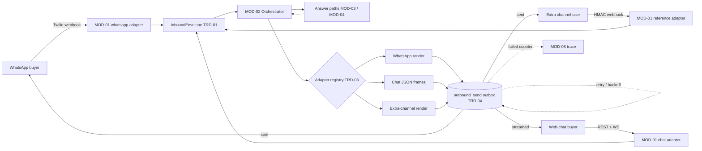

> **Lens:** PO / TPO (technical ACs) / Architect (HLD, LLD) · **Engagement:** Brownfield

# US-002 — Answer on web chat, WhatsApp and a configurable extra channel through one adapter pattern [Lens: PO]

- **Story:** As a **diagnostic-centre owner who messages on WhatsApp at 22:00**, I want **my question answered on the channel I already have open, and an ops admin to be able to switch on another messaging channel later without a rebuild**, so that **ANITA reaches buyers wherever they are and can grow its channel coverage without re-opening the product**.
- **Business value:** Messaging is where the out-of-hours demand lives; and the configurable adapter is what makes D1's "additional messaging channel" a configuration task rather than a second delivery project.
- **Priority:** **Must** — web chat and WhatsApp are core MVP channels; the extra adapter is the D1 commitment (`00-product-intent.md` §5).
- **Ordering note (TPO):** independent of US-001; both consume the TRD-01 envelope. It must land before US-006 (turns must be persistable) and before US-009 (the console renders channel health, including the extra adapter). The outbox (TRD-04) is shared with US-001's status callbacks but is built here.

## Acceptance Criteria [Lens: PO]

```gherkin
Scenario: AC-1 A WhatsApp buyer gets an answer on WhatsApp
  Given the ANITA WhatsApp sender is registered on the ANITA Twilio number
  When a buyer sends "MOQ on the ultrasound gel?" to that sender
  Then a WhatsApp reply states the catalogue MOQ of 1 Unit with the quote-required caveat
    And the conversation is grouped under the sender identity and scored for sentiment

Scenario: AC-2 A web-chat buyer gets a streamed answer and keeps context between turns
  Given a buyer has an open chat session
  When the buyer asks "what does the FCR Prima T2 weigh?" and then "and the price?"
  Then the second answer resolves the same product without re-asking which product

Scenario: AC-3 A WhatsApp voice note is declined with a text prompt
  Given a buyer sends a voice note to the ANITA sender
  When the message is processed
  Then the buyer receives a text reply explaining that voice notes are not transcribed and offering text or a call

Scenario: AC-4 (failure) Duplicate WhatsApp delivery is deduplicated
  Given Twilio redelivers the same MessageSid three times
  When all three webhooks are processed
  Then exactly one reply is sent and exactly one turn is recorded

Scenario: AC-5 (failure) A carrier send failure is queued, retried and visible
  Given the outbound WhatsApp send fails with a carrier 5xx
  When the retry budget is exhausted
  Then the send row is marked FAILED with the carrier error and appears in the ops console
    And the buyer is never left with a silently unanswered question

Scenario: AC-6 An ops admin enables the extra messaging channel by configuration
  Given a provider account, its HMAC secret and its capability declaration are configured
  When the admin enables the channel adapter
  Then inbound messages on that channel are answered and outbound replies route to it
    And no other channel adapter or the answer engine needed a code change or restart

Scenario: AC-7 (failure) An invalid extra-channel credential leaves the other channels running
  Given the extra adapter's configured secret is rejected by the provider
  When the adapter is enabled
  Then the adapter refuses to enable and names the failing credential
    And web chat, WhatsApp and voice continue serving without interruption

Scenario: AC-8 (failure) An unsupported media type is explained, not ignored
  Given a buyer sends a file type the channel cannot process
  When the message is processed
  Then the buyer receives an explanation and a text prompt
    And the message is recorded on the conversation with the unsupported type noted

Scenario: AC-9 (failure) An anonymous chat session does not become a lead
  Given a chat session with no contact details supplied
  When the buyer asks several questions and leaves
  Then the conversation is stored and reviewable, and no lead row is created (CV-02)
```

Technical acceptance criteria [Lens: TPO]:

- **TAC-1:** Every channel produces exactly one `InboundEnvelope` shape; no adapter-specific field crosses into MOD-02 (asserted by a contract test over all adapters).
- **TAC-2:** WhatsApp webhook ack p95 ≤ 150 ms; reply dispatch p95 ≤ 400 ms after the answer is composed.
- **TAC-3:** Chat first token p95 ≤ 2.5 s end-to-end (inherits `00-product-intent.md` §4); WS keepalive at 15 s, idle close at 10 min.
- **TAC-4:** Outbox: 5 attempts, exponential backoff 5 s → 15 min, `next_attempt_at` indexed partial index; a failed row is never deleted.
- **TAC-5:** Duplicate provider event ids produce zero duplicate sends and zero duplicate turns (replay of 10 events → 1 send).
- **TAC-6:** Inbound body limit 1 MiB (chat) / 16 MiB (WhatsApp media); oversize → 413 with the limit named.
- **TAC-7:** Enabling/disabling an adapter is idempotent and takes effect within 2 s without restarting the process or affecting other channels.
- **TAC-8:** No message body or phone number is written unmasked to logs.

## HLD — Architecture Slice [Lens: Architect]



- **Components touched:**
  - **MOD-01 (this story):** adapter interface + registry, `POST /twilio/whatsapp`, `POST /chat/session`, `WS /chat/stream`, `POST /channels/{channel_id}/inbound`, native renderers, `outbound_send` worker.
  - **MOD-02:** consumes `InboundEnvelope` only; unchanged.
  - **MOD-06:** reads the chat session's identity link when details are supplied (CV-02 link point).
  - **MOD-08:** receives send-failure and channel counters for the console.
- **Interaction summary:**
  1. An inbound event arrives on any of the three adapters, is attributed to this instance, and is deduplicated on its provider event id.
  2. The adapter constructs one `InboundEnvelope` (text, media ref, identity, capabilities) and hands it to MOD-02.
  3. The answer returns; the **originating** adapter renders it natively and writes one `outbound_send` row.
  4. The send worker dispatches; success records `provider_message_id`, failure schedules the next attempt.
  - **Failure path:** duplicate event → acknowledged, discarded; carrier failure → `RETRY` then `FAILED` surfaced to ops; unsupported media → explanatory reply; adapter credential invalid → adapter disabled, other channels unaffected.

## LLD — Implementation Detail [Lens: Architect]

- **Classes / functions / APIs** — Python:

```python
# mod01/channels/base.py
class ChannelCapabilities(BaseModel):
    inbound: bool; outbound: bool
    text: bool; media: bool; audio: bool; streaming: bool

class ChannelAdapter(Protocol):
    kind: str
    capabilities: ChannelCapabilities
    def normalise(self, raw: RawInbound) -> InboundEnvelope: ...
    def render(self, reply: Reply) -> RenderedSend: ...
    async def dispatch(self, send: RenderedSend) -> SendResult: ...

# mod01/channels/registry.py
class AdapterRegistry:
    def register(self, adapter: ChannelAdapter) -> None
    def get(self, kind: str) -> ChannelAdapter
    def enabled(self) -> list[ChannelAdapter]
    def enable(self, kind: str, config: AdapterConfig) -> EnableResult   # UC-14 A1/E1
    def disable(self, kind: str) -> None

# mod01/channels/whatsapp.py / chat.py / reference.py
class WhatsAppAdapter(ChannelAdapter): ...
class WebChatAdapter(ChannelAdapter): ...
class ReferenceWebhookAdapter(ChannelAdapter):   # DG-07 reference implementation

# mod01/outbound/outbox.py
@dataclass
class OutboundSend:
    id: UUID; channel_kind: str; conversation_id: UUID
    lead_id: UUID | None; attempt: int; status: str
    next_attempt_at: datetime; last_error: str | None

class SendOutbox:
    async def enqueue(self, send: OutboundSend) -> UUID
    async def claim_due(self, limit: int = 20) -> list[OutboundSend]   # FOR UPDATE SKIP LOCKED
    async def mark_sent(self, send_id: UUID, provider_message_id: str) -> None
    async def mark_retry(self, send_id: UUID, error: str, attempt: int) -> None
    async def mark_failed(self, send_id: UUID, error: str) -> None
    def backoff(self, attempt: int) -> timedelta   # 5s, 30s, 2m, 8m, 15m
```

- **Data schema changes:**

```sql
CREATE TABLE IF NOT EXISTS outbound_send (
  id                  uuid PRIMARY KEY DEFAULT gen_random_uuid(),
  channel_kind        text NOT NULL,
  conversation_id     uuid,
  lead_id             uuid,
  attempt             int  NOT NULL DEFAULT 0,
  status              text NOT NULL DEFAULT 'QUEUED',   -- QUEUED|RETRY|SENT|FAILED
  payload_ref         jsonb NOT NULL,
  next_attempt_at     timestamptz NOT NULL DEFAULT now(),
  last_error          text,
  provider_message_id text,
  created_at          timestamptz NOT NULL DEFAULT now(),
  updated_at          timestamptz NOT NULL DEFAULT now()
);

CREATE INDEX IF NOT EXISTS outbound_send_due_idx
  ON outbound_send (next_attempt_at)
  WHERE status IN ('QUEUED', 'RETRY');   -- REC-07 partial-index pattern

ALTER TABLE channel_endpoint
  ADD COLUMN IF NOT EXISTS capability_matrix jsonb NOT NULL DEFAULT '{}';
```

- **Edge cases** — each with the decided behaviour:
  1. **Duplicate `MessageSid`** → `inbound_event` PK conflict → 200, no reply, no turn (`AC-4`).
  2. **WhatsApp media without caption** → stored, buyer asked for context (`UC-02` partial data).
  3. **WhatsApp voice note** → text decline with a call offer (`AC-3`, `CG-8`).
  4. **Unsupported media type** → explanation plus prompt; recorded with the type (`AC-8`).
  5. **Sender blocks the number** → send fails with the provider's undeliverable code → row `FAILED`, lead flagged, not retried (`UC-02` cancellation).
  6. **Two messages in flight from one sender** → processed in arrival order per conversation (`SM-02` serialisation).
  7. **Unknown sender, idle window expired** → new conversation, prior lead matched by phone (`UC-02` E1).
  8. **Blank sender number** (extra channel without a handle) → conversation keyed on the adapter's supplied handle; anonymous.
  9. **Chat WS drop mid-stream** → answer persisted; reconnect within 60 s resumes and replays the completed answer (`UC-01` partial completion).
  10. **Chat message empty or > 4,000 chars** → re-prompt with the limit; no turn created (`UC-01` invalid input).
  11. **Extra-adapter HMAC mismatch** → 401, counted, no turn.
  12. **Extra-adapter config malformed** → enable refused with a field-level error (`UC-14` invalid input).
  13. **Re-enabling an already-enabled adapter** → no-op, 200 (`UC-14` duplicate).
  14. **Two admins enable concurrently** → second is a no-op; registry state converges (`UC-14` concurrent).
  15. **Adapter disabled with an inbound in flight** → inbound completes; subsequent inbound is rejected politely (`UC-14` cancellation).
  16. **Outbox worker crash mid-dispatch** → `RETRY` row reclaimed on restart; provider dedupe by message id prevents a double send where the provider supports it.

- **Error handling:**
  - `AdapterNotFound` → 404 on the enable route; `AdapterConfigInvalid` → 422 with field details.
  - `SendFailed` → classify transient (5xx, timeout) → `RETRY`; permanent (4xx except 429, undeliverable) → `FAILED`.
  - `DuplicateEvent` → acknowledged, counters incremented; never an error surfaced to the provider.
  - Retries: outbox only (backoff 5 s → 15 min, 5 attempts); inbound is deduped, not retried. Dead letter: `FAILED` rows, retained indefinitely and surfaced in the console.

- **Test scenarios** — the `UC-01`, `UC-02` and `UC-14` Scenario Coverage tables are the floor:

| # | Scenario row | Level | Test |
|---|---|---|---|
| **UC-01 web chat** | | | |
| T-01 | Happy path | e2e | Chat session → question → streamed grounded answer → turn recorded with sentiment |
| T-02 | Alternate path (A1, A2) | integration | Commercial question routes to deterministic; ambiguous product name triggers disambiguation |
| T-03 | Invalid input | unit | Empty and 4,001-char messages rejected with a re-prompt; no turn row |
| T-04 | Unauthorized user | integration | No auth required; per-session rate limit returns 429 after the threshold |
| T-05 | Missing data | integration | Question naming a product absent from the catalogue → decline + handoff offer |
| T-06 | Partial data | integration | Product present with no spec block → "not published", never inferred |
| T-07 | Duplicate request | integration | Same question twice → answered twice, one lead row |
| T-08 | Timeout | integration | Retrieval/LLM exceeds budget → decline path, turn `FAILED` with reason |
| T-09 | Dependency failure | integration | Vector store down → chat still replies with the decline + handoff |
| T-10 | Retry | unit | Transient LLM failure retried once, then decline |
| T-11 | Concurrent operation | integration | Two tabs, one session → turns serialised per conversation |
| T-12 | Cancellation | integration | Tab closed mid-answer → turn recorded incomplete, no lead created |
| T-13 | Recovery | integration | After a backend failure the buyer re-asks; prior context preserved |
| T-14 | Partial completion | integration | Streamed answer then socket loss → full answer persisted and replayable |
| **UC-02 WhatsApp** | | | |
| T-15 | Happy path | e2e | Inbound text → grouped conversation → WhatsApp reply → scored |
| T-16 | Alternate path (A1, A2) | integration | Media accepted and stored; voice note declined with a text prompt |
| T-17 | Invalid input | integration | Unsupported media type explained, not ignored |
| T-18 | Unauthorized user | integration | Unknown sender accepted; abuse rate-limited per sender |
| T-19 | Missing data | integration | Sender number absent → conversation keyed on the channel handle |
| T-20 | Partial data | integration | Media without caption → buyer asked for context |
| T-21 | Duplicate request | integration | Same `MessageSid` ×10 → one reply, one turn (TAC-5) |
| T-22 | Timeout | integration | Engine slow → holding reply then the answer; no timeout error to the buyer |
| T-23 | Dependency failure | integration | Twilio API down → send row queued, worker retries, no crash |
| T-24 | Retry | unit | Outbound send retried with the documented backoff schedule |
| T-25 | Concurrent operation | integration | Two messages in flight → processed in arrival order |
| T-26 | Cancellation | integration | Buyer blocks the number → sends marked undeliverable and not retried |
| T-27 | Recovery | integration | Next inbound after a failure resumes normally under the same identity |
| T-28 | Partial completion | integration | Media stored but reply failed → reply queued and dispatched later |
| **UC-14 extra channel** | | | |
| T-29 | Happy path | e2e | Configure → register HMAC webhook → declare capabilities → enable → smoke-test message answered |
| T-30 | Alternate path (A1) | integration | Send-only channel enabled without an inbound webhook |
| T-31 | Invalid input | unit | Malformed config rejected with a specific field error |
| T-32 | Unauthorized user | integration | Enable/disable requires the admin session; buyer traffic needs no auth |
| T-33 | Missing data | unit | Missing capability declaration defaults to text-only |
| T-34 | Partial data | integration | Credential present, webhook secret absent → inbound only, warning emitted |
| T-35 | Duplicate request | integration | Re-adding an existing channel is a no-op |
| T-36 | Timeout | integration | Provider handshake timeout → adapter not enabled, error names the provider |
| T-37 | Dependency failure | integration | Provider unreachable → adapter disabled, other channels unaffected (AC-7) |
| T-38 | Retry | integration | Enable retried succeeds once the provider recovers |
| T-39 | Concurrent operation | integration | Two admins enable simultaneously → second is a no-op |
| T-40 | Cancellation | integration | Channel disabled → inbound rejected politely, config retained, re-enable restores |
| T-41 | Partial completion | integration | Inbound live, outbound failing → channel marked degraded, not healthy |
| T-42 | **Load** | load | 30 inbound messages across the three adapters in 60 s: all acked ≤ 150 ms, outbox drains with zero duplicate sends and no cross-channel envelope field leakage (TAC-1, TAC-2) |

## Traceability

- Parent module: `MOD-01`
- Use cases: `UC-01`, `UC-02`, `UC-14` (business story)
- Technical requirements: `TRD-01` (envelope), `TRD-03` (adapter registry), `TRD-04` (outbox)
- Business requirements: `BRD-01` (one engine), `BRD-02` (continuity), `BRD-19` (cross-platform), `BRD-23` (outbound delivery path), `BRD-14` (outbox pattern, no Salesforce code)
- Data gap / state machine: `DG-07` (extra-channel adapter pattern), `SM-02` (conversation/turn states), `SM-04` (outbound attempt), `DG-06` (rate limiting on buyer surfaces)
- Reconciliation: `REC-07` (outbox pattern re-implemented), `REC-11` (Twilio messaging refactored), `REC-06`/`REC-21` (no Salesforce code, no secret values), `REC-13` (idempotent DDL)

## Definition of Done

- [ ] All ACs pass (AC-1 … AC-9, TAC-1 … TAC-8)
- [ ] Tests T-01 … T-42 pass, including the cross-adapter contract test and the 60 s load test
- [ ] Schema migration applied (`outbound_send`, `channel_endpoint.capability_matrix`)
- [ ] Module doc `MOD-01-channel-gateway.md` updated if the adapter interface changed
- [ ] The reference adapter passes the same contract test as the built-in adapters (proves TRD-03)
- [ ] No message body, phone number or HMAC secret appears in logs
