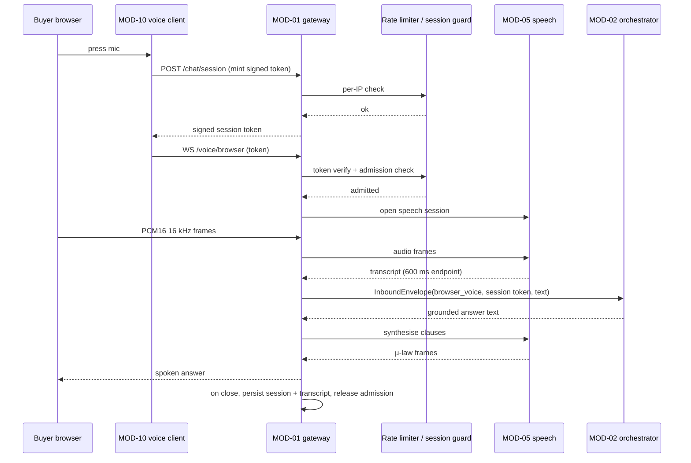

> **Lens:** PO / TPO (technical ACs) / Architect (HLD, LLD) · **Engagement:** Brownfield

# US-003 — Open the browser-mic voice channel behind a hardened public edge [Lens: PO]

- **Story:** As a **radiographer browsing the ANITA site on my phone**, I want to **tap a microphone, ask my question out loud and hear the answer, without installing anything**, so that **I get an answer faster than typing — and as the business, I want that new public door locked to forged callbacks and abuse before it is opened**.
- **Business value:** Browser voice removes the phone-call commitment for a buyer in a corridor; the hardening is the `DG-06` remediation without which the whole public surface (lead PII included) must not go live.
- **Priority:** **Must** — browser voice is the D1 commitment; the `DG-06` controls are **blocking for public launch** (`04-coverage-gap-analysis.md` §6).
- **Ordering note (TPO):** must land after US-004 (identity) and MOD-05 speech; independent of US-002. It is deliberately sequenced **before** any public DNS/tunnel switch-over: an unhardened edge must never be exposed.

## Acceptance Criteria [Lens: PO]

```gherkin
Scenario: AC-1 A buyer asks by voice in the browser and hears the answer
  Given the buyer's browser has microphone permission and the page is open
  When the buyer presses the mic control and asks "what does the FCR Prima T2 weigh?"
  Then the answer is spoken in the browser within 1.2 s of the buyer finishing speaking (p95)
    And the turn is recorded on the same conversation as any prior chat turns for that session

Scenario: AC-2 The buyer switches from voice to typing mid-session
  Given an open browser-mic session
  When the buyer types a follow-up instead of speaking
  Then the typed turn continues in the same conversation with the voice context available

Scenario: AC-3 (failure) Microphone permission is denied
  Given the buyer denies microphone permission
  When the mic control is pressed
  Then the page offers the text chat and shows the direct phone number without an error state

Scenario: AC-4 (failure) The WebSocket drops mid-session
  Given an active browser-mic session
  When the socket drops
  Then the session ends cleanly, the transcript is retained, and a reconnect within 60 s resumes the same conversation

Scenario: AC-5 (failure) A forged Twilio or adapter webhook is refused
  Given a request to a webhook route with an invalid signature or HMAC
  When the gateway processes it
  Then the response is 403/401 and no conversation, turn or lead row is created

Scenario: AC-6 (failure) A single abusive client is rate-limited, not served
  Given one identity sends more than 20 chat turns in a minute
  When the 21st request arrives
  Then the response is 429 with Retry-After
    And the other channels and users continue serving unaffected

Scenario: AC-7 (failure) Admin routes require a session
  Given no admin session cookie
  When any /admin/* route is requested
  Then the response is 401 and the body contains no conversation, lead or metric data

Scenario: AC-8 (failure) Voice admission refuses the browser session
  Given the voice admission ceiling is reached by PSTN and browser sessions
  When a new browser-mic session starts
  Then the client shows the busy state with a callback number and falls back to text chat
```

Technical acceptance criteria [Lens: TPO]:

- **TAC-1:** Mic frame capture → first outbound WS frame ≤ 300 ms; end-of-speech → first answer audio p95 ≤ 1.2 s end-to-end (the 600 ms endpointing floor included).
- **TAC-2:** The browser session carries a signed, HttpOnly session token minted server-side; unsigned or expired → 401 before any audio is accepted.
- **TAC-3:** 100 % of Twilio webhook routes validate `X-Twilio-Signature` against the configured public base URL **before** body parsing; 100 % of extra-adapter routes validate the per-adapter HMAC.
- **TAC-4:** Rate limits enforced: 20 turns/identity/min (burst 30), 120 req/IP/min on chat REST, 10 concurrent WSS/IP, 200 WSS/process; breach → 429 + `Retry-After`; all counters exposed to MOD-08.
- **TAC-5:** Browser-mic idle close after 30 s without frames; reconnect within 60 s reuses the conversation id; abnormal close never leaves a `channel_session` row open.
- **TAC-6:** Cross-channel isolation: a browser-mic session with no identity never merges into a phone-identified lead until contact details are supplied (`CV-02`).
- **TAC-7:** The same admission controller governs PSTN and browser sessions; a refused session opens no media pipeline and consumes no GPU.
- **TAC-8:** No secret, signature value or audio payload is logged; rejection reasons are counted by class only.

## HLD — Architecture Slice [Lens: Architect]



Every Twilio webhook additionally passes a signature gate before the sequence above begins; the gate is drawn separately in the module doc's component flow and is the subject of TRD-06.

- **Components touched:**
  - **MOD-01 (this story):** `WS /voice/browser`, session-token minting/verification, the shared admission controller, the shared rate limiter, and signature validation wired onto every public webhook route.
  - **MOD-05:** consumes PCM frames and returns transcripts/µ-law audio (built separately; only the boundary is fixed here).
  - **MOD-10:** the voice client UI is US-008; this story fixes the transport contract it consumes.
  - **MOD-09:** supplies the public base URL and the rate-limit/admission settings; the isolation assertion runs at boot.
  - **MOD-08:** receives rejection counters by class and the rate-limit counters.
- **Interaction summary:**
  1. The client mints a signed session token (per-IP limited) and opens the voice WebSocket with it.
  2. The gateway verifies the token, applies the per-IP connection cap, and asks the shared admission controller for a voice slot.
  3. Audio flows to MOD-05; end-of-speech yields a transcript handed to MOD-02 as an envelope.
  4. The answer returns and is synthesised back to the browser as µ-law frames.
  5. On close, the session row is closed, the slot released, the transcript persisted.
  - **Failure path:** no/invalid token → 401 before audio; connection cap → 429; admission refused → busy state + text fallback; socket drop → clean teardown and resume window; **and for webhooks, signature failure → 403 before body parse, counted, no side effects**.

## LLD — Implementation Detail [Lens: Architect]

- **Classes / functions / APIs** — Python:

```python
# mod01/security/signatures.py
class SignatureGate:
    def __init__(self, *, public_base_url: str, twilio_auth_token: str) -> None: ...
    def verify_twilio(self, request: Request, form: Mapping[str, str]) -> None   # raises SignatureError
    def verify_hmac(self, adapter_id: str, body: bytes, header: str) -> None     # raises SignatureError

# mod01/security/ratelimit.py
class TokenBucket:
    def allow(self, key: str, *, rate_per_min: int, burst: int) -> bool

class Limits:
    per_identity_turns = (20, 30)     # rate/min, burst
    per_ip_rest = 120
    per_ip_ws = 10
    per_process_ws = 200

# mod01/voice/browser_ws.py
class BrowserVoiceSession:
    async def open(self, token: SessionToken) -> OpenResult
    async def on_audio(self, pcm16: bytes) -> None
    async def on_control(self, frame: ControlFrame) -> None     # start | stop | stop_speaking
    async def close(self, reason: str) -> None

@router.websocket("/voice/browser")
async def voice_browser(ws: WebSocket) -> None: ...

def mint_session_token(*, ttl_seconds: int = 3600) -> str
def verify_session_token(token: str) -> SessionToken   # raises TokenError
```

- **Data schema changes:**

```sql
CREATE TABLE IF NOT EXISTS rate_limit_event (
  id            bigserial PRIMARY KEY,
  bucket_key    text NOT NULL,           -- hashed identity or IP, never raw
  limit_class   text NOT NULL,           -- 'turns_per_identity' | 'rest_per_ip' | 'ws_per_ip' | 'ws_process'
  occurred_at   timestamptz NOT NULL DEFAULT now()
);
CREATE INDEX IF NOT EXISTS rate_limit_event_bucket_idx ON rate_limit_event (bucket_key, limit_class, occurred_at);

ALTER TABLE channel_session
  ADD COLUMN IF NOT EXISTS close_reason text,       -- 'idle' | 'client_stop' | 'socket_error' | 'admission'
  ADD COLUMN IF NOT EXISTS resumed_from_session_id uuid;

CREATE TABLE IF NOT EXISTS rejected_ingress (
  id          bigserial PRIMARY KEY,
  received_at timestamptz NOT NULL DEFAULT now(),
  route       text NOT NULL,
  reason      text NOT NULL             -- 'signature' | 'hmac' | 'rate_limit' | 'attribution' | 'oversize'
);
```

`bucket_key` stores a salted hash — the raw phone number or IP is never persisted by the limiter (`TAC-8`).

- **Edge cases** — each with the decided behaviour:
  1. **Mic permission denied** → client-side `DEGRADED`; no WS is opened, no server error (`AC-3`).
  2. **No microphone device** → same path, counted client-side (`UC-04` invalid input).
  3. **Unsigned / expired token** → 401 before any audio frame; counted (`TAC-2`).
  4. **Duplicate start frames** → ignored by frame sequence; one session (`UC-04` duplicate).
  5. **Two tabs, one buyer** → independent sessions; both resolve to the same conversation only if identity exists (`TAC-6`).
  6. **Idle socket** → 30 s close with `close_reason='idle'`; no orphan row (`TAC-5`).
  7. **Socket error mid-audio** → teardown, transcript retained, resume window 60 s.
  8. **Buyer stops the mic** → explicit close, no partial lead created (`UC-04` cancellation).
  9. **Reconnect after drop** → resumed conversation via token within 60 s (`UC-04` retry).
 10. **Admission refused** → busy state plus text fallback; no GPU consumed (`TAC-7`).
 11. **Rate limit breached** → 429 with `Retry-After`; the session is not silently dropped mid-audio.
 12. **Replayed Twilio webhook** → accepted by the dedupe table but never double-processed; the signature gate runs first.
 13. **Signature valid for the wrong number** → attribution rejection 403; counted separately from signature failure (`CG-1`).
 14. **Public URL misconfigured** → every Twilio webhook fails closed with 403; boot preflight warns loudly rather than silently rejecting traffic (`DG-09`).
 15. **Oversized chat body** → 413 with the limit named; no turn.
 16. **Anonymous browser session ends** → conversation stored, no lead (`CV-02`, `TAC-6`).

- **Error handling:**
  - `SignatureError` → 403, body never parsed, body never logged, counter `rejected_ingress.reason='signature'`.
  - `TokenError` → 401 on the WS handshake before accept.
  - `RateLimited` → 429 with `Retry-After`; the current audio buffer is flushed first on an open session so the buyer is not cut off mid-word.
  - `AdmissionRejected` → busy state, callback number, no media pipeline.
  - Retries: none on rejected ingress (a rejected signature is never retried); the client reconnect path covers socket failures (1 s → 8 s, 4 attempts).

- **Test scenarios** — the `UC-04` Scenario Coverage table is the floor:

| # | Scenario row | Level | Test |
|---|---|---|---|
| T-01 | Happy path | e2e | Token → WS → question → spoken answer → turn recorded under the session conversation |
| T-02 | Alternate path (A1 — switch to typing) | integration | Voice turn then a typed turn in the same conversation with prior context |
| T-03 | Invalid input | unit | No mic device / permission denied → DEGRADED; no WS opened |
| T-04 | Unauthorized user | integration | Public endpoint; per-session and per-IP limits applied; unsigned token → 401 |
| T-05 | Missing data | integration | Anonymous session → conversation stored, no lead (TAC-6) |
| T-06 | Partial data | integration | Partial capture retained on the session without inventing a lead |
| T-07 | Duplicate request | unit | Duplicate start frames ignored |
| T-08 | Timeout | integration | Idle 30 s → clean close, no orphaned `channel_session` row |
| T-09 | Dependency failure | integration | STT unavailable → text fallback offered, session closed cleanly |
| T-10 | Retry | integration | Reconnect within 60 s resumes the same conversation |
| T-11 | Concurrent operation | integration | Two tabs → two independent sessions, no cross-talk |
| T-12 | Cancellation | integration | Buyer stops the mic → session closed, no partial lead |
| T-13 | Recovery | integration | Page reload → new session, prior conversation retrievable by session identity |
| T-14 | Partial completion | integration | Audio sent, answer not played → answer persisted in the transcript |
| T-15 | Signature gate | unit | Valid Twilio signature for the public URL passes with a tunnel host header; tampered body fails with 403 and no side effect |
| T-16 | Signature gate | integration | Replay of a previously valid webhook with a mutated parameter → 403, no turn |
| T-17 | Rate limit | integration | 21st turn in a minute → 429 + `Retry-After`; a second identity is unaffected (AC-6) |
| T-18 | Connection cap | integration | 11th concurrent WS from one IP → 429; PSTN and messaging channels unaffected |
| T-19 | Admin boundary | integration | Every `/admin/*` route returns 401 with an empty data body when unauthenticated (AC-7) |
| T-20 | Isolation | unit | A browser session cannot attach to a lead without supplied contact details |
| T-21 | **Load** | load | 10 browser sessions + 2 PSTN calls offered against a 2-slot voice admission: exactly 2 hold media pipelines, refusal latency ≤ 150 ms, chat REST stays p95 ≤ 2.5 s under the simultaneous 120 req/min IP limit (TAC-1, TAC-4, TAC-7) |

## Traceability

- Parent module: `MOD-01`
- Use case: `UC-04` (business story)
- Technical requirements: `TRD-05` (browser-mic transport), `TRD-06` (public-edge hardening)
- Business requirements: `BRD-01`, `BRD-03` (endpoint attribution), `BRD-18` (isolation), `BRD-19` (cross-platform runtime)
- Data gap / state machine: `DG-06` (auth/rate-limit/signature remediation — blocking), `CV-03` (buyer vs admin surface split), `DG-01` (admission ceiling), `SM-02` (conversation), `SM-04` (attempt)
- Reconciliation: `REC-11` (Twilio integration refactored — signature validation **added**, absent in source), `REC-18` (ports and ingress made configurable), `REC-21` (no secret values copied), `REC-16` (browser client asset refactored)

## Definition of Done

- [ ] All ACs pass (AC-1 … AC-8, TAC-1 … TAC-8)
- [ ] Tests T-01 … T-21 pass, including the 2-slot admission load test and the signature-gate regression
- [ ] Schema migration applied (`rate_limit_event`, `rejected_ingress`, `channel_session` close columns)
- [ ] Module doc `MOD-01-channel-gateway.md` updated if the token or admission contract changed
- [ ] Penetration check: forged webhook, replayed webhook, unsigned WS, and rate-limit bypass each produce the documented refusal
- [ ] Boot preflight asserts the public base URL is configured; a missing value warns and fails webhook validation closed
