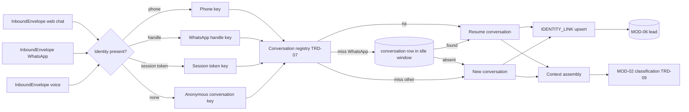

> **Lens:** PO / TPO (technical ACs) / Architect (HLD, LLD) · **Engagement:** Brownfield

# US-004 — Recognise a returning buyer across channels and keep the conversation together [Lens: PO]

- **Story:** As a **hospital procurement officer who asked about an FCR Prima T2 on web chat last night and calls from the same number this morning**, I want **to be recognised, so I do not have to repeat which product I am asking about** — and as **ops**, I want **each conversation to stay one coherent thread with a clear link to the lead**, so that reviews and follow-ups are not stitched together by hand.
- **Business value:** Continuity is what turns two contacts into one qualified lead; without it a buyer repeats themselves and the sales rep receives two disconnected fragments.
- **Priority:** **Must** — `BRD-02` is a launch requirement and every buyer channel depends on it.
- **Ordering note (TPO):** this is the **first** MOD-02 story and blocks US-001, US-002, US-003 and US-005 — all of them hand an `InboundEnvelope` to this module and expect a resolved conversation back. It relocates `app/crm/session.py` (`REC-02`), so it must land before the Salesforce package is cut out of the repository or the conversation registry disappears with it.

## Acceptance Criteria [Lens: PO]

```gherkin
Scenario: AC-1 A buyer recognised across channels keeps their context
  Given a web-chat conversation where the buyer supplied phone number 98xxxxxxxx and asked about the FCR Prima T2
  When the same number calls the ANITA line
  Then the voice conversation is linked to the same lead
    And the products discussed on web chat are available in the voice conversation's context

Scenario: AC-2 A WhatsApp conversation survived a restart is resumed, not split
  Given a WhatsApp conversation with activity 20 minutes ago and a service restart since
  When the buyer sends the next message
  Then the message joins the existing conversation rather than opening a new one

Scenario: AC-3 (failure) An anonymous browser session is not merged with anyone
  Given an anonymous web-chat session with no contact details
  When the buyer asks questions and leaves
  Then the conversation is stored and reviewable, and it is linked to no lead (CV-02)

Scenario: AC-4 (failure) A stale conversation is closed, not reopened
  Given a conversation whose last activity is 7 hours ago (beyond the 6 h idle window)
  When the same identity sends a new message
  Then a new conversation is created with the closed conversation recorded as its parent
    And review shows both threads linked

Scenario: AC-5 (failure) A duplicated Twilio start event cannot fork a conversation
  Given Twilio delivers the same media-stream start event twice
  When both are processed
  Then both resolve to the same conversation id and no second conversation exists

Scenario: AC-6 (failure) A registry miss after restart is not an error
  Given the process restarted and the in-memory registry is empty
  When an anonymous chat turn arrives, and separately a WhatsApp turn arrives
  Then the chat turn opens a new conversation and the WhatsApp turn recovers its prior conversation from the database
```

Technical acceptance criteria [Lens: TPO]:

- **TAC-1:** Identity resolution p95 ≤ 10 ms on a registry hit, ≤ 25 ms on the database fallback; no channel adapter is imported by this module (no channel vocabulary leaks in).
- **TAC-2:** `resolve_whatsapp_session` implements the three-level fallback (registry → most recent in-window `conversation` row → new session) and is idempotent for the same phone within the window.
- **TAC-3:** The registry is idempotent on `(channel_kind, key)`; ten duplicate `start` calls produce one conversation id.
- **TAC-4:** `IDENTITY_LINK (identity_type, identity_value)` is unique; concurrent inserts from two channels resolve to one lead by constraint, not by read-then-write.
- **TAC-5:** A conversation idle beyond the configured window (default 6 h) transitions `IDLE → CLOSED` within 5 min of expiry, and the next inbound creates a child conversation with `parent_conversation_id` set.
- **TAC-6:** No raw phone number, handle or token value is stored in `rate_limit_event`-style auxiliary stores or written unmasked to logs.
- **TAC-7:** The relocated registry carries **zero** CRM vocabulary: no `crm_user_id`, no Salesforce field names, no network I/O — a static check over the module's imports and symbols enforces it.

## HLD — Architecture Slice [Lens: Architect]



- **Components touched:**
  - **MOD-02 (this story):** the relocated registry (`ConversationSession`, `start/get/end/touch/active/purge_expired/resolve_whatsapp_session`), the identity-resolution precedence, the `IDENTITY_LINK` upsert, and the idle sweeper.
  - **MOD-01:** supplies identity on the envelope; unchanged.
  - **MOD-06:** receives the link when a conversation attaches to an existing lead; unchanged.
  - **MOD-08:** receives the `resolved` stage mark with the resolution source (`registry` / `db` / `new`).
- **Interaction summary:**
  1. The envelope arrives with whatever identity the channel could provide.
  2. Precedence is applied: phone > channel handle > persisted session token > anonymous key.
  3. The registry is consulted; on a miss, WhatsApp falls back to the database inside the idle window.
  4. A hit resumes the conversation and touches its activity; a miss creates a conversation (child if the identity's last conversation is closed).
  5. `IDENTITY_LINK` is upserted so a later cross-channel contact resolves to the same lead.
  - **Failure path:** registry miss → new session, never an error; database unavailable → registry-only resolution with the link upsert replayed later; identity absent → anonymous conversation, no lead until details are supplied.

## LLD — Implementation Detail [Lens: Architect]

- **Classes / functions / APIs** — relocated from `app/crm/session.py` (`REC-02`), namespace changed, `crm_user_id` renamed to `lead_id`:

```python
# mod02/conversation/registry.py   (relocated REC-02; no network I/O)
@dataclass
class ConversationSession:
    conversation_id: str
    channel: str                # 'inbound_call' | 'outbound_call' | 'whatsapp' | 'chat' | 'browser_voice' | adapter kind
    key: str
    phone_number: str = ""
    lead_id: str = ""
    started_at: datetime = field(default_factory=lambda: datetime.now(timezone.utc))
    last_activity: datetime = field(default_factory=lambda: datetime.now(timezone.utc))
    awaiting: str = ""          # what the last agent turn asked for

    def touch(self) -> None: ...
    def idle_seconds(self) -> float: ...
    def is_expired(self, idle_window_seconds: float) -> bool: ...

def start(channel: str, key: str, *, phone_number: str = "", lead_id: str = "",
          conversation_id: str | None = None) -> ConversationSession: ...
def get(channel: str, key: str) -> ConversationSession | None: ...
def end(channel: str, key: str) -> ConversationSession | None: ...
def touch(channel: str, key: str) -> None: ...
def active(channel: str | None = None) -> list[ConversationSession]: ...
def purge_expired(idle_window_seconds: float, channel: str | None = None) -> int: ...
async def resolve_whatsapp_session(phone_number: str, *, idle_window_hours: float) -> ConversationSession: ...

# mod02/conversation/identity.py
class IdentityType(StrEnum):
    PHONE = "phone"; HANDLE = "handle"; SESSION = "session"; ANONYMOUS = "anonymous"

def resolve_identity(envelope: InboundEnvelope) -> Identity          # precedence CO-1
async def upsert_identity_link(identity: Identity, lead_id: str | None) -> None
async def find_conversation_for(identity: Identity, *, idle_window_hours: float) -> ConversationRecord | None

# mod02/conversation/lifecycle.py
async def open_or_resume(envelope: InboundEnvelope) -> ConversationSession
async def close_conversation(conversation_id: str, *, reason: str) -> None
async def sweep_idle(*, idle_window_hours: float) -> int                # every 5 min
```

- **Data schema changes:**

```sql
CREATE TABLE IF NOT EXISTS conversation (
  id                    uuid PRIMARY KEY DEFAULT gen_random_uuid(),
  channel_kind          text NOT NULL,
  identity_type         text NOT NULL,
  identity_value        text,                       -- normalised E.164 / handle / token id
  lead_id               uuid,
  parent_conversation_id uuid REFERENCES conversation(id),
  state                 text NOT NULL DEFAULT 'ACTIVE',   -- ACTIVE | IDLE | CLOSED
  summary               text,
  started_at            timestamptz NOT NULL DEFAULT now(),
  last_activity_at      timestamptz NOT NULL DEFAULT now(),
  closed_at             timestamptz
);
CREATE INDEX IF NOT EXISTS conversation_identity_idx
  ON conversation (identity_type, identity_value, last_activity_at DESC);
CREATE INDEX IF NOT EXISTS conversation_state_idx ON conversation (state, last_activity_at);

CREATE TABLE IF NOT EXISTS identity_link (
  id             uuid PRIMARY KEY DEFAULT gen_random_uuid(),
  identity_type  text NOT NULL,                     -- 'phone' | 'handle' | 'session'
  identity_value text NOT NULL,
  lead_id        uuid NOT NULL,
  first_seen     timestamptz NOT NULL DEFAULT now(),
  last_seen      timestamptz NOT NULL DEFAULT now(),
  UNIQUE (identity_type, identity_value)            -- TAC-4: concurrent links converge
);
```

- **Edge cases** — each with the decided behaviour:
  1. **No identity at all** → `ANONYMOUS` key from the signed session token; conversation stored, no lead (`AC-3`, `CV-02`).
  2. **Registry miss after restart** → new session for chat; WhatsApp recovers from the DB (`AC-6`, `TAC-2`).
  3. **Duplicate `start`** → same `(channel, key)` returns the existing session (`AC-5`, `TAC-3`).
  4. **Blank key** → mint a UUID key and warn (the source's own guard is retained), so anonymous conversations never share one session.
  5. **Closed conversation receives a turn** → new child conversation with `parent_conversation_id` (`AC-4`, `CO-5`).
  6. **Same phone on two channels simultaneously** → both resolve to one `IDENTITY_LINK`; the second conversation links rather than duplicating the lead (`SM-01` #6).
  7. **Buyer supplies details mid-anonymous-session** → link created; the lead is attached on the same turn (`UC-08` A1).
  8. **Two different people share a phone** (office line) → one link; the lead is flagged for the sales rep (`UC-08` E2).
  9. **Phone supplied in a non-E.164 format** → normalised once at the boundary; a value that cannot be normalised is stored as a flagged raw value and never used for merging.
  10. **Database unavailable** → registry-only resolution; identity links queued for replay.
  11. **Idle sweeper races an inbound turn** → the row lock on `conversation` decides; an inbound that lands first keeps the conversation `ACTIVE`.
  12. **Clock skew on `last_activity_at`** → server clock is authoritative; client timestamps are ignored.

- **Error handling:**
  - `IdentityUnresolvable` → fall back to `ANONYMOUS`, never fail the turn.
  - `IdentityLinkConflict` → the unique constraint wins; the loser reads the winner and merges (never duplicates).
  - `RegistryUnavailable` (DB down) → in-memory resolution continues; replays queued.
  - Retries: link upsert retried 3× with 200 ms backoff, then queued. Dead letter: unresolved identities are counted and surfaced in the console; no conversation is lost because the conversation row itself is written first.

- **Test scenarios** — the `UC-01` and `UC-02` Scenario Coverage tables are the floor for the conversation-lifecycle behaviour this story owns:

| # | Scenario row | Level | Test |
|---|---|---|---|
| **UC-01 web chat — conversation identity and lifecycle** | | | |
| T-01 | Happy path | integration | Session resolved, conversation ACTIVE, turn attached, `resolved` trace mark emitted |
| T-02 | Alternate path (A1, A2) | integration | Commercial/disambiguation turns stay in the same conversation and preserve context |
| T-03 | Invalid input | unit | Empty message leaves the conversation untouched (no empty turn row) |
| T-04 | Unauthorized user | integration | Anonymous session resolves to an anonymous key, not to another buyer's conversation |
| T-05 | Missing data | integration | No identity → conversation-scoped, no lead, review visible |
| T-06 | Partial data | integration | Identity added mid-session links the conversation to a lead on the same turn |
| T-07 | Duplicate request | integration | Identical question twice → one conversation, two turns |
| T-08 | Timeout | integration | Turn exceeding budget leaves the conversation ACTIVE with a FAILED turn |
| T-09 | Dependency failure | integration | DB down → conversation answered and held; link replayed on recovery |
| T-10 | Retry | integration | Re-ask after a failure resumes the same conversation |
| T-11 | Concurrent operation | integration | Two tabs share the conversation; turns ordered; one conversation row |
| T-12 | Cancellation | integration | Tab closed → conversation IDLE (not CLOSED) and recoverable within the window |
| T-13 | Recovery | integration | Reload → session token resolves the prior conversation |
| T-14 | Partial completion | integration | Answer persisted before the socket closed; reconnect shows it (no fork) |
| **UC-02 WhatsApp — grouping and idle window** | | | |
| T-15 | Happy path | integration | Sender resolved to conversation within the idle window; one thread |
| T-16 | Alternate path (A1, A2) | integration | Media/voice-note turns stay in the same conversation |
| T-17 | Invalid input | unit | Unsupported media leaves the conversation state unchanged |
| T-18 | Unauthorized user | integration | Unknown sender starts a new conversation keyed on the handle |
| T-19 | Missing data | integration | Handle absent → conversation keyed on the channel handle slot, flagged |
| T-20 | Partial data | integration | Media without caption followed by a text turn → same conversation |
| T-21 | Duplicate request | integration | Redelivered `MessageSid` → same conversation, one turn |
| T-22 | Timeout | integration | Slow engine → conversation stays ACTIVE, reply arrives in the same thread |
| T-23 | Dependency failure | integration | DB down → in-memory conversation; DB fallback exercised on the next boot |
| T-24 | Retry | integration | Outbound retry reuses the same conversation id |
| T-25 | Concurrent operation | integration | Two messages → one conversation, arrival order |
| T-26 | Cancellation | integration | Blocked sender → conversation CLOSED on the next idle sweep |
| T-27 | Recovery | integration | Restart then next message → `resolve_whatsapp_session` DB fallback finds the thread (AC-2) |
| T-28 | Partial completion | integration | Reply failed but conversation persisted → retry attaches to the same thread |
| T-29 | Cross-channel merge | e2e | Web-chat phone + WhatsApp handle + inbound call → one lead, three conversations linked (AC-1) |
| T-30 | Stale conversation | integration | 7 h idle → child conversation created, parent linked (AC-4) |
| T-31 | Duplicate start | unit | Ten duplicate starts → one conversation id (TAC-3) |
| T-32 | **Load** | load | 500 concurrent anonymous sessions resolve at p95 ≤ 10 ms and 200 WhatsApp resolutions at p95 ≤ 25 ms, with registry memory ≤ 50 MB (TAC-1) |

## Traceability

- Parent module: `MOD-02`
- Use cases: `UC-01`, `UC-02` (business story); conversation lifecycle also underlies `UC-03`/`UC-04`
- Technical requirements: `TRD-07` (identity registry, relocated), `TRD-08` (grouping)
- Business requirements: `BRD-02` (cross-channel continuity), `BRD-11` (conversation linked to lead), `BRD-01` (one conversation regardless of channel)
- Data gap / state machine: `CV-02` (continuity only where an identity exists), `SM-02` (ACTIVE/IDLE/CLOSED, idle window, resume), `SM-01` (lead dedupe key)
- Reconciliation: `REC-02` (**relocate** `app/crm/session.py` — the coupling trap: deleting `app/crm/` wholesale would remove this registry), `REC-13` (`conversation_id` re-derived from `conversations.id` + phone + idle window), `REC-06` (no Salesforce vocabulary survives), `REC-22` (conversation-flow test structure)

## Definition of Done

- [ ] All ACs pass (AC-1 … AC-6, TAC-1 … TAC-7)
- [ ] Tests T-01 … T-32 pass, including the restart-fallback and cross-channel merge e2e tests
- [ ] Schema migration applied (`conversation`, `identity_link`) with unique constraints
- [ ] `app/crm/` is not referenced by this module; a static check proves zero CRM vocabulary (TAC-7)
- [ ] Module doc `MOD-02-conversation-orchestrator.md` updated if the identity precedence changed
- [ ] The 6 h idle window is read from configuration, never hard-coded
