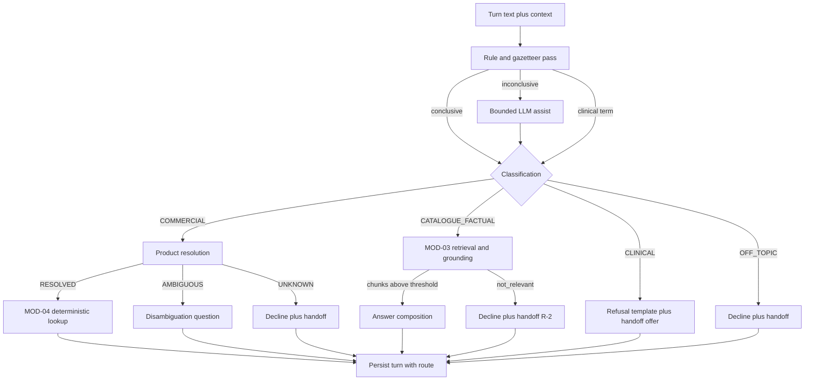

> **Lens:** PO / TPO (technical ACs) / Architect (HLD, LLD) · **Engagement:** Brownfield

# US-005 — Route every question to the right answer path, and refuse the ones we must not answer [Lens: PO]

- **Story:** As a **compliance owner and sales director at ANITA**, I want **every incoming question classified before it is answered — commercial facts to the deterministic lookup, catalogue questions to the grounded retrieval path, clinical questions refused — so that a price is never generated, a specification is never invented, and no clinical advice is ever given**.
- **Business value:** This is the product's correctness spine: `BRD-05`/`BRD-06` make a generated price a commercial liability, and `BRD-10` makes clinical guidance a regulatory one. Classification is the single gate that keeps both out of the answer path.
- **Priority:** **Must** — `BRD-04`, `BRD-05` and `BRD-10` are all launch-blocking correctness requirements.
- **Ordering note (TPO):** depends on US-004 (a conversation must exist before a turn can be classified). It must land before US-006 (persisted turns record the route) and before the MOD-03/MOD-04 answer paths are wired to MOD-02 — the router is their entry contract. The clinical lexicon is configuration (`DG-08`), so the legal wording can change without a code change.

## Acceptance Criteria [Lens: PO]

```gherkin
Scenario: AC-1 A price question is routed to the deterministic path
  Given an open conversation
  When the buyer asks "what is the price of the ultrasound gel?"
  Then the turn is classified COMMERCIAL and routed to the deterministic lookup
    And the turn trace shows no LLM generation call for this turn

Scenario: AC-2 A specification question is routed to grounded retrieval
  Given an open conversation
  When the buyer asks "what does the FCR Prima T2 weigh?"
  Then the turn is classified CATALOGUE_FACTUAL and routed to retrieval and grounding
    And the answer cites the retrieved catalogue record

Scenario: AC-3 A clinical question is refused, not answered
  Given an open conversation
  When the buyer asks "my patient has a suspected fracture — which machine should I use?"
  Then the turn is classified CLINICAL and the approved refusal wording is returned
    And a human handoff is offered, and the refusal is logged for ops

Scenario: AC-4 A mixed clinical-and-product question answers only the product part
  Given an open conversation
  When the buyer asks "is the Microbar Enema safe for a patient with a pacemaker?"
  Then the clinical part is refused and the product part, if answerable from the catalogue, is answered
    And the refusal wording appears before any product text

Scenario: AC-5 (failure) An ambiguous product name is disambiguated before answering
  Given the buyer asks about "the Medical Dry Imager price"
    And the catalogue contains two products with that exact name (ids 270683 and 3935251)
  When the turn is classified and resolved
  Then the system asks which product, naming both ids and their prices
    And no price is stated before the buyer chooses

Scenario: AC-6 (failure) Retrieval returns nothing relevant
  Given a catalogue question whose subject is not in the 24-product corpus
  When retrieval returns no chunk above threshold
  Then the buyer receives an honest decline plus a handoff offer
    And no generated answer is emitted (R-2)

Scenario: AC-7 (failure) The classifier is unavailable
  Given the classifier raises or times out
  When a turn arrives
  Then the turn is routed to retrieval and, if empty, declined — never to generation
    And a question containing clinical terms is still refused

Scenario: AC-8 (failure) An off-topic question is declined
  Given a question with no catalogue or company subject
  When the turn is classified
  Then the turn is classified OFF_TOPIC and the buyer receives a decline plus a handoff offer
```

Technical acceptance criteria [Lens: TPO]:

- **TAC-1:** Rule-pass classification p95 ≤ 40 ms; LLM-assist fallback p95 ≤ 300 ms; total orchestrator routing overhead p95 ≤ 120 ms.
- **TAC-2:** A `COMMERCIAL` classification can **never** reach the generation path — enforced structurally by the routing table, not by prompt instruction; asserted by a test that fails if a generation call occurs on a commercial turn.
- **TAC-3:** Any absolute clinical term (dose, diagnosis, treatment, symptom, prescribe, contraindication) forces `CLINICAL` regardless of confidence or LLM opinion.
- **TAC-4:** Confidence below 0.6 fails safe: clinical-uncertain → refuse; otherwise retrieval-then-decline.
- **TAC-5:** Product resolution returns `RESOLVED` | `AMBIGUOUS` | `UNKNOWN`; `AMBIGUOUS` always emits the disambiguation question before any fact, and the question names the numeric product id.
- **TAC-6:** Refusal wording is configuration (`DG-08`); a missing/unreadable value falls back to the built-in conservative default and never to silence.
- **TAC-7:** Classification and route are persisted on the turn (`SM-02` states `CLASSIFIED` before `ANSWERED`); an `ANSWERED` turn without a `CLASSIFIED` predecessor is rejected by the persistence layer.

## HLD — Architecture Slice [Lens: Architect]



- **Components touched:**
  - **MOD-02 (this story):** the classifier, the gazetteers (products from `DAT-02`, price/MOQ/delivery terms, clinical lexicon), the routing table, product resolution/disambiguation, and the refusal template loader.
  - **MOD-03:** receives the query only for `CATALOGUE_FACTUAL`; returns chunks or `not_relevant`; unchanged.
  - **MOD-04:** receives the resolved product for deterministic lookup, or the retrieval context for generation; unchanged.
  - **MOD-06:** receives the handoff trigger when a refusal or decline offers one.
  - **MOD-08:** receives the classification, confidence, route and any fallback mark on the turn trace.
- **Interaction summary:**
  1. The turn text and bounded context enter the classifier.
  2. The rule/gazetteer pass classifies immediately when it can; otherwise a bounded LLM assist classifies, with a 300 ms budget.
  3. Clinical terms force `CLINICAL` at any confidence.
  4. Routing sends `COMMERCIAL` to product resolution then the deterministic lookup; `CATALOGUE_FACTUAL` to retrieval; `CLINICAL`/`OFF_TOPIC` to refusal/decline plus a handoff offer.
  5. The classification and route are persisted with the turn.
  - **Failure path:** classifier exception/timeout → rule-only pass, then retrieval-then-decline, never generation; retrieval `not_relevant` → decline plus handoff; ambiguous product → disambiguation question naming ids.

## LLD — Implementation Detail [Lens: Architect]

- **Classes / functions / APIs** — Python:

```python
# mod02/routing/classifier.py
class QuestionClass(StrEnum):
    CATALOGUE_FACTUAL = "catalogue_factual"
    COMMERCIAL = "commercial"
    CLINICAL = "clinical"
    OFF_TOPIC = "off_topic"

@dataclass
class Classification:
    kind: QuestionClass
    confidence: float
    source: str                 # 'rule' | 'llm' | 'clinical_override'

class RuleClassifier:
    def __init__(self, gazetteers: Gazetteers) -> None: ...
    def classify(self, text: str) -> Classification | None      # None = inconclusive

class Gazetteers:
    products: dict[str, list[str]]      # normalised name/model -> product ids (DAT-02)
    commercial_terms: frozenset[str]    # price, cost, rate, moq, minimum order, delivery, gst, address
    clinical_terms: frozenset[str]      # dose, diagnosis, treatment, symptom, prescribe, contraindication
    def match_products(self, text: str) -> list[str]

async def classify(text: str, ctx: TurnContext) -> Classification   # rule -> llm -> fail-safe

# mod02/routing/router.py
class AnswerPath(StrEnum):
    DETERMINISTIC = "deterministic"; RETRIEVAL = "retrieval"
    REFUSAL = "refusal"; DECLINE = "decline"; DISAMBIGUATE = "disambiguate"

@dataclass
class RouteDecision:
    path: AnswerPath
    product_ids: list[str]
    reason: str

def route(classification: Classification, resolution: Resolution) -> RouteDecision

# mod02/routing/products.py
class ResolutionKind(StrEnum):
    RESOLVED = "resolved"; AMBIGUOUS = "ambiguous"; UNKNOWN = "unknown"

@dataclass
class Resolution:
    kind: ResolutionKind
    product_ids: list[str]

def resolve_product(text: str, gazetteers: Gazetteers) -> Resolution
def disambiguation_question(resolution: Resolution, products: ProductIndex) -> str

# mod02/routing/refusal.py
def load_refusal_template() -> str          # config; built-in conservative default if absent
def is_clinical_override(text: str) -> bool
```

- **Data schema changes:**

```sql
ALTER TABLE turn
  ADD COLUMN IF NOT EXISTS classification text,
  ADD COLUMN IF NOT EXISTS classification_confidence real,
  ADD COLUMN IF NOT EXISTS classification_source text,   -- 'rule' | 'llm' | 'fail_safe'
  ADD COLUMN IF NOT EXISTS route text,
  ADD COLUMN IF NOT EXISTS product_ids uuid[];

-- classification must exist before a turn can be answered (TAC-7)
ALTER TABLE turn
  ADD CONSTRAINT turn_answered_requires_classified
  CHECK (state <> 'ANSWERED' OR classification IS NOT NULL) NOT VALID;

CREATE TABLE IF NOT EXISTS classifier_gazetteer (
  id          uuid PRIMARY KEY DEFAULT gen_random_uuid(),
  kind        text NOT NULL,          -- 'product' | 'commercial_term' | 'clinical_term'
  term        text NOT NULL,
  ref_id      text,                   -- product id for kind='product'
  source      text NOT NULL DEFAULT 'corpus',   -- corpus | config | legal
  updated_at  timestamptz NOT NULL DEFAULT now(),
  UNIQUE (kind, term)
);
```

The `NOT VALID` constraint is validated after the backfill migration in the same release; it is the mechanical enforcement of `TAC-7`.

- **Edge cases** — each with the decided behaviour:
  1. **Question names a product not in the catalogue** → `UNKNOWN` → decline plus handoff (`UC-01` missing data).
  2. **Question names two products** → both resolved; comparison route if both `RESOLVED`, otherwise disambiguation (`UC-06`).
  3. **Question names three products** → ask which two (`UC-06` invalid input).
  4. **"Medical Dry Imager" with no qualifier** → `AMBIGUOUS`; the disambiguation question names ids 270683 (₹5,50,000) and 3935251 (₹2,00,000) so they can never be conflated (`BRD-09`, R-3).
  5. **Product has no specification block** (3 of 24) → retrieval returns the record; the answer says "not published" rather than inventing (`BRD-07`, `DG-13`).
  6. **Product has no About text** (4 of 24) → same honest-absence path (`DG-13`).
  7. **Company/statutory question** (GST, PAN, address, certification) → classified commercial/company-factual and answered from `company_ids`/`branches`/`certifications` (`BRD-08`); no generation of identifiers.
  8. **Mixed clinical + product** → refusal clause first, then the answerable product part (`AC-4`).
  9. **Classifier timeout** → rule-only path; if the rule pass was inconclusive, retrieval-then-decline (`CO-3`).
  10. **Classifier returns an invalid class** → fail safe to `CATALOGUE_FACTUAL` + retrieval, and count a malformed-classification event.
  11. **Very short turn ("ok", "thanks")** → classified `OFF_TOPIC` with a low-signal flag; no sentiment trigger, no handoff spam (`UC-10` invalid input).
  12. **Refusal template missing** → built-in default used; a boot warning names the missing config key (`DG-09`).
  13. **Two classifications for one turn** (retry) → the persisted classification is the one that produced the answer; the discarded attempt is not written as `ANSWERED`.

- **Error handling:**
  - `ClassificationError` → rule-only, mark `classification_source='fail_safe'`, continue (never 500 to the buyer).
  - `ClinicalOverrideTriggered` → refuse regardless of any downstream route decision.
  - `ResolutionUnknown` / `RetrievalNotRelevant` → decline path with a handoff offer (`R-2`).
  - Retries: LLM assist retried once (300 ms budget) then rule-only. Dead letter: n/a — the turn always terminates in `ANSWERED`, `FAILED` or a decline, so there is no unhandled state.

- **Test scenarios** — the `UC-11` Scenario Coverage table is the floor, plus the routing rows this story owns in `UC-01`, `UC-05` and `UC-06`:

| # | Scenario row | Level | Test |
|---|---|---|---|
| **UC-11 clinical refusal** | | | |
| T-01 | Happy path | integration | Clinical question refused with the configured wording, logged, handoff offered |
| T-02 | Alternate path (A1 — mixed) | integration | Product part answered, clinical part refused, refusal appears first |
| T-03 | Invalid input — ambiguous | unit | Ambiguous phrasing containing a clinical term → fail-safe refusal |
| T-04 | Unauthorized user | integration | Public path; refusal identical for anonymous and identified buyers |
| T-05 | Missing data — wording not configured | unit | Built-in default used; boot warning names the missing key |
| T-06 | Partial data | unit | Refusal is atomic — no partial refusal text is possible |
| T-07 | Duplicate request | integration | Repeated clinical questions → same refusal, logged once per turn |
| T-08 | Timeout — classification timeout | unit | Refuse, never answer (fail safe) |
| T-09 | Dependency failure — classifier down | integration | Refuse; rule pass carries clinical terms |
| T-10 | Retry | unit | Refusal path has no retry and cannot partially apply |
| T-11 | Concurrent operation | unit | Stateless refusal under concurrent turns |
| T-12 | Cancellation | unit | n/a by construction — asserted as a no-op test |
| T-13 | Recovery | unit | n/a by construction — asserted as a no-op test |
| T-14 | Partial completion | unit | Impossible by construction — asserted |
| **UC-01 routing rows** | | | |
| T-15 | Alternate path (A1) | integration | Commercial question → deterministic route, no generation call (TAC-2) |
| T-16 | Alternate path (A2) | integration | Ambiguous product → disambiguation question naming both ids |
| T-17 | Missing data | integration | Product absent from corpus → decline plus handoff |
| T-18 | Partial data | integration | Product with no spec block → "not published" |
| T-19 | Timeout | integration | Retrieval exceeds budget → decline path |
| T-20 | Dependency failure | integration | Vector store down → decline plus handoff, no generated guess |
| **UC-05 / UC-06 routing rows** | | | |
| T-21 | UC-05 E1 — product unresolved | integration | Ask the buyer to choose; no price stated |
| T-22 | UC-05 E2 — figure missing | integration | Decline plus handoff for that product |
| T-23 | UC-06 E1 — one product ambiguous | integration | Disambiguation first, then comparison |
| T-24 | UC-06 E2 — no shared specs | integration | Explain and offer handoff; never emit a half comparison |
| T-25 | **Load** | load | 200 classification calls in 20 s: rule-pass p95 ≤ 40 ms, LLM-assist p95 ≤ 300 ms, zero commercial misroutes to generation (TAC-1, TAC-2) |

## Traceability

- Parent module: `MOD-02`
- Use cases: `UC-11` (business story), plus the routing rows of `UC-01`, `UC-05`, `UC-06`
- Technical requirements: `TRD-09` (classification contract), `TRD-10` (context assembly and routing)
- Business requirements: `BRD-01` (one engine), `BRD-04` (grounded only), `BRD-05` (deterministic commercial), `BRD-07` (specification answering), `BRD-08` (company facts), `BRD-09` (same-name disambiguation), `BRD-10` (clinical refusal)
- Business rules: `R-2` (no retrieval hit → decline, never answer from memory), `R-3` (same name → disambiguate), `R-4` (clinical → refuse), `R-7` (unknown source → do not answer)
- Data gap / state machine: `DG-08` (refusal wording config, legal sign-off pending), `DG-13` (honest absence for missing specs/About), `SM-02` (CLASSIFIED before ANSWERED)
- Reconciliation: `REC-23` (corpus validation gate pattern — the index refuses a corpus that is not the ANITA catalogue), `REC-09` (grounding rule structure refactored for a catalogue, not admissions)

## Definition of Done

- [ ] All ACs pass (AC-1 … AC-8, TAC-1 … TAC-7)
- [ ] Tests T-01 … T-25 pass, including the zero-misroute assertion and the two "Medical Dry Imager" disambiguation test
- [ ] Schema migration applied (`turn` classification columns, `classifier_gazetteer`); the `NOT VALID` check constraint validated after backfill
- [ ] Module doc `MOD-02-conversation-orchestrator.md` updated if the route table changed
- [ ] Refusal wording sourced from configuration with the built-in conservative default present
- [ ] Gazetteers regenerated from `data/out/ams.sqlite` (24 products) with a reproducible script, and the product gazetteer contains both 270683 and 3935251
