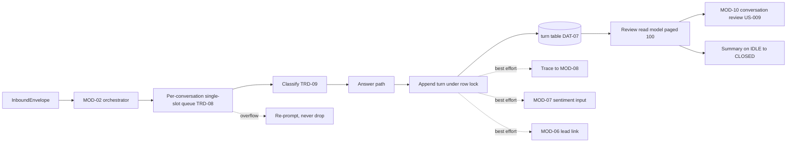

> **Lens:** PO / TPO (technical ACs) / Architect (HLD, LLD) · **Engagement:** Brownfield

# US-006 — Keep every turn ordered, persisted and reviewable [Lens: PO]

- **Story:** As a **sales rep at ANITA receiving a handoff**, I want **the full conversation — every turn, in order, with the route that produced it and what it was grounded in — persisted and reviewable**, so that **I can pick up the conversation with context instead of asking the buyer to start again**, and as **ops** I want a coherent transcript for every incident and every quality complaint.
- **Business value:** The transcript is the handoff's payload and the quality record behind `BRD-22`; an out-of-order or half-written transcript makes both the sales follow-up and the release gate unreliable.
- **Priority:** **Must** — `BRD-11` (lead context) and `BRD-21` (per-conversation observability) both depend on it.
- **Ordering note (TPO):** depends on US-004 (conversation identity) and US-005 (classification, because `SM-02` forbids `ANSWERED` without `CLASSIFIED`). It must land before US-009 (the console renders the review view) and before MOD-07's sentiment worker can read turns reliably. It also carries the MOD-02 half of the replay/degradation behaviour the source already proved (`REC-13`).

## Acceptance Criteria [Lens: PO]

```gherkin
Scenario: AC-1 Every turn is persisted with its route and preserved in order
  Given an open conversation with a buyer
  When the buyer asks three questions in sequence
  Then all three turns are stored with a monotonically increasing sequence number
    And each stores its classification, route and answer reference

Scenario: AC-2 A handoff conversation opens with full context in review
  Given a conversation that ended in a handoff (UC-07)
  When a sales rep opens it in the review surface
  Then the transcript, the products discussed, the sentiment trail and the handoff reason are visible
    And the conversation is scoped to this instance only

Scenario: AC-3 (failure) Two turns arriving together are serialised, not interleaved
  Given two messages from the same buyer arriving 200 ms apart
  When both are processed
  Then the transcript shows them in arrival order with no interleaved text and no duplicate sequence number

Scenario: AC-4 (failure) An answer survives a persistence failure
  Given the database is unavailable while an answer is composed
  When the turn completes
  Then the buyer still receives the answer
    And the turn is replayed to storage on recovery without blocking the conversation

Scenario: AC-5 (failure) A crash between answer and persistence is recoverable
  Given a turn was answered but the process died before the write committed
  When the service restarts
  Then the answer is re-rendered from the stored turn on the next read
    And a possible duplicate reply is acceptable and recorded as such

Scenario: AC-6 (failure) A very large transcript is paged, not dumped
  Given a conversation with 500 turns
  When review opens it
  Then the first 100 turns render within 500 ms and subsequent pages load on demand

Scenario: AC-7 (failure) Expired retention is labelled, not shown as empty
  Given a conversation whose transcript retention has expired
  When review opens it
  Then the screen states the transcript expired with its date
    And the conversation row and lead remain visible
```

Technical acceptance criteria [Lens: TPO]:

- **TAC-1:** Turn persistence p95 ≤ 15 ms; turn read p95 ≤ 25 ms for a 100-turn page; sequence assignment is atomic per conversation (row lock), so two concurrent turns cannot share a `seq`.
- **TAC-2:** `TURN (conversation_id, seq)` and `TURN (provider_event_id)` unique constraints are enforced at the database, not in application code.
- **TAC-3:** With PostgreSQL unavailable, turns are answered and buffered in a bounded replay queue (capacity 1,000, drop-oldest with a counter beyond it); replay drains within 60 s of recovery.
- **TAC-4:** An `ANSWERED` turn always has a classification and a route (the `turn_answered_requires_classified` check from US-005 holds); a `FAILED` turn carries a `failure_reason`.
- **TAC-5:** Conversation summaries are written on `IDLE → CLOSED` and on voice/browser-mic teardown, and are idempotent (two writes produce one summary).
- **TAC-6:** The review read model is instance-scoped by construction and returns no cross-instance rows (`BRD-18`).
- **TAC-7:** Transcript reads never block the conversation path: the review queries run on a separate connection pool from turn writes.

## HLD — Architecture Slice [Lens: Architect]



- **Components touched:**
  - **MOD-02 (this story):** the single-slot queue, `seq` assignment under a conversation row lock, the turn writer/reader, the bounded replay queue, the summary writer, and the review read model.
  - **MOD-06:** reads turns when linking a lead; unchanged.
  - **MOD-07:** reads turns for sentiment; unchanged (the emission contract is fixed here).
  - **MOD-08:** receives the `persisted` stage mark; unchanged.
  - **MOD-10:** consumes the review read model (rendered in US-009); unchanged here.
- **Interaction summary:**
  1. A turn enters the conversation's single-slot queue; if a turn is in flight it waits (depth 20) or is re-prompted on overflow.
  2. Classification and the answer path run; the turn is appended with an atomic `seq` under a row lock on `conversation`.
  3. Downstream emissions (trace, sentiment, lead link) are best-effort and never block the answer.
  4. On `IDLE → CLOSED` or channel teardown, an idempotent summary is written.
  - **Failure path:** DB down → answer proceeds, buffered and replayed; crash after answer before write → re-render from the stored turn; overflow → re-prompt the buyer rather than dropping a turn silently.

## LLD — Implementation Detail [Lens: Architect]

- **Classes / functions / APIs** — Python:

```python
# mod02/turns/queue.py
class ConversationQueue:
    """One in-flight turn per conversation; arrival order preserved."""
    def __init__(self, depth: int = 20) -> None: ...
    async def submit(self, conversation_id: str, work: Callable[[], Awaitable[Turn]]) -> Turn | QueueFull

class QueueFull(Exception): ...

# mod02/turns/store.py
class TurnStore:
    async def append(self, turn: NewTurn) -> Turn          # assigns seq under row lock
    async def by_provider_event(self, provider_event_id: str) -> Turn | None
    async def page(self, conversation_id: str, *, after_seq: int = 0, limit: int = 100) -> list[Turn]
    async def mark_failed(self, turn_id: str, reason: str) -> None

class ReplayQueue:
    """Bounded buffer used when the database is unavailable (TAC-3)."""
    def __init__(self, capacity: int = 1000) -> None: ...
    def put(self, turn: NewTurn) -> None            # drop-oldest beyond capacity, counted
    async def drain(self, store: TurnStore) -> int

# mod02/turns/summary.py
async def write_summary(conversation_id: str) -> None      # idempotent
async def sweep_close_idle(*, idle_window_hours: float) -> int

# mod02/review/read_model.py
@dataclass
class ConversationView:
    conversation_id: str; channel: str; state: str
    lead_id: str | None; turn_count: int
    sentiment_category: str | None; handoff_reason: str | None

async def get_conversation(conversation_id: str) -> ConversationView | None
async def page_transcript(conversation_id: str, *, after_seq: int = 0, limit: int = 100) -> list[TurnView]
```

- **Data schema changes:**

```sql
CREATE TABLE IF NOT EXISTS turn (
  id                        uuid PRIMARY KEY DEFAULT gen_random_uuid(),
  conversation_id           uuid NOT NULL REFERENCES conversation(id),
  seq                       int  NOT NULL,
  direction                 text NOT NULL,            -- 'inbound' | 'outbound'
  channel_kind              text NOT NULL,
  provider_event_id         text,
  text                      text,
  state                     text NOT NULL,            -- RECEIVED | CLASSIFIED | ANSWERED | FAILED
  classification            text,
  classification_confidence real,
  route                     text,
  answer_ref                uuid,
  grounding_refs            jsonb,
  latency_ms                int,
  failure_reason            text,
  created_at                timestamptz NOT NULL DEFAULT now(),
  UNIQUE (conversation_id, seq),
  UNIQUE (provider_event_id)
);
CREATE INDEX IF NOT EXISTS turn_conversation_seq_idx ON turn (conversation_id, seq);
CREATE INDEX IF NOT EXISTS turn_created_idx ON turn (created_at);

ALTER TABLE conversation
  ADD COLUMN IF NOT EXISTS summary_updated_at timestamptz;
```

The `seq` assignment statement is the serialisation point:

```sql
-- executed inside one transaction with the conversation row locked
SELECT id FROM conversation WHERE id = %s FOR UPDATE;
SELECT COALESCE(MAX(seq), 0) + 1 FROM turn WHERE conversation_id = %s;
INSERT INTO turn (conversation_id, seq, ...) VALUES (%s, %s, ...);
```

- **Edge cases** — each with the decided behaviour:
  1. **Two turns in flight** → queued; the second sees `MAX(seq)+1` after the first commits (`TAC-1`, `AC-3`).
  2. **Provider event replay** → `turn (provider_event_id)` unique violation returns the existing turn; no duplicate answer.
  3. **Queue overflow (21st turn in flight)** → re-prompt ("still working on your previous question"), no silent drop; overflow counted.
  4. **Crash after answer, before commit** → on restart the turn is re-rendered from the in-flight record on the next read; duplicate reply possible and flagged (`AC-5`, `SM-02` #7).
  5. **DB down during a turn** → answer delivered; turn buffered; replay on recovery (`AC-4`, `TAC-3`).
  6. **Replay buffer full** → oldest dropped and counted; an ops alert fires; no buyer-visible failure.
  7. **Summary written twice** (idle sweep + teardown) → idempotent by `summary_updated_at` guard (`TAC-5`).
  8. **Conversation closed with zero turns** (voice failed early) → summary states "no transcript"; review shows it explicitly (`UC-13` missing data).
  9. **Turn with no answer** (LLM/carrier failure) → `FAILED` with `failure_reason`; review distinguishes failure from silence (`SM-02`).
  10. **Very long single turn text** (voice transcript of a long question) → stored whole, truncated only in the review payload at 8,000 chars with a marker.
  11. **Review while a turn is being written** → read sees committed turns only; the in-flight turn appears on the next poll.
  12. **Retention expiry** → transcript rows removed by the retention job; the conversation row keeps a `transcript_expired_at` marker so review can label the gap rather than show empty (`AC-7`, `UC-13` E1).
  13. **Clock skew between app and DB** → `created_at` from the database clock; `latency_ms` from the monotonic app clock.
  14. **Two workers writing the same conversation** (misconfiguration) → the row lock serialises; the boot guard (MOD-09) refuses multi-worker configuration for the conversation path.

- **Error handling:**
  - `PersistenceUnavailable` → buffer + continue; never convert to a buyer-visible error.
  - `DuplicateTurn` → return the stored turn; count as a dedupe, not an error.
  - `QueueFull` → re-prompt, count, and emit an ops counter if the rate exceeds 1/min for a conversation.
  - Retries: replay drain retried every 30 s while the DB is down; summary write retried 3× then queued. Dead letter: dropped replay entries and failed summaries are counted and surfaced in the console; transcripts already returned to the buyer are unaffected.

- **Test scenarios** — the `UC-01` and `UC-13` Scenario Coverage tables are the floor for this story:

| # | Scenario row | Level | Test |
|---|---|---|---|
| **UC-01 — turn lifecycle and persistence** | | | |
| T-01 | Happy path | integration | Three turns stored with `seq` 1..3 and correct route/answer_ref |
| T-02 | Alternate path (A1, A2) | integration | Deterministic and disambiguation turns persist their route correctly |
| T-03 | Invalid input | unit | Rejected input creates no turn row |
| T-04 | Unauthorized user | integration | Anonymous turns persist against the anonymous conversation only |
| T-05 | Missing data | integration | Decline turn persists with route `decline` and no answer_ref |
| T-06 | Partial data | integration | "Not published" turn persists with its grounding ref to the product record |
| T-07 | Duplicate request | integration | Duplicate `provider_event_id` returns the stored turn; one row |
| T-08 | Timeout | integration | Timed-out turn stored `FAILED` with `failure_reason='timeout'` |
| T-09 | Dependency failure | integration | DB down → answer returned, buffered, replayed on recovery |
| T-10 | Retry | unit | LLM retry produces one persisted turn, not two |
| T-11 | Concurrent operation | integration | 20 concurrent turns → contiguous `seq` with no gaps or duplicates |
| T-12 | Cancellation | integration | Abandoned turn persists as `ANSWERED` (answer composed) or `FAILED`, never limbo |
| T-13 | Recovery | integration | Re-ask after failure resumes the same conversation and appends a new turn |
| T-14 | Partial completion | integration | Answer persisted then socket lost → full turn readable; no fork |
| **UC-13 — review read model** | | | |
| T-15 | Happy path | integration | Review returns transcript, products, sentiment trail and handoffs for one conversation |
| T-16 | Alternate path (A1) | integration | Drilling from a sentiment alert opens the triggering turn by `seq` |
| T-17 | Invalid input | unit | Unknown conversation id → `None`/404 from the read model, no stack trace |
| T-18 | Unauthorized user | integration | The read model is only reachable through the authenticated console route |
| T-19 | Missing data | integration | Conversation with no turns renders "no transcript" explicitly |
| T-20 | Partial data | integration | Turns without sentiment render a partial trail with the missing span marked |
| T-21 | Duplicate request | unit | Repeated reads are idempotent |
| T-22 | Timeout | integration | 500-turn transcript pages at 100 with every page ≤ 500 ms |
| T-23 | Dependency failure | integration | DB down → review returns the unavailable state, not an empty transcript |
| T-24 | Retry | integration | Manual refresh re-reads and picks up newly committed turns |
| T-25 | Concurrent operation | integration | Two reviewers reading do not block writes (separate pool, TAC-7) |
| T-26 | Cancellation | unit | Abandoned read leaves no state |
| T-27 | Recovery | unit | n/a — read-only path, asserted as a no-op |
| T-28 | Partial completion | integration | Interrupted export discards the partial file rather than storing it |
| T-29 | Retention | integration | Expired transcript → review shows the expiry date, conversation row still visible (AC-7) |
| T-30 | **Load** | load | 50 conversations × 20 turns written in 60 s: write p95 ≤ 15 ms, page read p95 ≤ 25 ms, replay drains ≤ 60 s after a simulated DB outage (TAC-1, TAC-3) |

## Traceability

- Parent module: `MOD-02`
- Use cases: `UC-01` (turn lifecycle), `UC-13` (review model) — business story, with `UC-03`/`UC-04` teardown summaries
- Technical requirements: `TRD-08` (turn serialisation), `TRD-11` (turn persistence and emission)
- Business requirements: `BRD-02` (context availability), `BRD-11` (transcript attached to the lead), `BRD-21` (per-conversation observability)
- Data gap / state machine: `SM-02` (RECEIVED → CLASSIFIED → ANSWERED/FAILED; halfway-stop recovery), `DAT-07` (conversation transcripts), `DG-11` (retention/PII erasure owned by MOD-06)
- Reconciliation: `REC-13` (idempotent DDL pattern, graceful degradation, `conversation_id` re-derivation), `REC-15` (`perf_trace.py` emits the trace half), `REC-02` (registry supplies the conversation id)

## Definition of Done

- [ ] All ACs pass (AC-1 … AC-7, TAC-1 … TAC-7)
- [ ] Tests T-01 … T-30 pass, including the DB-outage replay test and the 20-concurrent-turn sequencing test
- [ ] Schema migration applied (`turn`, `conversation.summary_updated_at`) with both unique constraints
- [ ] Module doc `MOD-02-conversation-orchestrator.md` updated if the turn contract changed
- [ ] Review read path verified to use a separate connection pool from the write path
- [ ] Retention/erasure hook exposed for MOD-06 (`DG-11`) rather than implemented here
