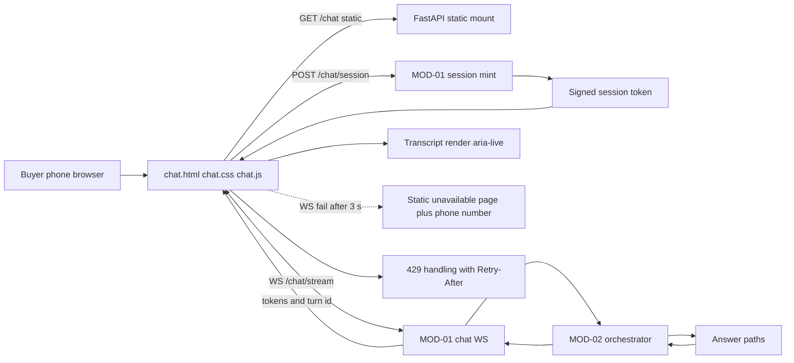

> **Lens:** PO / TPO (technical ACs) / Architect (HLD, LLD) · **Engagement:** Brownfield

# US-007 — Give buyers a responsive chat surface that works on the phone in their hand [Lens: PO]

- **Story:** As a **clinic owner comparing two CR systems on my phone between patients**, I want to **open the chat from the website, ask my question and read a clear answer without zooming, scrolling sideways or downloading an app**, so that **I can shortlist ANITA while I am standing in the room the machine will go in**.
- **Business value:** Mobile web is where D1 places the buyer surface; a desktop-only page would drop the largest share of out-of-hours traffic before the answer engine is ever reached.
- **Priority:** **Must** — web chat is a core MVP channel and the responsive surface is the D1 commitment (`00-product-intent.md` §5).
- **Ordering note (TPO):** depends on US-002 (chat transport) and US-004/US-006 (conversation and turn persistence); it must land before US-009's console work is promoted to production, because the review surface reads what this client writes. It is independent of US-008 (voice client) — the two share the page shell only.

## Acceptance Criteria [Lens: PO]

```gherkin
Scenario: AC-1 A buyer asks a question on a phone and reads the answer
  Given a phone browser at 360 px width
  When the buyer opens the chat page and sends "what does the FCR Prima T2 weigh?"
  Then the answer streams into the transcript and is fully readable with no horizontal page scroll
    And the first contentful paint was within 1.5 s on the 4G profile

Scenario: AC-2 The conversation continues with context on the next turn
  Given a conversation with one answered question
  When the buyer asks "and what is its price?"
  Then the follow-up resolves to the same product without re-asking which one

Scenario: AC-3 The composer stays usable with the on-screen keyboard open
  Given a phone browser with the keyboard raised
  When the buyer types a message
  Then the composer and send control remain visible above the keyboard

Scenario: AC-4 (failure) The chat backend is unreachable
  Given the chat WebSocket cannot connect within 3 s
  When the page finishes loading
  Then the buyer sees an explicit "chat unavailable" message and the direct phone number
    And no spinner is left running

Scenario: AC-5 (failure) A message is rejected before a turn is created
  Given the buyer submits an empty message or one longer than 4,000 characters
  When the send is attempted
  Then the composer explains the problem and keeps the text
    And no turn is created

Scenario: AC-6 (failure) The connection drops mid-answer
  Given a streamed answer in progress
  When the socket drops
  Then the page reconnects automatically and shows the completed answer rather than losing it

Scenario: AC-7 (failure) A rate-limited buyer is told to wait, not left hanging
  Given the buyer has exceeded the per-session turn limit
  When the next message is sent
  Then the page shows a clear "too many messages, try again in N seconds" state with the retry time
```

Technical acceptance criteria [Lens: TPO]:

- **TAC-1:** First contentful paint p95 ≤ 1.5 s on a 4G profile; total initial payload ≤ 150 KB uncompressed / ≤ 45 KB gzipped; no third-party CDN, analytics or font fetch at runtime.
- **TAC-2:** The page is functional and non-scrolling at 360 px; the layout uses a 16 px gutter and safe-area insets; no element exceeds the viewport width at any supported breakpoint (360/480/768/1024 px).
- **TAC-3:** The answer region is an `aria-live="polite"` region; all controls are keyboard operable with a visible focus ring; body-text contrast ≥ 4.5:1 (WCAG 2.1 AA).
- **TAC-4:** WebSocket keepalive every 15 s; automatic reconnect with backoff 1 s → 8 s (4 attempts); a completed answer interrupted by a drop is re-fetched by turn id, not re-asked.
- **TAC-5:** The session token is `HttpOnly` + `Secure` + `SameSite=Lax`; no transcript, lead or sentiment value is written to `localStorage`/`sessionStorage`.
- **TAC-6:** The static fallback page renders with JavaScript disabled and carries the phone number; the chat does not block page paint on the socket.
- **TAC-7:** A 429 response surfaces the `Retry-After` value to the buyer in plain language; no silent drop.

## HLD — Architecture Slice [Lens: Architect]



- **Components touched:**
  - **MOD-10 (this story):** `chat.html`, `chat.css`, `chat.js`, the streaming renderer, the reconnect/replay logic, the composer states, and the static fallback page.
  - **MOD-01:** exposes the static mount, `/chat/session` and `/chat/stream` (built in US-002); no server change in this story except the static mount path.
  - **MOD-02:** answers turns; unchanged.
- **Interaction summary:**
  1. The page loads statically and paints before any socket work (TAC-6).
  2. A session token is minted; the WebSocket opens with it.
  3. The buyer's message is sent; the answer streams back token-by-token and renders into the live region.
  4. The composer clears on send and restores the text on a rejected send.
  - **Failure path:** socket cannot connect within 3 s → static unavailable page plus phone number; drop mid-answer → reconnect and re-fetch by turn id; 429 → retry-time message; oversized/empty message → inline explanation and text preserved.

## LLD — Implementation Detail [Lens: Architect]

- **Modules / functions / APIs** — vanilla JavaScript, no build step:

```js
// mod10/chat/chat.js
export function createChatSession(baseUrl) -> Promise<{ token, conversationId }>
export function connectStream(token, { onToken, onTurnComplete, onError, onRateLimited }) -> ChatStream

class ChatStream {
  send(text) -> void
  reconnect() -> Promise<void>          // backoff 1s..8s, 4 attempts
  close() -> void
}

// mod10/chat/render.js
export function renderTurn(turn) -> HTMLElement      // direction, text, grounding chip
export function appendToken(turnEl, token) -> void
export function setComposerState(state) -> void      // 'idle' | 'sending' | 'error' | 'rate_limited'

// mod10/chat/validate.js
export const MAX_MESSAGE_CHARS = 4000
export function validateMessage(text) -> { ok: boolean, reason?: string }

// mod10/chat/socket.js
export function isUnavailable(elapsedMs, connectTimeoutMs = 3000) -> boolean
```

- **Data schema changes:** none — MOD-10 owns no persistent store. The client-side contract is:
  - `GET /chat` serves `chat.html` with a cache-busting build string.
  - `POST /chat/session` returns `{ token, conversation_id }` (201), `429` with `Retry-After` when IP-limited.
  - `WS /chat/stream` frames: `{type:'turn_start', turn_id}` → `{type:'token', turn_id, text}`* → `{type:'turn_complete', turn_id, grounding_ref}`; errors as `{type:'error', code, retry_after?}`.
  - Close codes: `4001` session expired, `4008` rate limited, `1000` normal.
  - No `localStorage` keys are written (TAC-5).

- **Edge cases** — each with the decided behaviour:
  1. **Empty message** → send disabled; if forced, inline reason, no turn (`AC-5`).
  2. **Message > 4,000 chars** → inline reason with the limit, text preserved (`AC-5`).
  3. **Socket cannot connect** → 3 s timeout → static unavailable page with phone number (`AC-4`, `CS-7`).
  4. **Drop mid-answer** → reconnect, then fetch the turn by id; the completed answer renders once (`AC-6`).
  5. **Drop before any turn** → reconnect silently; the buyer's unsent text is preserved in memory (not storage).
  6. **429 on session mint** → unavailable page with the retry time (`AC-7`).
  7. **429 mid-session** → composer shows the wait state; auto-clears at the retry time (`TAC-7`).
  8. **Double-tap send** → the composer is disabled on send; duplicate send is ignored client-side, and the server dedupes by client turn id (`UC-01` duplicate row).
  9. **Very long answer** → transcript scrolls; the live region announces completion, not every token (screen-reader sanity).
  10. **Keyboard opens** → composer pinned above the visual viewport using `visualViewport` with a `resize` fallback (`AC-3`).
  11. **Rotate device mid-answer** → layout reflows; scroll position preserved; no reconnect.
  12. **Browser back/forward** → the conversation id is in the URL hash so a reload resumes the thread (modulo identity).
  13. **JS disabled** → static fallback with the phone number (`TAC-6`).
  14. **Slow network** → a "still working" affordance appears after 4 s without a token; never an infinite bare spinner.

- **Error handling:**
  - `SendRejected` → inline composer reason, text preserved, no turn.
  - `StreamError` → reconnect with backoff; after 4 failures the unavailable page is shown.
  - `RateLimited(retryAfter)` → countdown in the composer; no message loss.
  - Retries: socket reconnect only; a turn is never auto-resent because the server keys turns by client turn id. Dead letter: n/a (stateless client).

- **Test scenarios** — the `UC-01` Scenario Coverage table is the floor, exercised from the buyer-surface perspective:

| # | Scenario row | Level | Test |
|---|---|---|---|
| T-01 | Happy path | e2e | Phone viewport → question → streamed answer renders fully with no horizontal scroll (AC-1) |
| T-02 | Alternate path (A1, A2) | integration | Commercial question and disambiguation question render with their distinct affordances |
| T-03 | Invalid input | unit | Empty and oversized messages rejected inline with the text preserved (AC-5) |
| T-04 | Unauthorized user | integration | Anonymous session works; the session token is HttpOnly and no PII is stored client-side (TAC-5) |
| T-05 | Missing data | integration | Decline turn renders with the handoff affordance |
| T-06 | Partial data | integration | "Not published" answer renders with its grounding chip labelled as absent |
| T-07 | Duplicate request | unit | Double-tap send produces one message frame |
| T-08 | Timeout | integration | No token for 4 s shows the "still working" affordance, not a bare spinner |
| T-09 | Dependency failure | integration | WS unreachable → static unavailable page with the phone number within 3 s (AC-4) |
| T-10 | Retry | integration | Reconnect after a drop resumes and re-fetches the completed turn (AC-6) |
| T-11 | Concurrent operation | integration | Two tabs render independently; no shared client state collision |
| T-12 | Cancellation | integration | Closing the tab mid-answer leaves the server turn record intact and no client-side orphan |
| T-13 | Recovery | integration | Reload with the conversation hash re-renders the thread |
| T-14 | Partial completion | integration | Streamed answer interrupted → full answer re-fetched and rendered once, not duplicated |
| T-15 | Accessibility | unit | Automated axe pass on the chat page at 360 px: no AA violations; live region present (TAC-3) |
| T-16 | Payload budget | unit | Build check: initial payload ≤ 45 KB gzipped and no external requests (TAC-1) |
| T-17 | Rate limit UX | integration | 429 shows the retry time and re-enables the composer at that time (AC-7, TAC-7) |
| T-18 | **Load** | load | 200 concurrent chat sessions on the 4G profile: FCP p95 ≤ 1.5 s, first token p95 ≤ 2.5 s, no client-side error storm on reconnect (TAC-1, TAC-4) |

## Traceability

- Parent module: `MOD-10`
- Use case: `UC-01` (business story, buyer surface)
- Technical requirement: `TRD-45` (responsive web-chat client contract)
- Business requirements: `BRD-01` (channel on the shared answer engine), `BRD-21` (the turn this client creates is what the console observes)
- Data gap / state machine: `DG-06` (public buyer surface rate-limited, not authenticated — `CV-03`), `SM-02` (conversation states reflected in the client)
- Reconciliation: `REC-16` (vanilla-JS client and static assets refactored to ANITA shapes; polling/WS constraints respected), `REC-10` (chat routes re-expressed out of `app/main.py`)

## Definition of Done

- [ ] All ACs pass (AC-1 … AC-7, TAC-1 … TAC-7)
- [ ] Tests T-01 … T-18 pass, including the axe accessibility pass and the payload budget check
- [ ] Static contract frozen (`/chat/session`, `/chat/stream` frame shapes, close codes) and documented in the module doc's API table
- [ ] No schema migration (MOD-10 owns no store) — verified by absence of client persistence keys
- [ ] Module doc `MOD-10-client-surfaces.md` updated if the client contract changed
- [ ] Fallback page verified with JavaScript disabled
