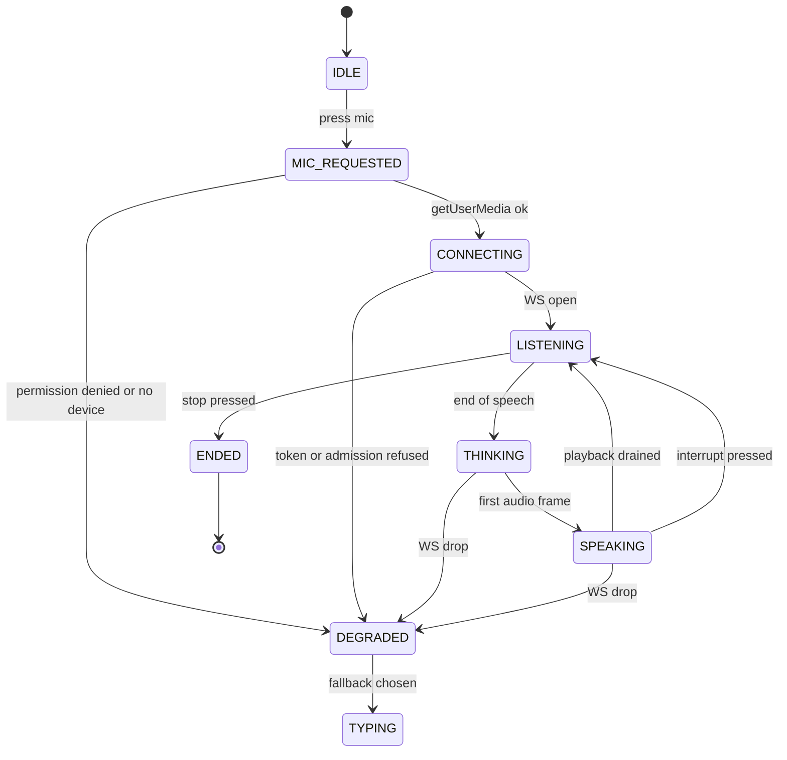
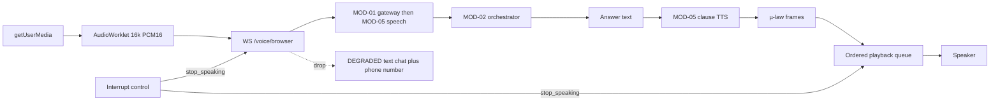

> **Lens:** PO / TPO (technical ACs) / Architect (HLD, LLD) · **Engagement:** Brownfield

# US-008 — Let a buyer talk to the assistant in the browser, with typing always one tap away [Lens: PO]

- **Story:** As a **radiographer with the product page open on a tablet**, I want to **press one microphone button, ask my question out loud and hear the answer, and fall back to typing the moment voice is not workable**, so that **I get an answer in seconds without picking up the phone or typing a long specification name**.
- **Business value:** Browser voice converts the browse-and-wonder visitor who will not dial a number, and it does so on the same conversation and the same answer engine as chat (`BRD-01`).
- **Priority:** **Must** — browser-mic voice alongside PSTN is the D1 commitment (`00-product-intent.md` §5).
- **Ordering note (TPO):** depends on US-003 (the browser-mic transport contract) and US-005/US-006 (classification and turn persistence); it can be built in parallel with US-007 (chat surface) but must ship after the transport so the client is written against a frozen frame contract. The AudioWorklet capture path is the story's main technical risk and is isolated behind one helper.

## Acceptance Criteria [Lens: PO]

```gherkin
Scenario: AC-1 A buyer asks by voice and hears the answer in the browser
  Given a browser with microphone permission granted
  When the buyer presses the mic control and asks "what does the FCR Prima T2 weigh?"
  Then the answer audio plays in the browser within 1.2 s (p95) of the buyer finishing speaking
    And the transcript of the question and answer is visible on the page

Scenario: AC-2 The buyer interrupts the spoken answer
  Given the assistant is speaking a long answer
  When the buyer presses the interrupt control and starts speaking
  Then playback stops immediately and the new question is captured

Scenario: AC-3 The buyer switches to typing mid-session
  Given an open voice session
  When the buyer types a follow-up question
  Then the typed turn continues in the same conversation with the voice context available

Scenario: AC-4 (failure) Microphone permission is denied
  Given the buyer denies microphone permission
  When the mic control is pressed
  Then the text chat is offered and the direct phone number is shown, with no error state

Scenario: AC-5 (failure) No microphone device is present
  Given the device has no microphone
  When the mic control is pressed
  Then the same text-and-phone fallback is shown within one interaction

Scenario: AC-6 (failure) The WebSocket drops mid-session
  Given an active browser voice session
  When the socket drops
  Then the client shows the ended state, retains the transcript, and offers reconnect
    And reconnecting within 60 s resumes the same conversation

Scenario: AC-7 (failure) Voice capacity is refused
  Given the voice admission ceiling is reached
  When a session starts
  Then the client shows the busy state with the callback number and a link to text chat
    And no microphone capture starts

Scenario: AC-8 (failure) The page is opened on a browser with no audio capture support
  Given a browser where getUserMedia or AudioWorklet is unavailable
  When the page loads
  Then the mic control is not shown as available and text chat is the offered path
```

Technical acceptance criteria [Lens: TPO]:

- **TAC-1:** Mic capture → first outbound frame ≤ 300 ms; end-of-speech → first answer audio p95 ≤ 1.2 s end-to-end; playback queue never reorders frames.
- **TAC-2:** Capture is mono 16 kHz PCM16 via AudioWorklet; when AudioWorklet is unavailable, a `MediaRecorder` fallback yields the same server contract, at chunkier framing.
- **TAC-3:** `getUserMedia` is requested only on an explicit buyer gesture; permission denial is a first-class state, never an unhandled promise rejection.
- **TAC-4:** Playback uses a single ordered queue; a `stop_speaking` control frame clears the queue within 150 ms.
- **TAC-5:** The client makes no persistent writes (`localStorage`/`sessionStorage`/IndexedDB); the session token is `HttpOnly` (TAC-5 of US-007).
- **TAC-6:** All voice states are reflected in text (`idle`, `listening`, `thinking`, `speaking`, `ended`, `degraded`) with an accessible status region; the voice path is never the only path to an answer (WCAG 2.1 AA).
- **TAC-7:** On any transport failure the client falls back to text chat and shows the direct phone number — it never leaves a dead control (CS-4).

## HLD — Architecture Slice [Lens: Architect]





- **Components touched:**
  - **MOD-10 (this story):** `voice_client.html`, `voice.js`, the state machine, AudioWorklet capture module, playback queue, interrupt control, and the degraded/fallback UI.
  - **MOD-01:** the `/voice/browser` WS and admission (built in US-003); no server change here.
  - **MOD-05:** STT/TTS behind the socket; unchanged.
  - **MOD-02:** answers turns; unchanged.
- **Interaction summary:**
  1. The buyer presses mic; permission is requested on the gesture.
  2. On grant, the client connects the WS with the session token; on admission the capture starts.
  3. End-of-speech is detected server-side (600 ms floor); the transcript becomes a turn.
  4. The answer audio streams back as µ-law frames and plays through the ordered queue.
  5. The interrupt control sends `stop_speaking` and the client returns to `LISTENING`.
  - **Failure path:** permission denied / no device → `DEGRADED` with text chat and the phone number; token or admission refused → busy state with a callback number; WS drop → `DEGRADED` with reconnect; every state has a text alternative (TAC-6).

## LLD — Implementation Detail [Lens: Architect]

- **Modules / functions / APIs** — vanilla JavaScript:

```js
// mod10/voice/state.js
export const VoiceState = Object.freeze({
  IDLE:'idle', MIC_REQUESTED:'mic_requested', CONNECTING:'connecting',
  LISTENING:'listening', THINKING:'thinking', SPEAKING:'speaking',
  ENDED:'ended', DEGRADED:'degraded'
});
export function createMachine({ onChange }) -> { state, transition(event) }

// mod10/voice/capture.js
export async function openMic({ sampleRate = 16000 }) -> MicStream   // throws MicDenied | MicUnsupported
export class AudioWorkletCapture {
  constructor(stream, { onFrame }) {}
  start() -> void
  stop() -> void
}
export class MediaRecorderFallback {
  constructor(stream, { onChunk }) {}
  start() -> void; stop() -> void
}

// mod10/voice/playback.js
export class OrderedPlaybackQueue {
  enqueue(ulawFrame) -> void
  flush() -> void            // used by stop_speaking, clears within 150 ms
  get isDraining() -> boolean
}

// mod10/voice/client.js
export function connectVoice(token, { onTranscript, onAudio, onState, onError }) -> VoiceSession
export class VoiceSession {
  interrupt() -> void        // sends stop_speaking, flushes playback
  stop() -> void
  reconnect() -> Promise<void>   // within 60 s resumes the conversation
}
```

- **Data schema changes:** none persistent. Client contract:
  - Control frames: `{type:'start', conversation_id}` → `{type:'stop'}` | `{type:'stop_speaking'}`.
  - Server frames: `{type:'transcript', text, final}` → `{type:'audio', ulaw_b64}`* → `{type:'turn_complete', turn_id}`; `{type:'busy', callback_number}`; `{type:'error', code}`.
  - Close codes: `4001` token expired, `4002` admission refused, `4008` rate limited, `1000` normal.
  - No browser persistence keys (TAC-5).

- **Edge cases** — each with the decided behaviour:
  1. **Permission denied** → `DEGRADED`, text chat plus phone number, one-line explanation (`AC-4`).
  2. **No device** → `DEGRADED` within one interaction (`AC-5`).
  3. **No AudioWorklet** → `MediaRecorderFallback`; if neither exists, the mic control is disabled and text is offered (`AC-8`).
  4. **Token refused / expired** → `DEGRADED`; a fresh token can be minted on the next gesture.
  5. **Admission refused (`4002`)** → busy state plus callback number plus text link; capture never starts (`AC-7`).
  6. **WS drop in `LISTENING`** → `DEGRADED`, transcript retained, reconnect offered (`AC-6`).
  7. **WS drop in `SPEAKING`** → playback flushes immediately; the completed answer is fetched by turn id and shown as text.
  8. **Interrupt pressed while silent** → no-op, no frame sent.
  9. **Interrupt pressed during playback** → `stop_speaking` sent, queue flushed ≤ 150 ms (`TAC-4`, `AC-2`).
  10. **Double press of mic** → second press ignored while not `IDLE`/`ENDED`.
  11. **Page hidden (tab backgrounded)** → capture continues only if the socket is healthy; on `visibilitychange` to hidden for > 60 s the session stops and states plainly that it ended.
  12. **Feedback loop (speaker→mic)** → browser echo cancellation enabled on `getUserMedia`; a server-side echo gate is MOD-05's contract; if the client detects repeated self-transcription it flushes and warns.
  13. **Slow first answer** → `THINKING` shows a text status ("found it, getting the answer"); no infinite listening spinner.
  14. **Reconnect after `ENDED`** → opens a **new** session but the conversation hash keeps the thread; the prior transcript is still visible.
  15. **Browser without WebSocket** (very old) → mic control hidden, text offered (`AC-8`).

- **Error handling:**
  - `MicDenied`, `MicUnsupported` → `DEGRADED`; never an unhandled rejection (TAC-3).
  - `VoiceRefused` (`4002`) → busy state with the callback number.
  - `TransportLost` → `DEGRADED` with reconnect; completed turns re-fetched, never re-asked.
  - Retries: reconnect 1 s → 8 s (4 attempts); no automatic re-send of a question. Dead letter: n/a (stateless client).

- **Test scenarios** — the `UC-04` Scenario Coverage table is the floor, from the client's perspective:

| # | Scenario row | Level | Test |
|---|---|---|---|
| T-01 | Happy path | e2e | Press mic → speak → transcript shown → answer audio plays → turn recorded (AC-1) |
| T-02 | Alternate path (A1) | integration | Typed follow-up mid-session continues the same conversation (AC-3) |
| T-03 | Invalid input | unit | No mic device → DEGRADED with text and phone number (AC-5) |
| T-04 | Unauthorized user | integration | Public page; the session token is HttpOnly and no client storage is written (TAC-5) |
| T-05 | Missing data | integration | Anonymous session keeps the thread on the page but creates no lead |
| T-06 | Partial data | unit | Partial capture does not create a lead or a partial turn |
| T-07 | Duplicate request | unit | Duplicate start frames and double mic presses are ignored |
| T-08 | Timeout | integration | Idle session ends cleanly and the UI shows `ended` with a restart control |
| T-09 | Dependency failure | integration | STT unavailable → DEGRADED with the text fallback offered |
| T-10 | Retry | integration | Reconnect within 60 s resumes the same conversation (AC-6) |
| T-11 | Concurrent operation | integration | Two tabs run independent sessions with no audio cross-talk |
| T-12 | Cancellation | integration | Stop pressed → session closed, no partial lead, queue flushed |
| T-13 | Recovery | integration | Page reload → new session, prior conversation retrievable via the conversation hash |
| T-14 | Partial completion | integration | Answer audio not played → the answer is still shown as text from the persisted turn |
| T-15 | Interrupt | integration | `stop_speaking` flushes playback within 150 ms and the next question is captured (TAC-4, AC-2) |
| T-16 | Admission refused | integration | `4002` shows the busy state and callback number and starts no capture (AC-7) |
| T-17 | Accessibility | unit | Every voice state is exposed in an accessible status region; text path reachable at all times (TAC-6) |
| T-18 | **Load** | load | 10 concurrent browser sessions against a 2-slot admission: exactly 2 capture paths open, 8 show the busy state within 500 ms, no runaway reconnect storm (TAC-1, TAC-7) |

## Traceability

- Parent module: `MOD-10`
- Use case: `UC-04` (business story, buyer surface)
- Technical requirement: `TRD-46` (browser voice client media contract and state machine)
- Business requirements: `BRD-01` (same answer engine), `BRD-19` (cross-platform runtime — the client must work on Windows, macOS and Linux browsers)
- Data gap / state machine: `DG-01` (admission ceiling exercised by the client), `DG-06` (public surface, session-token bounded — `CV-03`), `SM-02` (session end and teardown states)
- Reconciliation: `REC-16` (`voice_client.html` refactored from the source's browser-mic page), `REC-11` (media-stream contract reused from the Twilio path)

## Definition of Done

- [ ] All ACs pass (AC-1 … AC-8, TAC-1 … TAC-7)
- [ ] Tests T-01 … T-18 pass, including the interrupt-timing test and the 10-session admission load test
- [ ] No schema migration (MOD-10 owns no store)
- [ ] Frame and close-code contract frozen and documented in the module doc's API table
- [ ] Verified on iOS Safari 16, Android Chrome 110, and the desktop trio; the AudioWorklet and MediaRecorder paths both exercised
- [ ] Degraded states verified by simulated permission denial, socket drop and `4002` refusal
