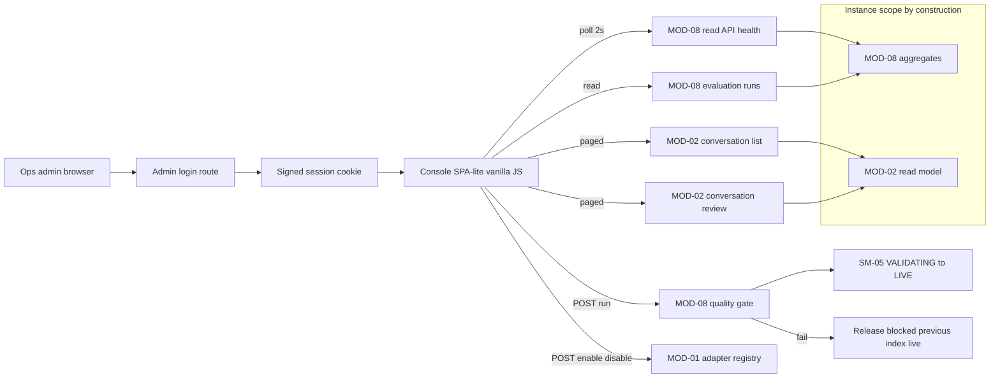

> **Lens:** PO / TPO (technical ACs) / Architect (HLD, LLD) · **Engagement:** Brownfield

# US-009 — Give ops one console for channel health, conversation review and the release gate — behind a login [Lens: PO]

- **Story:** As an **ops admin at ANITA**, I want **to see this instance's channel health, open any conversation and its sentiment trail, and promote or block a catalogue refresh on the frozen evaluation result — all behind an authenticated console**, so that **I can run four channels and a monthly corpus refresh without guessing, and without ever exposing buyer PII on an open page**.
- **Business value:** The console is the operating surface for the whole product: `BRD-21` (observability) and `BRD-22` (quality gate) are only real if someone can see them, and the `DG-06` split (`CV-03`) requires the admin surface to be the authenticated half.
- **Priority:** **Must** — required by `BRD-21`, and the admin authentication is **blocking for public launch** (`DG-06`).
- **Ordering note (TPO):** depends on US-006 (the review read model), US-002 (channel health counters) and MOD-08's read API plus frozen evaluation set. It is the last MOD-10 story: it consumes the data contracts the other stories produce, and it must land before the first public deployment because it carries the admin auth.

## Acceptance Criteria [Lens: PO]

```gherkin
Scenario: AC-1 Ops sees live channel health for this instance only
  Given the console is open with a valid admin session
  When the health panel loads
  Then each channel shows its state, live connection count, queue depth and recent error count
    And only this instance's channels and conversations are shown

Scenario: AC-2 Ops opens a live conversation and reads it end to end
  Given a conversation exists with a transcript
  When the operator opens it from the conversation list
  Then the transcript, products discussed, sentiment trail and handoff reason are shown
    And the view is reachable by URL so it can be shared with a colleague

Scenario: AC-3 Ops drills from a sentiment alert into the triggering turn
  Given a conversation with negative sentiment
  When the operator selects the alert
  Then the review opens at the turn that triggered it

Scenario: AC-4 (failure) An unauthenticated request to any admin route is refused
  Given no admin session cookie
  When any /admin/* route or /admin/api/* endpoint is requested
  Then the response is 401 and the body contains no conversation, lead, sentiment or metric data

Scenario: AC-5 (failure) The metrics backend is down and the console says so
  Given MOD-08's read API is unreachable
  When the console loads
  Then every affected panel shows "unavailable" with its last-known time
    And no panel shows zero as if it were a real reading

Scenario: AC-6 (failure) A transcript's retention has expired
  Given a conversation whose transcript retention has expired
  When the operator opens it
  Then the review shows the expiry date and the conversation and lead remain visible

Scenario: AC-7 An evaluation run blocks a regressive index
  Given a candidate index that fails the frozen evaluation set
  When the operator runs the release gate
  Then the release is blocked, the failing question ids are listed, and the previous index stays live

Scenario: AC-8 (failure) A second evaluation run is refused while one is in flight
  Given an evaluation run is in progress
  When the operator starts another
  Then the request is refused with the running run's id
    And the first run is unaffected
```

Technical acceptance criteria [Lens: TPO]:

- **TAC-1:** 100 % of `/admin/*` routes require a signed admin session cookie (`HttpOnly`, `Secure`, `SameSite=Lax`); unauthenticated → 401 with an empty data body; expired session → 401 and a re-login prompt.
- **TAC-2:** Console reads are served through MOD-08's in-process read API and MOD-02's review read model; every response carries `source: live | stale | unavailable` plus `as_of`, and the UI renders the state for every panel.
- **TAC-3:** Console page load p95 ≤ 2 s; health refresh every 2 s; conversation list paged 50; transcript paged 100 turns at ≤ 500 ms per page.
- **TAC-4:** All read queries are instance-scoped by construction: no route accepts an instance parameter, and a test asserts that no cross-instance row is reachable through any console endpoint (`BRD-18`).
- **TAC-5:** Refresh uses polling, not SSE/WebSocket — with 3 consecutive failures the interval backs off 2 s → 10 s and resumes on the first success.
- **TAC-6:** The channel enable/disable action and the evaluation run are the only mutations; both are idempotent, logged with the operator session, and the disable takes effect within 2 s across the instance.
- **TAC-7:** The evaluation run is refused with 409 while another run is in flight; a run that errors on a question counts it as a failure, never as skipped (`UC-15` E1).
- **TAC-8:** Panels degrade independently: one failed fetch never blanks the page.

## HLD — Architecture Slice [Lens: Architect]



- **Components touched:**
  - **MOD-10 (this story):** the admin login/session, the console shell, the health panel, the conversation list and review panel, the evaluation panel, and the polling/backoff refresh loop.
  - **MOD-08:** supplies health aggregates, traces and the evaluation run/read API (built in its own stories); this story consumes and renders.
  - **MOD-02:** supplies the review read model (US-006); this story pages and renders it.
  - **MOD-01:** receives enable/disable through the adapter registry (US-002).
  - **MOD-09:** supplies the admin credential/session secret and asserts instance isolation at boot.
- **Interaction summary:**
  1. The operator authenticates once; a signed session cookie is issued.
  2. The console shell loads and polls the health endpoint every 2 s.
  3. Conversation list, review and evaluation panels fetch on demand, paged.
  4. A release-gate run is started from the console; MOD-08 executes the frozen set and returns the verdict; promotion happens only on pass (`SM-05`).
  - **Failure path:** no/expired session → 401 and re-login; MOD-08 unreachable → panels render `unavailable` with last-known time; expired transcript → labelled expiry, not empty; in-flight run → 409 with the running id.

## LLD — Implementation Detail [Lens: Architect]

- **Modules / functions / APIs** — Python route layer plus vanilla JS:

```python
# mod10/admin/auth.py
def issue_admin_session(response: Response, *, ttl_seconds: int = 28800) -> None
def require_admin_session(request: Request) -> AdminSession      # raises 401
def admin_login(credential_hash: str, presented: str) -> bool   # constant-time compare

# mod10/admin/routes.py
@router.get("/admin/api/health")           # -> ChannelHealth[] with source/as_of
@router.get("/admin/api/conversations")    # ?channel=&state=&lead=&after= paged 50
@router.get("/admin/api/conversations/{conversation_id}")
@router.post("/admin/api/conversations/{conversation_id}/export")
@router.get("/admin/api/evaluations")
@router.post("/admin/api/evaluations/run")     # 202 or 409 with running id
@router.post("/admin/api/channels/{channel_kind}/enable")
@router.post("/admin/api/channels/{channel_kind}/disable")

# mod10/admin/aggregates.py
@dataclass
class PanelState:
    source: str          # 'live' | 'stale' | 'unavailable'
    as_of: datetime
    payload: dict | None
def safe_panel(loader: Callable[[], dict]) -> PanelState     # never raises; TAC-8
```

```js
// mod10/admin/console.js
export function startPolling(path, { intervalMs = 2000, onData }) -> Poller
export class Poller { backoff() -> void; resume() -> void }   // 2s -> 10s on 3 failures
export function renderPanel(el, panelState) -> void           // live | stale | unavailable | empty
export function renderTranscriptPage(turns, { onNext }) -> void
```

- **Data schema changes** — the console owns no tables; it requires the read API contract and one audit table for mutations:

```sql
CREATE TABLE IF NOT EXISTS admin_action_log (
  id             bigserial PRIMARY KEY,
  session_id     text NOT NULL,
  action         text NOT NULL,          -- 'channel.enable' | 'channel.disable' | 'evaluation.run'
  target         text NOT NULL,
  requested_at   timestamptz NOT NULL DEFAULT now(),
  result         text NOT NULL           -- 'accepted' | 'refused' | 'error'
);
CREATE INDEX IF NOT EXISTS admin_action_log_time_idx ON admin_action_log (requested_at DESC);
```

- **Edge cases** — each with the decided behaviour:
  1. **No session** → 401 with an empty body; the page redirects to the login form (`AC-4`, `TAC-1`).
  2. **Expired session mid-poll** → next poll gets 401 → the console shows the re-login prompt and stops polling; no partial data is rendered.
  3. **Metrics backend down** → affected panels `unavailable` with the last-known timestamp; unaffected panels keep rendering (`AC-5`, `TAC-8`).
  4. **Metrics stale (no new data for 3 cycles)** → `stale` label, values still shown with their age (`CS-2`).
  5. **Unknown conversation id** → 404 rendered as "not found in this instance" (`UC-13` invalid input).
  6. **Expired transcript** → expiry date shown; conversation and lead still visible (`AC-6`).
  7. **500-turn transcript** → paged at 100, cursor by `seq`, every page ≤ 500 ms (`TAC-3`).
  8. **Evaluation set absent/malformed** → run refused with a specific error; the release stays blocked (`UC-15` invalid input / missing data).
  9. **Evaluation run in flight** → 409 with the running id; the button reflects the running state (`AC-8`, `TAC-7`).
  10. **Evaluation question errors** → counted as a failure; the run is reported incomplete, never passed (`UC-15` E1).
  11. **Evaluation timeout** → run void, release blocked, previous index live (`UC-15` timeout).
  12. **Channel id unknown on enable/disable** → 404 with the list of known channels (`UC-12` invalid input).
  13. **Two operators** → read-only concurrency; the only contention is the evaluation run, resolved by 409.
  14. **Channel disable while a call is in flight** → the call completes; new inbound rejected politely (`UC-14` cancellation).
  15. **Cross-instance probe** (a crafted id from the university schema) → 404; the instance scoping is structural, not filtered (`TAC-4`, `BRD-18`).
  16. **Console opened on a phone** → layout usable at 360 px for on-call checks; heavy panels show the summary first.

- **Error handling:**
  - `Unauthenticated` → 401 with an empty body; the failure is logged without the requested data.
  - `PanelUnavailable` → `PanelState(source='unavailable')`; never a 500 and never fabricated values (`TAC-8`).
  - `RunInFlight` → 409 with the running id; the console shows the run state.
  - `AdapterToggleRefused` → 422 with the adapter's reason (e.g. invalid credential, `UC-14` E1).
  - Retries: console polling only (2 s → 10 s backoff, resume on success); no automatic retry of a refused mutation. Dead letter: `admin_action_log` records refused and errored actions; nothing is silently discarded.

- **Test scenarios** — the `UC-12`, `UC-13` and `UC-15` Scenario Coverage tables are the floor:

| # | Scenario row | Level | Test |
|---|---|---|---|
| **UC-12 instance health** | | | |
| T-01 | Happy path | e2e | Console shows per-channel state, connections, queue depth and error counts for this instance |
| T-02 | Alternate path (A1 — restart a channel) | integration | Channel disable then enable from the console takes effect within 2 s (`TAC-6`) |
| T-03 | Invalid input | unit | Unknown channel id → 404 with the known-channel list |
| T-04 | Unauthorized user | integration | Every `/admin/*` route → 401 with no data when unauthenticated (`AC-4`) |
| T-05 | Missing data | integration | No traces yet → empty state, explicitly not an error |
| T-06 | Partial data | integration | Some channels reporting → per-channel status; others marked unavailable |
| T-07 | Duplicate request | unit | Repeated health polls are idempotent |
| T-08 | Timeout | integration | Slow read API → `unavailable` panel with the last-known time, not a hung page |
| T-09 | Dependency failure | integration | MOD-08 down → `unavailable`, never fabricated zeros (`AC-5`) |
| T-10 | Retry | integration | Polling backs off 2 s → 10 s and resumes on the first success (`TAC-5`) |
| T-11 | Concurrent operation | integration | Two operators read simultaneously with no mutation conflict |
| T-12 | Cancellation | integration | Operator leaves mid-poll → no server state change |
| T-13 | Recovery | integration | MOD-08 returns → live data resumes within one poll cycle |
| T-14 | Partial completion | integration | Interrupted drill-down produces no mutation and no partial page state |
| **UC-13 conversation review** | | | |
| T-15 | Happy path | e2e | Review shows transcript, products, sentiment trail and handoffs for one conversation |
| T-16 | Alternate path (A1 — drill from alert) | integration | Opening from a sentiment alert lands on the triggering turn (`AC-3`) |
| T-17 | Invalid input | unit | Unknown conversation id → 404 rendered clearly |
| T-18 | Unauthorized user | integration | Review route → 401 with an empty body (`TAC-1`) |
| T-19 | Missing data | integration | Transcript empty because a call failed early → shown as such |
| T-20 | Partial data | integration | Early turns without sentiment → partial trail with the gap marked |
| T-21 | Duplicate request | unit | Repeated reads idempotent |
| T-22 | Timeout | integration | 500-turn transcript pages at 100 with every page ≤ 500 ms (`TAC-3`) |
| T-23 | Dependency failure | integration | DB down → `unavailable`, not an empty transcript |
| T-24 | Retry | integration | Manual refresh re-reads and picks up new turns |
| T-25 | Concurrent operation | integration | Two reviewers read while turns are written; no blocking (`TAC-3`) |
| T-26 | Cancellation | integration | Closing the panel leaves no state |
| T-27 | Recovery | integration | Backend recovers → live review resumes |
| T-28 | Partial completion | integration | Interrupted export discards the partial file |
| T-29 | Retention | integration | Expired transcript → expiry date shown, conversation and lead visible (`AC-6`) |
| **UC-15 release validation** | | | |
| T-30 | Happy path | e2e | Candidate index runs the frozen set, passes, and is promoted (`SM-05`) |
| T-31 | Alternate path (A1 — report only) | integration | Run records results without promotion |
| T-32 | Invalid input | unit | Malformed evaluation set → run refused with a specific error |
| T-33 | Unauthorized user | integration | Evaluation routes require the admin session (`TAC-1`) |
| T-34 | Missing data | integration | Evaluation set absent → release blocked, cannot be silently skipped |
| T-35 | Partial data | integration | Some questions errored → run reported incomplete, never passed (`TAC-7`) |
| T-36 | Duplicate request | integration | Re-running for the same candidate is idempotent |
| T-37 | Timeout | integration | Run exceeds budget → void, release blocked, previous index live |
| T-38 | Dependency failure | integration | Answer engine down → whole run void (`UC-15` E2) |
| T-39 | Retry | integration | Re-run permitted after a void run |
| T-40 | Concurrent operation | integration | Second run refused with the running id (`AC-8`, `TAC-7`) |
| T-41 | Cancellation | integration | Aborted run → no promotion, previous index stays live |
| T-42 | Partial completion | integration | Promotion is atomic — no partially-promoted state is reachable |
| T-43 | Isolation probe | integration | A crafted cross-instance id returns 404; no university row is reachable from any console endpoint (`TAC-4`, `BRD-18`) |
| T-44 | **Load** | load | 5 concurrent console tabs polling against a live instance: page load p95 ≤ 2 s, health poll adds no measurable latency to conversation p95, backoff engages cleanly on MOD-08 failure (`TAC-3`, `TAC-5`) |

## Traceability

- Parent module: `MOD-10`
- Use cases: `UC-12`, `UC-13`, `UC-15` (business story)
- Technical requirements: `TRD-47` (console read API and auth), `TRD-48` (rendering and refresh)
- Business requirements: `BRD-18` (instance isolation), `BRD-21` (per-conversation observability), `BRD-22` (quality gate)
- Data gap / state machine: `DG-06` (admin authentication — blocking for launch), `CV-03` (buyer/admin surface split), `DG-09` (config audit surfaced on the console), `DG-10` (adoption proxy via sentiment trend), `SM-05` (index VALIDATING → LIVE), `SM-06` (handoffs shown in review)
- Reconciliation: `REC-15` (`perf_trace.py` extended into the console's data), `REC-16` (Command Cockpit refactored; polling chosen because the tunnel breaks SSE), `REC-17` (evaluation harness pattern re-implemented for the ANITA frozen set)

## Definition of Done

- [ ] All ACs pass (AC-1 … AC-8, TAC-1 … TAC-8)
- [ ] Tests T-01 … T-44 pass, including the cross-instance isolation probe and the 5-tab load test
- [ ] Schema migration applied (`admin_action_log`)
- [ ] Every `/admin/*` route covered by an explicit 401 test (no route left unguarded)
- [ ] Module doc `MOD-10-client-surfaces.md` updated if the read API contract changed
- [ ] Console verified to render `unavailable` with a stopped metrics backend, and `stale` after 3 missed cycles
- [ ] No PII in URLs: conversation ids only, never phone numbers or names
