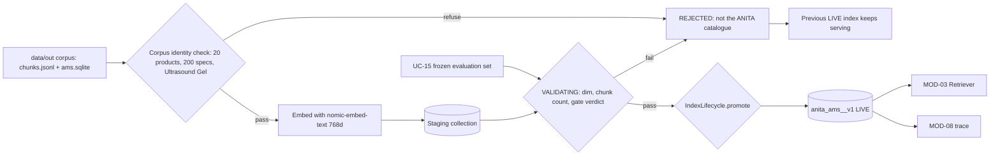

> **Lens:** PO / TPO (technical ACs) / Architect (HLD, LLD) · **Engagement:** Brownfield

# US-010 — Build and validate the ANITA-only catalogue index [Lens: PO]

- **Story:** As an **ops admin**, I want the ANITA catalogue to be ingested into its own vector collection and promoted only after validation, so that the assistant answers from ANITA's catalogue and a bad corpus can never silently replace a good one.
- **Business value:** The index is the ground truth for every catalogue answer. If it is built from the wrong corpus, or promoted half-built, every downstream answer inherits the defect — and neither failure announces itself.
- **Priority:** **Must** — no other MOD-03 story can be tested without it. TPO ordering note: build this first among MOD-03 stories; US-011 and US-012 consume the collection and the `build_id` it produces.

## Acceptance Criteria [Lens: PO]

```gherkin
Scenario: Happy path — the ANITA corpus is indexed and promoted
  Given the validated corpus at data/out/chunks.jsonl with 169 chunks
  And the ANITA collection anita_ams__v1 does not yet exist
  When the ops admin runs the index build
  Then 169 chunks are embedded at 768 dimensions into a staging collection
  And the build enters VALIDATING
  And when the frozen evaluation gate passes the build is promoted atomically
  And queries immediately cite the new build_id

Scenario: Failure path — a corpus that is not the ANITA catalogue is refused
  Given a corpus whose products.name set does not contain "Ultrasound Gel"
  Or whose product_specs row count is below 200
  When the ops admin runs the index build
  Then the build is refused before any embedding call is made
  And the refusal names the failed identity check
  And the currently LIVE index continues serving unchanged

Scenario: Failure path — an embedding dimension mismatch is rejected
  Given a staging build whose vectors are 512-dimensional
  When validation runs
  Then the build is marked REJECTED with reject_reason dim_mismatch
  And the previous LIVE build remains the served collection
  And a partial staging collection is never queryable
```

Technical acceptance criteria [Lens: TPO]:

- TAC-1: The collection name is exactly `anita_ams__v1`; the strings `langchain` and `meridian_kb__v1` are refused as collection names (`BRD-18`, `REC-03`).
- TAC-2: A full build of 169 chunks plus validation completes in ≤ **10 minutes** wall clock.
- TAC-3: `anita.index_builds` holds at most one row with `state = 'LIVE'` per collection, enforced by a partial unique index — double promotion raises a database error.
- TAC-4: A rebuild during live traffic causes **0** query failures and **0** queries served from a non-LIVE build.
- TAC-5: Killing the process mid-BUILDING and restarting leaves the LIVE index serving and discards the partial staging collection (`SM-05` #7).
- TAC-6: Every `TRD-15` transition is emitted to MOD-08 as a trace event with `build_id`, `state` and `reason`.

## HLD — Architecture Slice [Lens: Architect]



- **Components touched:**
  - `CorpusIngestor` — new; reads the corpus, runs the identity check, embeds, writes staging.
  - `IndexLifecycle` — new; owns `SM-05` states, validation, the atomic promotion and `anita.index_builds` persistence.
  - `EmbeddingProvider` (MOD-04) — consumed unchanged; the 768-d `nomic-embed-text` call.
  - MOD-09 boot preflight — gains the "collection must exist and be LIVE" assertion (`ABSENT` refuses boot).
  - MOD-08 — receives build lifecycle events and supplies the `UC-15` gate verdict.
- **Interaction summary (happy path):** 1. Ops invokes the build with a corpus path. 2. Identity check passes. 3. 169 chunks embed into a staging collection and a `BUILDING` row is written. 4. Validation checks dimension, chunk count and the gate verdict → `VALIDATING`. 5. `promote()` swaps the served pointer in one transaction and stamps `promoted_at`. 6. Retrieval now cites the new `build_id`.
- **Failure path:** at any step before promotion the build moves to `REJECTED` with a reason; the LIVE pointer is untouched, so the assistant keeps answering from the previous index and `UC-12` shows the rejection.

## LLD — Implementation Detail [Lens: Architect]

- **Classes / functions / APIs:**

```python
# mod03/ingest.py
@dataclass(frozen=True)
class CorpusIdentity:
    product_ids: frozenset[str]
    spec_rows: int
    has_ultrasound_gel: bool
    def ok(self) -> bool: ...          # len(product_ids) >= 20 and spec_rows >= 200 and has_ultrasound_gel

class CorpusIngestor:
    def __init__(self, corpus_dir: Path, embedder: EmbeddingProvider) -> None: ...
    def verify_identity(self) -> CorpusIdentity: ...
    def build(self, staging_dir: Path) -> BuildReport: ...      # raises CorpusIdentityError, EmbeddingUnavailable

# mod03/lifecycle.py
class IndexState(StrEnum):
    ABSENT = "ABSENT"; BUILDING = "BUILDING"; VALIDATING = "VALIDATING"
    LIVE = "LIVE"; REJECTED = "REJECTED"

class IndexLifecycle:
    COLLECTION = "anita_ams__v1"
    FORBIDDEN_COLLECTIONS = ("langchain", "meridian_kb", "meridian_kb__v1")
    def start_build(self, corpus_sha256: str) -> str: ...            # returns build_id, writes BUILDING
    def begin_validation(self, build_id: str) -> None: ...            # BUILDING -> VALIDATING
    def reject(self, build_id: str, reason: str) -> None: ...         # -> REJECTED, persists reason
    def promote(self, build_id: str, gate_verdict: GateVerdict) -> None: ...
        # refuses unless state == VALIDATING and gate_verdict.passed
    def status(self) -> IndexStatus: ...

class CorpusIdentityError(Exception): ...
class BuildStateError(Exception): ...      # illegal transition, e.g. ABSENT -> LIVE
```

```sql
-- anita.index_builds (see MOD-03 B.4 for the full DDL)
CREATE UNIQUE INDEX IF NOT EXISTS index_builds_one_live
    ON anita.index_builds (collection) WHERE state = 'LIVE';
```

- **Edge cases:**
  1. Collection `ABSENT` at boot → MOD-09 refuses boot; the stack never serves an empty index.
  2. Corpus missing `chunks.jsonl` → `CorpusIdentityError` before any embedding.
  3. Corpus has 24 products but < 200 spec rows (truncated scrape) → refused by identity check.
  4. Embedding fails midway → build REJECTED, staging discarded, LIVE untouched.
  5. Chunk count < 169 from a corpus that declares 169 → REJECTED with `chunk_count_regression`.
  6. Dim ≠ 768 → REJECTED with `dim_mismatch`; no vectors are written to the LIVE path.
  7. Two concurrent builds → second refused on the exclusive build lock.
  8. Process killed mid-BUILDING → partial staging discarded on next start (`SM-05` #7).
  9. Validation exceeds 15 minutes → REJECTED by timeout (`SM-05` #10).
  10. Gate verdict missing → promotion refused; build stays VALIDATING (cannot silently promote).
  11. Re-promoting the already-LIVE `build_id` → no-op, idempotent.
  12. A build that is REJECTED then rebuilt → new `build_id`, new row; history retained.

- **Error handling:** `CorpusIdentityError` → build refused, event `index.build.refused`; `BuildStateError` → promotion refused with the illegal transition named; `EmbeddingUnavailable` → REJECTED (transient, retry permitted); all errors write `reject_reason` and never delete the previous LIVE row.

- **Test scenarios:**
  - **Unit** — identity check accepts the real corpus and rejects a fixture missing "Ultrasound Gel"; `promote()` raises on `ABSENT`, on `BUILDING`, on `REJECTED` and on a failed gate verdict; forbidden collection names raise.
  - **Unit** — dim-mismatch fixture (512-d embedder stub) produces `REJECTED/dim_mismatch`.
  - **Integration** — full build of the real 169-chunk corpus against a temp Chroma dir → `LIVE`, `chunk_count = 169`, `embedding_dim = 768`, one LIVE row.
  - **Integration** — rebuild while a query loop runs: 0 query failures, every served `build_id` is the old one until promotion, then the new one.
  - **Integration** — kill mid-build fixture (injected exception during embed) → next start discards staging, LIVE still serves.
  - **E2E** — `WF-03`: seed a candidate corpus whose gate fails → index stays on the previous build and `UC-12` reports `REJECTED/gate_regression`.
  - **E2E** — `UC-15` run against a promoted index: promotion is recorded, `UC-15`'s promotion is atomic (no partially-promoted state observable).
  - **Load/throughput** — build throughput ≥ 0.5 chunks/s sustained so the 10-minute TAC holds with headroom; measure the gate-run wall clock against the 15-minute validation budget.
  - **Recovery** — after REJECTED, the previous index answers 100 % of the frozen FAQ set unchanged.

## Traceability
- Parent module: `MOD-03`
- Use case: `UC-15` (release validation) · Workflow: `WF-03`
- Technical requirements: `TRD-12` (guarded ingestion, ANITA-only collection), `TRD-15` (index lifecycle and atomic promotion)
- Business requirements: `BRD-04` (grounded answers only), `BRD-18` (instance isolation), `BRD-22` (quality gate)
- Data gap / state machine: `SM-05` (ABSENT → BUILDING → VALIDATING → LIVE / REJECTED), `DG-13` (ingestion carries the absent-data products), `DG-09` (every build key is read)
- Reconciliation: `REC-03` (drop both source vector stores), `REC-04` (`app/rag*.py` refactor), `REC-23` (corpus identity gate pattern), `REC-13` (idempotent DDL-on-boot pattern), `REC-18` (no hardcoded paths/ports)
- Assets: `DAT-01` (chunks), `DAT-02`/`DAT-03`/`DAT-05` (corpus tables), `DAT-12` (vector index), `DAT-13` (config)

## Definition of Done
- [ ] All ACs pass (AC-1 … AC-3, TAC-1 … TAC-6)
- [ ] Tests from the LLD test scenarios pass, including the kill-mid-build recovery test
- [ ] Build-throughput measurement recorded against the 10-minute and 15-minute budgets
- [ ] Schema migration applied (`anita.index_builds` + `index_builds_one_live` partial unique index)
- [ ] MOD-09 boot assertion added for `ABSENT`/non-LIVE collection; MOD-03 module doc updated if the contract changed
