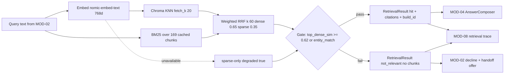

> **Lens:** PO / TPO (technical ACs) / Architect (HLD, LLD) · **Engagement:** Brownfield

# US-011 — Hybrid retrieval with a grounding gate that can say "not relevant" [Lens: PO]

- **Story:** As a **buyer**, I want the assistant to answer only from ANITA's published catalogue and to tell me plainly when it cannot, so that I never act on a specification or claim the company never made.
- **Business value:** This is `BRD-04` made mechanical. A confident wrong answer about medical equipment is a commercial and regulatory liability; an honest "I can't answer that" with a human offer is a recovered lead.
- **Priority:** **Must** — the single most load-bearing change in the answer path. TPO ordering note: depends on US-010 (the collection must exist); blocks US-013/US-014 (MOD-04 consumes `hit`/`not_relevant`).

## Acceptance Criteria [Lens: PO]

```gherkin
Scenario: Happy path — a specification question is answered from catalogue evidence
  Given the ANITA index is LIVE with 169 chunks
  When a buyer asks "what does the FCR Prima T2 weigh?"
  Then retrieval returns at least one chunk containing the FCR Prima T2 specification
  And the result carries decision "hit" with the chunk_id and source_url for each chunk
  And the answer engine receives the chunks and composes the answer from them

Scenario: Failure path — a question with no catalogue support is refused
  Given the index is LIVE and contains no MRI scanner
  When a buyer asks "what is the price of an MRI scanner?"
  Then retrieval returns decision "not_relevant" with no chunks
  And the language model is never invoked for the turn
  And the buyer is offered a human instead

Scenario: Failure path — the embedding backend is down
  Given the embedding provider raises EmbeddingUnavailable
  When a buyer asks about the FCR Prima T2 by name
  Then retrieval falls back to sparse BM25 only
  And entity-matched questions are still answered with decision "hit" and degraded true
  And a question with no exact catalogue match returns "not_relevant"

Scenario: Alternate path — a duplicate product name returns both candidates
  Given two catalogue rows are named "Medical Dry Imager"
  When a buyer asks "tell me about the Medical Dry Imager"
  Then retrieval returns both rows with their product_ids and prices
  And entity_match is true and decision is "hit"
  And the answer engine is required to disambiguate before stating a price
```

Technical acceptance criteria [Lens: TPO]:

- TAC-1: Hybrid retrieval p95 ≤ **150 ms** warm, measured from `retrieval_start` to `retrieval_done`, including the embed call.
- TAC-2: The grounding gate decides in ≤ **5 ms** after fusion and performs no I/O.
- TAC-3: `decision = "not_relevant"` implies `chunks == []`, and no `RetrievalResult` in that state can reach a generation call — asserted by a MOD-02/MOD-04 contract test.
- TAC-4: Identical queries return identical rankings and citations across runs (deterministic tie-break on `chunk_id`).
- TAC-5: Retrieval sustains ≥ **20 hybrid queries/s** single-process with p95 ≤ 150 ms and 0 errors.
- TAC-6: `RETRIEVAL_MIN_DENSE_SIM = 0.0` is rejected by the MOD-09 boot audit; the gate can never be shipped dormant (the source's `RAG_SIMILARITY_THRESHOLD = 0.0` defect).
- TAC-7: The dense and sparse weights (`0.65` / `0.35`) and `k = 60` are read from config by the fusion function; an unread key fails boot (`BRD-20`, `DG-09`).
- TAC-8: With the embedding provider stubbed to raise, every unit test still passes and `degraded = true` is set on all results.

## HLD — Architecture Slice [Lens: Architect]



- **Components touched:**
  - `Retriever` — new; orchestrates embed → dense → sparse → fusion → gate.
  - `MiniBM25` — new (stdlib, `REC-04` pattern); cached index over the 169 chunk texts.
  - `EntityMatcher` — new; normalised exact lookup against `products.name`, `products.model`, `product_id`.
  - `EmbeddingProvider` (MOD-04) — consumed; failures are caught and converted to degraded mode, never propagated.
  - MOD-02 — consumes `decision`; a `not_relevant` produces the decline path with 0 LLM calls.
- **Interaction summary (happy path):** 1. Query arrives from MOD-02. 2. Embed and BM25 run; dense KNN over `fetch_k = 20`. 3. Weighted RRF fuses to `top_k = 5`. 4. The gate checks `top_dense_sim ≥ 0.62` or `entity_match`. 5. A `hit` returns chunks with citations, `collection`, `build_id`, `degraded`.
- **Failure paths:** (a) gate fails → `not_relevant`, no generation; (b) embedder down → sparse-only with `degraded = true`; (c) Chroma unavailable → `RetrievalUnavailable` → MOD-02 treats it as E2 (engine unavailable), not as `not_relevant` — the two must stay distinguishable in the trace.

## LLD — Implementation Detail [Lens: Architect]

- **Classes / functions / APIs:**

```python
# mod03/retriever.py
DECISION_HIT = "hit"; DECISION_NOT_RELEVANT = "not_relevant"

@dataclass(frozen=True)
class Chunk:
    chunk_id: str; doc_id: str; text: str
    source_url: str; chunk_type: str; score: float

@dataclass(frozen=True)
class RetrievalResult:
    decision: str                       # "hit" | "not_relevant"
    chunks: list[Chunk]
    top_dense_sim: float
    entity_match: bool
    collection: str                     # always "anita_ams__v1"
    build_id: str
    degraded: bool

class Retriever:
    def __init__(self, settings: RetrievalSettings, embedder: EmbeddingProvider,
                 collection: Collection, bm25: MiniBM25, matcher: EntityMatcher) -> None: ...
    def retrieve(self, query: str, top_k: int = 5) -> RetrievalResult: ...
        # raises EmptyQuery, RetrievalUnavailable; never raises for "no result"
    def _dense(self, query: str, fetch_k: int) -> list[tuple[str, float]]: ...
    def _sparse(self, query: str, fetch_k: int) -> list[str]: ...
    def _fuse(self, dense, sparse, k: int, w_dense: float, w_sparse: float) -> list[Chunk]: ...
    def _gate(self, chunks, top_dense_sim, entity_match) -> str: ...

class MiniBM25:
    def __init__(self, docs: Sequence[str]) -> None: ...
    def top(self, query: str, k: int) -> list[str]: ...   # zero-score docs excluded

class EntityMatcher:
    def match(self, query: str) -> MatchResult: ...
        # exact normalised name/model/product_id; returns Ambiguous when >1 row matches

class EmptyQuery(Exception): ...
class RetrievalUnavailable(Exception): ...     # vector store down -> MOD-02 E2, not not_relevant
```

Ranking formula, implemented literally:

```
score(d) = w_dense / (k + rank_dense(d)) + w_sparse / (k + rank_sparse(d))   # k = 60
tie-break: chunk_id ascending
```

- **Data schema changes:** none. Reads `anita.products` for entity matching (`lower(name)`, `lower(model)`, `product_id`) and the LIVE Chroma collection for vectors. The `build_id` is read from `anita.index_builds` (`state = 'LIVE'`) and stamped on every result for traceability.

```sql
CREATE INDEX IF NOT EXISTS products_name_lower_idx ON anita.products (lower(name));
CREATE INDEX IF NOT EXISTS products_model_lower_idx ON anita.products (lower(model));
```

- **Edge cases:**
  1. Empty / whitespace query → `EmptyQuery` before embedding; MOD-02 re-prompts (UC-01 invalid input).
  2. Query > 2,000 characters → rejected as `EmptyQuery` variant `QueryTooLong`; re-prompt.
  3. Non-English or off-topic query → gate fails → `not_relevant` (never a guess).
  4. Product named but absent from the catalogue → `NotFound`, gate fails, decline + handoff.
  5. Product exists with 0 spec rows (`270685`, `270687`, `381893`) → retrieval may return the product chunk; the spec answer itself is `not_published` (US-012) — retrieval does **not** invent a spec.
  6. Two rows share a name → dict with both product ids in the chunk payload; `entity_match = true` (UC-01 A2, `BRD-09`).
  7. Exact model number (`DRYPIX 2000`, `RT-150`, `APO 200`) → BM25 rank 0; the sparse side exists for this case.
  8. Embedder raises → sparse-only, `degraded = true`, `top_dense_sim = 0.0`; gate can still pass via `entity_match`.
  9. Chroma client raises → `RetrievalUnavailable` (distinct from `not_relevant`); MOD-02 takes the E2 path.
  10. Query during an index rebuild → served from the LIVE build id; staging is invisible (`SM-05` #5).
  11. Same query twice → identical chunk order and citations (deterministic tie-break).
  12. Concurrent identical queries → no shared mutable state; BM25 index is read-only after warm-up.
  13. Score exactly at the threshold (`0.62`) → inclusive pass (`>=`), asserted by a boundary test.

- **Error handling:** `EmptyQuery`/`QueryTooLong` → validation, re-prompt, no trace as a failure; `EmbeddingUnavailable` → caught inside `Retriever`, degraded result, `degraded = true` in the trace; `RetrievalUnavailable` → propagates to MOD-02 as the engine-unavailable path; gate failure is **not** an error, it is a normal `not_relevant` result and is traced with `decision = not_relevant` and `top_dense_sim` recorded.

- **Test scenarios (UC-01 Scenario Coverage table is the floor):**
  - **Unit — happy path:** a fixture corpus query for "FCR Prima T2 weight" returns a `hit` with a citation.
  - **Unit — alternate path:** query naming "Medical Dry Imager" returns both product ids with `entity_match = true`.
  - **Unit — invalid input:** empty and 2,001-character queries raise `EmptyQuery` before any embed call.
  - **Unit — missing data:** an MRI-scanner query returns `not_relevant` with `chunks == []`.
  - **Unit — partial data:** a query for a product with 0 spec rows returns a hit whose answer path resolves to `not_published`, never a spec value.
  - **Unit — duplicate request:** identical queries produce byte-identical rankings and citation lists.
  - **Unit — dependency failure:** embedder stubbed to raise → `degraded = true`, sparse-only, entity match still hits; Chroma stubbed to raise → `RetrievalUnavailable`.
  - **Unit — boundary:** `top_dense_sim = 0.619` → `not_relevant`; `0.620` → `hit`.
  - **Integration — timeout/retry:** retrieval bounded by the turn budget; a slow embed is retried once then degrades to sparse-only, and the turn is not failed.
  - **Integration — concurrent operation:** 20 parallel retrievals on one process produce 0 errors and stable rankings.
  - **Integration — cancellation:** a cancelled turn leaves no partial BM25 or collection state; the next query is unaffected.
  - **Integration — recovery/partial completion:** after a forced `RetrievalUnavailable`, the next query succeeds without a restart.
  - **E2E — happy path:** `WF-01` chat turn: `not_relevant` produces a decline + handoff and the LLM invocation counter is **0** for that turn.
  - **E2E — unauthorized user:** retrieval is not reachable from any public route; it is in-process only.
  - **Load:** 20 queries/s for 5 minutes → p95 ≤ 150 ms, p99 ≤ 300 ms, 0 errors, gate ≤ 5 ms (TAC-1, TAC-2, TAC-5).

## Traceability
- Parent module: `MOD-03`
- Use cases: `UC-01`, `UC-02`, `UC-03`, `UC-04` (retrieval for every channel), `UC-11` (fail-safe refusal path is the same gate)
- Technical requirements: `TRD-13` (hybrid dense + BM25 + weighted RRF), `TRD-14` (grounding gate and `not_relevant` contract)
- Business requirements: `BRD-04` (grounded only), `BRD-07` (specification answering), `BRD-08` (company facts share the path), `BRD-09` (duplicate-name ambiguity surfaces here)
- Business rules: `R-2`, `R-7`
- Data gap / state machine: `DG-13` (absent data never inferred), `DG-03` (embedding outage degrades to sparse-only), `SM-05` (queries always hit the LIVE build), `DG-09` (weights and threshold keys are read)
- Reconciliation: `REC-04` (`app/rag*.py` dispatcher/circuit-breaker refactor, MCP hop dropped), `REC-03` (single collection), `REC-01` (retrieval call stripped out of the speech turn loop)
- Assets: `DAT-01` (chunks), `DAT-12` (index), `DAT-13` (retrieval config)

## Definition of Done
- [ ] All ACs pass (AC-1 … AC-4, TAC-1 … TAC-8)
- [ ] Tests from the LLD test scenarios pass, covering the UC-01 coverage-table rows named above
- [ ] Load test passed: 20 queries/s, p95 ≤ 150 ms, gate ≤ 5 ms
- [ ] Schema migration applied (entity-match indexes) if not already present
- [ ] MOD-02 contract test asserts a `not_relevant` result can never reach MOD-04; MOD-03 module doc updated if the `RetrievalResult` contract changed
