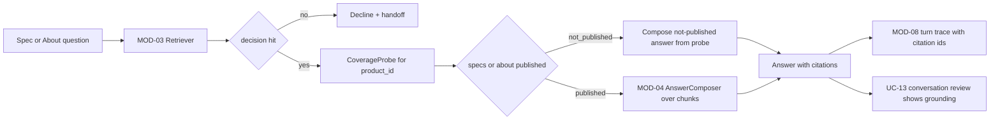

> **Lens:** PO / TPO (technical ACs) / Architect (HLD, LLD) · **Engagement:** Brownfield

# US-012 — Cite every answer, and answer "not published" when the catalogue is silent [Lens: PO]

- **Story:** As a **buyer**, I want every specification answer to name the catalogue record it came from, and to be told plainly when ANITA has not published a detail, so that I can trust what I am told and know the difference between "not in the catalogue" and "does not exist".
- **Business value:** Provenance is what makes `BRD-04` auditable — a reviewer, an evaluator or a buyer can check the source. And `DG-13` is a live data reality: 3 products publish no specifications and 4 publish no About text. Inventing those values is the one failure mode the product may never ship.
- **Priority:** **Must** — `BRD-07` and `BRD-08` are unshippable without it, and the "not published" path is the difference between an honest assistant and a liability. TPO ordering note: depends on US-010 and US-011; consumes the `Chunk`/`Availability` contracts they define.

## Acceptance Criteria [Lens: PO]

```gherkin
Scenario: Happy path — a specification answer carries its catalogue citation
  Given the buyer asks for the FCR Prima T2 specification
  And the index contains the FCR Prima T2 chunk
  When the answer is composed
  Then the answer carries the chunk_id, doc_id and source_url of every chunk it used
  And the conversation review can render the grounding for that turn

Scenario: Failure path — a product with no published specification
  Given the catalogue holds no specification rows for Microbar Paste product 270685
  When a buyer asks "what is the specification of Microbar Paste?"
  Then the answer states that ANITA has not published specifications for that product
  And no specification value is stated for it
  And a human follow-up is offered

Scenario: Failure path — a product with no About text
  Given product 3935251 has about_chars = 0
  When a buyer asks "tell me about the Medical Dry Imager at 2 lakh"
  Then the answer states no description is published for that product
  And no description is inferred from a similarly named product

Scenario: Happy path — a company statutory question is answered from collected facts
  Given the buyer asks "what is your Delhi address?"
  When the answer is composed
  Then it states the Karol Bagh branch address from the collected branch records
  And it cites the branch source record
```

Technical acceptance criteria [Lens: TPO]:

- TAC-1: 100 % of composed answers that state a catalogue fact carry ≥1 citation; an answer with 0 citations and a catalogue fact is a composition defect and must not be released.
- TAC-2: Every citation's `chunk_id` resolves to a row in the indexed corpus; a citation that does not resolve is a release blocker.
- TAC-3: `CoverageProbe.for_product(p)` returns `not_published` for specs exactly for product ids with 0 `product_specs` rows (currently `270685`, `270687`, `381893`) and for About exactly when `about_chars = 0` (currently `270683`, `3935251`, `3935247`, `3935249`) — asserted against the live corpus in a test.
- TAC-4: A "not published" answer is composed from the probe result, never routed through the LLM; the LLM invocation counter for such a turn is 0.
- TAC-5: The coverage probe queries complete in ≤ **10 ms** p95 and are read-only.
- TAC-6: Company-fact answers cite `company_ids`/`people`/`branches`/`certifications` source records and never state a value absent from those tables.

## HLD — Architecture Slice [Lens: Architect]



- **Components touched:**
  - `CoverageProbe` — new; derives availability from `product_specs` row counts and `products.about_chars`.
  - `Citation` payload on `Chunk` — new; `chunk_id`, `doc_id`, `source_url`, `chunk_type`.
  - `Retriever` — returns citations; `RetrievalResult` already carries `build_id` for reproducible review.
  - MOD-04 `AnswerComposer` — consumes the probe signal; composes "not published" without generation.
  - MOD-08 — stores citation ids on the turn trace so `UC-13` can render the grounding.
- **Interaction summary (happy path):** 1. Question is classified to a product and a fact kind. 2. Retrieval returns a `hit` with citations. 3. The probe answers "published" and the spec chunks are composed with their citations. 4. The trace records `chunk_ids` and `build_id`.
- **Failure path:** 1. Retrieval returns product chunks but the probe answers `not_published`. 2. MOD-04 composes the fixed absence sentence. 3. 0 spec tokens are emitted, 0 LLM calls are made, and a human offer is attached.

## LLD — Implementation Detail [Lens: Architect]

- **Classes / functions / APIs:**

```python
# mod03/coverage.py
class Availability(StrEnum):
    PUBLISHED = "published"
    NOT_PUBLISHED = "not_published"

@dataclass(frozen=True)
class ProductAvailability:
    product_id: str
    specs: Availability
    about: Availability

class CoverageProbe:
    def __init__(self, pool: ConnectionPool) -> None: ...
    def for_product(self, product_id: str) -> ProductAvailability: ...   # raises UnknownProduct
    def absent_spec_products(self) -> frozenset[str]: ...
    def absent_about_products(self) -> frozenset[str]: ...

# mod03/retriever.py (extended)
@dataclass(frozen=True)
class Citation:
    chunk_id: str; doc_id: str; source_url: str; chunk_type: str

@dataclass(frozen=True)
class Chunk:
    chunk_id: str; doc_id: str; text: str
    source_url: str; chunk_type: str; score: float
    def citation(self) -> Citation: ...
```

- **Data schema changes:** a read-only view over the corpus projection makes the probe a single query and keeps the "published" definition in one place:

```sql
CREATE OR REPLACE VIEW anita.product_availability AS
SELECT p.product_id,
       p.name,
       CASE WHEN coalesce(s.spec_rows, 0) = 0 THEN 'not_published' ELSE 'published' END AS specs,
       CASE WHEN coalesce(p.about_chars, 0)  = 0 THEN 'not_published' ELSE 'published' END AS about
FROM anita.products p
LEFT JOIN (
    SELECT product_id, count(*) AS spec_rows
    FROM anita.product_specs GROUP BY product_id
) s ON s.product_id = p.product_id;

-- Must return exactly the 3 named products (270685, 270687, 381893).
SELECT product_id FROM anita.product_availability WHERE specs = 'not_published';

-- Must return exactly the 4 named products (270683, 3935251, 3935247, 3935249).
SELECT product_id FROM anita.product_availability WHERE about = 'not_published';
```

- **Edge cases:**
  1. Product id present but with 0 spec rows → `specs = not_published`; fixed absence sentence + human offer.
  2. Product id present with `about_chars = 0` → `about = not_published`; never borrowed from "Medical Dry Laser Imager" or another sibling.
  3. Product id absent from `products` → `UnknownProduct` → decline + handoff (not an absence claim).
  4. Both specs and about absent → both statements emitted; still no invented value.
  5. Spec row present but `spec_value` empty → treated as not published for that named spec, not as an empty string in the answer.
  6. Query asks for a spec of a product whose spec exists on only one of two compared products → marked `not_published` on that side (UC-06 missing data row).
  7. Company fact absent from `company_ids` (e.g. a state GST) → stated as not published; never derived from the other GST number.
  8. Citation points at a chunk from the previous build after a promotion → review resolves it via `build_id`; the trace keeps the build it was answered from.
  9. Corpus is refreshed and a product gains specs → the probe flips to `published` with no code change (derived, not cached).
  10. `source_url` missing on a chunk → answer still emitted but flagged `citation_incomplete` and counted; the release gate fails if the count is non-zero on the frozen set.
  11. Duplicate product name → probe is per product id, so the two "Medical Dry Imager" rows report independently (one has About, one does not).
  12. Probe runs while a promotion is in flight → reads the same projection generation the retrieval used, so a citation and its availability cannot disagree.

- **Error handling:** `UnknownProduct` → decline + handoff, logged as a data gap (it means a classifier resolved to something absent); DB unavailable → MOD-04 degrades (commercial path surfaces the existing DB-unavailable behaviour); an unresolvable citation raises `CitationResolutionError` in the **test/evaluation harness only** — never in the buyer path, where the answer has already been grounded by construction.

- **Test scenarios (UC-01/UC-06 coverage-table floor):**
  - **Unit — happy path:** a spec answer for FCR Prima T2 carries a citation whose `chunk_id` resolves in the fixture corpus.
  - **Unit — partial data (UC-01):** `for_product("270685")` → `specs = not_published`; the composed answer contains no numeric spec token and the LLM is not called.
  - **Unit — missing data (UC-06):** comparing `270694` and `3935251` marks absent spec names `not_published` on the missing side only.
  - **Unit — absence honesty:** `absent_spec_products()` returns exactly `{270685, 270687, 381893}` and `absent_about_products()` exactly `{270683, 3935251, 3935247, 3935249}` against the real corpus.
  - **Unit — unknown product:** an id not in `products` raises `UnknownProduct` and yields a decline, not a "not published" claim.
  - **Unit — empty spec value:** a spec row with an empty `spec_value` is treated as absent, not emitted as blank.
  - **Integration — company facts (BRD-08):** Delhi address, ISO 9001:2015, NSIC-CRISIL, GST `07AAACA3337R1ZF`/`27AAACA3337R1ZD`, PAN `AAACA3337R` and IEC `0388056606` each answer with a resolvable citation.
  - **Integration — duplicate name:** the two "Medical Dry Imager" rows report different availability (About present/absent) without cross-contamination.
  - **Integration — refresh:** after a fixture corpus gains a spec row, the probe flips to `published` with no code change and no cache invalidation.
  - **E2E — UC-13:** a reviewed conversation renders the citation list and the `build_id` for every grounded turn; a turn answered after promotion shows the new build.
  - **E2E — citation integrity:** the frozen evaluation set asserts 0 unresolvable citations and 0 `citation_incomplete` flags (TAC-1, TAC-2).
  - **Load:** 50 probe calls/s against the view → p95 ≤ 10 ms, no writes (TAC-5).

## Traceability
- Parent module: `MOD-03`
- Use cases: `UC-01` (chat spec answer, partial-data row), `UC-02` (WhatsApp), `UC-06` (comparison, missing-data row), `UC-13` (review shows grounding)
- Technical requirements: `TRD-16` (provenance payload and honest-absence handling), `TRD-14` (the gate that precedes it)
- Business requirements: `BRD-04` (traceable answers), `BRD-07` (specification answering including empty spec blocks), `BRD-08` (company/contact answering)
- Data gap / state machine: `DG-13` (3 products without specifications, 4 without About — "not published", never inferred), `SM-05` (citations carry the build they came from), `AS-03` (single resident collection)
- Reconciliation: `REC-23` (the corpus-validation gate pattern extended to availability), `REC-04` (single retriever), `REC-13` (corpus projection into the `anita` schema)
- Assets: `DAT-03` (specifications, 21/24 present), `DAT-04` (FAQs, 6/24), `DAT-05` (company facts), `DAT-01` (chunks), `DAT-12` (index)

## Definition of Done
- [ ] All ACs pass (AC-1 … AC-4, TAC-1 … TAC-6)
- [ ] Tests from the LLD test scenarios pass, including the exact absent-product-id sets against the real corpus
- [ ] Load test passed: probe p95 ≤ 10 ms at 50 calls/s
- [ ] `anita.product_availability` view migration applied
- [ ] MOD-04 contract test asserts a `not_published` answer makes 0 LLM calls; MOD-03 module doc updated if the probe contract changed
