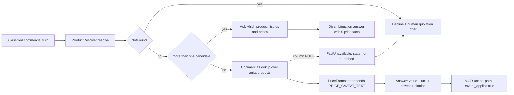

> **Lens:** PO / TPO (technical ACs) / Architect (HLD, LLD) · **Engagement:** Brownfield

# US-013 — Answer price, MOQ and delivery from SQL, with the caveat and the right product [Lens: PO]

- **Story:** As a **hospital procurement officer**, I want the exact catalogue price, MOQ and delivery time for the product I actually mean, always presented as a list price requiring a quotation, so that I can plan a purchase without being misled by a rounded or invented figure.
- **Business value:** A price that drifts one digit is a commercial liability and the lost caveat is a compliance defect (`BRD-05`, `BRD-06`). The corpus also contains two products named "Medical Dry Imager" at ₹5,50,000 and ₹2,00,000 — conflating them quotes the wrong price with full confidence (`BRD-09`).
- **Priority:** **Must** — the highest-value correctness change in the product. TPO ordering note: independent of US-014; ships with or before it. It is the path that must survive an LLM outage (US-015).

## Acceptance Criteria [Lens: PO]

```gherkin
Scenario: Happy path — a price answer with the mandatory caveat
  Given product 270694 Ultrasound Gel has price_display "₹60/Piece" in the catalogue
  When a buyer asks "what is the price of the ultrasound gel?"
  Then the answer states ₹60 per Piece exactly as published
  And the answer carries the list-price / quotation-required caveat
  And the answer was produced by the SQL path, not by the language model

Scenario: Happy path — MOQ and delivery come from the same row
  Given Ultrasound Gel has moq_value 10.0, moq_unit "Pieces" and delivery_time "7 Days"
  When a buyer asks "what is the minimum order quantity and delivery time?"
  Then the answer states 10 Pieces and 7 Days
  And each value is read from the products row, not inferred

Scenario: Failure path — a duplicate product name forces disambiguation
  Given both 270683 and 3935251 are named "Medical Dry Imager"
  And their prices are ₹5,50,000 and ₹2,00,000
  When a buyer asks "what is the price of the Medical Dry Imager?"
  Then the answer asks which of the two products is meant and lists both with their ids
  And no price is stated until the buyer chooses

Scenario: Failure path — a commercial value missing from the catalogue
  Given product 6797484 has no supply_ability value
  When a buyer asks "what is the supply ability for the Apollo RT CT Single Head?"
  Then the answer states the value is not published and offers a human quotation
  And no value is estimated or borrowed from another injector
```

Technical acceptance criteria [Lens: TPO]:

- TAC-1: Deterministic path p95 ≤ **25 ms** end-to-end (SQL read + formatting + caveat), p50 ≤ 10 ms.
- TAC-2: 100 % of price answers carry `caveat_applied = true`; the composer asserts `price_facts == [] or caveat_applied is True` and a violation raises rather than emitting (`BRD-06`, R-1).
- TAC-3: Boot guard `SELECT count(*) FROM anita.products WHERE price_is_list_price <> 1 OR quote_required <> 1` returns 0; non-zero refuses the price path and fails boot.
- TAC-4: `ProductResolver.resolve` returns `Ambiguous` for every name that matches >1 row; a boot self-test asserts the ambiguity set is non-empty so the path cannot be silently disabled.
- TAC-5: 0 LLM calls on the commercial path — asserted by a provider stub that fails the test if invoked.
- TAC-6: Every registry fact's columns are verified against `data/out/tables_schema.json` at boot; a registry column absent from the corpus fails startup (`DG-09`).
- TAC-7: ≥ **20 commercial lookups/s** sustained with p95 ≤ 25 ms and 0 errors.
- TAC-8: NULL commercial columns are omitted, never rendered as an empty string, `0`, `N/A` or an inferred value.

## HLD — Architecture Slice [Lens: Architect]



- **Components touched:**
  - `ProductResolver` — new; normalised name/model/id matching, returns `Resolved | Ambiguous | NotFound`.
  - `CommercialLookup` — new; declarative fact registry → parameterised read-only SQL.
  - `PriceFormatter` — new; the **only** function that renders `price_display`/`price_spoken`, and the only place the caveat is appended.
  - MOD-02 — routes commercial turns here without knowing which path produced the answer.
  - MOD-08 — receives `path = sql`, `caveat_applied`, and the values used.
- **Interaction summary (happy path):** 1. The classifier marks the turn commercial. 2. `resolve()` matches exactly one product. 3. `lookup()` reads the requested facts from `anita.products`. 4. `PriceFormatter` renders the value and appends the caveat. 5. The answer object is returned with `caveat_applied = true`.
- **Failure paths:** ambiguity → disambiguation prompt, no price stated; missing column → `FactUnavailable` → "not published" + human; DB unavailable → MOD-04's degradation path (decline + human, never a guess).

## LLD — Implementation Detail [Lens: Architect]

- **Classes / functions / APIs:**

```python
# mod04/resolver.py
class ResolutionKind(StrEnum):
    RESOLVED = "resolved"; AMBIGUOUS = "ambiguous"; NOT_FOUND = "not_found"

@dataclass(frozen=True)
class ProductRef:
    product_id: str; name: str; price_display: str | None; price_amount: int | None

@dataclass(frozen=True)
class Resolution:
    kind: ResolutionKind
    product: ProductRef | None = None
    candidates: tuple[ProductRef, ...] = ()

class ProductResolver:
    def resolve(self, text: str) -> Resolution: ...
    def ambiguity_demo(self) -> frozenset[str]: ...   # boot self-test hook

# mod04/commercial.py
FACTS: dict[str, str] = {
    "price":     "price_amount, price_display, price_spoken, price_unit",
    "moq":       "moq_value, moq_unit",
    "delivery":  "delivery_time, delivery_days",
    "supply":    "supply_ability",
    "availability": "availability, condition, brand",
}

@dataclass(frozen=True)
class CommercialAnswer:
    product_id: str
    values: Mapping[str, str]         # fact name -> rendered value, NULLs omitted
    price_facts: tuple[str, ...]      # () when the answer states no price
    caveat_applied: bool
    unavailable: tuple[str, ...]      # facts requested but not published

class CommercialLookup:
    def lookup(self, product_id: str, facts: Sequence[str]) -> CommercialAnswer: ...
    def assert_registry_against_schema(self, schema_path: Path) -> None: ...   # boot, DG-09

class PriceFormatter:
    CAVEAT: str = settings.PRICE_CAVEAT_TEXT
    def render(self, price_display: str, price_spoken: str | None) -> tuple[str, str]: ...
        # returns (written, spoken); both include the caveat; no other function may render a price

class FactUnavailable(Exception): ...
class RegistrySchemaMismatch(Exception): ...
```

Reference values used in the acceptance tests (from `data/out/tables/products.csv`):

| Product id | Name | price_display | moq_value/unit | delivery | supply_ability |
|---|---|---|---|---|---|
| 270694 | Ultrasound Gel | ₹60/Piece | 10.0 Pieces | 7 Days | 10 Per Day |
| 270685 | Microbar Paste | ₹300/Piece | 10.0 Pieces | 7 Days | 100 Pieces Per Day |
| 270680 | FCR Capsula X Imaging Systems | ₹14,00,000/Piece | 1.0 Unit | 7 Days | 1 Unit Per Day |
| 270692 | Xray Intensifying Screen | ₹9,500/Pair | 1.0 (unit empty) | 7 Days | 10 Pairs Per Day |
| 6797484 | Apollo RT CT Single Head APO 100 | ₹5,50,000/Piece | 1.0 Piece | 7 Days | *(empty)* |

- **Data schema changes:** none to the corpus tables; a boot guard and the fact-registry audit:

```sql
-- M4-1 boot guard. Must return 0; non-zero fails boot and refuses the price path.
SELECT count(*) FROM anita.products WHERE price_is_list_price <> 1 OR quote_required <> 1;

-- Commercial lookup, parameterised and read-only.
SELECT product_id, name, price_amount, price_display, price_spoken, price_unit,
       moq_value, moq_unit, delivery_time, delivery_days, supply_ability, availability
FROM anita.products WHERE product_id = %(product_id)s;

-- Ambiguity detection used by ProductResolver.
SELECT product_id, name, price_display, price_amount
FROM anita.products
WHERE lower(name) = lower(%(q)s) OR lower(model) = lower(%(q)s) OR product_id = %(q)s
ORDER BY price_amount DESC;
```

App-side config key (read by `PriceFormatter`, audited by MOD-09): `PRICE_CAVEAT_TEXT`.

- **Edge cases:**
  1. Name matches two rows → `Ambiguous`; disambiguation prompt lists both ids and prices; 0 price facts emitted (UC-05 E1).
  2. Name matches nothing → `NotFound` → decline + human quotation (UC-05 missing data).
  3. `moq_unit` empty (`270692`) → MOQ stated as `1` with the unit omitted, never guessed as "Piece" (UC-05 partial data).
  4. `supply_ability` empty (`6797484`, `6835421`, `6835567`) → `supply` in `unavailable`, stated as not published.
  5. Buyer asks for a quantity-based price → explained as quotation-based; requirement captured for a human (UC-05 A1).
  6. Buyer asks price of two products in one turn → both resolved; if either is ambiguous the whole turn disambiguates.
  7. Buyer says "the cheaper one" before a product is resolved → cannot resolve; clarify.
  8. Buyer asks for a price of a product absent from the catalogue → decline + human, no price.
  9. Same question asked twice → identical value and caveat (idempotent read; UC-05 duplicate row).
  10. DB read times out → one retry, then decline + human (UC-05 dependency-failure/retry rows).
  11. Buyer leaves mid-composition → answer discarded; no partial lead (UC-05 cancellation row).
  12. Unit absent from `price_unit` → price stated without a unit and the caveat still applied; the omission is counted.
  13. Registry column missing from the corpus schema → boot fails naming the column (DG-09).
  14. A future corpus changes a price → answer changes on the next read with no cache to invalidate; the price is never cached across turns.

- **Error handling:** `FactUnavailable` → composed as "not published" + human offer, traced with the missing fact name; `RegistrySchemaMismatch` → boot refusal; DB exception → one retry, then decline (never a fallback to the LLM — a commercial fact may not be generated, even on failure); `AssertionError` on `price_facts and not caveat_applied` → treated as a defect: the answer is suppressed and the turn is declined, and the failure is alerted.

- **Test scenarios (UC-05/UC-06 coverage-table floor):**
  - **Unit — happy path:** price, MOQ, delivery for `270694` return the exact published values with `caveat_applied = true`.
  - **Unit — alternate path (A1):** a quantity-based price question returns the quotation explanation and captures the requirement.
  - **Unit — invalid input:** "what's the price of the thing?" resolves to no product → clarification, not a guess.
  - **Unit — missing data (E2):** a product with no price row → decline + human; 0 price facts.
  - **Unit — partial data:** `270692` MOQ renders `1` with the unit omitted, never "1 Piece".
  - **Unit — duplicate request:** the same question twice returns byte-identical values and caveat.
  - **Unit — timeout / retry:** an injected DB timeout retries once then declines; 0 generated values.
  - **Unit — dependency failure:** DB down → decline + human; the LLM stub is never called.
  - **Unit — cancellation:** a turn cancelled after lookup discards the answer and writes no lead.
  - **Unit — recovery:** after the DB returns, the same question answers normally with no restart.
  - **Unit — caveat invariant:** a constructed answer with `price_facts` and `caveat_applied = False` raises and emits nothing.
  - **Integration — disambiguation (BRD-09):** "Medical Dry Imager" returns both `270683` and `3935251` with ₹5,50,000 and ₹2,00,000; choosing one answers only that one.
  - **Integration — registry audit:** removing a column from a fixture schema fails boot with the column named.
  - **Integration — concurrency:** two channels asking the same price concurrently return identical values (read-only, no shared state).
  - **E2E — UC-05 happy path:** a WhatsApp price question receives the value plus caveat in the outbound message.
  - **E2E — UC-06:** comparing `270694` and `270688` returns shared specs and marks non-shared ones not published, never a half-comparison.
  - **Load:** 20 lookups/s for 5 minutes → p95 ≤ 25 ms, p50 ≤ 10 ms, 0 errors (TAC-1, TAC-7).

## Traceability
- Parent module: `MOD-04`
- Use cases: `UC-05` (price/MOQ/delivery), `UC-06` (comparison of commercial and spec rows)
- Technical requirements: `TRD-18` (deterministic SQL answer path), `TRD-19` (mandatory price caveat enforcement)
- Business requirements: `BRD-05` (deterministic commercial lookups), `BRD-06` (price caveat), `BRD-09` (same-named product disambiguation)
- Business rules: `R-1` (price → caveat), `R-3` (duplicate name → disambiguate)
- Data gap / state machine: `DG-09` (registry columns must be read and must exist), `DG-13` (absent values answered as not published), `AS-06` (corpus records list price + quote required)
- Reconciliation: `REC-13` (raw-psycopg2 with graceful degradation and idempotent DDL), `REC-06` (Salesforce CRM tables dropped; no `crm_*` columns carried), `REC-20` (`app/offers/` domain objects dropped)
- Assets: `DAT-02` (products, 24 rows, 0 null prices), `DAT-03` (specs for comparison), `DAT-05` (statutory facts), `DAT-13` (caveat and registry config)

## Definition of Done
- [ ] All ACs pass (AC-1 … AC-4, TAC-1 … TAC-8)
- [ ] Tests from the LLD test scenarios pass, covering the UC-05/UC-06 rows named above
- [ ] Load test passed: 20 lookups/s, p95 ≤ 25 ms
- [ ] Boot guard and registry-vs-schema audit wired into MOD-09 preflight
- [ ] MOD-02 routing test asserts commercial turns never reach the prose path; MOD-04 module doc updated if the fact registry changed
