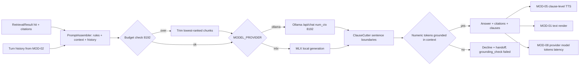

> **Lens:** PO / TPO (technical ACs) / Architect (HLD, LLD) · **Engagement:** Brownfield

# US-014 — Compose grounded prose on Ollama or MLX, streamed by clause for voice [Lens: PO]

- **Story:** As a **buyer**, I want descriptions, specifications and company narrative answered in plain language from ANITA's own catalogue, and I want the voice channel to start speaking before the whole answer is ready, so that the assistant feels immediate on every channel without ever improvising a fact.
- **Business value:** Catalogue prose is the bulk of buyer questions that are not a single commercial figure. It must be generated from retrieved evidence (`BRD-04`) and it must be fast enough that voice is usable — the clause contract is what keeps first-audio inside the 1.2 s guardrail. Running on both Ollama and MLX is what makes `BRD-19` real, not aspirational.
- **Priority:** **Must** — without it, only commercial questions are answerable. TPO ordering note: depends on US-011 (context) and US-013 (the routing boundary it must not cross); the backend abstraction is reused from `REC-08` and is independently testable.

## Acceptance Criteria [Lens: PO]

```gherkin
Scenario: Happy path — a specification answer composed from retrieved context
  Given retrieval returned the FCR Prima T2 specification chunks
  When the buyer asks "what are the specifications of the FCR Prima T2?"
  Then the answer is generated only from those chunks
  And every numeric and unit token in the answer appears in the retrieved context
  And the answer carries the citations of the chunks it used

Scenario: Failure path — the model invents a number
  Given retrieval returned chunks that do not contain a throughput figure
  When the model produces an answer containing "120 images per hour"
  Then the post-generation grounding check rejects the answer
  And the buyer receives the decline-with-handoff message instead
  And the turn trace records grounding_check failed

Scenario: Happy path — the voice channel hears the first clause early
  Given a voice turn with a multi-sentence answer
  When the model streams its first complete sentence
  Then that clause is emitted within 120 ms of its final token
  And speech synthesis can begin before the rest of the answer exists

Scenario: Failure path — the provider is not ready
  Given the configured provider reports is_ready false
  When a prose question arrives
  Then the request is declined with the human-handoff message without waiting on a dead model
  And commercial questions are unaffected
```

Technical acceptance criteria [Lens: TPO]:

- TAC-1: First token p95 ≤ **900 ms** warm with `OLLAMA_NUM_CTX = 8192`; whole answer p95 ≤ 2.5 s for ≤ 200 tokens.
- TAC-2: A clause is flushed ≤ **120 ms** after its final token; the cutter never buffers more than **400 characters** without emitting.
- TAC-3: 100 % of released prose answers pass the numeric/unit grounding check; a failure converts to a decline, never a filtered answer.
- TAC-4: The same code path serves Ollama and MLX; provider selection is `MODEL_PROVIDER` and the provider name is reported on every generation (`BRD-19`).
- TAC-5: Prompt budget enforced: system ≤ 1,200 tokens, context ≤ 4,000, history ≤ 800, total ≤ 8,192; over-budget context is trimmed from the lowest-ranked chunk, never truncated mid-chunk.
- TAC-6: Flipping `BARGE_IN_ENABLED` changes the prompt prefix and both MOD-04 and MOD-05 read the same key (`REC-09` coupling trap 7).
- TAC-7: 2 concurrent generations sustain TAC-1 with 0 errors; a third is queued and degrades to the decline path after a 3 s cap (`Assumed:`).
- TAC-8: Every model/provider/context key is read by the code that acts on it; an unread key fails the MOD-09 audit (`BRD-20`, `DG-09`).

## HLD — Architecture Slice [Lens: Architect]



- **Components touched:**
  - `PromptAssembler` — new; numbered grounding rules, `{context}` slot, history block, interruption contract (`REC-09` structure, rewritten content).
  - `LLMBackend` — reused from `app/llm_backend.py` (`REC-08`): `pick_model`, `chat`, `stream_chat`, `is_ready`, `health`.
  - `ClauseCutter` — reused (`REC-08`); emits sentence-boundary clauses with a bounded buffer.
  - `GroundingCheck` — new; numeric/unit token containment test over the emitted answer.
  - MOD-05 — consumes the clause iterator; MOD-01 renders the final text.
- **Interaction summary (happy path):** 1. A `hit` context arrives from MOD-03. 2. The assembler builds the prompt within budget. 3. The provider streams tokens. 4. `ClauseCutter` emits clauses; the first is delivered to TTS immediately. 5. On completion the grounding check runs over the full text. 6. The answer is released with citations.
- **Failure paths:** grounding failure → decline with handoff, the model text is discarded; provider not ready → immediate decline (≤ 2 s), no wait; over-budget context → trimmed, never truncated mid-chunk; interruption → `GenerationCancelled`, partial text kept in the transcript marked truncated.

## LLD — Implementation Detail [Lens: Architect]

- **Classes / functions / APIs:**

```python
# mod04/prompt.py
@dataclass(frozen=True)
class PromptBudget:
    system_max: int = 1200; context_max: int = 4000; history_max: int = 800; total_max: int = 8192

class PromptAssembler:
    def __init__(self, template: str, budget: PromptBudget, barge_in: bool) -> None: ...
    def assemble(self, turn: ClassifiedTurn, ctx: RetrievalResult,
                 history: Sequence[Turn]) -> list[Message]: ...   # raises ContextOverflow(untrimmed)
    def _trim_lowest_ranked(self, chunks: list[Chunk], need: int) -> list[Chunk]: ...

# mod04/backend.py  (adapter over app/llm_backend.py, REC-08)
def provider_name() -> Literal["ollama", "mlx"]: ...
def pick_model(preferred: str | None = None) -> str: ...
def chat(messages, *, model=None, num_ctx=None, temperature=None) -> str: ...
def stream_chat(messages, *, model=None, num_ctx=None, temperature=None) -> Iterator[str]: ...
def is_ready() -> bool: ...
def health() -> dict[str, str | bool]: ...

# mod04/compose.py
@dataclass(frozen=True)
class Answer:
    kind: Literal["prose", "commercial", "not_published", "decline", "refusal"]
    text: str
    citations: tuple[Citation, ...]
    caveat_applied: bool
    price_facts: tuple[str, ...]
    provider: str
    model: str
    latency_ms: int
    grounding_check: Literal["passed", "failed", "not_applicable"]

class GroundingCheck:
    NUM_RE = re.compile(r"(?:₹\s?)?\d[\d,\.]*(?:\s?(?:kg|g|ml|l|psi|mm|cm|kv|ma|hr|hours|days|lakh|crore))?", re.I)
    def run(self, text: str, ctx: RetrievalResult) -> bool: ...
    @staticmethod
    def normalise(token: str) -> str: ...   # ₹5,50,000 == 5,50,000 == 5.5 lakh

class AnswerComposer:
    def answer(self, turn: ClassifiedTurn, ctx: RetrievalResult) -> Answer: ...
    def stream(self, turn: ClassifiedTurn, ctx: RetrievalResult) -> Iterator[Clause]: ...
```

Prompt template (structure per `REC-09`; content rewritten for the catalogue):

```
You answer questions about ANITA MEDICAL SYSTEMS' published product catalogue.
1. Use ONLY the CONTEXT below. If a fact is not in the CONTEXT, say you cannot find it.
2. Never state a price, MOQ, delivery time or GST figure — those are answered elsewhere.
3. If two catalogue entries share a name, ask which one the buyer means.
4. Never give medical, diagnostic or clinical advice.
5. {interruption_contract}

CONTEXT:
{context}

PROFILE:
{profile}
```

- **Data schema changes:** none. Prompt components, `PRICE_CAVEAT_TEXT`-adjacent wording, `MODEL_PROVIDER`, `MODEL_PREFERRED`, `OLLAMA_NUM_CTX`, `OLLAMA_KEEP_ALIVE`, `SMALL_TASK_NUM_CTX`, `BARGE_IN_ENABLED` are `DAT-13` config keys, each read by the component that acts on it (`MODEL_PROVIDER` by `provider_name()`, `OLLAMA_NUM_CTX` by `chat`/`stream_chat`, `BARGE_IN_ENABLED` by both the assembler and MOD-05).

- **Edge cases:**
  1. Context over budget → trim lowest-ranked chunks first; never truncate mid-chunk; if still over after trimming to 1 chunk → decline.
  2. Model emits a number not in context → grounding check fails → decline + handoff (M4-4).
  3. Model emits a price → rule 2 violation; the answer is declined and the turn is re-routed to the commercial path.
  4. Clinical question reaching the prose path → rule 4 refuses; reason `clinical` (`BRD-10`, `DG-08`).
  5. Two same-named products in context → the model asks which one; the answer is not marked grounded until the buyer chooses.
  6. Provider returns `is_ready() == false` → immediate decline ≤ 2 s, no socket wait (US-015).
  7. Provider times out on the first token (> 8 s, `Assumed:`) → one retry, then decline.
  8. Buyer interrupts mid-stream → `GenerationCancelled`; partial text retained and marked truncated (`UC-03` A1).
  9. `BARGE_IN_ENABLED` flips between turns → prompt prefix changes; the prefix cache is invalidated rather than serving a stale contract (`REC-09` trap 7).
  10. Model outputs Markdown for the voice channel → MOD-01/MOD-05 render plain speech; the answer object keeps the channel-agnostic text.
  11. Empty model output → treated as a generation failure → decline, not an empty reply.
  12. Two generations for two channels at once → both queued; the second waits rather than running a third concurrent model instance.
  13. A chunk with no `source_url` → answer emitted with `citation_incomplete` flagged and counted.
  14. Answers are never cached across turns — a corpus change is visible on the next question (`BRD-04`).

- **Error handling:** `GenerationFailed` → retry once, then decline + handoff; `GenerationCancelled` → partial text persisted, no retry; `ContextOverflow` → trimmed then declined if unresolvable; `GroundingCheckFailed` → the model text is discarded entirely (never partially filtered) and the decline is emitted with `grounding_check = failed`; provider errors never propagate to MOD-02 — the composer always returns an `Answer` object.

- **Test scenarios (UC-01/UC-03 coverage-table floor):**
  - **Unit — happy path:** a fixture context produces a prose answer whose every numeric token is in the context; `grounding_check = passed`.
  - **Unit — grounding failure:** a stub model returning "120 images per hour" yields a decline with 0 fabricated text released.
  - **Unit — budget:** an over-budget context trims lowest-ranked chunks and never splits a chunk.
  - **Unit — clause contract:** a 3-sentence stream emits 3 clauses, each within 120 ms of its final token, with ≤ 400 characters buffered.
  - **Unit — provider switch:** the same messages produce a generation through the Ollama stub and the MLX stub; `provider` is reported correctly for each.
  - **Unit — timeout/retry:** a first-token timeout retries once, then declines; the retry is traced.
  - **Unit — cancellation:** cancelling mid-stream raises `GenerationCancelled`, keeps partial text and calls no further tools.
  - **Integration — alternate path (UC-01 A1):** a commercial question routed to the composer is re-routed to the commercial path and never generated.
  - **Integration — clinical (UC-11):** a clinical question returns the refusal wording and reason `clinical`; `DG-08` wording key is read from config.
  - **Integration — dependency failure:** provider down → immediate decline ≤ 2 s; commercial path unaffected (TAC-7 boundary).
  - **Integration — concurrency (UC-01 concurrent row):** two turns on one conversation are serialised; two conversations generate concurrently within the queue.
  - **E2E — partial completion (UC-01):** an answer streamed then disconnected is fully persisted and retrievable on resume.
  - **E2E — recovery:** after a decline the buyer re-asks and receives a normal answer with context preserved.
  - **Load:** 2 concurrent generations for 10 minutes → first-token p95 ≤ 900 ms, 0 errors; third request degrades per TAC-7 (TAC-1, TAC-7).

## Traceability
- Parent module: `MOD-04`
- Use cases: `UC-01` (web chat prose), `UC-02` (WhatsApp prose), `UC-03` (voice prose and clause delivery), `UC-11` (clinical refusal composed here)
- Technical requirements: `TRD-17` (Ollama/MLX backend abstraction), `TRD-20` (grounded prompt assembly, streaming, clause contract, grounding check)
- Business requirements: `BRD-04` (grounded only), `BRD-10` (clinical refusal), `BRD-19` (cross-platform runtime)
- Data gap / state machine: `DG-03` (no LLM fallback — this path is the one that declines), `DG-09` (every model key read), `DG-08` (refusal wording pending legal review), `SM-02` (turn `FAILED` on generation failure)
- Reconciliation: `REC-08` (`app/llm_backend.py` reused — provider switch, streaming, `ClauseCutter`, keep-alive), `REC-09` (prompt structure refactored, admissions content rewritten), `REC-10` (`app/main.py` dropped), `REC-20` (Pipecat pipeline dropped)
- Assets: `DAT-01` (context chunks), `DAT-12` (index), `DAT-13` (model/prompt config), `DAT-14` (traces)

## Definition of Done
- [ ] All ACs pass (AC-1 … AC-4, TAC-1 … TAC-8)
- [ ] Tests from the LLD test scenarios pass, covering the UC-01/UC-03 rows named above
- [ ] Load test passed: 2 concurrent generations, first-token p95 ≤ 900 ms
- [ ] Schema migration applied (none) — config keys registered and audit-clean
- [ ] MLX smoke test recorded on Apple Silicon; MOD-04 module doc updated if the prompt contract changed
