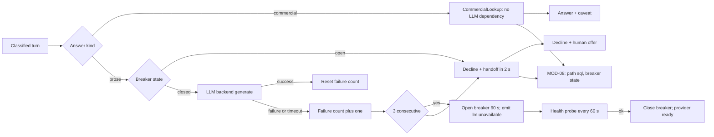

> **Lens:** PO / TPO (technical ACs) / Architect (HLD, LLD) · **Engagement:** Brownfield

# US-015 — Keep selling when the model is down: SQL answers survive, prose declines with a handoff [Lens: PO]

- **Story:** As a **sales director**, I want price and availability questions to keep being answered when the language model is unavailable, and prose questions to be honestly declined with a human handoff, so that an AI outage costs us a conversation but never a misquoted price or a silent caller.
- **Business value:** `DG-03` records the hard truth that the source platform has **no LLM fallback**. For a commercial product, the mitigation is not a second model — it is recognising that the highest-value questions (price, MOQ, delivery) never needed a model in the first place. During an outage the assistant must keep answering those and stop pretending on the rest.
- **Priority:** **Must** — this is the designed degradation mode named in `06-architecture.md` §5 for MOD-04 and the accepted `DG-03` position. TPO ordering note: depends on US-013 (SQL path) and US-014 (prose path); the circuit breaker is new code on top of `REC-08`'s provider abstraction.

## Acceptance Criteria [Lens: PO]

```gherkin
Scenario: Happy path — commercial answers continue with the model stopped
  Given the Ollama process is stopped
  And the circuit breaker has marked the provider unavailable
  When a buyer asks "what is the price of the ultrasound gel?"
  Then the answer states ₹60 per Piece with the caveat
  And the answer is produced without any model call
  And the turn is recorded as answered on the SQL path

Scenario: Failure path — a prose question declines with a human offer
  Given the provider is unavailable
  When a buyer asks "describe the difference between the two dry imagers"
  Then the buyer hears an honest apology and is offered a human
  And the decline is returned within 2 seconds
  And no answer text is generated or invented

Scenario: Failure path — the model times out on a live request
  Given the provider is reachable but does not emit a first token within 8 seconds
  When a prose question arrives
  Then the request retries once and then declines with the handoff offer
  And the turn is recorded FAILED with reason model_timeout
  And the third consecutive failure opens the breaker

Scenario: Happy path — recovery closes the breaker
  Given the provider was unavailable and is now healthy
  When the health probe succeeds
  Then prose questions are answered normally again
  And the console shows the provider ready with the last outage timestamp
```

Technical acceptance criteria [Lens: TPO]:

- TAC-1: With the provider unavailable, the commercial path answers 100 % of the frozen commercial question set correctly and p95 stays ≤ 25 ms.
- TAC-2: A prose decline is returned in ≤ **2 s** while the breaker is open (no socket wait); while the breaker is closed but the provider times out, the 8 s first-token budget plus one retry is the ceiling.
- TAC-3: Breaker opens after **3 consecutive** `GenerationFailed`/timeout outcomes and closes after a single successful health probe; the state is published to MOD-08.
- TAC-4: 0 fabricated catalogue facts across the whole outage scenario matrix; a fabricated answer is a release blocker.
- TAC-5: The decline and refusal wording is read from config with a built-in default; an unset key degrades to the conservative sentence, never to silence (`UC-11` missing-data row).
- TAC-6: Turn state on a declined prose question is persisted (`SM-02` turn `FAILED`, conversation `ACTIVE`) so the buyer can re-ask and context is preserved.
- TAC-7: The breaker is process-local and never affects the deterministic path — a unit test proves the SQL path has 0 references to the breaker.

## HLD — Architecture Slice [Lens: Architect]



- **Components touched:**
  - `ProviderBreaker` — new; wraps `LLMBackend.chat`/`stream_chat`, counts consecutive failures, exposes `state()` and `probe()`.
  - `AnswerComposer` — routes prose through the breaker; commercial routing is untouched.
  - `LLMBackend.health()` — reused (`REC-08`) as the probe.
  - MOD-02 — persists the turn as `FAILED` and serves the decline (it already owns the decline path for `not_relevant`).
  - MOD-08 — receives breaker transitions and the decline reason for `UC-12`.
- **Interaction summary (happy path):** 1. Commercial turn → SQL path completes with no breaker consulted. 2. Prose turn → the breaker is closed, generation runs, success resets the failure count.
- **Failure paths:** (a) 3 consecutive failures open the breaker and prose declines immediately for 60 s; (b) a first-token timeout retries once then declines and counts as a failure; (c) the probe restores service; (d) the decline wording key being unset still produces the conservative default sentence.

## LLD — Implementation Detail [Lens: Architect]

- **Classes / functions / APIs:**

```python
# mod04/breaker.py
class BreakerState(StrEnum):
    CLOSED = "closed"; OPEN = "open"; HALF_OPEN = "half_open"

class ProviderUnavailable(Exception):
    """Raised immediately (no socket I/O) when the breaker is OPEN."""

class ProviderBreaker:
    def __init__(self, backend: LLMBackend, *, threshold: int = 3, cooldown_s: float = 60.0,
                 first_token_timeout_s: float = 8.0, clock: Callable[[], float] = time.monotonic) -> None: ...
    def call(self, messages, **kw) -> str: ...            # raises ProviderUnavailable when OPEN
    def stream(self, messages, **kw) -> Iterator[str]: ... # same gate for the clause path
    def record_success(self) -> None: ...
    def record_failure(self, reason: str) -> BreakerState: ...
    def probe(self) -> bool: ...                          # backend.health() -> close on success
    def state(self) -> BreakerState: ...

# mod04/compose.py (routing)
class AnswerComposer:
    def answer(self, turn, ctx) -> Answer:
        if turn.kind == "commercial":
            return self._commercial(turn)                  # no breaker reference (TAC-7)
        if self.breaker.state() is BreakerState.OPEN:
            return self._decline(reason="provider_unavailable", deadline_ms=2000)
        try:
            return self._prose(turn, ctx)
        except (GenerationFailed, ProviderUnavailable) as exc:
            self.breaker.record_failure(type(exc).__name__)
            return self._decline(reason=type(exc).__name__)
```

Decline wording config keys, each read by the composer and audited by MOD-09 (`BRD-20`, `DG-09`): `DECLINE_HANDOFF_TEXT`, `REFUSAL_CLINICAL_TEXT` (`DG-08`), `DECLINE_CALLBACK_TEXT` (voice). An unset key resolves to the built-in conservative default rather than to an empty string.

- **Data schema changes:** none. The decline is a normal `Answer` object; the `SM-02` turn row records `state = FAILED`, `failure_reason` and `decline_reason`, and the conversation stays `ACTIVE` so the buyer can re-ask.

- **Edge cases:**
  1. Provider process stopped → first prose request fails, breaker opens on the 3rd; commercial requests unaffected throughout.
  2. Provider reachable but hung → first-token timeout fires at 8 s, one retry, then decline; each counted.
  3. Model loads but emits an empty completion → counted as a failure with reason `empty_completion`.
  4. Breaker open and a commercial request arrives → answered with 0 breaker interaction (TAC-7).
  5. Breaker opens mid-voice-answer → the current clause stream is cancelled; the caller hears the callback offer, not silence (`UC-03` E2).
  6. Health probe returns ready but the next generation fails → breaker re-opens; no flapping below the 3-failure threshold.
  7. Decline wording key unset → conservative default sentence emitted (`UC-11` missing-data row).
  8. Buyer re-asks after the decline → context preserved; if the breaker has closed the question is answered normally (recovery row).
  9. Two prose turns arrive in the same outage → both decline fast; no request queues behind a dead socket.
  10. Evaluation run (`UC-15`) during an outage → the run is void and the release is blocked (E2 of UC-15), not partially scored.
  11. Sentiment (`MOD-07`) during an outage → its own rule-based fallback applies; escalation still works (`SM-03`).
  12. Outbound call (`UC-09`) during an outage → placed, but the agent uses the callback/handoff script rather than generating prose.

- **Error handling:** `ProviderUnavailable` → immediate decline, traced `decline_reason = provider_unavailable`, no retry (retrying into an open breaker is the failure mode this class exists to prevent); `GenerationFailed` → one retry while closed, then decline and count; `GenerationCancelled` → not counted as a failure (a caller interruption is not an outage); timeouts → counted, with the first-token budget as the measure; every transition emits `llm.unavailable` / `llm.recovered` to MOD-08.

- **Test scenarios (UC-01/UC-03 coverage-table floor):**
  - **Unit — happy path:** breaker closed, generation succeeds, failure count resets to 0.
  - **Unit — dependency failure:** 3 stubbed failures open the breaker; the 4th call raises `ProviderUnavailable` with no backend invocation.
  - **Unit — timeout/retry:** a backend that never emits a first token trips the 8 s budget, retries once, then declines.
  - **Unit — recovery:** a successful probe closes the breaker and the next generation runs.
  - **Unit — isolation:** a static/source check plus a runtime stub prove the commercial path never references the breaker (TAC-7).
  - **Unit — cancellation not counted:** a cancelled voice generation does not increment the failure count.
  - **Integration — commercial under outage:** the full commercial question set answers correctly with the backend stubbed to raise on every call (TAC-1).
  - **Integration — prose under outage:** every prose question returns the decline within 2 s, and the fabricated-answer counter is 0 (TAC-4).
  - **Integration — partial completion (UC-01):** a stream cut by an outage after some clauses leaves the turn `FAILED` and the conversation `ACTIVE`.
  - **E2E — UC-03 E2:** a voice caller during an outage hears the callback offer and the call ends cleanly; the transcript records the decline.
  - **E2E — UC-12:** the console shows the provider unavailable with the transition timestamp, never a fabricated healthy state.
  - **E2E — UC-15 E2:** an evaluation run started during an outage is void and the release is blocked.
  - **Load:** 2 concurrent prose declines while under outage → every decline ≤ 2 s, no queue growth, commercial p95 ≤ 25 ms (TAC-1, TAC-2).

## Traceability
- Parent module: `MOD-04`
- Use cases: `UC-01` (chat, E2 engine-unavailable path), `UC-03` (voice, E2 apology + callback), `UC-05` (commercial answers unaffected), `UC-12` (model health visible)
- Technical requirement: `TRD-21` (LLM-outage degradation)
- Business requirements: `BRD-05` (commercial lookups survive), `BRD-13` (human handoff on decline), `BRD-21` (model state in the console)
- Data gap / state machine: `DG-03` (no LLM fallback — deterministic path survives, prose declines), `SM-02` (turn `FAILED`, conversation `ACTIVE`), `SM-03` (sentiment falls back independently)
- Reconciliation: `REC-08` (provider abstraction and `health()` reused), `REC-15` (dependency-free tracing lets the outage be recorded without risking the turn)
- Assets: `DAT-14` (outage traces), `DAT-02` (commercial answers during the outage), `DAT-13` (decline wording config)

## Definition of Done
- [ ] All ACs pass (AC-1 … AC-4, TAC-1 … TAC-7)
- [ ] Tests from the LLD test scenarios pass, covering the UC-01/UC-03 failure rows named above
- [ ] Load test passed: declines ≤ 2 s under outage; commercial p95 ≤ 25 ms during the same period
- [ ] Schema migration applied (none) — turn `failure_reason`/`decline_reason` fields present
- [ ] Decline and refusal text keys registered and audit-clean; MOD-04 module doc updated if the breaker contract changed
