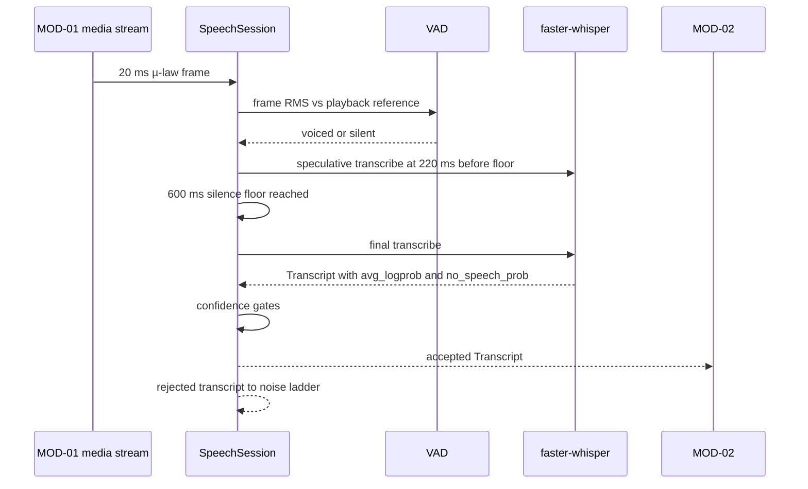

> **Lens:** PO / TPO (technical ACs) / Architect (HLD, LLD) · **Engagement:** Brownfield

# US-016 — Hear the caller: 20 ms frames, VAD and the 600 ms end-of-speech floor [Lens: PO]

- **Story:** As a **caller**, I want the assistant to wait until I have actually finished speaking and then answer quickly, so that I am not cut off mid-sentence and not left waiting in silence.
- **Business value:** Voice is the channel a procurement officer uses away from a desk. The measured **600 ms** end-of-speech floor is the dominant term in the ≤ 1.2 s first-audio guardrail (`00-product-intent.md` §4); the quality of the VAD is what decides whether a call feels like a conversation or an intercom. Rejecting noise before it reaches the answer engine also protects `BRD-04` from garbage-in.
- **Priority:** **Must** — no voice channel without it. TPO ordering note: builds on `REC-01`'s turn loop; US-017 (TTS) and US-018 (admission) layer on the session state it defines.

## Acceptance Criteria [Lens: PO]

```gherkin
Scenario: Happy path — the caller finishes and is transcribed
  Given a caller is speaking on a Twilio media stream
  When the caller stops for 600 ms
  Then end-of-speech fires exactly once for that utterance
  And a transcript is produced and handed to the orchestrator
  And the turn moves to PROCESSING

Scenario: Failure path — a cough does not end the turn
  Given a 120 ms burst of noise arrives on the line
  When the VAD evaluates it
  Then the utterance is not ended
  And the burst is not transcribed as a question

Scenario: Failure path — speech is not recognisable
  Given the caller says something the STT cannot resolve above the confidence floor
  When the transcript fails the confidence gates
  Then the caller hears the re-prompt and the noise ladder advances
  And the rejected transcript never reaches the answer engine

Scenario: Alternate path — the browser microphone produces the same transcript shape
  Given a buyer is using the browser-mic WebSocket at 16 kHz PCM
  When they finish an utterance
  Then a Transcript with the same fields is produced as on the Twilio path
  And no channel-specific field is present
```

Technical acceptance criteria [Lens: TPO]:

- TAC-1: End-of-speech fires after 600 ms of sub-floor silence and never before 15 voiced frames (300 ms); 0 turns ended on a sub-300 ms utterance.
- TAC-2: Transcript available ≤ **400 ms** p95 after end-of-speech for a ≤ 10 s utterance; STT RTF ≤ **0.35** on GPU.
- TAC-3: Speculative transcription starts at 220 ms before the floor would fire and is discarded if the caller resumes; a discarded speculation contributes 0 tokens to the turn.
- TAC-4: Frames that are not exactly 320 samples / 20 ms, or arrive out of order, are dropped and counted; no partial frame is ever decoded.
- TAC-5: 2 concurrent calls × 100 frames/s sustain with 0 dropped frames and p95 first-audio ≤ 1.2 s.
- TAC-6: Every rejected transcript carries a `rejected_reason` and is traced; 0 rejected transcripts reach MOD-02.
- TAC-7: The same `Transcript` dataclass is produced for µ-law 8 kHz and PCM16 16 kHz inputs, asserted by a shared contract test (`BRD-01`).

## HLD — Architecture Slice [Lens: Architect]



- **Components touched:**
  - `SpeechSession` — refactored out of `app/voice_handler.py` (`REC-01`); transport and CRM minting stripped, frame/VAD/STT kept.
  - `AudioCodec` — `ulaw_to_pcm`/`pcm_to_ulaw` plus 20 ms frame alignment; the `audio_format.py` contract (`SAMPLE_RATE 16000`, `CHANNELS 1`, `SAMPLE_WIDTH 2`, `CHUNK_MS 20`, `CHUNK_FRAMES 320`).
  - `VAD` — RMS floor with a decaying playback reference; `VAD_SILENCE_MS = 600`, `MIN_UTTERANCE_FRAMES = 15`.
  - `STT` — faster-whisper `small.en`; confidence gates `STT_MIN_AVG_LOGPROB = -4.0`, `STT_MAX_NO_SPEECH_PROB`, `STT_MIN_CHARS`.
  - MOD-02 — receives only accepted transcripts; MOD-05's noise ladder handles the rest.
- **Interaction summary (happy path):** 1. Frames arrive at 20 ms. 2. VAD tracks voiced frames; speculative transcription starts early. 3. Silence reaches 600 ms with ≥ 15 voiced frames → end-of-speech. 4. Final transcript is confidence-checked. 5. Accepted transcript goes to MOD-02.
- **Failure paths:** (a) sub-300 ms noise → no end-of-speech; (b) confidence failure → noise ladder, no orchestrator call; (c) STT model unavailable → alternative-channel prompt; (d) malformed frame → dropped and counted.

## LLD — Implementation Detail [Lens: Architect]

- **Classes / functions / APIs:**

```python
# mod05/audio.py
SAMPLE_RATE = 16000; CHANNELS = 1; SAMPLE_WIDTH = 2; CHUNK_MS = 20; CHUNK_FRAMES = 320; FRAME_MS = 20

def ulaw_to_pcm(ulaw_bytes: bytes) -> bytes: ...
def pcm_to_ulaw(pcm_bytes: bytes) -> bytes: ...
def frame_rms(ulaw_chunk: bytes) -> float: ...
def align_frame(data: bytes) -> bytes | None: ...      # None => dropped, caller counts it

# mod05/session.py  (refactor of app/voice_handler.py, REC-01)
class VADDecision(StrEnum):
    VOICED = "voiced"; SILENT = "silent"

@dataclass(frozen=True)
class Transcript:
    text: str
    avg_logprob: float
    no_speech_prob: float
    duration_ms: int
    speculative: bool
    rejected_reason: str | None = None

class SpeechSession:
    def __init__(self, call_id: str, channel: Literal["twilio", "browser"],
                 stt: WhisperSTT, settings: SpeechSettings) -> None: ...
    def feed_audio(self, chunk: bytes) -> FrameVerdict: ...      # 20 ms µ-law or PCM16 frame
    def is_end_of_speech(self) -> bool: ...                      # 600 ms floor AND >= 15 voiced frames
    def transcribe(self, *, speculative: bool = False) -> Transcript: ...
    def _gate_confidence(self, t: Transcript) -> str | None: ...  # None => accepted
    def _noise_ladder(self) -> str: ...                          # NOISE, LINE_QUALITY, ALT_CHANNEL, HUMAN_TRANSFER
```

```python
# mod05/stt.py
class WhisperSTT:
    def __init__(self, model_size: str = settings.WHISPER_MODEL) -> None: ...   # default small.en
    def warm(self) -> None: ...
    def transcribe(self, pcm16: bytes, *, language: str = "en") -> Transcript: ...
    def ready(self) -> bool: ...
```

- **Data schema changes:** none for this story. The `call_id` and per-turn marks are emitted to MOD-08; VAD and speculative state are in-memory only and are never persisted (they are meaningless after teardown).

- **Edge cases:**
  1. Pure silence from connect → 0 voiced frames; the continuous-silence cap (`Assumed: 45 s`) ends the call via the ladder.
  2. Sub-300 ms burst (cough, door) → not end-of-speech; not transcribed.
  3. Continuous speech with no pause → no end-of-speech until a real 600 ms gap or the call cap.
  4. Caller resumes during speculation → speculation discarded, utterance continues, 0 duplicated tokens.
  5. `avg_logprob < -4.0` → rejected, ladder advances (`NOISE_REPLY` first).
  6. Pure noise tokens ("uh", "um", "hmm") → `is_noise_fragment` → rejected before STT is even consulted for the answer path.
  7. Transcript below `STT_MIN_CHARS` → rejected.
  8. `no_speech_prob` above maximum → rejected with reason.
  9. Frame not 320 samples → dropped, counted, session continues (never a crash on a malformed frame).
  10. Frames arrive out of order (network jitter) → jitter buffer ≤ 300 ms; oldest dropped beyond it, counted.
  11. Twilio µ-law vs browser PCM16 → identical `Transcript` shape (TAC-7).
  12. STT model fails to load → `ready()` false; caller hears the alternative-channel prompt and is offered text/WhatsApp.
  13. Caller's number withheld → transcript carries no identity; MOD-02 keys the conversation on the stream id (UC-03 missing-data row).
  14. Caller speaks a product name the model mis-hears → post-processor clarification ladder asks once, then continues; a wrong transcript never becomes a stated fact because MOD-03's gate and MOD-04's checks still apply downstream.

- **Error handling:** `FrameDropped` (counted, not raised); `STTUnavailable` → ladder path `ALT_CHANNEL_REPLY` and the call ends cleanly; `TranscriptRejected` carries `rejected_reason` and is traced — the session does **not** pass it to MOD-02; every rejection advances the ladder exactly one step so a caller can never loop on the same prompt (M5-5).

- **Test scenarios (UC-03/UC-04 coverage-table floor):**
  - **Unit — happy path:** a fixture utterance with 600 ms trailing silence yields one end-of-speech and one accepted transcript.
  - **Unit — invalid input:** a 120 ms burst yields no end-of-speech; a pure-noise utterance is rejected with reason `noise`.
  - **Unit — confidence gates:** `avg_logprob = -4.5`, short text, and high `no_speech_prob` each reject with a distinct reason.
  - **Unit — speculative advance:** speculation starts at 220 ms before the floor and is discarded when voice resumes.
  - **Unit — frame alignment:** 319-sample and 321-sample frames are dropped and counted; a valid frame is decoded.
  - **Unit — channel parity:** the same utterance through the µ-law decoder and the PCM16 path produces the same `Transcript` fields (TAC-7).
  - **Integration — timeout:** no end-of-speech for the call cap duration → graceful close, transcript retained.
  - **Integration — dependency failure:** STT unavailable → alternative-channel prompt, call ends, text channels unaffected.
  - **Integration — retry:** a failed final transcription is retried once; on second failure the ladder advances.
  - **Integration — concurrent operation:** two sessions process frames independently with no shared VAD state.
  - **Integration — cancellation:** a caller hang-up mid-utterance keeps the partial transcript and writes no lead (UC-03 cancellation row).
  - **Integration — recovery/partial completion:** a call dropped after transcription but before the summary keeps the transcript; the summary job re-runs (UC-03 partial-completion row).
  - **E2E — UC-03 happy path:** caller asks a catalogue question and MOD-02 receives exactly one clean transcript.
  - **E2E — UC-04:** browser-mic session produces the same transcript shape and reaches the same answer path (BRD-01).
  - **E2E — unauthorized/anonymous:** a browser session with no identity produces an anonymous conversation and no lead (UC-04 missing-data row).
  - **Load:** 2 concurrent calls × 50 inbound frames/s for 10 minutes → 0 dropped frames, STT RTF ≤ 0.35, end-of-speech to transcript p95 ≤ 400 ms (TAC-2, TAC-5).

## Traceability
- Parent module: `MOD-05`
- Use cases: `UC-03` (inbound voice), `UC-04` (browser mic), `UC-09` (outbound contact hears the same STT contract)
- Technical requirement: `TRD-22` (STT, frame contract, VAD, 600 ms end-of-speech floor)
- Business requirements: `BRD-01` (one engine across channels — the transcript is the channel-agnostic input), `BRD-19` (cross-platform runtime)
- Data gap / state machine: `DG-01` (2-call ceiling inherited), `SM-02` (turn `RECEIVED` → `CLASSIFIED`; `FAILED` on unusable audio), `DG-09` (VAD and model keys must be read)
- Reconciliation: `REC-01` (`app/voice_handler.py` refactored — transport and CRM minting stripped, VAD/STT/speculation kept), `REC-19` (hardware/platform detection and boot readiness reused), `REC-20` (Pipecat pipeline stays dropped)
- Assets: `DAT-07` (conversation transcripts), `DAT-13` (speech config), `DAT-14` (per-turn traces)

## Definition of Done
- [ ] All ACs pass (AC-1 … AC-4, TAC-1 … TAC-7)
- [ ] Tests from the LLD test scenarios pass, covering the UC-03/UC-04 rows named above
- [ ] Load test passed: 2 concurrent calls, 0 dropped frames, transcript p95 ≤ 400 ms
- [ ] Schema migration applied (none) — speech config keys registered and audit-clean
- [ ] Channel-parity contract test added (Twilio vs browser); MOD-05 module doc updated if the frame contract changed
