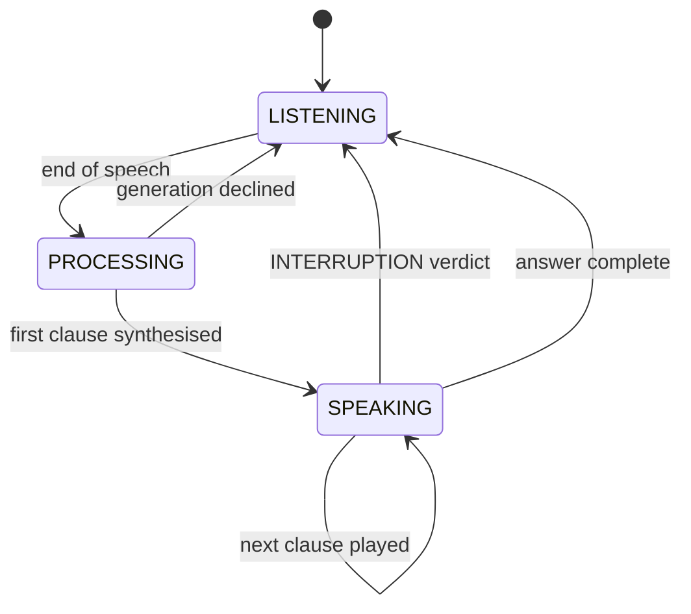
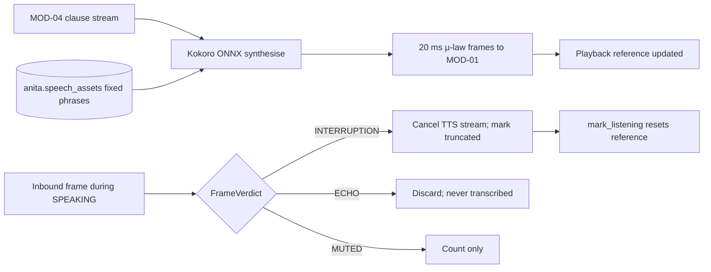

> **Lens:** PO / TPO (technical ACs) / Architect (HLD, LLD) · **Engagement:** Brownback

# US-017 — Speak the answer by clause, and stop the moment the caller talks [Lens: PO]

- **Story:** As a **caller**, I want the assistant to start speaking as soon as it has something to say and to stop immediately when I interrupt, so that the call behaves like talking to a person rather than waiting on a recording.
- **Business value:** First-audio latency is the perceived quality of the voice channel, and barge-in is the difference between a conversation and being talked over. The source platform already proved both — this story carries that behaviour across by refactoring the turn loop (`REC-01`) rather than rebuilding it.
- **Priority:** **Must** — voice is the primary outbound channel and it is unusable without interruption handling. TPO ordering note: depends on US-016 (session state and frame verdicts); the clause iterator it consumes is produced by US-014.

## Acceptance Criteria [Lens: PO]

```gherkin
Scenario: Happy path — the first clause is spoken early
  Given the answer engine streamed its first complete sentence
  When the synthesiser receives that clause
  Then audio for it is emitted within 300 ms p95
  And playback continues clause by clause as the rest arrives

Scenario: Happy path — the caller interrupts and is heard
  Given the agent is speaking an answer
  When the caller begins speaking
  Then playback stops within 150 ms
  And the interruption is classified INTERRUPTION and the turn yields to the caller
  And the transcript records that the answer was truncated

Scenario: Failure path — the agent's own audio returns through the line
  Given an open-speakerphone caller with agent playback returning on the microphone
  When those frames arrive during SPEAKING
  Then they are classified ECHO and discarded
  And they are never transcribed and never treated as an interruption

Scenario: Failure path — a clause fails to synthesise
  Given a synthesis failure on one clause
  When the failure occurs
  Then the clause is retried once
  And on a second failure the caller hears the human-transfer offer rather than silence
```

Technical acceptance criteria [Lens: TPO]:

- TAC-1: First clause audible ≤ **300 ms** p95 after the clause text is available; Kokoro RTF ≈ 0.06 GPU.
- TAC-2: Playback stop on interruption ≤ **150 ms** from caller speech onset; a truncation marker is written on 100 % of interrupted answers.
- TAC-3: Echo frames are rejected at ≥ **95 %** on an open-speakerphone fixture; 0 echo frames are transcribed or counted as barge-in.
- TAC-4: Fixed phrases (greeting, busy, callback, noise ladder, transfer, good-bye) are served from the cache; a cache hit costs no synthesis and ≤ 20 ms.
- TAC-5: The TTS cache key is `sha256(voice | speed | text)` and the store is per-instance (`anita.speech_assets`); a cross-schema read is impossible (`BRD-18`).
- TAC-6: Interrupted audio never leaves a dangling playback reference: `mark_listening()` resets state so the next utterance is not compared against stale playback.
- TAC-7: With `BARGE_IN_ENABLED` off, frames are classified `MUTED`, counted, and do not interrupt (`REC-09` trap 7 — the prompt prefix and the audio behaviour flip together).

## HLD — Architecture Slice [Lens: Architect]





- **Components touched:**
  - `SpeechSynthesizer` — Kokoro ONNX wrapper; clause in, µ-law frames out; cache lookup first.
  - `TurnArbiter` — the `LISTENING/PROCESSING/SPEAKING` state machine and the four frame verdicts (`REC-01`).
  - `PlaybackReference` — decaying RMS reference used by the echo gate and barge-in margin.
  - `TtsCache` — `anita.speech_assets` store; pre-warms greetings and fixed phrases at boot.
  - MOD-04 — its clause stream is cancelled via `GenerationCancelled` on interruption.
- **Interaction summary (happy path):** 1. First clause arrives from MOD-04. 2. Synthesiser emits frames per clause. 3. Playback reference advances with each frame. 4. The final clause completes and the turn returns to `LISTENING`.
- **Failure paths:** interruption → cancel + truncation marker; echo → discard; synthesis failure → one retry then human-transfer; TTS unavailable → alternative-channel prompt.

## LLD — Implementation Detail [Lens: Architect]

- **Classes / functions / APIs:**

```python
# mod05/tts.py
@dataclass(frozen=True)
class Clause:
    text: str
    is_final: bool

class TtsCache:
    def get(self, text: str, voice: str, speed: float) -> bytes | None: ...
    def put(self, text: str, voice: str, speed: float, ulaw: bytes, duration_ms: int) -> None: ...
    @staticmethod
    def key(text: str, voice: str, speed: float) -> str: ...   # sha256(voice|speed|text)
    def warm(self, phrases: Sequence[str]) -> None: ...

class SpeechSynthesizer:
    def __init__(self, cache: TtsCache, voice: str = settings.KOKORO_VOICE,
                 speed: float = settings.KOKORO_SPEED) -> None: ...
    def speak(self, clause: Clause) -> Iterator[bytes]: ...     # 20 ms aligned µ-law frames
    def ready(self) -> bool: ...

# mod05/arbiter.py
class TurnState(StrEnum):
    LISTENING = "LISTENING"; PROCESSING = "PROCESSING"; SPEAKING = "SPEAKING"
class FrameVerdict(StrEnum):
    LISTENING = "LISTENING"; INTERRUPTION = "INTERRUPTION"; ECHO = "ECHO"; MUTED = "MUTED"

class PlaybackReference:
    def advance(self, frames: list[bytes]) -> None: ...
    def rms(self) -> float: ...                                  # decaying reference
    def reset(self) -> None: ...

class TurnArbiter:
    def admit_inbound_frame(self, ulaw_chunk: bytes) -> FrameVerdict: ...
    def mark_speaking(self, frames: list[bytes] | None = None) -> None: ...
    def mark_listening(self) -> None: ...
    def request_interruption(self) -> None: ...
    def cancel_requested(self) -> bool: ...
    def note_answer_truncated(self) -> None: ...
    def state(self) -> TurnState: ...
```

Reused barge-in configuration, each key read by the arbiter (`DG-09`): `BARGE_IN_ENABLED`, `BARGE_IN_ECHO_GAIN = 0.5`, `BARGE_IN_MARGIN`, `BARGE_IN_ABS_FLOOR`, `BARGE_IN_MIN_FRAMES`, `BARGE_IN_REF_DECAY`.

Truncation marker written into the turn text so MOD-02/MOD-07 see what the caller actually heard (`REC-01`):

```
"[the caller began speaking before I finished — they may not have heard the end]"
```

- **Data schema changes:**

```sql
-- Per-instance TTS/asset cache (BRD-18: never in the university schema).
CREATE TABLE IF NOT EXISTS anita.speech_assets (
    asset_key    TEXT PRIMARY KEY,          -- sha256(voice | ':' | speed | ':' | text)
    text_sha256  TEXT NOT NULL,
    voice        TEXT NOT NULL,
    speed        REAL NOT NULL,
    ulaw_bytes   BYTEA NOT NULL,
    duration_ms  INTEGER NOT NULL,
    created_at   TIMESTAMPTZ NOT NULL DEFAULT now(),
    CONSTRAINT speech_assets_duration_chk CHECK (duration_ms > 0)
);
CREATE INDEX IF NOT EXISTS speech_assets_text_idx ON anita.speech_assets (text_sha256);
```

- **Edge cases:**
  1. Caller interrupts on the first word → playback stops; the truncated answer is recorded; the caller's new utterance becomes the next turn.
  2. Caller interrupts a cached greeting → same stop path; the cached asset is not mutated.
  3. Open-speakerphone echo → frames classified `ECHO`, dropped; transcript unaffected.
  4. Echo just above the gate (a loud room) → bounded false interruption; `BARGE_IN_MIN_FRAMES` requires sustained speech so a single reflection does not stop playback.
  5. `BARGE_IN_ENABLED` off → `MUTED` verdicts counted; the prompt's interruption contract flips with the same key.
  6. Synthesis failure on one clause → retry once; second failure skips the clause and moves to the human-transfer offer.
  7. TTS model not ready → alternative-channel prompt; the call ends cleanly.
  8. Answer cancelled by the engine (`GenerationCancelled`) → playback drains the clauses already produced and returns to `LISTENING` without a marker for the ungenerated remainder.
  9. Very long clause (model ignored sentence boundaries) → synthesised in ≤ 400-character synthesis units so first audio is not held hostage to a run-on sentence.
  10. Cache key collision improbable but possible → `text_sha256` stored and asserted on read; a mismatch is treated as a miss, never served.
  11. First call after boot → fixed phrases pre-warmed; a cold synthesis on a non-fixed phrase still meets the 300 ms TAC.
  12. Playback reference after teardown → `mark_listening()`/session close resets it; the next call starts with a zero reference.
  13. Buyer hangs up mid-playback → teardown ≤ 1 s, partial transcript retained (`UC-03` E3).
  14. Voice note / non-speech audio on a voice call → tts never involved; STT/VAD path handles it.

- **Error handling:** `SynthesisFailed` → retry once then human-transfer offer (never silence); `TtsUnavailable` → alternative-channel prompt; `CacheCorrupt` (hash mismatch) → treat as miss and re-synthesise; cancellation is not an error and is not counted against any failure budget.

- **Test scenarios (UC-03/UC-04 coverage-table floor):**
  - **Unit — happy path:** a 3-clause stream emits frames per clause with first-clause audio ≤ 300 ms in a timing fixture.
  - **Unit — interruption:** a frame set above the barge-in gate during `SPEAKING` returns `INTERRUPTION` and stops emission.
  - **Unit — echo:** a playback-coupled fixture yields ≥ 95 % `ECHO` verdicts and 0 transcript tokens.
  - **Unit — muted flag:** with `BARGE_IN_ENABLED=false`, the same fixture yields `MUTED` and does not stop playback.
  - **Unit — cache:** the greeting is served from `anita.speech_assets` with 0 synthesis calls; a corrupted row is treated as a miss.
  - **Unit — synthesis failure:** a stubbed failure retries once, then the human-transfer offer is emitted.
  - **Unit — long clause:** a 1,200-character clause is synthesised in bounded units without exceeding the buffer rule.
  - **Integration — alternate path (UC-03 A1):** an interruption mid-answer produces a transcript-marked truncation and the next turn answers the caller's new question.
  - **Integration — dependency failure:** TTS unavailable → alternative-channel prompt, other channels unaffected.
  - **Integration — cancellation:** buyer hangs up mid-playback → teardown ≤ 1 s, partial transcript retained.
  - **Integration — concurrent operation:** two calls synthesise independently; cache writes do not collide.
  - **E2E — UC-04:** browser-mic session hears clause-streamed audio and can barge in.
  - **E2E — recovery:** after an interrupted turn the caller re-asks and receives the full answer.
  - **Load:** 2 concurrent calls streaming clause audio for 10 minutes → first-clause p95 ≤ 300 ms, TTS RTF ≤ 0.1, 0 synthesis queue growth (TAC-1).

## Traceability
- Parent module: `MOD-05`
- Use cases: `UC-03` (inbound voice, A1 barge-in, E3 teardown), `UC-04` (browser mic), `UC-09` (outbound playback uses the same synthesiser)
- Technical requirements: `TRD-23` (Kokoro TTS, clause streaming, cache), `TRD-24` (barge-in, echo gate, frame arbitration)
- Business requirements: `BRD-01` (same answer text on every channel), `BRD-19` (cross-platform runtime), `BRD-13` (handoff must be speakable)
- Data gap / state machine: `SM-02` (turn/answer lifecycle), `DG-09` (every barge-in key read), `DG-01` (2-call ceiling)
- Reconciliation: `REC-01` (`app/voice_handler.py` turn loop refactored — barge-in, echo gate, `ClauseCutter` consumption, truncation marker retained), `REC-20` (Pipecat stays dropped)
- Assets: `DAT-13` (voice/speed/barge-in config), `DAT-14` (playback and interruption traces), `DAT-07` (transcript with truncation marker)

## Definition of Done
- [ ] All ACs pass (AC-1 … AC-4, TAC-1 … TAC-7)
- [ ] Tests from the LLD test scenarios pass, covering the UC-03/UC-04 rows named above
- [ ] Load test passed: first-clause p95 ≤ 300 ms, RTF ≤ 0.1 at 2 concurrent calls
- [ ] Schema migration applied (`anita.speech_assets`); fixed-phrase warm-up verified at boot
- [ ] Echo-rejection fixture recorded at ≥ 95 %; MOD-05 module doc updated if the arbitration contract changed
