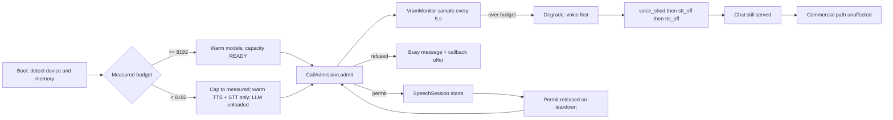

> **Lens:** PO / TPO (technical ACs) / Architect (HLD, LLD) · **Engagement:** Brownfield

# US-018 — Fit inside the shared GPU: admission control and degrade voice before text [Lens: PO]

- **Story:** As a **platform owner**, I want the assistant to admit calls only while the graphics memory budget allows and to shed voice capacity before it degrades text, so that a spike in calls never takes down the channels that are carrying live buyer conversations.
- **Business value:** The target machine is a single **16,311 MiB** GPU shared with a live, unrelated product (`DG-01`, `CV-01`). ANITA is a guest on that hardware: an unbounded call spike does not just slow ANITA, it can disturb a product that is not ours. Admission control is what makes the deployment safe to run, and the degrade-voice-first ordering is what keeps the cheaper-to-serve channels alive when capacity runs out.
- **Priority:** **Must** — the ceiling is a hard constraint of the environment, not a tuning knob. TPO ordering note: consumes the VRAM budget fixed in `TRD-25`; layers on US-016 (session) and US-017 (synthesis); the outbound dialler (MOD-06) honours the same admission permit.

## Acceptance Criteria [Lens: PO]

```gherkin
Scenario: Happy path — two concurrent calls fit the budget
  Given the speech stack is warm and the measured budget is 8,192 MiB
  When two calls are admitted
  Then both calls sustain streaming audio with no frame drops
  And the measured resident usage stays within the budget at every sample

Scenario: Failure path — a third call is refused rather than over-committing
  Given two calls are already admitted
  When a third inbound call arrives
  Then the third caller hears the all-lines-busy message with the option of a callback
  And no model is loaded and no third session is started
  And the refusal is recorded with reason capacity

Scenario: Failure path — the model backend is unavailable at boot
  Given the LLM backend fails to load or its health check fails
  When the platform starts
  Then the commercial SQL path stays available
  And voice is reported degraded with the reason naming the missing component
  And no call is admitted on a false-ready state

Scenario: Alternate path — voice degrades before text under pressure
  Given the platform is at the two-call ceiling and memory pressure is high
  When a new prose chat request arrives
  Then the chat request is served and degraded only after voice has been shed
  And the ordering is visible in the capacity trace
```

Technical acceptance criteria [Lens: TPO]:

- TAC-1: The ANITA budget is fixed at **8,192 MiB** of the 16,311 MiB card; boot fails if the platform cannot demonstrate ≥ 8,119 MiB free for the other product at start.
- TAC-2: Resident usage is sampled every **5 s**; the p99 stays ≤ the budget and 0 samples exceed it during a 30-minute soak.
- TAC-3: `MAX_CONCURRENT_CALLS = 2`; the 3rd call is refused in ≤ **500 ms** with the busy message and a callback offer, never queued.
- TAC-4: The admission permit is a hard precondition of session creation; a session cannot start without one, and a permit is returned within 1 s of teardown on every exit path (hang-up, error, timeout).
- TAC-5: Degradation order is enforced: `voice_shed → stt_off → tts_off → chat_degrade → commercial_only`. A capacity trace proves text is never degraded while voice is still admitting.
- TAC-6: Deployed on Windows and Linux with the same policy; on Apple Silicon the budget is derived from the detected unified-memory size with the same ratio (`Assumed: 0.5 of unified memory, capped at 8,192 MiB`).
- TAC-7: Every capacity key (`GPU_MEMORY_BUDGET_MIB`, `MAX_CONCURRENT_CALLS`, `ADMISSION_REFUSE_TEXT`, `MAX_CONCURRENT_STT`, `MAX_CONCURRENT_TTS`) is read by the code that acts on it; an unread key fails the MOD-09 audit (`BRD-20`, `DG-09`).

## HLD — Architecture Slice [Lens: Architect]



- **Components touched:**
  - `VramMonitor` — new; polls device memory, exposes `budget_mib()`, `used_mib()`, `pressure()`, and emits capacity events to MOD-08.
  - `CallAdmission` — new; holds the semaphore of permits, refuses with a structured reason, and never queues an inbound call.
  - `CapacityPolicy` — new; the ordered degradation ladder of TAC-5 and the rule that voice sheds first.
  - MOD-06 — the outbound dialler asks for a permit before dialling (`UC-09`); a refusal defers the contact rather than dialling into a full line group.
  - MOD-08 — receives every admission, refusal and degrade transition (`SM-04` contact state is unaffected by a refused inbound call).
- **Interaction summary (happy path):** 1. Boot measures device memory and fixes the budget. 2. Models warm within it. 3. Inbound call takes a permit. 4. Samples stay inside budget. 5. Teardown returns the permit for the next call.
- **Failure paths:** (a) 3rd call → busy + callback, no model work; (b) usage over budget → voice shed first, chat unaffected; (c) LLM unloadable → voice degraded, SQL still serving; (d) a leaked permit → the monitor's 1 s sweep reclaims it after teardown.

## LLD — Implementation Detail [Lens: Architect]

- **Classes / functions / APIs:**

```python
# mod05/capacity.py
class CapacityState(StrEnum):
    READY = "READY"; DEGRADED = "DEGRADED"; REFUSING = "REFUSING"

@dataclass(frozen=True)
class Budget:
    total_mib: int          # measured on this device
    anita_mib: int          # <= 8192
    reserved_mib: int       # total_mib - anita_mib

class VramMonitor:
    def __init__(self, sample_s: float = 5.0) -> None: ...
    def bootstrap(self) -> Budget: ...        # refuses boot below the floor
    def sample(self) -> int: ...              # resident MiB for the ANITA stack
    def pressure(self) -> Literal["ok", "high", "critical"]: ...
    def budget_mib(self) -> int: ...

class AdmissionRefused(Exception):
    def __init__(self, reason: Literal["capacity", "degraded"], message: str) -> None: ...

class CallAdmission:
    def __init__(self, monitor: VramMonitor, max_calls: int = settings.MAX_CONCURRENT_CALLS) -> None: ...
    def admit(self, call_id: str, deadline_ms: int = 500) -> "AdmissionPermit": ...   # no queueing
    def release(self, permit: "AdmissionPermit") -> None: ...
    def in_flight(self) -> int: ...

class CapacityPolicy:
    LADDER: tuple[str, ...] = ("voice_shed", "stt_off", "tts_off", "chat_degrade", "commercial_only")
    def on_pressure(self, level: str) -> str: ...   # returns the step applied; voice first
    def may_admit_voice(self) -> bool: ...
```

- **Data schema changes:**

```sql
-- Capacity events are durable so an incident can be reconstructed (DAT-14).
CREATE TABLE IF NOT EXISTS anita.capacity_events (
    event_id     BIGSERIAL PRIMARY KEY,
    observed_at  TIMESTAMPTZ NOT NULL DEFAULT now(),
    event        TEXT NOT NULL,            -- admit | refuse | degrade | recover | boot
    reason       TEXT,
    in_flight    INTEGER NOT NULL,
    used_mib     INTEGER NOT NULL,
    budget_mib   INTEGER NOT NULL,
    CONSTRAINT capacity_events_kind_chk
        CHECK (event IN ('admit','refuse','degrade','recover','boot'))
);
CREATE INDEX IF NOT EXISTS capacity_events_time_idx ON anita.capacity_events (observed_at DESC);
```

- **Edge cases:**
  1. Two calls in flight and a third inbound arrives → refused in ≤ 500 ms with the busy message; the refusal is recorded, never queued (`UC-03` E1).
  2. A call is refused while the outbound dialler also wants a line → the inbound caller wins by default; the dialler defers (its own `SM-04` state is unchanged).
  3. A call ends abruptly (network drop) → the permit is returned by teardown within 1 s; a leaked permit is reclaimed by the monitor sweep.
  4. Memory pressure while two calls are mid-answer → voice is shed only when a call must be dropped, and the caller hears the callback offer before teardown (`BRD-13`).
  5. The other product on the card grows its footprint → ANITA's sampled usage is already inside the budget, so the guest does not need to act; boot-time free-memory assertion is the guard against an already-oversubscribed start.
  6. Boot on a machine with less free memory than the budget → the budget is capped to the measured value and voice still starts; the shortfall is reported to MOD-08 with the exact figures.
  7. LLM backend fails to load → voice is degraded with reason `llm_unavailable`, STT/TTS stay warm for the busy and callback scripts, SQL serves normally.
  8. The GPU is temporarily unavailable (driver reset) → all speech is shed, chat continues, calls in progress get the courtesy message; recovery re-warms on the next health probe.
  9. Chat-only load with no calls in flight → no permits are consumed; the LLM within the budget can use the whole ANITA allowance.
  10. Third call arrives while memory is already `critical` → refused with reason `degraded`; the caller is told the lines are busy, not that the assistant is broken.
  11. Simultaneous admission from two processes (blue/green restart) → the permit store is process-local by design, so the restart drains calls before the new process admits; `Assumed: 30 s drain window`.
  12. The 2-call ceiling is reached during a large evaluation run (`UC-15`) → the evaluation is scheduled, never run concurrently with live calls, so a capacity refusal does not void a run.
  13. A per-call STT/TTS worker fails to initialise → the call is never admitted (permit released), so capacity is not lost to a half-started session.
  14. `GPU_MEMORY_BUDGET_MIB` set above the card total → boot refuses with the measured total named (a config typo can never oversubscribe a shared card).

- **Error handling:** `AdmissionRefused` → busy message + callback offer, recorded with reason, 0 model work; `BudgetTooSmall` → boot refusal with the measured figure named; `MonitorUnavailable` (no device query) → conservative fallback budget of **6,144 MiB** with a reported warning, so the platform degrades rather than assuming it is alone on the card; every capacity transition emits to MOD-08 and is written to `anita.capacity_events`.

- **Test scenarios (UC-03/UC-09 coverage-table floor):**
  - **Unit — happy path:** two permits are granted, a third `admit()` raises `AdmissionRefused(reason="capacity")` within the deadline and starts no session.
  - **Unit — concurrent operation:** 20 threads race for 2 permits → exactly 2 succeed, 18 refuse, 0 permits leak.
  - **Unit — cancellation/teardown:** every exit path (hang-up, exception, timeout) releases the permit exactly once.
  - **Unit — degraded boot:** a stubbed device with insufficient memory caps the budget and reports the shortfall without failing boot.
  - **Unit — config typo:** a budget above the card total refuses boot naming the measured total.
  - **Unit — policy ordering:** the degradation ladder returns `voice_shed` first in every pressure level; a trace assertion fails if `chat_degrade` precedes it (TAC-5).
  - **Integration — refusal path (UC-03 E1):** the third caller hears the busy message with a callback offer and the refusal is recorded with reason `capacity`.
  - **Integration — outbound (UC-09):** the dialler is refused a permit at the ceiling and defers the contact with no failed-dial record.
  - **Integration — dependency failure:** LLM unloadable → voice degraded, SQL path answers price questions throughout.
  - **Integration — timeout/recovery:** a permit leaked by a crashed session is reclaimed within 1 s and the next call is admitted.
  - **Integration — concurrency:** two calls plus 20 chats for 20 minutes → 0 budget overruns, chat p95 within guardrail.
  - **E2E — UC-03 degraded:** with the LLM down, a caller still hears the callback script in a natural voice (STT/TTS warm).
  - **E2E — UC-15 isolation:** a scheduled evaluation run does not admit calls and does not void the run when the ceiling is reached by live traffic.
  - **Load:** sustained 2 concurrent calls for 30 minutes with the monitor sampling every 5 s → p99 usage ≤ 8,192 MiB, 0 dropped frames, 0 capacity overruns (TAC-2).

## Traceability
- Parent module: `MOD-05`
- Use cases: `UC-03` (E1 third-call busy path, degraded voice), `UC-04` (browser-mic capacity shares the same permits), `UC-09` (outbound respects capacity), `UC-15` (evaluation runs scheduled, never concurrent with live calls)
- Technical requirement: `TRD-25` (VRAM budget, admission control, voice-degrades-first)
- Business requirements: `BRD-19` (cross-platform runtime and memory policy), `BRD-13` (every refusal offers a human next step), `BRD-21` (capacity state visible in the console)
- Success metric: `AS-09` (the shared GPU is not disturbed — the guest budget is bounded and asserted)
- Data gap / state machine: `DG-01` (single shared GPU is a hard ceiling), `CV-01` (isolation is logical; the card is shared), `SM-04` (outbound contact state unaffected by a refused permit)
- Reconciliation: `REC-19` (hardware/platform detection and boot readiness reused; extended with the memory assertion), `REC-15` (dependency-free tracing keeps capacity events cheap)
- Assets: `DAT-13` (capacity config keys), `DAT-14` (capacity traces), `DAT-15` (deployment and hardware constraints)

## Definition of Done
- [ ] All ACs pass (AC-1 … AC-4, TAC-1 … TAC-7)
- [ ] Tests from the LLD test scenarios pass, covering the UC-03/UC-09 rows named above
- [ ] Load test passed: 30-minute soak at 2 concurrent calls, p99 ≤ 8,192 MiB, 0 overruns
- [ ] Schema migration applied (`anita.capacity_events`); boot memory assertion verified on the target host
- [ ] Degradation order assertion in CI; MOD-05 module doc updated if the budget or ceiling changed
