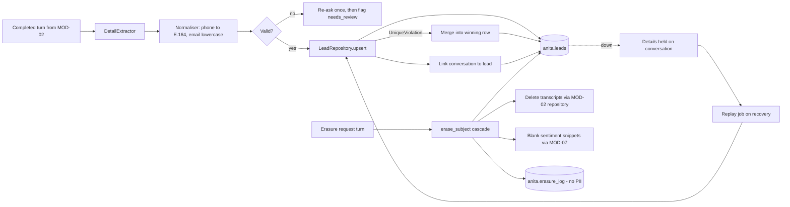

> **Lens:** PO / TPO (technical ACs) / Architect (HLD, LLD) · **Engagement:** Brownfield

# US-019 — Capture and deduplicate a lead from any conversation [Lens: PO]

- **Story:** As a **buyer who has given my name and number**, I want **the assistant to remember me as one person no matter which channel I use**, so that **I am not asked the same questions again and my enquiry is not lost between channels**.
- **Business value:** Every qualified lead depends on this write. `BRD-11` is the North Star metric's only source; a duplicate or lost lead is a lead the sales rep cannot follow up.
- **Priority:** **Must** — TPO ordering note: this is the first MOD-06 story because `TRD-27`'s mock-CRM interface is specified against this write path, and US-020 cannot be sized until the dedupe key is fixed.

## Acceptance Criteria [Lens: PO]

```gherkin
Scenario: New lead captured from a web-chat turn
  Given a buyer on web chat who has not been seen before
  When they type "I need the FCR Prima T2, my name is Priya, call me on 98765 43210"
  Then a lead exists with phone_e164 "+919876543210", name "Priya" and product interest "FCR Prima T2"
  And the conversation is linked to that lead
  And the lead status is QUALIFYING

Scenario: The same buyer returns on WhatsApp
  Given a lead already exists for phone "+919876543210"
  When the same buyer messages the WhatsApp sender from that number
  Then the existing lead is updated, not duplicated
  And the new conversation is linked to the same lead
  And a rep sees one lead with two conversations

Scenario: Buyer asks to be forgotten
  Given a lead with a name, phone, email and two conversations
  When the buyer asks "please delete my details"
  Then the lead's name, phone and email are erased within 60 seconds
  And the conversation transcripts for that lead are removed
  And the lead can never be selected for an outbound call again
  And the erasure is recorded with a timestamp but no personal data

Scenario: Malformed contact detail
  Given a buyer who supplies an email of "priya at anita dot com"
  When the system validates it
  Then it asks once for the email again
  And if the buyer does not correct it, the lead is saved with the raw value and flagged needs_review
  And nothing is silently discarded
```

Technical acceptance criteria [Lens: TPO]:

- **TAC-1:** Dedupe is enforced by a database unique index on normalised identifiers, not by an application `SELECT`-then-`INSERT`. Two concurrent inserts for the same phone must produce exactly one row.
- **TAC-2:** With PostgreSQL stopped, no buyer-visible error occurs; the details are retained against the conversation and a replay writes the lead within 60 s of the store returning. Zero leads lost.
- **TAC-3:** Lead upsert p95 < 120 ms at 50 concurrent callers (load test).
- **TAC-4:** No buyer phone number or email appears in any log line, trace record or outbox payload in plaintext (masked to last 4 digits where logging is unavoidable).
- **TAC-5:** `erase_subject` is idempotent — calling it twice returns success and performs no further change.

## HLD — Architecture Slice [Lens: Architect]



- **Components touched:**
  - `MOD-06 LeadService` — new: `upsert_from_turn`, `qualify`, `erase_subject`.
  - `MOD-02 Conversation Orchestrator` — new call site on turn completion + repository method for transcript deletion.
  - `MOD-07 Sentiment` — new call site for snippet blanking; score aggregation rows survive anonymised.
  - `MOD-06 LeadRepository` — new: the single write path to `anita.leads`.
- **Interaction summary:**
  1. MOD-02 finishes a turn and calls `LeadService.upsert_from_turn(turn)` outside the answer path.
  2. The extractor pulls structured details; the normaliser canonicalises phone (`E.164`, `+91` default) and email.
  3. The repository upserts on the phone key, then the email key; a collision merges into the surviving row and writes an interaction.
  4. The conversation is linked; failure to link leaves the lead reachable by the repair job.
  5. **Failure path:** if the DB write fails, the turn is still answered; the details stay on the conversation and a replay job re-runs step 3 after recovery.

## LLD — Implementation Detail [Lens: Architect]

- **Classes / functions / APIs:**

```python
# app/anita/leads/normalise.py
def normalise_phone(raw: str, default_cc: str = "91") -> str | None: ...   # -> E.164 or None
def normalise_email(raw: str) -> str | None: ...                            # -> lower/strip or None

# app/anita/leads/extract.py
@dataclass(frozen=True)
class ExtractedDetails:
    name: str = ""; company: str = ""; phone_raw: str = ""; email_raw: str = ""
    products: tuple[str, ...] = (); quantity: str = ""; city: str = ""; urgency: str = ""
    buyer_type: Literal["hospital","clinic","distributor","service_engineer","unknown"] = "unknown"
    intent_expressed: bool = False
def extract_details(turn_text: str) -> ExtractedDetails: ...

# app/anita/leads/service.py
class LeadService:
    def upsert_from_turn(self, turn: TurnRef) -> LeadRef | None: ...
    def qualify(self, lead_id: UUID, signals: QualificationSignals) -> Qualification: ...
    def erase_subject(self, lead_id: UUID, request: ErasureRequest) -> ErasureReport: ...

# app/anita/leads/repository.py
class LeadRepository:
    def upsert(self, ident: LeadIdentity, fields: LeadFields) -> tuple[LeadRef, bool]: ...  # (ref, created)
    def merge(self, winner: UUID, loser: UUID, reason: str) -> None: ...
    def link_conversation(self, lead_id: UUID, conversation_id: UUID, channel: str) -> None: ...
    def repair_unlinked(self, limit: int = 100) -> int: ...
```

- **Data schema changes** (added to `anita` schema; `leads` DDL is owned by `TRD-26`):

```sql
CREATE TABLE IF NOT EXISTS anita.lead_conversations (
    lead_id         UUID NOT NULL REFERENCES anita.leads(id) ON DELETE CASCADE,
    conversation_id UUID NOT NULL,
    channel         VARCHAR(16) NOT NULL,
    linked_at       TIMESTAMPTZ NOT NULL DEFAULT NOW(),
    PRIMARY KEY (lead_id, conversation_id)
);

CREATE TABLE IF NOT EXISTS anita.lead_interactions (
    id              UUID PRIMARY KEY,
    lead_id         UUID NOT NULL REFERENCES anita.leads(id) ON DELETE CASCADE,
    conversation_id UUID,
    channel         VARCHAR(16) NOT NULL,
    direction       VARCHAR(8)  NOT NULL DEFAULT 'inbound',
    products_discussed JSONB NOT NULL DEFAULT '[]',
    summary         TEXT DEFAULT '',
    idempotency_key VARCHAR(128) NOT NULL UNIQUE,   -- (conversation_id, turn_id)
    occurred_at     TIMESTAMPTZ NOT NULL DEFAULT NOW()
);

CREATE TABLE IF NOT EXISTS anita.erasure_log (
    id           UUID PRIMARY KEY,
    lead_tombstone VARCHAR(64) NOT NULL,   -- salted hash, never the phone itself
    requested_at TIMESTAMPTZ NOT NULL,
    completed_at TIMESTAMPTZ,
    channel      VARCHAR(16) NOT NULL,
    scope        JSONB NOT NULL DEFAULT '{}'   -- counts only: conversations, scores, interactions
);

-- The upsert the repository runs (single statement per key, no read-modify-write):
INSERT INTO anita.leads (id, phone_e164, email_norm, name, company, buyer_type, city, qualification, status)
VALUES (%(id)s, %(phone)s, %(email)s, %(name)s, %(company)s, %(buyer_type)s, %(city)s, %(qual)s, 'QUALIFYING')
ON CONFLICT (phone_e164) WHERE phone_e164 IS NOT NULL AND erased_at IS NULL
DO UPDATE SET
    name       = COALESCE(NULLIF(EXCLUDED.name, ''), anita.leads.name),
    email_norm = COALESCE(anita.leads.email_norm, EXCLUDED.email_norm),
    updated_at = NOW()
RETURNING id, (xmax = 0) AS created;
```

- **Edge cases** (each with the decided behaviour):
  1. **Only a phone, no name** → lead created, `status='NEW'`, `qualification.missing=['name']`; not promoted to `QUALIFYING`.
  2. **Only an email** → lead created keyed on `email_norm`; a later phone-bearing turn merges onto it.
  3. **Same phone, different email** → merge into the phone-keyed row; the loser's email is retained only if the winner has none.
  4. **Two channels insert concurrently** → `ON CONFLICT` makes one the winner; the loser's transaction retries against the winner's id.
  5. **DB write timeout (> 5 s)** → one retry, then the details stay on the conversation with `capture_pending=true`.
  6. **Erasure while a scoring row is `PENDING`** → the score write tolerates a missing lead and discards the row; the cascade blanks snippets for existing rows.
  7. **Erasure requested twice** → second call is a no-op returning the original `ErasureReport`.
  8. **Transcript deletion partially fails** → `completed_at` stays `NULL`; the daily reconciliation job re-runs the cascade.
  9. **Buyer supplied a landline with an extension** → stored as `phone_e164` of the base number; the raw value is kept in `qualification.raw_phone` for the rep.
  10. **A buyer's number is shared by two people (clinic switchboard)** → one lead; `qualification.shared_line=true` and the rep is warned.

- **Error handling:**
  - `ValidationError(key, reason)` — value not normalisable; triggers the single re-ask, then the `needs_review` flag.
  - `UniqueViolation` — **expected control flow**, not an error: caught, merged, logged at `INFO` with masked identifiers.
  - `StoreUnavailable` — caught at the service boundary; the turn proceeds, `capture_pending` is set, the replay job owns recovery.
  - `ErasureIncomplete` — raised only by the reconciliation path; alerts ops, never surfaces to the buyer.

- **Test scenarios** (floor = every `✓` row of the `UC-08` Scenario Coverage table):
  - *Unit* — happy path: extract + normalise a turn with name/phone/email → `ExtractedDetails` correct.
  - *Unit* — invalid input: `normalise_email("priya at anita dot com")` → `None`, re-ask flag set.
  - *Unit* — missing data: turn with only a first name → lead created with `status='NEW'`, `missing=['phone','email']`.
  - *Unit* — partial data: phone but no email → lead stored, follow-up gap flagged.
  - *Unit* — duplicate request: same details twice in one turn → one `ExtractedDetails`, one upsert.
  - *Integration* — alternate path: existing lead upserted, not duplicated; two conversations linked to one lead.
  - *Integration* — concurrent operation: two connections inserting the same phone under a unique index → exactly one row, loser merged.
  - *Integration* — unauthorized user: capture path is reachable only in-process from MOD-02; no public route exists to write a lead directly (asserted by a route census test).
  - *Integration* — timeout: repository forced to sleep past 5 s → one retry, then `capture_pending=true`.
  - *Integration* — dependency failure: Postgres stopped → turn completes, lead absent, `capture_pending` set.
  - *Integration* — retry: `crm_outbox`/replay job drains and writes the held lead.
  - *Integration* — recovery: pending details replayed on next boot.
  - *Integration* — partial completion: lead written, `link_conversation` fails → `repair_unlinked()` re-links from the turn's conversation id.
  - *Integration* — cancellation (`DG-11`): `erase_subject` erases PII, deletes transcripts, blanks snippets, writes `erasure_log` with no PII, and the lead is excluded from outbound eligibility.
  - *E2E* — buyer on web chat then WhatsApp yields one lead with two conversations and a rep-visible single record.
  - *Load* — 50 concurrent upserts of 50 distinct phones, and 20 concurrent upserts of the *same* phone → p95 < 120 ms, exactly one row for the shared phone (TAC-1, TAC-3).

## Traceability
- Parent module: `MOD-06`
- Use case: `UC-08` · technical requirements: `TRD-26`, `TRD-28`
- Business requirement: `BRD-11`, `BRD-12`
- Data gap / state machine: `DG-11` (erasure cascade), `SM-01` (created by UC-08; dedupe #5; concurrency #6; halfway stop #7; cancel)
- Reconciliation: `REC-13` (idempotent-DDL + graceful-degradation patterns reused), `REC-06` (`app/crm/` forbidden — the normaliser and repository are new)
- Data assets: `DAT-08` (leads), `DAT-07` (conversations, owned by MOD-02)

## Definition of Done
- [ ] All ACs pass (AC-1 … AC-4, TAC-1 … TAC-5)
- [ ] Tests from the LLD test scenarios pass, including the two-writer unique-index race and the Postgres-stopped degradation
- [ ] Load test passed: 50 concurrent upserts, p95 < 120 ms (TAC-3)
- [ ] Schema migration applied (`lead_conversations`, `lead_interactions`, `erasure_log`, `leads` unique indexes)
- [ ] Erasure verified end-to-end: no PII remains in `leads`, transcripts, sentiment snippets or logs after a request
- [ ] Module docs updated if the `LeadService` contract changed
