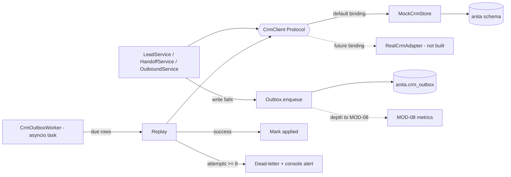

> **Lens:** PO / TPO (technical ACs) / Architect (HLD, LLD) · **Engagement:** Brownfield

# US-020 — Mock CRM store behind a swappable CRM interface [Lens: PO]

- **Story:** As an **ANITA business owner**, I want **lead and interaction data written through a CRM interface backed by our own local store**, so that **we carry no Salesforce dependency today, but can adopt a real CRM later without rewriting the product**.
- **Business value:** This is the seam the brief explicitly demanded (`BRD-14`). It removes 3,349 LOC of forbidden Salesforce client (`REC-06`) and replaces it with ~400 LOC we own, while keeping the option to buy a CRM open.
- **Priority:** **Must** — TPO ordering note: blocked by nothing in this module and blocking the handoff story (US-022) and the outbound story (US-021), because both write through this interface.

## Acceptance Criteria [Lens: PO]

```gherkin
Scenario: Lead written through the interface
  Given the CRM interface is bound to the mock store
  When the lead service writes a lead and an interaction
  Then both are committed to the anita schema
  And the caller used no Salesforce-specific concept, field or credential

Scenario: The CRM write fails
  Given the mock store is unreachable
  When a handoff record is written
  Then the buyer's conversation is unaffected and the buyer is still told a human will follow up
  And the write is queued for retry with the failure recorded
  And no part of the write is lost

Scenario: Queued writes replay after recovery
  Given three writes are queued with recorded failures
  When the store returns
  Then the worker replays them oldest-first with exponential backoff
  And a replayed write is applied once, never twice

Scenario: A write keeps failing
  Given a queued write that has failed eight times
  When the worker attempts it again
  Then it is moved to dead-letter
  And it appears on the ops console with its last error
  And it is never retried automatically again

Scenario: A real CRM is swapped in
  Given a second implementation of the CRM interface
  When it is bound at startup by configuration
  Then no caller in the codebase changes
```

Technical acceptance criteria [Lens: TPO]:

- **TAC-1:** A CI grep over the ANITA source tree finds **zero** occurrences of `CRM_BASE_URL`, `X-API-Key`, `salesforce`, `Salesforce`, `SOQL`, `crm_user_id`, `crm_application_no` or any `crm_*` column name (`REC-06` forbidden).
- **TAC-2:** The outbox `enqueue` never raises — a failure returns `False` and is logged, and the calling conversation path is unaffected.
- **TAC-3:** Replay is exactly-once-effective: an idempotency key on every op makes a duplicate replay a no-op (verified by replaying the same row twice and asserting one effect).
- **TAC-4:** Backoff follows 30 s, 2 m, 10 m, 30 m, 1 h, 2 h and caps at 8 attempts, then dead-letters (unit-tested against a frozen clock).
- **TAC-5:** Outbox depth and dead-letter count are exposed to MOD-08 within 60 s of a change.

## HLD — Architecture Slice [Lens: Architect]



- **Components touched:**
  - `MOD-06 CrmClient` — new `typing.Protocol`; the only CRM vocabulary any caller may use.
  - `MOD-06 MockCrmStore` — new: the default implementation against the `anita` schema.
  - `MOD-06 Outbox` — new: durable retry queue (the `REC-07` pattern, re-implemented).
  - `MOD-06 CrmOutboxWorker` — new asyncio task started from the FastAPI lifespan.
  - `MOD-09` — new setting `ANITA_CRM_BINDING` (default `mock`) selecting the implementation.
- **Interaction summary:**
  1. A service calls a `CrmClient` method; it never sees the store.
  2. The mock store executes the write in one transaction and returns a domain object.
  3. **Failure path:** the store raises `StoreUnavailable`; the service calls `Outbox.enqueue(op, payload, idempotency_key)` which commits the row and returns; the caller logs and continues.
  4. The worker polls every 60 s, reads due rows oldest-first, replays through the same `CrmClient`, and marks them applied.
  5. After 8 failed attempts the row is dead-lettered and surfaced on the console; it is never silently dropped.

## LLD — Implementation Detail [Lens: Architect]

- **Classes / functions / APIs:**

```python
# app/anita/crm/interface.py
class CrmClient(Protocol):
    def upsert_lead(self, ident: LeadIdentity, fields: LeadFields) -> LeadRef: ...
    def get_lead(self, lead_id: UUID) -> LeadRecord | None: ...
    def find_by_identifier(self, kind: Literal["phone","email"], value: str) -> LeadRecord | None: ...
    def append_interaction(self, lead_id: UUID, interaction: Interaction) -> None: ...
    def create_handoff(self, handoff: HandoffDraft) -> HandoffRef: ...
    def update_handoff(self, handoff_id: UUID, status: HandoffStatus, **fields) -> None: ...
    def erase_subject(self, lead_id: UUID, request: ErasureRequest) -> ErasureReport: ...

# app/anita/crm/mock_store.py
class MockCrmStore:                      # implements CrmClient
    def __init__(self, pool: ConnectionFactory, *, clock: Callable[[], datetime] = utcnow) -> None: ...

# app/anita/crm/outbox.py
SUPPORTED_OPS = frozenset({"lead_upsert","interaction_append","handoff_create",
                           "handoff_update","lead_erase"})
REPLAY_BACKOFF_S = (30, 120, 600, 1800, 3600, 7200)
MAX_ATTEMPTS = 8

def enqueue(op: str, payload: dict, *, idempotency_key: str, lead_id: UUID | None = None) -> bool: ...
def due(limit: int = 20) -> list[OutboxRow]: ...
def mark_applied(row_id: int) -> None: ...
def mark_failed(row_id: int, error: str, attempts: int) -> None: ...
def dead_letter(row_id: int, error: str) -> None: ...
def depth() -> OutboxDepth: ...          # {"pending": n, "dead": m}
def next_attempt_after(attempts: int, now: datetime) -> datetime: ...

# app/anita/crm/worker.py
class CrmOutboxWorker:
    def __init__(self, client: CrmClient, *, poll_interval: int = 60) -> None: ...
    async def start(self) -> None: ...
    async def stop(self) -> None: ...
    async def _tick(self) -> None: ...       # never lets a bad tick kill the loop
```

- **Data schema changes:**

```sql
CREATE TABLE IF NOT EXISTS anita.crm_outbox (
    id              BIGSERIAL PRIMARY KEY,
    op              VARCHAR(32) NOT NULL,          -- restricted to SUPPORTED_OPS
    lead_id         UUID,
    handoff_id      UUID,
    payload         JSONB NOT NULL,
    idempotency_key VARCHAR(160) NOT NULL,
    attempts        INTEGER NOT NULL DEFAULT 0,
    state           VARCHAR(16) NOT NULL DEFAULT 'PENDING'
        CHECK (state IN ('PENDING','APPLIED','DEAD')),
    next_attempt_at TIMESTAMPTZ NOT NULL DEFAULT NOW(),
    last_error      TEXT,
    created_at      TIMESTAMPTZ NOT NULL DEFAULT NOW(),
    UNIQUE (op, idempotency_key)
);

-- Partial index: only due, live rows are ever scanned (the REC-07 pattern).
CREATE INDEX IF NOT EXISTS ix_crm_outbox_due
    ON anita.crm_outbox(next_attempt_at)
    WHERE state = 'PENDING';
```

- **Edge cases** (each with the decided behaviour):
  1. **Enqueue itself fails (DB down)** → returns `False`; the caller logs; the write is lost by design and the loss is counted — the outbox must never raise into a conversation path.
  2. **Same op replayed twice (worker crash after apply, before marking)** → the `UNIQUE (op, idempotency_key)` plus an idempotent store write makes the second a no-op.
  3. **Out-of-order replay of a create and an update** → ops on the same lead are replayed in `id` order; an update for a lead the store has not seen is re-queued once, then dead-lettered with a clear reason.
  4. **Clock skew / row scheduled in the future** → `next_attempt_at` is computed from the DB clock (`NOW()`), never the app clock.
  5. **Store bindings change while rows are queued** → the worker resolves the binding per tick, so a queue drained after a swap goes to the new implementation.
  6. **Payload contains PII** → payload holds identifiers and structured fields only; transcript text is never queued (TAC-4 of US-019).
  7. **Dead-letter grows** → console alert at > 20 dead rows; ops may re-queue manually, and the re-queue is audited.

- **Error handling:**
  - `StoreUnavailable` — raised by the store, caught by `enqueue`'s caller; never escapes to the buyer.
  - `UnsupportedOp` — refused at enqueue with an error log; the op list is closed (the source's `SUPPORTED_OPS` lesson, `REC-07`).
  - `PermanentWriteError` (e.g. a constraint the payload violates) — not retried; dead-lettered immediately, because retrying a deterministic failure is how a naive outbox retry-storms.
  - `WorkerTickError` — caught per tick; the loop continues; the error is counted to MOD-08.

- **Test scenarios** (floor = the `UC-08`, `UC-09` and `UC-07` scenario rows that touch the CRM seam):
  - *Unit* — happy path: `MockCrmStore.upsert_lead` writes and returns a `LeadRef`.
  - *Unit* — retry: `next_attempt_after(2, now)` = `now + 120 s`; attempt 9 → dead-letter.
  - *Unit* — invalid input: `enqueue("bogus_op", …)` returns `False` and logs; nothing is written.
  - *Unit* — dependency failure: `enqueue` with a broken pool returns `False` and does not raise (TAC-2).
  - *Integration* — write failure path: forced store failure → row in `crm_outbox` with `state='PENDING'`, `last_error` set.
  - *Integration* — duplicate request: replay the same row twice → one effect (TAC-3).
  - *Integration* — retry: worker drains a due row and marks it `APPLIED`.
  - *Integration* — dead-letter: 8 failures → `state='DEAD'`, visible to the console query, no further automatic attempts.
  - *Integration* — concurrent operation: two workers running → each row applied exactly once (claim is `FOR UPDATE SKIP LOCKED` on the outbox too).
  - *Integration* — unauthorized user: no network route exists to the mock store; it is in-process only (route census).
  - *Integration* — partial completion: handoff row written, notification enqueue fails → handoff still `OPEN`, notification retried (`UC-07` E2).
  - *Integration* — recovery: worker restart resumes the queue (`UC-08` recovery row).
  - *Integration* — cancellation: an erased lead's queued writes are voided rather than replayed (no PII resurrected).
  - *E2E* — stop the mock store, complete a conversation with a handoff, restart the store → handoff and lead present within 60 s, buyer saw no error.
  - *Load* — 500 queued rows drained by one worker at 20 rows/tick with no row applied twice (TAC-5 window).

## Traceability
- Parent module: `MOD-06`
- Use cases: `UC-08`, `UC-09`, `UC-07` · technical requirement: `TRD-27`
- Business requirement: `BRD-14` (and the persistence half of `BRD-11`)
- Data gap / state machine: `DG-02` (mock CRM behind a swappable interface), `SM-01` (durability of the lead write)
- Reconciliation: `REC-06` (`forbidden` — `app/crm/` not carried), `REC-07` (`pattern-only` — outbox re-implemented), `REC-13` (DDL + graceful degradation reused)
- Data assets: `DAT-11` (mock CRM store), `DAT-08` (leads)

## Definition of Done
- [ ] All ACs pass (AC-1 … AC-5, TAC-1 … TAC-5)
- [ ] Tests from the LLD test scenarios pass, including replay-twice idempotency and the two-worker drain
- [ ] The forbidden-string CI grep (TAC-1) returns zero hits across the ANITA tree, fixtures and tests included
- [ ] Schema migration applied (`crm_outbox` + partial index)
- [ ] Outbox depth and dead-letter count visible to MOD-08
- [ ] Module docs updated if the `CrmClient` protocol changed
