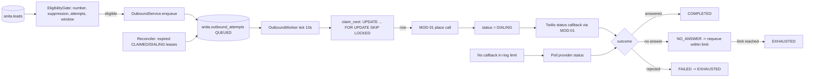

> **Lens:** PO / TPO (technical ACs) / Architect (HLD, LLD) · **Engagement:** Brownfield

# US-021 — Outbound queue and dialling worker [Lens: PO]

- **Story:** As a **sales rep**, I want **every lead that asked for a callback to be called back automatically, a bounded number of times and only during business hours**, so that **no enquiry goes cold and nobody is harassed**.
- **Business value:** `BRD-23` converts a captured lead into a conversation. Without it, an after-hours enquiry waits for a human to remember it — which is the gap the product exists to close.
- **Priority:** **Must** — TPO ordering note: depends on US-019 (leads) and US-020 (the write seam); must land before the sentiment escalation path is load-tested, because both compete for the same worker pool.

## Acceptance Criteria [Lens: PO]

```gherkin
Scenario: A callback-requested lead is called in hours
  Given a qualified lead with a reachable number who asked for a callback
  And the local time is 14:20 IST
  When the outbound worker ticks
  Then exactly one attempt row is claimed and a call is placed through MOD-01
  And the attempt is recorded against the lead
  And the lead status becomes CONTACT_ATTEMPTED

Scenario: Eligible lead outside the calling window
  Given a lead becomes eligible at 21:30 IST
  When the worker ticks
  Then no call is placed that night
  And the attempt is scheduled for after 10:00 IST the next day
  And the lead is not counted as exhausted

Scenario: Contact asks not to be called again
  Given a contact who says "stop calling me"
  When the turn is processed
  Then a suppression is recorded immediately
  And no further outbound attempt is ever created for that lead
  And the suppression is shown to the rep

Scenario: Attempt limit reached
  Given a lead with 3 recorded failed attempts
  When eligibility is evaluated
  Then no fourth attempt is created
  And the lead is marked EXHAUSTED and surfaced to the rep

Scenario: Two workers, one lead
  Given two outbound workers running against the same queue
  When both tick at the same instant
  Then the lead receives exactly one call
```

Technical acceptance criteria [Lens: TPO]:

- **TAC-1:** Claiming uses `SELECT … FOR UPDATE SKIP LOCKED`; a concurrency test with two real worker processes and 300 due rows produces **zero** duplicate dials and zero unclaimed rows.
- **TAC-2:** `UNIQUE (lead_id, attempt_no)` makes a duplicate attempt a database error, not a silent second call.
- **TAC-3:** The window is evaluated in `OUTBOUND_TIMEZONE` (`Asia/Kolkata`), never in UTC or host-local time; a DST-free zone is asserted at config load.
- **TAC-4:** A worker killed mid-`DIALING` leaves a row that the reconciler returns to `QUEUED` **with the attempt counted**, within 90 s of the lease lapsing.
- **TAC-5:** With the Twilio API unavailable, queue rows are retained and the worker does not spin — failures back off to the next tick.

## HLD — Architecture Slice [Lens: Architect]



- **Components touched:**
  - `MOD-06 OutboundService` — new: eligibility, enqueue, claim, outcome recording.
  - `MOD-06 OutboundWorker` — new asyncio task; `REC-12`'s polling-worker pattern, hardened with `SKIP LOCKED`.
  - `MOD-06 OutboundReconciler` — new: lease expiry + lost-callback reconciliation.
  - `MOD-01 Channel Gateway` — existing: receives the dial request; Twilio status callbacks arrive here and are forwarded.
  - `MOD-02` — existing: a suppression request detected in a turn reaches `OutboundService.suppress()`.
- **Interaction summary:**
  1. A lead becomes eligible (callback request, unanswered enquiry, or the outbound policy for a captured lead); the eligibility gate checks number, suppression, attempt count and window.
  2. An attempt row is inserted as `QUEUED` with `scheduled_at` at the next legal moment.
  3. The worker ticks every 10 s and claims one row atomically, transitioning it to `CLAIMED` then `DIALING`.
  4. MOD-01 places the call; the carrier callback returns the outcome, which is matched on `provider_call_sid`.
  5. **Failure path:** no callback inside the ring limit → poll provider status at 60 s and 5 min; if still unknown, `NO_ANSWER`, and the row is re-queued or exhausted per `R-6`.

## LLD — Implementation Detail [Lens: Architect]

- **Classes / functions / APIs:**

```python
# app/anita/outbound/service.py
@dataclass(frozen=True)
class Eligibility:
    ok: bool; reason: str; next_legal_at: datetime | None

class OutboundService:
    def evaluate(self, lead_id: UUID, now: datetime) -> Eligibility: ...
    def enqueue(self, lead_id: UUID, channel: str, reason: str, *, now: datetime | None = None) -> UUID: ...
    def claim_next(self, worker_id: str) -> AttemptRow | None: ...
    def mark_dialing(self, attempt_id: UUID, provider_call_sid: str) -> None: ...
    def record_outcome(self, provider_call_sid: str, outcome: str, detail: str = "") -> None: ...
    def suppress(self, lead_id: UUID, phone: str, reason: str, channel: str) -> None: ...
    def drain(self, reason: str) -> int: ...                      # campaign stop

# app/anita/outbound/window.py
def in_window(ts: datetime, tz: ZoneInfo, start: time, end: time) -> bool: ...
def next_window_open(ts: datetime, tz: ZoneInfo, start: time) -> datetime: ...

# app/anita/outbound/worker.py
class OutboundWorker:
    def __init__(self, svc: OutboundService, gateway: ChannelGateway, *,
                 poll_interval: int = 10, lease_s: int = 90) -> None: ...
    async def start(self) -> None: ...
    async def _tick(self) -> None: ...

# app/anita/outbound/reconciler.py
class OutboundReconciler:
    async def sweep(self) -> ReconcileReport: ...   # lease expiry; lost callbacks; poll provider
```

- **Data schema changes:**

```sql
-- Claim: one statement, two workers, no double dial (TAC-1, TAC-2).
UPDATE anita.outbound_attempts SET
    status           = 'CLAIMED',
    claimed_at       = NOW(),
    claimed_by       = %(worker_id)s,
    claim_expires_at = NOW() + INTERVAL '90 seconds'
WHERE id = (
    SELECT a.id
      FROM anita.outbound_attempts a
      JOIN anita.leads l ON l.id = a.lead_id
     WHERE a.status = 'QUEUED'
       AND a.scheduled_at <= NOW()
       AND l.status NOT IN ('SUPPRESSED','CLOSED','EXHAUSTED')
       AND NOT EXISTS (SELECT 1 FROM anita.suppressions s WHERE s.lead_id = a.lead_id)
       AND a.attempt_no <= a.max_attempts
     ORDER BY l.overall_sentiment_score DESC, a.scheduled_at, a.id
     FOR UPDATE OF a SKIP LOCKED
     LIMIT 1
)
RETURNING id, lead_id, attempt_no, channel;
```

```sql
-- Requeue a lapsed lease: the attempt is already counted (TAC-4, SM-04 #7).
UPDATE anita.outbound_attempts
   SET status = 'QUEUED', claimed_by = NULL, claim_expires_at = NULL,
       scheduled_at = NOW(), outcome_reason = 'lease_expired'
 WHERE status IN ('CLAIMED','DIALING')
   AND claim_expires_at < NOW();
```

- **Edge cases** (each with the decided behaviour):
  1. **Lead with a malformed number** → excluded at `enqueue` with `reason='unreachable'`; flagged on the lead for the rep; no row created.
  2. **Lead with no number at all** → never callable; surfaced to the rep as an incomplete lead.
  3. **Same lead queued twice for the same reason** → the second `enqueue` is a no-op if a `QUEUED`/`CLAIMED`/`DIALING` row exists; the unique `(lead_id, attempt_no)` is the backstop.
  4. **Contact answers and hangs up immediately** → `NO_ANSWER` with `outcome_reason='hung_up'`; counted as an attempt.
  5. **Carrier rejects the call** → `FAILED` → `EXHAUSTED` (a rejected dial is permanent for that number).
  6. **Carrier status callback lost** → poll at 60 s/5 min; on repeated failure the attempt is recorded `NO_ANSWER` and the reason is `status_unknown`.
  7. **Number present, name unknown** → the call is placed and the script addresses the contact generically.
  8. **Suppression recorded mid-campaign** → the claim statement's `NOT EXISTS` prevents a queued row from dialling.
  9. **Campaign stopped (ops action)** → `drain()` drops `QUEUED` rows and leaves an in-flight `DIALING` call to finish (`UC-09` cancellation).
  10. **Two channels eligible for one lead** → ONE attempt row per attempt number regardless of channel; the channel is a field, not a second queue.
  11. **Worker restart with rows in `CLAIMED`** → reconciler sweeps immediately on boot, before the first tick.

- **Error handling:**
  - `GatewayUnavailable` — the dial fails before any carrier call: the row returns to `QUEUED` with the attempt **not** counted (nothing was dialled) and `scheduled_at = now + 60 s`.
  - `CarrierRejected` — permanent; `FAILED` → `EXHAUSTED`.
  - `SuppressedLead` — raised by `enqueue`; callers treat it as an expected refusal (no error surfaced to the buyer).
  - `AttemptLimitReached` — raised by `enqueue`; the lead is marked `EXHAUSTED` and the caller logs an info-level event.
  - `LeaseExpired` — internal; the reconciler handles it, never the UI.

- **Test scenarios** (floor = every `✓` row of the `UC-09` Scenario Coverage table):
  - *Unit* — happy path: eligible lead inside the window → `enqueue` creates exactly one `QUEUED` row.
  - *Unit* — alternate A1: an answered call routes into the same engine as `UC-03` (asserted by the gateway call shape).
  - *Unit* — alternate A2: suppression written; `evaluate` returns `ok=False, reason='suppressed'` thereafter.
  - *Unit* — invalid input: malformed number → `reason='unreachable'`, no row.
  - *Unit* — unauthorized user: suppression list is consulted on every `evaluate` and inside the claim statement (belt and braces).
  - *Unit* — missing data: no number → not callable, surfaced to the rep.
  - *Unit* — partial data: number present, name empty → the dial payload carries a generic salutation.
  - *Integration* — duplicate request: two `enqueue` calls for the same lead → one row; `UNIQUE (lead_id, attempt_no)` enforced.
  - *Integration* — timeout: no callback within the ring limit → `NO_ANSWER` (TAC-5 path).
  - *Integration* — dependency failure: Twilio unavailable → rows retained, no spin (the worker's failure path backs off).
  - *Integration* — retry: `NO_ANSWER` at attempt 1 and 2 re-queues; attempt 3 → `EXHAUSTED` (`R-6`).
  - *Integration* — concurrent operation: two worker processes, 300 due rows → exactly 300 dials, zero duplicates (TAC-1).
  - *Integration* — cancellation: `drain()` drops queued rows; an in-flight `DIALING` row is untouched.
  - *Integration* — recovery: worker killed mid-`DIALING`; on restart the reconciler returns the row to `QUEUED` with the attempt counted (TAC-4).
  - *Integration* — partial completion: call placed, callback lost → provider poll reconciles to a terminal state; the lead is not left `DIALING`.
  - *Integration* — window: eligibility at 21:30 IST → `next_legal_at` is 10:00 IST the next day; no call that night.
  - *E2E* — a callback-requested lead is dialled, answered, and the conversation creates/updates the same lead.
  - *Load* — sustained: 300 attempts over one hour with poll interval 10 s → p95 claim latency < 50 ms, queue drains, no duplicate dials (TAC-1).

## Traceability
- Parent module: `MOD-06`
- Use case: `UC-09` · technical requirements: `TRD-29`, `TRD-30`
- Business requirement: `BRD-23`
- Data gap / state machine: `DG-04` (cadence + window defaults: 3 attempts, 10:00–19:00 IST), `DG-05` (no territory data — prioritise on sentiment/intent/recency), `SM-04` (#4 illegal transitions, #5 non-repeatable dial, #6 concurrency, #7 halfway stop, #8 resume, #10 timeout), `R-6`
- Reconciliation: `REC-12` (`refactor` — `call_queue` worker pattern, hardened with `FOR UPDATE SKIP LOCKED`)
- Data asset: `DAT-16` (outbound queue)

## Definition of Done
- [ ] All ACs pass (AC-1 … AC-5, TAC-1 … TAC-5)
- [ ] Tests from the LLD test scenarios pass, including the two-process 300-row concurrency test and the lease-expiry requeue
- [ ] Load test passed against TAC-1 (zero duplicate dials) and the claim-latency target
- [ ] Schema migration applied (`outbound_attempts` + indexes)
- [ ] Window evaluation verified against `Asia/Kolkata` at 09:59 / 10:00 / 18:59 / 19:00 / 21:30
- [ ] Module docs updated if the outbound contract changed
