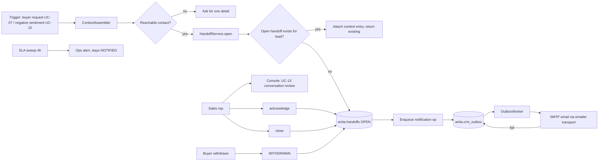

> **Lens:** PO / TPO (technical ACs) / Architect (HLD, LLD) · **Engagement:** Brownfield

# US-022 — Handoff records and sales-rep notification [Lens: PO]

- **Story:** As a **sales rep**, I want **a complete, contactable handoff record delivered to me whenever a buyer asks for a human or gets frustrated**, so that **I can pick up the conversation with the full context instead of starting cold**.
- **Business value:** `BRD-13` is the promise the whole product makes — a machine may decline, but a human always follows. It is also the mitigation for `AS-04` (buyers who distrust an assistant): the handoff is always one turn away.
- **Priority:** **Must** — TPO ordering note: depends on US-019 (a reachable lead) and US-020 (the outbox); it is the delivery half of MOD-07's escalation (`TRD-35` calls into this contract), so it must land before US-024 is integration-tested.

## Acceptance Criteria [Lens: PO]

```gherkin
Scenario: Buyer asks for a human on web chat
  Given a buyer with a linked lead and at least one product discussed
  When they type "can I speak to someone?"
  Then a handoff record is created with reason "buyer_request"
  And it carries the products discussed, the sentiment trail and the contact details
  And the buyer is told when to expect contact
  And the rep receives an email notification

Scenario: Buyer withdraws the request
  Given an open handoff for a lead
  When the buyer says "actually, don't worry about it"
  Then the handoff is marked WITHDRAWN
  And the rep is informed that it was withdrawn
  And no further notification is sent for it

Scenario: No way to reach the buyer
  Given a buyer on an anonymous web-chat session with no phone or email
  When they ask for a human
  Then the system asks for one contact detail before completing the handoff
  And if they decline, the handoff is recorded as incomplete with a reason
  And the buyer is still given the direct phone number as a fallback

Scenario: Rep notification fails
  Given the mail server is unreachable
  When a handoff is opened
  Then the handoff record exists and is visible to the rep in the console
  And the notification is queued and retried
  And the buyer is not told anything false

Scenario: The same buyer escalates twice from two channels
  Given an open handoff for a lead from web chat
  When the same lead escalates from WhatsApp
  Then exactly one open handoff exists
  And the second trigger is attached to it as an additional context entry
```

Technical acceptance criteria [Lens: TPO]:

- **TAC-1:** The handoff row commits **before** any notification attempt; a notification failure can never roll back or delay the record (verified by forcing SMTP failure and asserting the row exists).
- **TAC-2:** Opening a handoff is idempotent per lead while an `OPEN`/`NOTIFIED` record exists — a partial unique index enforces it at the database, not in application code.
- **TAC-3:** Notification delivery is an outbox op, so it retries with the shared backoff and is dead-lettered after 8 attempts with an ops alert.
- **TAC-4:** A handoff `NOTIFIED` but unacknowledged past the SLA (4 h) raises an ops alert and remains `NOTIFIED`; it is never auto-closed.
- **TAC-5:** Handoff write p95 < 120 ms; the buyer's "a person will follow up" message is emitted within the same turn as the trigger.

## HLD — Architecture Slice [Lens: Architect]



- **Components touched:**
  - `MOD-06 HandoffService` — new: `open`, `attach`, `acknowledge`, `close`, `withdraw`.
  - `MOD-06 NotificationDispatcher` — new: renders the handoff notification, enqueues through the outbox.
  - `MOD-06 emailer adapter` — reused **transport only** from `REC-20`; the university's offer-letter templates and copy are not carried.
  - `MOD-07 EscalationService` — existing caller (`TRD-35`).
  - `MOD-02` — existing caller for the buyer-request path; supplies the assembled conversation context.
  - `MOD-08` — new metric: handoff age, unacknowledged count.
- **Interaction summary:**
  1. A trigger arrives from `UC-07` (buyer request) or `UC-10` (negative sentiment).
  2. The context assembler collects transcript reference, products discussed, sentiment trail and contact details.
  3. If there is no reachable contact, the buyer is asked for one detail before the handoff completes.
  4. `open()` returns the existing open handoff if one exists (idempotent), otherwise inserts `OPEN`.
  5. A notification op is enqueued; the worker delivers it and marks the handoff `NOTIFIED`.
  6. **Failure path:** SMTP down → the op stays in the outbox and retries; the handoff remains `OPEN`, still visible to the rep in the console.

## LLD — Implementation Detail [Lens: Architect]

- **Classes / functions / APIs:**

```python
# app/anita/handoffs/service.py
class HandoffReason(str, Enum):
    BUYER_REQUEST = "buyer_request"
    NEGATIVE_SENTIMENT = "negative_sentiment"
    UNANSWERABLE = "unanswerable"
    CLINICAL = "clinical"
    CAPACITY = "capacity"

class HandoffStatus(str, Enum):
    OPEN = "OPEN"; NOTIFIED = "NOTIFIED"; ACKNOWLEDGED = "ACKNOWLEDGED"
    CLOSED = "CLOSED"; WITHDRAWN = "WITHDRAWN"

@dataclass(frozen=True)
class HandoffContext:
    conversation_id: UUID | None
    products_discussed: tuple[str, ...]
    sentiment_summary: dict
    objections: tuple[str, ...]
    contact_snapshot: dict          # masked in logs
    transcript_ref: str             # pointer, never the transcript body

class HandoffService:
    def open(self, lead_id: UUID, reason: HandoffReason, ctx: HandoffContext,
             *, sla_hours: int = 4) -> HandoffRef: ...
    def attach(self, handoff_id: UUID, entry: dict) -> None: ...
    def acknowledge(self, handoff_id: UUID, rep_id: str) -> None: ...
    def close(self, handoff_id: UUID, rep_id: str, resolution: str = "") -> None: ...
    def withdraw(self, handoff_id: UUID, source: str) -> None: ...
    def open_for_lead(self, lead_id: UUID) -> HandoffRef | None: ...
    def overdue(self, now: datetime | None = None) -> list[HandoffRef]: ...

class IllegalTransition(RuntimeError): ...

# app/anita/handoffs/notify.py
class NotificationDispatcher:
    def dispatch(self, handoff: HandoffRef) -> bool: ...     # enqueues; never sends inline
    def render_email(self, handoff: HandoffRef) -> EmailMessage: ...

# app/anita/handoffs/sla.py
class HandoffSlaSweeper:
    async def sweep(self) -> list[HandoffRef]: ...           # overdue -> ops alert, stays NOTIFIED
```

- **Data schema changes:**

```sql
CREATE TABLE IF NOT EXISTS anita.handoffs (
    id              UUID PRIMARY KEY,
    lead_id         UUID NOT NULL REFERENCES anita.leads(id) ON DELETE CASCADE,
    conversation_id UUID,
    reason          VARCHAR(32) NOT NULL
        CHECK (reason IN ('buyer_request','negative_sentiment','unanswerable','clinical','capacity')),
    status          VARCHAR(16) NOT NULL DEFAULT 'OPEN'
        CHECK (status IN ('OPEN','NOTIFIED','ACKNOWLEDGED','CLOSED','WITHDRAWN')),
    context         JSONB NOT NULL DEFAULT '{}',
    contact_snapshot JSONB NOT NULL DEFAULT '{}',
    sla_due_at      TIMESTAMPTZ NOT NULL,
    notified_at     TIMESTAMPTZ,
    acknowledged_at TIMESTAMPTZ,
    acknowledged_by VARCHAR(64),
    closed_at       TIMESTAMPTZ,
    closed_by       VARCHAR(64),
    created_at      TIMESTAMPTZ NOT NULL DEFAULT NOW()
);

-- AT MOST ONE open handoff per lead (TAC-2, SM-06 #6). A partial unique index
-- makes the application-level check a backstop rather than the guarantee.
CREATE UNIQUE INDEX IF NOT EXISTS ux_handoff_open_per_lead
    ON anita.handoffs(lead_id) WHERE status IN ('OPEN','NOTIFIED');

-- Transition guard: illegal transitions are impossible by construction (SM-06 #4).
CREATE OR REPLACE FUNCTION anita.handoff_transition() RETURNS trigger AS $$
BEGIN
  IF OLD.status = 'WITHDRAWN' AND NEW.status <> 'WITHDRAWN' THEN
    RAISE EXCEPTION 'illegal handoff transition WITHDRAWN -> %', NEW.status;
  END IF;
  IF OLD.status = 'CLOSED' AND NEW.status <> 'CLOSED' THEN
    RAISE EXCEPTION 'illegal handoff transition CLOSED -> %', NEW.status;
  END IF;
  IF OLD.status = 'OPEN' AND NEW.status = 'CLOSED' AND NEW.notified_at IS NULL THEN
    RAISE EXCEPTION 'illegal handoff transition OPEN -> CLOSED without a notification attempt';
  END IF;
  RETURN NEW;
END; $$ LANGUAGE plpgsql;
```

- **Edge cases** (each with the decided behaviour):
  1. **Unattached "operator" request on a silent channel** → the request is clarified before a handoff is opened; a bare keyword with no conversation context does not create a record.
  2. **Buyer supplies contact details during the handoff** → the lead is created/updated first (`US-019`), then the handoff references the now-complete lead.
  3. **Name known, phone missing** → the handoff is written and marked `context.incomplete=['phone']`; the rep sees the gap and the console offers the fallback number.
  4. **Buyer asks twice in one turn** → one handoff; the second request is an `attach` entry.
  5. **Handoff write times out** → one retry; on second failure the escalation is enqueued in the outbox and the buyer is still told a human will follow up.
  6. **CRM/store unavailable** → outbox path (`US-020`); the buyer-visible message is unchanged.
  7. **SMTP rejects the notification** → the op retries; the handoff stays `OPEN` and appears in the console's unacknowledged list.
  8. **Two channels escalate the same lead concurrently** → the partial unique index makes one insert win; the loser catches `UniqueViolation` and attaches to the winner.
  9. **Buyer withdraws after the rep acknowledged** → allowed (`NOTIFIED → WITHDRAWN`, `ACKNOWLEDGED → WITHDRAWN`); the rep is told.
  10. **Buyer withdraws after close** → refused; the record is terminal (`SM-06` #4).
  11. **Handoff opens for an erased lead** → refused with `LeadErased`; an erasure request supersedes an escalation, and the buyer is given the direct phone number instead.
  12. **Rep never acknowledges** → SLA sweep alerts ops at 4 h; the record never auto-closes and never silently disappears.

- **Error handling:**
  - `IllegalTransition` — raised before the DB, mirroring the trigger; the caller is a bug if it hits this.
  - `LeadErased` — expected refusal; the caller routes the buyer to the phone-number fallback.
  - `ContextIncomplete` — not an error: a flag on the handoff with the missing fields listed.
  - `NotificationError` — swallowed into an outbox row; never surfaces to the buyer.
  - `StoreUnavailable` — escalates to the outbox; the buyer message is still emitted.

- **Test scenarios** (floor = every `✓` row of the `UC-07` Scenario Coverage table):
  - *Unit* — happy path: `open()` inserts `OPEN` with `sla_due_at = now + 4 h` and a full context.
  - *Unit* — alternate A1: contact details supplied during handoff → lead upsert called before `open()`.
  - *Unit* — invalid input: unattached "operator" request → clarified, no row.
  - *Unit* — unauthorized user: the buyer path is public by design; the rep-side transition APIs require an admin/rep identity (`DG-06`, CV-03 split).
  - *Unit* — missing data (E1): no reachable contact → the buyer is asked once; if still absent, the handoff is `incomplete` and the fallback number is given.
  - *Unit* — partial data: name known, phone missing → `context.incomplete=['phone']`.
  - *Integration* — duplicate request: two triggers → one open handoff, second is an `attach` (TAC-2).
  - *Integration* — timeout: forced store delay past the timeout → one retry, then outbox.
  - *Integration* — dependency failure: mock store down → record queued, buyer message still emitted (`UC-07` E2).
  - *Integration* — retry: notification op fails, worker replays, handoff becomes `NOTIFIED`.
  - *Integration* — concurrent operation: web-chat and WhatsApp escalations for one lead in parallel → exactly one open handoff (partial unique index).
  - *Integration* — cancellation: buyer withdraws → `WITHDRAWN`, rep informed, no further notifications.
  - *Integration* — recovery: failed handoff write replayed from the outbox after restart.
  - *Integration* — partial completion: handoff written, notification failed → notification retried, record untouched (TAC-1).
  - *Integration* — SLA: `NOTIFIED` at `now - 5 h` → `overdue()` returns it, an alert is emitted, status stays `NOTIFIED` (TAC-4).
  - *Integration* — erasure interaction: handoff for an erased lead is refused with `LeadErased`.
  - *E2E* — buyer asks for a human on WhatsApp → record, notification, console visibility, rep acknowledge, close.
  - *Load* — burst of 200 handoffs in 60 s (5× the assumed daily volume) → p95 write < 120 ms, every record present, no duplicate open handoffs (TAC-5).

## Traceability
- Parent module: `MOD-06`
- Use case: `UC-07` · technical requirement: `TRD-31`
- Business requirement: `BRD-13`
- Data gap / state machine: `DG-12` (rep notification defaults to SMTP email), `DG-11` (erasure supersedes escalation), `SM-06` (#4 illegal transitions, #5 terminal states, #6 concurrency dedupe, #7 halfway stop, #8 SLA age, #9 withdraw, #10 timeout)
- Reconciliation: `REC-07` (`pattern-only` — notification uses the outbox pattern), `REC-20` (`emailer.py` survives as the notification transport only)
- Data asset: `DAT-10` (handoff records)

## Definition of Done
- [ ] All ACs pass (AC-1 … AC-5, TAC-1 … TAC-5)
- [ ] Tests from the LLD test scenarios pass, including the two-channel concurrent escalation and the SMTP-down record-first assertion
- [ ] Load/burst test passed: 200 handoffs in 60 s, p95 < 120 ms (TAC-5)
- [ ] Schema migration applied (`handoffs` + partial unique index + transition trigger)
- [ ] Rep notification rendered and delivered end-to-end to a real SMTP inbox in a staging run
- [ ] Module docs updated if the `HandoffService` contract changed
