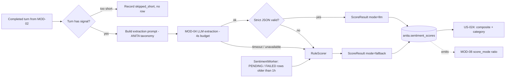

> **Lens:** PO / TPO (technical ACs) / Architect (HLD, LLD) · **Engagement:** Brownfield

# US-023 — Score every conversation turn, with a fallback that always works [Lens: PO]

- **Story:** As a **product owner at ANITA**, I want **every buyer turn read for sentiment, buying intent and objections — even when the language model is unavailable**, so that **we never lose the signal that a buyer is frustrated or ready to buy, and the escalation path can never be switched off by an outage**.
- **Business value:** `BRD-15` and `BRD-17` are the inputs to the sales follow-up: the rep sees "frustrated, price objection, high intent" instead of a transcript. The fallback is what keeps the North Star metric alive during a GPU outage.
- **Priority:** **Must** — TPO ordering note: this is the first MOD-07 story; the composite and escalation (US-024) cannot be built or tested without the score row it produces.

## Acceptance Criteria [Lens: PO]

```gherkin
Scenario: A normal turn is scored
  Given a completed turn from a web-chat conversation
  When the sentiment scorer processes it
  Then a score row exists with an emotion, a sentiment score, a buying-intent score and a friction score
  And any objections are recorded as structured labels
  And the row records that it was scored by the language model

Scenario: The language model is unavailable
  Given the inference backend is down or exceeds its 4 second budget
  When a turn is scored
  Then a score row still exists, marked as scored by the fallback
  And the fallback detects an obvious frustration phrase such as "third time I'm asking"
  And a price objection is still captured as a structured label

Scenario: A near-empty turn
  Given a buyer whose whole turn is "ok"
  When the scorer evaluates it
  Then no score row is written
  And no escalation candidate is produced
  And the turn is recorded as skipped for being too short

Scenario: Re-scoring a turn
  Given a turn that already has a score row
  When it is scored again
  Then a new row is written
  And the previous row is unchanged
```

Technical acceptance criteria [Lens: TPO]:

- **TAC-1:** The extraction response is validated against a strict JSON contract; any missing field, parse error or out-of-range value is treated as an LLM failure and routed to the fallback — a partly-applied extraction must never be persisted.
- **TAC-2:** Fallback scoring is stdlib-only, performs no network or GPU work, and completes in p95 ≤ 5 ms.
- **TAC-3:** Every row stores `score_mode` (`llm` | `fallback`), `model_version` and `weights_used`, so any historical score can be explained.
- **TAC-4:** No transcript text beyond 500 characters is persisted in the score row, and no buyer identifier appears in `extraction_raw` (PII, `DG-11`).
- **TAC-5:** Scoring never blocks the answer: it runs after the turn is committed, and a scoring failure of any kind leaves the conversation working.

## HLD — Architecture Slice [Lens: Architect]



- **Components touched:**
  - `MOD-07 SentimentScorer` — new: prompt assembly, strict-JSON validation, clamping.
  - `MOD-07 RuleScorer` — new: stdlib lexicon fallback for the product-enquiry domain.
  - `MOD-07 SentimentWorker` — new: drains `PENDING`/`FAILED` rows, ages stale ones to `FALLBACK`.
  - `MOD-04 Inference` — existing: serves the extraction call; may be absent (`DG-03`).
  - `MOD-02` — existing call site after the turn commits.
  - `MOD-08` — new counters: `score_mode` ratio, pending age, skip count.
- **Interaction summary:**
  1. MOD-02 commits the turn and calls `SentimentScorer.score_turn(turn)` off the answer path.
  2. The scorer rejects a near-empty turn and returns `skipped_short`.
  3. Otherwise it builds the ANITA extraction prompt and calls MOD-04 with a 4 s budget.
  4. A valid strict-JSON response becomes an `llm` row; a parse error, timeout or backend error goes to `RuleScorer` and becomes a `fallback` row.
  5. **Failure path:** if even the fallback cannot run (an unexpected exception), the row is written `FAILED` and retried by the worker up to 3 times before a zero-score `FALLBACK` row is written so the turn is still counted.

## LLD — Implementation Detail [Lens: Architect]

- **Classes / functions / APIs:**

```python
# app/anita/sentiment/models.py
PrimaryEmotion = Literal["excited","interested","neutral","skeptical",
                         "frustrated","angry","confused"]
ObjectionLabel  = Literal["price","delivery","specification","moq",
                          "aftersales","trust","timeline","competitor","other"]

@dataclass(frozen=True)
class ScoreResult:
    s_call: float                       # [-1, 1]
    primary_emotion: PrimaryEmotion
    buying_intent_score: float          # [0, 1]
    friction_score: float               # [0, 1]
    objections: tuple[ObjectionLabel, ...]
    bant: dict[str, str | None]
    score_mode: Literal["llm", "fallback"]
    model_version: str
    raw: dict                           # LLM response, PII-scrubbed before storage

# app/anita/sentiment/scorer.py
EXTRACTION_TIMEOUT_S = 4.0
MIN_SIGNAL_CHARS = 12

def has_signal(text: str) -> bool: ...
def build_prompt(turn_text: str, *, products: Sequence[str]) -> str: ...
def parse_extraction(raw: str) -> ScoreResult: ...          # raises ExtractionInvalid
async def score_turn(turn: TurnRef) -> ScoreOutcome: ...    # "scored" | "skipped_short" | "failed"
async def score_transcript(text: str, *, lead_id: UUID | None) -> ScoreResult: ...

# app/anita/sentiment/rules.py
class RuleScorer:                                           # stdlib only (TAC-2)
    FRUSTRATION = ("third time", "no one", "nobody", "forget it", "useless", "again and again")
    NEGATIVE    = ("too expensive","costly","overpriced","late","delay","wrong","broken","not working")
    INTENT      = ("need it by","urgent","send the quote","place an order","moq","how soon","can you ship")
    PRICE_TERMS = ("price","cost","rate","quotation","quote","discount")
    DELIVERY    = ("delivery","dispatch","shipping","lead time","how long")
    def score(self, text: str) -> ScoreResult: ...

# app/anita/sentiment/worker.py
class SentimentWorker:
    def __init__(self, *, poll_interval: int = 30, max_age_s: int = 3600) -> None: ...
    async def start(self) -> None: ...
    async def _tick(self) -> None: ...   # retry FAILED, age PENDING > 1h to FALLBACK
```

- **Data schema changes:**

```sql
CREATE TABLE IF NOT EXISTS anita.sentiment_scores (
    id                 UUID PRIMARY KEY,
    lead_id            UUID REFERENCES anita.leads(id) ON DELETE CASCADE,
    conversation_id    UUID,
    turn_id            UUID,
    s_call             DOUBLE PRECISION NOT NULL DEFAULT 0.0,
    primary_emotion    VARCHAR(64) DEFAULT 'neutral',
    buying_intent_score DOUBLE PRECISION DEFAULT 0.0,
    friction_score     DOUBLE PRECISION DEFAULT 0.0,
    objections         JSONB NOT NULL DEFAULT '[]',
    bant               JSONB NOT NULL DEFAULT '{}',
    score_mode         VARCHAR(16) NOT NULL DEFAULT 'llm'
        CHECK (score_mode IN ('llm','fallback')),
    status             VARCHAR(16) NOT NULL DEFAULT 'PENDING'
        CHECK (status IN ('PENDING','SCORED','FALLBACK','FAILED')),
    extraction_raw     JSONB DEFAULT '{}',
    model_version      VARCHAR(64) DEFAULT '',
    weights_used       JSONB DEFAULT '{}',
    transcript_snippet VARCHAR(500) DEFAULT '',
    created_at         TIMESTAMPTZ NOT NULL DEFAULT NOW()
);
CREATE INDEX IF NOT EXISTS ix_sentiment_lead_latest ON anita.sentiment_scores(lead_id, created_at DESC);
CREATE INDEX IF NOT EXISTS ix_sentiment_retry ON anita.sentiment_scores(created_at) WHERE status IN ('PENDING','FAILED');
```

- **Edge cases** (each with the decided behaviour):
  1. **Turn below `MIN_SIGNAL_CHARS` or containing only stopwords** → `skipped_short`; no row; no escalation candidate (`M7-2`).
  2. **LLM returns valid JSON with an unknown emotion value** → treated as invalid → fallback; the raw value is kept in `extraction_raw`.
  3. **LLM returns numbers outside the permitted ranges** → values are clamped only when within a small epsilon; otherwise invalid → fallback (clamping a wildly wrong number would fabricate a score).
  4. **Extraction prompt includes a buyer-supplied product name** → the prompt is built from the retrieved catalogue names, not from raw buyer text, so no injection surface is created via the product list.
  5. **Transcript contains an email or phone** → scrubbed from `extraction_raw` and from the 500-character snippet before storage (TAC-4).
  6. **Turn is in a language other than English** → the LLM path may still score it; the fallback returns `neutral` with `objections=[]`. The MVP is English-only (`00-product-intent.md` §5); the row records the detected language so the gap is measurable rather than invisible.
  7. **Scorer is called twice for one turn** → a second row is written (`SM-03` #5); the composite recomputes from history, never mutates.
  8. **Worker is disabled** → the turn still scores inline; the worker only drains stragglers.
  9. **`lead_id` is null (anonymous session)** → the score row is still written with a null lead; it is not attached to any composite and is used only for aggregate adoption metrics.

- **Error handling:**
  - `ExtractionInvalid` — the LLM's response failed the contract; logged with the response, routed to the fallback.
  - `ExtractionTimeout` — MOD-04 exceeded 4 s; routed to the fallback; counted against the fallback ratio.
  - `BackendUnavailable` — MOD-04 unreachable; routed to the fallback.
  - `ScoreWriteFailed` — the row could not be persisted; retried once, then raised to the worker's retry queue; the conversation is unaffected (TAC-5).
  - `ShortTurnSkipped` — not an error; an outcome with a reason.

- **Test scenarios** (floor = every `✓` row of the `UC-10` Scenario Coverage table that this story owns; escalation rows belong to US-024):
  - *Unit* — happy path: a clear interest turn → `llm` row with `buying_intent_score > 0.5` and no objections.
  - *Unit* — invalid input: `has_signal("ok")` is `False` → `skipped_short`, no row.
  - *Unit* — dependency failure: backend stub raises → fallback row with `score_mode='fallback'`.
  - *Unit* — timeout: backend stub sleeps 5 s → fallback row, fallback ratio incremented.
  - *Unit* — malformed JSON: response `"not json"` → `ExtractionInvalid` → fallback, raw preserved.
  - *Unit* — out-of-range: `sentiment_score = 4.2` → invalid → fallback (no clamping of a wild value).
  - *Unit* — fallback detection: "this is the third time I'm asking" → `friction_score ≥ 0.5` and `primary_emotion` in (`frustrated`,`angry`).
  - *Unit* — fallback objection: "your price is too high" → `objections` contains `price`.
  - *Unit* — PII scrub: a turn containing a phone and an email → neither appears in `extraction_raw` or `transcript_snippet`.
  - *Integration* — unauthorized user: scoring is in-process only; no route exposes it.
  - *Integration* — retry: a `FAILED` row is retried by the worker and becomes `FALLBACK` after the retry budget.
  - *Integration* — recovery: backend returns after an outage → the next turn scores `llm` again; historical fallback rows are untouched (`SM-03` #4).
  - *Integration* — concurrent operation: two turns for one lead scored in parallel → two rows, both valid, neither lost (`SM-03` #6 is exercised fully in US-024).
  - *Integration* — partial completion: score written, composite update fails → the composite job re-derives on next boot (`SM-03` #7, verified in US-024).
  - *Integration* — re-score: scoring the same turn twice yields two rows and an unchanged first row (`M7-3`).
  - *E2E* — a full WhatsApp conversation where the LLM is stopped mid-conversation → every turn still has a score row, half marked `fallback`, and the console shows the fallback ratio rising.
  - *Load* — 200 turns scored where the LLM is unavailable: fallback p95 ≤ 5 ms and zero rows lost (TAC-2).

## Traceability
- Parent module: `MOD-07`
- Use case: `UC-10` · technical requirements: `TRD-32`, `TRD-33`
- Business requirement: `BRD-15`, `BRD-17`
- Data gap / state machine: `DG-03` (no LLM fallback in the source — this story supplies one), `DG-11` (PII scrubbing and erasure interaction), `SM-03` (#3 PENDING→SCORED/FALLBACK/FAILED, #5 re-score creates a row, #8 retry and 1 h age, #9 closed conversation still scored)
- Reconciliation: `REC-05` (`refactor` — `app/sentiment/` re-targeted: taxonomy and prompt change, architecture carried), `REC-13` (DDL pattern)
- Data asset: `DAT-09` (sentiment scores)

## Definition of Done
- [ ] All ACs pass (AC-1 … AC-4, TAC-1 … TAC-5)
- [ ] Tests from the LLD test scenarios pass, including malformed-JSON, out-of-range and PII-scrub cases
- [ ] Load test passed: fallback p95 ≤ 5 ms over 200 turns with the LLM unavailable (TAC-2)
- [ ] Schema migration applied (`sentiment_scores` with `score_mode`, `status`, retry index)
- [ ] The admissions taxonomy is verifiably absent: no prompt string, fixture or lexicon entry references courses, fees or scholarships
- [ ] Module docs updated if the `ScoreResult` contract changed
