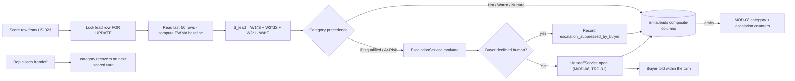

> **Lens:** PO / TPO (technical ACs) / Architect (HLD, LLD) · **Engagement:** Brownfield

# US-024 — Lead composite, category and same-turn escalation [Lens: PO]

- **Story:** As a **sales rep**, I want **a lead's score to accumulate across turns and channels, and a frustrated buyer to be escalated to me inside the same turn**, so that **I can intervene while the buyer is still in the conversation instead of reading about the lost lead tomorrow**.
- **Business value:** `BRD-16` and objective `O-4`. "Negative-sentiment handoff within 1 turn" is a launch guardrail; a nightly batch would miss it entirely. The composite and category are also what makes a lead prioritised rather than merely listed.
- **Priority:** **Must** — TPO ordering note: depends on US-023 (score rows) and US-022 (the handoff contract); it is the last MOD-07 story because it is the integration point for both.

## Acceptance Criteria [Lens: PO]

```gherkin
Scenario: Frustration escalates within the turn
  Given a lead with a neutral history on web chat
  When the buyer writes "this is the third time I'm asking, forget it"
  Then the lead's category becomes At-Risk
  And a handoff is opened with reason "negative_sentiment" before the buyer's next message
  And the buyer is told a person will follow up

Scenario: The composite accumulates across channels and days
  Given a lead with two positive turns from WhatsApp yesterday
  When the same lead has a negative turn on a voice call today
  Then the lead's composite score reflects both, weighted toward the newer turn
  And the trajectory shows the decline
  And the score row records the weights that were used

Scenario: The buyer declines a human
  Given a negative turn that crosses the threshold
  When the buyer says "no, don't call anyone, I'll manage"
  Then the escalation decision is recorded on the score row
  And no handoff is opened
  And the buyer's choice is respected on subsequent turns unless the sentiment worsens

Scenario: Repeated negative turns
  Given an open handoff from a negative turn
  When two more negative turns arrive
  Then exactly one open handoff exists
  And the later turns are attached to it as additional evidence

Scenario: The buyer's issue is resolved
  Given an open escalation for a lead
  When subsequent turns score positively and the rep closes the handoff
  Then the lead's category recovers on the next scored turn
  And the closed handoff is not reopened by history
```

Technical acceptance criteria [Lens: TPO]:

- **TAC-1:** The composite is computed under a `SELECT … FOR UPDATE` row lock on the lead, so two concurrent turns cannot interleave the EWMA (`SM-03` #6); a concurrency test with 20 parallel turns asserts a deterministic, ordered composite.
- **TAC-2:** The escalation decision reads committed rows only and is emitted within the same turn as the trigger; the buyer-visible message is emitted within that turn's response.
- **TAC-3:** `weights_used` and `model_version` are frozen onto every score row, so a historical composite is reproducible from the rows plus the recorded weights.
- **TAC-4:** Escalation is idempotent per lead: no sequence of concurrent triggers produces more than one open handoff (`SM-06` #6).
- **TAC-5:** With the composite unable to update (DB error), the escalation decision degrades conservatively: a turn whose `s_call` alone is below the threshold still escalates rather than silently skipping.

## HLD — Architecture Slice [Lens: Architect]



- **Components touched:**
  - `MOD-07 CompositeService` — new: EWMA baseline, weighted composite, category precedence, lead-column write.
  - `MOD-07 EscalationService` — new: pure `evaluate()` + side-effecting `escalate()`.
  - `MOD-06 HandoffService` — existing: `open()` is the escalation's write (`TRD-31`).
  - `MOD-06 leads` — existing: five composite columns written in the same transaction as the score row's `s_lead`.
  - `MOD-08` — new counters: category distribution, escalation count and trigger reason, trajectory mix.
- **Interaction summary:**
  1. A score row lands (US-023) and the composite service takes the lead row lock.
  2. The EWMA baseline is computed from the last 50 score rows; `ΔS` is derived from it.
  3. The weighted composite produces `S_lead`; the categoriser applies its precedence to give Hot / Warm / Nurture / At-Risk / Disqualified.
  4. The lead's composite columns are written in the same transaction.
  5. `EscalationService.evaluate` decides from the committed values; if the trigger fires and the buyer has not declined a human, `HandoffService.open` is called — idempotent per lead.
  6. **Failure path:** if the composite write fails, the escalation decision still runs on `s_call` alone (conservative degradation, TAC-5) and the lead columns are re-derived by the composite job on the next boot (`SM-03` #7).

## LLD — Implementation Detail [Lens: Architect]

- **Classes / functions / APIs:**

```python
# app/anita/sentiment/composite.py
W1, W2, W3, W4 = (0.30, 0.30, 0.25, 0.15)          # SENTIMENT_W1..W4 defaults
EWMA_LAMBDA     = 0.35                              # SENTIMENT_EWMA_LAMBDA
HISTORY_LIMIT   = 50

@dataclass(frozen=True)
class LeadComposite:
    s_lead: float; delta_s: float | None; trajectory: str
    category: str; p_convert: float | None; weights: dict[str, float]

def ewma_baseline(rows: Sequence[float], lam: float = EWMA_LAMBDA) -> float: ...
def intent_score(bant: dict, buying_intent_score: float) -> float: ...
def composite(s_call: float, baseline: float | None, intent: float, friction: float,
              *, w: tuple[float, float, float, float] = (W1, W2, W3, W4)) -> float: ...
def trajectory(delta_s: float | None, history: Sequence[float]) -> str: ...

# app/anita/sentiment/categorizer.py  (REC-05, retained precedence)
def categorize(s_lead: float, delta_s: float | None, p_convert: float | None,
               friction: float, trajectory: str, objections: Sequence[str],
               buying_intent: float) -> str: ...   # Hot|Warm|Nurture|At-Risk|Disqualified

# app/anita/sentiment/service.py
class CompositeService:
    def recompute(self, lead_id: UUID) -> LeadComposite: ...     # takes the lead row lock
    def latest(self, lead_id: UUID) -> ScoreRow | None: ...
    def repair_missing(self, limit: int = 200) -> int: ...       # SM-03 #7

# app/anita/sentiment/escalation.py
NEGATIVE_THRESHOLD = -0.20          # NEGATIVE_ESCALATION_THRESHOLD

@dataclass(frozen=True)
class EscalationDecision:
    should_escalate: bool; reason: str; suppressed_by_buyer: bool

class EscalationService:
    def evaluate(self, lead_id: UUID, comp: LeadComposite, row: ScoreRow) -> EscalationDecision: ...
    def escalate(self, lead_id: UUID, decision: EscalationDecision, ctx: HandoffContext) -> HandoffRef | None: ...
```

- **Data schema changes:**

```sql
-- Category precedence is data, not code (REC-05 categorizer.py retained as the
-- reference implementation; the thresholds live in configuration so the PO can tune).
-- config/anita.yaml
sentiment:
  w1: 0.30
  w2: 0.30
  w3: 0.25
  w4: 0.15
  ewma_lambda: 0.35
  negative_escalation_threshold: -0.20
  hot_min_s_lead: 0.70
  hot_min_p_convert: 0.55
  at_risk_delta: -0.35
  disqualified_max: -0.20

-- The composite columns written in the same transaction as the score row:
UPDATE anita.leads SET
    current_category        = %(category)s,
    overall_sentiment_score = %(s_lead)s,
    sentiment_trajectory    = %(trajectory)s,
    conversion_probability  = %(p_convert)s,
    last_sentiment_at       = NOW(),
    updated_at              = NOW()
WHERE id = %(lead_id)s;
```

- **Edge cases** (each with the decided behaviour):
  1. **First-ever turn for a lead** → `ΔS` is `null`; the composite uses `S_latest` and intent only; the trajectory is `Stable` (`SM-03` #3).
  2. **Category precedence conflict (Hot criteria met *and* a sharp drop)** → At-Risk wins: the precedence is ordered and the risk signal dominates (`REC-05` categorizer order retained).
  3. **High buying intent with a price objection** → **Warm**, not Disqualified: a hard objection with high intent is interest, not rejection (the source's rule, retained — the domain changes but the logic is sound).
  4. **`P_convert` is `NULL`** (fewer than 100 labelled outcomes) → the Hot path degrades to `S_lead ≥ 0.70 AND ΔS > 0`; the console shows the degraded reason so the difference is visible.
  5. **Two turns scored concurrently** → the lead row lock serialises the composites; both score rows persist; the EWMA order matches the row order (TAC-1).
  6. **No contactable identity on the lead** → the escalation is still recorded as a handoff with `context.incomplete` (`UC-10` missing-data row); the rep sees it, the buyer is not promised a callback.
  7. **Score present but objections absent** → escalation proceeds on the score alone (`UC-10` partial-data row).
  8. **Buyer declines a human** → `escalation_suppressed_by_buyer = TRUE` on the row; no handoff; if a later turn's `S_lead` drops further by more than 0.15 below the decline point, the suppression expires and escalation fires (the buyer's choice is respected, not weaponised against them).
  9. **Lead erased between scoring and escalation** → `HandoffService.open` raises `LeadErased`; the decision is logged and dropped; no PII resurfaces.
  10. **Rep closes the handoff while a negative turn is in flight** → the new turn may open a **new** handoff (the previous is terminal); this is correct — a fresh negative signal after resolution is a fresh escalation (`SM-06` #5).

- **Error handling:**
  - `CompositeWriteFailed` — the score row exists but the lead columns did not update; `repair_missing()` re-derives on boot (`SM-03` #7); escalation still evaluates from the row (TAC-5).
  - `LeadErased` — expected refusal from `open()`; logged, never surfaced to the buyer.
  - `HandoffOpenFailed` — routed into MOD-06's outbox; the buyer is still told a human will follow up (`UC-10` E2).
  - `IllegalTransition` — from a rep-side action; surfaced to the console, never to the buyer.

- **Test scenarios** (floor = every `✓` row of the `UC-10` Scenario Coverage table):
  - *Unit* — happy path: `S_lead` computed from a negative turn with a neutral baseline → category `At-Risk`.
  - *Unit* — formula: `composite(0.6, 0.5, 0.8, 0.1)` equals the documented weighted result to 3 decimals.
  - *Unit* — EWMA: 5 known `s_call` values with `λ=0.35` → baseline matches the hand-computed value.
  - *Unit* — categoriser precedence: Disqualified beats At-Risk beats Hot beats Warm beats Nurture.
  - *Unit* — high intent + price objection → `Warm` (not Disqualified).
  - *Unit* — first turn: `ΔS is None` → no crash, trajectory `Stable`.
  - *Integration* — alternate A1: negative turn + buyer declines → `escalation_suppressed_by_buyer` set, no handoff row created.
  - *Integration* — unauthorized user: escalation is in-process; the rep-side handoff transitions are authenticated (CV-03).
  - *Integration* — missing data: lead with no phone/email → handoff recorded with `context.incomplete`, no callback promise.
  - *Integration* — partial data: score present, objections empty → escalation on score alone.
  - *Integration* — duplicate request: three negative turns in a row → one open handoff, two attached evidence entries (TAC-4).
  - *Integration* — timeout/retry: handoff write fails once → outbox retry succeeds; exactly one handoff.
  - *Integration* — dependency failure: LLM down → fallback score still crosses the threshold → escalation fires (`UC-10` E1, end to end).
  - *Integration* — concurrent operation: two negative turns escalated in parallel → one handoff (partial unique index).
  - *Integration* — cancellation: buyer resolves and the rep closes → the next positive turn restores the category; the closed handoff is not reopened.
  - *Integration* — recovery: scorer back online → next turn scores `llm`; the composite continues from history without a discontinuity except the recorded `model_version`.
  - *Integration* — partial completion: handoff recorded, rep notification failed → retried via outbox; handoff stays `OPEN` (`US-022` TAC-1).
  - *E2E* — a buyer with a positive history turns hostile on a voice call → category At-Risk, handoff opened, rep emailed, all inside the same call turn.
  - *Load* — 20 concurrent turns for one lead → deterministic ordered composite, no lost rows, p95 composite+category < 50 ms, lead lock hold < 50 ms (TAC-1).

## Traceability
- Parent module: `MOD-07`
- Use case: `UC-10` · technical requirements: `TRD-34`, `TRD-35`
- Business requirement: `BRD-15`, `BRD-16`, `BRD-17`
- Data gap / state machine: `DG-03` (escalation must survive an LLM outage), `DG-05` (prioritisation on sentiment/intent/recency), `SM-03` (#5 re-score, #6 concurrency, #7 halfway stop, #10 timeout), `SM-06` (#5 terminal states, #6 dedupe), `R-5`
- Reconciliation: `REC-05` (`refactor` — categorizer precedence and weighted composite retained from `app/sentiment/`)
- Data assets: `DAT-09` (sentiment scores), `DAT-08` (lead composite columns), `DAT-10` (handoffs)

## Definition of Done
- [ ] All ACs pass (AC-1 … AC-5, TAC-1 … TAC-5)
- [ ] Tests from the LLD test scenarios pass, including the 20-way concurrency ordering test and the buyer-declines-human path
- [ ] Load test passed: p95 composite+category < 50 ms, lead lock hold < 50 ms (TAC-1)
- [ ] Schema migration applied (composite columns + `escalation_suppressed_by_buyer`)
- [ ] Same-turn escalation verified on a real voice call: handoff row exists before the buyer's next utterance
- [ ] Module docs updated if the composite or escalation contract changed
